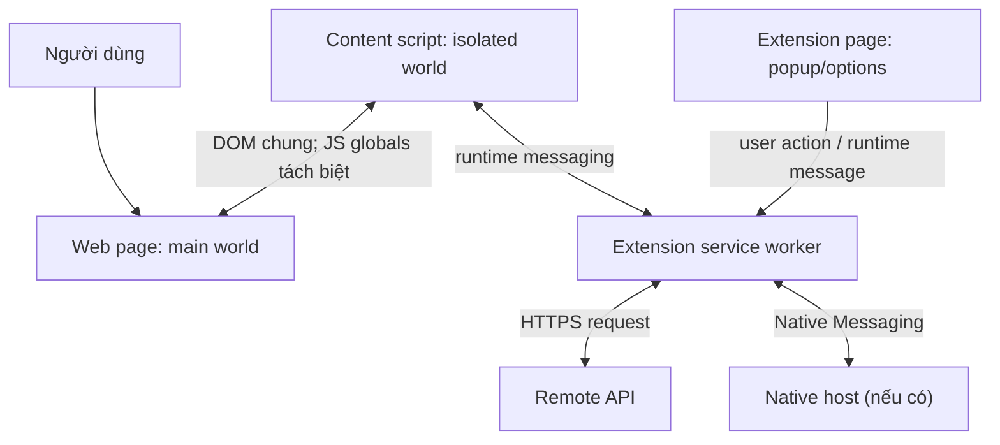

# Extension security: bảo vệ tiện ích mở rộng trình duyệt

## 1. Extension security là gì?

**Extension security** là việc thiết kế, triển khai, phân phối và vận hành tiện ích mở rộng trình duyệt sao cho quyền truy cập vào trang web, dữ liệu người dùng và API của browser luôn được giới hạn đúng mục đích. Browser extension có thể đọc hoặc thay đổi nội dung trang, quan sát tab, lưu dữ liệu, gửi request tới server và tương tác với hệ điều hành thông qua các API được cấp quyền. Những khả năng này làm extension hữu ích, đồng thời khiến một extension bị lỗi hoặc bị chiếm quyền có thể gây ảnh hưởng rộng.

Một extension thường gồm manifest, extension pages như popup/options, background service worker, content scripts và các tài nguyên được đóng gói. Các thành phần này chạy trong những môi trường khác nhau và có quyền khác nhau. Ranh giới giữa extension, trang web, server bên ngoài và native application phải được xác định rõ.

Ví dụ, một extension hỗ trợ quản lý đơn hàng có thể cần đọc nội dung trang quản trị để trích xuất mã đơn. Nếu extension xin quyền đọc mọi website, lưu session token trong storage đồng bộ và tải JavaScript từ CDN, một lỗi trong vendor hoặc tài khoản phát hành có thể làm lộ dữ liệu nhiều hơn phạm vi tính năng.

**Nguyên tắc:** chỉ xin quyền tối thiểu, giữ logic thực thi trong gói extension đã được review, xác thực mọi message đi qua ranh giới thành phần và coi dữ liệu từ trang web là input không tin cậy. Không xem việc extension được cài từ store là bằng chứng nó an toàn.

Bài viết thuộc chương **Browser extension** của module **SECURITY_APPLICATION_SECURITY_BROWSER_SECURITY**. Nội dung kết nối extension security với origin, DOM, storage, cookie, CSP, messaging, supply chain và các ranh giới bảo mật của browser.

Sau bài học, bạn có thể:

- Mô tả các thành phần của extension và trust boundary giữa chúng.
- Phân biệt extension page, content script isolated world và page main world.
- Thiết kế manifest với permissions và host permissions tối thiểu.
- Dùng activeTab hoặc optional permissions khi chỉ cần quyền theo thao tác.
- Xác thực sender, origin, frame và schema của message.
- Tránh DOM injection, XSS và lạm dụng postMessage.
- Lưu dữ liệu đúng phạm vi và tránh để lộ secret trong extension storage.
- Hiểu CSP của extension và giới hạn thực thi remote code.
- Kiểm soát web-accessible resources và external messaging.
- Quản lý dependency, update, publisher account và native messaging.
- Kiểm thử extension trong môi trường local và xử lý sự cố phát hành.

## 2. Mô hình bảo mật của browser extension

Extension không phải một website thông thường. Browser cấp cho extension một số API đặc quyền thông qua manifest và permission grant. Các thành phần của extension cũng không chia sẻ cùng một môi trường thực thi.

Các thành phần thường gặp:

| Thành phần | Vai trò | Ranh giới bảo mật |
|---|---|---|
| Manifest | Khai báo phiên bản, entry point, permission và resource | Là bản khai quyền và cấu hình của extension |
| Extension page | Popup, options, side panel hoặc trang nội bộ | Chạy trong extension origin |
| Background service worker | Xử lý event và tác vụ nền | Có thể dùng extension APIs theo permission |
| Content script | Tương tác với DOM của trang được phép | Chạy trong isolated world nhưng chia sẻ DOM với page |
| Page main world | JavaScript của website | Không được xem là môi trường tin cậy |
| Remote server | API hoặc dịch vụ extension kết nối | Có thể nhận dữ liệu và trả nội dung không tin cậy |
| Native host | Ứng dụng cục bộ qua Native Messaging | Có thể có quyền hệ điều hành lớn hơn extension |

Một sơ đồ rút gọn:



Extension có thể đọc dữ liệu trang thông qua content script hoặc scripting API khi permission cho phép. Một số extension pages có thể gửi cross-origin request tới host đã được cấp quyền. Browser quản lý permission và origin, nhưng extension vẫn phải xác minh dữ liệu, danh tính người gửi và quyền nghiệp vụ.

### 2.1. Threat model

Những nguồn đe dọa thường gặp:

- Website độc hại cố gửi dữ liệu hoặc DOM giả cho content script.
- XSS trên website làm thay đổi DOM mà extension đang đọc.
- Message giả mạo hoặc sai schema đi qua postMessage/runtime messaging.
- Extension bị thêm dependency độc hại hoặc bị chiếm tài khoản publisher.
- Permission quá rộng làm lộ dữ liệu nhiều website.
- Token hoặc dữ liệu nhạy cảm bị lưu trong storage không phù hợp.
- Extension page có XSS và attacker chiếm quyền extension APIs.
- Native host xử lý message không an toàn.
- Update mới đưa vào hành vi không mong muốn.
- Log, telemetry hoặc analytics gửi dữ liệu trang ra ngoài.

Hãy xác định tài sản cần bảo vệ, actor nào có thể tác động, API nào tạo quyền và dữ liệu nào rời khỏi browser trước khi triển khai.

### 2.2. Quyền extension không phải quyền của người dùng trong ứng dụng

Host permission có thể cho phép extension truy cập một origin theo API của browser. Nó không chứng minh người dùng có quyền đọc mọi record trên server đó. Nếu extension gọi API nghiệp vụ, server vẫn phải xác thực session và authorization cho từng thao tác.

Không dùng extension ID, tab ID hoặc storage key làm bằng chứng người dùng đã được cấp quyền nghiệp vụ.

## 3. Manifest và nguyên tắc least privilege

Manifest khai báo extension cần quyền gì và thành phần nào được browser khởi chạy. Với Manifest V3, ví dụ một extension chỉ hoạt động trên trang portal cụ thể:

```json
{
  "manifest_version": 3,
  "name": "Portal Helper",
  "version": "1.0.0",
  "permissions": [
    "storage"
  ],
  "host_permissions": [
    "https://portal.example.com/*"
  ],
  "background": {
    "service_worker": "service-worker.js"
  },
  "content_scripts": [
    {
      "matches": [
        "https://portal.example.com/*"
      ],
      "js": [
        "content.js"
      ],
      "run_at": "document_idle"
    }
  ],
  "action": {
    "default_title": "Portal Helper"
  },
  "content_security_policy": {
    "extension_pages": "script-src 'self'; object-src 'self';"
  }
}
```

Đây là ví dụ minh họa cho Chrome Manifest V3. Firefox và các browser khác có thể hỗ trợ Manifest V3 với khác biệt về API, background model và policy. Hãy kiểm tra tài liệu của browser mục tiêu.

### 3.1. permissions và host_permissions

Hai nhóm khai báo có mục đích khác nhau:

- `permissions`: quyền truy cập API browser như storage, scripting, tabs hoặc downloads.
- `host_permissions`: quyền truy cập website/origin cụ thể cho những API cần host access.

Một số API như `tabs` cho phép đọc các thuộc tính nhạy cảm của tab như URL hoặc title. Nếu chỉ cần thao tác trên tab hiện tại sau khi người dùng bấm extension, hãy xem xét `activeTab` thay cho quyền rộng.

Không khai báo quyền chỉ vì "có thể cần sau này". Mỗi quyền cần có mục đích, owner và cách kiểm thử.

### 3.2. activeTab

`activeTab` cấp quyền truy cập tạm thời vào tab hiện tại sau một thao tác rõ ràng của người dùng như bấm action của extension. Nó phù hợp với công cụ chỉ phân tích trang khi người dùng chủ động yêu cầu.

Ví dụ manifest:

```json
{
  "manifest_version": 3,
  "name": "On-demand Page Inspector",
  "version": "1.0.0",
  "permissions": [
    "activeTab",
    "scripting"
  ],
  "background": {
    "service_worker": "service-worker.js"
  },
  "action": {
    "default_title": "Inspect this page"
  }
}
```

Service worker chỉ inject hàm đọc thông tin không nhạy cảm sau thao tác action:

```js
chrome.action.onClicked.addListener(async (tab) => {
  if (!tab.id) return;

  const results = await chrome.scripting.executeScript({
    target: { tabId: tab.id },
    func: () => ({
      title: document.title,
      path: location.pathname
    })
  });

  console.log("Page summary:", results[0]?.result);
});
```

Đoạn code minh họa thao tác theo user gesture. Không gửi toàn bộ DOM, URL query, form value hoặc token tới server nếu tính năng không cần chúng. API có thể không inject được vào một số trang đặc biệt của browser hoặc trang bị hạn chế.

### 3.3. Optional permissions

Nếu extension chỉ cần truy cập một website sau khi người dùng bật tính năng, dùng optional permission để xin quyền tại thời điểm cần:

```json
{
  "manifest_version": 3,
  "name": "Optional Site Access",
  "version": "1.0.0",
  "optional_host_permissions": [
    "https://portal.example.com/*"
  ],
  "action": {
    "default_title": "Enable portal support"
  }
}
```

Ví dụ yêu cầu quyền khi người dùng bấm nút trong extension page:

```js
enableButton.addEventListener("click", async () => {
  const granted = await chrome.permissions.request({
    origins: ["https://portal.example.com/*"]
  });

  if (granted) {
    status.textContent = "Đã cấp quyền cho portal.";
  } else {
    status.textContent = "Người dùng chưa cấp quyền.";
  }
});
```

Permission request cần được kích hoạt từ thao tác người dùng phù hợp. Giải thích rõ quyền sẽ cho phép extension làm gì và cung cấp chức năng cơ bản khi người dùng từ chối.

### 3.4. Host permission quá rộng

Các pattern như `https://*/*` hoặc `<all_urls>` có thể cho extension quyền truy cập trên phạm vi rất lớn. Nếu extension đọc nội dung mọi trang, một lỗi nhỏ trong message handling có thể làm lộ dữ liệu từ email, ngân hàng, quản trị hoặc ứng dụng nội bộ.

Host permission được cấp theo origin; phần path trong host permission pattern không tạo ranh giới quyền theo từng route. Dùng origin cụ thể để giới hạn website, sau đó dùng `content_scripts.matches` hoặc logic trong extension để giới hạn route cần xử lý. Nếu tính năng cần nhiều website, cân nhắc xin quyền theo từng website khi người dùng bật tính năng.

### 3.5. Permission review

Với mỗi permission, ghi lại:

| Câu hỏi | Ví dụ |
|---|---|
| Tính năng nào cần quyền? | Đọc title của tab đang mở |
| Thành phần nào dùng quyền? | Background service worker |
| Có thể dùng quyền hẹp hơn không? | activeTab thay tabs |
| Khi nào quyền được sử dụng? | Sau click action |
| Dữ liệu nào được đọc/gửi? | Title và route name |
| Nếu quyền bị từ chối thì sao? | Tắt chức năng phân tích trang |

## 4. Content script và isolated world

### 4.1. Content script chạy ở đâu?

Content script thường chạy trong **isolated world**. Nó có global scope riêng với JavaScript của trang. Biến hoặc function trong page main world không tự động trở thành biến của content script và ngược lại.

Tuy nhiên, hai môi trường cùng tương tác với DOM của document. Page có thể thay đổi element, attribute, text và event mà content script đọc. Vì vậy, isolated world bảo vệ một phần môi trường JavaScript, nhưng DOM vẫn là kênh dữ liệu không tin cậy.

Ví dụ content script đọc nội dung:

```js
const title = document.querySelector("h1")?.textContent ?? "";

chrome.runtime.sendMessage({
  type: "PAGE_TITLE",
  payload: {
    title: title.slice(0, 200)
  }
});
```

Page có thể thay nội dung h1 trước khi content script đọc. Nếu background dùng title để quyết định hành động nhạy cảm, phải coi nó là dữ liệu do page kiểm soát và xác minh ở nơi có thẩm quyền.

### 4.2. Không tin DOM như dữ liệu nghiệp vụ

DOM có thể chứa:

- Nội dung do người dùng khác nhập.
- Dữ liệu bị XSS sửa đổi.
- Attribute giả do page chèn.
- Hidden input hoặc element được tạo động.
- Text trông giống mã đơn hàng nhưng không được server xác nhận.

Content script có thể đọc DOM để hỗ trợ UI, nhưng không dùng giá trị DOM làm quyền truy cập, payment amount, identity hoặc trạng thái giao dịch mà không xác minh qua backend.

### 4.3. Main world

Một số API cho phép inject code vào page main world. Khi chạy ở main world, code chia sẻ môi trường JavaScript với website và có thể bị page ghi đè function, thay đổi prototype hoặc quan sát hành vi.

Chỉ dùng main world khi phải tương tác với API JavaScript mà isolated world không truy cập được. Giữ đoạn code ngắn, không đưa secret vào đó và coi mọi dữ liệu trao đổi với page là không tin cậy.

### 4.4. Không để lộ secret qua DOM

Không đặt extension token, API key hoặc dữ liệu nhạy cảm vào:

- `data-*` attribute của element.
- Hidden input hoặc comment trong DOM.
- Window global variable.
- Script tag hoặc inline JSON mà page đọc được.
- URL query hoặc fragment.
- Message broadcast tới mọi frame.

Page có thể đọc DOM và các giá trị mà extension ghi vào đó. Nếu cần hiển thị kết quả, chỉ đưa dữ liệu tối thiểu mà page thực sự cần.

## 5. Messaging giữa content script và service worker

Messaging là ranh giới quan trọng. Content script có thể gửi message tới background service worker bằng runtime API. Service worker phải xác minh sender và schema trước khi xử lý.

### 5.1. Xác minh sender

Ví dụ service worker nhận message chỉ từ content script ở đúng origin và top frame:

```js
chrome.runtime.onMessage.addListener(
  (message, sender, sendResponse) => {
    if (sender.id !== chrome.runtime.id) return;

    if (!sender.tab || sender.frameId !== 0) return;

    let senderUrl;
    try {
      senderUrl = new URL(sender.url || sender.tab.url);
    } catch {
      return;
    }

    if (senderUrl.origin !== "https://portal.example.com") return;

    if (
      message === null ||
      typeof message !== "object" ||
      message.type !== "PAGE_TITLE"
    ) {
      return;
    }

    const title = message.payload?.title;

    if (typeof title !== "string" || title.length > 200) {
      return;
    }

    sendResponse({
      ok: true,
      acceptedLength: title.length
    });
  }
);
```

Kiểm tra này minh họa sender ID, tab, frame và origin. Ứng dụng thực tế còn phải validate từng field, giới hạn kích thước, kiểm tra quyền của thao tác và không thực hiện hành động nhạy cảm chỉ dựa vào message từ content script.

`sender.url` và `sender.tab.url` có thể khác nhau tùy loại message/frame. Nếu extension hỗ trợ iframe, cần định nghĩa rõ frame nào được phép và kiểm tra origin/frame theo yêu cầu.

### 5.2. Validate schema và giới hạn message

Không nhận object tùy ý rồi chuyển tiếp tới API hoặc filesystem. Định nghĩa message type cụ thể, kiểu dữ liệu, giới hạn độ dài và tập giá trị hợp lệ.

Ví dụ chỉ chấp nhận mã record theo format đã định nghĩa:

```js
function parseRecordRequest(message) {
  if (!message || typeof message !== "object") {
    return null;
  }

  if (message.type !== "GET_RECORD_STATUS") {
    return null;
  }

  const recordId = message.payload?.recordId;

  if (
    typeof recordId !== "string" ||
    !/^[A-Z0-9-]{1,32}$/.test(recordId)
  ) {
    return null;
  }

  return { recordId };
}
```

Schema validation không chứng minh người gửi có quyền đọc record. Backend vẫn phải kiểm tra user/session và authorization.

### 5.3. Không dùng message như lệnh tổng quát

Tránh thiết kế message kiểu:

```json
{
  "type": "EXECUTE",
  "command": "..."
}
```

hoặc nhận URL/path bất kỳ rồi background fetch hay mở file theo yêu cầu. Thiết kế message theo các hành động nghiệp vụ hẹp như `GET_VISIBLE_ORDER_SUMMARY` hoặc `SAVE_USER_PREFERENCE`, sau đó kiểm tra từng tham số.

### 5.4. postMessage giữa page và content script

Nếu phải làm cầu nối giữa page main world và content script, page có thể gửi message giả. Kiểm tra source, origin và schema:

```js
const trustedPageOrigin = "https://portal.example.com";

window.addEventListener("message", (event) => {
  if (event.source !== window) return;
  if (event.origin !== trustedPageOrigin) return;

  const data = event.data;

  if (
    data === null ||
    typeof data !== "object" ||
    data.channel !== "portal-helper" ||
    data.type !== "REQUEST_STATUS"
  ) {
    return;
  }

  // Dữ liệu vẫn không tin cậy; chỉ xử lý field đã allowlist.
  chrome.runtime.sendMessage({
    type: "GET_VISIBLE_STATUS",
    payload: {
      itemId: String(data.itemId || "").slice(0, 32)
    }
  });
});
```

Kiểm tra `event.origin` giúp xác định origin của document gửi message. `event.source` giúp giới hạn đúng window. Tuy nhiên, script hợp lệ của trang cũng có thể gửi message; các kiểm tra này không biến payload thành dữ liệu nghiệp vụ đáng tin cậy.

### 5.5. external messaging

Nếu extension không cần giao tiếp với extension khác hoặc website bên ngoài, đừng bật external messaging. Khi dùng `onMessageExternal` hoặc `onConnectExternal`, allowlist extension ID/origin cụ thể, validate schema và giới hạn hành động.

Không chấp nhận mọi sender chỉ vì message đến qua API của browser. External messaging mở thêm một bề mặt tấn công cần review riêng.

## 6. Storage và quản lý secret

### 6.1. Các storage area

Chrome extension có nhiều storage area với vòng đời và khả năng đồng bộ khác nhau:

| Storage | Đặc điểm | Dùng khi |
|---|---|---|
| `storage.local` | Lưu trên thiết bị, tồn tại qua lần browser khởi động | Preference hoặc cache không nhạy cảm |
| `storage.sync` | Có thể đồng bộ giữa thiết bị qua tài khoản browser | Setting nhỏ không nhạy cảm |
| `storage.session` | State tạm trong phiên browser extension | Cache ngắn hạn, state tạm |
| `storage.managed` | Giá trị do tổ chức quản trị cung cấp | Policy enterprise |

API và khả năng có thể khác theo browser/version. Không giả định mọi storage area có cùng mức bảo vệ hoặc khả năng truy cập.

### 6.2. Extension storage không phải secret vault

Không lưu API key dài hạn, password, refresh token có quyền rộng hoặc private key trong storage chỉ vì nó thuộc extension origin. Storage có thể bị đọc bởi extension code có quyền, bị lấy qua profile compromise, debug tooling hoặc một extension page có XSS.

`storage.sync` còn có thể đồng bộ dữ liệu qua tài khoản và nhiều thiết bị. Không lưu dữ liệu nhạy cảm vào sync storage nếu không có thiết kế bảo vệ phù hợp.

Nếu cần token, ưu tiên token ngắn hạn, scope hẹp và có thể thu hồi; giữ phía server khi có thể. Không nhúng secret quản trị vào package extension vì người dùng có thể giải nén package.

### 6.3. Giới hạn storage access

Nếu browser hỗ trợ, có thể hạn chế storage area chỉ cho trusted extension contexts:

```js
await chrome.storage.local.setAccessLevel({
  accessLevel: "TRUSTED_CONTEXTS"
});
```

API này có thể khác nhau giữa browser và version. Hãy kiểm tra compatibility trước khi phụ thuộc vào nó. Dù đã giới hạn content script, extension page bị XSS vẫn là trusted context và có thể truy cập dữ liệu.

### 6.4. Lưu state có kiểm soát

- Chỉ lưu field cần thiết.
- Không lưu toàn bộ page DOM hoặc request headers.
- Đặt retention và cleanup.
- Kiểm tra schema khi đọc dữ liệu cũ.
- Xử lý trường hợp storage bị sửa hoặc không còn tương thích.
- Không dùng storage value làm authorization.
- Tách preference khỏi token/credential.
- Có thao tác sign-out/revoke rõ ràng.

Ví dụ kiểm tra schema preference:

```js
async function loadPreferences() {
  const stored = await chrome.storage.local.get("preferences");
  const value = stored.preferences;

  if (
    !value ||
    typeof value !== "object" ||
    typeof value.showBadge !== "boolean"
  ) {
    return { showBadge: true };
  }

  return {
    showBadge: value.showBadge
  };
}
```

## 7. Extension CSP và remote code

### 7.1. CSP cho extension pages

Manifest V3 có Content Security Policy cho extension pages. Ví dụ:

```json
{
  "content_security_policy": {
    "extension_pages": "script-src 'self'; object-src 'self';"
  }
}
```

Policy giới hạn nguồn script thực thi trong extension pages. Hãy đóng gói code đã review và tránh mở rộng policy không cần thiết.

### 7.2. Không tải remote executable code

Không tải JavaScript từ CDN hoặc server rồi thực thi trong extension:

```js
// Không an toàn: remote code execution trong extension.
const response = await fetch("https://cdn.example.net/extension-code.js");
const source = await response.text();
new Function(source)();
```

Cũng không dùng `eval()` hoặc kỹ thuật tương đương để thực thi chuỗi nhận từ server. Manifest V3 yêu cầu logic thực thi nằm trong package extension theo chính sách áp dụng; remote hosted code và dynamic evaluation không phải cách cập nhật extension an toàn.

Có thể tải dữ liệu từ server như JSON hoặc cấu hình có schema rõ ràng, nhưng không biến dữ liệu đó thành source code. Validate dữ liệu, giới hạn kích thước và không diễn giải chuỗi thành lệnh.

### 7.3. Không dùng HTML động không tin cậy

Extension page có thể có quyền mạnh. Nếu page có DOM XSS, attacker có thể lợi dụng các API extension mà trang thường không có.

Không đưa dữ liệu từ tab, server hoặc storage vào `innerHTML`. Dùng `textContent`, DOM API an toàn và template đã escape. Tránh inline event handler và giữ CSP chặt.

### 7.4. CSP không thay thế validation

CSP giúp hạn chế nguồn script và một số dạng injection, nhưng không sửa logic authorization, message validation hoặc data flow. Nếu extension cho phép script hợp lệ gửi toàn bộ tab content ra server, CSP không ngăn hành vi đó khi endpoint đã được allowlist.

## 8. Web-accessible resources

### 8.1. Resource được expose là gì?

Extension có thể cần cho website tải một số tài nguyên như icon, hình hoặc trang hỗ trợ. Manifest V3 dùng `web_accessible_resources` để khai báo tài nguyên nào được phép truy cập từ web pages và origin nào được phép yêu cầu.

Ví dụ chỉ expose một icon cho portal cụ thể:

```json
{
  "web_accessible_resources": [
    {
      "resources": [
        "images/status-icon.svg"
      ],
      "matches": [
        "https://portal.example.com/*"
      ]
    }
  ]
}
```

Không expose toàn bộ thư mục extension hoặc file chứa cấu hình nội bộ nếu không cần.

### 8.2. Tác động bảo mật

Tài nguyên web-accessible có thể được page truy cập theo quy tắc browser. Điều này có thể tiết lộ cấu trúc extension, tạo bề mặt fingerprinting hoặc cho phép page tương tác với resource ngoài dự kiến.

Chỉ expose resource cần thiết, giới hạn match pattern và review mỗi lần thêm file. Không coi URL resource khó đoán là cơ chế authorization.

## 9. Host permissions và cross-origin requests

### 9.1. Host permission cấp quyền cho extension

Một extension page hoặc service worker có thể cần gọi API trên domain bên ngoài. Host permission cho phép extension dùng một số API cross-origin theo policy của browser.

Ví dụ manifest khai báo API cụ thể:

```json
{
  "host_permissions": [
    "https://api.example.net/*"
  ],
  "permissions": [
    "storage"
  ],
  "background": {
    "service_worker": "service-worker.js"
  }
}
```

Gửi request từ service worker:

```js
async function loadSummary() {
  const response = await fetch(
    "https://api.example.net/v1/summary",
    {
      method: "GET",
      credentials: "omit",
      headers: {
        "Accept": "application/json"
      }
    }
  );

  if (!response.ok) {
    throw new Error("API request failed");
  }

  return response.json();
}
```

Ví dụ dùng `credentials: "omit"` khi API không cần cookie của website. Nếu API cần authentication, dùng cơ chế token/session được thiết kế rõ và server phải kiểm tra authorization.

### 9.2. Không nhầm host permission với CORS hoặc authorization

Host permission là quyền browser cấp cho extension. Nó không tự cấp quyền truy cập dữ liệu của mọi user trên server và không thay thế authentication.

CORS chủ yếu kiểm soát việc web page JavaScript đọc response cross-origin. Extension APIs có thể có quy tắc host permission riêng, nhưng server vẫn phải kiểm tra danh tính và quyền nghiệp vụ. Không dùng extension làm proxy để bỏ qua kiểm soát truy cập của API.

### 9.3. Không gửi credential tự động khi không cần

Đặt `credentials: "omit"` khi request không cần cookie. Nếu dùng `include`, hiểu rõ cookie nào có thể được gửi, SameSite/partitioning và chính sách credential của browser. Không gửi session cookie của website tới server analytics hoặc API khác.

## 10. DOM, XSS và dữ liệu từ trang

### 10.1. Dữ liệu trang là input không tin cậy

Content script đọc DOM có thể nhận text do website hoặc user-generated content tạo. Nếu đưa text đó vào extension popup hoặc options page bằng `innerHTML`, nội dung độc hại có thể trở thành DOM XSS trong extension origin.

Ví dụ không an toàn:

```js
const pageText = document.querySelector(".customer-note")?.textContent;
result.innerHTML = pageText;
```

Ví dụ an toàn hơn:

```js
const pageText = document.querySelector(".customer-note")?.textContent ?? "";
result.textContent = pageText;
```

Nếu cần rich text, dùng sanitizer đã được review với allowlist element/attribute cụ thể. Tránh tự viết sanitizer bằng regex.

### 10.2. Không thực thi code từ DOM

Không đọc attribute như `data-command`, `onclick`, script text hoặc URL từ DOM rồi thực thi như lệnh. Nếu page cần gửi dữ liệu cho extension, chỉ nhận các giá trị có schema và không mở API thực thi tùy ý.

### 10.3. URL validation

Nếu extension mở URL do page cung cấp, parse bằng `URL` và allowlist scheme/origin. Không cho phép `javascript:`, `data:` hoặc protocol lạ khi không cần.

Ví dụ chỉ mở HTTPS link thuộc một tập domain:

```js
function isAllowedHelpUrl(value) {
  try {
    const url = new URL(value);

    return (
      url.protocol === "https:" &&
      ["docs.example.com", "support.example.com"].includes(url.hostname)
    );
  } catch {
    return false;
  }
}
```

Kiểm tra hostname chính xác, không dùng phép so sánh chuỗi kiểu `endsWith("example.com")` mà không kiểm tra ranh giới domain. Nếu cần subdomain, xác định quy tắc suffix rõ ràng.

### 10.4. Không để extension trở thành confused deputy

Confused deputy xảy ra khi extension có quyền cao hơn page nhưng nhận lệnh từ page rồi dùng quyền đó thay mặt page mà không kiểm tra mục đích/quyền.

Ví dụ page gửi message yêu cầu extension tải URL tùy ý bằng host permission rộng. Nếu extension thực hiện request với quyền của mình, page có thể lợi dụng extension để truy cập tài nguyên mà page không được phép đọc.

Giới hạn API message theo tác vụ cụ thể, xác minh origin, yêu cầu user gesture cho thao tác nhạy cảm và không cho page chọn URL tùy ý.

## 11. External messaging và native messaging

### 11.1. External messaging

Extension có thể cho phép website hoặc extension khác gửi message qua API external messaging. Chỉ bật nếu tính năng thực sự cần.

- Khai báo allowlist website/extension ID trong manifest khi phù hợp.
- Kiểm tra sender ID, sender origin hoặc URL theo browser API.
- Validate schema và giới hạn kích thước.
- Không nhận lệnh thực thi tổng quát.
- Không trả dữ liệu nhạy cảm chỉ vì sender biết extension ID.
- Ghi log sự kiện cần thiết mà không lưu payload nhạy cảm.

### 11.2. Native Messaging

Native Messaging cho phép extension giao tiếp với ứng dụng native được cài trên máy. Đây là ranh giới quan trọng vì native host có thể truy cập filesystem, process, thiết bị hoặc tài nguyên hệ điều hành theo quyền của user.

Một thiết kế an toàn cần:

- Chỉ khai báo extension ID được phép trong native host manifest.
- Validate JSON message, kiểu dữ liệu và kích thước.
- Không nối input message vào shell command.
- Không thực thi file hoặc path do extension/page cung cấp nếu chưa allowlist.
- Chạy native host với quyền hệ điều hành tối thiểu.
- Không log secret hoặc dữ liệu nhạy cảm.
- Xác minh mọi file được mở nằm trong thư mục cho phép.

Không coi native host là một process đáng tin tuyệt đối chỉ vì nó được extension gọi.

## 12. Supply chain, dependency và cập nhật

### 12.1. Extension package là phần mềm được phân phối

Một extension có thể phụ thuộc thư viện npm, SDK analytics, tag hoặc mã do vendor cung cấp. Nếu dependency bị chiếm quyền, attacker có thể đưa code vào package và nhận các permission mà extension đã có.

Giảm rủi ro bằng cách:

- Giữ dependency tối thiểu.
- Dùng lockfile và review thay đổi version.
- Theo dõi advisory và bản vá bảo mật.
- Tránh dependency không còn được duy trì.
- Review source/build output của dependency quan trọng.
- Không tải executable code từ remote server.
- Dùng build pipeline có kiểm soát và artifact có thể truy vết.
- Kiểm tra package cuối cùng trước khi phát hành.

### 12.2. Publisher account

Tài khoản developer/store có thể phát hành update cho người dùng hiện tại. Bảo vệ tài khoản phát hành bằng MFA, credential riêng, quyền theo vai trò và quy trình approval.

Không chia sẻ password hoặc signing key qua chat/log. Nếu nền tảng hỗ trợ quản lý signing key, bảo vệ key trong hệ thống chuyên dụng và có quy trình khôi phục/thu hồi.

### 12.3. Review update

Mỗi bản update cần xem xét:

- Manifest permissions có tăng không?
- Host permissions có rộng hơn không?
- Có thêm content script hoặc web-accessible resource không?
- Có dependency hoặc native messaging host mới không?
- Data flow có thay đổi không?
- Có gửi thêm page content hoặc identifier ra ngoài không?
- Có thêm code path thực thi từ dữ liệu remote không?
- CSP hoặc message validation có bị nới lỏng không?

Store review và chữ ký package giúp quản lý phân phối, nhưng không thay thế code review và threat modeling của đội phát triển.

### 12.4. Rollback và incident response

Cần biết cách dừng hoặc rollback update, thu hồi token backend, disable API key, thông báo người dùng và điều tra dữ liệu có thể đã bị gửi đi. Lưu version, release artifact, changelog và thời điểm phát hành để truy vết.

## 13. Privacy và telemetry của extension

Extension có thể nhìn thấy nội dung trang hoặc URL mà người dùng mở. Đây là dữ liệu nhạy cảm ngay cả khi extension không lưu password.

Trước khi thu thập telemetry:

- Nêu rõ event nào được gửi và mục đích.
- Không gửi URL đầy đủ, query, fragment hoặc page text mặc định.
- Không thu thập form input, email, token hoặc nội dung tài khoản.
- Dùng route category hoặc event aggregate nếu đáp ứng mục tiêu.
- Giới hạn retention và quyền truy cập.
- Không dùng storage sync cho dữ liệu nhạy cảm.
- Cho người dùng biết cách tắt telemetry khi phù hợp.
- Kiểm tra endpoint thực tế bằng DevTools và server logs.

Không dùng host permission rộng để xây dựng lịch sử duyệt web nếu tính năng không thực sự cần. Quyền truy cập browsing history hoặc tab URL có tác động privacy lớn và cần giải thích rõ.

## 14. Download, file và dữ liệu do extension tạo

Extension có thể dùng Downloads API hoặc tạo Blob URL để xuất dữ liệu. Filename và nội dung vẫn phải được kiểm soát:

- Không dùng tên file do page cung cấp làm path.
- Làm sạch filename hiển thị và kiểm tra extension.
- Không đưa HTML hoặc active content không tin cậy vào extension page.
- Không ghi file vào vị trí tùy ý theo message từ website.
- Xác minh nội dung trước khi gửi lên server hoặc native host.
- Không đưa dữ liệu riêng tư vào download URL hoặc query string.

Nếu extension hỗ trợ export, tạo tên file từ route/category hoặc metadata đã allowlist. Storage key và đường dẫn vật lý phải do thành phần có thẩm quyền tạo.

## 15. Lab local: xây dựng extension MV3 có quyền tối thiểu

Lab tạo một extension đơn giản chỉ inject content script vào một trang local cụ thể. Content script gửi page path tới service worker. Service worker xác minh extension sender, top frame và origin trước khi phản hồi.

Lab không gọi server bên ngoài, không đọc cookie và không thu thập dữ liệu tài khoản.

### 15.1. Tạo cấu trúc thư mục

```text
extension-security-lab/
  manifest.json
  content.js
  service-worker.js
```

### 15.2. Tạo manifest.json

```json
{
  "manifest_version": 3,
  "name": "Extension Security Lab",
  "version": "1.0.0",
  "description": "A minimal local extension security exercise",
  "permissions": [],
  "host_permissions": [
    "http://127.0.0.1:8080/*"
  ],
  "background": {
    "service_worker": "service-worker.js"
  },
  "content_scripts": [
    {
      "matches": [
        "http://127.0.0.1:8080/*"
      ],
      "js": [
        "content.js"
      ],
      "run_at": "document_idle"
    }
  ],
  "action": {
    "default_title": "Extension Security Lab"
  },
  "content_security_policy": {
    "extension_pages": "script-src 'self'; object-src 'self';"
  }
}
```

Host permission chỉ giới hạn vào loopback test site. Không đổi thành mọi website khi chạy thử.

### 15.3. Tạo content.js

```js
const pagePath = location.pathname;

chrome.runtime.sendMessage({
  type: "PAGE_INFO",
  payload: {
    path: pagePath
  }
}).then((reply) => {
  console.info("Extension worker response:", reply);
}).catch((error) => {
  console.error("Extension message failed:", error);
});
```

Content script gửi đúng một field cần cho bài lab. Nó không gửi toàn bộ URL, query, fragment, DOM hoặc cookie.

### 15.4. Tạo service-worker.js

```js
chrome.runtime.onMessage.addListener(
  (message, sender, sendResponse) => {
    if (sender.id !== chrome.runtime.id) return;
    if (!sender.tab || sender.frameId !== 0) return;

    let sourceUrl;

    try {
      sourceUrl = new URL(sender.url || sender.tab.url);
    } catch {
      return;
    }

    if (sourceUrl.origin !== "http://127.0.0.1:8080") return;

    if (
      message === null ||
      typeof message !== "object" ||
      message.type !== "PAGE_INFO"
    ) {
      return;
    }

    const pagePath = message.payload?.path;

    if (
      typeof pagePath !== "string" ||
      pagePath.length > 256 ||
      !pagePath.startsWith("/") ||
      pagePath !== sourceUrl.pathname
    ) {
      return;
    }

    sendResponse({
      ok: true,
      path: pagePath
    });
  }
);
```

Service worker xác minh sender và dữ liệu trước khi phản hồi. Trong extension thực tế, nếu message yêu cầu API nghiệp vụ, backend vẫn phải xác thực user và quyền truy cập.

### 15.5. Chạy trang local

Tạo một trang HTML tĩnh trong thư mục test riêng hoặc dùng static server hiện có để phục vụ:

```text
http://127.0.0.1:8080/demo
```

Trang chỉ cần hiển thị nội dung vô hại. Không dùng website thật hoặc URL chứa token để thử lab.

### 15.6. Load extension

Với Chromium-based browser:

1. Mở trang quản lý extension của browser.
2. Bật Developer mode.
3. Chọn Load unpacked.
4. Chọn thư mục `extension-security-lab`.
5. Mở trang local `http://127.0.0.1:8080/demo`.
6. Mở DevTools Console của tab và quan sát log từ content script.
7. Mở trang extension service worker inspection để xem log background.
8. Reload extension sau khi sửa manifest hoặc code.

Tên menu và vị trí có thể khác theo browser/version. Không cần tải extension từ website bên ngoài.

### 15.7. Kiểm thử ranh giới

Thực hiện các kiểm tra:

- Mở `http://127.0.0.1:8080/demo`: content script được inject và message được phản hồi.
- Mở `http://localhost:8080/demo`: extension không inject vì host khác với match pattern.
- Mở một website HTTPS bất kỳ: extension không inject.
- Thay `message.type` thành giá trị khác trong bản test: service worker bỏ qua.
- Thay path trong payload không khớp `sender.url`: service worker bỏ qua.
- Mở trang local trong iframe: message từ frame không phải top frame bị bỏ qua do kiểm tra `frameId`.
- Xem manifest và xác nhận không có quyền tabs, history hoặc all_urls.
- Tắt extension và xác nhận trang local vẫn hoạt động bình thường.

### 15.8. Lab mở rộng: optional permission

Nếu muốn extension hỗ trợ thêm một portal, chuyển host permission sang `optional_host_permissions` và tạo nút trong extension popup để xin quyền bằng `chrome.permissions.request()`. Chỉ gọi request khi người dùng bấm nút, giải thích phạm vi domain và kiểm tra trường hợp user từ chối.

Không xin quyền rộng hơn để tránh phải thiết kế luồng permission.

## 16. Kiểm thử và giám sát extension

### 16.1. Static review

Kiểm tra:

- Manifest permission và host permission.
- Content script match pattern.
- CSP extension pages.
- `web_accessible_resources`.
- `externally_connectable`.
- Remote script, eval và dynamic code.
- Dependency và lockfile.
- Native messaging manifest.
- API dùng để đọc tab, history, clipboard, downloads hoặc webRequest.

### 16.2. Runtime review

Dùng browser extension inspection và DevTools để xem:

- Console errors của extension page/content script/service worker.
- Network request từ extension.
- Message và sender metadata.
- Storage data.
- Permission grant/revoke.
- Tab/frame nơi content script được inject.
- Update behavior và background worker restart.

Không export log có URL, cookie, page content hoặc token thật ra bug report công khai.

### 16.3. Negative testing

Một extension an toàn phải từ chối input không hợp lệ. Hãy thử:

- Sender từ origin khác.
- Sender từ iframe không được phép.
- Message thiếu field hoặc sai type.
- String vượt giới hạn.
- URL có scheme lạ.
- Record ID không đúng format.
- Permission bị thu hồi.
- API server trả 401/403/429.
- Storage có dữ liệu cũ hoặc sai schema.
- Native host không phản hồi hoặc gửi message quá lớn.

### 16.4. Permission regression

So sánh manifest của mỗi release. Nếu thêm quyền mới, yêu cầu người review trả lời:

- Feature nào cần quyền này?
- Có thể dùng activeTab hoặc optional permission không?
- Dữ liệu mới nào có thể truy cập?
- Người dùng được giải thích thế nào?
- Có thể bỏ quyền sau khi feature kết thúc không?

## 17. Checklist review Extension security

Trước khi phát hành:

1. **Manifest:** Có đúng Manifest Version và chỉ khai báo permission cần thiết không?
2. **Host access:** Có dùng origin cụ thể thay all_urls khi có thể không?
3. **User gesture:** Có dùng activeTab hoặc optional permission cho quyền theo thao tác không?
4. **Content script:** Có hiểu isolated world và DOM vẫn là input không tin cậy không?
5. **Main world:** Có tránh inject main world nếu không cần không?
6. **Messaging:** Có xác minh sender ID, origin, tab, frame và message schema không?
7. **Confused deputy:** Có ngăn page dùng extension permission để truy cập tài nguyên ngoài quyền của page không?
8. **DOM:** Có dùng textContent/auto-escaping thay innerHTML với dữ liệu không tin cậy không?
9. **URL:** Có allowlist scheme và hostname trước khi mở hoặc fetch không?
10. **Storage:** Có tránh lưu secret dài hạn và hạn chế storage access không?
11. **CSP:** Có giữ extension CSP chặt và không dùng remote executable code không?
12. **Web resources:** Có expose đúng resource và match pattern tối thiểu không?
13. **External messaging:** Có tắt nếu không cần hoặc allowlist sender không?
14. **Native messaging:** Có validate input và chạy host với quyền tối thiểu không?
15. **Supply chain:** Có lockfile, review dependency và kiểm soát build artifact không?
16. **Publisher:** Có MFA và quyền phát hành theo vai trò không?
17. **Privacy:** Có tránh thu URL/page content/cookie không cần thiết không?
18. **Telemetry:** Có giới hạn field, retention và endpoint không?
19. **Updates:** Có review permission/data-flow changes và rollback plan không?
20. **Testing:** Có negative tests cho origin, frame, message và permission revoke không?

## 18. Những hiểu lầm phổ biến

| Nhận định sai | Cách hiểu đúng |
|---|---|
| Extension cài từ store thì chắc chắn an toàn. | Store review và package signing hỗ trợ phân phối; code và publisher vẫn cần được review. |
| Content script isolated world nên DOM đáng tin. | JavaScript globals tách biệt nhưng DOM dùng chung và có thể bị page sửa. |
| Host permission đồng nghĩa user được phép đọc mọi record. | Server vẫn phải xác thực và authorization theo tài khoản/record. |
| activeTab cấp quyền vĩnh viễn. | Quyền này gắn với thao tác user và tab hiện tại theo policy browser. |
| Chỉ cần kiểm tra message.type. | Cần xác minh sender, origin/frame, schema, kích thước và quyền hành động. |
| Extension ID bí mật. | ID không phải secret và không phải cơ chế xác thực người dùng. |
| Storage.local là secret vault. | Storage có thể bị đọc bởi extension code hoặc profile compromise; không lưu secret dài hạn tùy tiện. |
| CSP ngăn mọi hành vi gửi dữ liệu. | CSP giới hạn nguồn; code hợp lệ vẫn có thể gửi dữ liệu tới endpoint được phép. |
| Remote JSON và remote code giống nhau. | Dữ liệu có schema có thể được xử lý; không được biến dữ liệu thành code thực thi. |
| SRI hoặc package signing thay thế code review. | Chúng hỗ trợ integrity; logic và data flow vẫn cần được review. |
| Iframe và content script có cùng quyền. | Iframe là document riêng; content script chạy trong isolated world nhưng thao tác DOM page. |
| Native Messaging chỉ là IPC vô hại. | Native host có thể truy cập tài nguyên hệ điều hành theo quyền của process. |
| Không có quyền tabs thì extension không biết URL nào. | Host permissions và các API khác cũng có thể cung cấp thông tin trang trong phạm vi được cấp. |
| UUID hoặc tab ID là authorization. | ID chỉ định danh; server phải kiểm tra owner và quyền truy cập. |
| Chỉ cần xóa token khỏi storage khi logout. | Cần revoke token phía server và xử lý session/cache liên quan theo thiết kế. |

## 19. Câu hỏi ôn tập

1. Extension security bảo vệ những tài sản nào?
2. Manifest có vai trò gì trong mô hình quyền của extension?
3. permissions và host_permissions khác nhau ra sao?
4. Khi nào activeTab phù hợp hơn host permission rộng?
5. Content script isolated world khác page main world ở điểm nào?
6. Vì sao DOM vẫn là dữ liệu không tin cậy dù content script có isolated world?
7. Service worker cần kiểm tra những thông tin nào từ sender?
8. Vì sao message schema cần giới hạn kích thước và field?
9. Confused deputy xảy ra thế nào khi page điều khiển extension?
10. postMessage cần kiểm tra event.origin và event.source ra sao?
11. Vì sao extension storage không phải secret vault?
12. storage.sync có rủi ro riêng nào?
13. CSP extension pages giới hạn những gì?
14. Vì sao Manifest V3 không cho extension tải remote executable code theo cách tùy ý?
15. web_accessible_resources cần giới hạn như thế nào?
16. Host permission khác CORS và authorization ra sao?
17. Native Messaging tạo thêm trust boundary nào?
18. Supply-chain attack có thể ảnh hưởng extension thế nào?
19. Vì sao store review không thay thế code review?
20. Những negative test nào cần có trước release?

**Đáp án định hướng:** (1) Dữ liệu trang, credential, storage, quyền browser và hệ thống native. (2) Khai báo thành phần, quyền và resource. (3) Một nhóm là API permission, nhóm kia là host access. (4) Khi chỉ cần thao tác trên tab sau user gesture. (5) Isolated world có JS globals riêng; main world chia sẻ môi trường JS với page. (6) DOM được page kiểm soát và có thể bị thay đổi. (7) Extension ID, tab, frame, URL/origin và loại message. (8) Ngăn input quá lớn, sai kiểu và lạm dụng command. (9) Page lợi dụng extension permission cao hơn để truy cập tài nguyên ngoài quyền của page. (10) Kiểm tra đúng window và origin allowlist; payload vẫn cần validate. (11) Extension code hoặc profile compromise có thể đọc storage. (12) Dữ liệu có thể đồng bộ qua tài khoản và nhiều thiết bị. (13) Nguồn script/object trong extension pages. (14) Để logic thực thi nằm trong package có thể review và kiểm soát. (15) Chỉ expose resource cần thiết cho origin cụ thể. (16) Host permission là browser grant; CORS là response-reading policy; authorization là quyền nghiệp vụ server. (17) Extension trao đổi với process hệ điều hành. (18) Dependency hoặc publisher bị chiếm quyền có thể đưa code độc hại vào package. (19) Store không hiểu hết threat model và data flow của từng extension. (20) Origin/frame sai, schema sai, message lớn, permission revoke và backend denial.

## 20. Tài liệu tham khảo

- [Chrome for Developers — Extension security](https://developer.chrome.com/docs/extensions/develop/security-privacy/stay-secure): Nguyên tắc bảo mật cho Chrome extensions.
- [Chrome for Developers — Declare permissions](https://developer.chrome.com/docs/extensions/develop/concepts/declare-permissions): Permission, host permission và optional permission.
- [Chrome for Developers — Content scripts](https://developer.chrome.com/docs/extensions/develop/concepts/content-scripts): Isolated world, injection và content script behavior.
- [Chrome for Developers — Message passing](https://developer.chrome.com/docs/extensions/develop/concepts/messaging): Runtime messaging và external messaging.
- [Chrome for Developers — Manifest V3](https://developer.chrome.com/docs/extensions/develop/migrate/what-is-mv3): Kiến trúc và giới hạn Manifest V3.
- [Chrome for Developers — Extension service worker](https://developer.chrome.com/docs/extensions/develop/concepts/service-workers): Background service worker lifecycle.
- [Chrome for Developers — Storage API](https://developer.chrome.com/docs/extensions/reference/api/storage): Storage areas và access control.
- [Chrome for Developers — Content Security Policy](https://developer.chrome.com/docs/extensions/reference/manifest/content-security-policy): CSP cho extension pages.
- [Chrome for Developers — Web accessible resources](https://developer.chrome.com/docs/extensions/reference/manifest/web-accessible-resources): Expose resource cho website.
- [Chrome for Developers — Native Messaging](https://developer.chrome.com/docs/extensions/develop/concepts/native-messaging): Giao tiếp với native host.
- [MDN — Browser extensions](https://developer.mozilla.org/en-US/docs/Mozilla/Add-ons/WebExtensions): Kiến trúc WebExtensions và khác biệt browser.
- [MDN — WebExtensions security best practices](https://developer.mozilla.org/en-US/docs/Mozilla/Add-ons/WebExtensions/Security_best_practices): Bảo vệ extension và dữ liệu người dùng.
- [OWASP — Cross Site Scripting Prevention Cheat Sheet](https://cheatsheetseries.owasp.org/cheatsheets/Cross_Site_Scripting_Prevention_Cheat_Sheet.html): Tránh DOM XSS khi hiển thị dữ liệu.
- [OWASP — Third Party JavaScript Management Cheat Sheet](https://cheatsheetseries.owasp.org/cheatsheets/Third_Party_Javascript_Management_Cheat_Sheet.html): Quản lý dependency và code bên thứ ba.

**Kết nối với mô hình bảo mật web:** Extension có quyền cao hơn một page thông thường nhưng vẫn tương tác với origin, DOM, cookie, storage và server. Isolated world tách JavaScript globals chứ không làm DOM trở nên đáng tin; host permission không thay thế authorization; CSP không thay thế validation. Thiết kế extension an toàn cần permission tối thiểu, message sender/schema validation, storage có kiểm soát, code thực thi được đóng gói và supply chain được review. Mọi dữ liệu lấy từ website phải được coi là input không tin cậy.
