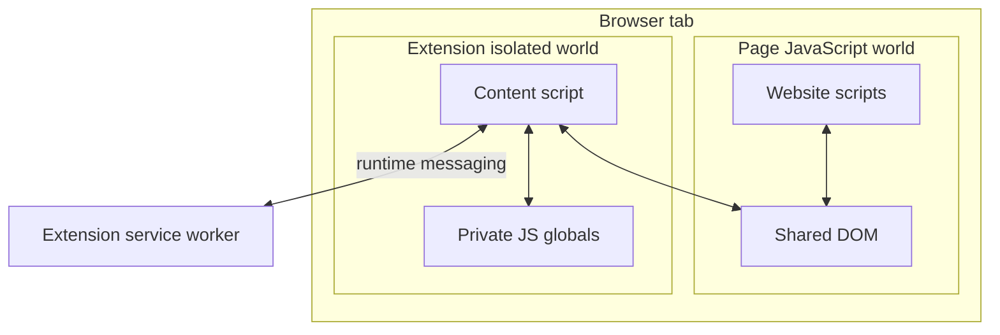

# Content script

## Mục tiêu bài học

Sau bài này, bạn có thể:

- Giải thích content script là gì và phân biệt isolated world với JavaScript world của trang web.
- Hiểu vì sao JavaScript global được cô lập nhưng DOM vẫn là bề mặt chia sẻ giữa extension và trang.
- Khai báo content script trong manifest, chọn `matches`, `run_at` và phạm vi frame phù hợp.
- Thiết kế trao đổi dữ liệu giữa content script, extension service worker và trang web.
- Nhận diện rủi ro DOM XSS, giả mạo message, dữ liệu DOM không tin cậy và leo thang quyền qua extension messaging.
- Áp dụng nguyên tắc least privilege cho host permissions, extension APIs, storage và script injection.
- Kiểm thử content script trên nhiều origin, frame, trạng thái điều hướng và tình huống trang độc hại.

## 1. Content script là gì?

Content script là JavaScript do browser extension đưa vào một trang web phù hợp với quy tắc match của extension. Nó có thể đọc và thay đổi DOM của trang, quan sát sự kiện, thêm giao diện hỗ trợ hoặc trích xuất dữ liệu mà extension cần xử lý. Content script là cầu nối giữa extension và tài liệu web đang mở.

Ví dụ một extension hỗ trợ người dùng đánh dấu các liên kết ngoài. Content script có thể tìm các thẻ `a`, kiểm tra `href`, thêm biểu tượng hoặc gắn sự kiện. Khi cần lưu lựa chọn, script gửi message đến extension service worker để thực hiện thao tác bằng API extension.

Một extension thường có các thành phần:

| Thành phần | Vai trò | Mức tin cậy và quyền |
| --- | --- | --- |
| Web page | Nội dung và JavaScript do website cung cấp. | Không tin cậy từ góc nhìn extension; có thể bị XSS hoặc chủ động tạo dữ liệu/DOM giả. |
| Content script | Chạy trong ngữ cảnh trang nhưng thường có isolated world riêng. | Code do extension phát hành, có quyền đọc/ghi DOM; quyền extension API bị giới hạn theo browser. |
| Extension service worker (Manifest V3) | Xử lý message, điều phối API, sự kiện nền và tác vụ không cần document. | Có quyền extension được cấp trong manifest; không có DOM của tab. |
| Extension page/popup/options | Giao diện do extension sở hữu. | Chạy ở extension origin và dùng các API được cấp. |
| Browser extension APIs | Cung cấp tabs, storage, scripting, permissions, downloads và các khả năng khác. | Mỗi API cần quyền phù hợp; chỉ cấp những quyền thực sự cần. |

Content script không phải một ứng dụng độc lập. Nó chạy trên trang của website và tương tác với DOM do website kiểm soát. Vì vậy, thiết kế an toàn cần phân biệt dữ liệu do extension tạo với dữ liệu có thể bị trang web điều khiển.

## 2. Isolated world: JavaScript riêng, DOM dùng chung

Isolated world là cơ chế giúp content script có môi trường JavaScript riêng với trang web. Các biến global, hàm và prototype của content script không tự động dùng chung với JavaScript chạy trong page world. Trang web không thể đơn giản đọc biến local của content script chỉ bằng cách truy cập `window`.

Tuy nhiên, cả hai world vẫn tương tác với cùng document và DOM. Nếu content script thêm node, thay đổi attribute hoặc gắn dữ liệu vào DOM, trang có thể quan sát những thay đổi đó. Ngược lại, trang có thể sửa node, thay nội dung, tạo event hoặc thay đổi attribute mà content script đang đọc.



Điều cần nhớ:

- Biến JavaScript của hai world được cô lập, nhưng DOM là điểm giao tiếp chung.
- Nội dung trong DOM không tự trở thành dữ liệu đáng tin chỉ vì content script đọc được nó.
- Trang có thể tạo hoặc giả mạo các node, attribute, form, custom event và trạng thái giao diện.
- Extension không nên đặt token, secret hoặc dữ liệu nội bộ vào attribute, text node hay hidden input vì page script có thể đọc DOM.
- Isolated world giảm xung đột và một số rủi ro can thiệp trực tiếp vào biến, nhưng không phải sandbox hoàn chỉnh cho logic xử lý dữ liệu không tin cậy.

### 2.1. Ví dụ về hai JavaScript world

Content script:

```js
// content.js — chạy trong isolated world
const extensionPrivateState = {
  featureEnabled: true
};

window.addEventListener("DOMContentLoaded", () => {
  console.log("Content script đã khởi tạo");
});
```

Website:

```js
// page.js — chạy trong page world
console.log(window.extensionPrivateState); // undefined
```

Biến `extensionPrivateState` không tự xuất hiện trên `window` của page world. Nhưng nếu content script ghi giá trị đó vào `document.documentElement.dataset`, trang có thể đọc attribute. Không dùng DOM làm kho bí mật hoặc kênh truyền credential.

## 3. Khai báo content script trong Manifest V3

Content script có thể được khai báo tĩnh trong manifest hoặc được chèn động bằng `chrome.scripting` khi extension có quyền phù hợp.

Ví dụ manifest tối giản:

```json
{
  "manifest_version": 3,
  "name": "Link helper",
  "version": "1.0.0",
  "permissions": ["storage"],
  "host_permissions": ["https://app.example.com/*"],
  "background": {
    "service_worker": "service-worker.js"
  },
  "content_scripts": [
    {
      "matches": ["https://app.example.com/*"],
      "js": ["content.js"],
      "run_at": "document_idle"
    }
  ]
}
```

Ví dụ này chỉ minh họa cấu trúc Manifest V3. Quyền cụ thể cần được đối chiếu với API và browser hỗ trợ. `matches` xác định trang mà content script được phép chạy; `host_permissions` cấp quyền host cho những API extension cần truy cập host. Không mở rộng thành `<all_urls>` nếu chức năng chỉ cần một vài website.

### 3.1. `matches` và phạm vi website

Match pattern giới hạn URL mà content script có thể chạy. Hãy chọn scheme, host và path hẹp nhất đáp ứng chức năng.

Ví dụ:

```json
{
  "matches": [
    "https://portal.example.com/account/*",
    "https://portal.example.com/reports/*"
  ]
}
```

Nếu extension chỉ cần hỗ trợ một ứng dụng nội bộ, không cần cấp quyền trên mọi subdomain hoặc mọi website. Wildcard host làm tăng số trang có thể tương tác với extension và tăng lượng dữ liệu nhạy cảm mà extension có thể quan sát.

### 3.2. `run_at`

`run_at` xác định thời điểm browser đưa content script vào document:

| Giá trị | Thời điểm | Khi nào dùng |
| --- | --- | --- |
| `document_start` | Sau khi tạo document, trước khi DOM được xây dựng đầy đủ và trước một số script của trang. | Cần quan sát sớm hoặc cài hook trước khi trang chạy logic; DOM có thể chưa có node để thao tác. |
| `document_end` | Sau khi DOM hoàn tất, trước khi tài nguyên phụ như ảnh/frame có thể tải xong. | Cần cấu trúc DOM cơ bản nhưng không cần chờ trang idle. |
| `document_idle` | Browser chọn thời điểm phù hợp sau khi document và phần lớn công việc tải ban đầu hoàn tất. Đây thường là mặc định. | Phù hợp với đa số thao tác đọc/đánh dấu DOM và giảm cạnh tranh với quá trình render. |

Không dùng `document_start` chỉ vì nghĩ nó an toàn hơn. Nếu script cần node, hãy chờ DOM hoặc dùng `MutationObserver` cho nội dung được tạo động. Nếu cần bắt một hành vi trước khi script trang chạy, phải có threat model rõ và kiểm thử theo browser mục tiêu.

### 3.3. Frame và iframe

Mặc định content script thường chạy ở frame chính theo cấu hình. `all_frames: true` có thể yêu cầu chạy trong các frame phù hợp với match pattern. Mỗi frame có URL, DOM và lifecycle riêng; không được giả định frame con cùng origin hoặc đáng tin như frame cha.

Ví dụ:

```json
{
  "content_scripts": [
    {
      "matches": ["https://app.example.com/*"],
      "js": ["content.js"],
      "all_frames": true,
      "run_at": "document_idle"
    }
  ]
}
```

Chỉ bật `all_frames` nếu chức năng thực sự cần tương tác với iframe. Một số frame như `about:blank`, `srcdoc` hoặc frame có URL đặc biệt cần cấu hình fallback riêng và có khác biệt giữa browser. Các tùy chọn như `match_about_blank` hoặc `match_origin_as_fallback` phụ thuộc phiên bản/engine; kiểm tra tài liệu của browser mà extension hỗ trợ. Không mở rộng match một cách mù quáng để xử lý frame không khớp.

Nếu extension chỉ cần frame chính, service worker nên xác minh `sender.frameId === 0` trước khi xử lý message có quyền cao. Nếu cần frame con, xác định rõ origin/URL được phép và loại thao tác nào frame đó được yêu cầu.

## 4. Đọc và thay đổi DOM an toàn

Content script thường xử lý dữ liệu do website cung cấp: tiêu đề, liên kết, nội dung bài viết, tên tài khoản hoặc thuộc tính của form. Trang có thể thay đổi những giá trị này bất kỳ lúc nào. Hãy coi DOM là input không tin cậy.

### 4.1. Ưu tiên API tạo node và textContent

Ví dụ thêm nhãn cho một liên kết:

```js
function addExternalLabel(anchor) {
  const label = document.createElement("span");
  label.className = "extension-external-label";
  label.textContent = "Liên kết ngoài";
  anchor.append(label);
}

for (const anchor of document.querySelectorAll("a[href]")) {
  const target = new URL(anchor.href, location.href);
  if (target.origin !== location.origin) {
    addExternalLabel(anchor);
  }
}
```

`textContent` đưa dữ liệu thành text, không parse nó thành HTML. Khi cần tạo node từ dữ liệu trang, dùng `createElement`, gán text an toàn và chỉ cho phép các attribute cần thiết.

### 4.2. Tránh HTML injection

Không nối nội dung DOM hoặc dữ liệu trang vào `innerHTML`, `outerHTML`, `insertAdjacentHTML`, `document.write`, `eval` hoặc `new Function`.

Ví dụ không an toàn:

```js
const title = document.querySelector("h1")?.textContent ?? "";
container.innerHTML = `<p>Tiêu đề: ${title}</p>`;
```

Ví dụ an toàn hơn:

```js
const title = document.querySelector("h1")?.textContent ?? "";
const paragraph = document.createElement("p");
paragraph.textContent = `Tiêu đề: ${title}`;
container.replaceChildren(paragraph);
```

Nếu thật sự cần hiển thị HTML, dùng sanitizer được duy trì và cấu hình allowlist rõ. Không coi isolated world là lý do để bỏ qua DOM XSS; content script vẫn có thể tạo lỗ hổng trong giao diện extension hoặc làm thay đổi trang theo cách nguy hiểm.

### 4.3. Kiểm tra URL trước khi dùng

Không lấy `href` từ DOM rồi gửi trực tiếp đến privileged API hoặc mở tab mà không parse và allowlist scheme/host. Trang có thể tạo liên kết `javascript:`, `data:` hoặc URL giả dạng domain tin cậy.

```js
function getAllowedHttpUrl(value) {
  try {
    const url = new URL(value, location.href);
    if (url.protocol !== "https:" && url.protocol !== "http:") {
      return null;
    }
    return url;
  } catch {
    return null;
  }
}
```

Nếu nghiệp vụ chỉ hỗ trợ một số domain, kiểm tra `url.origin` với allowlist cụ thể. Không dùng kiểm tra chuỗi như `href.includes("example.com")`, vì `https://example.com.attacker.test/` vẫn chứa chuỗi đó.

### 4.4. DOM có thể thay đổi sau khi đọc

Trang SPA thường thay DOM sau mỗi lần điều hướng nội bộ hoặc cập nhật dữ liệu. Một node có thể bị thay thế sau khi content script đã kiểm tra nó. Khi hành động quan trọng, hãy đọc lại giá trị cần thiết ngay trước khi gửi request và xác minh ở service worker/server. Không dùng một lần kiểm tra DOM cũ làm bằng chứng cho quyền hoặc trạng thái hiện tại.

`MutationObserver` hữu ích để phát hiện node mới, nhưng không chứng minh node đó hợp lệ. Debounce callback, giới hạn phạm vi quan sát và tránh xử lý đệ quy khi chính extension thay đổi DOM.

## 5. Trao đổi message với extension service worker

Content script không nên tự thực hiện mọi thao tác đặc quyền. Mô hình phổ biến là gửi message đến service worker; service worker kiểm tra nguồn gửi, schema, quyền và ngữ cảnh rồi mới gọi API extension.

Ví dụ content script:

```js
const pageTitle = document.title.slice(0, 200);

chrome.runtime.sendMessage({
  type: "SAVE_PAGE_TITLE",
  title: pageTitle
}).then((result) => {
  if (!result?.ok) {
    console.warn("Không thể lưu tiêu đề trang");
  }
});
```

Service worker:

```js
const ALLOWED_ORIGINS = new Set([
  "https://app.example.com"
]);

chrome.runtime.onMessage.addListener((message, sender, sendResponse) => {
  if (sender.id !== chrome.runtime.id) return;
  if (!sender.tab || sender.frameId !== 0) return;

  let sourceOrigin;
  try {
    sourceOrigin = new URL(sender.url).origin;
  } catch {
    return;
  }

  if (!ALLOWED_ORIGINS.has(sourceOrigin)) return;
  if (!message || message.type !== "SAVE_PAGE_TITLE") return;
  if (typeof message.title !== "string") return;

  const title = message.title.trim().slice(0, 200);
  if (!title) {
    sendResponse({ ok: false });
    return;
  }

  void chrome.storage.local.set({ lastPageTitle: title })
    .then(() => sendResponse({ ok: true }))
    .catch(() => sendResponse({ ok: false }));

  return true;
});
```

Đây là ví dụ cho Chrome Manifest V3. API, kiểu Promise và chi tiết `MessageSender` có thể khác theo browser/version. Trong production, kiểm tra `sender.id`, `sender.url`/origin, tab và frame theo yêu cầu; không lấy `tabId`, origin hoặc quyền từ field do message payload tự khai báo. Nếu cần cho phép nhiều frame, dùng allowlist riêng cho từng frame origin và action.

### 5.1. Message payload là dữ liệu không tin cậy

Ngay cả message đến từ content script của extension cũng có thể chứa dữ liệu lấy từ DOM mà trang web kiểm soát. Service worker cần:

- Kiểm tra `message` là object có schema đúng.
- Allowlist `type` và các field được phép; từ chối field thừa nếu giao thức cần nghiêm ngặt.
- Kiểm tra kiểu dữ liệu, độ dài, số lượng phần tử và định dạng URL.
- Tự lấy tab/frame/origin từ `sender`, không tin metadata trong payload.
- Kiểm tra user permission và trạng thái extension trước khi thao tác.
- Không biến message chung chung thành API thực thi lệnh tùy ý.

Không xây dựng handler như `{ action: message.action, args: message.args }` rồi gọi một privileged function bất kỳ. Hãy tạo từng message type hẹp, ví dụ `SAVE_PAGE_TITLE`, `GET_FEATURE_STATE` hoặc `OPEN_ALLOWED_HELP_PAGE`, với schema và quyền riêng.

### 5.2. Sender verification không thay thế authorization

Kiểm tra sender giúp biết message đến từ extension context và trang/frame nào. Nó không chứng minh dữ liệu DOM là thật, người dùng đã đồng ý hoặc thao tác nghiệp vụ được phép. Service worker vẫn phải xác minh permission, allowlist, trạng thái người dùng và điều kiện nghiệp vụ trước khi thực hiện hành động.

Nếu extension gọi backend, backend vẫn cần xác thực người dùng và authorize resource. Không tin rằng request xuất phát từ extension đồng nghĩa đã được người dùng cho phép.

## 6. Giao tiếp giữa content script và page world

Đôi khi content script cần trao đổi với JavaScript của trang, ví dụ website cung cấp một API JavaScript chỉ tồn tại trong page world. Có thể dùng `window.postMessage`, DOM event hoặc một cầu nối khác. Đây là ranh giới không tin cậy: trang có thể gửi message giả, đọc message mà extension phát ra và thay đổi thứ tự sự kiện.

Ví dụ page script có thể gửi:

```js
window.postMessage({
  source: "example-page",
  type: "REQUEST_STATUS"
}, location.origin);
```

Content script có thể lắng nghe, nhưng phải coi toàn bộ `event.data` là input từ website:

```js
window.addEventListener("message", (event) => {
  if (event.source !== window) return;
  if (event.origin !== location.origin) return;
  if (!event.data || event.data.type !== "REQUEST_STATUS") return;

  // Chỉ trả trạng thái không nhạy cảm và đã được allowlist.
  window.postMessage({
    source: "link-helper",
    type: "STATUS",
    enabled: true
  }, location.origin);
});
```

Kiểm tra `event.origin` và `event.source` là cần thiết nhưng không xác thực được danh tính của một script cụ thể trong cùng page origin. Bất kỳ script nào chạy trong page world của origin đó đều có thể tạo message tương tự. Không dùng `source` string như `example-page` làm bằng chứng tin cậy.

Không gửi token, cookie, private key, dữ liệu extension nội bộ hoặc kết quả privileged operation qua `postMessage` nếu trang không cần biết. Nếu cần một bridge, chỉ cung cấp các thao tác tối thiểu và dữ liệu ít nhạy cảm; xác minh từng request ở service worker.

### 6.1. Không tin CustomEvent

Trang có thể dispatch `CustomEvent` với cùng tên và detail mà content script sử dụng. Vì vậy, một event như `extension:save-settings` không thể được coi là lệnh tin cậy chỉ vì tên có prefix extension. Nếu phải dùng event, validate schema và không cho event trực tiếp kích hoạt API đặc quyền.

### 6.2. Không đưa code đặc quyền vào MAIN world

Một số API injection cho phép chạy script trong `MAIN` world để tương tác với biến JavaScript của trang. Khi chạy ở page world, code chia sẻ môi trường với website và có thể bị page can thiệp; nó cũng không có cùng quyền extension API như isolated world.

Chỉ dùng MAIN world khi thật sự cần tích hợp với API của trang. Truyền dữ liệu tối thiểu, không truyền secret, không giả định biến/hàm của trang đáng tin và đưa mọi yêu cầu đặc quyền qua message đã xác thực ở service worker.

## 7. DOM XSS và dữ liệu do trang kiểm soát

Content script có thể trở thành nguồn phát sinh XSS nếu đưa dữ liệu trang vào HTML, URL, CSS hoặc JavaScript theo cách không an toàn. Một extension còn có thể làm tăng tác động của lỗ hổng bằng cách đọc dữ liệu trang rồi gửi đến backend hoặc mở URL ngoài.

Các nguồn dữ liệu không tin cậy thường gặp:

- `document.title`, `location.href`, text và attribute trong DOM.
- Giá trị input, textarea, select và form.
- `href`, `src`, `data-*` hoặc thuộc tính do website tạo.
- Message từ `window.postMessage`, CustomEvent hoặc event handler.
- Nội dung từ API của website, kể cả khi được render thành DOM.
- Dữ liệu từ iframe hoặc frame khác origin.

Các quy tắc phòng vệ:

- Dùng `textContent`, `createElement` và DOM API an toàn.
- Tránh `innerHTML`, `outerHTML`, `insertAdjacentHTML`, `eval` và `new Function`.
- Parse URL bằng `URL`, kiểm tra protocol/origin và allowlist host.
- Không tự tạo script tag hoặc chuyển chuỗi dữ liệu thành JavaScript.
- Không dùng DOM attributes làm kho credential hoặc kênh truyền secret.
- Không gửi toàn bộ DOM/page text về service worker hoặc server khi chỉ cần vài field.
- Encode output theo đúng context nếu hiển thị dữ liệu trong extension page.

Content script không nên tin rằng dữ liệu trang đã được server xác thực. Website có thể bị XSS, API có thể trả nội dung do user tạo và người dùng có thể dùng DevTools để sửa DOM. Kiểm tra authorization và tính hợp lệ ở server vẫn là bắt buộc cho thao tác nghiệp vụ.

## 8. Permissions và nguyên tắc least privilege

Quyền extension quyết định extension có thể tương tác với website và API browser nào. Một quyền rộng có thể làm tăng lượng dữ liệu extension quan sát được và mức độ ảnh hưởng nếu extension bị xâm nhập.

Một số khái niệm:

| Quyền/cơ chế | Ý nghĩa | Cách dùng an toàn |
| --- | --- | --- |
| `host_permissions` | Cho phép extension truy cập một số host qua API cần quyền host. | Chỉ khai báo origin/path thực sự cần. |
| `content_scripts.matches` | Chỉ định URL có thể nhận content script tĩnh. | Giới hạn theo website và route nghiệp vụ. |
| `activeTab` | Cấp quyền truy cập tạm thời vào tab sau thao tác người dùng đủ điều kiện. | Ưu tiên khi chức năng chỉ chạy khi người dùng bấm nút extension. |
| `optional_host_permissions` | Cho phép xin thêm quyền host khi cần. | Giải thích mục đích và yêu cầu từ thao tác rõ ràng của người dùng. |
| `scripting` | Cho phép dùng API scripting để chèn script theo quyền phù hợp. | Chỉ inject file/code đã đóng gói và vào tab được phép. |
| `storage` | Cho phép dùng storage API của extension theo hỗ trợ của browser. | Hạn chế context được truy cập và không lưu secret không cần thiết. |

Không xin `<all_urls>`, `tabs`, `webRequest`, `cookies` hoặc quyền rộng khác chỉ để tránh phải thiết kế lại. Một số API có thể cần quyền riêng; hãy kiểm tra chính xác yêu cầu của browser và chức năng.

### 8.1. Quyền theo thao tác người dùng

Nếu extension chỉ cần đánh dấu trang hiện tại sau khi người dùng bấm biểu tượng, `activeTab` và injection theo thao tác có thể phù hợp hơn việc chạy content script trên mọi trang. Cách này giảm quyền thường trực và làm rõ thời điểm extension được phép tương tác.

Khi dùng optional permissions, giải thích extension sẽ đọc hoặc thay đổi gì trên website. Không yêu cầu quyền mới ngay khi cài đặt nếu chức năng chưa cần.

### 8.2. Content script và cross-origin fetch

Content script chạy trên trang không tự có quyền tùy ý gọi mọi host. Request từ content script chịu các giới hạn của môi trường và browser; request cross-origin có thể cần CORS hoặc host permission theo API. Với thao tác cần quyền host của extension, thường nên chuyển sang service worker, nơi có thể dùng host permission được khai báo.

Không dùng service worker như proxy tùy ý cho URL do page gửi. Hãy allowlist origin, path và method; giới hạn response bytes; không chuyển tiếp credential của extension đến host ngoài allowlist.

## 9. Storage và dữ liệu nhạy cảm

Extension có thể dùng storage API để lưu preference, trạng thái UI hoặc dữ liệu cần đồng bộ. Content script không nên được xem là nơi giữ secret lâu dài.

- Không nhúng API key bí mật, private key hoặc client secret vào bundle extension; package có thể được giải nén và kiểm tra.
- Không lưu session token của website chỉ vì content script có thể đọc DOM hoặc cookie không HttpOnly.
- Không ghi credential vào `localStorage` của trang hoặc DOM attribute.
- Chỉ lưu dữ liệu tối thiểu, đặt retention và cleanup rõ ràng.
- Phân biệt dữ liệu theo account/profile và xử lý logout/đổi tài khoản.
- Nếu browser hỗ trợ storage access level, giới hạn vùng storage nhạy cảm cho trusted extension contexts; kiểm tra khả năng tương thích trước khi dựa vào tính năng này.
- Không coi mã hóa bằng key nhúng trong extension là bảo vệ trước người có thể đọc package và runtime.

Nếu content script cần preference, chỉ gửi/nhận field cần thiết qua service worker. Tránh trả toàn bộ object storage cho mọi content script trên mọi website.

## 10. Extension CSP và script injection

Extension pages có Content Security Policy riêng theo manifest và browser. Manifest V3 áp dụng hạn chế chặt với code thực thi từ xa; extension không nên tải JavaScript rồi thực thi như code của mình. Đóng gói script cần thiết cùng extension, cập nhật qua quy trình phát hành và dùng dependency được kiểm tra.

Ví dụ CSP cho extension pages trong Manifest V3:

```json
{
  "content_security_policy": {
    "extension_pages": "script-src 'self'; object-src 'self'"
  }
}
```

Đây là ví dụ chính sách tối giản; browser có giới hạn và cú pháp manifest riêng. Không thêm `unsafe-eval` hoặc tải remote code để né giới hạn. CSP của extension pages và CSP của website là hai chính sách khác nhau.

Content script chạy trong isolated world, nhưng nếu extension chèn `<script>` vào DOM để chạy trong page world, script đó có thể chịu CSP của trang và chia sẻ quyền JavaScript với trang. Không coi việc chèn script là cách an toàn để gọi extension API.

### 10.1. Web accessible resources

Tài nguyên extension được khai báo là web-accessible có thể được website tải theo các quy tắc match đã khai báo. Không đặt secret, private configuration hoặc dữ liệu người dùng vào tài nguyên web-accessible. Chỉ công khai file thực sự cần để trang web tải, ví dụ một asset giao diện hoặc script bridge tối giản.

## 11. UI overlay và clickjacking trong content script

Content script đôi khi thêm nút, banner hoặc panel lên website. DOM do page kiểm soát nên trang có thể di chuyển, che hoặc giả mạo các phần tử. Ngược lại, extension cũng có thể vô tình che nút xác nhận, thông báo bảo mật hoặc nội dung quan trọng của website.

Khi tạo UI:

- Dùng namespace class/id riêng để tránh xung đột CSS.
- Không giả mạo thương hiệu, hộp đăng nhập hoặc hộp thoại xác nhận của website.
- Làm rõ thành phần nào do extension tạo và cung cấp cách đóng/tắt.
- Không đặt nút extension chồng lên nút thanh toán, xóa dữ liệu hoặc xác nhận nhạy cảm.
- Không tin vị trí/visibility của node làm bằng chứng người dùng đã nhìn thấy hoặc bấm đúng thành phần.
- Xử lý focus, keyboard và screen reader; không cướp focus khi người dùng không yêu cầu.

Shadow DOM có thể giúp cô lập style của UI extension khỏi CSS trang, nhưng không phải ranh giới bảo mật. Trang vẫn có thể tác động đến host element, layout và các phần tử ngoài shadow root; dữ liệu hiển thị vẫn có thể bị đọc qua giao diện hoặc accessibility tree.

## 12. Navigation, SPA và lifecycle

Content script thường được tạo lại khi document mới được tải. Với SPA, route có thể thay đổi bằng `history.pushState()` mà không tạo document mới; content script không nhất thiết được chạy lại.

Nếu extension theo dõi route:

- Lắng nghe các tín hiệu phù hợp hoặc quan sát DOM thay đổi.
- Không monkey-patch `history.pushState` trong MAIN world nếu không có yêu cầu rõ; cách đó ảnh hưởng trang và có thể bị can thiệp.
- Debounce xử lý route để tránh chạy nhiều lần.
- Xóa listener, observer và UI cũ khi không còn cần.
- Không giữ dữ liệu của route trước khi người dùng chuyển sang route hoặc account khác.
- Kiểm tra lại URL và quyền trước thao tác nhạy cảm sau navigation.

Frame có thể được tạo/xóa động; tab có thể điều hướng trong khi message đang chờ. Service worker phải xử lý trường hợp sender tab/frame đã biến mất hoặc URL thay đổi. Không dựa vào trạng thái DOM cũ khi thực hiện thao tác bất đồng bộ.

## 13. Ví dụ kiến trúc content script an toàn

Ví dụ sau cho thấy content script chỉ thu thập tiêu đề ngắn trên một website được allowlist, rồi gửi message có schema hẹp đến service worker. Service worker tự lấy thông tin sender và chỉ lưu khi origin/frame phù hợp.

`manifest.json`:

```json
{
  "manifest_version": 3,
  "name": "Page note helper",
  "version": "1.0.0",
  "permissions": ["storage"],
  "host_permissions": ["https://portal.example.com/*"],
  "background": {
    "service_worker": "service-worker.js"
  },
  "content_scripts": [
    {
      "matches": ["https://portal.example.com/*"],
      "js": ["content.js"],
      "run_at": "document_idle"
    }
  ]
}
```

`content.js`:

```js
function getPageTitle() {
  return String(document.title || "").trim().slice(0, 200);
}

async function saveTitle() {
  const title = getPageTitle();
  if (!title) return;

  try {
    await chrome.runtime.sendMessage({
      type: "SAVE_PAGE_TITLE",
      title
    });
  } catch {
    // Service worker có thể đang dừng hoặc tab đã điều hướng.
  }
}

void saveTitle();
```

`service-worker.js`:

```js
const ALLOWED_ORIGIN = "https://portal.example.com";

chrome.runtime.onMessage.addListener((message, sender, sendResponse) => {
  if (sender.id !== chrome.runtime.id) return;
  if (!sender.tab || sender.frameId !== 0) return;

  let origin;
  try {
    origin = new URL(sender.url).origin;
  } catch {
    return;
  }

  if (origin !== ALLOWED_ORIGIN) return;
  if (message?.type !== "SAVE_PAGE_TITLE") return;
  if (typeof message.title !== "string") return;

  const title = message.title.trim().slice(0, 200);
  if (!title) {
    sendResponse({ ok: false });
    return;
  }

  void chrome.storage.local.set({ lastPageTitle: title })
    .then(() => sendResponse({ ok: true }))
    .catch(() => sendResponse({ ok: false }));

  return true;
});
```

Đây là ví dụ kiến trúc, không phải một tính năng lưu dữ liệu hoàn chỉnh. `document.title` do website kiểm soát và có thể chứa nội dung không mong muốn; service worker giới hạn độ dài và chỉ lưu như text. Nếu extension gửi dữ liệu đến server, cần thông báo cho người dùng, giới hạn dữ liệu, xác thực backend và áp dụng chính sách quyền riêng tư. Trong ứng dụng thực, cũng cần tránh ghi đè một giá trị dùng chung khi nhiều tab hoạt động; có thể lưu theo tab/document ID hoặc để người dùng chủ động chọn lưu.

## 14. Những lỗi thường gặp

| Lỗi | Hậu quả | Cách khắc phục |
| --- | --- | --- |
| Nghĩ isolated world có nghĩa DOM đáng tin | Trang có thể tạo/sửa node và dữ liệu mà content script đọc. | Xem DOM là input không tin cậy; validate schema và URL. |
| Đưa dữ liệu trang vào `innerHTML` | DOM XSS trong giao diện extension hoặc trang. | Dùng `textContent`, `createElement` và sanitizer khi thật sự cần HTML. |
| Dùng `postMessage` như kênh xác thực | Trang cùng origin có thể giả mạo message. | Kiểm tra origin/source, coi payload không tin cậy và không gửi secret. |
| Service worker tin `tabId` hoặc origin từ payload | Content script/page có thể yêu cầu thao tác trên tab/host khác. | Dùng `sender.tab`, `sender.url`, `sender.frameId` do browser cung cấp. |
| Message có action tùy ý | Content script trở thành proxy cho API đặc quyền. | Dùng message type allowlist, schema chặt và authorization theo action. |
| Dùng `<all_urls>` cho chức năng hẹp | Extension có thể đọc/đụng đến nhiều website hơn cần thiết. | Dùng match pattern hẹp, `activeTab` hoặc optional host permissions. |
| Bật `all_frames` mà không kiểm tra frame | Extension xử lý dữ liệu từ iframe ngoài dự kiến. | Xác minh frame URL/origin và chỉ bật khi cần. |
| Chèn script vào MAIN world để lấy quyền | Code chạy cùng page, dễ bị trang can thiệp và không giữ isolated-world boundary. | Giữ logic đặc quyền trong service worker/isolated world; bridge hẹp khi bắt buộc. |
| Lưu secret trong bundle hoặc DOM | Website hoặc người dùng có thể trích xuất. | Không nhúng secret; không đưa dữ liệu nội bộ vào DOM. |
| Cho rằng Shadow DOM là sandbox | Host/layout và nội dung hiển thị vẫn chịu ảnh hưởng từ trang. | Dùng Shadow DOM cho style isolation, không dùng làm ranh giới tin cậy. |

## 15. Kiểm thử content script

Kiểm thử trên extension build cục bộ và các website thử nghiệm. Không dùng dữ liệu tài khoản thật hoặc host production ngoài phạm vi quyền được cấp.

| Kịch bản | Cách kiểm tra | Kết quả mong đợi |
| --- | --- | --- |
| Match pattern | Mở trang được phép và trang ngoài allowlist. | Content script chỉ chạy ở URL được khai báo. |
| Isolated world | Tạo biến global cùng tên ở page script và content script. | Biến không tự chia sẻ giữa hai world. |
| DOM tampering | Website thay nội dung/attribute sau khi content script đọc. | Extension không coi giá trị cũ là bằng chứng; thao tác quan trọng được kiểm tra lại. |
| DOM XSS | Đặt chuỗi HTML giả trong title/text/attribute. | UI extension hiển thị như text, không tạo node thực thi. |
| URL scheme | Đưa `javascript:`, `data:` và domain giả vào `href`. | URL bị từ chối theo allowlist protocol/origin. |
| Forged message | Page gửi `postMessage` hoặc CustomEvent giả. | Bridge không thực hiện privileged action hoặc trả dữ liệu nhạy cảm. |
| Invalid runtime message | Gửi message thiếu field, sai type hoặc field quá dài. | Service worker từ chối message và không gọi API. |
| Sender/frame validation | Gửi từ frame không được phép hoặc trang khác origin. | Service worker từ chối dựa trên sender metadata. |
| SPA navigation | Dùng `pushState`, thay route và cập nhật DOM. | Content script xử lý route đúng, không tạo observer/listener lặp. |
| Frame lifecycle | Tạo rồi xóa iframe, điều hướng frame. | Extension chỉ xử lý frame được phép và dọn trạng thái khi frame biến mất. |
| Permission scope | Thu hồi host permission hoặc thử tab ngoài phạm vi. | Extension xử lý lỗi quyền mà không cố truy cập host ngoài allowlist. |
| Service worker restart | Để worker dừng rồi gửi message mới. | Content script xử lý Promise/rejection và worker khởi tạo trạng thái cần thiết lại. |

### 15.1. Quan sát bằng DevTools

Trong Chrome, mở `chrome://extensions`, bật Developer mode và mở DevTools của extension/service worker hoặc content script từ trang extension tương ứng. Giao diện và cách gắn DevTools khác giữa browser.

Kiểm tra:

1. Content script có xuất hiện ở đúng frame và thời điểm `run_at` không.
2. Console của page world và isolated world có tách biệt như dự kiến không.
3. DOM thay đổi do extension có lộ dữ liệu nội bộ hoặc tạo node không an toàn không.
4. Message đến service worker có đúng schema, sender URL và frame ID không.
5. Service worker có từ chối message giả hoặc message từ origin ngoài allowlist không.
6. Manifest chỉ yêu cầu host/API permission cần thiết; không có wildcard thừa.
7. Network panel có request ngoài dự kiến hoặc dữ liệu trang bị gửi đi không.
8. Sau navigation/reload, observer, listener và UI cũ có được dọn đúng không.

DevTools chỉ hỗ trợ quan sát. Cần kiểm thử logic validate message, URL allowlist và permission bằng test tự động phù hợp với extension code. Không đưa token, cookie hoặc nội dung trang nhạy cảm vào screenshot/log chia sẻ.

## 16. Bài thực hành

Xây dựng extension Manifest V3 nhỏ chỉ chạy trên `https://portal.example.com/*`, thêm một nhãn UI và gửi tiêu đề trang đến service worker để lưu preference thử nghiệm.

1. Khai báo content script tĩnh với match pattern hẹp và `run_at: "document_idle"`.
2. Đọc tiêu đề trang và hiển thị bằng `textContent`; không đưa dữ liệu DOM vào `innerHTML`.
3. Gửi message có `type` cố định và schema tối giản đến service worker.
4. Ở service worker, kiểm tra `sender.id`, `sender.url`, `sender.tab`, `sender.frameId` và schema trước khi ghi storage.
5. Thử message có type giả, title quá dài, URL giả và message từ frame khác; xác nhận bị từ chối.
6. Tạo DOM chứa chuỗi HTML giả và liên kết `javascript:`; xác nhận content script không thực thi hoặc mở URL đó.
7. Dùng `postMessage` giả từ page world và kiểm tra bridge không tiết lộ dữ liệu extension.
8. Thử SPA navigation và iframe để xác định lifecycle, phạm vi match và cleanup.
9. Rà soát manifest để loại quyền không cần và ghi lại lý do cho từng permission.
10. Ghi nhận những dữ liệu extension đọc, lưu và gửi đi; loại bỏ field không cần thiết.

Hoàn thành bài thực hành khi bạn chứng minh được isolated world không làm DOM trở nên đáng tin, message được xác minh trước khi dùng API đặc quyền, content script chỉ chạy trên host/frame đã cho phép và dữ liệu trang không thể kích hoạt DOM XSS hoặc privileged action tùy ý.
