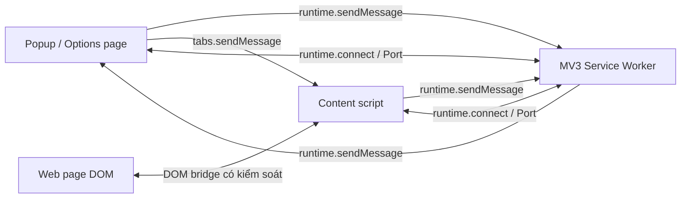

# Extension messaging

> **Chương:** Browser extension  
> **Chủ đề:** Extension messaging  
> **Module:** SECURITY_APPLICATION_SECURITY_BROWSER_SECURITY — phân tích ranh giới bảo mật giữa trình duyệt, origin, cookie và ứng dụng web để hiểu Same-Origin Policy, CORS và các cơ chế cách ly. Thực hành phòng vệ XSS, CSRF, clickjacking bằng CSP, Trusted Types, security headers và kiểm chứng hành vi thực tế.

## Mục tiêu học tập

Sau bài học, bạn có thể:

1. Mô tả các context trong browser extension và ranh giới giữa chúng.
2. Chọn đúng `runtime.sendMessage`, `tabs.sendMessage`, `runtime.connect` và `tabs.connect`.
3. Thiết kế request/response envelope có version, request ID và error contract.
4. Xử lý asynchronous response, timeout, disconnect và retry.
5. Kiểm tra sender, tab, frame, origin và schema trước khi xử lý message.
6. Ngăn content script hoặc webpage biến extension thành confused deputy.
7. Quản lý Port và trạng thái tạm thời trong Manifest V3 service worker.
8. Kiểm thử messaging bằng một extension local tối giản.

## 1. Extension messaging là gì?

Browser extension thường gồm nhiều thành phần chạy trong các context khác nhau:

- **Popup/action UI:** giao diện nhỏ mở từ biểu tượng extension.
- **Options page:** trang cấu hình extension.
- **Content script:** script được inject vào trang web để đọc hoặc thay đổi DOM theo quyền được cấp.
- **Background service worker:** thành phần nền của Manifest V3, nhận event và điều phối công việc.
- **Extension page/tab:** trang do extension sở hữu, có thể chứa UI hoặc công cụ riêng.
- **Offscreen document:** document nền được tạo khi extension cần một số khả năng DOM mà service worker không có.

Các context này không chia sẻ trực tiếp một JavaScript global hoặc DOM. Popup không thể truy cập biến trong content script; service worker cũng không có document của tab. Extension messaging cung cấp kênh truyền dữ liệu giữa các context.

Mô hình phổ biến:



Service worker có thể đóng vai trò broker để kiểm tra quyền, đọc storage hoặc gọi API extension. Content script đóng vai trò adapter giữa trang web và extension. Hãy giới hạn dữ liệu đi qua từng kênh và chỉ gửi những gì bên nhận thật sự cần.

## 2. Chọn API messaging phù hợp

Chrome Extensions API thường dùng namespace `chrome.*`. Các browser hỗ trợ WebExtensions có thể cung cấp `browser.*` và khác biệt nhỏ về Promise/callback; nếu cần tương thích nhiều browser, kiểm tra compatibility matrix hoặc dùng polyfill phù hợp.

| API | Kiểu giao tiếp | Dùng khi |
|---|---|---|
| `chrome.runtime.sendMessage()` | Một request, một response | Popup/content script gửi lệnh hoặc dữ liệu tới extension listener |
| `chrome.tabs.sendMessage(tabId, message)` | Một request, một response | Extension UI/service worker gửi message tới content script trong tab |
| `chrome.runtime.connect()` | Kênh Port hai chiều | Extension context cần trao đổi nhiều message với service worker |
| `chrome.tabs.connect(tabId)` | Kênh Port tới content script | Extension cần giao tiếp nhiều lần với content script trong tab |
| `window.postMessage()` | Kênh giữa window/page và content script | Chỉ dùng khi cần bridge với page script; phải xác thực chặt và coi payload là không tin cậy |

### 2.1. runtime.sendMessage

Từ popup hoặc content script, gọi:

```js
const response = await chrome.runtime.sendMessage({
  version: 1,
  type: 'PREFERENCE_GET',
  requestId: crypto.randomUUID(),
});
```

Message được gửi tới listener trong extension, thường là service worker hoặc extension page phù hợp. `runtime.sendMessage()` không phải API tổng quát để popup chọn một content script bất kỳ trong tab; dùng `tabs.sendMessage()` cho đích đó.

### 2.2. tabs.sendMessage

Popup hoặc service worker gửi tới content script trong một tab:

```js
const [tab] = await chrome.tabs.query({
  active: true,
  currentWindow: true,
});

if (!tab?.id) {
  throw new Error('No active tab');
}

const response = await chrome.tabs.sendMessage(tab.id, {
  version: 1,
  type: 'PAGE_TITLE_GET',
  requestId: crypto.randomUUID(),
});
```

Nếu content script chưa được inject, tab đã đóng hoặc frame đích không tồn tại, request có thể reject với lỗi kiểu “Receiving end does not exist”. UI cần xử lý lỗi này và đưa ra hướng dẫn phù hợp thay vì giả định mọi tab đều có listener.

Có thể chỉ định `frameId` hoặc `documentId` trong các API/phiên bản hỗ trợ khi cần nhắm tới frame hoặc document cụ thể. Mặc định, việc gửi tới tab có thể tạo listener ở nhiều frame; thiết kế handler và quyền truy cập phải tính tới iframe.

### 2.3. runtime.connect và tabs.connect

Port phù hợp với luồng cần nhiều message trong cùng một kết nối:

```js
const port = chrome.runtime.connect({
  name: 'settings-channel-v1',
});

port.onMessage.addListener((message) => {
  console.log('Received:', message);
});

port.onDisconnect.addListener(() => {
  console.log('Port disconnected');
});

port.postMessage({
  version: 1,
  type: 'PING',
  requestId: crypto.randomUUID(),
});
```

`runtime.connect()` kết nối extension context với listener `runtime.onConnect`. `tabs.connect(tabId)` tạo Port hướng tới content script trong tab. Port có `postMessage`, `onMessage`, `onDisconnect`; ứng dụng phải tự định nghĩa protocol request/response và correlation.

Port không tự cung cấp authentication, authorization, retry hay bảo đảm dữ liệu được lưu bền vững. Kết nối bị đóng khi một đầu bị unload, tab/frame đóng hoặc extension context bị dừng.

## 3. One-time message và long-lived Port

### 3.1. Khi nào dùng one-time message?

Dùng `sendMessage()` khi thao tác ngắn, có kết quả rõ ràng và không cần giữ kết nối:

- Đọc preference.
- Yêu cầu content script lấy tiêu đề trang hiện tại.
- Gửi một event đơn giản.
- Yêu cầu service worker mở một tab hoặc thực hiện một thao tác đã allowlist.

Ưu điểm là API gọn, lifecycle dễ hiểu và không phải tự quản lý Port. Mỗi message nên có type cụ thể, payload nhỏ và response contract rõ ràng.

### 3.2. Khi nào dùng Port?

Port hữu ích khi cần:

- Stream nhiều event trạng thái.
- Theo dõi tiến trình một tác vụ dài.
- Đồng bộ nhiều thay đổi trong một phiên UI.
- Trao đổi hai chiều liên tục giữa popup/content script và service worker.

Không giữ Port chỉ để thay thế event listener hoặc polling đơn giản. Mỗi Port tiêu thụ tài nguyên và có thể disconnect khi context bị đóng. Với popup, người dùng đóng popup thì Port từ popup cũng mất; tác vụ quan trọng nên được quản lý bởi service worker và storage thay vì phụ thuộc popup tồn tại.

### 3.3. Port không phải background process vĩnh viễn

Trong Manifest V3, background là extension service worker. Browser có thể suspend/terminate worker khi không còn công việc cần xử lý. Port không nên được xem là bảo đảm worker sẽ sống mãi hoặc message sẽ được xử lý sau khi browser restart.

Khi Port disconnect:

- Dừng timer và listener liên quan.
- Xóa reference tới Port đã đóng.
- Báo UI nếu tác vụ bị gián đoạn.
- Chỉ reconnect khi còn nhu cầu và có điều kiện retry rõ ràng.
- Nếu tác vụ phải tiếp tục sau khi worker dừng, lưu trạng thái vào `chrome.storage` hoặc backend phù hợp.

## 4. Thiết kế message protocol

Message nên là data transfer object (DTO) nhỏ, có schema rõ ràng. Không gửi DOM node, function, class instance phức tạp, object chứa credential hoặc toàn bộ page state nếu chỉ cần một vài field.

### 4.1. Request envelope

Một envelope đơn giản:

```json
{
  "version": 1,
  "type": "PREFERENCE_GET",
  "requestId": "8e5c9d3a-...",
  "payload": {}
}
```

Các field:

| Field | Vai trò |
|---|---|
| `version` | Version của protocol |
| `type` | Tên lệnh thuộc allowlist |
| `requestId` | ID để ghép request và response |
| `payload` | Dữ liệu đúng schema của message type |

### 4.2. Response envelope

```json
{
  "version": 1,
  "requestId": "8e5c9d3a-...",
  "ok": true,
  "data": {
    "displayMode": "compact"
  }
}
```

Response lỗi nên có mã ổn định và thông báo không chứa stack trace hoặc secret:

```json
{
  "version": 1,
  "requestId": "8e5c9d3a-...",
  "ok": false,
  "error": {
    "code": "INVALID_REQUEST",
    "message": "The message is not supported."
  }
}
```

Không trả raw exception, token, cookie, đường dẫn nội bộ hoặc dữ liệu nhạy cảm trong error message. Log chi tiết ở extension context có quyền phù hợp và redact payload trước khi ghi.

### 4.3. Versioning và tương thích

Khi thay đổi protocol, tăng version hoặc bổ sung field theo cách backward-compatible. Bên nhận phải từ chối version không hỗ trợ bằng lỗi rõ ràng. Không âm thầm diễn giải message cũ theo schema mới nếu semantics đã thay đổi.

Đặt tên type theo hành động cụ thể như `PREFERENCE_GET`, `PAGE_TITLE_GET`, `TAB_CAPTURE_REQUEST`. Tránh API chung như `EXECUTE`, `RUN_CODE`, `FETCH_ANY_URL` hoặc `CALL_METHOD`, vì chúng mở rộng quyền của bên gửi quá mức.

### 4.4. Serialization

Message passing chỉ nên chứa dữ liệu có thể serialize theo API và browser mục tiêu. Chrome và các browser WebExtensions có thể khác nhau ở chi tiết serialization; vì vậy hãy ưu tiên JSON-compatible values: string, number, boolean, null, array và object thuần.

Không dựa vào việc function, DOM node, Error instance, Map/Set, prototype hoặc object đặc biệt sẽ được giữ nguyên qua message. Nếu cần dữ liệu nhị phân lớn, dùng API phù hợp như Blob/ArrayBuffer khi browser hỗ trợ hoặc lưu dữ liệu trong storage rồi truyền một key tham chiếu. Giới hạn kích thước payload để tránh làm nghẽn service worker.

## 5. Xử lý asynchronous response

Listener `runtime.onMessage` có thể cần đọc storage hoặc gọi API bất đồng bộ. Trong Chrome, pattern callback tương thích rộng là gọi `sendResponse()` khi hoàn tất và trả `true` đồng bộ để giữ message channel mở:

```js
chrome.runtime.onMessage.addListener((message, sender, sendResponse) => {
  if (message?.version !== 1 || message.type !== 'PREFERENCE_GET') {
    return;
  }

  chrome.storage.local.get('displayMode')
    .then((values) => {
      sendResponse({
        version: 1,
        requestId: message.requestId,
        ok: true,
        data: {
          displayMode: values.displayMode ?? 'compact',
        },
      });
    })
    .catch(() => {
      sendResponse({
        version: 1,
        requestId: message.requestId,
        ok: false,
        error: {
          code: 'STORAGE_UNAVAILABLE',
          message: 'Could not read the preference.',
        },
      });
    });

  return true;
});
```

`return true` phải được trả đồng bộ từ listener để báo rằng response sẽ được gửi bất đồng bộ. Không đợi Promise rồi mới return true.

Một số browser/API version hỗ trợ listener trả Promise trực tiếp; mức hỗ trợ khác nhau. Nếu extension cần chạy đa browser, dùng pattern được tài liệu compatibility của các browser mục tiêu xác nhận hoặc một wrapper đã kiểm thử.

### 5.1. Chỉ một listener nên chịu trách nhiệm trả lời

Nếu nhiều `onMessage` listener cùng tồn tại, thứ tự listener không nên được dùng làm routing contract. Trong Chrome, response đầu tiên được gửi sẽ thắng; listener khác có thể không còn cơ hội trả lời. Tập trung dispatch qua một router duy nhất hoặc bảo đảm mỗi message type có đúng một handler chịu trách nhiệm.

### 5.2. Timeout ở phía gửi

Không giả định listener luôn phản hồi. Tab có thể đóng, service worker bị dừng hoặc handler gặp lỗi. Dùng timeout ở phía caller:

```js
function withTimeout(promise, milliseconds) {
  let timer;
  return Promise.race([
    promise,
    new Promise((_, reject) => {
      timer = setTimeout(() => reject(new Error('Message timed out')), milliseconds);
    }),
  ]).finally(() => clearTimeout(timer));
}

const response = await withTimeout(
  chrome.runtime.sendMessage({
    version: 1,
    type: 'PREFERENCE_GET',
    requestId: crypto.randomUUID(),
  }),
  5000
);
```

Timeout không hủy chắc chắn công việc đang chạy ở bên nhận; nếu retry, phải xét idempotency và request ID. Dùng request ID để phát hiện request trùng nếu handler thực hiện side effect.

## 6. Xác minh sender và message trước khi xử lý

Extension messaging là một ranh giới tin cậy. Không xử lý message chỉ vì nó có type hợp lệ hoặc vì nó đến từ một context mang cùng extension ID.

Mỗi handler cần kiểm tra:

1. Sender là extension context, content script hay external sender?
2. Message đến từ tab, frame và document nào?
3. URL/origin của frame có nằm trong allowlist không?
4. Message type có được hỗ trợ không?
5. Payload có đúng schema, kiểu dữ liệu, độ dài và giới hạn kích thước không?
6. Sender có được phép thực hiện đúng thao tác này trên resource cụ thể không?

### 6.1. sender metadata

Listener nhận object sender chứa metadata do browser cung cấp, có thể gồm:

| Field | Ý nghĩa |
|---|---|
| `sender.id` | ID extension gửi message, nếu sender là extension |
| `sender.url` | URL của document gửi message |
| `sender.origin` | Origin của sender trong browser/API hỗ trợ |
| `sender.tab` | Thông tin tab nếu message đến từ tab |
| `sender.frameId` | ID frame; top-level frame thường là 0 |
| `sender.documentId` | ID document trong các browser/API version hỗ trợ |

Các field có thể khác nhau theo loại sender và browser. Không thay metadata browser cung cấp bằng giá trị origin, tabId hoặc frameId do message payload tự khai báo.

### 6.2. Kiểm tra schema theo allowlist

Không dùng một handler chung nhận tên method hoặc URL tùy ý. Dùng dispatcher với message type và payload được định nghĩa trước:

```js
function isRecord(value) {
  return value !== null &&
    typeof value === 'object' &&
    !Array.isArray(value);
}

function isPageTitleRequest(message) {
  return isRecord(message) &&
    message.version === 1 &&
    message.type === 'PAGE_TITLE_GET' &&
    typeof message.requestId === 'string' &&
    message.requestId.length <= 80;
}

function isTrustedPageSender(sender) {
  if (sender.id !== chrome.runtime.id) return false;
  if (!sender.tab || sender.frameId !== 0) return false;
  if (typeof sender.url !== 'string') return false;

  try {
    return new URL(sender.url).origin === 'http://localhost:8080';
  } catch {
    return false;
  }
}
```

Đoạn kiểm tra origin là ví dụ cho lab localhost. Production phải dùng HTTPS origin chính xác và allowlist cấu hình rõ ràng. Nếu message được phép từ nhiều frame, xác định frame nào được đọc dữ liệu và vì sao; không bỏ kiểm tra chỉ để hỗ trợ iframe.

### 6.3. Content script là context có quyền thấp hơn

Content script chạy trong isolated world nên JavaScript global của trang không truy cập trực tiếp biến nội bộ của content script. Tuy vậy, content script làm việc với DOM do trang kiểm soát. Attacker có thể tạo DOM giả, thay đổi text/attribute, kích hoạt event hoặc điều khiển dữ liệu mà content script đọc.

Vì vậy:

- Coi dữ liệu đọc từ DOM là untrusted input.
- Không xem một DOM button hoặc custom event là bằng chứng người dùng đã xác nhận thao tác đặc quyền.
- Không để content script tự quyết định quyền đọc cookie, history, tab hoặc gọi API nhạy cảm.
- Service worker phải xác minh lại quyền và resource ở phía đặc quyền.
- Chỉ gửi về page những dữ liệu cần hiển thị, không gửi token hoặc secret.

## 7. Confused deputy và privilege boundary

Confused deputy xảy ra khi thành phần có quyền cao thực hiện hành động theo yêu cầu của thành phần ít tin cậy mà không kiểm tra liệu yêu cầu đó có được phép hay không.

Ví dụ:

1. Extension có host permission để gọi API nội bộ hoặc đọc tab.
2. Content script đọc một giá trị từ DOM hoặc nhận message từ trang.
3. Trang độc hại tạo dữ liệu khiến content script gửi yêu cầu như FETCH_URL.
4. Service worker thực hiện fetch bằng quyền của extension mà không giới hạn destination.
5. Attacker lợi dụng extension làm proxy để truy cập tài nguyên mà trang không có quyền đọc.

Không tạo API đặc quyền tổng quát như:

```js
// Không an toàn: caller có thể chọn URL tùy ý.
chrome.runtime.sendMessage({
  type: 'FETCH_URL',
  payload: { url: userControlledUrl },
});
```

Thay vào đó, tạo thao tác theo nghiệp vụ và allowlist resource:

```js
const API_ORIGIN = 'https://api.example.test';

async function getCurrentAccountSummary() {
  const response = await fetch(
    API_ORIGIN + '/v1/account/summary',
    { credentials: 'omit' }
  );

  if (!response.ok) {
    throw new Error('Account summary unavailable');
  }

  return response.json();
}
```

Đây chỉ là ví dụ về destination cố định. Extension vẫn phải có authorization phù hợp, xử lý credential đúng cách và xác định message sender nào được phép yêu cầu thao tác.

### 7.1. Những lệnh cần tránh

- EXECUTE_SCRIPT với source code do message cung cấp.
- FETCH_URL tới URL tùy ý hoặc cho phép scheme tùy ý.
- READ_ALL_TABS khi chức năng chỉ cần tab đang active.
- GET_COOKIES không ràng buộc domain và mục đích.
- OPEN_URL nhận destination chưa qua allowlist.
- STORAGE_SET cho phép ghi key tùy ý vào mọi namespace.

Định nghĩa từng capability hẹp, kiểm tra sender và validate tham số ở service worker. Quyền extension trong manifest là quyền tối đa browser cấp; message protocol phải tiếp tục giới hạn quyền ở mức cần thiết.

### 7.2. Không tin message từ webpage bridge

Page script có thể dùng window.postMessage() để gửi dữ liệu tới content script:

```js
window.postMessage({
  source: 'page-widget',
  type: 'REQUEST_EXTENSION_ACTION',
  payload: { action: '...' },
}, window.location.origin);
```

Content script có thể lắng nghe message event và kiểm tra:

```js
window.addEventListener('message', (event) => {
  if (event.source !== window) return;
  if (event.origin !== window.location.origin) return;
  if (!isAllowedPageMessage(event.data)) return;

  // Chỉ xử lý dữ liệu công khai, giới hạn theo schema.
});
```

Kiểm tra source và origin giúp loại bỏ một số message từ frame khác, nhưng không xác thực được script nào trong cùng trang đã gửi message. Script độc hại cùng origin có thể giả mạo payload hợp lệ. Vì vậy bridge chỉ nên cung cấp chức năng không đặc quyền; không để postMessage trực tiếp kích hoạt quyền nhạy cảm của extension.

## 8. External messaging

Extension có thể cho extension khác hoặc website được allowlist gửi message qua onMessageExternal/onConnectExternal. Cấu hình externally_connectable trong manifest xác định bên ngoài nào được phép kết nối.

Ví dụ manifest chỉ cho phép một website:

```json
{
  "externally_connectable": {
    "matches": [
      "https://portal.example.test/*"
    ]
  }
}
```

Không dùng wildcard rộng nếu không có yêu cầu cụ thể. Với external message:

- Kiểm tra sender.id nếu sender là extension khác.
- Kiểm tra sender.origin hoặc parse sender.url để xác minh website trong allowlist.
- Kiểm tra type và payload như message nội bộ.
- Chỉ công khai một tập chức năng hẹp.
- Không trả secret, token hoặc dữ liệu người dùng không liên quan.
- Có rate limit và giới hạn kích thước payload nếu endpoint có thể bị gọi thường xuyên.

External messaging không tự biến website thành trusted extension context. Một trang được phép gửi message vẫn là nguồn dữ liệu không tin cậy; quyền của từng thao tác phải được kiểm tra độc lập.

### 8.1. Allowlist extension ID

Nếu chỉ một extension khác được phép kết nối, khai báo ID cụ thể:

```json
{
  "externally_connectable": {
    "ids": [
      "abcdefghijklmnopabcdefghijklmnop"
    ]
  }
}
```

Không dùng ID mẫu này trong production. Lấy ID thật từ quy trình phân phối extension và xác minh sender ở runtime. Một extension được allowlist vẫn chỉ được gọi các command mà protocol công khai cho phép.

## 9. Port lifecycle và Manifest V3 service worker

### 9.1. Service worker có thể bị dừng

Manifest V3 background service worker chạy theo event và có thể bị browser terminate khi idle hoặc khi vượt giới hạn runtime. Biến global chỉ tồn tại trong vòng đời worker hiện tại.

Không lưu trạng thái quan trọng chỉ trong:

```js
// Không bền vững qua lần service worker bị dừng.
let currentUserSelection = null;
let pendingJobs = [];
```

Lưu dữ liệu cần khôi phục vào `chrome.storage.local`, IndexedDB trong extension context hoặc backend phù hợp. Khi worker khởi động lại, khôi phục state từ storage và đăng ký event listener ở top-level để browser có thể đánh thức worker.

### 9.2. Đăng ký listener ở top-level

Đăng ký `runtime.onMessage`, `runtime.onConnect`, `alarms.onAlarm` và các event listener cần thiết khi service worker được evaluate. Không chờ một Promise bất đồng bộ hoặc một hàm khởi tạo muộn mới đăng ký listener, vì event có thể đến trước khi listener tồn tại.

### 9.3. Quản lý Port

Ví dụ listener Port:

```js
chrome.runtime.onConnect.addListener((port) => {
  if (port.name !== 'settings-channel-v1') {
    port.disconnect();
    return;
  }

  if (port.sender?.id !== chrome.runtime.id) {
    port.disconnect();
    return;
  }

  port.onMessage.addListener((message) => {
    if (!isValidPortMessage(message)) {
      port.postMessage({
        version: 1,
        ok: false,
        error: { code: 'INVALID_MESSAGE' },
      });
      return;
    }

    // Dispatch đúng message type đã allowlist.
  });

  port.onDisconnect.addListener(() => {
    // Dọn subscription, timer và reference gắn với Port này.
  });
});
```

Trong code thực tế, kiểm tra thêm URL, tab/frame và quyền của sender. Tên Port chỉ giúp phân loại channel; nó không phải credential hoặc cơ chế authorization.

### 9.4. Reconnect và idempotency

Khi Port disconnect, không retry vô hạn. Dùng backoff có giới hạn và chỉ reconnect khi UI/tác vụ còn cần. Với thao tác ghi hoặc side effect, dùng request ID/idempotency key để server hoặc worker nhận biết retry của cùng một thao tác.

Không giả định message gửi ngay trước khi worker bị terminate chắc chắn đã được xử lý. Với tác vụ quan trọng, lưu job trước, xử lý theo trạng thái có thể khôi phục và gửi completion event khi caller kết nối lại.

## 10. Request/response qua Port

Port chỉ là kênh truyền message hai chiều. Nếu cần nhiều request đồng thời, dùng request ID để ghép response với đúng Promise.

Ví dụ phía caller:

```js
function createPortClient(port) {
  const pending = new Map();

  port.onMessage.addListener((message) => {
    if (typeof message?.requestId !== 'string') return;

    const entry = pending.get(message.requestId);
    if (!entry) return;

    clearTimeout(entry.timer);
    pending.delete(message.requestId);
    entry.resolve(message);
  });

  port.onDisconnect.addListener(() => {
    for (const entry of pending.values()) {
      clearTimeout(entry.timer);
      entry.reject(new Error('Port disconnected'));
    }
    pending.clear();
  });

  function request(type, payload, timeoutMs = 5000) {
    const requestId = crypto.randomUUID();

    return new Promise((resolve, reject) => {
      const timer = setTimeout(() => {
        pending.delete(requestId);
        reject(new Error('Port request timed out'));
      }, timeoutMs);

      pending.set(requestId, { resolve, reject, timer });

      try {
        port.postMessage({
          version: 1,
          type,
          requestId,
          payload,
        });
      } catch (error) {
        clearTimeout(timer);
        pending.delete(requestId);
        reject(error);
      }
    });
  }

  return { request };
}
```

Bên nhận phải echo đúng requestId trong response. Hãy giới hạn số request pending để tránh một caller tạo quá nhiều Promise và timer. Khi Port disconnect, reject tất cả request đang chờ và để caller quyết định có retry hay không.

Không retry tự động một thao tác có side effect nếu không có idempotency key hoặc cơ chế kiểm tra trạng thái. Caller có thể không biết request đã được xử lý trước lúc Port đóng hay chưa.

## 11. Chẩn đoán lỗi messaging

| Triệu chứng | Nguyên nhân có thể | Cách kiểm tra |
|---|---|---|
| Receiving end does not exist | Content script chưa inject, tab không hỗ trợ hoặc listener không còn | Kiểm tra URL match, reload tab và kiểm tra content script |
| Message port closed before response | Listener không trả response, quên return true hoặc context bị đóng | Kiểm tra async listener, sendResponse và lifecycle |
| Port disconnect ngay sau connect | Sai Port name, receiver từ chối hoặc tab/frame đóng | Kiểm tra onConnect, port.sender và onDisconnect |
| Message đến sai frame | Không chỉ định frameId/documentId hoặc nhiều frame cùng listener | Log sender.frameId và kiểm tra frame target |
| Response ghép nhầm request | Không dùng requestId hoặc dùng biến global đơn | Dùng map pending theo requestId |
| Retry tạo side effect hai lần | Caller không biết request đầu đã chạy hay chưa | Dùng idempotency key và lưu trạng thái xử lý |
| Service worker mất state | Chỉ giữ state trong biến global | Lưu trạng thái bền vững và khôi phục khi worker khởi động |
| Message từ page kích hoạt lệnh đặc quyền | Tin DOM/window.postMessage hoặc content script như trusted caller | Kiểm tra sender, schema và authorization ở service worker |
| External message bị từ chối | externally_connectable không khớp hoặc sender không nằm trong allowlist | Kiểm tra manifest, origin/extension ID và response contract |

### 11.1. Công cụ kiểm tra

- Mở trang quản lý extension của browser và kiểm tra lỗi service worker.
- Mở DevTools của popup/options page để xem console riêng.
- Mở DevTools của tab đích để kiểm tra content script và frame.
- Ghi log message type, requestId, sender.id, sender.tab.id và frameId khi cần; không log token, cookie hoặc toàn bộ page content.
- Kiểm tra service worker có bị dừng và khởi động lại giữa các message không.
- Dùng browser mục tiêu để kiểm tra Promise/callback behavior và serialization.

Log nên đủ để trace một request qua các context nhưng không biến extension thành nơi lưu nội dung người dùng. Dùng request ID ngẫu nhiên, log message type và kết quả tổng quát; redact payload nhạy cảm.

## 12. Thực hành: extension messaging với Manifest V3

Lab tạo một extension local gồm popup, content script và service worker. Popup gửi một message tới content script để đọc title của trang localhost, đồng thời gửi message tới service worker để đọc/ghi một preference trong extension storage.

Lab không yêu cầu quyền đọc tất cả tab, cookie hoặc dữ liệu website khác. Content script chỉ được inject trên trang localhost do lab phục vụ.

### Bước 1 — Tạo cấu trúc thư mục

Tạo hai thư mục riêng:

```text
extension-messaging-lab/
  manifest.json
  popup.html
  popup.js
  content.js
  service-worker.js

local-page/
  local-page.cjs
```

### Bước 2 — Tạo trang local để content script hoạt động

Trong `local-page/local-page.cjs`:

```js
const http = require('node:http');

const html = [
  '<!doctype html>',
  '<html lang="vi"><head><meta charset="utf-8">',
  '<meta name="viewport" content="width=device-width, initial-scale=1">',
  '<title>Local page for extension messaging</title></head><body>',
  '<h1>Extension messaging lab</h1>',
  '<p>Trang này chỉ phục vụ localhost để thử content script.</p>',
  '<p id="status">Chưa có thao tác từ extension.</p>',
  '</body></html>',
].join('\n');

const server = http.createServer((req, res) => {
  if (req.method !== 'GET' || req.url !== '/') {
    res.writeHead(404, { 'Content-Type': 'text/plain; charset=utf-8' });
    return res.end('Not found');
  }

  res.writeHead(200, {
    'Content-Type': 'text/html; charset=utf-8',
    'Cache-Control': 'no-store',
    'X-Content-Type-Options': 'nosniff',
  });
  res.end(html);
});

server.listen(8080, 'localhost', () => {
  console.log('Open http://localhost:8080');
});
```

### Bước 3 — Tạo manifest.json

Trong `extension-messaging-lab/manifest.json`:

```json
{
  "manifest_version": 3,
  "name": "Extension Messaging Lab",
  "version": "1.0.0",
  "description": "Local-only example of popup, content script and service worker messaging.",
  "permissions": [
    "storage"
  ],
  "host_permissions": [
    "http://localhost:8080/*"
  ],
  "background": {
    "service_worker": "service-worker.js"
  },
  "action": {
    "default_popup": "popup.html"
  },
  "content_scripts": [
    {
      "matches": [
        "http://localhost:8080/*"
      ],
      "js": [
        "content.js"
      ],
      "run_at": "document_idle"
    }
  ]
}
```

Manifest chỉ cấp storage permission và host access cho trang localhost của lab. Không mở rộng thành <all_urls> khi không cần.

### Bước 4 — Tạo popup.html

Trong `extension-messaging-lab/popup.html`:

```html
<!doctype html>
<html lang="vi">
<head>
  <meta charset="utf-8">
  <meta name="viewport" content="width=device-width, initial-scale=1">
  <title>Messaging lab</title>
</head>
<body>
  <h1>Messaging lab</h1>
  <button id="get-title" type="button">Get page title</button>
  <button id="get-preference" type="button">Get preference</button>
  <button id="set-preference" type="button">Set preference</button>
  <pre id="output"></pre>
  <script src="popup.js"></script>
</body>
</html>
```

Không dùng inline script trong popup. Script được nạp từ file extension để tương thích với CSP mặc định của extension page.

### Bước 5 — Tạo content.js

Trong `extension-messaging-lab/content.js`:

```js
const POPUP_URL = chrome.runtime.getURL('popup.html');

function isValidRequest(message) {
  return message !== null &&
    typeof message === 'object' &&
    message.version === 1 &&
    message.type === 'PAGE_TITLE_GET' &&
    typeof message.requestId === 'string' &&
    message.requestId.length <= 80;
}

chrome.runtime.onMessage.addListener((message, sender, sendResponse) => {
  if (sender.id !== chrome.runtime.id) return;
  if (sender.url !== POPUP_URL) return;
  if (!isValidRequest(message)) return;

  sendResponse({
    version: 1,
    requestId: message.requestId,
    ok: true,
    data: {
      title: document.title,
    },
  });
});
```

Content script chỉ trả title của trang, không đọc form, cookie, token hoặc nội dung tùy ý. Sender phải là popup của chính extension và message phải có schema đã định nghĩa.

### Bước 6 — Tạo service-worker.js

Trong `extension-messaging-lab/service-worker.js`:

```js
const POPUP_URL = chrome.runtime.getURL('popup.html');

function isPopupSender(sender) {
  return sender.id === chrome.runtime.id &&
    sender.url === POPUP_URL;
}

function isValidEnvelope(message) {
  return message !== null &&
    typeof message === 'object' &&
    message.version === 1 &&
    typeof message.type === 'string' &&
    typeof message.requestId === 'string' &&
    message.requestId.length <= 80;
}

function sendError(sendResponse, requestId, code) {
  sendResponse({
    version: 1,
    requestId,
    ok: false,
    error: {
      code,
      message: 'The request could not be completed.',
    },
  });
}

chrome.runtime.onMessage.addListener((message, sender, sendResponse) => {
  if (!isPopupSender(sender)) return;

  if (!isValidEnvelope(message)) {
    sendError(sendResponse, '', 'INVALID_MESSAGE');
    return;
  }

  if (message.type === 'PREFERENCE_GET') {
    chrome.storage.local.get('displayMode')
      .then((values) => {
        sendResponse({
          version: 1,
          requestId: message.requestId,
          ok: true,
          data: {
            displayMode: values.displayMode || 'compact',
          },
        });
      })
      .catch(() => sendError(
        sendResponse,
        message.requestId,
        'STORAGE_UNAVAILABLE'
      ));

    return true;
  }

  if (message.type === 'PREFERENCE_SET') {
    const displayMode = message.payload?.displayMode;
    if (!['compact', 'comfortable'].includes(displayMode)) {
      sendError(sendResponse, message.requestId, 'INVALID_PREFERENCE');
      return;
    }

    chrome.storage.local.set({ displayMode })
      .then(() => {
        sendResponse({
          version: 1,
          requestId: message.requestId,
          ok: true,
          data: { displayMode },
        });
      })
      .catch(() => sendError(
        sendResponse,
        message.requestId,
        'STORAGE_UNAVAILABLE'
      ));

    return true;
  }

  sendError(sendResponse, message.requestId, 'UNKNOWN_MESSAGE_TYPE');
});
```

Service worker chỉ nhận preference request từ popup của extension. Nó kiểm tra message type và allowlist giá trị preference trước khi ghi storage. Các listener được đăng ký ở top-level để service worker có thể được browser đánh thức cho event.

### Bước 7 — Tạo popup.js

Trong `extension-messaging-lab/popup.js`:

```js
const output = document.querySelector('#output');

function show(value) {
  output.textContent = JSON.stringify(value, null, 2);
}

function requestId() {
  return crypto.randomUUID();
}

document.querySelector('#get-title').addEventListener('click', async () => {
  try {
    const [tab] = await chrome.tabs.query({
      active: true,
      currentWindow: true,
    });

    if (!tab?.id) throw new Error('No active tab');

    const response = await chrome.tabs.sendMessage(tab.id, {
      version: 1,
      type: 'PAGE_TITLE_GET',
      requestId: requestId(),
    });

    show(response);
  } catch (error) {
    show({
      ok: false,
      message: 'Open or reload http://localhost:8080 first.',
      detail: error.message,
    });
  }
});

document.querySelector('#get-preference').addEventListener('click', async () => {
  try {
    const response = await chrome.runtime.sendMessage({
      version: 1,
      type: 'PREFERENCE_GET',
      requestId: requestId(),
    });
    show(response);
  } catch (error) {
    show({ ok: false, message: error.message });
  }
});

document.querySelector('#set-preference').addEventListener('click', async () => {
  try {
    const response = await chrome.runtime.sendMessage({
      version: 1,
      type: 'PREFERENCE_SET',
      requestId: requestId(),
      payload: {
        displayMode: 'comfortable',
      },
    });
    show(response);
  } catch (error) {
    show({ ok: false, message: error.message });
  }
});
```

Popup dùng `tabs.sendMessage` cho content script trong tab đang active và `runtime.sendMessage` cho service worker. Mỗi request có requestId để đối chiếu response.

### Bước 8 — Chạy trang local và cài extension

Chạy trong terminal:

```sh
node local-page.cjs
```

Mở `http://localhost:8080` để kiểm tra trang local.

Trong Chrome/Edge:

1. Mở trang quản lý extensions.
2. Bật Developer mode.
3. Chọn Load unpacked và chọn thư mục `extension-messaging-lab`.
4. Reload tab localhost sau khi cài extension để content script được inject.
5. Mở popup của extension.

### Bước 9 — Kiểm tra từng kênh

1. Nhấn **Get page title**. Popup gửi `tabs.sendMessage`; content script trả title trang.
2. Nhấn **Get preference**. Popup gửi `runtime.sendMessage`; service worker đọc `chrome.storage.local` và trả `displayMode`.
3. Nhấn **Set preference**. Service worker chỉ chấp nhận `compact` hoặc `comfortable` rồi lưu giá trị.
4. Đóng popup, mở lại và nhấn Get preference để xác nhận dữ liệu vẫn tồn tại sau khi popup đóng.
5. Mở một tab không phải localhost, nhấn Get page title. Không có content script nhận message; popup phải hiển thị lỗi dễ hiểu.
6. Mở trang quản lý extension và xem service worker DevTools để quan sát listener/log khi thao tác.

### Bước 10 — Thử thay đổi message

- Đổi type thành một giá trị không hỗ trợ; service worker phải trả UNKNOWN_MESSAGE_TYPE.
- Đổi displayMode thành một giá trị ngoài allowlist; service worker phải trả INVALID_PREFERENCE.
- Gửi message thiếu requestId hoặc sai version; handler phải từ chối.
- Thử mở một trang ngoài localhost; content script không được inject do manifest match giới hạn.

Lab không triển khai external messaging, page bridge hoặc quyền đọc tab toàn cục. Các phần đó cần allowlist và threat model riêng.

## 13. Checklist thiết kế extension messaging

- [ ] Mỗi context có vai trò rõ ràng: popup, content script, service worker hoặc external page.
- [ ] Chọn sendMessage cho request đơn giản và Port cho trao đổi hai chiều thực sự cần thiết.
- [ ] Dùng tabs.sendMessage để nhắm content script trong tab; không nhầm với runtime.sendMessage.
- [ ] Message có version, type, requestId và payload schema rõ ràng.
- [ ] Chỉ cho phép message type nằm trong allowlist.
- [ ] Kiểm tra sender.id, sender.url/origin, tab, frame và document khi phù hợp.
- [ ] Không tin tabId, origin hoặc quyền do payload tự khai báo.
- [ ] Coi content script là context có thể bị tác động bởi DOM/page data không tin cậy.
- [ ] Service worker tự kiểm tra authorization cho từng thao tác đặc quyền.
- [ ] Không cung cấp generic FETCH_URL, EXECUTE_SCRIPT hoặc READ_ALL_TABS không cần thiết.
- [ ] Không để page window.postMessage trực tiếp kích hoạt thao tác đặc quyền.
- [ ] External messaging chỉ mở cho origin/extension ID được allowlist.
- [ ] Async onMessage giữ channel đúng cách; kiểm tra behavior theo browser mục tiêu.
- [ ] Có timeout, xử lý receiver missing, onDisconnect và lỗi serialization.
- [ ] Port có requestId/correlation, giới hạn pending request và cleanup.
- [ ] Retry có backoff và idempotency cho thao tác có side effect.
- [ ] Trạng thái cần bền vững được lưu ngoài biến global của service worker.
- [ ] Event listener của MV3 service worker được đăng ký ở top-level.
- [ ] Payload và log không chứa token, cookie, password hoặc dữ liệu page không cần thiết.
- [ ] Manifest chỉ xin permissions/host permissions cần cho chức năng.
- [ ] Có test cho frame, tab đóng, worker restart, message sai schema và external sender.

## 14. Câu hỏi tự kiểm tra

**1.** Vì sao popup không thể truy cập trực tiếp biến JavaScript trong content script?  
**Trả lời:** Chúng chạy trong các execution context riêng; extension messaging là kênh truyền dữ liệu giữa chúng.

**2.** Khi nào dùng runtime.sendMessage và khi nào dùng tabs.sendMessage?  
**Trả lời:** runtime.sendMessage gửi tới extension listener; tabs.sendMessage nhắm content script trong một tab cụ thể.

**3.** Khi nào nên dùng Port?  
**Trả lời:** Khi cần trao đổi nhiều message hai chiều hoặc theo dõi tiến trình qua một kết nối; không dùng Port cho mọi request đơn giản.

**4.** requestId giải quyết vấn đề gì?  
**Trả lời:** Ghép response với đúng request, nhất là khi nhiều request chạy đồng thời hoặc caller cần retry.

**5.** Vì sao content script không phải trusted caller tuyệt đối?  
**Trả lời:** Nó làm việc với DOM và dữ liệu do trang kiểm soát; trang có thể thao túng input mà content script đọc hoặc kích hoạt.

**6.** Confused deputy trong extension messaging là gì?  
**Trả lời:** Service worker có quyền cao thực hiện yêu cầu của page/content script ít tin cậy mà không kiểm tra quyền và destination.

**7.** Vì sao kiểm tra event.origin không đủ để tin window.postMessage?  
**Trả lời:** Script độc hại cùng origin có thể gửi message hợp lệ về mặt origin; kiểm tra origin không xác thực script cụ thể.

**8.** Vì sao không nên giữ state quan trọng trong biến global của MV3 service worker?  
**Trả lời:** Browser có thể dừng worker; biến global mất khi worker khởi động lại.

**9.** return true trong onMessage callback pattern có ý nghĩa gì?  
**Trả lời:** Báo listener sẽ gọi sendResponse bất đồng bộ và cần giữ message channel mở.

**10.** Port disconnect có bảo đảm request chưa được xử lý không?  
**Trả lời:** Không. Caller có thể không biết bên nhận đã xử lý trước lúc disconnect; cần request ID và idempotency để retry an toàn.

## Tổng kết

Extension messaging kết nối popup, content script, service worker và các context khác qua message một lần hoặc Port hai chiều. Protocol cần schema/version rõ ràng, request ID, timeout và error contract. Bảo mật phụ thuộc vào việc xác minh sender và từng thao tác: content script tiếp xúc với DOM không tin cậy, webpage bridge có thể bị giả mạo bởi script cùng origin, còn service worker có quyền cao nên phải tránh confused deputy. Trong Manifest V3, service worker có thể bị dừng; trạng thái cần bền vững phải được lưu ngoài biến global và Port phải có lifecycle/reconnect rõ ràng. Hãy cấp quyền tối thiểu, allowlist message type/resource và kiểm thử các trường hợp tab/frame đóng, worker restart, message sai schema và sender bên ngoài.
