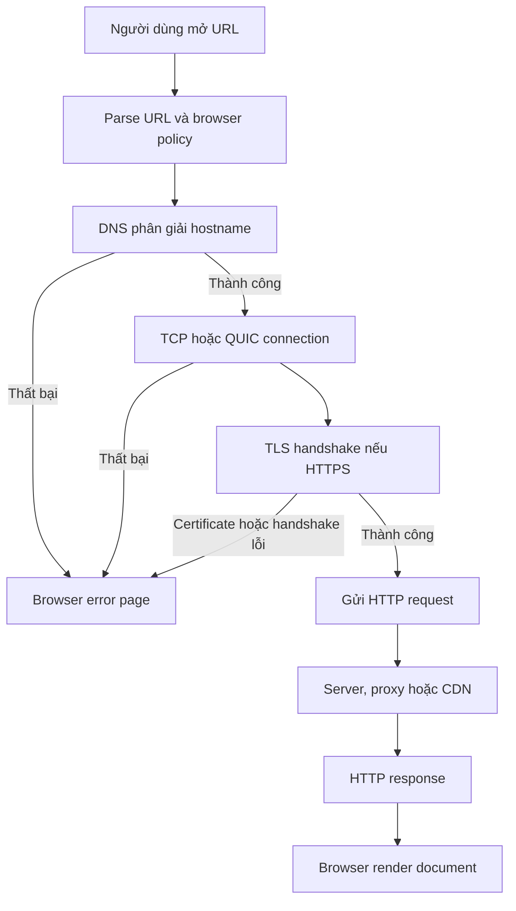

# Browser error page

## 1. Browser error page là gì?

**Browser error page** là giao diện do browser tạo khi navigation hoặc tải tài nguyên thất bại ở tầng browser, network hoặc security trước khi website cung cấp được một document hợp lệ. Ví dụ: không tìm thấy máy chủ, kết nối bị từ chối, timeout hoặc certificate TLS không được chấp nhận.

Trang lỗi do browser tạo khác với trang lỗi do website trả về. Nếu server trả HTTP `404 Not Found` hoặc `500 Internal Server Error`, browser đã nhận được HTTP response và có thể hiển thị body của response. Nếu DNS không phân giải được host, TCP connection không thiết lập được hoặc TLS handshake bị từ chối, browser có thể chưa nhận được HTTP response từ website.

Một browser error page không chứng minh ứng dụng server đã nhận request. Ngược lại, một trang HTML có dòng chữ “404” cũng không chứng minh browser nhận status 404; đó có thể chỉ là nội dung do website hoặc bên thứ ba tạo ra.

Browser error page là giao diện nội bộ do browser kiểm soát. Website không thể tự do đọc DOM hoặc điều khiển giao diện này như document cùng origin. Tuy nhiên, website độc hại có thể dựng một màn hình trông giống trang lỗi để lừa người dùng nhập mật khẩu, tải file hoặc bỏ qua cảnh báo bảo mật.

Bài học này phân biệt lỗi browser, HTTP error response và custom error page; phân tích DNS/TCP/TLS/HTTP/CORS; hướng dẫn chẩn đoán bằng DevTools và server logs; đồng thời xây dựng quy trình báo cáo lỗi an toàn.

### Kết quả học tập

Sau bài này, người học có thể:

1. Phân biệt browser-generated error page, HTTP error response và custom error page.
2. Xác định request thất bại ở DNS, TCP, TLS, HTTP hay browser policy.
3. Hiểu ý nghĩa và giới hạn của các mã lỗi browser phổ biến.
4. Phân biệt top-level navigation, subresource và lỗi trong `fetch()`.
5. Giải thích vì sao JavaScript website không thể đọc tùy ý browser error page.
6. Chẩn đoán lỗi bằng Network, Console, Security panel và server/proxy logs.
7. Tránh nhầm CORS, extension blocking, offline state và server outage.
8. Thiết kế error handling cho SPA mà không giả mạo browser UI.
9. Thu thập báo cáo lỗi tối thiểu mà không làm lộ token, cookie hoặc PII.
10. Nhận diện phishing page giả dạng browser error hoặc certificate warning.

## 2. Ba loại trang lỗi cần phân biệt

### 2.1. Browser-generated error page

Browser tự hiển thị giao diện lỗi khi không thể hoàn thành navigation hoặc khi browser security policy chặn việc tiếp tục. Nội dung và mã lỗi tùy browser, phiên bản, ngôn ngữ, hệ điều hành và tình huống.

Ví dụ: hostname không phân giải được; không thể kết nối tới server; kết nối bị reset hoặc timeout; TLS certificate không hợp lệ; hoặc extension/phần mềm bảo mật chặn request. Website có thể chưa gửi được HTTP response. Trang lỗi do browser kiểm soát, không phải body mà backend có thể tùy chỉnh.

### 2.2. HTTP error response

HTTP error response là response thực sự từ server hoặc intermediary sau khi request đã đi đủ xa để nhận được HTTP status.

```http
HTTP/1.1 404 Not Found
Content-Type: text/html; charset=utf-8
Cache-Control: no-store

<!doctype html>
<title>Không tìm thấy trang</title>
<h1>Không tìm thấy tài nguyên</h1>
```

| Status | Ý nghĩa khái quát | Ví dụ |
| --- | --- | --- |
| 400 | Request không hợp lệ | Thiếu hoặc sai tham số |
| 401 | Chưa xác thực | Session hết hạn |
| 403 | Bị từ chối | Không có quyền |
| 404 | Không tìm thấy | URL/resource không tồn tại |
| 429 | Quá nhiều request | Rate limit |
| 500 | Lỗi xử lý server | Exception chưa xử lý |
| 502 | Gateway nhận response không hợp lệ | Upstream response lỗi |
| 503 | Dịch vụ tạm thời không sẵn sàng | Bảo trì/quá tải |
| 504 | Gateway timeout | Upstream không trả lời kịp |

HTTP status cho biết lớp HTTP đã tạo response, nhưng chưa chắc origin application là thành phần tạo response. CDN, reverse proxy, API gateway hoặc captive portal cũng có thể trả status.

### 2.3. Custom error page của website

Custom error page là HTML/CSS do ứng dụng hoặc hosting trả về cho HTTP status, ví dụ trang 404 có logo và nút quay về trang chủ. Nó vẫn là website document và tuân theo origin, CSP, cookie và JavaScript policy của response.

Một custom page có thể trả status 200 do cấu hình sai (“soft 404”). Khi điều tra, kiểm tra status trong Network thay vì chỉ nhìn nội dung hoặc tiêu đề trang.

### 2.4. Bảng phân biệt

| Đặc điểm | Browser error page | HTTP error response | Custom error page |
| --- | --- | --- | --- |
| Ai tạo giao diện? | Browser | Server/intermediary | Ứng dụng/hosting |
| Có HTTP response? | Thường không | Có | Có |
| Có status của response? | Không có status từ website | Có | Có |
| Website tùy chỉnh body? | Không trực tiếp | Có thể | Có |
| JavaScript ứng dụng chạy? | Không nên giả định | Có thể | Có |
| Origin website bình thường? | Không nên coi là document của website đích | Có | Có |
| Kiểm tra ở đâu? | Browser UI, DevTools, network diagnostics | Network và server logs | Network, headers và application logs |

## 3. Navigation thất bại ở đâu?

Một navigation HTTPS thường cần phân giải DNS, thiết lập kết nối, hoàn tất TLS rồi mới gửi HTTP request. Nếu bước sớm thất bại, browser có thể hiển thị error page mà origin server không nhìn thấy HTTP request.



Các bước thực tế có thể khác theo HTTP/3, connection reuse, proxy, DNS cache và TLS session resumption. Sơ đồ giúp định vị lớp lỗi, không phải timeline bắt buộc cho mọi request.

### 3.1. DNS

Browser cần phân giải hostname thành địa chỉ IP. Lỗi có thể do hostname sai, domain chưa tồn tại, resolver không truy cập được, DNS record sai/chưa cập nhật, VPN, proxy, DNS filtering hoặc DNS-over-HTTPS policy.

Nếu DNS thất bại trước HTTP, origin server thường không có access log cho request. Kiểm tra hostname, resolver và DNS record trước khi kết luận ứng dụng bị down.

### 3.2. TCP, QUIC và kết nối mạng

Sau khi có địa chỉ, browser cần thiết lập kết nối. Kết nối có thể bị từ chối, reset hoặc timeout do service không lắng nghe, firewall, route, load balancer, proxy hoặc mạng người dùng.

`ERR_CONNECTION_REFUSED` thường gợi ý endpoint từ chối kết nối; `ERR_CONNECTION_TIMED_OUT` gợi ý không nhận được phản hồi trong thời gian chờ. Đây là gợi ý chẩn đoán, không xác định duy nhất thành phần gây lỗi.

### 3.3. TLS và certificate validation

Với HTTPS, browser xác minh TLS certificate và handshake trước khi gửi HTTP request trong kết nối đó. Lỗi có thể liên quan:

- Certificate hết hạn hoặc chưa có hiệu lực.
- Hostname trên certificate không khớp URL.
- Certificate chain không được tin cậy.
- Certificate bị revoke hoặc policy không chấp nhận.
- TLS version, cipher hoặc handshake không tương thích.
- Đồng hồ thiết bị sai.
- Proxy inspection hoặc captive portal thay thế certificate.

Nếu browser hiển thị certificate interstitial, đừng hướng dẫn người dùng bỏ qua cảnh báo trên website production. Kiểm tra hostname, chain, expiry, thiết bị và cấu hình TLS. HSTS có thể ngăn bypass certificate warning; đây là hành vi bảo vệ có chủ đích.

### 3.4. HTTP và intermediary

Khi HTTP request đã được gửi và response nhận về, browser có thể render status 4xx/5xx hoặc custom error page. Status 502/503/504 có thể do CDN/gateway tạo. Xác định response đến từ CDN, gateway hay origin bằng response headers và log correlation.

### 3.5. Browser policy

Request có thể bị chặn do mixed content, CORS, CSP, blocked port, private network policy, download policy, extension hoặc safe browsing. Những lỗi này không đồng nghĩa server không hoạt động. Xem loại request và thông báo trong Console/Network để phân biệt.

## 4. Những mã lỗi browser thường gặp

Các chuỗi mã lỗi là chi tiết triển khai của browser, không phải HTTP status và không phải API ổn định cho ứng dụng. Tên và hành vi có thể đổi theo browser/version.

| Mã lỗi thường thấy trong Chromium | Ý nghĩa gợi ý | Hướng kiểm tra |
| --- | --- | --- |
| `ERR_NAME_NOT_RESOLVED` | Không phân giải hostname | DNS, spelling, resolver, VPN |
| `ERR_INTERNET_DISCONNECTED` | Browser nhận thấy không có kết nối mạng | Adapter, captive portal, offline |
| `ERR_CONNECTION_REFUSED` | Kết nối bị từ chối | Listener, firewall, port, proxy |
| `ERR_CONNECTION_TIMED_OUT` | Kết nối timeout | Routing, firewall, health |
| `ERR_CONNECTION_RESET` | Kết nối bị reset | Proxy, load balancer, server/network |
| `ERR_ADDRESS_UNREACHABLE` | Địa chỉ đích không tới được | Route, gateway, VPN |
| `ERR_CERT_DATE_INVALID` | Thời gian certificate không hợp lệ | Expiry, notBefore, system clock |
| `ERR_CERT_AUTHORITY_INVALID` | CA/chain không được tin cậy | Chain, trust store, TLS inspection |
| `ERR_CERT_COMMON_NAME_INVALID` | Hostname không khớp certificate | SAN, domain, reverse proxy |
| `ERR_SSL_PROTOCOL_ERROR` | TLS/SSL protocol hoặc handshake lỗi | TLS config, proxy, port |
| `ERR_BLOCKED_BY_CLIENT` | Request bị client-side component chặn | Extension, privacy tool, browser policy |
| `ERR_ABORTED` | Request/navigation bị hủy | User navigation, redirect, tab lifecycle |

Không map mọi mã thành “Server đang lỗi”. `ERR_BLOCKED_BY_CLIENT` có thể do extension chặn analytics; `ERR_ABORTED` có thể là navigation bình thường bị thay thế; `ERR_CERT_DATE_INVALID` có thể do đồng hồ thiết bị sai hoặc certificate hết hạn.

Firefox, Safari và browser khác dùng chuỗi mã và trang lỗi khác. Ghi nhận browser/version và nguyên văn mã lỗi khi cần hỗ trợ, nhưng không dùng chuỗi đó làm logic bảo mật hoặc quyết định authorization.

## 5. Browser error page không thuộc website đích

### 5.1. Không có document website để script đọc

Khi navigation thất bại trước khi browser commit document từ website, ứng dụng không có trang HTML bình thường để truy cập. Browser có thể hiển thị giao diện nội bộ hoặc error interstitial do browser quản lý.

Website không thể dựa vào `window.onerror`, `unhandledrejection` hoặc `window.addEventListener("error")` trong document cũ để đọc nội dung browser error page hay biết chắc vì sao navigation mới thất bại. Các handler này chỉ quan sát lỗi trong execution context của trang hiện tại và một số resource event.

### 5.2. Không giả định location.origin của error UI

Các browser có cách triển khai nội bộ khác nhau. Không dựa vào URL nội bộ, DOM selector hoặc `location.origin` cụ thể của browser error page để thiết kế ứng dụng. Những chi tiết đó không phải contract web platform ổn định và có thể bị browser thay đổi.

### 5.3. Browser extension cũng bị giới hạn

Extension host permission không có nghĩa extension được inject vào browser-internal error page hoặc trang nội bộ của browser. Các trang đặc biệt thường bị chặn khỏi content script injection. Không thiết kế tính năng hỗ trợ dựa vào việc extension đọc DOM trang lỗi nội bộ.

### 5.4. Browser UI là vùng tin cậy

Certificate interstitial, biểu tượng khóa/kết nối và thanh địa chỉ thuộc giao diện browser. Website không thể thay đổi thanh địa chỉ thật bằng HTML. Nhưng website có thể dựng bản sao trực quan bên trong nội dung trang. Người dùng cần kiểm tra thanh địa chỉ và browser chrome thật, không chỉ nhìn hình ảnh ổ khóa được vẽ trong trang.

## 6. Phân biệt navigation, subresource và fetch

### 6.1. Top-level navigation

Top-level navigation là khi browser chuyển tab/cửa sổ sang URL mới. Nếu navigation không thể hoàn tất ở DNS/TCP/TLS hoặc browser policy, browser có thể hiển thị error page. Trang trước đó có thể bị thay thế hoặc vẫn được giữ tùy cách navigation và browser.

### 6.2. Subresource failure

Một trang có thể tải thành công nhưng ảnh, script, stylesheet, font hoặc iframe thất bại. Browser thường chỉ báo lỗi trong Network/Console và bỏ qua hoặc hiển thị một phần giao diện; nó không nhất thiết thay toàn bộ trang bằng browser error page.

Ví dụ: trang `https://shop.example.com` vẫn hiển thị, nhưng ảnh CDN timeout. Đây là lỗi subresource, không phải website chính không truy cập được.

### 6.3. fetch: network error và HTTP error khác nhau

`fetch()` thường reject Promise khi có network error, CORS failure hoặc request bị browser chặn. Nhưng khi server trả HTTP 404 hoặc 500, Promise vẫn resolve thành `Response`; code phải kiểm tra `response.ok` hoặc `response.status`.

```js
async function loadAccountSummary() {
  try {
    const response = await fetch("/api/account/summary", {
      credentials: "same-origin",
      cache: "no-store"
    });

    if (!response.ok) {
      if (response.status === 401) throw new Error("SESSION_EXPIRED");
      if (response.status === 403) throw new Error("ACCESS_DENIED");
      throw new Error("HTTP_" + response.status);
    }

    return await response.json();
  } catch (error) {
    if (error instanceof TypeError) {
      // Không đủ dữ kiện để phân biệt DNS, offline, CORS, TLS
      // hoặc extension blocking chỉ từ TypeError.
      throw new Error("NETWORK_OR_BROWSER_POLICY_ERROR");
    }
    throw error;
  }
}
```

Đây là ví dụ xử lý ở application layer. Không hiển thị exception nội bộ cho người dùng và không suy ra một `TypeError` duy nhất có nghĩa server đã down.

### 6.4. CORS error không nhất thiết server không nhận request

Với một số request, browser gửi preflight hoặc request thật rồi từ chối expose response cho JavaScript vì CORS header không hợp lệ. Server vẫn có thể đã nhận và xử lý request; cần xem Network và server log để xác minh.

CORS là cơ chế browser kiểm soát quyền đọc response cross-origin. Nó không phải firewall network và không đảm bảo request không tới server.

## 7. Lỗi do browser policy hoặc extension

### 7.1. Mixed content và CSP

Trang HTTPS tải script hoặc active content qua HTTP có thể bị block. CSP cũng có thể chặn script, frame, image, connect hoặc navigation không phù hợp với policy. Trang chính vẫn có thể mở được; chỉ resource bị chặn. Xem Console/Network và directive liên quan để xác định nguyên nhân.

### 7.2. Extension và privacy tools

Ad blocker, tracking protection, antivirus extension hoặc enterprise agent có thể chặn request. `ERR_BLOCKED_BY_CLIENT` gợi ý có thành phần phía client can thiệp, nhưng không chỉ ra chính xác extension nào.

Chỉ thử lại trong browser profile sạch hoặc tạm vô hiệu hóa extension khi có sự đồng ý và trong môi trường an toàn. Không yêu cầu người dùng tắt toàn bộ antivirus hoặc browser protection để truy cập website production.

### 7.3. Safe Browsing và download protection

Browser có thể cảnh báo hoặc chặn URL/download bị đánh giá nguy hiểm. Không hướng dẫn người dùng bỏ qua cảnh báo chỉ để tải file. Xác minh nguồn file, hash/signature, reputation và lý do cảnh báo qua kênh quản trị phù hợp.

### 7.4. Service Worker và offline fallback

Service Worker có thể intercept navigation và trả một offline page từ Cache Storage hoặc tạo response mới. Trang offline đó là response do ứng dụng kiểm soát, có thể mang origin của website và chạy code theo policy của response; nó không phải browser-generated error page. Nếu handler không trả response hợp lệ hoặc Promise của `respondWith()` reject, browser có thể hiển thị lỗi navigation. Trong DevTools, kiểm tra request có nguồn từ Service Worker hay network. Khi điều tra, thử bypass Service Worker trong profile kiểm thử và so sánh kết quả; không xóa cache hoặc unregister worker production một cách tùy tiện.

## 8. Certificate error, interstitial và HSTS

TLS xác minh browser đang kết nối tới endpoint có danh tính phù hợp với hostname và trust chain được chấp nhận. Nếu certificate validation thất bại, người dùng không có cơ sở đáng tin để biết mình đang nói chuyện với đúng server.

Nguyên nhân có thể là tấn công mạng, proxy sai cấu hình, captive portal hoặc lỗi vận hành như certificate hết hạn/thiếu intermediate certificate. Không nên bỏ qua cảnh báo trên website có đăng nhập, thanh toán hoặc dữ liệu cá nhân.

Quy trình kiểm tra an toàn:

- Xác nhận hostname trên thanh địa chỉ.
- Kiểm tra ngày/giờ thiết bị.
- Kiểm tra certificate subject/SAN, validity và chain qua công cụ tin cậy.
- Kiểm tra TLS ở load balancer/CDN/reverse proxy.
- Xem có captive portal, VPN hoặc TLS inspection hay không.
- So sánh từ mạng/thiết bị quản trị khác nếu phù hợp.
- Ghi browser/version và error code cho đội vận hành.

Không yêu cầu người dùng nhập mật khẩu sau khi browser cảnh báo certificate không hợp lệ. Không dùng screenshot warning làm bằng chứng duy nhất rằng server bị tấn công; cần kiểm tra chain và môi trường.

HSTS yêu cầu browser dùng HTTPS cho host đã ghi nhận policy. Khi certificate lỗi, browser có thể không cho bypass. HSTS không sửa certificate; đội vận hành vẫn phải khôi phục cấu hình TLS đúng.

## 9. Server và intermediary error page

Status 502, 503 hoặc 504 có thể do reverse proxy/CDN tạo khi upstream lỗi hoặc timeout. Response body có thể mang logo nhà cung cấp hạ tầng. Xác định thành phần tạo response bằng:

- Response headers và server identification.
- Request ID/correlation ID.
- CDN cache/status header.
- Reverse proxy access/error log.
- Origin application log.
- Timestamp và vùng edge.

Không phụ thuộc duy nhất vào header `Server` vì header có thể bị xóa, thay đổi hoặc giả mạo.

Ví dụ response có correlation ID:

```http
HTTP/1.1 503 Service Unavailable
Content-Type: application/json
Cache-Control: no-store
Retry-After: 30
X-Request-ID: req_01JEXAMPLE8
```

Không đặt token, email hoặc thông tin cá nhân trong request ID. Giữ ID ngẫu nhiên/opaque và ghi cùng ID ở các lớp cần điều tra.

Custom error page không nên hiển thị stack trace, filesystem path, SQL query, host nội bộ, secret, environment variable hoặc thông tin hạ tầng chi tiết. Trả thông báo an toàn cho người dùng và ghi chi tiết có kiểm soát ở server log.

## 10. Thiết kế lỗi trong ứng dụng web

### 10.1. Không giả mạo browser error page

Ứng dụng nên hiển thị trạng thái lỗi có nhận diện thương hiệu và cung cấp hành động hợp lý: thử lại, quay lại, liên hệ hỗ trợ hoặc xem mã yêu cầu. Không dựng thanh địa chỉ giả, biểu tượng khóa giả hoặc cảnh báo certificate giả.

### 10.2. Thông báo theo khả năng phục hồi

| Tình huống | Thông báo phù hợp | Hành động |
| --- | --- | --- |
| HTTP 404 | Không tìm thấy trang hoặc tài nguyên | Quay về danh mục/trang chủ |
| HTTP 401 | Phiên đăng nhập đã hết hạn | Đăng nhập lại qua flow chính thức |
| HTTP 403 | Bạn không có quyền xem nội dung này | Liên hệ quản trị viên |
| HTTP 429 | Có quá nhiều yêu cầu | Chờ theo Retry-After |
| HTTP 5xx | Dịch vụ tạm thời gặp sự cố | Thử lại sau, gửi request ID |
| Fetch network error | Không thể kết nối để tải dữ liệu | Kiểm tra kết nối và thử lại |
| CORS/policy error | Không thể hoàn tất thao tác trong browser | Báo đội kỹ thuật |
| Certificate error | Browser không xác minh được kết nối an toàn | Dừng thao tác và liên hệ hỗ trợ |

Không hiển thị “Internet đã mất” chỉ dựa trên một `fetch` rejection; nguyên nhân có thể là CORS, TLS, DNS, extension hoặc policy.

### 10.3. Retry có kiểm soát

Retry phù hợp với lỗi tạm thời và thao tác idempotent. Không tự động retry vô hạn, không retry mutation không có idempotency key và không gửi lại payment/order request chỉ vì browser không nhận response. Nếu request có thể đã được server xử lý, truy vấn trạng thái bằng request ID/idempotency key trước khi gửi lại.

### 10.4. Offline state

`navigator.onLine` chỉ là gợi ý về trạng thái kết nối mà browser quan sát; nó không chứng minh internet hoặc origin cụ thể đang truy cập được. Dùng nó để cập nhật UI nhẹ, sau đó xác minh bằng request tới endpoint health phù hợp. Không dùng online/offline event làm quyết định bảo mật.

## 11. Thu thập và gửi báo cáo lỗi an toàn

### 11.1. Thu thập thông tin tối thiểu

Một báo cáo hữu ích có thể bao gồm thời điểm và timezone; URL host/path đã loại bỏ query nhạy cảm; browser/version và OS; error code/thông báo; loại thao tác; mạng ở mức khái quát nếu người dùng tự nguyện cung cấp; request ID; bước tái hiện; và screenshot đã che dữ liệu cá nhân.

Không thu thập cookie, Authorization header, access/refresh token, session ID, password, form body, nội dung email hoặc toàn bộ browsing history.

### 11.2. URL cần được làm sạch

Query string có thể chứa authorization code, reset token, signed URL, email hoặc dữ liệu tìm kiếm cá nhân. Khi báo cáo, chỉ giữ scheme/host/path cần thiết và loại bỏ fragment/query trừ khi một tham số đã được xác nhận an toàn.

```js
function sanitizeUrlForReport(rawUrl) {
  try {
    const url = new URL(rawUrl);
    return url.origin + url.pathname;
  } catch {
    return "[invalid-url]";
  }
}
```

Không gửi URL gốc chỉ vì nó xuất hiện trong address bar. Signed URL và callback URL có thể là bearer credential.

### 11.3. Báo cáo từ ứng dụng trước navigation

Nếu ứng dụng cần ghi nhận người dùng sắp điều hướng tới tài nguyên quan trọng, có thể ghi event tối thiểu trước khi điều hướng. Điều này không cho phép ứng dụng biết browser error page sau đó, nhưng giúp đối chiếu ý định điều hướng với log server.

```js
function reportNavigationAttempt(destination) {
  const safeUrl = sanitizeUrlForReport(destination);
  const body = JSON.stringify({
    event: "navigation_attempt",
    destination: safeUrl,
    occurredAt: new Date().toISOString()
  });

  navigator.sendBeacon(
    "/telemetry/navigation",
    new Blob([body], { type: "application/json" })
  );
}
```

Endpoint telemetry cần giới hạn schema, kích thước và retention; không coi dữ liệu client gửi là bằng chứng tin cậy. Không chặn navigation chỉ để chờ telemetry hoàn tất.

### 11.4. Lỗi không thể gửi telemetry

Nếu DNS/TLS hoặc mạng thất bại, telemetry tới cùng host có thể cũng thất bại. Không retry vô hạn hoặc lưu toàn bộ request data nhạy cảm vào local storage. Cung cấp mã tham chiếu nếu đã có và cách báo lỗi thủ công qua kênh hỗ trợ đáng tin cậy.

## 12. Phishing: trang web giả dạng browser error

Website độc hại có thể tạo HTML trông giống trang “Site unavailable”, cảnh báo certificate, dialog đăng nhập browser, màn hình yêu cầu cài extension để sửa lỗi, thông báo virus hoặc trang hỗ trợ giả yêu cầu gọi số điện thoại. Đây là nội dung website, không phải giao diện nội bộ của browser.

Dấu hiệu cần kiểm tra:

- Thanh địa chỉ và domain thật của tab.
- Browser chrome thật, không phải hình ảnh nằm trong nội dung trang.
- Yêu cầu nhập mật khẩu, mã MFA, recovery code hoặc payment data bất thường.
- Yêu cầu tải executable, extension hoặc remote access tool.
- Domain gần giống nhưng sai chính tả hoặc dùng ký tự Unicode gây nhầm lẫn.
- Redirect qua nhiều host không rõ nguồn.

Không gọi số hỗ trợ hoặc tải công cụ từ trang giả cảnh báo. Đóng tab, mở website qua bookmark/kênh chính thức và báo đội bảo mật nếu cần.

Browser security interstitial thường nằm trong giao diện browser do browser kiểm soát. Website không thể xóa nó bằng JavaScript thông thường. Một hộp thoại “Continue” được vẽ bên trong nội dung trang không phải thao tác bỏ qua cảnh báo browser thật.

## 13. Thực hành chẩn đoán bằng DevTools

### 13.1. Network panel

Khi trang hoặc API lỗi:

1. Mở DevTools → Network.
2. Bật Preserve log để giữ request qua navigation nếu browser hỗ trợ.
3. Tái hiện lỗi một lần.
4. Xem request có xuất hiện hay không.
5. Kiểm tra Status, Type, Initiator, Timing và Response Headers.
6. Xem request báo failed/blocked, CORS hay HTTP status cụ thể.
7. Nếu có request ID, đối chiếu log proxy/CDN/origin.

Nếu navigation thất bại trước khi HTTP được gửi, Network có thể hiển thị error code nhưng không có HTTP status. Không coi ô status trống là HTTP 0 từ server.

### 13.2. Console và Security panel

Console giúp phân biệt CSP, CORS, mixed content, JavaScript exception và resource loading. Tuy nhiên thông báo thường không tiết lộ toàn bộ nguyên nhân network/TLS. Ghi lại thông báo liên quan, không copy toàn bộ console nếu có token hoặc dữ liệu người dùng.

Security panel có thể cung cấp thông tin HTTPS, certificate và mixed content cho document đang mở. Nếu navigation không commit document, panel có thể không hiển thị như với trang thành công. Dùng browser UI và công cụ quản trị tin cậy khi cần.

### 13.3. Cache và Service Worker

Chỉ dùng tùy chọn Disable cache hoặc unregister Service Worker trong profile thử nghiệm hoặc khi được phép. Cache, Service Worker và extension có thể thay đổi kết quả. So sánh điều kiện bình thường với điều kiện kiểm soát giúp tìm lỗi stale/offline fallback.

Không xóa dữ liệu production hoặc unregister Service Worker trên diện rộng như bước chẩn đoán mặc định.

## 14. Công cụ dòng lệnh và server logs

### 14.1. Kiểm tra DNS

```bash
nslookup app.example.com
```

Hoặc trên hệ thống có `dig`:

```bash
dig app.example.com A
dig app.example.com AAAA
```

Kết quả có thể khác theo resolver, DNS cache, VPN và DNS-over-HTTPS. Ghi nhận resolver và thời điểm khi so sánh.

### 14.2. Kiểm tra TLS/HTTP

Dùng `curl` để quan sát kết nối và response:

```bash
curl -vI https://app.example.com/
```

Không dùng `-k` để bỏ qua certificate validation rồi kết luận kết nối an toàn. Nếu cần phân tích certificate lỗi, ghi lại lỗi xác minh và kiểm tra chain bằng công cụ phù hợp; không gửi credential thật trong lệnh debug.

### 14.3. Đối chiếu log

| Lớp | Dữ liệu nên kiểm tra |
| --- | --- |
| Browser | Error code, timestamp, URL đã sanitize |
| DNS resolver | Query, response code, resolver, latency |
| Firewall/load balancer | Connection accept/reject/reset |
| CDN/reverse proxy | Request ID, edge status, upstream status, timeout |
| Origin web server | Access log, status, latency, request ID |
| Application | Error category, trace ID, exception đã redacted |

Nếu không có log ở origin, chưa thể kết luận request chưa đi qua bất kỳ intermediary nào. DNS/TLS có thể thất bại trước HTTP, nhưng proxy hoặc edge có thể đã nhận một phần kết nối.

## 15. Ma trận kiểm thử Browser error page

| Mã | Tình huống | Kết quả mong muốn |
| --- | --- | --- |
| BERR-01 | Hostname DNS không tồn tại | Browser hiển thị lỗi name resolution; không gán HTTP status từ origin |
| BERR-02 | DNS resolver không truy cập được | Báo lỗi phân giải; kiểm tra resolver |
| BERR-03 | TCP connection refused | Phân loại lỗi kết nối, không coi là HTTP 500 |
| BERR-04 | TCP timeout | Kiểm tra routing/firewall/service health |
| BERR-05 | Connection reset | Đối chiếu proxy/load balancer/server log |
| BERR-06 | Certificate hết hạn | Browser cảnh báo TLS; không khuyên bypass |
| BERR-07 | Certificate hostname mismatch | Dừng đăng nhập; kiểm tra SAN/domain |
| BERR-08 | Certificate chain không tin cậy | Kiểm tra trust chain và TLS inspection |
| BERR-09 | Đồng hồ thiết bị sai | Xác minh thời gian trước khi kết luận certificate lỗi |
| BERR-10 | HSTS host có certificate lỗi | Browser không cho bypass theo policy |
| BERR-11 | Server trả HTTP 404 | Network có status 404 và response |
| BERR-12 | Server trả HTTP 500 | Promise fetch resolve; application kiểm tra response.ok |
| BERR-13 | CDN trả 502/503/504 | Xác định intermediary qua header/request ID/log |
| BERR-14 | Custom 404 trả status 200 | Phát hiện soft 404 qua Network |
| BERR-15 | Ảnh subresource timeout | Trang chính vẫn có thể render |
| BERR-16 | Script bị CSP block | Console chỉ ra directive liên quan |
| BERR-17 | Mixed content bị block | Phân loại browser policy, không kết luận server down |
| BERR-18 | CORS response không hợp lệ | Xác định response có thể đã tới server |
| BERR-19 | Extension block request | Kiểm tra profile/extension theo quy trình an toàn |
| BERR-20 | ERR_ABORTED khi user chuyển trang | Không tự động báo outage |
| BERR-21 | navigator.onLine là true nhưng host không truy cập được | Không coi onLine là kiểm tra reachability |
| BERR-22 | fetch nhận HTTP 401 | Application xử lý session expiry |
| BERR-23 | fetch nhận HTTP 403 | Application hiển thị access denied phù hợp |
| BERR-24 | fetch reject TypeError | Không suy ra duy nhất DNS/offline/server down |
| BERR-25 | Browser error page xuất hiện | Website không đọc DOM nội bộ của trang lỗi |
| BERR-26 | Extension inject vào browser-internal page | Browser giới hạn injection |
| BERR-27 | Website vẽ fake certificate warning | Người dùng nhận diện qua browser chrome/address bar |
| BERR-28 | Error report chứa query token | Sanitizer loại bỏ query/fragment nhạy cảm |
| BERR-29 | Telemetry gửi trước navigation | Chỉ ghi nhận attempt; không tuyên bố biết kết quả browser |
| BERR-30 | Network/TLS fail nên telemetry cũng fail | UI có phương án báo thủ công, không retry vô hạn |

## 16. Những sai lầm thường gặp

| Nhận định sai | Cách hiểu đúng |
| --- | --- |
| Browser error page là HTTP 500 | Browser có thể chưa nhận HTTP response |
| Trang có chữ “404” chắc chắn status 404 | Kiểm tra status trong Network |
| Mọi lỗi truy cập đều là server down | DNS, TCP, TLS, CORS, CSP, extension hoặc proxy cũng có thể gây lỗi |
| CORS error chứng minh server không nhận request | Request/preflight có thể đã tới server |
| fetch reject khi server trả 404 | HTTP 404 thường resolve thành Response; phải kiểm tra status |
| navigator.onLine true nghĩa internet hoạt động | Nó không xác minh host cụ thể |
| Website có thể đọc DOM browser error page | Browser error UI không thuộc document ứng dụng |
| Extension có host permission đọc được mọi trang | Browser-internal pages bị giới hạn riêng |
| Có thể bỏ qua certificate warning | Cần xác minh TLS trước khi nhập dữ liệu |
| ERR_BLOCKED_BY_CLIENT luôn là lỗi server | Có thể do extension/privacy tool |
| ERR_ABORTED luôn là outage | Có thể do navigation bị hủy bình thường |
| Retry mọi request khi lỗi | Mutation có thể đã được server xử lý; cần idempotency/status check |
| Gửi full URL/console log cho support luôn an toàn | URL và log có thể chứa token, PII hoặc secret |
| Trang lỗi càng chi tiết càng tốt | Chi tiết nội bộ nên ở log bảo vệ, không ở public response |
| Fake browser error chỉ là vấn đề giao diện | Có thể là phishing lấy credential hoặc cài malware |

## 17. Checklist xử lý và báo cáo

- [ ] Xác định browser error page, HTTP response hay custom error page.
- [ ] Ghi browser/version, OS, timestamp và error code.
- [ ] Xác định lỗi ở DNS, kết nối, TLS, HTTP hay browser policy.
- [ ] Kiểm tra Network/Console trước khi kết luận server outage.
- [ ] Đối chiếu CDN/proxy/origin logs bằng request ID khi có.
- [ ] Phân biệt top-level navigation với subresource và fetch.
- [ ] Kiểm tra HTTP status thay vì đọc chữ trên trang.
- [ ] Không coi CORS error là bằng chứng server không nhận request.
- [ ] Không dùng navigator.onLine làm phép kiểm tra reachability duy nhất.
- [ ] Không yêu cầu bỏ qua certificate warning hoặc tắt security protection.
- [ ] Không cố đọc DOM/URL nội bộ của browser error page.
- [ ] Dùng thông báo lỗi ứng dụng rõ ràng, không giả mạo browser chrome.
- [ ] Retry có giới hạn và chỉ khi thao tác an toàn/idempotent.
- [ ] Không lặp payment/order mutation khi chưa kiểm tra trạng thái.
- [ ] Sanitize URL và redaction cookie/token/header/body trước khi báo cáo.
- [ ] Giữ correlation ID opaque, không chứa dữ liệu cá nhân.
- [ ] Không tiết lộ stack trace, filesystem path hoặc secret trong custom error page.
- [ ] Kiểm tra dấu hiệu phishing khi trang giả dạng browser/certificate warning.
- [ ] Có kênh báo lỗi thủ công khi network/telemetry không hoạt động.
- [ ] Lưu log theo retention và access policy phù hợp.

### Ghi nhớ

**Browser error page và HTTP error page là hai loại lỗi khác nhau.** Browser có thể thất bại ở DNS, TCP, TLS hoặc browser policy trước khi website trả HTTP response. HTTP 4xx/5xx là response có status và body; custom error page vẫn thuộc website. `fetch()` reject với lỗi network/policy nhưng thường resolve khi server trả 404/500. Hãy chẩn đoán theo từng lớp, không bỏ qua certificate warning, không giả mạo browser UI và chỉ gửi báo cáo đã loại bỏ token, cookie cùng dữ liệu cá nhân.
