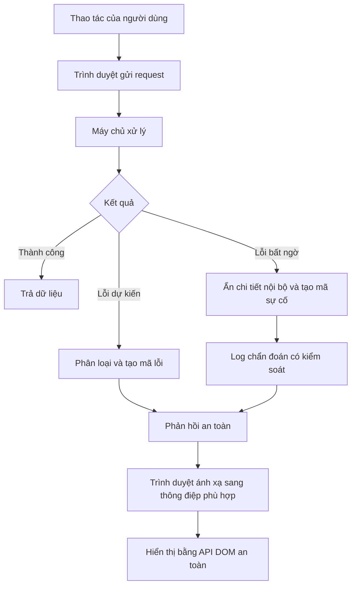

# Error message

Error message là thông điệp mô tả một thao tác không thể hoàn tất. Trong ứng dụng web, thông điệp lỗi xuất hiện ở nhiều nơi: giao diện trình duyệt, phản hồi API, log phía máy chủ và hệ thống theo dõi sự cố. Cùng một lỗi có thể cần những cách diễn đạt khác nhau cho người dùng, nhà phát triển và đội vận hành.

Một thông điệp tốt giúp người dùng hiểu điều gì đã xảy ra và bước tiếp theo nên làm gì. Nó cũng giúp đội kỹ thuật tìm đúng sự cố. Tuy nhiên, thông điệp được gửi ra trình duyệt là dữ liệu công khai đối với người có thể truy cập trang. Nếu đưa stack trace, câu truy vấn, đường dẫn nội bộ, token hoặc chi tiết hạ tầng vào thông điệp, ứng dụng có thể vô tình tiết lộ thông tin hỗ trợ kẻ tấn công.

Trong bảo mật ứng dụng web, thiết kế error message cần cân bằng ba yêu cầu: dễ hiểu, đủ ổn định để chương trình xử lý và không tiết lộ thông tin nội bộ. Bài học này trình bày cách phân loại lỗi, định dạng phản hồi, hiển thị an toàn trong trình duyệt và lưu thông tin chẩn đoán ở đúng nơi.

## Mục tiêu

Sau bài học, bạn có thể:

- Phân biệt thông điệp dành cho người dùng, mã lỗi dành cho ứng dụng và chi tiết chẩn đoán dành cho đội kỹ thuật.
- Chọn HTTP status phù hợp và thiết kế cấu trúc lỗi API ổn định.
- Xử lý lỗi HTTP, lỗi mạng, timeout và hủy request trong JavaScript.
- Hiển thị thông điệp an toàn, tránh XSS và tránh tiết lộ thông tin nhạy cảm.
- Thiết kế lỗi xác thực, phân quyền và validation để hạn chế rò rỉ thông tin.
- Kết nối thông điệp hiển thị với log phía máy chủ bằng mã tương quan.

## Error message trong luồng xử lý

Một lỗi thường đi qua nhiều lớp. Ví dụ, người dùng gửi biểu mẫu, trình duyệt gọi API, máy chủ xác thực dữ liệu, truy cập cơ sở dữ liệu rồi trả kết quả. Nếu một bước thất bại, ứng dụng cần quyết định thông tin nào được gửi tới người dùng và thông tin nào chỉ được lưu nội bộ.



Trong luồng này có ba loại thông tin cần tách biệt:

| Loại thông tin | Người nhận | Ví dụ | Yêu cầu |
|---|---|---|---|
| Thông điệp người dùng | Người đang sử dụng ứng dụng | “Phiên làm việc đã hết hạn. Hãy đăng nhập lại.” | Dễ hiểu, có hành động tiếp theo, không chứa bí mật |
| Mã lỗi máy đọc được | Frontend hoặc client tích hợp API | `SESSION_EXPIRED` | Ổn định, có tài liệu, không phụ thuộc câu chữ đã dịch |
| Chi tiết chẩn đoán | Log hoặc hệ thống theo dõi nội bộ | Loại exception, stack trace, dịch vụ liên quan | Có kiểm soát truy cập, lọc dữ liệu nhạy cảm và thời hạn lưu giữ |

Không dùng một chuỗi duy nhất cho cả ba mục đích. Câu chữ có thể thay đổi theo ngôn ngữ và trải nghiệm sản phẩm; mã lỗi nên ổn định để frontend có thể xử lý. Chi tiết nội bộ cần đủ để điều tra nhưng không nên xuất hiện trong phản hồi công khai.

## Phân loại lỗi trước khi tạo thông điệp

Phân loại lỗi giúp chọn đúng cách xử lý. Một số lỗi là kết quả bình thường của quy tắc nghiệp vụ, một số đến từ trạng thái mạng hoặc dịch vụ phụ thuộc, và một số là lỗi bất ngờ cần điều tra.

### Lỗi đầu vào và quy tắc nghiệp vụ

Lỗi validation xảy ra khi dữ liệu không đáp ứng định dạng hoặc quy tắc đã công bố, chẳng hạn email sai định dạng hoặc trường bắt buộc bị bỏ trống. Thông điệp nên chỉ rõ trường cần sửa và cách sửa. Không phản chiếu nguyên văn dữ liệu không đáng tin cậy vào HTML hoặc log.

Lỗi nghiệp vụ có thể xảy ra khi trạng thái hiện tại không cho phép thao tác, ví dụ bản ghi đã được cập nhật bởi một phiên khác. Hãy giải thích trạng thái và hướng xử lý, chẳng hạn tải lại dữ liệu hoặc chọn một phương án khác.

### Lỗi xác thực và phân quyền

Lỗi xác thực cho biết ứng dụng không thể xác nhận danh tính hoặc phiên hiện tại. Lỗi phân quyền cho biết danh tính hiện tại không được phép thực hiện thao tác. Thông điệp cần tuân theo chính sách bảo mật của hệ thống, đặc biệt khi việc phân biệt hai trường hợp có thể làm lộ sự tồn tại của tài khoản hoặc tài nguyên.

Ví dụ, màn hình đăng nhập có thể dùng thông điệp chung “Thông tin đăng nhập không hợp lệ” cho cả tài khoản không tồn tại và mật khẩu sai. Cách này giảm khả năng dò tìm tài khoản. Với tài nguyên riêng tư, một số hệ thống cũng trả cùng phản hồi cho trường hợp không tồn tại và không được phép truy cập để tránh xác nhận tài nguyên có thật. Quyết định này phải nhất quán với mô hình quyền và yêu cầu sản phẩm.

### Lỗi mạng và dịch vụ

Lỗi mạng có thể do mất kết nối, DNS, TLS, proxy, CORS hoặc máy chủ không phản hồi. Trình duyệt đôi khi chỉ cung cấp một lỗi tổng quát cho JavaScript, trong khi nguyên nhân cụ thể nằm ở Network hoặc Console.

Lỗi dịch vụ có thể là timeout, giới hạn tốc độ, dịch vụ phụ thuộc tạm thời không sẵn sàng hoặc lỗi gateway. Thông điệp cho người dùng nên cho biết có thể thử lại hay cần liên hệ hỗ trợ. Không khẳng định thao tác thất bại hoàn toàn nếu kết quả thực tế chưa xác định, ví dụ request tạo đơn hàng bị ngắt kết nối sau khi máy chủ đã xử lý.

### Lỗi bất ngờ

Lỗi bất ngờ gồm exception không được dự kiến, lỗi lập trình, lỗi cấu hình hoặc sự cố hạ tầng. Phản hồi công khai nên có nội dung tổng quát và mã sự cố để hỗ trợ tra cứu. Stack trace, câu truy vấn, đường dẫn file, tên máy chủ và dữ liệu request phải ở kênh chẩn đoán nội bộ có bảo vệ.

## Chọn HTTP status phù hợp

HTTP status mô tả kết quả ở mức giao thức. Frontend và các client khác có thể dựa vào status để chọn hành vi, vì vậy không nên trả `200 OK` cho mọi trường hợp rồi nhét lỗi vào phần thân phản hồi.

| Status | Ý nghĩa thường gặp | Ví dụ thông điệp hoặc hành vi |
|---|---|---|
| `400 Bad Request` | Request sai cú pháp hoặc không hợp lệ ở mức cơ bản | Yêu cầu không đúng định dạng |
| `401 Unauthorized` | Thiếu hoặc không có thông tin xác thực hợp lệ | Yêu cầu đăng nhập lại |
| `403 Forbidden` | Máy chủ hiểu request nhưng từ chối quyền thực hiện | Bạn không có quyền thực hiện thao tác này |
| `404 Not Found` | Không tìm thấy tài nguyên hoặc hệ thống chủ động che giấu sự tồn tại của tài nguyên | Không tìm thấy nội dung được yêu cầu |
| `409 Conflict` | Trạng thái hiện tại xung đột với thao tác | Dữ liệu đã thay đổi; hãy tải lại trước khi lưu |
| `422 Unprocessable Content` | Nội dung có thể phân tích nhưng không thỏa quy tắc xử lý | Một hoặc nhiều trường cần được kiểm tra |
| `429 Too Many Requests` | Client gửi quá nhiều request trong khoảng thời gian quy định | Bạn thao tác quá nhanh; hãy thử lại sau |
| `500 Internal Server Error` | Lỗi bất ngờ khi xử lý phía máy chủ | Không thể hoàn tất yêu cầu lúc này |
| `502 Bad Gateway` | Gateway nhận phản hồi không hợp lệ từ dịch vụ phía sau | Dịch vụ tạm thời gặp sự cố |
| `503 Service Unavailable` | Dịch vụ hiện không thể xử lý request | Dịch vụ đang bận; hãy thử lại sau |
| `504 Gateway Timeout` | Gateway không nhận được phản hồi kịp thời | Yêu cầu mất quá nhiều thời gian |

Status cụ thể phụ thuộc hợp đồng API và ngữ cảnh nghiệp vụ. Ví dụ, lỗi validation có thể dùng `400` hoặc `422` theo quy ước của API; điều quan trọng là dùng nhất quán và mô tả đúng kết quả. Với `429` hoặc `503`, có thể cung cấp header `Retry-After` nếu máy chủ biết thời điểm phù hợp để thử lại.

Không tự động thử lại mọi lỗi. Thử lại một thao tác đọc thường an toàn hơn thao tác tạo thanh toán hoặc tạo đơn hàng. Với thao tác có tác dụng phụ, cần thiết kế idempotency key hoặc cơ chế tra cứu kết quả để tránh thực hiện trùng khi client không biết request trước đã được xử lý hay chưa.

## Thiết kế cấu trúc lỗi API

Phản hồi lỗi nên có cấu trúc ổn định để client có thể xử lý mà không phải phân tích câu văn. Một lựa chọn tiêu chuẩn là **Problem Details for HTTP APIs**, được định nghĩa trong RFC 9457. Kiểu nội dung thường dùng là `application/problem+json`.

Ví dụ phản hồi validation:

```http
HTTP/1.1 422 Unprocessable Content
Content-Type: application/problem+json
Cache-Control: no-store
```

```json
{
  "type": "https://api.example.com/problems/validation",
  "title": "Request validation failed",
  "status": 422,
  "detail": "One or more fields need attention.",
  "instance": "urn:request:8f1c2a",
  "code": "VALIDATION_FAILED",
  "errors": [
    {
      "field": "email",
      "code": "INVALID_FORMAT"
    }
  ]
}
```

Các trường chuẩn có ý nghĩa:

- `type`: URI định danh loại vấn đề. Client có thể dùng giá trị này để nhận biết loại lỗi.
- `title`: tiêu đề ngắn, ổn định cho loại vấn đề.
- `status`: HTTP status tương ứng. HTTP status thực tế của response vẫn là nguồn có thẩm quyền ở tầng giao thức.
- `detail`: mô tả trường hợp cụ thể bằng ngôn ngữ dễ hiểu. Chỉ đưa nội dung đã được duyệt để công khai.
- `instance`: định danh một lần xảy ra lỗi, nếu cần.

`code` và `errors` trong ví dụ là các trường mở rộng do API định nghĩa. `code` nên nằm trong danh sách mã đã công bố, chẳng hạn `VALIDATION_FAILED`, `SESSION_EXPIRED` hoặc `RATE_LIMITED`. Trường `field` phải là tên trường thuộc schema API. Không đưa giá trị đầu vào nguyên bản vào phản hồi lỗi nếu không cần thiết.

Một phản hồi lỗi `500` có thể ngắn hơn:

```json
{
  "type": "https://api.example.com/problems/internal",
  "title": "Internal server error",
  "status": 500,
  "detail": "The request could not be completed.",
  "instance": "urn:request:8f1c2a",
  "code": "INTERNAL_ERROR",
  "requestId": "8f1c2a"
}
```

Phản hồi này không chứa tên exception, stack trace, câu SQL, đường dẫn file hoặc nội dung request. `requestId` là mã tra cứu để đội hỗ trợ tìm bản ghi nội bộ tương ứng. Mã này không phải token xác thực và không được dùng để cấp quyền truy cập log.

### Quy tắc cho hợp đồng lỗi

- Giữ mã lỗi ổn định qua các lần thay đổi câu chữ hoặc bản dịch.
- Định nghĩa rõ status, mã lỗi, trường mở rộng và hành vi retry.
- Chỉ trả các trường đã được cho phép; tránh serialize trực tiếp object exception.
- Không để dữ liệu bí mật trong URL, `detail`, `instance` hoặc header.
- Dùng `Cache-Control: no-store` cho phản hồi có thể chứa thông tin theo phiên hoặc dữ liệu nhạy cảm.
- Đảm bảo lỗi từ các dịch vụ khác nhau được ánh xạ về cùng hợp đồng công khai của ứng dụng.

## Hiển thị lỗi an toàn trong trình duyệt

Frontend thường nhận lỗi từ API rồi hiển thị trên trang. Nội dung phản hồi phải được xem là dữ liệu không đáng tin cậy, kể cả khi đến từ máy chủ cùng hệ thống. Một endpoint có thể phản chiếu dữ liệu do người dùng gửi, proxy có thể trả trang lỗi, hoặc một dịch vụ phụ thuộc có thể trả nội dung không theo hợp đồng.

### Không chèn thông điệp bằng HTML

Không đưa trực tiếp thông điệp lỗi vào `innerHTML`:

```js
// Không an toàn: message có thể chứa HTML hoặc script do nguồn không tin cậy cung cấp.
errorBox.innerHTML = message;
```

Hãy hiển thị văn bản bằng `textContent`:

```js
errorBox.textContent = "Không thể lưu thay đổi. Hãy kiểm tra lại và thử lần nữa.";
```

Nếu dùng framework giao diện, ưu tiên cơ chế binding văn bản mặc định đã escape. Tránh API chèn HTML thô như `dangerouslySetInnerHTML` với nội dung lỗi. Nếu sản phẩm thực sự cần nội dung rich text, phải dùng quy trình sanitize theo allowlist phù hợp với ngữ cảnh HTML; chỉ escape chuỗi bằng một hàm tự viết là chưa đủ cho mọi ngữ cảnh.

### Ánh xạ mã lỗi sang thông điệp giao diện

Frontend có thể dùng mã lỗi đã biết để chọn thông điệp được kiểm soát và dịch theo ngôn ngữ. Cách này tránh hiển thị trực tiếp `detail` không đáng tin cậy:

```js
const publicMessages = {
  VALIDATION_FAILED: "Hãy kiểm tra lại các trường được đánh dấu.",
  SESSION_EXPIRED: "Phiên làm việc đã hết hạn. Hãy đăng nhập lại.",
  RATE_LIMITED: "Bạn thao tác quá nhanh. Hãy thử lại sau.",
  INTERNAL_ERROR: "Không thể hoàn tất yêu cầu lúc này. Hãy thử lại sau."
};

function messageForProblem(problem, status) {
  const code = typeof problem?.code === "string" ? problem.code : "";

  if (Object.hasOwn(publicMessages, code)) {
    return publicMessages[code];
  }

  if (status === 401) {
    return "Phiên làm việc không còn hợp lệ. Hãy đăng nhập lại.";
  }

  if (status === 403) {
    return "Bạn không có quyền thực hiện thao tác này.";
  }

  if (status >= 500) {
    return "Dịch vụ đang gặp sự cố. Hãy thử lại sau.";
  }

  return "Yêu cầu chưa thể hoàn tất. Hãy kiểm tra thông tin và thử lại.";
}
```

Chỉ những mã nằm trong danh sách mới được ánh xạ trực tiếp. Không dùng `problem.detail`, `problem.title` hoặc chuỗi lỗi tùy ý làm HTML. Trong môi trường cần hỗ trợ nhiều phiên bản API, hãy xử lý mã chưa biết bằng thông điệp dự phòng.

### Xử lý HTTP error, network error và abort

`fetch()` thường chỉ reject khi có lỗi ở tầng mạng hoặc request bị hủy. Response có status `400`, `404` hay `500` vẫn được resolve thành một đối tượng `Response`; ứng dụng phải kiểm tra `response.ok` hoặc `response.status`.

```js
async function readProblem(response) {
  const contentType = response.headers.get("content-type") ?? "";

  if (!contentType.includes("application/problem+json")) {
    return null;
  }

  try {
    const body = await response.json();
    return body && typeof body === "object" && !Array.isArray(body)
      ? body
      : null;
  } catch {
    return null;
  }
}

async function saveSettings(settings) {
  const errorBox = document.querySelector("[role='alert']");

  try {
    const response = await fetch("/api/settings", {
      method: "PUT",
      headers: { "Content-Type": "application/json" },
      body: JSON.stringify(settings)
    });

    if (!response.ok) {
      const problem = await readProblem(response);
      errorBox.textContent = messageForProblem(problem, response.status);
      return;
    }

    errorBox.textContent = "";
    // Cập nhật giao diện sau khi lưu thành công.
  } catch (error) {
    if (error instanceof DOMException && error.name === "AbortError") {
      // Request bị hủy theo chủ đích; không hiển thị như một sự cố máy chủ.
      return;
    }

    // Không ghi toàn bộ request, token hoặc dữ liệu biểu mẫu vào Console.
    console.warn("[settings] Không nhận được phản hồi từ máy chủ");
    errorBox.textContent = "Không thể kết nối tới dịch vụ. Hãy kiểm tra mạng và thử lại.";
  }
}
```

Ví dụ giả định trang có phần tử thông báo với `role="alert"`. Trong ứng dụng thực tế, cần kiểm tra phần tử có tồn tại, quản lý trạng thái loading và đảm bảo thông điệp được thông báo cho công nghệ hỗ trợ. Không nên dùng một `catch` chung để biến mọi lỗi thành lỗi mạng: lỗi lập trình, lỗi parse dữ liệu hoặc lỗi cấu hình có thể cần được xử lý và báo cáo riêng.

Lỗi CORS thường khiến JavaScript không đọc được response và chỉ nhận một lỗi tổng quát. Hãy kiểm tra cấu hình CORS và request trong DevTools Network; không thể suy ra status hay nội dung lỗi phía máy chủ chỉ từ thông điệp tổng quát của `fetch()`.

### Thông điệp dễ tiếp cận và có ích

Thông điệp nên xuất hiện gần vùng giao diện liên quan, có thể được đọc bởi trình đọc màn hình và không chỉ dựa vào màu sắc. Với lỗi biểu mẫu, gắn lỗi với trường tương ứng bằng `aria-describedby`, đánh dấu trạng thái không hợp lệ bằng `aria-invalid` khi phù hợp và đưa focus tới vùng lỗi tổng hợp nếu thao tác thất bại.

Một thông điệp tốt thường trả lời ba câu hỏi: thao tác nào chưa hoàn tất, người dùng có thể làm gì tiếp theo, và có cần trợ giúp hay không. Không nên hiển thị mã exception hoặc yêu cầu người dùng tự phân tích stack trace.

## Tránh rò rỉ thông tin qua thông điệp lỗi

Thông điệp lỗi có thể trở thành kênh dò tìm cấu trúc hệ thống. Kẻ tấn công có thể gửi nhiều request khác nhau rồi so sánh nội dung, status, thời gian phản hồi hoặc kích thước body để suy ra trạng thái nội bộ.

### Không tiết lộ chi tiết triển khai

Không gửi các nội dung sau cho client khi không có nhu cầu công khai rõ ràng:

- Stack trace, tên class exception, đường dẫn file hoặc số dòng mã nguồn.
- Câu SQL, tên bảng, tên cột, truy vấn tìm kiếm hoặc chi tiết driver cơ sở dữ liệu.
- Tên máy chủ nội bộ, địa chỉ IP riêng, cổng, tên dịch vụ, phiên bản framework và cấu hình triển khai.
- Token, cookie, header xác thực, khóa API, secret hoặc nội dung session.
- Toàn bộ request body, response body từ dịch vụ phụ thuộc hoặc dữ liệu cá nhân.

Thông điệp “Không thể hoàn tất yêu cầu” có thể phù hợp với người dùng; log nội bộ có thể lưu loại exception và stack trace để điều tra. Hai nội dung này phục vụ hai mục đích khác nhau.

### Hạn chế dò tìm tài khoản và tài nguyên

Nếu endpoint đăng nhập trả “không tìm thấy email” cho tài khoản không tồn tại nhưng trả “sai mật khẩu” cho tài khoản tồn tại, kẻ tấn công có thể thu thập danh sách tài khoản. Dùng thông điệp chung và kiểm soát tốc độ cho các trường hợp cần giữ kín.

Với tài nguyên riêng tư, phản hồi `404` có thể được dùng để che giấu sự tồn tại của tài nguyên khi chính sách yêu cầu. Nếu dùng cách này, cần giữ hành vi nhất quán giữa status, body và thời gian xử lý ở mức hợp lý; thay đổi câu chữ nhưng vẫn để lộ khác biệt rõ ràng qua các kênh khác sẽ không giải quyết được vấn đề.

Thông điệp chung không thay thế kiểm soát bảo mật. Máy chủ vẫn phải xác thực, kiểm tra quyền trên từng tài nguyên và áp dụng giới hạn tốc độ phù hợp.

### Ngăn XSS từ nội dung lỗi

Một thông điệp có thể chứa dữ liệu do người dùng kiểm soát, chẳng hạn tên file, tên trường hoặc giá trị tìm kiếm. Nếu nội dung đó được nối vào HTML, URL hoặc thuộc tính mà không xử lý đúng ngữ cảnh, lỗi hiển thị có thể trở thành XSS.

Ví dụ, nếu máy chủ phản chiếu tên file vào `detail`, không được đưa chuỗi đó vào `innerHTML`. Hãy dùng `textContent` hoặc cơ chế escape theo ngữ cảnh của framework. Với liên kết hỗ trợ, chỉ tạo URL từ route đã được kiểm soát; không dùng chuỗi URL tùy ý từ thông điệp lỗi làm `href`.

## Ghi log lỗi phía máy chủ

Thông điệp công khai cần tối thiểu và an toàn. Đội kỹ thuật vẫn cần đủ dữ liệu để điều tra. Hãy ghi chi tiết ở phía máy chủ bằng logger có cấu trúc, kiểm soát truy cập và chính sách lưu giữ.

Một bản ghi chẩn đoán có thể gồm:

- Mã request hoặc mã incident được tạo ở phía máy chủ.
- Thời điểm, môi trường, route hoặc operation đã được chuẩn hóa.
- HTTP status, mã lỗi nội bộ và loại exception.
- Stack trace trong hệ thống log được bảo vệ, nếu cần.
- Mã tương quan với trace hoặc request ở dịch vụ phụ thuộc.

Chỉ ghi các trường thực sự cần thiết. Tránh lưu access token, cookie, mật khẩu, toàn bộ body, thông tin thanh toán hoặc dữ liệu cá nhân. Nếu cần định danh người dùng để điều tra, dùng định danh nội bộ đã được phê duyệt và giới hạn quyền truy cập.

Ví dụ logic xử lý lỗi ở mức khái niệm:

```js
function handleUnexpectedError(error, request, response, logger) {
  const requestId = crypto.randomUUID();

  // Hàm classifyError và các trường được ghi phải tuân theo schema log nội bộ.
  logger.error({
    requestId,
    route: request.routeName,
    errorType: classifyError(error)
  }, "Unhandled request error");

  response
    .status(500)
    .type("application/problem+json")
    .set("Cache-Control", "no-store")
    .send({
      type: "https://api.example.com/problems/internal",
      title: "Internal server error",
      status: 500,
      detail: "The request could not be completed.",
      code: "INTERNAL_ERROR",
      requestId
    });
}
```

Đây là ví dụ minh họa cho một handler theo phong cách Express; `classifyError`, `logger` và `request.routeName` cần được triển khai theo framework của ứng dụng. Trong triển khai thực tế, middleware cần kiểm tra response chưa được gửi, phân biệt lỗi đã biết với lỗi bất ngờ và không để lỗi phát sinh trong chính error handler làm lộ thông tin. Stack trace có thể được gửi tới hệ thống quan sát nội bộ qua bộ xử lý đã lọc dữ liệu, thay vì serialize trực tiếp object `error` vào response.

### Mã tương quan và hỗ trợ người dùng

Mã request giúp nối thông điệp công khai với log nội bộ. Người dùng có thể cung cấp mã này khi liên hệ hỗ trợ; nhân viên có quyền mới dùng nó để tìm sự cố.

Máy chủ nên tạo mã ngẫu nhiên có độ dài phù hợp và gắn mã vào cả response lẫn log. Nếu nhận correlation ID từ client hoặc proxy, cần xác thực định dạng, giới hạn độ dài và quyết định rõ có tin cậy giá trị đó hay tạo mã nội bộ mới. Không dùng mã tương quan như bí mật hoặc cơ chế xác thực.

Khi nhiều dịch vụ tham gia một request, có thể truyền trace context theo chuẩn quan sát phân tán. Cần lọc header được chấp nhận và không để dữ liệu tùy ý từ client làm thay đổi định tuyến, quyền truy cập hoặc thông tin định danh trong log.

## Xử lý lỗi ở các ranh giới bảo mật

Error message cần nhất quán với cơ chế bảo mật của ứng dụng:

- **Xác thực:** thông điệp đăng nhập không nên giúp dò tài khoản; session hết hạn cần có hướng đăng nhập lại.
- **Phân quyền:** mọi request phải được kiểm tra quyền ở máy chủ. Thông điệp bị từ chối không được làm lộ dữ liệu của tài nguyên mà người dùng không có quyền xem.
- **CORS:** lỗi CORS ở trình duyệt không phải bằng chứng rằng API đã từ chối request. Kiểm tra cấu hình origin, preflight và response header ở Network.
- **CSRF:** nếu token CSRF không hợp lệ, trả lỗi phù hợp và không phản chiếu token hoặc giá trị cookie vào body.
- **CSP và Trusted Types:** lỗi vi phạm có thể được ghi nhận qua cơ chế báo cáo của trình duyệt; nội dung báo cáo cần được xem là dữ liệu đầu vào và lọc trước khi lưu hoặc hiển thị.
- **Giới hạn tốc độ:** trả `429` khi phù hợp, cung cấp hướng thử lại và tránh tiết lộ ngưỡng nội bộ nếu điều đó tạo lợi thế cho hành vi lạm dụng.

Không dựa vào thông điệp lỗi ở frontend để thực thi các quy tắc trên. Frontend chỉ giúp người dùng hiểu kết quả; quyết định bảo mật phải được thực thi ở phía máy chủ và các lớp kiểm soát tương ứng.

## Kiểm thử chất lượng thông điệp lỗi

Kiểm thử cần xác nhận cả nội dung công khai lẫn dữ liệu nội bộ. Có thể dùng các tình huống sau làm checklist cho API và giao diện:

| Tình huống | Điều cần xác nhận |
|---|---|
| Gửi dữ liệu sai định dạng | Status và mã lỗi đúng hợp đồng; thông điệp chỉ rõ cách sửa |
| Gửi request không có phiên | Phản hồi xác thực đúng chính sách; không lộ thông tin tài khoản |
| Truy cập tài nguyên không có quyền | Máy chủ từ chối; response không chứa dữ liệu của tài nguyên |
| Gây exception phía máy chủ trong môi trường thử nghiệm | Client nhận lỗi tổng quát và mã request; stack trace chỉ ở log được bảo vệ |
| Gửi chuỗi như `` vào trường có thể phản chiếu | Giao diện hiển thị chuỗi như văn bản; không tạo phần tử hoặc thực thi script |
| API trả body không phải JSON hoặc JSON sai cú pháp | Frontend hiển thị thông điệp dự phòng và không crash |
| Request bị timeout hoặc hủy | UI phân biệt mất kết nối với thao tác bị hủy có chủ đích |
| Response có status `429` hoặc `503` | Hành vi thử lại tuân theo chính sách và `Retry-After` nếu có |
| Log nhận dữ liệu chứa CR/LF hoặc chuỗi rất dài | Logger chuẩn hóa, giới hạn và giữ cấu trúc bản ghi |

Ngoài ra, kiểm tra rằng mã lỗi không thay đổi tùy tiện giữa các phiên bản, bản dịch không làm thay đổi logic xử lý và các thông điệp không được cache ngoài dự kiến. Thử nghiệm phải dùng dữ liệu giả lập, không dùng token hoặc hồ sơ thật.

## Thực hành

Hãy thiết kế hợp đồng lỗi cho một API cập nhật email tài khoản. API có thể trả về ba tình huống:

1. Email sai định dạng.
2. Phiên đăng nhập đã hết hạn.
3. Lỗi bất ngờ khi lưu dữ liệu.

Với mỗi tình huống, xác định HTTP status, mã lỗi ổn định, thông điệp dành cho người dùng và trường nào được phép ghi vào log. Sau đó triển khai một hàm frontend ánh xạ mã lỗi đã biết sang câu chữ tiếng Việt và hiển thị bằng `textContent`.

Dùng chuỗi thử nghiệm sau làm dữ liệu đầu vào để kiểm tra khả năng chống XSS:

```text

```

Chuỗi phải xuất hiện như văn bản thông thường. Không được tạo thẻ `img` hoặc chạy JavaScript. Tiếp theo, mô phỏng một response `500` có chứa trường `stack` giả lập và xác nhận giao diện không hiển thị trường này. Ở phía máy chủ, chỉ lưu thông tin chẩn đoán đã được lọc trong log thử nghiệm.

## Ghi nhớ

- Tách thông điệp người dùng, mã lỗi máy đọc được và chi tiết chẩn đoán nội bộ.
- Dùng HTTP status đúng ngữ nghĩa và một schema lỗi API ổn định.
- Không trả stack trace, câu SQL, đường dẫn nội bộ, token hoặc dữ liệu cá nhân cho client.
- `fetch()` không tự reject chỉ vì response có status `4xx` hoặc `5xx`; hãy kiểm tra `response.ok`.
- Xem nội dung lỗi từ API là dữ liệu không đáng tin cậy; hiển thị bằng `textContent` hoặc binding văn bản an toàn.
- Dùng thông điệp chung khi cần hạn chế dò tìm tài khoản hoặc tài nguyên.
- Ghi chi tiết cần thiết ở máy chủ với quyền truy cập, lọc dữ liệu và thời hạn lưu giữ phù hợp.
- Dùng mã request để hỗ trợ điều tra; mã này không thay thế xác thực hoặc phân quyền.
