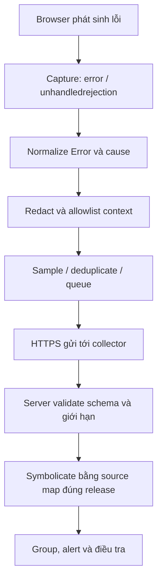

# Stack trace: đọc dấu vết lỗi và báo cáo an toàn

## 1. Stack trace là gì?

**Stack trace** (dấu vết ngăn xếp lời gọi) mô tả chuỗi lời gọi hàm dẫn tới một điểm trong chương trình, thường được đính kèm khi một exception hoặc error được tạo ra. Trong ứng dụng web, stack trace giúp xác định lỗi phát sinh ở file nào, dòng/cột nào, qua những hàm nào và có liên quan tới luồng bất đồng bộ nào.

Ví dụ, một lỗi khi tải hồ sơ có thể đi qua các hàm:

```text
loadDashboard()
  -> loadProfile()
      -> parseProfileResponse()
          -> throw new Error("Invalid profile response")
```

Stack trace cho biết đường đi đến điểm lỗi. Nó giúp developer tái hiện và sửa lỗi nhanh hơn, nhưng không phải bản ghi đầy đủ mọi hành động đã xảy ra. Một số frame có thể bị lược bỏ, tên hàm có thể bị minify, luồng async có thể không được thể hiện đầy đủ và định dạng stack khác nhau giữa browser/engine.

Stack trace cũng có thể chứa dữ liệu nhạy cảm như URL có query, đường dẫn nội bộ, tên file, tên hàm, ID tài khoản hoặc chuỗi được đưa vào error message. Gửi nguyên stack tới analytics hoặc hiển thị trực tiếp cho người dùng có thể làm lộ thông tin triển khai.

**Nguyên tắc:** dùng stack trace để điều tra lỗi trong môi trường có kiểm soát. Ở production, thu thập theo schema, lọc dữ liệu nhạy cảm, giới hạn kích thước và quyền truy cập; người dùng chỉ nên nhận thông báo an toàn cùng mã tham chiếu lỗi.

Bài viết thuộc chương **Error và report** của module **SECURITY_APPLICATION_SECURITY_BROWSER_SECURITY**. Nội dung kết nối stack trace với JavaScript runtime, browser error events, source maps, error reporting, privacy, URL leaks, CSP và quy trình vận hành ứng dụng web.

Sau bài học, bạn có thể:

- Đọc các thành phần của stack frame và stack trace.
- Phân biệt error message, error object, stack và cause.
- Hiểu khác biệt giữa stack đồng bộ và stack bất đồng bộ.
- Thu thập lỗi qua error và unhandledrejection event.
- Giải thích vì sao lỗi script cross-origin có thể chỉ hiện Script error.
- Dùng source map để symbolicate stack của bundle đã minify.
- Thiết kế error reporting pipeline có lọc dữ liệu.
- Tránh gửi token, cookie, URL nhạy cảm, DOM và dữ liệu cá nhân.
- Group, deduplicate và liên kết lỗi với release/request ID.
- Phân biệt lỗi phía client, lỗi tài nguyên và lỗi server.
- Thực hành tạo, đọc và lọc stack trace trong lab local.

## 2. Cấu trúc của stack trace

### 2.1. Stack frame

Một stack frame thường mô tả một vị trí trong chương trình. Tùy runtime và browser, frame có thể chứa:

- Tên hàm hoặc tên method.
- Tên file, URL script hoặc module.
- Số dòng.
- Số cột.
- Thông tin async boundary.
- Loại frame như native, eval hoặc anonymous.

Ví dụ minh họa theo định dạng thường thấy trong Chromium/V8:

```text
Error: Invalid profile response
    at parseProfileResponse (https://app.example.test/assets/profile.js:42:11)
    at loadProfile (https://app.example.test/assets/profile.js:18:16)
    at async loadDashboard (https://app.example.test/assets/dashboard.js:9:3)
```

Cách đọc:

| Thành phần | Ý nghĩa |
|---|---|
| Error: Invalid profile response | Loại lỗi và thông điệp |
| parseProfileResponse | Hàm tại frame |
| profile.js | Script chứa frame |
| 42 | Dòng |
| 11 | Cột |
| async loadDashboard | Frame liên quan luồng bất đồng bộ |

Đây là định dạng minh họa, không phải grammar chuẩn dùng được cho mọi browser. Firefox, Safari, Chromium, Node.js và các runtime khác có thể biểu diễn frame khác nhau.

### 2.2. Stack trace không phải call history đầy đủ

Stack trace thường phản ánh chuỗi lời gọi tại thời điểm Error được tạo hoặc ném ra. Nó không nhất thiết chứa mọi thao tác trước đó, mọi callback đã chạy hoặc toàn bộ lịch sử tương tác người dùng.

Ví dụ, nếu lỗi được bắt rồi chuyển thành một Error mới, stack mới có thể bắt đầu ở vị trí tạo Error mới. Nếu một Promise bị reject bằng string/object thay vì Error, không có stack chuẩn để đọc. Một số frame native, cross-origin hoặc async có thể bị ẩn.

Không dùng stack trace như audit log hoặc bằng chứng chắc chắn về hành vi người dùng. Nếu cần điều tra chuỗi sự kiện, ghi breadcrumb có giới hạn và correlation ID riêng.

### 2.3. Error message và stack khác nhau

- name: loại lỗi, ví dụ TypeError.
- message: mô tả ngắn về lỗi.
- stack: chuỗi dấu vết thực thi do runtime cung cấp.
- cause: nguyên nhân gốc được liên kết khi tạo Error.

Thông điệp có thể do ứng dụng tự tạo, thư viện tạo hoặc chứa giá trị từ input. Không giả định message an toàn để hiển thị hoặc gửi đi.

### 2.4. Error.stack không có định dạng chuẩn thống nhất

Thuộc tính Error.stack được hỗ trợ rộng rãi nhưng định dạng cụ thể phụ thuộc runtime. Không viết parser dựa trên một regex duy nhất rồi giả định mọi browser trả cùng format.

Một số runtime cung cấp API bổ sung như Error.captureStackTrace hoặc Error.prepareStackTrace; đây là API riêng của V8/Node.js, không phải tính năng portable của mọi browser. Chỉ dùng khi biết rõ runtime mục tiêu và có fallback.

## 3. Tạo và giữ nguyên nguyên nhân lỗi

### 3.1. Không làm mất stack gốc

Khi bắt lỗi, nếu chỉ tạo Error mới từ message:

```js
try {
  await loadProfile();
} catch (error) {
  throw new Error("Unable to load dashboard");
}
```

stack của Error mới thường bắt đầu tại nơi tạo Error mới và không tự động giữ đầy đủ stack ban đầu.

Nếu cần thêm ngữ cảnh, giữ lỗi gốc làm cause:

```js
try {
  await loadProfile();
} catch (error) {
  throw new Error("Unable to load dashboard", {
    cause: error
  });
}
```

Error options với cause được hỗ trợ trong JavaScript hiện đại. Khi gửi báo cáo, serialize cause theo giới hạn độ sâu và schema; không stringify đệ quy tùy tiện vì cause có thể là object không chuẩn, vòng tham chiếu hoặc chứa dữ liệu nhạy cảm.

### 3.2. Khi nào rethrow lỗi gốc?

Nếu tầng hiện tại không bổ sung ý nghĩa hoặc không xử lý được lỗi, có thể ném lại chính object lỗi:

```js
try {
  await loadProfile();
} catch (error) {
  recordLocalMetric("profile-load-failed");
  throw error;
}
```

Điều này giữ nguyên Error object và stack gốc. Tránh dùng throw new Error(error.message) chỉ để ném lại, vì cách đó tạo stack mới và có thể làm mất loại lỗi/cause.

### 3.3. Dùng cause để giữ chuỗi nguyên nhân

Ví dụ:

```js
async function loadDashboard() {
  try {
    return await fetchDashboardData();
  } catch (cause) {
    throw new Error("Dashboard initialization failed", {
      cause
    });
  }
}
```

Khi hiển thị hoặc báo cáo, có thể có nhiều lớp lỗi: lỗi nghiệp vụ ở ngoài và lỗi network/parse ở trong. Giữ chuỗi nguyên nhân giúp điều tra nhưng phải giới hạn số tầng, độ dài message và loại field được phép gửi.

### 3.4. Không dùng message để phân quyền hoặc quyết định bảo mật

Không kiểm tra chuỗi error.message hoặc stack để quyết định user có quyền truy cập, bỏ qua xác thực hay retry thao tác nhạy cảm. Nội dung Error không phải giao thức authorization. Quyền truy cập phải dựa trên trạng thái xác thực và policy có thẩm quyền.

## 4. Stack đồng bộ và bất đồng bộ

### 4.1. Stack đồng bộ

Trong lời gọi đồng bộ, hàm gọi hàm và lỗi lan ngược lên call stack:

```js
function parseAmount(value) {
  if (!Number.isFinite(value)) {
    throw new TypeError("Amount must be a finite number");
  }

  return value;
}

function createInvoice(input) {
  return {
    amount: parseAmount(input.amount)
  };
}

function submitInvoice(input) {
  return createInvoice(input);
}

try {
  submitInvoice({ amount: NaN });
} catch (error) {
  console.error(error.stack);
}
```

Stack có thể chỉ ra parseAmount, createInvoice và submitInvoice. Nếu code đã minify, tên hàm có thể bị rút gọn hoặc biến mất.

### 4.2. Stack bất đồng bộ

Promise và async/await tạo các ranh giới bất đồng bộ. Browser hiện đại thường bổ sung một phần async call chain vào stack, nhưng mức độ hiển thị phụ thuộc engine và cách code được viết.

Ví dụ:

```js
async function readAccount() {
  const response = await fetch("/api/account");

  if (!response.ok) {
    throw new Error("Account request failed");
  }

  return response.json();
}

async function renderAccount() {
  const account = await readAccount();
  return account.name.toUpperCase();
}

renderAccount().catch((error) => {
  console.error(error.stack);
});
```

Một stack có thể chứa frame async, nhưng không nên giả định nó luôn tái hiện đầy đủ mọi callback hoặc mọi tác vụ đã xếp hàng.

### 4.3. Callback và event loop

Lỗi xảy ra trong callback chạy sau một event loop turn có thể không giữ lại toàn bộ call site ban đầu. Ví dụ setTimeout, event listener hoặc message event thường tạo một ranh giới giữa lúc đăng ký callback và lúc callback chạy.

Nếu cần biết callback bắt nguồn từ thao tác nào, ghi breadcrumb có schema như event name, route category và correlation ID. Tránh lưu nguyên event object, DOM hoặc toàn bộ payload.

### 4.4. Promise rejection không nhất thiết là Error

JavaScript cho phép reject Promise bằng bất kỳ giá trị nào:

```js
Promise.reject("network unavailable");
Promise.reject({ code: "INVALID_STATE" });
Promise.reject(new Error("Request failed"));
```

Chỉ trường hợp cuối có Error stack tiêu chuẩn. Khi xử lý unhandledrejection, kiểm tra kiểu của event.reason; không giả định luôn có name, message và stack.

Nên chuẩn hóa Promise rejection trong code ứng dụng bằng Error object:

```js
function rejectRequest() {
  return Promise.reject(new Error("Request failed"));
}
```

Khi nhận dữ liệu từ thư viện hoặc code cũ, xử lý non-Error reason an toàn và không serialize object tùy ý.

## 5. Thu thập lỗi trong browser

### 5.1. window error event

Browser phát error event khi có JavaScript exception không được xử lý và trong một số trường hợp lỗi tải resource. Hai loại event này có payload khác nhau.

Ví dụ listener:

```js
window.addEventListener("error", (event) => {
  if (event.error instanceof Error) {
    reportClientError(event.error, {
      source: "window"
    });
    return;
  }

  // Có thể là lỗi resource như script/image không tải được.
  const target = event.target;

  if (target && target !== window) {
    reportResourceFailure({
      tagName: target.tagName || "unknown"
    });
  }
}, true);
```

Dùng capture phase để quan sát một số resource load errors không bubble như event thông thường. Không gửi nguyên element, HTML, src/href hoặc attribute của nó; các giá trị đó có thể chứa URL/query nhạy cảm.

event.error có thể null hoặc không phải Error trong một số trường hợp. event.message, filename, line và column cũng có thể bị giới hạn bởi cross-origin policy.

### 5.2. unhandledrejection

Event này được phát khi Promise bị reject nhưng không có rejection handler phù hợp tại thời điểm browser kiểm tra:

```js
window.addEventListener("unhandledrejection", (event) => {
  const reason = event.reason;

  if (reason instanceof Error) {
    reportClientError(reason, {
      source: "unhandledrejection"
    });
  } else {
    reportClientError(
      new Error("Unhandled rejection with non-Error reason"),
      {
        source: "unhandledrejection",
        reasonType: typeof reason
      }
    );
  }
});
```

Không tự động gửi event.reason nguyên bản. Nó có thể là object lớn, vòng tham chiếu, chứa request/response hoặc dữ liệu người dùng. Chỉ giữ loại dữ liệu đã allowlist.

Không gọi event.preventDefault() chỉ để làm mất thông báo console. Chỉ ngăn default reporting khi ứng dụng thực sự chịu trách nhiệm xử lý và đã có cơ chế quan sát thay thế.

### 5.3. Lỗi resource và lỗi JavaScript

Lỗi tải script, image, stylesheet hoặc iframe không giống exception trong code. Browser có thể phát error event trên element nhưng không cung cấp Error object có stack.

Với resource failure, thu thập loại resource, route category và mã lỗi đã chuẩn hóa. Tránh ghi URL đầy đủ vì query có thể chứa token hoặc identifier.

### 5.4. Tránh báo cáo trùng

Một lỗi có thể được bắt trong catch, được ghi log thủ công rồi tiếp tục nổi lên thành unhandledrejection hoặc window.error. Nếu mỗi nơi gửi một event, hệ thống sẽ đếm cùng một lỗi nhiều lần.

Chọn một điểm capture chính, đánh dấu lỗi đã report khi cần và dùng fingerprint/deduplication ở collector. Không làm mất lỗi chỉ để giảm số event; cần giữ tín hiệu đủ để điều tra.

## 6. Lỗi script cross-origin và Script error

### 6.1. Vì sao stack có thể bị ẩn?

Khi JavaScript từ một origin khác gây lỗi, browser có thể giới hạn thông tin được cung cấp cho trang gọi. Với classic script cross-origin không được tải qua CORS mode phù hợp, handler có thể chỉ nhận thông điệp chung như Script error. mà không có stack, file hoặc dòng chi tiết.

Đây là cơ chế bảo vệ thông tin giữa origin. Nó ngăn trang nhúng đọc chi tiết lỗi từ script bên ngoài trong một số cấu hình.

### 6.2. Cấu hình CORS cho script

Nếu cần nhận thông tin lỗi đầy đủ từ script CDN, script element có thể khai báo:

```html
<script
  src="https://cdn.example.net/app.js"
  crossorigin="anonymous"></script>
```

Server CDN cần trả CORS response header cho origin ứng dụng, ví dụ:

```http
Access-Control-Allow-Origin: https://app.example.com
```

Hoặc wildcard trong trường hợp tài nguyên public không dùng credential:

```http
Access-Control-Allow-Origin: *
```

Chỉ thêm crossorigin ở HTML mà server không cho phép origin thì chưa đủ. Cấu hình cần phù hợp với cách phục vụ script và credential policy.

### 6.3. CORS không phải cách bỏ qua isolation

Không mở CORS rộng chỉ để lấy stack nếu script chứa dữ liệu hoặc response cần được giới hạn. Chỉ cho phép origin cần thiết. Với tài nguyên public, wildcard có thể phù hợp nếu không dùng credentials; với nội dung riêng tư, dùng allowlist chính xác.

## 7. Source maps và symbolication

### 7.1. Vì sao cần source map?

Production JavaScript thường được bundle, transpile và minify. Stack trace có thể trỏ tới một dòng dài trong file bundle:

```text
at n (https://app.example.com/assets/app.4f21c.js:1:18340)
```

Source map ánh xạ vị trí trong file được phát hành về source file và vị trí ban đầu. Quá trình giải mã stack theo source map thường được gọi là **symbolication**.

Sau symbolication, frame có thể hiển thị tên file/module và dòng code gần với source ban đầu hơn. Điều này giúp developer xác định lỗi mà không phải đọc bundle đã minify.

### 7.2. Source map phải khớp đúng release

Source map phải tương ứng chính xác với artifact JavaScript mà người dùng đang chạy. Nếu upload map của build khác, vị trí và tên hàm có thể bị giải mã sai.

Gắn mỗi event với release/build identifier, ví dụ:

- Release version.
- Commit/build ID.
- Environment.
- Bundle name hoặc debug ID.
- Browser/runtime version.

Quy trình build nên tạo artifact và source map cùng một lần, sau đó upload map gắn với đúng release.

### 7.3. Source map có thể làm lộ source code

Source map có thể chứa tên file nội bộ, cấu trúc thư mục, tên module và tùy cấu hình có thể chứa sourcesContent (toàn bộ source gốc). Nếu public map không cần thiết, không deploy nó vào public asset directory.

Các lựa chọn thường gặp:

- Upload source map trực tiếp tới error reporting service qua build pipeline.
- Lưu map trong private artifact storage.
- Tắt public source map trong production.
- Nếu phải public map, review sourcesContent và nội dung trước khi phát hành.

Không chứa secret trong source code. Source map không phải nơi lưu khóa hoặc credential.

### 7.4. DevTools source map và backend symbolication

Browser DevTools có thể tải source map để hiển thị source dễ đọc cho developer. Error reporting service có thể cần map được upload riêng để symbolicate stack đã gửi về server.

Việc DevTools hiển thị source gốc không chứng minh collector đã có source map. Ngược lại, map được upload private cho collector không nhất thiết phải public trên website.

### 7.5. Không tin source map từ client

Client có thể gửi filename, line, column hoặc stack string tùy ý. Collector cần giới hạn kích thước và schema, sau đó chỉ symbolicate bằng artifact map mà hệ thống build đã tin cậy. Không tải source map từ URL do client tự gửi.

## 8. Error reporting pipeline

Một pipeline báo cáo lỗi production thường có các bước:



### 8.1. Capture

Chọn nguồn capture phù hợp: code try/catch, window.error, unhandledrejection, framework error boundary hoặc resource error. Tránh cài nhiều SDK cùng capture một event mà không có quy tắc deduplicate.

### 8.2. Normalize

Chuyển Error thành record có schema rõ:

| Field | Mục đích |
|---|---|
| error_name | Loại lỗi |
| message | Thông điệp đã lọc và giới hạn |
| stack | Stack đã lọc, giới hạn số frame/byte |
| cause | Nguyên nhân lồng nhau có giới hạn |
| source | Điểm capture |
| release | Bản phát hành |
| environment | production/staging/development |
| route_name | Tên route đã phân loại |
| request_id | Correlation ID không có quyền truy cập |

Không serialize toàn bộ Error object bằng JSON.stringify(error) rồi giả định nó có đủ field. Các thuộc tính Error có thể không enumerable; cần chuẩn hóa có chủ đích.

### 8.3. Context có allowlist

Context giúp tái hiện lỗi nhưng có thể làm lộ dữ liệu. Chỉ thêm các field cần thiết như:

- Release/build ID.
- Environment.
- Browser family và major version.
- Route category.
- Feature flag đã chuẩn hóa.
- Request/correlation ID.
- Breadcrumb event name và timestamp tương đối.

Không tự động gửi cookie, authorization header, request body, form input, page HTML, DOM snapshot, localStorage, full URL hoặc mọi object trong application state.

### 8.4. Queue và transport

Network có thể mất kết nối hoặc browser đóng tab. SDK có thể queue, retry hoặc batch event. Queue phải giới hạn số event, kích thước và thời gian tồn tại; tránh lưu payload nhạy cảm vào persistent storage.

Nếu dùng sendBeacon hoặc fetch khi page rời đi, vẫn phải lọc payload trước khi gửi. Chỉ gửi qua HTTPS tới collector đã được allowlist bởi ứng dụng và CSP.

### 8.5. Collector phía server

Server nhận error event phải coi request là input không tin cậy. Client có thể giả mạo event, gửi stack rất lớn hoặc flood collector.

Collector nên:

- Xác thực nguồn/ứng dụng theo thiết kế, không tin một field user_id client tự khai.
- Validate schema và kiểu dữ liệu.
- Giới hạn body size, số frame và độ dài string.
- Rate limit theo app/release/network context.
- Loại bỏ field không nằm trong allowlist.
- Escape dữ liệu khi hiển thị trong dashboard.
- Không render message/stack như HTML.
- Áp retention và access control.

### 8.6. Group và deduplicate

Một fingerprint có thể dựa trên error type, message đã chuẩn hóa và một số frame đầu sau symbolication. Không group chỉ theo message nếu message chứa ID động; cũng không đưa PII vào fingerprint.

Giữ release, browser và route category để biết lỗi chỉ xuất hiện sau một bản cập nhật hoặc trên một nhóm môi trường.

## 9. Privacy và dữ liệu nhạy cảm trong stack trace

Stack trace và error context có thể chứa:

- URL có query hoặc fragment.
- Email, account ID hoặc customer ID trong message/path.
- Tên file và đường dẫn hệ thống.
- Tên function hoặc module nội bộ.
- API endpoint hoặc hostname nội bộ.
- Input từ form hoặc dữ liệu server trả về.
- Token nếu ứng dụng đặt token trong URL hoặc script source URL.
- Chi tiết triển khai giúp attacker hiểu cấu trúc ứng dụng.

### 9.1. Không gửi toàn bộ URL mặc định

Thay vì:

```js
reportClientError(error, {
  url: location.href,
  referrer: document.referrer
});
```

hãy gửi route category:

```js
reportClientError(error, {
  route_name: "account-settings"
});
```

Nếu cần biết nguồn navigation, gửi category đã phân loại như internal, external hoặc direct, không gửi referrer đầy đủ nếu metric không cần.

### 9.2. Không gửi cookie, header hoặc request body

Không gắn các giá trị sau vào error event:

- Cookie hoặc Set-Cookie.
- Authorization hoặc bearer token.
- Password, OTP và form value.
- Request/response body không được lọc.
- DOM snapshot hoặc text người dùng nhập.
- localStorage/sessionStorage dump.

Nếu cần debug request, dùng request ID và tra cứu log phía server với quyền phù hợp.

### 9.3. Redaction ở client và server

Redact ở client giúp giảm dữ liệu rời khỏi browser, nhưng không phải ranh giới duy nhất. Collector phải lọc lại vì client có thể cũ, bị sửa hoặc bị giả mạo.

Redaction cần áp dụng cho cả message, stack, cause, breadcrumb, URL và custom context. Kiểm thử bằng dữ liệu giả có token/email để xác nhận giá trị nhạy cảm không xuất hiện trong request payload hoặc dashboard.

### 9.4. Không hiển thị stack cho người dùng

Production response nên trả thông báo chung và mã tham chiếu:

```text
Đã xảy ra lỗi khi xử lý yêu cầu.
Mã tham chiếu: err_7f3a91
```

Developer dùng mã đó để tìm event trong hệ thống nội bộ. Không gửi stack, source path, SQL/query, environment variable hoặc internal hostname trong response công khai.

## 10. Phân biệt client error, resource error và server error

| Loại lỗi | Ví dụ | Nguồn điều tra |
|---|---|---|
| JavaScript exception | TypeError khi đọc property | Browser stack trace |
| Promise rejection | API wrapper reject | unhandledrejection hoặc catch |
| Resource load failure | Script/image không tải được | Resource error event, Network |
| Network failure | DNS, timeout, offline | Network telemetry và server logs |
| HTTP error response | API trả 401/403/500 | Status, request ID, backend logs |
| Server exception | Backend ném exception | Server-side stack trace |
| CSP violation | Script hoặc connection bị policy chặn | CSP report/console và policy config |

HTTP 500 không tự động cho biết nguyên nhân. Browser stack trace cũng không thể thay thế stack trace phía server. Liên kết chúng bằng request ID, trace ID hoặc operation ID không chứa quyền truy cập.

### 10.1. Network error và HTTP error khác nhau

fetch thường resolve Promise ngay cả khi server trả status 404 hoặc 500. Code phải kiểm tra response.ok hoặc status code. Network failure thường reject Promise và có thể không cung cấp status HTTP.

```js
async function loadSettings() {
  const response = await fetch("/api/settings");

  if (!response.ok) {
    throw new Error("Settings API returned an unsuccessful status");
  }

  return response.json();
}
```

Không đưa toàn bộ response body vào error message; response có thể chứa thông tin cá nhân hoặc nội bộ.

### 10.2. CSP violation reporting

CSP có thể phát report khi browser chặn resource. Report có thể chứa document URI, blocked URI, directive và disposition. Những field URL này cũng cần được kiểm tra và redact trước khi lưu hoặc chia sẻ.

CSP report giúp phát hiện policy quá chặt hoặc hành vi đáng ngờ, nhưng không thay thế error reporting của JavaScript. Cấu hình endpoint và retention phù hợp.

## 11. Hiển thị và lưu stack an toàn

### 11.1. Không đưa stack vào HTML

Không render stack hoặc message bằng innerHTML. Dùng text node hoặc cơ chế auto-escaping:

```js
errorPanel.textContent = safeSummary;
```

Nếu dashboard hiển thị stack, escape dữ liệu và giới hạn quyền người xem. Stack có thể chứa chuỗi do attacker kiểm soát và tạo stored XSS trong công cụ nội bộ nếu render không an toàn.

### 11.2. Structured logging

Lưu record có field riêng thay vì ghép chuỗi log tự do. Giới hạn độ dài, escape control characters và loại bỏ dữ liệu nhạy cảm trước khi ghi.

Ví dụ cấu trúc:

```json
{
  "event_type": "client_error",
  "release": "web-2026.11.22.3",
  "environment": "production",
  "error_name": "TypeError",
  "route_name": "account-settings",
  "request_id": "req_7f3a91",
  "frame_count": 8
}
```

Ví dụ cố ý không chứa cookie, authorization header, full URL hay page content. Stack có thể được lưu riêng với quyền truy cập hẹp hơn.

### 11.3. Retention và access control

Stack trace có thể tiết lộ đường dẫn source và cấu trúc hệ thống. Chỉ cấp quyền cho người cần điều tra, ghi audit truy cập và đặt retention theo mục đích. Không để error dashboard công khai hoặc chia sẻ link không giới hạn.

### 11.4. Mã tham chiếu lỗi

Tạo một event ID ngẫu nhiên phía collector hoặc server. Trả ID đó về client để support có thể tra cứu. ID chỉ là correlation key; endpoint tra cứu vẫn phải yêu cầu xác thực và authorization.

## 12. Lab local: tạo và đọc stack trace

Lab dùng một trang HTML chạy trên localhost. Nó tạo lỗi đồng bộ, lỗi async và lỗi có cause, sau đó hiển thị bản tóm tắt bằng textContent. Một ví dụ URL giả có query token để minh họa redaction; không dùng token thật.

### 12.1. Tạo file index.html

```html
<!doctype html>
<html lang="vi">
<head>
  <meta charset="utf-8">
  <meta name="viewport" content="width=device-width, initial-scale=1">
  <title>Stack trace lab</title>
</head>
<body>
  <h1>Stack trace lab</h1>
  <p>Chọn loại lỗi để quan sát Error object và stack.</p>

  <button id="sync">Tạo lỗi đồng bộ</button>
  <button id="async">Tạo lỗi bất đồng bộ</button>
  <button id="cause">Tạo lỗi có cause</button>

  <h2>Kết quả</h2>
  <pre id="output" aria-live="polite"></pre>

  <script>
    const output = document.getElementById("output");

    function redactText(value) {
      return String(value)
        .replace(
          /([?&](?:token|access_token|code|email|session)=)[^&#\s)]+/gi,
          "$1[REDACTED]"
        )
        .replace(
          /\b[A-Z0-9._%+-]+@[A-Z0-9.-]+\.[A-Z]{2,}\b/gi,
          "[EMAIL]"
        )
        .slice(0, 4000);
    }

    function safeErrorSummary(error, depth = 0) {
      if (!(error instanceof Error)) {
        return {
          name: "NonError",
          message: "A non-Error value was thrown",
          stack: ""
        };
      }

      const record = {
        name: redactText(error.name).slice(0, 100),
        message: redactText(error.message).slice(0, 500),
        stack: redactText(error.stack || "").slice(0, 3000)
      };

      if (error.cause && depth < 2) {
        record.cause = safeErrorSummary(error.cause, depth + 1);
      }

      return record;
    }

    function parseResponse() {
      throw new TypeError(
        "Invalid response for https://app.example.test/api?token=FAKE-TOKEN"
      );
    }

    function loadProfile() {
      return parseResponse();
    }

    function loadDashboard() {
      return loadProfile();
    }

    async function loadAsyncProfile() {
      await Promise.resolve();
      throw new Error("Async profile load failed");
    }

    document.getElementById("sync").addEventListener("click", () => {
      try {
        loadDashboard();
      } catch (error) {
        output.textContent = JSON.stringify(
          safeErrorSummary(error),
          null,
          2
        );
      }
    });

    document.getElementById("async").addEventListener("click", async () => {
      try {
        await loadAsyncProfile();
      } catch (error) {
        output.textContent = JSON.stringify(
          safeErrorSummary(error),
          null,
          2
        );
      }
    });

    document.getElementById("cause").addEventListener("click", async () => {
      try {
        try {
          await loadAsyncProfile();
        } catch (cause) {
          throw new Error("Dashboard initialization failed", { cause });
        }
      } catch (error) {
        output.textContent = JSON.stringify(
          safeErrorSummary(error),
          null,
          2
        );
      }
    });
  </script>
</body>
</html>
```

### 12.2. Chạy lab

Lưu nội dung thành index.html trong một thư mục local và phục vụ bằng static HTTP server trên loopback, ví dụ:

```text
http://127.0.0.1:8080/
```

Không cần deploy hoặc tải thư viện bên ngoài. Nếu môi trường đã có static server, dùng server đó; nếu không, dùng một static server local được team cho phép.

### 12.3. Quan sát stack

1. Mở DevTools → Console.
2. Bấm **Tạo lỗi đồng bộ**.
3. Đọc frame từ parseResponse lên loadProfile và loadDashboard.
4. Bấm **Tạo lỗi bất đồng bộ**.
5. Quan sát frame async mà browser hiển thị.
6. Bấm **Tạo lỗi có cause**.
7. So sánh message và stack của lỗi ngoài với cause bên trong.
8. Xem query token giả trong Error message đã được thay bằng [REDACTED] trong bản tóm tắt.
9. Kiểm tra DOM output dùng textContent, không dùng innerHTML.
10. Thử thay chuỗi lỗi bằng email giả và xác nhận email được lọc.

### 12.4. Thử global error events

Trong bản lab riêng, thêm listener:

```js
window.addEventListener("error", (event) => {
  console.log({
    hasErrorObject: event.error instanceof Error,
    message: event.message || "(no message)",
    line: event.lineno,
    column: event.colno
  });
});

window.addEventListener("unhandledrejection", (event) => {
  console.log({
    reasonIsError: event.reason instanceof Error,
    reasonType: typeof event.reason
  });
});
```

Tạo một lỗi không được catch hoặc một Promise rejection không có handler trong lab. Quan sát event và dọn listener sau khi thử nghiệm.

Không để lỗi unhandled trong ứng dụng production chỉ để thu stack. Ở ứng dụng thật, xử lý lỗi theo flow và gửi report tại một điểm capture có kiểm soát.

### 12.5. Thử source map

Trong một ứng dụng demo có build/minify, tạo source map cho bundle và bật DevTools JavaScript source maps. So sánh stack khi source map được bật và tắt.

Nếu dùng error reporting service, upload source map gắn với đúng release/build ID vào khu vực private của service. Kiểm tra dashboard symbolicate đúng frame và không yêu cầu public source map.

### 12.6. Giới hạn của lab

Lab chỉ minh họa Error object, stack đồng bộ/bất đồng bộ, cause và redaction cơ bản. Regex redaction trong ví dụ không phải bộ lọc toàn diện; production cần schema allowlist, server-side redaction và kiểm thử với dữ liệu giả. Lab không mô phỏng đầy đủ CORS, CSP reporting, source map service hoặc mọi định dạng stack của browser.

## 13. Checklist triển khai error reporting

Trước khi phát hành:

1. **Capture:** Có xác định nguồn capture chính và tránh báo cáo trùng không?
2. **Normalize:** Có chuẩn hóa Error, non-Error rejection và cause không?
3. **Stack:** Có giới hạn số frame, độ dài và kích thước payload không?
4. **Source maps:** Map có khớp release/build artifact không?
5. **Privacy:** Có loại cookie, token, URL query/fragment, email và form data không?
6. **Context:** Chỉ gửi route category, release, environment và request ID cần thiết?
7. **Transport:** Có HTTPS, retry/queue giới hạn và CSP connect-src phù hợp không?
8. **Collector:** Có validate schema, body size, rate limit và escape output không?
9. **Symbolication:** Chỉ dùng source map từ build pipeline đáng tin cậy?
10. **Grouping:** Fingerprint có loại bỏ identifier động và PII không?
11. **Access:** Dashboard có quyền theo vai trò và audit không?
12. **Retention:** Có thời hạn lưu và quy trình xóa phù hợp không?
13. **User response:** Client có nhận thông báo chung và error reference thay stack không?
14. **Cross-origin:** Script CDN có CORS configuration đúng nếu cần detailed error không?
15. **Testing:** Đã thử lỗi sync, async, resource, rejection và source map chưa?

## 14. Những hiểu lầm phổ biến

| Nhận định sai | Cách hiểu đúng |
|---|---|
| Stack trace là toàn bộ lịch sử chương trình. | Nó chỉ mô tả các frame mà runtime ghi nhận tại thời điểm lỗi; có thể thiếu async boundary hoặc callback trước đó. |
| Mọi browser có cùng định dạng stack. | Format và mức chi tiết phụ thuộc runtime/browser. |
| error.message luôn an toàn để gửi. | Message có thể chứa URL, input hoặc dữ liệu cá nhân. |
| Error.stack luôn tồn tại. | Có thể thiếu hoặc bị giới hạn, nhất là với non-Error rejection và cross-origin script. |
| Tạo Error mới từ message giữ stack gốc. | Error mới thường có stack bắt đầu tại nơi tạo; dùng cause hoặc rethrow lỗi gốc. |
| Promise luôn reject bằng Error. | Promise có thể reject bằng bất kỳ giá trị nào. |
| unhandledrejection chỉ chứa Error. | event.reason có thể là string, object hoặc giá trị khác. |
| crossorigin attribute tự mở stack cross-origin. | Server cũng phải trả CORS header cho origin phù hợp. |
| Source map public luôn an toàn. | Map có thể tiết lộ source, tên module và cấu trúc thư mục. |
| DevTools xem được source gốc nghĩa là collector đã symbolicate. | DevTools và error reporting service có thể dùng hai bản source map khác nhau. |
| Gửi full URL giúp debug tốt hơn. | Route category và request ID thường đủ; full URL có thể chứa secret. |
| Client error event là đáng tin. | Client có thể giả mạo hoặc flood event; collector phải validate/rate limit. |
| Stack trace nên trả về cho người dùng để dễ support. | Trả error reference; giữ stack trong hệ thống nội bộ có kiểm soát. |
| CSP ngăn mọi dữ liệu error bị gửi. | CSP giới hạn đích kết nối; payload vẫn phải được lọc. |
| Chỉ cần redact ở browser. | Collector phải lọc lại vì client có thể cũ, bị sửa hoặc giả mạo. |

## 15. Câu hỏi ôn tập

1. Stack trace là gì và thường gồm những thông tin nào?
2. Stack frame khác stack trace ở điểm nào?
3. Vì sao stack trace không phải call history đầy đủ?
4. Error name, message, stack và cause khác nhau thế nào?
5. Khi nào nên rethrow Error gốc và khi nào dùng cause?
6. Vì sao throw Error mới từ message có thể làm mất thông tin?
7. Stack bất đồng bộ khác stack đồng bộ ra sao?
8. Promise rejection có thể chứa kiểu dữ liệu nào?
9. window.error và unhandledrejection dùng để thu thập lỗi gì?
10. Vì sao resource load error khác JavaScript exception?
11. Vì sao script cross-origin có thể chỉ trả Script error?
12. Cần cấu hình gì để nhận detailed cross-origin script error?
13. Source map dùng để làm gì?
14. Vì sao source map phải khớp release?
15. Source map có thể làm lộ thông tin nào?
16. Error reporting pipeline nên gồm những bước nào?
17. Vì sao không gửi cookie, authorization header hoặc full URL?
18. Collector phải kiểm tra client error event ra sao?
19. Vì sao không trả stack trace cho người dùng production?
20. Cần kiểm thử những loại lỗi nào trước khi phát hành?

**Đáp án định hướng:** (1) Dấu vết lời gọi dẫn tới lỗi, gồm hàm, file/URL, dòng/cột tùy runtime. (2) Frame là một vị trí; trace là chuỗi frame. (3) Runtime có thể bỏ async/callback/native/cross-origin frames. (4) Name là loại, message là mô tả, stack là dấu vết, cause là nguyên nhân lồng nhau. (5) Rethrow khi không đổi ngữ nghĩa; dùng cause khi thêm ngữ cảnh. (6) Nó tạo Error mới và stack mới. (7) Async boundary có thể được runtime thể hiện một phần. (8) Bất kỳ giá trị JavaScript nào. (9) Error event thu uncaught exception/resource error; unhandledrejection thu Promise rejection chưa xử lý. (10) Resource failure không nhất thiết có Error stack. (11) Browser giới hạn thông tin cross-origin theo isolation policy. (12) Thêm crossorigin phù hợp và server trả Access-Control-Allow-Origin. (13) Ánh xạ bundle/minified frame về source gốc. (14) Map khác build sẽ symbolicate sai. (15) Source, path, module và sourcesContent. (16) Capture, normalize, redact, queue, transport, validate, symbolicate, group/triage. (17) Chúng có thể chứa credential và PII không cần cho điều tra. (18) Validate schema, size, rate limit, escape và loại field thừa. (19) Stack tiết lộ cấu trúc triển khai; người dùng chỉ cần error reference. (20) Sync, async, resource, rejection, cross-origin và source map.

## 16. Tài liệu tham khảo

- [MDN — Error](https://developer.mozilla.org/en-US/docs/Web/JavaScript/Reference/Global_Objects/Error): Error object, stack và cause.
- [MDN — Error.stack](https://developer.mozilla.org/en-US/docs/Web/JavaScript/Reference/Global_Objects/Error/stack): Khác biệt triển khai của stack property.
- [MDN — ErrorEvent](https://developer.mozilla.org/en-US/docs/Web/API/ErrorEvent): Browser error event và các field.
- [MDN — unhandledrejection](https://developer.mozilla.org/en-US/docs/Web/API/Window/unhandledrejection_event): Promise rejection không được xử lý.
- [MDN — Using source maps](https://developer.mozilla.org/en-US/docs/Tools/Debugger/How_to/Use_a_source_map): Ánh xạ bundle về source gốc trong DevTools.
- [ECMA-262 — Error Objects](https://tc39.es/ecma262/#sec-error-objects): Mô hình Error trong ECMAScript.
- [WHATWG — HTML scripting](https://html.spec.whatwg.org/multipage/webappapis.html): Runtime script và xử lý exception trong browser.
- [MDN — CORS](https://developer.mozilla.org/en-US/docs/Web/HTTP/CORS): CORS cho tài nguyên cross-origin.
- [MDN — Script element crossorigin](https://developer.mozilla.org/en-US/docs/Web/HTML/Element/script#crossorigin): CORS mode của script element.
- [OWASP — Logging Cheat Sheet](https://cheatsheetseries.owasp.org/cheatsheets/Logging_Cheat_Sheet.html): Giảm dữ liệu nhạy cảm và quản lý log.
- [OWASP — Error Handling Cheat Sheet](https://cheatsheetseries.owasp.org/cheatsheets/Error_Handling_Cheat_Sheet.html): Xử lý lỗi và tránh lộ thông tin nội bộ.
- [Chrome DevTools — JavaScript source maps](https://developer.chrome.com/docs/devtools/javascript/source-maps): Debug source đã bundle/minify.
- [Sentry — Source Maps](https://docs.sentry.io/platforms/javascript/sourcemaps/): Upload và symbolicate source map cho error reporting.

**Kết nối với mô hình bảo mật web:** Stack trace giúp xác định vị trí lỗi nhưng có thể tiết lộ URL, đường dẫn và cấu trúc ứng dụng. Browser có thể giới hạn stack của script cross-origin; source map giúp symbolicate bundle nhưng cũng có thể làm lộ source. Error reporting an toàn cần capture có kiểm soát, giữ cause, lọc dữ liệu ở client và server, giới hạn quyền dashboard, gắn release/request ID và chỉ trả mã tham chiếu cho người dùng. Stack trace là công cụ điều tra, không phải dữ liệu authorization hay audit log hoàn chỉnh.
