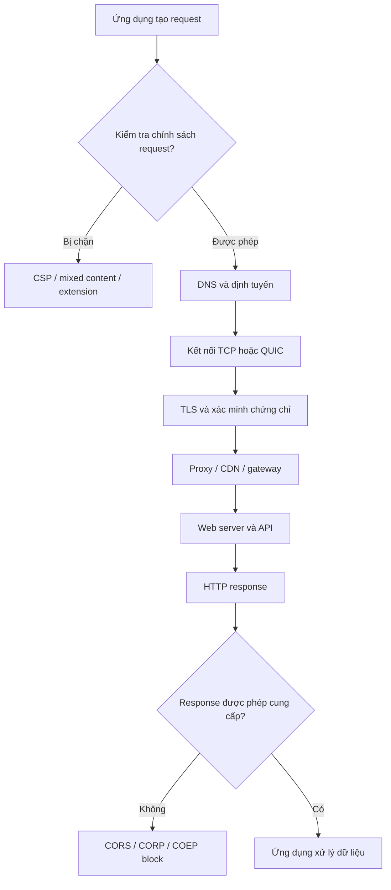

# Network error trong ứng dụng web

Network error là tình huống trình duyệt hoặc ứng dụng không hoàn tất được một thao tác mạng như dự kiến. Lỗi có thể xuất hiện khi phân giải tên miền, thiết lập kết nối, xác minh chứng chỉ TLS, gửi request, nhận response hoặc khi chính sách bảo mật của trình duyệt chặn việc sử dụng dữ liệu. Một thao tác cũng có thể bị hủy bởi người dùng, hết thời gian chờ hoặc bị Service Worker xử lý theo nhánh offline.

Trong bảo mật ứng dụng web, cần xác định đúng lớp phát sinh lỗi trước khi thay đổi cấu hình. Một request bị CORS chặn có ý nghĩa khác với máy chủ không phản hồi; status `403` khác với lỗi DNS; và một request `200` vẫn có thể trả dữ liệu không đúng quyền. Việc phân loại chính xác giúp khắc phục sự cố mà không vô tình nới lỏng CORS, bỏ qua TLS, tắt CSP hoặc làm lộ thông tin xác thực.

Sau bài học, bạn có thể:

- Phân biệt lỗi mạng ở tầng trình duyệt, kết nối, HTTP và ứng dụng.
- Dùng Network panel, Console và thông tin timing để tìm request lỗi.
- Nhận diện các nguyên nhân thường gặp như DNS, TLS, CORS, mixed content, CSP, cookie, proxy và Service Worker.
- Xử lý timeout, hủy request và retry theo cách an toàn.
- Thu thập bằng chứng chẩn đoán có thể đối chiếu với log máy chủ mà không làm lộ token hoặc dữ liệu cá nhân.

## 1. Network error là gì?

Trong giao diện người dùng, nhiều tình huống khác nhau đều có thể được gọi chung là “lỗi mạng”. Khi điều tra, hãy phân biệt ít nhất bốn nhóm:

| Nhóm | Điều đã xảy ra | Ví dụ |
|---|---|---|
| Lỗi kết nối hoặc truyền tải | Trình duyệt không thiết lập được kết nối hoặc không nhận được response HTTP hoàn chỉnh | DNS thất bại, máy chủ từ chối kết nối, kết nối bị reset, timeout |
| Lỗi chính sách trình duyệt | Request hoặc response bị giới hạn bởi chính sách bảo mật của trình duyệt | CORS, mixed content, CSP, CORP/COEP hoặc nội dung bị chặn |
| HTTP error response | Máy chủ hoặc gateway đã trả về một response HTTP có mã lỗi | `401`, `403`, `404`, `429`, `500`, `502`, `503`, `504` |
| Lỗi ở tầng ứng dụng | Request hoàn tất nhưng dữ liệu hoặc trạng thái không đáp ứng điều kiện nghiệp vụ | JSON sai định dạng, validation thất bại, thao tác bị từ chối, response không có trường bắt buộc |

Ngoài ra, request có thể được hủy có chủ đích, chẳng hạn người dùng rời trang, nhập truy vấn mới hoặc mã ứng dụng gọi `AbortController.abort()`. Đây là một kết quả cần xử lý riêng, không nhất thiết là sự cố của máy chủ.

### 1.1. Không đồng nhất lỗi mạng với HTTP status

Một response HTTP có status `404` hoặc `500` chứng minh rằng trình duyệt đã nhận được response từ một máy chủ hoặc gateway. Ngược lại, lỗi DNS hoặc lỗi TLS thường xảy ra trước khi có response HTTP mà ứng dụng có thể đọc.

Với `fetch()`, Promise thường chỉ bị reject khi có lỗi khiến request không thể cung cấp response cho mã JavaScript, ví dụ lỗi mạng, lỗi CORS hoặc request bị abort. Các status `404`, `500` và những status HTTP khác vẫn tạo ra một đối tượng `Response`; ứng dụng phải kiểm tra `response.ok` hoặc `response.status`.

```javascript
const response = await fetch("/api/profile");

// fetch không tự reject chỉ vì máy chủ trả 404 hoặc 500.
if (!response.ok) {
  throw new Error(`HTTP ${response.status}`);
}

const profile = await response.json();
```

Một số thư viện hoặc lớp wrapper có thể chủ động ném lỗi khi status không thành công. Vì vậy, hãy kiểm tra hợp đồng của thư viện đang dùng trước khi kết luận request đã thất bại ở tầng kết nối.

### 1.2. Vì sao giao diện có thể chỉ hiển thị “Network Error”?

Trình duyệt giới hạn thông tin chi tiết mà JavaScript được phép đọc khi một request cross-origin bị chặn. Với CORS, ứng dụng có thể chỉ nhận một `TypeError` chung như `Failed to fetch`, trong khi Console giải thích cụ thể response thiếu header cho phép origin. Một số lỗi TLS, DNS hoặc kết nối cũng được trình duyệt biểu diễn bằng thông báo chung.

Do đó, nội dung exception trong mã ứng dụng thường chưa đủ để tìm nguyên nhân. Hãy kết hợp Network panel, Console, trạng thái kết nối, request ID và log phía máy chủ.

## 2. Các lớp có thể gây ra lỗi

Một request đi qua nhiều thành phần trước khi ứng dụng nhận được dữ liệu. Trình tự dưới đây là mô hình chẩn đoán; các giao thức, proxy, cache và Service Worker có thể làm thay đổi đường đi thực tế.



| Lớp | Dấu hiệu thường gặp | Câu hỏi cần trả lời |
|---|---|---|
| Mã ứng dụng | Không có request, lỗi đồng bộ trước `fetch`, request bị abort | Hàm có thực sự chạy và tạo request không? |
| Chính sách trình duyệt | Console báo CORS/CSP/mixed content; request hiển thị blocked | Chính sách nào áp dụng và response nào tạo ra chính sách đó? |
| DNS và mạng | Không phân giải được host, timeout, không có kết nối | Tên miền có phân giải đúng và đường mạng có hoạt động không? |
| TLS | Cảnh báo chứng chỉ hoặc lỗi handshake | Hostname, thời hạn, chuỗi tin cậy và cấu hình TLS có hợp lệ không? |
| Proxy/CDN/gateway | `502`, `503`, `504`, response khác giữa các mạng | Thành phần trung gian nào nhận request và trả lỗi? |
| API/server | `4xx`, `5xx`, response sai hoặc chậm | Log server ghi nhận request nào và xử lý tới đâu? |
| Xử lý response | HTTP thành công nhưng giao diện lỗi | JSON, schema và trạng thái nghiệp vụ có hợp lệ không? |

## 3. Đọc lỗi trong Network panel và Console

Mở DevTools trước khi tái hiện sự cố, chọn **Network**, sau đó thực hiện lại thao tác gây lỗi. Nếu có điều hướng hoặc redirect, bật **Preserve log** để giữ lại chuỗi request. Xóa các dòng cũ trước lần thử mới để tránh nhầm request từ một thao tác trước đó.

### 3.1. Tìm đúng request

1. Chọn **Fetch/XHR** nếu lỗi xảy ra khi gọi API; chọn **Doc** nếu trang không tải hoặc điều hướng thất bại.
2. Lọc theo domain hoặc một phần URL.
3. Quan sát cột Status và các dòng được đánh dấu `(failed)`, `blocked` hoặc có biểu tượng lỗi.
4. Chọn request để đọc Headers, Payload, Response, Cookies, Initiator và Timing nếu các tab này có sẵn.
5. Mở Console để xem thông báo do trình duyệt hoặc mã ứng dụng phát ra.

Đừng chỉ dựa vào màu sắc hoặc một dòng status. Hãy xem chi tiết lỗi, URL, method, thời điểm, initiator và request liên quan trước đó. Với request bị chặn trước khi gửi, có thể không có response headers hay response body.

### 3.2. Đọc các giai đoạn Timing

Timing giúp xác định request dừng ở giai đoạn nào. Tên các giai đoạn có thể thay đổi theo phiên bản trình duyệt và giao thức.

| Giai đoạn | Ý nghĩa khi chẩn đoán |
|---|---|
| Queueing / Stalled | Request chờ tài nguyên trình duyệt, kết nối hoặc điều kiện lập lịch |
| DNS Lookup | Trình duyệt phân giải tên miền thành địa chỉ mạng |
| Initial connection | Thiết lập kết nối tới máy chủ hoặc proxy |
| SSL / TLS | Thương lượng và xác minh kết nối TLS khi có giai đoạn riêng |
| Request sent | Gửi request tới peer đang kết nối |
| Waiting / TTFB | Chờ byte đầu tiên của response; có thể gồm thời gian xử lý ở máy chủ và mạng |
| Content Download | Nhận phần còn lại của response |

Nếu DNS Lookup kéo dài hoặc thất bại, hãy kiểm tra DNS và cấu hình mạng. Nếu kết nối thành công nhưng Waiting rất lâu, cần đối chiếu thời gian xử lý API, hàng đợi và gateway. Nếu Content Download kéo dài, xem kích thước response, băng thông và việc truyền dữ liệu có bị gián đoạn không.

### 3.3. Xem thông tin blocked reason

Một số phiên bản DevTools hiển thị lý do chặn trong phần chi tiết request hoặc cột liên quan. Ví dụ, request có thể bị chặn bởi extension, CSP, mixed content, CORP/COEP hoặc chính sách nội dung. Khi giao diện chỉ hiển thị một mã lỗi chung, thông báo Console thường cung cấp thêm ngữ cảnh.

Network panel của Chromium có thể hiển thị các mã `net::ERR_*`. Đây là mã chẩn đoán riêng của họ trình duyệt Chromium, không phải bộ mã HTTP chuẩn và không đảm bảo xuất hiện giống hệt trong Firefox hoặc Safari.

## 4. Các lỗi kết nối thường gặp

| Dấu hiệu hoặc mã thường thấy | Nguyên nhân có thể | Hướng kiểm tra |
|---|---|---|
| `ERR_NAME_NOT_RESOLVED` | DNS không phân giải được tên miền | Kiểm tra hostname, DNS record, resolver, VPN và cấu hình mạng |
| `ERR_CONNECTION_REFUSED` | Máy đích từ chối kết nối hoặc không có dịch vụ lắng nghe tại cổng đó | Kiểm tra host, port, trạng thái service, firewall và reverse proxy |
| `ERR_CONNECTION_RESET` | Kết nối bị đóng đột ngột bởi peer hoặc thiết bị trung gian | Đối chiếu log proxy, gateway, server và điều kiện mạng |
| `ERR_CONNECTION_TIMED_OUT` | Không thiết lập được kết nối trong thời gian chờ | Kiểm tra định tuyến, firewall, tải máy chủ và timeout ở các lớp |
| `ERR_INTERNET_DISCONNECTED` | Trình duyệt phát hiện thiết bị không có kết nối mạng | Kiểm tra trạng thái mạng và hành vi offline của ứng dụng |
| `ERR_CERT_AUTHORITY_INVALID` | Chứng chỉ không được chuỗi tin cậy của thiết bị chấp nhận | Kiểm tra CA, certificate chain, proxy TLS inspection và trust store |
| `ERR_CERT_DATE_INVALID` | Chứng chỉ hết hạn/chưa có hiệu lực hoặc đồng hồ thiết bị sai | Kiểm tra thời hạn chứng chỉ và thời gian hệ thống |
| `ERR_CERT_COMMON_NAME_INVALID` | Hostname truy cập không khớp danh tính chứng chỉ | Kiểm tra SAN của chứng chỉ và hostname trong URL |
| `ERR_BLOCKED_BY_CLIENT` | Extension hoặc cơ chế lọc phía client chặn request | Kiểm tra extension, chính sách thiết bị và filter list |
| `ERR_ABORTED` | Request bị hủy hoặc điều hướng thay thế | Kiểm tra thao tác người dùng, route, AbortController và lifecycle |

Các mã trên là gợi ý điều tra, không phải bằng chứng duy nhất về nguyên nhân. Một lỗi có thể do proxy, VPN, phần mềm bảo mật, mạng doanh nghiệp hoặc môi trường máy phát triển. Hãy so sánh cùng request trên một mạng và thiết bị được kiểm soát khi cần.

### 4.1. DNS và hostname

Kiểm tra hostname trong Request URL có đúng môi trường hay không: development, staging và production có thể dùng domain khác nhau. DNS sai hoặc record cũ có thể khiến request đi tới máy chủ không mong muốn, gây lỗi kết nối hoặc trả chứng chỉ không khớp.

Khi kiểm tra, xác nhận:

- Hostname được viết đúng và có record DNS dự kiến.
- Máy đang dùng đúng VPN, resolver hoặc mạng nội bộ theo yêu cầu.
- CDN hoặc DNS cache không giữ địa chỉ cũ sau thay đổi hạ tầng.
- Không có cấu hình hosts file hoặc proxy cục bộ trỏ nhầm đích.

Không đưa request có token hoặc dữ liệu nhạy cảm tới một hostname lạ chỉ để thử xem nó có phản hồi hay không.

### 4.2. TLS và chứng chỉ

HTTPS bảo vệ tính bí mật và toàn vẹn của dữ liệu trên đường truyền, đồng thời xác thực danh tính máy chủ theo chứng chỉ. Lỗi TLS có thể xuất hiện trước khi server nhận được HTTP request. Vì vậy, Network panel có thể không có status HTTP để đọc.

Kiểm tra hostname, thời hạn chứng chỉ, chuỗi chứng chỉ trung gian, CA tin cậy và cấu hình TLS của endpoint. Đồng hồ hệ thống sai cũng có thể khiến chứng chỉ hợp lệ bị đánh giá là chưa có hiệu lực hoặc đã hết hạn.

Không hướng dẫn người dùng bỏ qua cảnh báo chứng chỉ trên môi trường thật. Việc bỏ qua có thể khiến thông tin xác thực và dữ liệu phiên bị gửi tới một máy chủ giả mạo. Với HSTS, trình duyệt còn có thể từ chối cho phép người dùng tiếp tục qua kết nối không an toàn.

### 4.3. Proxy, VPN và gateway

Request có thể đi qua proxy doanh nghiệp, VPN, CDN, WAF hoặc reverse proxy. Một thành phần trung gian có thể chặn kết nối, thay chứng chỉ, áp dụng giới hạn hoặc trả status `502`, `503`, `504`.

Hãy xác định response được tạo bởi API hay gateway. Dùng request ID, timestamp và thông tin route để nhờ nhóm vận hành đối chiếu log. Không tự ý tắt proxy bảo mật hoặc VPN do tổ chức quản lý để khắc phục tạm thời.

## 5. Phân biệt HTTP error với lỗi mạng

Khi Network panel hiển thị status HTTP, hãy xử lý nó như một response cần phân tích. Một số mã phổ biến:

| Status | Ý nghĩa | Điều tra tiếp |
|---|---|---|
| `400` / `422` | Request sai cú pháp hoặc dữ liệu không hợp lệ | Kiểm tra schema, payload và validation phía server |
| `401` | Thiếu hoặc không chấp nhận thông tin xác thực | Kiểm tra phiên, token, thời hạn và cơ chế refresh |
| `403` | Máy chủ từ chối thao tác theo chính sách hoặc quyền | Kiểm tra quyền của principal và tài nguyên được yêu cầu |
| `404` | Không tìm thấy route/tài nguyên hoặc server che giấu tài nguyên | Kiểm tra URL, route, phiên bản API và quyền |
| `408` | Máy chủ hoặc thành phần trung gian không nhận đủ request trong thời gian cho phép | Kiểm tra kết nối, upload và timeout phía server |
| `429` | Bị giới hạn tần suất | Đọc `Retry-After`, quota và chính sách rate limit |
| `500` | Lỗi nội bộ phía server | Đối chiếu exception và request ID trong log server |
| `502` | Gateway nhận response không hợp lệ từ upstream | Kiểm tra upstream, proxy và kết nối nội bộ |
| `503` | Dịch vụ tạm thời không sẵn sàng | Kiểm tra health, bảo trì, quá tải và retry policy |
| `504` | Gateway không nhận response upstream đúng hạn | Kiểm tra timeout giữa gateway và service |

Status không tự giải thích nguyên nhân đầy đủ. Ví dụ, `403` có thể do quyền truy cập, CSRF protection, WAF hoặc quy tắc nghiệp vụ. Hãy đọc response body theo mức độ an toàn, header và log phía server để phân biệt.

## 6. Lỗi do chính sách bảo mật của trình duyệt

Một request có thể thất bại dù máy chủ vẫn hoạt động bình thường. Trong các tình huống này, cần sửa chính sách ở đúng nơi và giữ nguyên mục tiêu bảo vệ.

### 6.1. CORS

CORS kiểm soát việc JavaScript đọc response từ origin khác. Khi response thiếu `Access-Control-Allow-Origin` phù hợp, trình duyệt có thể chặn response khỏi mã ứng dụng. DevTools có thể cho thấy request `OPTIONS` thất bại, request thật bị chặn hoặc request đã được gửi nhưng response không được phép đọc.

Ví dụ request JSON có thể kích hoạt preflight:

```javascript
await fetch("https://api.example.test/profile", {
  method: "POST",
  credentials: "include",
  headers: { "Content-Type": "application/json" },
  body: JSON.stringify({ displayName: "Demo User" })
});
```

Kiểm tra các header sau:

```http
Origin: https://app.example.test
Access-Control-Request-Method: POST
Access-Control-Request-Headers: content-type
```

Và response preflight có thể cần:

```http
Access-Control-Allow-Origin: https://app.example.test
Access-Control-Allow-Methods: POST
Access-Control-Allow-Headers: Content-Type
Access-Control-Allow-Credentials: true
Vary: Origin
```

Với request có credentials, server phải trả origin cụ thể được cho phép; `Access-Control-Allow-Origin: *` không hợp lệ khi kết hợp `Access-Control-Allow-Credentials: true`. Kiểm tra cả response preflight lẫn response thực tế. Nếu origin được phản hồi động, `Vary: Origin` giúp cache phân biệt response theo origin.

Không khắc phục lỗi CORS bằng cách cho phép mọi origin hoặc bật chế độ bảo mật không an toàn trong trình duyệt. CORS không phải cơ chế xác thực và không thay thế CSRF protection. Một request đơn giản cross-origin vẫn có thể được gửi trong một số tình huống dù JavaScript không đọc được response.

### 6.2. CSP và tài nguyên bị chặn

Content Security Policy có thể chặn script, connect, image, font, worker hoặc frame không khớp directive. Ví dụ, `connect-src` quyết định những đích mà một số API kết nối như `fetch`, XHR và WebSocket được phép truy cập.

```http
Content-Security-Policy: default-src 'self'; connect-src 'self' https://api.example.test; object-src 'none'; base-uri 'self'
```

Nếu API bị chặn, chọn request trong Network và đọc thông báo CSP trong Console. Kiểm tra đúng response document đã thiết lập policy và directive áp dụng. Sửa allowlist ở mức domain/path cần thiết, không thêm wildcard rộng chỉ để làm biến mất lỗi.

Nếu policy dùng `Content-Security-Policy-Report-Only`, trình duyệt báo cáo vi phạm nhưng không chặn theo policy đó. Hãy phân biệt chế độ này với CSP đang được thực thi.

### 6.3. Mixed content

Trang HTTPS tải một số tài nguyên qua HTTP có thể bị trình duyệt chặn hoặc tự nâng cấp tùy loại tài nguyên và hành vi trình duyệt. Network panel có thể đánh dấu request bị blocked và Console cho biết URL gây ra vấn đề.

Sửa URL tài nguyên, cấu hình CDN và endpoint để dùng HTTPS. Không hạ trang chính xuống HTTP để né cảnh báo, vì điều đó làm suy yếu bảo vệ toàn bộ phiên.

### 6.4. CORP, COEP và nội dung cross-origin

Các chính sách như Cross-Origin Resource Policy (CORP) và Cross-Origin Embedder Policy (COEP) có thể ngăn tài nguyên cross-origin được nhúng khi điều kiện chia sẻ không đáp ứng. Một số trình duyệt cũng có thể chặn nội dung đáng ngờ theo cơ chế bảo vệ riêng.

Khi thấy lỗi liên quan tới tài nguyên cross-origin, kiểm tra response header của tài nguyên và policy trên document đang nhúng nó. Xác minh mục đích chia sẻ tài nguyên trước khi thêm `Cross-Origin-Resource-Policy` hoặc thay đổi COEP. Không dùng `crossorigin` hay CORS header một cách máy móc nếu tài nguyên không nên được chia sẻ.

### 6.5. Cookie và credentials

Request có thể hoàn tất nhưng không mang cookie phiên vì domain, path, thời hạn, `Secure`, `SameSite` hoặc chế độ credentials không phù hợp. Với `fetch`, chế độ mặc định `credentials` là `same-origin`; request cross-origin cần cấu hình phù hợp nếu kiến trúc thực sự sử dụng cookie cross-site.

```javascript
const response = await fetch("https://api.example.test/account", {
  credentials: "include"
});
```

Khi dùng credentials cross-origin, server cũng phải cấu hình CORS phù hợp với origin cụ thể và `Access-Control-Allow-Credentials: true`. Trình duyệt có thể tiếp tục áp dụng chính sách cookie bên thứ ba, partitioning và SameSite. Vì vậy, `credentials: "include"` không đảm bảo cookie sẽ luôn được gửi.

Nếu request trả `401`, kiểm tra phiên hoặc token. Nếu trả `403`, kiểm tra quyền, CSRF token và chính sách server. Không ghi giá trị cookie hoặc Authorization header vào báo cáo lỗi.

## 7. Service Worker và trạng thái offline

Service Worker có thể nhận request từ trang, trả response từ Cache Storage, chuyển tiếp tới mạng hoặc cung cấp trang offline. Vì vậy, một request hiển thị thành công không nhất thiết đã tới máy chủ; ngược lại, lỗi có thể phát sinh từ logic trong Service Worker.

Khi điều tra:

1. Kiểm tra request có được phục vụ bởi Service Worker hay cache không.
2. Xem Console của Service Worker và các thông báo lỗi liên quan.
3. Kiểm tra logic `fetch` event, cache key, version cache và nhánh fallback offline.
4. So sánh hành vi khi Service Worker hoạt động với môi trường thử nghiệm đã kiểm soát việc bypass nó.
5. Kiểm tra update lifecycle để chắc chắn client không dùng phiên bản worker cũ ngoài dự kiến.

Chỉ bypass Service Worker như một phép thử có kiểm soát; điều đó thay đổi đường đi request và có thể che lỗi trong cơ chế offline thực tế. Không xóa toàn bộ dữ liệu trình duyệt của người dùng để xử lý một lỗi chưa được chẩn đoán.

## 8. Xử lý lỗi trong mã JavaScript

Mã ứng dụng nên phân biệt HTTP error, network error, timeout và thao tác bị hủy. Giao diện có thể đưa ra thông báo ngắn gọn, còn log kỹ thuật lưu thông tin đã được làm sạch để hỗ trợ điều tra.

### 8.1. Bắt lỗi và kiểm tra HTTP status

```javascript
async function loadProfile() {
  try {
    const response = await fetch("/api/profile", {
      headers: { Accept: "application/json" }
    });

    if (!response.ok) {
      // Không đưa response body chưa kiểm duyệt vào log người dùng.
      throw new Error(`HTTP_ERROR_${response.status}`);
    }

    const contentType = response.headers.get("content-type") || "";
    const mediaType = contentType.split(";", 1)[0].trim().toLowerCase();
    if (mediaType !== "application/json" && !mediaType.endsWith("+json")) {
      throw new Error("UNEXPECTED_CONTENT_TYPE");
    }

    return await response.json();
  } catch (error) {
    if (error.name === "AbortError") {
      // Request đã bị hủy; có thể là thao tác điều hướng hoặc người dùng.
      throw new Error("REQUEST_ABORTED");
    }

    if (error instanceof TypeError) {
      // Có thể là lỗi mạng hoặc lỗi bị trình duyệt che như CORS.
      // Cần DevTools/telemetry để phân loại chính xác hơn.
      throw new Error("NETWORK_OR_BROWSER_POLICY_ERROR");
    }

    throw error;
  }
}
```

Không nên hiển thị nguyên văn exception cho người dùng nếu nó chứa URL nội bộ, payload hoặc chi tiết hạ tầng. Đồng thời, không gộp mọi lỗi thành “hãy kiểm tra Internet”: lỗi `401`, `403`, `429` và lỗi validation cần hướng dẫn khác nhau.

### 8.2. Timeout và AbortController

Một request có thể chờ vô hạn nếu ứng dụng không đặt giới hạn phù hợp với nghiệp vụ. `AbortController` cho phép hủy request sau thời gian chờ hoặc khi người dùng không còn cần kết quả.

```javascript
async function fetchWithTimeout(url, timeoutMs = 8000) {
  const controller = new AbortController();
  let timedOut = false;

  const timer = setTimeout(() => {
    timedOut = true;
    controller.abort();
  }, timeoutMs);

  try {
    return await fetch(url, { signal: controller.signal });
  } catch (error) {
    if (timedOut) {
      throw new Error("REQUEST_TIMEOUT");
    }
    if (error.name === "AbortError") {
      throw new Error("REQUEST_CANCELLED");
    }
    throw error;
  } finally {
    clearTimeout(timer);
  }
}
```

Giá trị timeout phải dựa trên đặc tính thao tác, mạng và trải nghiệm người dùng. Timeout quá ngắn có thể hủy request hợp lệ trên mạng chậm; timeout quá dài khiến giao diện có vẻ bị treo. Việc abort ở trình duyệt cũng không đảm bảo máy chủ đã dừng xử lý nếu request đã tới server.

### 8.3. Retry có kiểm soát

Retry có thể hữu ích với lỗi tạm thời như một số trường hợp `429`, `502`, `503`, `504` hoặc mất kết nối ngắn hạn. Tuy nhiên, retry không phù hợp với mọi request.

- Ưu tiên retry thao tác idempotent, ví dụ GET hoặc PUT được thiết kế idempotent.
- Với `429` và một số response tạm thời, tôn trọng `Retry-After` nếu có.
- Dùng exponential backoff và jitter để nhiều client không đồng loạt gửi lại cùng lúc.
- Giới hạn số lần thử và tổng thời gian retry.
- Không tự động retry thao tác tạo giao dịch, thanh toán hoặc thay đổi trạng thái không idempotent nếu chưa có cơ chế chống thực thi trùng.

Ví dụ một chính sách backoff đơn giản cho thao tác đọc:

```javascript
function delay(ms) {
  return new Promise(resolve => setTimeout(resolve, ms));
}

async function getWithRetry(url, attempts = 3) {
  for (let attempt = 0; attempt < attempts; attempt++) {
    try {
      const response = await fetch(url);

      if (response.ok) return response;

      const temporary = [429, 502, 503, 504].includes(response.status);
      if (!temporary || attempt === attempts - 1) {
        throw new Error(`HTTP_${response.status}`);
      }

      await response.body?.cancel();
      const retryAfter = Number(response.headers.get("Retry-After"));
      const backoff = Math.min(500 * (2 ** attempt), 5000);
      const jitter = Math.random() * 250;
      await delay(retryAfter > 0 ? retryAfter * 1000 : backoff + jitter);
    } catch (error) {
      if (attempt === attempts - 1 || error.message.startsWith("HTTP_")) {
        throw error;
      }
      await delay(Math.min(500 * (2 ** attempt), 5000) + Math.random() * 250);
    }
  }
}
```

Đoạn mã trên chỉ minh họa nguyên tắc cho request đọc. Trong ứng dụng thực tế cần phân loại lỗi mạng cụ thể hơn, tránh chờ hai lần cho cùng một lỗi, xử lý `Retry-After` theo cả dạng số giây và HTTP-date, hỗ trợ hủy bởi người dùng và tránh retry vượt quá deadline. Với thao tác ghi, dùng idempotency key do server quản lý nếu nghiệp vụ hỗ trợ; không tự tạo key mới cho mỗi lần retry của cùng một thao tác logic.

## 9. Quy trình điều tra Network error

Áp dụng quy trình sau cho một lỗi cụ thể để có thể tái hiện và chuyển giao cho nhóm phụ trách.

### Bước 1: Ghi lại điều kiện tái hiện

Ghi môi trường (development, staging hay production), trình duyệt và phiên bản, thời điểm, route, thao tác, tài khoản thử nghiệm và tần suất xảy ra. Ghi nhận lỗi xuất hiện với mọi người dùng hay chỉ một mạng, thiết bị hoặc tài khoản.

### Bước 2: Xác định request

Mở Network trước khi tái hiện. Tìm URL, method, resource type, status hoặc blocked reason. Nếu không có request, kiểm tra mã có chạy tới `fetch` hay không, event handler, validation phía client và điều kiện hủy.

### Bước 3: Phân loại kết quả

- Có HTTP status: đọc response headers/body và phân loại `4xx` hay `5xx`.
- Không có status HTTP: kiểm tra DNS, kết nối, TLS, CORS, CSP, mixed content, proxy hoặc abort.
- Có response thành công nhưng giao diện lỗi: kiểm tra MIME, JSON parsing, schema, dữ liệu và logic cập nhật UI.

### Bước 4: Kiểm tra request và response

Đối chiếu URL, method, origin, credentials, request headers, payload, redirect, response headers và response body. Xem cookie có bị loại trừ không, request có gửi CSRF token không và response có đúng Content-Type không.

### Bước 5: Dùng Timing và Initiator

Xác định request dừng ở DNS, kết nối, TLS, chờ server hay tải dữ liệu. Dùng Initiator để tìm đoạn mã tạo request và kiểm tra request trước đó có thiết lập trạng thái cần thiết không.

### Bước 6: Đối chiếu phía máy chủ

Dùng request ID hoặc trace ID để tìm log tương ứng. Nếu server không ghi nhận request, điều tra DNS, mạng, TLS, proxy hoặc chính sách trình duyệt. Nếu server ghi nhận request nhưng không hoàn tất, kiểm tra ứng dụng, database, upstream và timeout.

### Bước 7: Thay đổi một yếu tố mỗi lần

Thử trên một môi trường được kiểm soát: cùng URL với tài khoản thử nghiệm khác, cùng tài khoản trên mạng khác, hoặc cùng request sau khi xác minh cache. Ghi lại điều kiện và kết quả từng lần để tránh thay nhiều cấu hình cùng lúc.

### Bước 8: Xác minh cách khắc phục

Tái hiện lại đúng thao tác ban đầu sau khi sửa. Kiểm tra cả đường thành công và đường lỗi, chẳng hạn API trả `401`, timeout, offline hoặc `429`. Đảm bảo thay đổi không làm suy yếu CORS, TLS, CSP, cookie hoặc phân quyền.

## 10. Đối chiếu bằng curl và công cụ khác

`curl` có thể giúp xác định endpoint có phản hồi HTTP hay không, kiểm tra status và header từ một môi trường cụ thể:

```bash
curl -i --connect-timeout 5 --max-time 15 https://api.example.test/health
```

Để xem thêm quá trình phân giải, kết nối và TLS, có thể dùng chế độ verbose trong môi trường thử nghiệm:

```bash
curl -v --connect-timeout 5 --max-time 15 https://api.example.test/health
```

Kết quả curl không chứng minh trình duyệt sẽ cho phép JavaScript đọc response. Curl không thực thi Same-Origin Policy, CORS, CSP, chính sách cookie của trình duyệt hay Service Worker theo cách browser thực hiện. Curl cũng có thể dùng DNS, proxy, trust store và cookie jar khác máy người dùng.

Không dán bearer token, cookie phiên hoặc URL ký số vào lệnh được lưu trong shell history hay ticket. Nếu cần kiểm tra endpoint có xác thực, dùng thông tin thử nghiệm có thời hạn ngắn và tuân thủ quy định của môi trường.

## 11. Ghi nhận và báo cáo lỗi an toàn

Một báo cáo lỗi hữu ích cần đủ dữ liệu để người khác tái hiện nhưng không chứa bí mật.

Thông tin nên ghi:

- Thời điểm và múi giờ xảy ra lỗi.
- Môi trường, trình duyệt và phiên bản.
- Route và thao tác đã thực hiện.
- URL đã loại bỏ query nhạy cảm; method, status hoặc mã lỗi trình duyệt.
- Request ID/trace ID nếu hệ thống cung cấp.
- Thời gian xảy ra lỗi và các giai đoạn Timing đáng chú ý.
- Thông báo Console đã được rà soát dữ liệu nhạy cảm.
- Kết quả tái hiện và điều kiện mạng liên quan.

Không đưa các dữ liệu sau vào ticket hoặc log thông thường:

- Cookie phiên, refresh token, access token, API key và header `Authorization`.
- Mật khẩu, mã xác thực một lần hoặc URL đặt lại mật khẩu.
- Dữ liệu cá nhân, payload tài khoản và response chứa thông tin nhạy cảm.
- Query string có chữ ký, mã truy cập hoặc định danh bí mật.

HAR, Copy as cURL và ảnh chụp Network panel có thể chứa thông tin xác thực đang còn hiệu lực. Trước khi chia sẻ, hãy loại bỏ cookie, token, header nhạy cảm, query và payload riêng tư; chỉ giữ request cần thiết. Nếu lỡ chia sẻ bí mật còn hiệu lực, xử lý như một sự cố lộ thông tin: thu hồi hoặc xoay vòng thông tin xác thực theo quy trình của tổ chức.

## 12. Ví dụ tình huống thực tế

### Tình huống A: API hiện “Failed to fetch” nhưng server vẫn hoạt động

Ứng dụng ở `https://app.example.test` gọi API tại `https://api.example.test`. Trang báo `TypeError: Failed to fetch`, nhưng mở API health check cho thấy server đang chạy.

Hướng điều tra:

1. Xem Console để tìm thông báo CORS.
2. Lọc Fetch/XHR và kiểm tra request `OPTIONS` nếu có preflight.
3. Đối chiếu `Origin`, method và request headers với allowlist server.
4. Kiểm tra response preflight và response của request thực tế.
5. Nếu dùng cookie cross-origin, kiểm tra `credentials`, `Access-Control-Allow-Credentials`, origin cụ thể và cookie policy.

Kết luận chỉ được đưa ra sau khi xác định browser policy đang chặn ở bước nào. Không bật wildcard origin hoặc tắt bảo vệ trình duyệt để che lỗi.

### Tình huống B: Chỉ người dùng trong mạng doanh nghiệp gặp lỗi chứng chỉ

Người dùng ngoài mạng doanh nghiệp truy cập bình thường, còn người dùng trong mạng nội bộ thấy cảnh báo TLS hoặc `ERR_CERT_AUTHORITY_INVALID`.

Hướng điều tra: kiểm tra proxy có TLS inspection không, chứng chỉ được proxy cấp có chuỗi tin cậy hợp lệ trên thiết bị không, hostname có khớp không và chính sách trust store của thiết bị có đúng không. Phối hợp với nhóm quản trị mạng để xử lý chứng chỉ; không yêu cầu người dùng bỏ qua cảnh báo.

### Tình huống C: Người dùng nhấn “Lưu” hai lần sau khi thấy timeout

Giao diện báo timeout, nhưng request đầu tiên có thể đã tới server và hoàn tất giao dịch. Nếu client tự gửi lại POST, thao tác có thể bị thực hiện hai lần.

Hướng xử lý: thiết kế idempotency key cho một thao tác logic, lưu trạng thái xử lý ở server và cho phép client truy vấn kết quả khi trạng thái chưa rõ. Không xem timeout ở trình duyệt là bằng chứng giao dịch chưa được thực hiện.

### Tình huống D: Trang hiển thị dữ liệu cũ dù request thành công

Network panel cho thấy API trả `200`, nhưng giao diện không cập nhật. Kiểm tra response body, `Cache-Control`, nguồn cache, Service Worker, JSON parsing và logic đồng bộ state. Request thành công ở tầng HTTP chưa chứng minh dữ liệu mới đã được ứng dụng sử dụng.

## 13. Những nhầm lẫn thường gặp

- **Mọi lỗi `fetch` đều là mất Internet:** CORS, CSP, TLS, abort và lỗi trình duyệt cũng có thể khiến Promise reject.
- **`404` hoặc `500` làm `fetch` tự reject:** cần kiểm tra `response.ok` hoặc `response.status`.
- **CORS lỗi nghĩa là server không nhận request:** với request đơn giản, browser có thể gửi request nhưng chặn JavaScript đọc response.
- **CORS là biện pháp xác thực:** CORS không thay thế xác thực, phân quyền hoặc CSRF protection.
- **Timeout nghĩa là server chưa xử lý:** server có thể đã nhận và hoàn tất thao tác sau khi client ngừng chờ.
- **Retry luôn an toàn:** retry thao tác ghi có thể tạo side effect trùng nếu không có idempotency.
- **Curl chạy được nghĩa là browser phải chạy được:** curl không áp dụng các chính sách bảo mật của browser như CORS, CSP và cookie policy.
- **Tắt TLS verification hoặc CSP là cách sửa lỗi:** cách đó làm mất cơ chế bảo vệ và có thể che giấu nguyên nhân thật.
- **Không có request trong Network nghĩa là mạng lỗi:** mã có thể chưa tạo request, request bị abort sớm hoặc thao tác không đi qua API mạng.

## 14. Checklist kết thúc điều tra

- [ ] Đã tái hiện lỗi và ghi lại môi trường, thời điểm, thao tác.
- [ ] Đã tìm đúng request hoặc xác định mã chưa tạo request.
- [ ] Đã phân biệt HTTP status, lỗi kết nối, browser policy và lỗi ứng dụng.
- [ ] Đã kiểm tra Console, blocked reason, Headers, Payload, Response, Initiator và Timing khi phù hợp.
- [ ] Đã xem xét DNS, TLS, proxy, CORS, CSP, mixed content, cookie và Service Worker theo dấu hiệu thực tế.
- [ ] Đã đối chiếu request ID với log máy chủ nếu request tới được hạ tầng.
- [ ] Đã kiểm tra retry và timeout không gây thao tác trùng hoặc bỏ qua lỗi xác thực.
- [ ] Đã che token, cookie, dữ liệu cá nhân và bí mật khỏi HAR, cURL, ảnh chụp và ticket.
- [ ] Đã tái kiểm tra sau khi sửa và xác nhận các chính sách bảo mật vẫn được thực thi.

Network error chỉ là biểu hiện bên ngoài của một request chưa đạt kết quả mong đợi. Khi phân loại theo từng lớp, đối chiếu bằng chứng từ trình duyệt với hệ thống phía server và xử lý riêng timeout, hủy request cùng HTTP status, bạn có thể khắc phục sự cố có kiểm soát mà vẫn giữ được ranh giới bảo mật của ứng dụng web.
