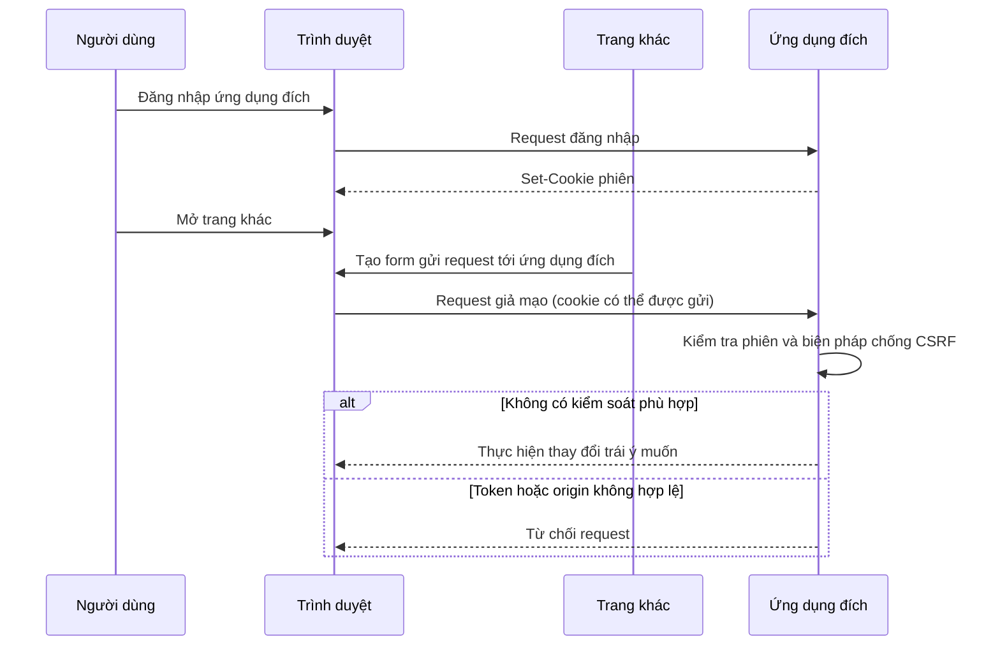

# CSRF test

CSRF (Cross-Site Request Forgery) là kiểu tấn công khiến trình duyệt gửi một request có mang thông tin xác thực của người dùng tới ứng dụng mà họ đang đăng nhập, trong khi người dùng không chủ ý thực hiện thao tác đó. Kiểm thử CSRF xác minh rằng một website khác không thể lợi dụng phiên đăng nhập để thay đổi dữ liệu, thực hiện giao dịch hoặc gọi thao tác nhạy cảm thay mặt người dùng.

CSRF test cần kiểm tra cả trình duyệt và máy chủ. Trình duyệt quyết định cookie nào được gửi theo ngữ cảnh điều hướng, form hoặc `fetch()`. Máy chủ phải xác minh request có xuất phát từ luồng hợp lệ và có bằng chứng chống CSRF phù hợp. Một thông điệp lỗi hoặc một response `403` riêng lẻ chưa đủ chứng minh hệ thống an toàn; cần xác nhận trạng thái nghiệp vụ thực sự không thay đổi.

Các ví dụ trong bài dùng hai website thử nghiệm do bạn kiểm soát, tài khoản giả lập và dữ liệu không nhạy cảm. Chỉ thực hiện kiểm thử trên ứng dụng mà bạn được phép đánh giá.

## Mục tiêu

Sau bài học, bạn có thể:

- Nhận diện endpoint có thể bị CSRF và hiểu điều kiện để tấn công thành công.
- Tạo môi trường kiểm thử cross-site và same-site để quan sát hành vi cookie trong trình duyệt.
- Kiểm tra CSRF token, `Origin`, `Referer`, Fetch Metadata và thuộc tính `SameSite`.
- Phân biệt CSRF với CORS, XSS và lỗi xác thực.
- Viết các ca kiểm thử dương tính và âm tính cho form, API, upload và thao tác có tác dụng phụ.
- Đánh giá kết quả dựa trên trạng thái dữ liệu và log phía máy chủ.

## CSRF hoạt động như thế nào?

Trình duyệt thường tự động gửi cookie phù hợp với domain, path, thuộc tính bảo mật và ngữ cảnh request. Nếu người dùng đã đăng nhập `app.example.test`, một trang khác có thể cố gắng làm trình duyệt gửi request tới ứng dụng đó. Nếu endpoint chỉ kiểm tra cookie phiên mà không xác minh request là hợp lệ, máy chủ có thể hiểu nhầm request giả mạo là thao tác của người dùng.

Một kịch bản điển hình:

1. Người dùng đăng nhập vào ứng dụng ngân hàng thử nghiệm. Trình duyệt lưu cookie phiên.
2. Người dùng mở một trang do kẻ tấn công kiểm soát trong cùng trình duyệt.
3. Trang đó tạo một form gửi request tới endpoint chuyển tiền hoặc thay đổi thông tin tài khoản.
4. Nếu cookie phiên được gửi và máy chủ không có kiểm soát chống CSRF, thao tác có thể được thực hiện bằng quyền của người dùng.



CSRF thường cần một số điều kiện: người dùng có phiên xác thực còn hiệu lực; trình duyệt tự động gắn thông tin xác thực vào request; ứng dụng có thao tác làm thay đổi trạng thái; và máy chủ không xác minh đầy đủ nguồn gốc hoặc bằng chứng chống CSRF. Cookie không phải cơ chế xác thực duy nhất có thể bị lợi dụng, nhưng cookie phiên là trường hợp phổ biến nhất.

Các thao tác cần xem xét gồm đổi email hoặc mật khẩu, thay đổi địa chỉ giao hàng, thêm người nhận thanh toán, thay đổi quyền, tạo hoặc hủy giao dịch, cập nhật cấu hình bảo mật và đăng xuất. Cần xem cả endpoint phụ trợ, API cũ, upload và route có method override.

## Phân biệt CSRF với CORS và XSS

Ba khái niệm này có liên quan tới ranh giới trình duyệt nhưng giải quyết vấn đề khác nhau:

| Cơ chế | Câu hỏi chính | Điều cần kiểm tra |
|---|---|---|
| CSRF | Website khác có thể khiến trình duyệt gửi thao tác được xác thực hay không? | Cookie, token, origin và tác dụng phụ của endpoint |
| CORS | JavaScript từ origin khác có được đọc response hay không? | Preflight, `Access-Control-Allow-Origin`, credentials và allowlist origin |
| XSS | Mã không tin cậy có thể chạy trong origin của ứng dụng hay không? | Context output, DOM sink, CSP và Trusted Types |

CORS không phải cơ chế chống CSRF tổng quát. CORS chủ yếu quyết định JavaScript ở origin khác có được đọc response. Một HTML form vẫn có thể gửi một số request cross-origin mà không cần đọc response. Vì vậy, việc response bị trình duyệt chặn đọc không có nghĩa request chưa tới máy chủ hoặc không gây thay đổi trạng thái.

XSS có thể làm suy yếu nhiều biện pháp chống CSRF vì script chạy trong origin đáng tin cậy có thể đọc token được trang cung cấp và gửi request hợp lệ. Do đó, CSRF test cần ghi nhận giả định về XSS và kiểm thử riêng các biện pháp chống XSS.

## Chuẩn bị môi trường kiểm thử

### Dùng hai website thử nghiệm có kiểm soát

Tạo hai host thử nghiệm trỏ về máy local hoặc môi trường kiểm thử:

- `https://app.test`: ứng dụng đích có đăng nhập và endpoint thay đổi trạng thái.
- `https://attacker.test`: trang mô phỏng nguồn gửi request không đáng tin cậy.

Có thể dùng tên miền thử nghiệm nội bộ và cấu hình DNS/hosts phù hợp. Hai host cần là hai site khác nhau để kiểm tra hành vi cross-site thực sự. Hai cổng khác nhau trên cùng hostname thường chỉ tạo hai origin khác nhau nhưng vẫn là cùng site; kiểm thử chỉ với hai cổng có thể bỏ sót hành vi của `SameSite`.

Nên bổ sung một host cùng site nhưng khác origin, ví dụ `https://evil.app.test`, nếu ứng dụng có nhiều subdomain. Điều này giúp kiểm tra tình huống một subdomain ít tin cậy có thể gửi request tới ứng dụng chính. `SameSite` dựa trên khái niệm site, không đồng nhất với origin; một subdomain khác origin vẫn có thể là same-site.

Thiết lập tài khoản giả lập với quyền thấp nhất và dữ liệu dễ nhận biết, chẳng hạn email `before@example.test`. Tạo endpoint thử nghiệm thay đổi email thành một giá trị khác. Ghi lại giá trị ban đầu để so sánh sau mỗi lần thử.

Nếu cookie có thuộc tính `Secure`, dùng HTTPS trong môi trường thử nghiệm. Không hạ cấu hình cookie của production chỉ để phục vụ kiểm thử. Dùng profile trình duyệt riêng hoặc xóa session sau khi hoàn tất để tránh nhầm lẫn trạng thái đăng nhập.

### Xác định bề mặt cần kiểm thử

Liệt kê các request có thể thay đổi trạng thái và thông tin xác thực được dùng:

| Nhóm | Ví dụ | Câu hỏi cần đặt ra |
|---|---|---|
| Form HTML | Đổi email, địa chỉ, tùy chọn tài khoản | Endpoint có chấp nhận form cross-site không? |
| API | `POST`, `PUT`, `PATCH`, `DELETE` | Có yêu cầu token hoặc header chống CSRF không? |
| Upload | Tải ảnh đại diện hoặc tệp đính kèm | Multipart request có được bảo vệ như các request khác không? |
| Method override | `_method=DELETE` hoặc header override | Middleware có kiểm tra CSRF sau khi xác định method hiệu lực không? |
| Thao tác qua GET | Link kích hoạt, đăng xuất, thay đổi trạng thái | GET có tạo tác dụng phụ hay không? |
| Đăng nhập | Gắn một phiên vào tài khoản do người khác chọn | Có kiểm soát login CSRF và liên kết phiên không? |

Tìm request qua DevTools Network khi thao tác hợp lệ trên ứng dụng. Ghi lại URL, method, content type, cookie, header, token, status và thay đổi dữ liệu. Không sao chép cookie hoặc token thật vào tài liệu, ticket hoặc log chia sẻ.

## Các lớp bảo vệ cần kiểm tra

### CSRF token

CSRF token là giá trị khó đoán mà máy chủ gắn với phiên hoặc ngữ cảnh hợp lệ. Client gửi lại token trong form field hoặc custom header; máy chủ xác minh token trước khi thực hiện thao tác.

Với mô hình synchronizer token, máy chủ lưu token trong session và đưa token vào trang hoặc response được bảo vệ. Với form, token có thể nằm trong hidden field; với API, frontend có thể gửi token trong header như `X-CSRF-Token`. Token phải được ràng buộc với phiên phù hợp, khó đoán và được so sánh an toàn.

Kiểm thử tối thiểu cần xác minh:

- Request hợp lệ có token đúng được chấp nhận.
- Thiếu token bị từ chối.
- Token sai hoặc bị sửa bị từ chối.
- Token của phiên A không dùng được trong phiên B.
- Token hết hiệu lực theo chính sách vòng đời phiên hoặc token.
- Token không xuất hiện trong URL, log, thông báo lỗi hoặc dữ liệu analytics.

Không giả định rằng chỉ cần có một trường tên `csrf` là đã được bảo vệ. Máy chủ phải xác minh giá trị thực sự và ràng buộc nó với đúng phiên. Một token cố định, có thể dự đoán hoặc dùng chung giữa mọi người dùng không đáp ứng mục đích này.

### Double-submit cookie

Với mô hình double-submit, client gửi một giá trị qua cookie và đồng thời gửi lại giá trị tương ứng trong request body hoặc header. Máy chủ so sánh hai giá trị. Thiết kế đơn giản có thể bị tấn công nếu kẻ tấn công có thể cài hoặc ghi đè cookie cùng tên; cách triển khai vững chắc cần token được ký hoặc ràng buộc mật mã với session, cùng kiểm soát domain cookie phù hợp.

Khi kiểm thử, xác minh cookie và giá trị gửi kèm khớp nhau, giá trị không khớp bị từ chối, và token không thể được chuyển từ phiên khác để sử dụng. Kiểm tra domain, path và khả năng ghi đè cookie từ subdomain. Không kết luận double-submit an toàn chỉ vì server so sánh hai chuỗi giống nhau.

### Origin và Referer validation

Với request thay đổi trạng thái, máy chủ có thể kiểm tra header `Origin` và/hoặc `Referer` để xác nhận nguồn gửi request. So sánh origin theo cấu trúc gồm scheme, hostname và port với danh sách origin tin cậy.

Các kiểm tra cần có:

- Origin hợp lệ đúng chính xác được chấp nhận.
- Origin từ site khác bị từ chối.
- Origin `null` được xử lý theo chính sách rõ ràng; không tự động xem là đáng tin cậy.
- Giá trị thiếu `Origin` được xử lý theo chính sách dự phòng, chẳng hạn kiểm tra `Referer` khi có thể.
- `Referer` được parse thành origin và so sánh chính xác; không dùng phép so chuỗi con như `endsWith("example.test")`.
- Proxy và cấu hình public origin được xác định từ nguồn tin cậy; không xây allowlist trực tiếp từ header `Host` do client kiểm soát.

Một số ngữ cảnh có thể không gửi `Origin` hoặc `Referer`, do đó cần định nghĩa rõ cách xử lý. Với endpoint nhạy cảm dùng cookie, từ chối khi không thể xác minh nguồn có thể là lựa chọn phù hợp, nhưng cần kiểm tra tương thích của các luồng hợp lệ.

### SameSite cookie

Thuộc tính `SameSite` giới hạn khi trình duyệt gửi cookie trong request cross-site:

| Giá trị | Hành vi tổng quát | Điều cần kiểm thử |
|---|---|---|
| `Strict` | Hạn chế gửi cookie trong ngữ cảnh cross-site | Điều hướng từ site khác có làm mất trạng thái đăng nhập mong đợi không? |
| `Lax` | Cho phép cookie trong một số điều hướng top-level an toàn, thường là GET; hạn chế nhiều request cross-site khác | POST từ form cross-site có bị loại cookie không? GET có gây thay đổi trạng thái không? |
| `None` | Cho phép gửi cookie trong ngữ cảnh cross-site khi đáp ứng yêu cầu trình duyệt; phải đi cùng `Secure` | Cookie có thực sự cần cross-site và endpoint có token/origin validation không? |

`SameSite` là lớp phòng vệ hữu ích nhưng không thay thế CSRF token hoặc kiểm tra nguồn cho thao tác nhạy cảm. Các subdomain cùng site có thể vẫn gửi cookie trong một số ngữ cảnh; nếu một subdomain bị chiếm quyền, chỉ dựa vào `SameSite` có thể không đủ. Trình duyệt hoặc chính sách quyền riêng tư cũng có thể chặn cookie bên thứ ba ngay cả khi cookie được đặt `SameSite=None; Secure`; vì vậy hãy quan sát cookie thực sự được gửi trong môi trường kiểm thử. Cookie phiên nên được cấu hình tối thiểu với `Secure`, `HttpOnly` và `SameSite` phù hợp. `HttpOnly` ngăn JavaScript đọc cookie nhưng không ngăn trình duyệt tự gửi cookie trong request.

### Fetch Metadata

Trình duyệt hỗ trợ Fetch Metadata có thể gửi các header như `Sec-Fetch-Site`, `Sec-Fetch-Mode`, `Sec-Fetch-Dest`. Máy chủ có thể dùng chúng như tín hiệu bổ sung để từ chối request `cross-site` tới endpoint thay đổi trạng thái.

Giá trị `Sec-Fetch-Site` thường gồm `same-origin`, `same-site`, `cross-site` hoặc `none`. Hãy kiểm thử từng trường hợp, đặc biệt `same-site`: một subdomain không đáng tin cậy có thể cùng site với ứng dụng. Fetch Metadata là lớp phòng vệ bổ sung; cần có chính sách dự phòng cho client không gửi header và không coi header do client không phải trình duyệt tự tạo là bằng chứng xác thực.

## Thực hiện CSRF test trong trình duyệt

### Bước 1: Xác nhận thao tác hợp lệ

Đăng nhập tài khoản thử nghiệm tại `app.test`, thực hiện thao tác đổi email qua giao diện chính thức và xác nhận giá trị mới được lưu. Trong Network, ghi nhận request hợp lệ: method, endpoint, content type, token/header và response. Khôi phục dữ liệu ban đầu trước khi chạy các ca âm tính.

Đây là ca kiểm thử dương tính. Nếu request hợp lệ không hoạt động, cần sửa fixture hoặc hiểu đúng hợp đồng ứng dụng trước khi kết luận về CSRF.

### Bước 2: Tạo form cross-site trong môi trường local

Trên `attacker.test`, tạo một trang thử nghiệm gửi form tới endpoint thay đổi trạng thái của `app.test`. Ví dụ sau chỉ dùng tên host và dữ liệu giả lập trong lab:

```html
<!doctype html>
<html lang="vi">
  <meta charset="utf-8">
  <title>CSRF test page</title>
  <body>
    <p>Trang mô phỏng request cross-site trong môi trường kiểm thử.</p>
    <form action="https://app.test/account/email" method="POST">
      <input type="hidden" name="email" value="after-csrf@example.test">
      <button type="submit">Gửi request thử nghiệm</button>
    </form>
  </body>
</html>
```

Đăng nhập trước ở `app.test`, sau đó mở trang lab ở `attacker.test` và gửi form. Quan sát Network để biết cookie có được gửi hay không, máy chủ trả status nào và dữ liệu có thay đổi không. Với ứng dụng có token, form trên cố ý không gửi token để kiểm tra máy chủ có từ chối request thiếu token hay không.

Nếu response bị chặn bởi chính sách trình duyệt, vẫn cần kiểm tra log phía máy chủ và trạng thái dữ liệu. Không dùng việc trang tấn công không đọc được response làm bằng chứng duy nhất rằng request đã bị chặn.

### Bước 3: Kiểm tra token và nguồn request

Chạy lại form với các biến thể trong môi trường thử nghiệm:

1. Không có token.
2. Token ngẫu nhiên không hợp lệ.
3. Token lấy từ phiên khác.
4. Token hợp lệ nhưng `Origin` không thuộc allowlist.
5. Token hợp lệ và `Origin` đúng, gửi từ giao diện chính thức.

Ca thiếu token, token sai và token thuộc phiên khác phải bị từ chối nếu ứng dụng dùng token. Request có token đúng nhưng `Origin` không tin cậy phải bị từ chối nếu ứng dụng áp dụng origin validation. Ca có token và origin hợp lệ phải thành công. Nếu ứng dụng chỉ dùng một trong hai cơ chế, thiết kế ca thử theo chính sách thực tế và ghi rõ lớp bảo vệ còn thiếu trong kết quả. Không gửi token thật qua URL hoặc ghi token vào ảnh chụp chia sẻ.

### Bước 4: Kiểm tra cookie trong DevTools

Mở tab **Application/Storage → Cookies** để xem thuộc tính cookie phiên: `Domain`, `Path`, `Secure`, `HttpOnly`, `SameSite`, thời hạn và phạm vi host. Trong tab **Network**, chọn request và xem cookie nào thực sự được gửi; một cookie xuất hiện trong kho lưu trữ không có nghĩa nó được gửi trong mọi ngữ cảnh.

Lặp lại thử nghiệm với các cấu hình `Strict`, `Lax` và `None` trong môi trường lab. Ghi nhận khác biệt giữa form POST cross-site, điều hướng top-level GET và request same-site từ subdomain. Không thay đổi cookie production để tạo các biến thể này.

### Bước 5: Kiểm tra các đường request khác

Ngoài form POST, thử nghiệm các đường có thể thay đổi trạng thái:

- Form `application/x-www-form-urlencoded` và `multipart/form-data`.
- Endpoint API dùng `PUT`, `PATCH` hoặc `DELETE`.
- Request có `Content-Type: text/plain` nếu server có parser tùy biến.
- Header method override hoặc tham số `_method`.
- Endpoint upload, đổi email, đổi mật khẩu, thêm địa chỉ hoặc thao tác tài khoản.
- Link GET, redirect và route đăng xuất.

Một endpoint thay đổi trạng thái qua GET là dấu hiệu thiết kế cần sửa. Các thao tác thay đổi dữ liệu phải dùng method phù hợp và vẫn được bảo vệ bằng cơ chế chống CSRF. Không chỉ kiểm tra route chính; kiểm tra mọi alias hoặc API cũ dẫn tới cùng hành động.

## Kiểm thử API và vai trò của CORS

API có thể yêu cầu custom header như `X-CSRF-Token`. Một request cross-origin dùng custom header thường cần preflight CORS trước khi trình duyệt gửi request chính. Đây là một lớp hữu ích khi server chỉ chấp nhận request có header đó và cấu hình CORS chặt chẽ.

Tuy vậy, không nên coi preflight là biện pháp duy nhất. Endpoint có thể còn chấp nhận form đơn giản, content type khác hoặc route cũ. Kiểm tra:

- Allowlist CORS chỉ chứa origin cần thiết, so sánh chính xác scheme, host và port.
- Không phản chiếu tùy ý `Origin` vào `Access-Control-Allow-Origin`.
- Nếu dùng credentials, response phải cấu hình origin cụ thể và `Access-Control-Allow-Credentials: true`; wildcard `*` không dùng được cho response credentialed.
- Preflight chỉ cho phép method và header cần thiết.
- Endpoint vẫn xác minh token hoặc nguồn request theo chính sách.
- Các request form không có custom header cũng bị kiểm tra.

Khi dùng `fetch()` để thử API, nhớ rằng `credentials: "include"` yêu cầu trình duyệt áp dụng quy tắc cookie và CORS tương ứng. Một request JSON có thể bị dừng ở bước preflight; điều đó khác với form request đơn giản vốn có thể được gửi mà không cần JavaScript đọc response.

## Bộ ca kiểm thử CSRF

Ma trận sau có thể dùng làm checklist cho từng endpoint thay đổi trạng thái:

| ID | Request | Kết quả mong đợi |
|---|---|---|
| CSRF-01 | Request hợp lệ từ giao diện chính thức, token đúng | Được chấp nhận; thay đổi trạng thái đúng một lần |
| CSRF-02 | Thiếu token | Bị từ chối; dữ liệu không thay đổi |
| CSRF-03 | Token sai hoặc đã bị sửa | Bị từ chối; dữ liệu không thay đổi |
| CSRF-04 | Token thuộc phiên khác | Bị từ chối; dữ liệu không thay đổi |
| CSRF-05 | Form POST từ site khác | Bị từ chối hoặc không có cookie theo chính sách; dữ liệu không thay đổi |
| CSRF-06 | Request từ subdomain cùng site nhưng khác origin | Bị kiểm soát bởi token/origin policy; không dựa riêng vào SameSite |
| CSRF-07 | `Origin` không tin cậy hoặc `null` | Bị xử lý theo chính sách; không thực hiện thao tác |
| CSRF-08 | Thiếu `Origin`, có `Referer` không tin cậy | Bị từ chối theo chính sách fallback |
| CSRF-09 | GET tới route có tác dụng phụ | Không làm thay đổi trạng thái; route cần được thiết kế lại |
| CSRF-10 | Multipart upload hoặc method override | Cơ chế chống CSRF vẫn được áp dụng |
| CSRF-11 | Cookie `SameSite=None; Secure` | Token/origin vẫn ngăn request giả mạo |
| CSRF-12 | Request hợp lệ lặp lại | Kết quả tuân theo nghiệp vụ và không tạo tác dụng phụ ngoài dự kiến |

Với mỗi ca, ghi lại request, response, trạng thái trước và sau, cùng log phía máy chủ đã lọc. Đánh giá cả false positive: request hợp lệ bị chặn do proxy, ứng dụng di động hoặc luồng tích hợp có origin khác. Mọi ngoại lệ phải có thiết kế và kiểm soát rõ ràng.

## Tự động hóa kiểm thử bằng trình duyệt

Kiểm thử tự động nên chạy trên trình duyệt thật hoặc browser automation để giữ nguyên hành vi cookie, form submission, origin và SameSite. Unit test cho hàm xác minh token vẫn hữu ích nhưng không thay thế kiểm thử tích hợp giữa hai site.

Ví dụ dưới đây là khung Playwright minh họa; thay route, tài khoản và selector theo ứng dụng thử nghiệm:

```js
import { test, expect } from "@playwright/test";

test("cross-site form không thể đổi email của phiên đã đăng nhập", async ({ page }) => {
  await page.goto("https://app.test/login");
  await page.getByLabel("Email").fill("tester@example.test");
  await page.getByLabel("Password").fill("test-only-password");
  await page.getByRole("button", { name: "Sign in" }).click();

  await page.goto("https://app.test/account");
  await expect(page.getByTestId("account-email")).toHaveText("before@example.test");

  await page.goto("https://attacker.test/csrf.html");
  await page.getByRole("button", { name: "Gửi request thử nghiệm" }).click();

  await page.goto("https://app.test/account");
  await expect(page.getByTestId("account-email")).toHaveText("before@example.test");
});
```

Test này tập trung vào kết quả nghiệp vụ: email vẫn giữ giá trị ban đầu. Trong suite thực tế, nên xác nhận thêm response bị từ chối bằng cách quan sát request tương ứng hoặc kiểm tra trạng thái qua fixture/API quản trị dành riêng cho test. Không dùng endpoint quản trị hoặc dữ liệu thật trong test chạy công khai.

Tạo thêm test dương tính để đảm bảo form hợp lệ có token vẫn hoạt động. Nếu chỉ có test âm tính, một ứng dụng từ chối mọi request cũng có thể làm test xanh mà chức năng đã hỏng.

## Đọc kết quả và xử lý phát hiện

Một CSRF test chỉ đạt khi request giả mạo không gây thay đổi trạng thái và request hợp lệ vẫn hoạt động. Cần phân tích nguyên nhân khi kết quả khác mong đợi:

- **Form bị từ chối vì thiếu token:** kiểm tra server có thực sự xác minh token trên mọi route và method tương ứng hay không.
- **Cookie không được gửi:** xác định đó là tác dụng của `SameSite`, domain/path hay chính sách trình duyệt. Tiếp tục kiểm tra token và origin validation; cookie không gửi trong một ca không chứng minh mọi ca đều an toàn.
- **Response bị CORS chặn:** kiểm tra server log và trạng thái dữ liệu để xác định request đã được xử lý hay chưa.
- **Subdomain gửi được cookie:** kiểm tra ranh giới same-site, cookie Domain và độ tin cậy của các subdomain.
- **GET làm thay đổi dữ liệu:** chuyển thao tác sang method thay đổi trạng thái và bổ sung kiểm soát CSRF.
- **Token hợp lệ nhưng vẫn bị từ chối:** kiểm tra vòng đời session, cache trang chứa token, proxy, đồng bộ session và quy tắc origin.
- **Thông điệp lỗi chứa token hoặc dữ liệu nhạy cảm:** sửa response/logging và kiểm tra lại các kênh quan sát.

Khi báo cáo phát hiện, nêu endpoint và method, điều kiện phiên, nguồn gửi, biện pháp đang có, bước tái hiện trong lab, trạng thái trước/sau và tác động có thể xảy ra. Che cookie, token, mật khẩu và dữ liệu cá nhân trong bằng chứng.

## Thực hành

Trong ứng dụng thử nghiệm do bạn kiểm soát, chọn một endpoint đổi email hoặc địa chỉ tài khoản. Thực hiện các bước sau:

1. Ghi lại trạng thái ban đầu và gửi một request hợp lệ qua giao diện chính thức.
2. Mở trang `attacker.test` có form cross-site và gửi request không kèm token.
3. Lặp lại với token sai, token của phiên khác và origin không tin cậy.
4. Kiểm tra request từ một subdomain cùng site nhưng khác origin.
5. Quan sát cookie với `SameSite=Lax`, `Strict` và `None; Secure` trong môi trường lab.
6. Xác nhận endpoint GET không làm thay đổi dữ liệu và upload/method override vẫn được bảo vệ.
7. Chạy test tự động cho cả trường hợp hợp lệ và giả mạo.

Hoàn thành bảng kết quả gồm request, cookie có được gửi hay không, token/origin có hợp lệ hay không, HTTP status và trạng thái dữ liệu sau request. Đưa ra kết luận dựa trên trạng thái thực tế của máy chủ, không chỉ dựa vào nội dung trang phản hồi.

## Ghi nhớ

- CSRF lợi dụng thông tin xác thực mà trình duyệt tự động gửi cùng request.
- Kiểm tra mọi thao tác thay đổi trạng thái, bao gồm form, API, upload, method override và route GET cũ.
- Kết hợp CSRF token với kiểm tra `Origin`/`Referer` và các lớp bổ sung như `SameSite` hoặc Fetch Metadata.
- CORS kiểm soát khả năng đọc response; nó không tự ngăn mọi request cross-site.
- `SameSite` dựa trên site, không phải origin; subdomain khác origin có thể vẫn cùng site.
- `HttpOnly` bảo vệ khả năng đọc cookie bằng JavaScript, không ngăn cookie được gửi tự động.
- Kiểm thử dương tính và âm tính, đồng thời xác nhận dữ liệu không đổi sau request giả mạo.
- Dùng tài khoản và dữ liệu giả lập; che token, cookie và thông tin xác thực trong bằng chứng.
