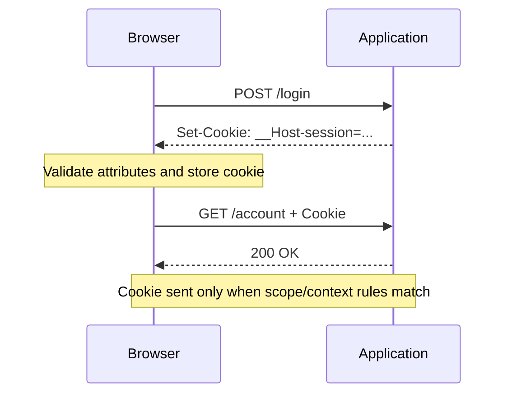

# Cookie test: kiểm thử thuộc tính, phạm vi và hành vi cookie trong browser

## 1. Mục tiêu của Cookie test

Cookie là một cơ chế lưu trạng thái nhỏ ở browser và tự động gửi lại trong các HTTP request phù hợp với phạm vi cookie. Ứng dụng thường dùng cookie cho session, refresh flow, CSRF defense, preference hoặc trạng thái đăng nhập. Một cấu hình cookie sai có thể khiến session bị gửi qua HTTP, JavaScript đọc được credential, cookie bị chia sẻ sang subdomain không tin cậy hoặc request cross-site mang theo cookie ngoài dự kiến.

Cookie test là quá trình xác minh cả hai phía: server phát `Set-Cookie` đúng policy và browser lưu/gửi cookie đúng theo scope, context và thuộc tính. Chỉ nhìn thấy một dòng cookie trong DevTools chưa đủ chứng minh cookie an toàn. Cần kiểm tra request thực tế, response thực tế, navigation cùng-site/cross-site và hành vi trên browser mục tiêu.

Bài này hướng dẫn lập ma trận kiểm thử cookie, tạo test case cho `Domain`, `Path`, `Secure`, `HttpOnly`, `SameSite`, expiry và cookie prefix; kiểm tra credential trong fetch/form/navigation; phân biệt CORS với việc browser gửi cookie; và tự động hóa các luồng bằng Playwright.

Sau bài học, bạn có thể:

- Giải thích cookie được tạo, lưu và gửi lại như thế nào.
- Kiểm thử host-only cookie, `Domain`, `Path` và cookie collision.
- Xác minh `Secure`, `HttpOnly`, `SameSite` và expiry.
- Kiểm tra cookie prefix `__Host-`, `__Secure-` và các prefix liên quan.
- Phân biệt same-origin, same-site và cross-site khi test.
- Kiểm thử CSRF và credentialed CORS bằng browser thật.
- Kiểm tra third-party cookie và partitioned cookie.
- Dùng DevTools, curl và Playwright để thu thập bằng chứng.
- Viết regression test cho session cookie và logout.

## 2. Cookie flow và các điểm cần kiểm thử

Server tạo cookie bằng response header `Set-Cookie`. Browser kiểm tra thuộc tính, lưu cookie nếu hợp lệ và gửi header `Cookie` trong những request thỏa điều kiện domain, path, scheme, SameSite, partition và chính sách browser.



Các điểm kiểm thử chính:

1. Server phát đúng tên cookie, giá trị và thuộc tính.
2. Browser chấp nhận hoặc từ chối cookie theo quy tắc.
3. Cookie chỉ được gửi tới host/path/scheme phù hợp.
4. Cookie có được gửi trong top-level navigation, iframe, form và fetch hay không.
5. JavaScript có đọc được cookie hay không.
6. Logout/revoke có vô hiệu hóa session phía server và xóa cookie phía browser hay không.
7. Browser privacy controls có thay đổi third-party cookie behavior hay không.

### 2.1 Không kiểm thử chỉ bằng cách đọc document.cookie

`document.cookie` không hiển thị cookie có `HttpOnly`; nó cũng không thể cho bạn thấy toàn bộ thuộc tính cookie theo cách DevTools hiển thị. Cookie có thể tồn tại nhưng không được gửi do SameSite, domain, path, Secure, partition hoặc browser policy.

Hãy kết hợp Application → Cookies, Network → request/response headers, server-side request log đã redacted và các test case navigation/fetch thực tế.

## 3. Cấu trúc cookie và các thuộc tính

Ví dụ session cookie:

```http
Set-Cookie: __Host-session=opaque-session-value; Path=/; Secure; HttpOnly; SameSite=Lax
```

| Thuộc tính | Ý nghĩa | Điều cần xác minh |
| --- | --- | --- |
| Name/value | Định danh và giá trị cookie. | Không chứa dữ liệu nhạy cảm không cần thiết; giá trị session opaque, khó đoán. |
| Domain | Host/domain được phép nhận cookie. | Không có Domain nếu cần host-only; không mở rộng scope quá mức. |
| Path | Request path gửi cookie. | Chọn path phù hợp; không xem Path là ranh giới bảo mật. |
| Secure | Chỉ gửi qua secure transport theo quy tắc browser. | Có mặt trên cookie nhạy cảm; kiểm tra môi trường HTTPS. |
| HttpOnly | JavaScript không đọc cookie qua `document.cookie`. | Có mặt trên session credential nếu JS không cần truy cập. |
| SameSite | Điều khiển gửi cookie trong context cross-site. | Chọn Strict/Lax/None theo luồng nghiệp vụ và CSRF model. |
| Expires/Max-Age | Thời điểm hết hạn hoặc tuổi thọ. | Kiểm tra persistence và precedence. |
| Partitioned | Lưu cookie theo top-level site partition. | Kiểm tra CHIPS và browser support khi dùng. |

Một cookie có thể có nhiều thuộc tính cùng lúc. Browser có thể bỏ qua hoặc từ chối cookie có tổ hợp thuộc tính không hợp lệ; vì vậy phải kiểm tra cookie thực sự được lưu, không chỉ kiểm tra server đã gửi header.

### 3.1 Set-Cookie là response header

Một response có thể chứa nhiều dòng `Set-Cookie`. Server không nên ghép chúng thành một header comma-separated thông thường vì `Expires` có dấu phẩy và `Set-Cookie` có semantics riêng. Framework cần API append cookie đúng cách.

### 3.2 Cookie request không gửi lại thuộc tính

Browser chỉ gửi name/value trong request header:

```http
Cookie: __Host-session=opaque-session-value; theme=dark
```

`Secure`, `HttpOnly`, `SameSite`, `Path` và `Expires` không được gửi lại trong `Cookie` request header. Muốn kiểm tra chúng, xem Set-Cookie ở response hoặc cookie store trong DevTools.

## 4. Lập test matrix trước khi chạy

Một Cookie test nên có expected result rõ ràng thay vì chỉ click và quan sát bằng mắt.

| Nhóm | Điều kiện thay đổi | Kết quả cần xác minh |
| --- | --- | --- |
| Scope | Host-only và Domain cookie | Host nào nhận cookie. |
| Path | `/`, `/admin`, `/api` | Request path nào mang cookie. |
| Transport | HTTP và HTTPS | Secure cookie có bị gửi qua HTTP không. |
| Script access | HttpOnly bật/tắt | `document.cookie` có thấy cookie không. |
| Site context | Strict/Lax/None | Cookie có gửi trong navigation/form/fetch cross-site không. |
| Expiry | Max-Age/Expires | Cookie còn tồn tại sau thời điểm hết hạn không. |
| Prefix | `__Host-`, `__Secure-` | Browser chấp nhận/từ chối tổ hợp thuộc tính nào. |
| CORS | same-origin/cross-origin | Cookie được gửi và response được đọc trong điều kiện nào. |
| Privacy | third-party/partitioned | Cookie có bị chặn hoặc phân vùng không. |
| Lifecycle | login/refresh/logout | Session rotate/revoke và cookie deletion có đúng không. |

Với mỗi test case, ghi:

- Test ID và mục tiêu.
- Browser/version, profile và privacy setting.
- Origin/top-level site và request destination.
- Cookie header mong đợi ở response.
- Cookie store mong đợi sau response.
- Request tiếp theo có/không có cookie.
- Kết quả thực tế, screenshot/trace đã sanitize và verdict.

## 5. Kiểm thử host-only cookie và Domain

Nếu `Set-Cookie` không có thuộc tính `Domain`, browser tạo host-only cookie: cookie chỉ được gửi tới host đã set nó. Nếu server đặt `Domain=example.test`, cookie có thể được gửi tới domain đó và các subdomain phù hợp.

Ví dụ:

```http
Set-Cookie: host-session=abc; Path=/; Secure; HttpOnly; SameSite=Lax
Set-Cookie: shared-session=def; Domain=example.test; Path=/; Secure; HttpOnly; SameSite=Lax
```

Giả sử response được phát từ `app.example.test`:

| Request tới | host-session | shared-session |
| --- | --- | --- |
| `app.example.test` | Có thể gửi | Có thể gửi |
| `api.example.test` | Không gửi | Có thể gửi |
| `files.example.test` | Không gửi | Có thể gửi |
| `other.test` | Không gửi | Không gửi |

### 5.1 Test host-only

1. Login tại `app.example.test`.
2. Xác nhận response Set-Cookie không có `Domain`.
3. Gửi request tới `app.example.test` và xác nhận cookie xuất hiện.
4. Gửi request tới subdomain khác trong test environment.
5. Xác nhận host-only cookie không được gửi sang subdomain đó.

### 5.2 Test Domain cookie

1. Set cookie với `Domain=example.test`.
2. Mở một subdomain được kiểm soát trong lab.
3. Xác nhận cookie có thể được gửi tới subdomain theo scope.
4. Đánh giá liệu mọi subdomain có thực sự đáng tin để nhận session hay không.

Không đặt Domain rộng như `example.test` nếu session chỉ cần dùng tại `app.example.test`. Một subdomain yếu hoặc bị takeover có thể mở rộng bề mặt tấn công khi cookie được chia sẻ.

### 5.3 Domain không thể đặt tùy ý

Browser từ chối Domain không phải domain hiện tại hoặc parent domain hợp lệ; public suffix như `.com` không được dùng làm cookie domain. Kiểm thử bằng domain test có thể kiểm soát, không dựa vào `localhost` để suy luận mọi quy tắc domain của production.

### 5.4 Cookie không được cô lập theo port

Port không phải thành phần của cookie scope. Hai ứng dụng ở `https://app.example.test:443` và `https://app.example.test:8443` có origin khác nhau, nhưng cookie phù hợp với host/path/scheme vẫn có thể được gửi tới cả hai port.

Trong lab, set host-only cookie ở port 443 rồi gửi request tới cùng host ở port 8443. Xác nhận cookie vẫn có thể xuất hiện ở request thứ hai. Không dùng port để cô lập session giữa hai ứng dụng; nếu cần ranh giới, dùng host riêng và cookie host-only.

## 6. Kiểm thử Path

`Path` quyết định những request path nào phù hợp để browser gửi cookie. Ví dụ:

```http
Set-Cookie: admin-pref=1; Path=/admin; Secure; SameSite=Lax
```

Cookie này có thể được gửi tới `/admin` và các path con phù hợp, nhưng không gửi tới `/api` hoặc `/profile`.

### 6.1 Test path matching

Tạo các endpoint trong lab:

- `/admin`
- `/admin/users`
- `/administrator`
- `/api`
- `/`

Set cookie với `Path=/admin`, sau đó kiểm tra request header ở từng endpoint. Path matching có quy tắc ranh giới path; không giả định `/admin` khớp `/administrator`.

### 6.2 Path không phải ranh giới bảo mật

Path không cô lập cookie như origin. Các ứng dụng khác nhau trên cùng host có thể có request path giao nhau và có thể set cookie cùng tên với path khác. Không dựa vào Path để bảo vệ session khỏi một ứng dụng không tin cậy trên cùng host.

Với session chính, `Path=/` thường phù hợp, đặc biệt khi dùng prefix `__Host-`. Tách ứng dụng nhạy cảm bằng host/origin riêng và cookie host-only khi cần ranh giới mạnh hơn.

## 7. Kiểm thử Secure

`Secure` yêu cầu browser chỉ gửi cookie qua secure channel theo cookie rules. Session cookie production nên có `Secure` khi ứng dụng dùng HTTPS.

```http
Set-Cookie: session=opaque; Path=/; Secure; HttpOnly; SameSite=Lax
```

### 7.1 Test trên HTTPS

1. Mở ứng dụng qua HTTPS.
2. Login và xác nhận Set-Cookie có `Secure`.
3. Kiểm tra Application → Cookies cho cột Secure.
4. Gọi endpoint cùng host qua HTTPS và xác nhận cookie được gửi.

### 7.2 Test HTTP

Nếu lab có HTTP endpoint riêng:

1. Set cookie không Secure và quan sát behavior.
2. Set cookie Secure qua HTTPS.
3. Gửi request HTTP tới cùng host.
4. Xác nhận Secure cookie không được gửi qua HTTP.

Browser có ngoại lệ với localhost đối với Secure cookie; vì vậy kết quả local có thể khác host production. Dùng staging HTTPS để xác minh policy cuối cùng và không dùng localhost làm bằng chứng duy nhất rằng Secure cookie không bị gửi qua HTTP trên host thật.

### 7.3 Secure không mã hóa giá trị cookie trong storage

Secure kiểm soát việc gửi qua transport, không thay thế HTTPS, không bảo vệ khỏi XSS đọc cookie không HttpOnly và không mã hóa giá trị lưu trong browser profile. Luôn dùng TLS và bảo vệ endpoint/session.

## 8. Kiểm thử HttpOnly

`HttpOnly` ngăn script trong trang đọc cookie qua API JavaScript như `document.cookie`. Browser vẫn tự gửi cookie trong request phù hợp.

```http
Set-Cookie: __Host-session=opaque; Path=/; Secure; HttpOnly; SameSite=Lax
```

### 8.1 Test JavaScript access

Sau khi login, chạy trong Console:

```javascript
document.cookie
```

Cookie `__Host-session` có `HttpOnly` không nên xuất hiện trong kết quả. Cookie không HttpOnly như theme preference có thể xuất hiện.

### 8.2 Test request behavior

Reload trang hoặc gọi endpoint cần session. Xác nhận browser vẫn gửi `__Host-session` trong Request Headers dù JavaScript không đọc được cookie.

### 8.3 HttpOnly không chống mọi hành động của XSS

XSS không đọc được session cookie HttpOnly trực tiếp nhưng có thể thao tác DOM, gọi API same-origin bằng browser session hiện có hoặc đọc dữ liệu mà trang có quyền truy cập. HttpOnly giảm nguy cơ đánh cắp cookie qua JavaScript; nó không thay CSP, output encoding, CSRF defense hoặc server-side authorization.

### 8.4 Không dùng HttpOnly cho cookie mà frontend cần đọc

Một số thiết kế CSRF double-submit cookie cần JavaScript đọc token cookie để đưa vào custom header; cookie đó thường không HttpOnly. Cần đánh giá trade-off và thiết kế CSRF token phù hợp. Session credential vẫn nên HttpOnly nếu frontend không cần đọc nó.

## 9. Kiểm thử SameSite

`SameSite` kiểm soát việc browser gửi cookie trong request có ngữ cảnh cross-site. Đây là lớp giảm CSRF, nhưng không thay thế authorization hoặc CSRF token cho mọi ứng dụng.

Ba giá trị chính:

| Giá trị | Hành vi khái quát |
| --- | --- |
| `Strict` | Không gửi cookie trong request cross-site; cookie được gửi trong ngữ cảnh same-site. |
| `Lax` | Cho phép same-site và một số top-level cross-site navigation dùng safe method, thường là GET. |
| `None` | Cho phép gửi trong cross-site context nếu các điều kiện khác và browser privacy policy cho phép; phải có `Secure`. |

Nếu không khai báo SameSite, browser hiện đại thường áp dụng default Lax behavior, nhưng chi tiết có thể khác theo browser và thời điểm set cookie. Với policy bảo mật, hãy khai báo rõ `SameSite` thay vì dựa vào default.

### 9.1 Phân biệt same-origin và same-site

Same-origin so sánh scheme, host và port. Same-site dựa trên schemeful site và registrable domain; port không phải thành phần phân biệt site, còn subdomain thường thuộc cùng site.

Ví dụ:

| URL A | URL B | Quan hệ |
| --- | --- | --- |
| `https://app.example.test` | `https://app.example.test:8443` | Same-site, khác origin do port. |
| `https://app.example.test` | `https://api.example.test` | Thường same-site, khác origin do host. |
| `https://app.example.test` | `https://attacker.test` | Cross-site và cross-origin. |
| `https://app.example.test` | `http://app.example.test` | Cross-site theo schemeful same-site, khác origin. |

Điều này quan trọng khi test: một request từ subdomain khác có thể là cross-origin nhưng vẫn same-site, vì vậy SameSite cookie có thể được gửi. CORS và SameSite giải quyết các câu hỏi khác nhau.

### 9.2 Test SameSite=Strict

1. Login tại site ứng dụng và nhận cookie `SameSite=Strict`.
2. Mở một trang ở site khác trong test environment.
3. Từ trang đó tạo link top-level tới endpoint ứng dụng.
4. Quan sát request đầu tiên không mang cookie Strict trong cross-site navigation.
5. Sau khi trang ứng dụng đã mở và các request tiếp theo diễn ra trong same-site context, kiểm tra cookie được gửi theo policy.

Strict có thể ảnh hưởng luồng login redirect từ identity provider hoặc link đi vào từ website khác. Test cả luồng nghiệp vụ hợp lệ trước khi chọn.

### 9.3 Test SameSite=Lax

Với cookie Lax, kiểm tra:

- Top-level cross-site navigation bằng GET.
- Cross-site form POST.
- Cross-site iframe/subresource request.
- Same-site request từ subdomain khác.

Lax thường cho phép cookie trong top-level navigation an toàn, nhưng chặn các request cross-site nhúng và các phương thức thay đổi trạng thái. Không dùng GET để thay đổi trạng thái; nếu ứng dụng làm vậy, Lax có thể không đủ bảo vệ.

Một số browser áp dụng compatibility behavior cho cookie không khai báo SameSite (default Lax), có thể có khoảng thời gian ngắn cho phép top-level POST sau khi cookie mới được tạo. Test `SameSite=Lax` được khai báo rõ và test cookie thiếu thuộc tính thành hai case riêng.

### 9.4 Test SameSite=None

Cookie cần `Secure`:

```http
Set-Cookie: embedded-session=opaque; Path=/; Secure; HttpOnly; SameSite=None
```

Kiểm thử:

1. Mở top-level site A.
2. Nhúng iframe hoặc tạo fetch tới site B.
3. Quan sát cookie có được gửi không.
4. Lặp lại khi browser chặn third-party cookies.
5. Phân biệt cookie bị loại do SameSite với cookie bị chặn bởi privacy settings.

`SameSite=None` không bảo đảm cookie third-party luôn được gửi. Browser có thể chặn hoặc phân vùng third-party storage/cookies.

### 9.5 SameSite không thay thế CSRF protection

SameSite không giải quyết mọi CSRF case:

- Request same-site từ subdomain không tin cậy có thể vẫn mang cookie.
- Một số luồng cross-site hợp lệ cần `SameSite=None`.
- Browser/legacy client có thể có behavior khác.
- XSS same-origin có thể thực hiện request với cookie.

Với thao tác thay đổi trạng thái, kết hợp CSRF token, kiểm tra Origin/Fetch Metadata khi phù hợp, phương thức HTTP đúng và authorization server-side.

## 10. Kiểm thử cookie prefix

Cookie prefix giúp browser áp dụng một số ràng buộc khi chấp nhận `Set-Cookie`. Chúng hữu ích để giảm cấu hình sai, nhưng cần xác minh browser mục tiêu có hỗ trợ prefix đó.

### 10.1 __Secure-

Cookie có tên bắt đầu bằng `__Secure-` phải được set từ secure context và có thuộc tính `Secure`:

```http
Set-Cookie: __Secure-preference=dark; Path=/; Secure; SameSite=Lax
```

Test negative case bằng cách bỏ `Secure` hoặc set qua HTTP trong môi trường phù hợp; browser hỗ trợ prefix phải từ chối cookie không thỏa điều kiện.

### 10.2 __Host-

`__Host-` yêu cầu:

- `Secure` phải có.
- `Path=/` phải có.
- Không được có `Domain`.

Ví dụ:

```http
Set-Cookie: __Host-session=opaque; Path=/; Secure; HttpOnly; SameSite=Lax
```

Prefix này tạo host-only cookie có scope chặt hơn và giúp chống việc subdomain set cookie cùng prefix cho parent domain.

### 10.3 __Http- và __Host-Http-

Các prefix `__Http-` và `__Host-Http-` được hỗ trợ trên một số browser hiện đại để yêu cầu cookie được set qua HTTP response, với `Secure` và `HttpOnly`; biến thể `__Host-Http-` còn yêu cầu các ràng buộc host như `__Host-`. Kiểm tra compatibility trên browser mục tiêu và không dùng prefix như cơ chế duy nhất để bảo vệ session.

### 10.4 Negative test cho prefix

| Cookie name | Thuộc tính thiếu/sai | Kết quả mong đợi trên browser hỗ trợ |
| --- | --- | --- |
| `__Secure-id` | Không có Secure | Bị từ chối. |
| `__Host-id` | Có Domain | Bị từ chối. |
| `__Host-id` | Path khác `/` | Bị từ chối. |
| `__Host-id` | Không có Secure | Bị từ chối. |
| `__Host-Http-id` | Không có HttpOnly | Bị từ chối. |

Khi browser không hỗ trợ một prefix mới, test có thể cho kết quả khác. Ghi lại browser/version và kiểm tra cookie store thực tế.

## 11. Kiểm thử Expires, Max-Age và xóa cookie

Cookie có thể là session cookie hoặc persistent cookie. `Max-Age` và `Expires` điều khiển thời hạn:

```http
Set-Cookie: short-lived=abc; Max-Age=300; Path=/; Secure; HttpOnly
Set-Cookie: expires-cookie=def; Expires=Thu, 21 Oct 2027 07:28:00 GMT; Path=/; Secure
```

Nếu cả `Max-Age` và `Expires` cùng xuất hiện, `Max-Age` được ưu tiên trong cookie processing hiện đại.

### 11.1 Test Max-Age

1. Set cookie với `Max-Age=5`.
2. Xác nhận cookie xuất hiện trong Application → Cookies.
3. Gửi request ngay và xác nhận cookie được gửi.
4. Chờ qua thời gian expiry trong test có kiểm soát.
5. Xác nhận cookie không còn được gửi.

Không dùng thời gian chờ ngắn làm bằng chứng duy nhất nếu browser scheduler hoặc test runner không ổn định. Có thể test giá trị Max-Age âm/0 để xác nhận cookie bị xóa ngay.

### 11.2 Test Expires

Set cookie với ngày hết hạn trong quá khứ và xác nhận browser không lưu hoặc xóa cookie tương ứng. Kiểm tra định dạng HTTP-date và clock skew giữa server/client.

### 11.3 Test xóa cookie

Response xóa cookie thường đặt cùng name và scope với cookie cũ, cùng `Max-Age=0` hoặc `Expires` trong quá khứ:

```http
Set-Cookie: __Host-session=; Path=/; Max-Age=0; Secure; HttpOnly; SameSite=Lax
```

Nếu cookie cũ có Domain hoặc Path cụ thể, response xóa cần khớp scope đó. Không thể xóa cookie bằng cách chỉ gửi cùng tên nhưng khác Path/Domain.

### 11.4 Session cookie không có nghĩa chắc chắn mất khi browser đóng

Session restore của browser có thể khôi phục tab và session cookie tùy cấu hình. Không dùng thao tác đóng/mở browser làm kiểm thử expiry chính xác. Nếu yêu cầu logout/revoke, server phải vô hiệu hóa session/token.

## 12. Cookie collision và cookie cùng tên

Browser có thể lưu nhiều cookie cùng tên nhưng khác Domain hoặc Path. Khi gửi request, nhiều cặp name/value có thể xuất hiện trong `Cookie` header. Server/framework cần parse theo quy tắc rõ ràng, không dựa vào thứ tự mơ hồ để chọn session.

### 12.1 Test duplicate name

1. Set cookie `id` ở Path `/`.
2. Set cookie `id` thứ hai ở Path `/admin`.
3. Gửi request tới `/admin`.
4. Quan sát request có thể chứa cả hai cặp `id`.
5. Xác minh server không chọn nhầm cookie do parser khác nhau giữa proxy và application.

### 12.2 Không dùng cookie name trùng cho credential

Tránh đặt session cookie cùng tên ở nhiều Path/Domain. Dùng prefix `__Host-` cho session cookie host-only nếu phù hợp. Backend nên từ chối hoặc xử lý rõ request có cookie name duplicate thay vì tùy tiện lấy giá trị đầu/cuối.

### 12.3 Cookie deletion phải kiểm tra scope

Sau logout, tìm cookie cùng tên trong toàn bộ danh sách domain/path/partition. Cookie có thể vẫn tồn tại dưới scope khác và tiếp tục được gửi trong một số request.

## 13. Kiểm thử third-party cookie và partitioned cookie

Third-party cookie là cookie được dùng trong context mà site tạo cookie khác với top-level site đang mở, ví dụ iframe của identity provider hoặc widget bên thứ ba. Browser privacy policy có thể chặn, giới hạn hoặc phân vùng các cookie này.

Không giả định `SameSite=None; Secure` bảo đảm cookie third-party hoạt động ở mọi browser. Cookie có thể bị chặn bởi tracking prevention, user setting, enterprise policy hoặc chế độ duyệt riêng tư.

### 13.1 Test third-party context

1. Mở top-level site A.
2. Nhúng iframe từ site B có endpoint set/echo cookie.
3. Kiểm tra Set-Cookie và cookie store.
4. Gửi request tiếp theo trong iframe và quan sát Cookie header ở server B.
5. Lặp lại khi bật/tắt third-party cookie blocking.
6. Ghi lại browser/version và privacy setting.

Test top-level navigation tới B riêng với iframe của B. Cookie có thể được xử lý khác nhau tùy context; đừng suy luận kết quả iframe từ kết quả navigation.

### 13.2 Partitioned cookies (CHIPS)

Partitioned cookies cho phép một cookie được lưu theo top-level site partition, giúp một dịch vụ nhúng duy trì state riêng theo từng site nhúng mà không dùng chung một third-party cookie toàn cục.

Ví dụ:

```http
Set-Cookie: __Host-widget-id=opaque; Path=/; Secure; HttpOnly; SameSite=None; Partitioned
```

Kiểm tra:

- Cùng widget được nhúng từ top-level site A và B.
- Cookie trong partition A không tự động được dùng trong partition B.
- Widget vẫn hoạt động khi browser bật third-party cookie restrictions nếu browser hỗ trợ CHIPS.
- Cookie có `Secure` và các thuộc tính prefix đúng policy.

Partitioning không thay authorization hoặc CSRF defense. Hành vi và hỗ trợ có thể khác theo browser/version; test trên browser mục tiêu và kiểm tra cột/chi tiết Partition Key trong DevTools nếu có.

## 14. Phân biệt cookie, CORS và Fetch credentials

Ba cơ chế thường bị nhầm:

- Cookie rules quyết định browser có gửi cookie trong request hay không.
- Fetch credentials mode quyết định fetch có dùng credential theo mode cho phép hay không.
- CORS quyết định JavaScript ở origin gọi request có được đọc response hay không.

Với fetch:

| Request | credentials mode | Cookie behavior khái quát |
| --- | --- | --- |
| Same-origin fetch | `same-origin` (default) | Gửi credential same-origin phù hợp. |
| Cross-origin fetch | `same-origin` | Không gửi credential cross-origin. |
| Cross-origin fetch | `include` | Có thể gửi cookie nếu cookie policy/SameSite/privacy cho phép. |

Ví dụ:

```javascript
const response = await fetch("https://api.example.test/account", {
  credentials: "include"
});
```

`credentials: "include"` không vượt qua SameSite hoặc third-party cookie blocking. Nó cũng không tự cấp quyền đọc response; server vẫn cần CORS policy phù hợp.

### 14.1 Credentialed CORS response

Với frontend `https://app.example.test` gọi API cross-origin:

```http
Access-Control-Allow-Origin: https://app.example.test
Access-Control-Allow-Credentials: true
Vary: Origin
```

Không dùng wildcard `Access-Control-Allow-Origin: *` cho credentialed response. Server phải allowlist origin chính xác.

### 14.2 JavaScript không đọc được Set-Cookie response header

`Set-Cookie` là forbidden response-header name trong Fetch. JavaScript không đọc được header này qua `response.headers.get("Set-Cookie")`, kể cả khi server thêm `Set-Cookie` vào `Access-Control-Expose-Headers`. Dùng DevTools, server-side test endpoint hoặc Playwright automation API để kiểm tra header; không viết frontend test dựa vào việc đọc Set-Cookie bằng fetch.

### 14.3 Test request được gửi nhưng response không đọc được

Một request đơn giản hoặc form navigation có thể tới server trong khi browser chặn JavaScript đọc response vì CORS. Khi test, xem Network/server-side request log thay vì chỉ nhìn Promise rejection trong Console.

### 14.4 CORS preflight

Custom header như `X-CSRF-Token` hoặc một số Content-Type có thể kích hoạt OPTIONS preflight. Kiểm tra:

- OPTIONS response có allow đúng origin/method/header.
- Actual request có được gửi sau preflight không.
- Actual response có CORS headers cần thiết không.
- Cookie chỉ được gửi nếu credentials mode và cookie policy cho phép.

## 15. Kiểm thử CSRF với cookie

Browser tự đính kèm cookie trong request phù hợp, vì vậy server không thể coi sự hiện diện của session cookie là bằng chứng request do UI đáng tin cậy khởi tạo.

### 15.1 Test form cross-site

Trong môi trường lab có hai site do bạn kiểm soát:

1. Login vào ứng dụng A và nhận session cookie.
2. Mở trang B.
3. Từ B gửi form POST tới endpoint thay đổi trạng thái ở A.
4. Quan sát cookie có được gửi theo SameSite policy hay không.
5. Xác nhận server từ chối request nếu thiếu CSRF token/Origin validation theo policy.

Không thử trên tài khoản hoặc website production của bên thứ ba.

### 15.2 Test method và content type

Kiểm tra endpoint thay đổi trạng thái không chấp nhận GET. Test form-urlencoded, multipart/form-data và request JSON riêng biệt; không cho rằng JSON tự động loại bỏ CSRF nếu endpoint cũng chấp nhận form-compatible request hoặc credential được gửi qua cơ chế khác.

### 15.3 Test CSRF defense

Một bộ test có thể xác minh:

- Thiếu CSRF token → reject.
- Token sai hoặc đã hết hạn → reject.
- Token hợp lệ gắn đúng session → accept.
- Origin không nằm trong allowlist → reject theo policy.
- Fetch Metadata chỉ ra cross-site request không mong muốn → reject theo policy.
- SameSite cookie có hành vi đúng như expected nhưng server vẫn kiểm tra CSRF defense.

### 15.4 SameSite và subdomain

Nếu `app.example.test` và `untrusted.example.test` cùng site, request từ subdomain không tin cậy có thể được coi là same-site. Test trường hợp này để xác minh ứng dụng không dựa hoàn toàn vào SameSite khi có subdomain do nhóm khác hoặc người dùng kiểm soát.

## 16. Kiểm tra cookie trong DevTools

### 16.1 Application → Cookies

1. Mở DevTools → Application.
2. Chọn Storage → Cookies.
3. Chọn đúng origin.
4. Kiểm tra Name, Value, Domain, Path, Expires/Max-Age, Size, HttpOnly, Secure, SameSite và Partition Key nếu browser hiển thị.
5. Xác nhận cookie không có scope rộng hơn yêu cầu.

Không chụp hoặc chia sẻ screenshot chứa cookie value thật. Che giá trị và mọi token trước khi lưu evidence.

### 16.2 Network → response Set-Cookie

1. Chọn request login/refresh/logout.
2. Mở Headers → Response Headers.
3. Kiểm tra từng dòng Set-Cookie.
4. Xem Issues panel hoặc Console nếu browser báo cookie bị blocked/rejected.
5. Ghi lại nguyên nhân blocked đã được browser nêu, nhưng redact cookie value.

### 16.3 Network → request Cookie

Chọn request tới endpoint cần session và xem Request Headers. Kiểm tra cookie nào được gửi, cookie nào vắng mặt và request context là navigation, iframe, fetch hay subresource. Đừng chỉ dựa vào Application panel vì cookie store có thể chứa cookie mà request hiện tại không đủ điều kiện gửi.

### 16.4 Issues panel

Browser có thể cảnh báo cookie thiếu SameSite, SameSite=None không Secure, cookie third-party bị chặn hoặc vấn đề partitioning. Ghi browser/version và thông điệp đầy đủ đã loại bỏ giá trị nhạy cảm. Không giả định cảnh báo giống nhau giữa các browser.

## 17. Kiểm thử bằng curl

`curl` hữu ích để kiểm tra server phát `Set-Cookie`, cookie jar lưu cookie và request tiếp theo gửi cookie nào. Tuy nhiên, curl không phải browser: nó không mô phỏng đầy đủ SameSite, CORS, iframe, third-party cookie blocking hoặc browser partitioning.

### 17.1 Xem Set-Cookie

```bash
curl -i https://app.example.test/test/set-session
```

Kiểm tra response có `Set-Cookie` đúng các thuộc tính đã định nghĩa. Không paste cookie value thật vào ticket hoặc terminal recording.

### 17.2 Lưu và gửi cookie jar

Chỉ dùng cookie giả trong staging:

```bash
curl -i -c cookiejar.txt https://app.example.test/test/set-session
curl -i -b cookiejar.txt https://app.example.test/test/echo-cookie
```

`-c` ghi cookie jar; `-b` gửi cookie jar trong request. File cookie jar chứa credential có thể dùng lại, vì vậy không commit vào Git, không chia sẻ và xóa sau lab. Nếu dùng `-v`, output có thể in Cookie header; phải xử lý như dữ liệu nhạy cảm.

### 17.3 Test Path và Domain

Tạo endpoint echo trả về tên cookie đã nhận hoặc boolean `sessionPresent`, không trả giá trị cookie. Gửi request tới nhiều path/host và so sánh cookie jar. Dùng cùng một cookie jar để thấy host-only/Domain/path filtering ở mức HTTP client.

### 17.4 Giới hạn của curl

curl không áp dụng đầy đủ SameSite và browser privacy rules. Kết quả curl gửi cookie thành công không chứng minh browser sẽ gửi cookie trong iframe hoặc cross-site fetch. Dùng browser automation cho test SameSite, CORS và third-party behavior.

## 18. Tự động hóa Cookie test bằng Playwright

Playwright chạy browser thật nên phù hợp để kiểm thử cookie store và request behavior. Các ví dụ dưới đây giả định staging có những endpoint test an toàn:

- `/test/set-session`: set session cookie theo policy.
- `/test/echo-session`: trả JSON chỉ có `sessionPresent: true/false`.
- `/test/logout`: revoke session và xóa cookie.

Không để endpoint test tồn tại công khai trong production.

### 18.1 Kiểm tra thuộc tính và HttpOnly

```javascript
import { test, expect } from "@playwright/test";

const appOrigin = process.env.APP_ORIGIN;

test("session cookie has required attributes", async ({ page, context }) => {
  if (!appOrigin) throw new Error("APP_ORIGIN is required");

  const response = await page.goto(appOrigin + "/test/set-session");

  const cookies = await context.cookies(appOrigin);
  const session = cookies.find((cookie) => cookie.name === "__Host-session");

  expect(session).toBeTruthy();
  if (!session) throw new Error("Session cookie was not stored");
  expect(session.secure).toBe(true);
  expect(session.httpOnly).toBe(true);
  expect(session.sameSite).toBe("Lax");
  expect(session.path).toBe("/");

  const setCookieHeaders = (await response?.headersArray() ?? [])
    .filter((header) => header.name.toLowerCase() === "set-cookie")
    .map((header) => header.value);
  expect(setCookieHeaders).toHaveLength(1);
  const sessionHeader = setCookieHeaders[0];
  if (!sessionHeader) throw new Error("Set-Cookie header was not returned");
  expect(sessionHeader).not.toMatch(/;\s*Domain=/i);
  expect(sessionHeader).toMatch(/;\s*Secure(?:;|$)/i);
  expect(sessionHeader).toMatch(/;\s*HttpOnly(?:;|$)/i);
  expect(sessionHeader).toMatch(/;\s*SameSite=Lax(?:;|$)/i);

  const visibleCookies = await page.evaluate(() => document.cookie);
  expect(visibleCookies).not.toContain("__Host-session");
});
```

Đối với host-only cookie, Playwright có thể biểu diễn domain là host hiện tại mà không có dấu chấm đầu; kiểm tra host/domain theo API thực tế của phiên bản đang dùng. Bằng chứng quan trọng là cookie không có Domain attribute trong response và browser không gửi sang subdomain.

### 18.2 Xác nhận browser gửi cookie mà JavaScript không đọc được

```javascript
test("HttpOnly session is sent to the server", async ({ page }) => {
  if (!appOrigin) throw new Error("APP_ORIGIN is required");

  await page.goto(appOrigin + "/test/set-session");

  const result = await page.evaluate(async () => {
    const response = await fetch("/test/echo-session", {
      credentials: "same-origin"
    });
    return response.json();
  });

  expect(result.sessionPresent).toBe(true);
});
```

JavaScript chỉ nhận boolean do server trả về; nó không đọc Cookie header hoặc giá trị HttpOnly.

### 18.3 Kiểm tra logout

```javascript
test("logout revokes and removes session cookie", async ({ page, context }) => {
  if (!appOrigin) throw new Error("APP_ORIGIN is required");

  await page.goto(appOrigin + "/test/set-session");
  await page.goto(appOrigin + "/test/logout");

  const cookies = await context.cookies(appOrigin);
  expect(cookies.some((cookie) => cookie.name === "__Host-session")).toBe(false);

  const result = await page.evaluate(async () => {
    const response = await fetch("/test/echo-session");
    return response.json();
  });
  expect(result.sessionPresent).toBe(false);
});
```

Test logout cần xác minh cả cookie đã bị xóa lẫn session phía server đã bị revoke. Nếu chỉ xóa cookie ở browser nhưng session vẫn còn hiệu lực, logout chưa hoàn tất.

### 18.4 Kiểm tra SameSite với hai site

Đặt `APP_ORIGIN` và `OTHER_SITE_ORIGIN` trỏ tới hai site staging do nhóm kiểm soát. Trang other site có link top-level tới endpoint `/test/echo-session` của app. Dùng Playwright để click link và xác nhận server nhận cookie đúng theo policy Lax/Strict. Test iframe và form POST riêng; không dùng một test top-level GET để kết luận cho mọi context.

### 18.5 Lưu ý khi dùng storageState

Playwright `storageState` có thể chứa cookie và local storage credential. Xem file này như secret:

- Dùng tài khoản test ít quyền.
- Không commit storage state vào repository.
- Đặt file trong thư mục test được ignore.
- Hạn chế thời gian tồn tại và xóa sau test.
- Không đính kèm trace/HAR có cookie thật vào bug report.

## 19. Bộ endpoint kiểm thử và môi trường

Cookie test cần môi trường có origin và site rõ ràng. Một bộ staging tối thiểu có thể gồm:

| Endpoint | Hành vi |
| --- | --- |
| `/test/set-session` | Phát cookie host-only `__Host-session`. |
| `/test/set-lax` | Phát cookie SameSite=Lax. |
| `/test/set-strict` | Phát cookie SameSite=Strict. |
| `/test/set-none` | Phát cookie SameSite=None; Secure. |
| `/test/echo-session` | Trả boolean cookie có hiện diện, không trả giá trị. |
| `/test/echo-path` | Trả danh sách tên cookie nhận được theo path. |
| `/test/logout` | Revoke session và expire cookie đúng scope. |

Yêu cầu môi trường:

- Dùng HTTPS cho test Secure cookie; localhost có ngoại lệ secure-context trong một số browser, nhưng staging HTTPS phản ánh production tốt hơn.
- Có hai site do nhóm kiểm soát để test cross-site.
- Có ít nhất hai subdomain để test same-site cross-origin và Domain scope.
- Đồng bộ clock server/browser để test expiry.
- Dùng profile sạch và ghi lại browser version/privacy settings.
- Tắt hoặc cấu hình rõ extension có thể chặn request/cookie.
- Không dùng dữ liệu tài khoản thật.

### 19.1 Endpoint echo không được làm lộ cookie value

Endpoint echo chỉ nên trả:

```json
{
  "sessionPresent": true,
  "cookieNames": ["__Host-session", "theme"]
}
```

Không trả raw Cookie header hoặc session value. Nếu cần debug server-side, log boolean hoặc cookie name sau khi đã loại giá trị; không lưu credential vào test report.

### 19.2 Test domain/path trên subdomain

Để test Domain cookie, cần subdomain thật hoặc local DNS/hosts mapping phù hợp. Hai port khác nhau trên cùng host tạo hai origin khác nhau nhưng không nhất thiết là hai site; không dùng test port để thay thế test subdomain hoặc cross-site.

## 20. Ma trận regression cho cookie quan trọng

Với session cookie, nên giữ bộ regression test sau mỗi thay đổi framework, reverse proxy, CDN, auth flow hoặc browser support:

| ID | Kịch bản | Expected |
| --- | --- | --- |
| C01 | Login thành công | Session cookie được set với Secure, HttpOnly, Path=/ và SameSite policy đúng. |
| C02 | Đọc `document.cookie` | Session cookie HttpOnly không xuất hiện. |
| C03 | Request same-origin cần login | Browser gửi session cookie; server nhận session hợp lệ. |
| C04 | Request HTTP | Secure session cookie không được gửi qua HTTP. |
| C05 | Request subdomain khác | Host-only session cookie không bị gửi sang subdomain. |
| C06 | Cookie Domain rộng | Chỉ được dùng nếu kiến trúc yêu cầu; subdomain scope được xác minh. |
| C07 | Path mismatch | Cookie không gửi tới path không phù hợp. |
| C08 | SameSite Strict cross-site navigation | Cookie không gửi trong context cross-site. |
| C09 | SameSite Lax top-level GET | Cookie được gửi theo quy tắc Lax. |
| C10 | SameSite Lax cross-site POST/iframe | Cookie bị giới hạn theo quy tắc Lax. |
| C11 | SameSite None không Secure | Browser từ chối cookie. |
| C12 | Prefix __Host- có Domain | Browser từ chối cookie trên browser hỗ trợ prefix. |
| C13 | Cookie hết hạn | Cookie không còn được gửi sau expiry. |
| C14 | Logout | Cookie bị expire và session phía server bị revoke. |
| C15 | Duplicate cookie name | Backend xử lý rõ ràng, không chọn nhầm session. |
| C16 | Third-party cookie blocked | UI có fallback hoặc báo trạng thái phù hợp. |
| C17 | Partitioned cookie | Cookie tách theo top-level site partition khi browser hỗ trợ. |
| C18 | Cross-origin fetch include | Cookie chỉ gửi khi cookie policy và CORS cho phép. |
| C19 | CSRF request thiếu token | Server từ chối thao tác thay đổi trạng thái. |
| C20 | Account switch | State và session của user cũ không bị tái sử dụng. |
| C21 | Cùng host, khác port | Cookie vẫn có thể được gửi; port không tạo cookie boundary. |

## 21. Chẩn đoán lỗi Cookie test

| Triệu chứng | Nguyên nhân cần kiểm tra |
| --- | --- |
| Set-Cookie xuất hiện nhưng cookie không lưu | Thuộc tính không hợp lệ, Secure trên HTTP, prefix constraint, Domain không hợp lệ hoặc browser policy. |
| Cookie lưu nhưng request không gửi | Domain/Path/Secure/SameSite mismatch, credentials mode, partition hoặc privacy control. |
| Cookie không xuất hiện trong `document.cookie` | Có thể là HttpOnly, path/context khác hoặc cookie không thuộc document origin. |
| Cookie gửi trong curl nhưng không gửi trong browser | SameSite, CORS/fetch credentials, third-party blocking hoặc partitioning. |
| Cookie gửi trong browser nhưng JS không đọc response | CORS có thể chặn response exposure dù request đã tới server. |
| Cookie xuất hiện lại sau logout | Response Set-Cookie mới, refresh flow, tab khác hoặc service worker/app bootstrap. |
| Logout xóa cookie nhưng session vẫn hoạt động | Backend chưa revoke/invalidate session hoặc có cookie khác cùng tên/scope. |
| SameSite=Lax vẫn gửi cookie từ subdomain | Hai host có thể same-site dù khác origin. |
| Cookie third-party hoạt động ở browser A nhưng không ở B | Khác biệt tracking prevention/privacy setting và support partitioned cookies. |

### 21.1 Quy trình điều tra

1. Xác nhận URL, scheme, host, port và top-level site.
2. Kiểm tra Set-Cookie ở response tạo cookie.
3. Kiểm tra cookie store và browser warning.
4. Xác định request context: navigation, form, iframe, fetch hay subresource.
5. Kiểm tra credentials mode và CORS response.
6. Kiểm tra request Cookie header ở Network/server test endpoint.
7. Đối chiếu browser privacy setting và version.
8. Lặp lại trong profile sạch để loại trừ extension/cache/cookie cũ.

## 22. Checklist review Cookie test

- [ ] Đã ghi browser/version, profile và privacy settings.
- [ ] Đã xác minh Set-Cookie từng cookie nhạy cảm.
- [ ] Session cookie dùng Secure và HttpOnly.
- [ ] SameSite được khai báo rõ theo luồng nghiệp vụ.
- [ ] Host-only được ưu tiên nếu không cần chia sẻ cookie giữa subdomain.
- [ ] Domain không mở rộng quá mức; Path không bị coi là ranh giới bảo mật.
- [ ] Prefix __Host-/__Secure- được kiểm thử cả positive và negative case.
- [ ] Expiry, Max-Age precedence và logout deletion được kiểm tra.
- [ ] Cookie cùng tên khác scope không gây parser ambiguity.
- [ ] Same-origin, same-site và cross-site được test riêng.
- [ ] Third-party cookie blocking và partitioned cookie được test trên browser mục tiêu.
- [ ] CORS credentials được kiểm tra độc lập với cookie inclusion.
- [ ] CSRF defense được test bằng form/request cross-site.
- [ ] Endpoint echo chỉ trả boolean/tên cookie, không trả giá trị.
- [ ] Playwright storageState, HAR, trace và screenshot không làm lộ credential.
- [ ] Logout revoke session/token ở server và xóa cookie đúng scope.

## 23. Câu hỏi tự kiểm tra

1. Cookie được browser tạo từ header nào và gửi lại qua header nào?
2. Host-only cookie khác Domain cookie như thế nào?
3. Vì sao Path không phải ranh giới bảo mật mạnh?
4. Secure và HttpOnly giải quyết hai rủi ro nào khác nhau?
5. Vì sao HttpOnly không ngăn mọi hành động của XSS?
6. Same-origin khác same-site ở những thành phần nào?
7. SameSite=Lax xử lý top-level GET và cross-site POST khác nhau ra sao?
8. Vì sao SameSite=None cần Secure và vẫn có thể bị browser chặn?
9. __Host- prefix yêu cầu những thuộc tính nào?
10. Max-Age và Expires có precedence như thế nào?
11. Vì sao logout phải revoke session phía server?
12. Cookie có thể cùng tên nhưng khác Path/Domain không?
13. CORS quyết định việc gửi cookie hay việc đọc response?
14. Partitioned cookie giải quyết use case nào?
15. Vì sao curl không đủ để kết luận SameSite behavior?

## 24. Tổng kết

Cookie test cần kiểm tra cả response Set-Cookie, cookie store và request thực tế. Domain, Path, Secure, HttpOnly, SameSite, expiry, prefix và partition quyết định cách browser lưu/gửi cookie. Host-only session cookie với Secure, HttpOnly, Path=/ và SameSite được chọn rõ ràng thường là điểm khởi đầu tốt; cookie prefix __Host- có thể giúp browser từ chối một số cấu hình scope không hợp lệ.

Same-origin, same-site và cross-site là các khái niệm khác nhau. Một request có thể cross-origin nhưng same-site; SameSite vì vậy không thay thế CORS hoặc CSRF defense. Fetch credentials mode, CORS response policy và browser privacy controls ảnh hưởng các phần khác nhau của request. Third-party cookie có thể bị chặn hoặc phân vùng ngay cả khi SameSite=None; Secure đã được khai báo.

DevTools cho biết cookie store và header browser thực sự gửi; curl hỗ trợ kiểm tra server và cookie jar; Playwright giúp tự động hóa các luồng browser. Test logout phải xác minh cả cookie bị xóa và session phía server bị revoke. Dùng tài khoản test, endpoint echo không trả cookie value, và bảo vệ storageState/HAR/trace như credential. Một bộ regression có expected result rõ ràng giúp phát hiện sớm thay đổi cookie behavior khi ứng dụng, hạ tầng hoặc browser được cập nhật.

## 25. Tài liệu tham khảo

- [MDN: HTTP cookies](https://developer.mozilla.org/docs/Web/HTTP/Cookies)
- [MDN: Set-Cookie header](https://developer.mozilla.org/docs/Web/HTTP/Headers/Set-Cookie)
- [MDN: SameSite cookies](https://developer.mozilla.org/docs/Web/HTTP/Headers/Set-Cookie#samesitesamesite-value)
- [MDN: Document.cookie](https://developer.mozilla.org/docs/Web/API/Document/cookie)
- [MDN: Fetch credentials](https://developer.mozilla.org/docs/Web/API/Request/credentials)
- [Chrome: CHIPS (Cookies Having Independent Partitioned State)](https://developers.google.com/privacy-sandbox/3pcd/chips)
- [Playwright: BrowserContext cookies](https://playwright.dev/docs/api/class-browsercontext#browser-context-cookies)
- [Playwright: Authentication and storage state](https://playwright.dev/docs/auth)
- [OWASP: Cross-Site Request Forgery Prevention Cheat Sheet](https://cheatsheetseries.owasp.org/cheatsheets/Cross-Site_Request_Forgery_Prevention_Cheat_Sheet.html)
