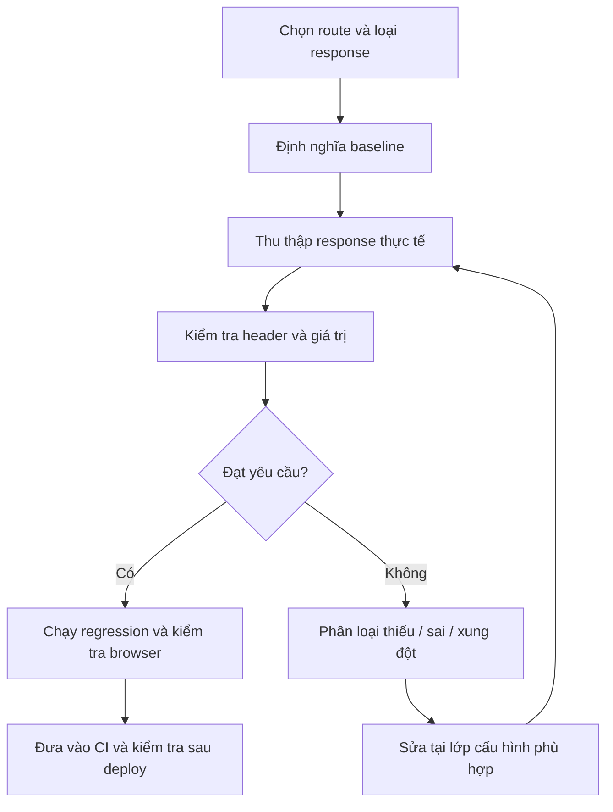

# Kiểm thử HTTP security headers

HTTP security headers là các header trong response giúp trình duyệt áp dụng chính sách bảo vệ cho trang và tài nguyên web. Chúng có thể giới hạn nguồn script, ngăn trang bị nhúng trái phép, kiểm soát referrer, buộc kết nối HTTPS, hạn chế quyền truy cập phần cứng và xác định cách trình duyệt xử lý kiểu nội dung hoặc tài nguyên cross-origin.

Kiểm thử header là bước xác minh cấu hình bảo mật đã thực sự tới trình duyệt và được áp dụng trên đúng response. Một header xuất hiện trong cấu hình ứng dụng chưa chứng minh nó được gửi qua CDN, reverse proxy hoặc gateway. Tương tự, nhìn thấy header trên trang chủ chưa đảm bảo các route đăng nhập, API, trang lỗi, file tải xuống và response redirect đều có chính sách phù hợp.

Trong module bảo mật trình duyệt, kiểm thử header kết nối các cơ chế như CSP, Trusted Types, HSTS, Same-Origin Policy, CORS, CORP/COEP, cookie và clickjacking với hành vi thực tế của trình duyệt. Mục tiêu là kiểm tra chính sách theo yêu cầu sản phẩm, phát hiện cấu hình thiếu hoặc mâu thuẫn và xác minh rằng thay đổi triển khai không làm suy yếu ranh giới bảo mật.

Sau bài học, bạn có thể:

- Lập ma trận header theo loại response và yêu cầu bảo mật.
- Kiểm tra response headers bằng DevTools, `curl` và test tự động.
- Đánh giá CSP, HSTS, `X-Content-Type-Options`, `frame-ancestors`, `Referrer-Policy` và `Permissions-Policy`.
- Kiểm tra các header cross-origin như COOP, COEP, CORP và CORS khi kiến trúc cần chúng.
- Xác minh cookie, cache, redirect, response lỗi và tài nguyên tĩnh theo đúng ngữ cảnh.
- Đưa kiểm thử header vào CI/CD và kiểm tra lại sau khi triển khai.

## 1. Phạm vi và nguyên tắc kiểm thử

### 1.1. Kiểm tra response headers

HTTP request có request headers và response headers. Khi kiểm thử security headers, trọng tâm thường là response headers do máy chủ hoặc thành phần trung gian gửi về. Ví dụ:

```http
HTTP/1.1 200 OK
Content-Type: text/html; charset=utf-8
Strict-Transport-Security: max-age=31536000; includeSubDomains
X-Content-Type-Options: nosniff
Referrer-Policy: strict-origin-when-cross-origin
Content-Security-Policy: default-src 'self'; object-src 'none'; base-uri 'self'; frame-ancestors 'none'
```

Các giá trị trên chỉ minh họa một baseline. Chính sách thực tế phải phù hợp với cách ứng dụng tải script, nhúng frame, gọi API, chia sẻ tài nguyên và phục vụ nội dung. Không sao chép nguyên mẫu vào production khi chưa đánh giá tương thích.

### 1.2. Kiểm thử theo response, không chỉ theo domain

Một website có nhiều loại response và nhiều đường đi. Hãy xác định phạm vi trước khi viết test:

| Loại response | Ví dụ | Điều cần xác minh |
|---|---|---|
| HTML document | Trang chủ, đăng nhập, hồ sơ, trang quản trị | CSP, HSTS, frame protection, Referrer-Policy, Permissions-Policy |
| API JSON | `/api/profile`, `/api/orders` | CORS nếu cross-origin, cache policy, Content-Type, header chống sniffing khi phù hợp |
| Redirect | HTTP sang HTTPS, route cũ sang route mới, login redirect | Đích đến, status, header áp dụng trên response redirect và response cuối |
| Trang lỗi | `401`, `403`, `404`, `429`, `500` | Không rò dữ liệu; header bảo vệ cần thiết vẫn được gửi |
| Tài nguyên tĩnh | JS, CSS, font, ảnh | MIME chính xác, `nosniff`, cache policy, CORS nếu được chia sẻ |
| Download | PDF, CSV, file do người dùng tải | Content-Type, Content-Disposition, cache và chính sách mở nội dung |

Header có thể được thêm ở ứng dụng, web server, CDN, WAF hoặc reverse proxy. Cần kiểm tra response cuối cùng mà trình duyệt nhận được vì nhiều lớp có thể thêm, xóa hoặc ghi đè header.

### 1.3. Xây dựng baseline có căn cứ

Trước khi kiểm tra, lập bảng yêu cầu ghi rõ:

- Route hoặc nhóm route cần kiểm tra.
- Loại response dự kiến và trạng thái HTTP hợp lệ.
- Header bắt buộc, giá trị hoặc directive cần có.
- Ngoại lệ có lý do, chủ sở hữu và thời hạn xem xét.
- Môi trường áp dụng: local, staging hay production.

Không phải mọi header đều cần xuất hiện trên mọi response. Ví dụ, HSTS chỉ có ý nghĩa khi được gửi qua HTTPS; CSP của một HTML document có thể khác chính sách dành cho JSON API; `Access-Control-Allow-Origin` chỉ cần khi tài nguyên được chia sẻ cross-origin. Test phải phản ánh thiết kế, không chỉ tìm kiếm một danh sách header cố định.

## 2. Quy trình kiểm thử tổng quát



Thực hiện theo trình tự sau:

1. Chọn route và thao tác đại diện, bao gồm trang công khai, trang yêu cầu đăng nhập và trang có nội dung nhúng.
2. Ghi lại response mong đợi và chính sách áp dụng cho route đó.
3. Thu thập response headers bằng Network panel hoặc công cụ dòng lệnh.
4. Kiểm tra cả sự hiện diện, cú pháp và ý nghĩa của giá trị.
5. Kiểm tra redirect, response lỗi, cache và các host phụ liên quan.
6. Chạy test tự động và kiểm thử hành vi trên trình duyệt.
7. Sửa cấu hình tại đúng lớp tạo response, sau đó chạy lại toàn bộ kiểm tra liên quan.
8. Lặp lại trên môi trường sau triển khai để phát hiện khác biệt do CDN, proxy hoặc cấu hình production.

## 3. Thu thập header bằng DevTools

Mở trang cần kiểm tra, mở DevTools và chọn **Network**. Bật **Preserve log** nếu cần quan sát redirect, sau đó tải lại trang. Chọn request loại **document** để xem header của HTML document.

Trong tab **Headers**, tập trung vào:

- **General**: Request URL, Request Method, Status Code.
- **Response Headers**: header thực tế trình duyệt nhận được.
- **Request Headers**: Origin, Cookie, Referer và các header đầu vào có liên quan.

Kiểm tra từng request document, không chỉ request đầu tiên. Nếu trang chuyển từ HTTP sang HTTPS, hãy đọc cả response redirect lẫn response HTTPS cuối cùng. Nếu HTML tải qua CDN nhưng API dùng host khác, kiểm tra API và tài nguyên ở host đó riêng.

Một số điểm cần chú ý:

- Header có thể được trình duyệt hiển thị với cách viết chữ hoa/thường khác nhau; tên field HTTP không phân biệt hoa thường.
- Một header có thể xuất hiện nhiều lần. Với CSP, nhiều policy được áp dụng đồng thời và mỗi policy bổ sung ràng buộc; không giả định các giá trị sẽ được hợp nhất thành một policy rộng hơn.
- Nếu DevTools hiển thị header từ memory cache, disk cache hoặc Service Worker, hãy xác định response đang quan sát đến từ đâu.
- Với cookie, dùng tab **Cookies** để xem lý do cookie được gửi hoặc bị loại trừ. `Set-Cookie` không được JavaScript đọc qua `response.headers` trong browser.

## 4. Thu thập header bằng curl

`curl` giúp xem status và response headers từ một máy cụ thể. Để gửi GET và chỉ in header, có thể dùng:

```bash
curl -sS -D - -o /dev/null https://app.example.test/
```

Trên Windows PowerShell, gọi rõ `curl.exe` để tránh nhầm alias `curl`:

```powershell
curl.exe -sS -D - -o NUL https://app.example.test/
```

Để quan sát chuỗi redirect:

```bash
curl -sS -L -D - -o /dev/null http://app.example.test/
```

Với `-L`, curl đi theo redirect và in các khối response headers trên đường đi. Kiểm tra từng khối để xác định response nào đã gửi header. Nếu cần chỉ xem response đầu tiên, bỏ `-L`.

Một số lưu ý khi dùng curl:

- `-I` gửi HEAD; máy chủ có thể xử lý HEAD khác GET. Dùng GET với `-D - -o /dev/null` khi cần kiểm tra response của GET.
- Curl không thực thi CSP, Same-Origin Policy, CORS, cookie policy hoặc Service Worker như trình duyệt.
- Kết quả phụ thuộc DNS, proxy, trust store và mạng của máy chạy lệnh.
- Không dùng `-k`/`--insecure` để bỏ qua xác minh TLS trong kiểm tra production; tùy chọn này làm mất bằng chứng về lỗi chứng chỉ.
- Không đưa token, cookie hoặc URL ký số vào lệnh có thể lưu trong shell history.

## 5. Kiểm thử Content-Security-Policy

CSP giới hạn nguồn tài nguyên và một số hành vi của document. Khi kiểm thử, hãy xác nhận policy được gửi bằng HTTP response header trên đúng HTML document và đang ở chế độ thực thi.

### 5.1. Kiểm tra header thực thi

Ví dụ policy:

```http
Content-Security-Policy: default-src 'self'; script-src 'self' 'nonce-r4nd0m'; object-src 'none'; base-uri 'self'; frame-ancestors 'none'; connect-src 'self' https://api.example.test
```

Kiểm tra:

- Có `Content-Security-Policy` đang thực thi, không chỉ `Content-Security-Policy-Report-Only`.
- `object-src 'none'` nếu ứng dụng không cần plugin object.
- `base-uri` được giới hạn để giảm nguy cơ thay đổi base URL ngoài ý muốn.
- `frame-ancestors` phản ánh chính xác nơi được phép nhúng trang.
- `script-src` dùng nonce hoặc hash khi cần inline script; nonce phải khó đoán và được tạo mới cho mỗi response.
- `connect-src` chỉ cho phép các endpoint ứng dụng thực sự cần.
- Không có `unsafe-eval` hoặc `unsafe-inline` nếu không có lý do tương thích được phê duyệt.

Đừng chỉ kiểm tra chuỗi `default-src 'self'`. Directive cụ thể có thể mở rộng nguồn cho script, style, image, font, worker, frame hoặc kết nối. Cần đánh giá policy theo từng loại tài nguyên.

### 5.2. Phân biệt enforcing và Report-Only

`Content-Security-Policy-Report-Only` chỉ báo cáo vi phạm, không chặn tài nguyên theo policy đó. Nó hữu ích khi triển khai thử nghiệm một policy mới. Khi kiểm thử production, phải xác nhận policy cần bảo vệ đã được gửi bằng `Content-Security-Policy`.

Có thể cùng lúc gửi policy thực thi và policy Report-Only. Hai header này có vai trò khác nhau; sự hiện diện của Report-Only không thay thế policy thực thi.

### 5.3. Kiểm tra nonce và hash

Nếu `script-src` sử dụng nonce, kiểm tra nonce trong header khớp với thuộc tính `nonce` của script hợp lệ trong HTML, nonce được sinh mới cho từng response và không bị tái sử dụng qua cache theo cách làm lộ hoặc dùng lại nonce. Không kiểm tra nonce bằng một giá trị cố định trong test production; kiểm tra định dạng, sự hiện diện và quan hệ giữa header với HTML.

Với hash source, xác minh hash khớp chính xác nội dung script/style được cho phép. Thay đổi một ký tự trong inline script sẽ làm hash không còn khớp.

### 5.4. Kiểm tra hành vi CSP trên browser

Tạo test trên staging để xác nhận script từ origin không được phép bị chặn, script hợp lệ vẫn chạy và Console ghi nhận vi phạm mong đợi. Dùng dữ liệu thử nghiệm, không đưa payload khai thác vào production. Kiểm tra cả iframe, worker, WebSocket và API nếu ứng dụng sử dụng các loại tài nguyên này.

Trusted Types thường được bật qua CSP, ví dụ:

```http
Content-Security-Policy: require-trusted-types-for 'script'; trusted-types app
```

Header test có thể xác nhận directive này có mặt; kiểm thử thực thi cần thêm browser test chứng minh sink DOM nguy hiểm từ chối chuỗi không được chuyển qua Trusted Types policy hợp lệ.

## 6. Kiểm thử HSTS

HTTP Strict Transport Security yêu cầu trình duyệt dùng HTTPS cho host trong thời gian được chỉ định. Header mẫu:

```http
Strict-Transport-Security: max-age=31536000; includeSubDomains
```

Kiểm tra:

- Header được gửi trên response HTTPS.
- `max-age` lớn hơn 0 và đáp ứng thời hạn baseline của tổ chức.
- `includeSubDomains` chỉ bật khi mọi subdomain thuộc phạm vi đều hỗ trợ HTTPS ổn định.
- `preload` chỉ dùng khi tổ chức đáp ứng điều kiện preload và có kế hoạch duy trì HTTPS cho toàn bộ phạm vi.
- Không kỳ vọng trình duyệt chấp nhận HSTS từ response HTTP không an toàn.

`max-age=31536000` thường được dùng làm mốc một năm trong baseline nghiêm ngặt, nhưng cần đánh giá phạm vi domain trước khi áp dụng. Một subdomain cũ chỉ hỗ trợ HTTP có thể bị ảnh hưởng nếu bật `includeSubDomains` ở domain cha.

Để kiểm thử, truy cập endpoint qua HTTPS và đọc response header. Không chỉ kiểm tra redirect HTTP sang HTTPS: redirect là hành vi máy chủ, còn HSTS là chính sách trình duyệt ghi nhớ sau khi nhận header qua HTTPS. Khi cần kiểm tra hành vi ghi nhớ, dùng profile browser thử nghiệm sạch hoặc môi trường test riêng.

## 7. Kiểm thử MIME và X-Content-Type-Options

`X-Content-Type-Options: nosniff` yêu cầu trình duyệt không diễn giải một số response theo kiểu nội dung khác với MIME type được khai báo. Header này đặc biệt quan trọng khi phục vụ script và stylesheet.

```http
X-Content-Type-Options: nosniff
Content-Type: text/javascript; charset=utf-8
```

Kiểm tra:

- Header `X-Content-Type-Options` có giá trị `nosniff`.
- JavaScript được phục vụ với MIME JavaScript hợp lệ.
- CSS được phục vụ với `text/css`.
- JSON API trả `application/json` hoặc media type JSON phù hợp.
- File download có Content-Type chính xác và Content-Disposition phù hợp.
- Không để upload không tin cậy được phục vụ từ origin ứng dụng với MIME có thể thực thi.

`nosniff` không thay thế kiểm tra nội dung upload, phân quyền hoặc cách ly origin. Với HTML, SVG và các định dạng có nội dung chủ động, cần đánh giá cách mở/nhúng và nguồn gốc file. Kiểm tra MIME trên response thực tế, kể cả sau khi đi qua CDN.

## 8. Kiểm thử chống clickjacking

Clickjacking lợi dụng việc nhúng trang vào frame để đánh lừa người dùng tương tác. Hai cơ chế response phổ biến là CSP `frame-ancestors` và header cũ hơn `X-Frame-Options`.

Ví dụ không cho phép nhúng:

```http
Content-Security-Policy: frame-ancestors 'none'
X-Frame-Options: DENY
```

Nếu chỉ cho phép cùng origin:

```http
Content-Security-Policy: frame-ancestors 'self'
X-Frame-Options: SAMEORIGIN
```

Kiểm tra:

- `frame-ancestors` được gửi qua HTTP response header; khai báo trong thẻ `meta` không thay thế được directive này.
- Danh sách ancestor khớp với nhu cầu sản phẩm, không dùng wildcard rộng không cần thiết.
- `X-Frame-Options` không mâu thuẫn với chính sách tương thích.
- Các route nhạy cảm, trang đăng nhập và trang quản trị đều có chính sách phù hợp.

Trong trình duyệt hiện đại, CSP `frame-ancestors` có hiệu lực ưu tiên hơn X-Frame-Options khi cả hai được hỗ trợ. Test nên kiểm tra chính sách CSP thực tế, đồng thời duy trì X-Frame-Options nếu cần hỗ trợ trình duyệt cũ theo baseline.

Kiểm thử hành vi bằng một trang thử nghiệm ở origin khác cố nhúng trang mục tiêu trong iframe. Xác nhận trình duyệt từ chối nhúng khi policy yêu cầu và không có ngoại lệ ngoài dự kiến. Không thực hiện trên trang giao dịch thật hoặc tài khoản thật.

## 9. Kiểm thử Referrer-Policy

Referrer-Policy xác định mức thông tin URL được gửi trong header `Referer` khi điều hướng hoặc tải tài nguyên.

Ví dụ baseline phổ biến:

```http
Referrer-Policy: strict-origin-when-cross-origin
```

Một số giá trị hợp lệ gồm `no-referrer`, `same-origin`, `origin`, `strict-origin`, `origin-when-cross-origin`, `strict-origin-when-cross-origin` và `no-referrer-when-downgrade`. `unsafe-url` có thể làm lộ đường dẫn và query string đầy đủ, nên cần tránh trừ khi có yêu cầu rõ ràng.

Kiểm thử bằng cách điều hướng từ trang thử nghiệm sang một endpoint do bạn kiểm soát và xem header `Referer` nhận được. Xác nhận:

- Cùng origin có mức thông tin phù hợp với yêu cầu.
- Cross-origin chỉ nhận thông tin tối thiểu cần thiết.
- Điều hướng từ HTTPS xuống HTTP không làm lộ URL nguồn đầy đủ.
- Query string chứa dữ liệu nhạy cảm không bị gửi sang bên thứ ba.

Header response là policy mặc định cho document; ứng dụng cũng có thể đặt policy cụ thể cho một thẻ hoặc request. Hãy kiểm tra hành vi cuối cùng chứ không chỉ giá trị header.

## 10. Kiểm thử Permissions-Policy

Permissions-Policy giới hạn việc document và frame sử dụng một số tính năng của trình duyệt như camera, microphone, geolocation, fullscreen, payment hoặc clipboard tùy tính năng được hỗ trợ.

Ví dụ chỉ cho phép một số tính năng ở cùng origin:

```http
Permissions-Policy: camera=(), microphone=(), geolocation=(self), fullscreen=(self)
```

Kiểm thử cần dựa trên tính năng ứng dụng thực sự dùng:

- Tắt các tính năng không cần thiết.
- Giới hạn allowlist theo origin cần dùng.
- Xác định chính sách áp dụng cho iframe và delegated permission.
- Kiểm tra tính năng bị từ chối trong browser khi policy không cho phép.

Không dùng một chuỗi policy mẫu cho mọi ứng dụng. Cú pháp và danh sách directive được trình duyệt hỗ trợ có thể thay đổi; kiểm tra tài liệu tương thích trước khi đưa directive mới vào baseline. Permissions-Policy cũng không thay thế prompt quyền của người dùng hoặc quyền hệ điều hành.

## 11. Kiểm thử các header cross-origin

Một số ứng dụng cần chia sẻ tài nguyên cross-origin hoặc bật cross-origin isolation. Các header này phải được kiểm tra cùng nhau theo kiến trúc, vì chúng có tác động tới khả năng nhúng tài nguyên và giao tiếp giữa cửa sổ.

### 11.1. CORS response headers

Ví dụ cho phép một origin cụ thể đọc API:

```http
Access-Control-Allow-Origin: https://app.example.test
Access-Control-Allow-Methods: GET, POST
Access-Control-Allow-Headers: Content-Type, X-CSRF-Token
Access-Control-Allow-Credentials: true
Vary: Origin
```

Kiểm thử:

- Origin được phép phải khớp chính xác scheme, host và port.
- Origin không được phép không nhận response CORS mở rộng quyền.
- Với credentials, không dùng `Access-Control-Allow-Origin: *`.
- Preflight `OPTIONS` phải cho phép đúng method và request headers.
- Response thực tế cũng phải có header CORS phù hợp.
- Nếu phản hồi origin động, `Vary: Origin` phải được cấu hình để cache phân biệt origin.

CORS không xác thực người dùng, không phân quyền tài nguyên và không tự chống CSRF. Test cần xác minh server vẫn kiểm tra danh tính, quyền và token chống CSRF cho các thao tác thay đổi trạng thái.

### 11.2. COOP, COEP và CORP

Các header thường gặp:

```http
Cross-Origin-Opener-Policy: same-origin
Cross-Origin-Embedder-Policy: require-corp
Cross-Origin-Resource-Policy: same-origin
```

- **COOP** kiểm soát việc document chia sẻ browsing context group với cửa sổ cross-origin và ảnh hưởng tới quan hệ `window.opener`.
- **COEP** yêu cầu tài nguyên cross-origin được tải vào document đáp ứng điều kiện chia sẻ phù hợp.
- **CORP** cho phép chủ tài nguyên giới hạn ngữ cảnh cross-origin được phép tải tài nguyên đó.

Chỉ bật cấu hình nghiêm ngặt khi ứng dụng cần và đã chuẩn bị các tài nguyên bên thứ ba. Với cross-origin isolation, thường cần COOP `same-origin` cùng COEP `require-corp` hoặc chế độ phù hợp khác được trình duyệt hỗ trợ. Kiểm thử trong browser bằng `window.crossOriginIsolated` và xác minh các tài nguyên cần thiết vẫn tải được.

CORP thường đặt trên response của tài nguyên được chia sẻ, còn COEP và COOP thường áp dụng trên document. Không yêu cầu cùng một giá trị cho mọi route và mọi tài nguyên.

## 12. Kiểm thử cookie và cache headers

### 12.1. Set-Cookie

Cookie phiên cần có thuộc tính phù hợp với mô hình xác thực. Ví dụ:

```http
Set-Cookie: __Host-session=<opaque>; Path=/; Secure; HttpOnly; SameSite=Lax
```

Kiểm tra:

- Cookie phiên có `Secure` khi ứng dụng chạy qua HTTPS.
- Cookie xác thực có `HttpOnly` nếu JavaScript không cần đọc nó.
- `SameSite` phù hợp với luồng điều hướng và kiến trúc đăng nhập.
- Cookie có phạm vi `Domain` và `Path` tối thiểu cần thiết.
- Prefix `__Host-` được dùng đúng điều kiện: Secure, Path `/`, không có Domain.
- Thời hạn cookie phù hợp với chính sách phiên và logout.

`Set-Cookie` là response header nhạy cảm. Không ghi giá trị cookie vào test report. Trong browser JavaScript, `Set-Cookie` là forbidden response header và không đọc được qua Fetch API; kiểm tra bằng Network panel hoặc công cụ server-side. Khi tự động hóa bằng Node, dùng API lấy từng Set-Cookie riêng nếu phiên bản runtime hỗ trợ, không tách chuỗi ghép theo dấu phẩy vì thuộc tính Expires cũng chứa dấu phẩy.

### 12.2. Cache-Control

Header cache cần phản ánh độ nhạy của response:

```http
Cache-Control: no-store
```

`no-store` phù hợp với response nhạy cảm cần tránh lưu vào cache. `no-cache` cho phép lưu nhưng yêu cầu xác thực lại trước khi sử dụng. Tài nguyên tĩnh có tên chứa content hash có thể dùng `public, max-age=31536000, immutable` nếu nội dung thực sự bất biến theo URL.

Kiểm thử theo loại response:

- Trang tài khoản và API chứa dữ liệu cá nhân: không cho cache dùng chung giữa người dùng; xác minh chính sách `private`/`no-store` phù hợp.
- Tài nguyên public có version hash: xác minh thời hạn cache dài và URL đổi khi nội dung thay đổi.
- Response phụ thuộc cookie hoặc header đầu vào: xem `Vary` và cấu hình CDN để không phát nhầm response giữa người dùng.
- Redirect và response lỗi: kiểm tra cache policy riêng, tránh cache nhầm trang lỗi hoặc response chứa dữ liệu phiên.

Không dùng `no-store` cho mọi tài nguyên một cách máy móc; điều đó có thể làm giảm hiệu năng. Cũng không dùng `public` cho response cá nhân chỉ để tăng cache hit.

## 13. Test tự động bằng Node.js

Có thể dùng `node:test` và `fetch` tích hợp trong Node.js để kiểm tra baseline response từ staging. Ví dụ dưới đây kiểm tra một số HTML route. Hãy thay danh sách route và điều kiện cho phù hợp với ứng dụng.

Tạo file `header.test.mjs`:

```javascript
import test from "node:test";
import assert from "node:assert/strict";

const baseUrl = new URL(process.env.BASE_URL ?? "https://app.example.test");
const htmlRoutes = ["/", "/login", "/account"];

function parseDirectives(policy) {
  const directives = new Map();
  for (const part of policy.split(";")) {
    const tokens = part.trim().split(/\s+/).filter(Boolean);
    if (tokens.length === 0) continue;
    const name = tokens[0].toLowerCase();
    assert.equal(directives.has(name), false, `Duplicate CSP directive: ${name}`);
    directives.set(name, tokens.slice(1).join(" "));
  }
  return directives;
}

for (const route of htmlRoutes) {
  test(`security headers: ${route}`, async () => {
    const response = await fetch(new URL(route, baseUrl), { redirect: "follow" });
    assert.equal(response.status, 200);
    assert.match(response.headers.get("content-type") ?? "", /^text\/html\b/i);

    assert.equal(
      response.headers.get("x-content-type-options")?.toLowerCase(),
      "nosniff"
    );

    const csp = response.headers.get("content-security-policy");
    assert.ok(csp, "An enforcing Content-Security-Policy header is required");
    const directives = parseDirectives(csp);
    assert.equal(directives.get("object-src"), "'none'");
    assert.ok(directives.has("base-uri"));
    assert.ok(directives.has("frame-ancestors"));

    const referrerPolicy = response.headers.get("referrer-policy");
    assert.ok(referrerPolicy, "Referrer-Policy must be present");
    assert.notEqual(referrerPolicy.toLowerCase(), "unsafe-url");

    if (baseUrl.protocol === "https:") {
      const hsts = response.headers.get("strict-transport-security") ?? "";
      const maxAge = hsts.match(/(?:^|;)\s*max-age=(\d+)/i);
      assert.ok(maxAge, "HSTS max-age must be present on HTTPS");
      assert.ok(Number(maxAge[1]) >= 31536000, "HSTS max-age must meet the one-year baseline");
    }
  });
}
```

Chạy test với URL staging:

```bash
BASE_URL=https://staging.example.test node --test header.test.mjs
```

Trong PowerShell:

```powershell
$env:BASE_URL = "https://staging.example.test"
node --test header.test.mjs
```

Ví dụ giả định ứng dụng có các HTML route trả status `200`, dùng một CSP header đơn giản và baseline HSTS một năm. Nếu ứng dụng dùng nhiều CSP policy, có trang redirect hoặc route yêu cầu đăng nhập, hãy mở rộng test để kiểm tra từng response theo hợp đồng thực tế. Không ép tất cả route dùng cùng một policy nếu có lý do sản phẩm rõ ràng.

### 13.1. Kiểm tra CORS preflight tự động

Một test server-side có thể gửi OPTIONS với Origin và Access-Control-Request headers để xác minh cấu hình:

```javascript
import assert from "node:assert/strict";

const apiUrl = process.env.API_URL ?? "https://api.example.test/profile";
const appOrigin = process.env.APP_ORIGIN ?? "https://app.example.test";

const response = await fetch(apiUrl, {
  method: "OPTIONS",
  headers: {
    Origin: appOrigin,
    "Access-Control-Request-Method": "POST",
    "Access-Control-Request-Headers": "content-type"
  }
});

assert.ok([200, 204].includes(response.status));
assert.equal(response.headers.get("access-control-allow-origin"), appOrigin);
assert.match(response.headers.get("access-control-allow-methods") ?? "", /\bPOST\b/i);
assert.match(response.headers.get("access-control-allow-headers") ?? "", /\bcontent-type\b/i);
assert.equal(response.headers.get("access-control-allow-credentials"), "true");

const vary = (response.headers.get("vary") ?? "").toLowerCase().split(",").map(v => v.trim());
assert.ok(vary.includes("origin"), "Dynamic origin responses should vary by Origin");
```

Test này xác minh response preflight từ API. Cần có browser integration test để kiểm tra trình duyệt gửi preflight trong đúng tình huống, xử lý credentials/cookie và cho phép hoặc từ chối JavaScript đọc response như mong đợi.

## 14. Kiểm thử trên trình duyệt và trong CI/CD

Test đọc header bằng Node hoặc curl xác nhận server trả giá trị nào. Nó không chứng minh trình duyệt thực thi chính sách đúng trong mọi luồng. Với policy ảnh hưởng hành vi browser, cần kiểm thử tích hợp.

Các kịch bản nên có:

| Kịch bản | Kết quả mong đợi |
|---|---|
| Trang HTTPS chính | HSTS và baseline document headers có mặt |
| Script không nằm trong CSP allowlist | Bị chặn; Console ghi nhận vi phạm |
| Script hợp lệ có nonce/hash | Được thực thi theo policy |
| Trang bị nhúng từ origin không được phép | Frame bị chặn bởi `frame-ancestors`/XFO |
| Điều hướng cross-origin | `Referer` không chứa thông tin vượt quá policy |
| API preflight từ origin được phép | OPTIONS và response thực tế có header phù hợp |
| API từ origin không được phép | JavaScript không đọc được response; server vẫn thực thi authz/CSRF |
| Tài nguyên sai MIME với `nosniff` | Browser từ chối xử lý theo ngữ cảnh yêu cầu |
| Route lỗi `403` hoặc `500` | Không lộ stack trace; header bảo vệ cần thiết vẫn có |
| Trang offline qua Service Worker | Hành vi fallback đúng và không trả dữ liệu cache sai người dùng |

Trong pipeline CI/CD:

1. Chạy test header trên build hoặc môi trường integration.
2. Chạy browser test cho CSP, frame, CORS và các policy có tác động trực tiếp.
3. Chạy kiểm tra staging sau khi reverse proxy/CDN đã nhận cấu hình.
4. Lưu kết quả pass/fail, route và giá trị header đã làm sạch.
5. Chạy lại sau thay đổi web server, CDN, WAF, gateway, framework hoặc domain.

Test không nên lưu toàn bộ response body hoặc cookie vào log CI. Khi thất bại, chỉ in tên header, route và giá trị đã loại bỏ thông tin nhạy cảm.

## 15. Các lỗi cấu hình và dấu hiệu cần tìm

| Vấn đề | Tác động | Cách kiểm tra |
|---|---|---|
| Header chỉ có trên trang chủ | Route nhạy cảm có thể thiếu bảo vệ | Kiểm tra ma trận route và response |
| CSP chỉ ở Report-Only | Tài nguyên vi phạm vẫn được tải | Xác minh header CSP thực thi |
| CSP có `unsafe-inline` hoặc wildcard rộng | Giảm hiệu quả hạn chế nguồn script | Kiểm tra directive và lý do ngoại lệ |
| HSTS chỉ có trên HTTP | Browser không ghi nhận policy | Kiểm tra response HTTPS và redirect |
| `includeSubDomains` bật quá sớm | Subdomain chưa hỗ trợ HTTPS có thể bị ảnh hưởng | Kiểm kê toàn bộ subdomain trước khi bật |
| `X-Frame-Options` và `frame-ancestors` không đồng bộ | Hành vi nhúng khác nhau giữa browser | Kiểm tra CSP hiện đại và fallback |
| `Access-Control-Allow-Origin: *` cùng credentials | CORS response không hợp lệ cho credentialed request | Kiểm tra origin cụ thể và credentials |
| Header bị CDN ghi đè hoặc xóa | Cấu hình origin server không phản ánh response cuối | Kiểm tra từ mạng bên ngoài qua public endpoint |
| Nhiều CSP policy không chủ ý | Các policy được thực thi đồng thời, có thể làm ứng dụng hỏng | Kiểm tra mọi field và cấu hình tại từng lớp |
| Cache chia sẻ response cá nhân | Có thể lộ dữ liệu giữa người dùng | Kiểm tra Cache-Control, Vary và CDN cache key |
| Cookie thiếu thuộc tính | Tăng rủi ro đánh cắp hoặc gửi cookie ngoài dự kiến | Kiểm tra Set-Cookie trong Network |

## 16. Báo cáo kết quả kiểm thử

Một finding nên ghi rõ phạm vi và bằng chứng để nhóm triển khai có thể xử lý:

- Môi trường, hostname, route và thời điểm kiểm tra.
- Loại response, status và phương thức thu thập.
- Header mong đợi, header thực tế và khác biệt.
- Tác động bảo mật hoặc chức năng dựa trên kiến trúc cụ thể.
- Cách tái hiện và bằng chứng đã làm sạch.
- Đề xuất sửa ở application, web server, CDN, proxy hoặc gateway.
- Ngoại lệ được chấp thuận, người chịu trách nhiệm và ngày xem xét lại.

Không gửi HAR hoặc response chứa cookie, token, dữ liệu tài khoản vào báo cáo. Nếu phát hiện header bị thiếu trên production, đánh giá mức độ ảnh hưởng theo loại trang, khả năng khai thác và dữ liệu được xử lý; ưu tiên sửa các route nhạy cảm và kiểm tra lại sau khi triển khai.

## 17. Checklist hoàn tất

- [ ] Đã xác định baseline header theo route và loại response.
- [ ] Đã kiểm tra response thực tế qua HTTPS và các lớp CDN/proxy liên quan.
- [ ] Đã xác minh CSP thực thi, directive cần thiết và nonce/hash nếu dùng.
- [ ] Đã kiểm tra HSTS trên HTTPS và đánh giá phạm vi subdomain.
- [ ] Đã kiểm tra `X-Content-Type-Options`, MIME và cách phục vụ file.
- [ ] Đã kiểm tra `frame-ancestors`/X-Frame-Options bằng browser test.
- [ ] Đã kiểm tra Referrer-Policy và Permissions-Policy theo nhu cầu sản phẩm.
- [ ] Đã kiểm tra CORS, COOP, COEP và CORP khi kiến trúc sử dụng.
- [ ] Đã kiểm tra Set-Cookie và Cache-Control trên response nhạy cảm.
- [ ] Đã kiểm tra redirect, response lỗi, API và tài nguyên tĩnh.
- [ ] Đã đưa các kiểm tra phù hợp vào CI/CD và xác minh sau triển khai.
- [ ] Đã loại bỏ cookie, token và dữ liệu cá nhân khỏi báo cáo.

Kiểm thử HTTP security headers có giá trị khi kết quả phản ánh response mà người dùng thực sự nhận được và hành vi mà trình duyệt thực sự thực thi. Một baseline rõ ràng, ma trận route đầy đủ và test tự động sau mỗi lần triển khai giúp phát hiện sớm cấu hình bị thiếu, sai giá trị hoặc bị thay đổi ở tầng hạ tầng.
