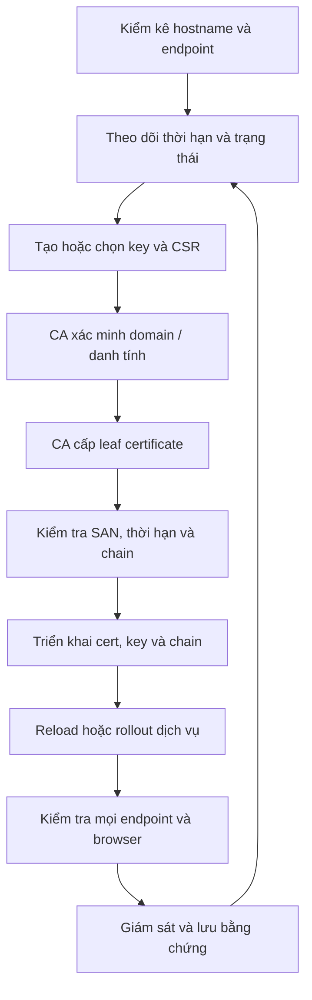

# Vận hành gia hạn chứng chỉ TLS

Chứng chỉ TLS giúp trình duyệt xác minh danh tính máy chủ khi thiết lập HTTPS. Chứng chỉ có thời hạn; nếu hết hạn, sai hostname, thiếu intermediate certificate hoặc không còn được chuỗi tin cậy chấp nhận, trình duyệt có thể từ chối kết nối và người dùng không thể truy cập ứng dụng an toàn.

Gia hạn chứng chỉ là một quy trình vận hành có nhiều bước: kiểm kê endpoint, theo dõi hạn dùng, xác thực quyền kiểm soát domain, cấp chứng chỉ mới, triển khai private key và certificate chain, nạp cấu hình vào máy chủ, rồi xác minh từ góc nhìn trình duyệt. Một lệnh cấp chứng chỉ thành công chưa chứng minh mọi máy chủ, CDN, load balancer và subdomain đã phục vụ chứng chỉ mới.

Trong vận hành bảo mật trình duyệt, quy trình gia hạn cần duy trì tính liên tục của HTTPS, bảo vệ private key, giữ nguyên hostname và chuỗi tin cậy, đồng thời kiểm tra tương tác với HSTS, cookie `Secure`, CORS và các kết nối API. Bài học này tập trung vào chứng chỉ TLS cho website và API được trình duyệt truy cập; chứng chỉ client dùng cho mutual TLS (mTLS) được đề cập ở những điểm khác biệt cần lưu ý.

Sau bài học, bạn có thể:

- Lập inventory chứng chỉ và xác định endpoint cần gia hạn.
- Giải thích vòng đời chứng chỉ, SAN, CSR, CA, intermediate chain và ACME challenge.
- Thiết kế gia hạn tự động có kiểm soát, cảnh báo và kiểm tra trước khi triển khai.
- Triển khai chứng chỉ mới mà không làm lộ private key hoặc gây gián đoạn HTTPS.
- Xác minh chứng chỉ được phục vụ trên đúng SNI, hostname, IPv4/IPv6 và các node trong hệ thống.
- Xử lý lỗi gia hạn, chứng chỉ hết hạn, sai chain và sự cố lộ private key.

## 1. Vòng đời chứng chỉ TLS

Chứng chỉ máy chủ TLS thường được CA cấp sau khi xác minh tổ chức hoặc quyền kiểm soát tên miền theo loại chứng chỉ. Chứng chỉ chứa public key, danh tính được xác thực, thời hạn hiệu lực và các thuộc tính sử dụng. Máy chủ giữ private key tương ứng và dùng nó trong quá trình bắt tay TLS.

Vòng đời vận hành có thể mô tả như sau:



Các giai đoạn chính:

| Giai đoạn | Việc cần làm | Rủi ro nếu bỏ qua |
|---|---|---|
| Inventory | Xác định hostname, loại chứng chỉ, CA, nơi lưu key và endpoint phục vụ | Bỏ sót subdomain hoặc node đang dùng chứng chỉ cũ |
| Monitoring | Theo dõi `notAfter`, trạng thái renewal và lỗi job | Chỉ phát hiện khi trình duyệt đã báo chứng chỉ hết hạn |
| Authorization | Chứng minh quyền kiểm soát domain hoặc danh tính | CA từ chối cấp hoặc xác thực nhầm môi trường |
| Issuance | Tạo CSR và nhận chứng chỉ mới | SAN, key usage hoặc thời hạn không đúng |
| Deployment | Cài leaf certificate, intermediate chain và private key tương ứng | Mismatch key, thiếu chain hoặc cấu hình sai SNI |
| Verification | Kiểm tra endpoint sau rollout và hành vi browser | Job báo thành công nhưng một node vẫn phục vụ cert cũ |
| Retirement | Thu hồi hoặc loại bỏ vật liệu cũ theo chính sách | Key cũ tiếp tục được dùng hoặc bí mật còn lưu ngoài phạm vi |

### 1.1. Những trường cần kiểm tra

Trước khi gia hạn, hãy hiểu các thuộc tính của chứng chỉ:

- **Subject:** danh tính được ghi trong chứng chỉ. Với xác thực hostname web hiện đại, không chỉ dựa vào Common Name.
- **Subject Alternative Name (SAN):** chứa DNS name hoặc IP address mà chứng chỉ có hiệu lực. Trình duyệt đối chiếu hostname truy cập với SAN.
- **Issuer:** CA hoặc intermediate CA đã ký chứng chỉ.
- **Validity:** khoảng thời gian `Not Before` đến `Not After`.
- **Public key:** thuật toán và kích thước khóa được chứng chỉ sử dụng.
- **Key Usage / Extended Key Usage:** mục đích sử dụng khóa, ví dụ `Digital Signature` và `TLS Web Server Authentication`.
- **Basic Constraints:** xác định chứng chỉ có phải CA certificate hay không.
- **Signature Algorithm:** thuật toán chữ ký CA sử dụng.

Wildcard `*.example.test` thường bao phủ một nhãn con như `api.example.test`, nhưng không bao phủ `example.test` và không bao phủ nhiều cấp như `v2.api.example.test`. Nếu cần domain gốc, phải đưa domain gốc vào SAN riêng.

Chứng chỉ mới cần đáp ứng hostname thực tế, loại key và thuật toán được hệ thống hỗ trợ, mục đích sử dụng và yêu cầu của CA/trust store. Đừng giả định đổi chứng chỉ sẽ tự động sửa được DNS sai hoặc cấu hình SNI sai.

### 1.2. Phân biệt chứng chỉ máy chủ và chứng chỉ client

Chứng chỉ máy chủ được server trình ra để browser xác minh server trong HTTPS. Chứng chỉ client được dùng trong mTLS để server xác minh client; trình duyệt hoặc ứng dụng client có thể phải chọn và trình chứng chỉ client khi server yêu cầu.

Hai loại chứng chỉ có thể cùng dùng TLS nhưng khác mục đích, EKU, chủ thể quản lý và quy trình phân phối. Không dùng chứng chỉ server thay cho client certificate nếu CA không cấp đúng mục đích. Khi gia hạn mTLS, cần kiểm tra cả trust store phía server và client, không chỉ chứng chỉ website.

## 2. Lập inventory và kế hoạch gia hạn

Một hệ thống có thể có nhiều điểm kết thúc TLS: CDN, load balancer, ingress controller, reverse proxy, web server, API gateway, máy chủ origin và endpoint nội bộ. Cùng một hostname có thể được phục vụ bởi nhiều node hoặc nhiều vùng địa lý.

Inventory tối thiểu nên ghi:

| Trường | Nội dung |
|---|---|
| Hostname/SAN | Tên miền hoặc IP được chứng chỉ bao phủ |
| Endpoint | CDN, load balancer, ingress, reverse proxy hoặc server |
| Owner | Nhóm chịu trách nhiệm vận hành |
| CA / loại cấp | Public CA, private CA, wildcard, DV/OV/EV hoặc loại nội bộ |
| Fingerprint / serial | Định danh chứng chỉ đang được triển khai |
| Not Before / Not After | Thời gian bắt đầu và kết thúc hiệu lực |
| Key location | Secret manager, HSM, filesystem hoặc dịch vụ quản lý khóa |
| Renewal method | ACME, quy trình CA nội bộ hoặc thao tác được phê duyệt |
| Challenge / validation | HTTP-01, DNS-01, TLS-ALPN-01 hoặc xác minh khác |
| Deployment path | Nơi chứng chỉ được cài và cách reload |
| Monitoring | Cảnh báo hạn dùng, job status và endpoint health |

Hãy rà soát cả các hostname ít truy cập, redirect domain, API phụ, static asset domain và subdomain phục vụ login. Chứng chỉ wildcard cũng cần được ghi rõ nơi sử dụng vì phạm vi private key có thể rộng hơn một endpoint.

### 2.1. Lập lịch trước hạn

Không đợi tới ngày hết hạn mới bắt đầu gia hạn. Đặt cửa sổ renewal đủ rộng để xử lý lỗi DNS, CA, quota, phê duyệt hoặc rollout. Mốc cảnh báo nên dựa trên thời hạn chứng chỉ, tần suất phát hành và thời gian xử lý sự cố. Với chứng chỉ ngắn hạn tự động, có thể bắt đầu kiểm tra khi còn vài tuần; với chứng chỉ dài hạn hoặc quy trình phê duyệt thủ công, cần lập kế hoạch sớm hơn.

Nên có ít nhất các ngưỡng:

- **Thông báo sớm:** chứng chỉ bước vào cửa sổ renewal.
- **Cảnh báo hành động:** renewal job chưa thành công hoặc chứng chỉ còn ít ngày.
- **Cảnh báo khẩn:** chứng chỉ sắp hết hạn, endpoint phục vụ serial/fingerprint cũ hoặc renewal bị lỗi liên tiếp.

Theo dõi cả `Not After` trên endpoint đang phục vụ và trạng thái job. Job chạy xanh không đảm bảo mọi node đã nhận chứng chỉ mới; ngược lại, một endpoint đang phục vụ chứng chỉ còn hạn không chứng minh quy trình tự động đã sẵn sàng cho kỳ tiếp theo.

## 3. CSR, private key và certificate chain

### 3.1. Tạo key và CSR

CSR (Certificate Signing Request) chứa public key và thông tin yêu cầu cấp chứng chỉ. Private key được tạo và giữ ở phía người yêu cầu; CSR được gửi cho CA. CA không cần nhận private key để ký chứng chỉ.

Ví dụ tạo private key RSA và CSR bằng OpenSSL cho mục đích minh họa:

```bash
openssl req -new -newkey rsa:3072 -nodes \
  -keyout example.test.key \
  -out example.test.csr \
  -subj "/CN=example.test" \
  -addext "subjectAltName=DNS:example.test,DNS:www.example.test"
```

Tùy chính sách, có thể dùng ECDSA với đường cong và tham số được nền tảng hỗ trợ. Tham số `-nodes` tạo private key không được mã hóa bằng passphrase trong file đầu ra; chỉ dùng trong môi trường kiểm soát và phải bảo vệ file ngay khi tạo. Với production, ưu tiên sinh key trong HSM, KMS hoặc secret manager có cơ chế truy cập phù hợp nếu kiến trúc hỗ trợ.

Nếu dùng lại key khi gia hạn, CSR mới vẫn phải khớp key đó. Nếu xoay key, tạo key mới và CSR tương ứng; không ghi đè key cũ trước khi chứng chỉ mới được xác minh và triển khai thành công. Khi key cũ bị nghi lộ, phải xoay key và xử lý như sự cố bảo mật, không chỉ gia hạn cùng key.

### 3.2. Bảo vệ private key

Private key là bí mật có khả năng cho phép kẻ tấn công giả mạo endpoint nếu còn hiệu lực và được chấp nhận. Các nguyên tắc vận hành:

- Giới hạn quyền đọc private key cho tiến trình hoặc nhóm vận hành cần thiết.
- Không commit key vào Git, container image công khai, artifact CI hoặc ticket.
- Không gửi key qua email/chat hoặc đưa vào log lệnh.
- Mã hóa khi lưu và kiểm soát quyền truy cập, audit theo chính sách tổ chức.
- Tách quyền quản lý DNS challenge khỏi quyền truy cập private key nếu có thể.
- Có quy trình backup/restore được bảo vệ; kiểm tra backup không làm phát sinh bản sao ngoài kiểm soát.
- Xoay key khi có nghi ngờ lộ lọt, thay đổi ranh giới tin cậy hoặc theo chính sách crypto.

Quyền file trên Linux thường cần giới hạn ở mức chỉ tiến trình TLS hoặc nhóm vận hành được phép đọc, ví dụ `0600` cho private key trong trường hợp phù hợp. Quyền chính xác phụ thuộc user chạy dịch vụ và cơ chế secret mount; không đặt quyền rộng chỉ để tránh lỗi permission.

### 3.3. Kiểm tra key khớp certificate

Có thể so sánh public key được trích từ private key và certificate. Ví dụ với RSA/ECDSA qua định dạng public key PEM:

```bash
openssl pkey -in example.test.key -pubout -outform pem | openssl sha256
openssl x509 -in example.test.crt -pubkey -noout | openssl pkey -pubin -outform pem | openssl sha256
```

Hai fingerprint của public key phải giống nhau. Lệnh chỉ đọc public key đã trích xuất; không in private key ra màn hình hoặc log.

### 3.4. Certificate chain

Server thường gửi leaf certificate cùng các intermediate certificate cần thiết để browser xây dựng đường dẫn tin cậy tới root CA đã được trust store chấp nhận. Root certificate thường không cần gửi trong TLS handshake vì browser đã có root trong trust store.

Thứ tự trong full chain thường là leaf certificate trước, sau đó là intermediate certificate tiếp theo. Thiếu intermediate có thể khiến một số client không xây dựng được chain dù một trình duyệt khác vẫn kết nối nhờ cache hoặc cơ chế tải intermediate riêng.

Không ghép chứng chỉ cũ và mới tùy tiện. Dùng chain do CA cung cấp cho đúng leaf certificate và kiểm tra bằng công cụ xác minh trước khi deploy.

## 4. Gia hạn tự động với ACME

ACME là giao thức cho phép client tự động trao đổi với CA để tạo account, chứng minh quyền kiểm soát domain, yêu cầu cấp và gia hạn chứng chỉ. Các client phổ biến có thể tích hợp với web server, DNS provider hoặc hệ thống điều phối.

Luồng cơ bản:

1. Client tạo hoặc dùng ACME account đã đăng ký.
2. Client yêu cầu CA cấp chứng chỉ cho một tập hostname.
3. CA đưa ra challenge để xác minh quyền kiểm soát tên miền.
4. Client hoàn thành challenge.
5. CA xác minh và cấp chứng chỉ.
6. Client lưu certificate/key/chain và chạy deploy hook hoặc cập nhật secret.
7. Hệ thống nạp chứng chỉ mới và kiểm tra endpoint.

### 4.1. HTTP-01

Với HTTP-01, client phục vụ token challenge tại đường dẫn dưới đây trên hostname cần xác minh:

```text
http://example.test/.well-known/acme-challenge/<token>
```

CA truy cập qua HTTP cổng 80. Challenge có thể cần hoạt động trước khi redirect hoặc routing đặc biệt làm mất đường dẫn. Kiểm tra CDN, reverse proxy và load balancer chuyển đúng request challenge tới ACME client.

HTTP-01 phù hợp với hostname có thể phục vụ challenge qua cổng 80. Nó không cấp chứng chỉ wildcard.

### 4.2. DNS-01

Với DNS-01, client tạo TXT record dưới `_acme-challenge` để chứng minh quyền kiểm soát domain. Phương thức này có thể dùng cho wildcard certificate và không yêu cầu mở cổng HTTP của endpoint.

```text
_acme-challenge.example.test TXT "<challenge-value>"
```

Kiểm tra:

- API credential của DNS provider chỉ có quyền chỉnh sửa zone/record cần thiết.
- Secret dùng cho DNS automation được lưu trong secret manager và có audit.
- Record TXT được publish đúng tên và giá trị.
- DNS propagation hoàn tất trước khi CA xác minh.
- Cleanup record cũ không xóa nhầm TXT record đang được challenge khác sử dụng.

DNS-01 có thể tạo quyền rất rộng nếu API token được cấp quyền sửa toàn bộ DNS zone. Hãy dùng credential scope hẹp, tách môi trường và xoay token khi có nghi ngờ lộ lọt.

### 4.3. TLS-ALPN-01

TLS-ALPN-01 xác minh domain thông qua một bắt tay TLS đặc biệt trên cổng 443 với ALPN protocol dành cho ACME. Nó phù hợp với một số kiến trúc có thể điều khiển trực tiếp endpoint TLS. Cần bảo đảm load balancer hoặc proxy không làm mất challenge protocol trước khi tới ACME client.

### 4.4. Dùng môi trường staging khi thử nghiệm

CA có giới hạn cấp chứng chỉ và có thể áp dụng rate limit. Khi phát triển automation, hãy dùng staging endpoint của CA nếu được hỗ trợ để kiểm tra luồng challenge và deploy mà không tiêu tốn quota production hoặc phát hành chứng chỉ không được browser trust.

Staging certificate thường không được trust store công khai tin cậy. Đó là điều mong đợi; không cài root staging vào máy người dùng production để làm cho test xanh.

## 5. Thiết kế quy trình renewal an toàn

Một quy trình tự động tốt cần quản lý cả việc cấp, triển khai và xác minh. Tự động lấy certificate nhưng yêu cầu người vận hành nhớ reload service vẫn có thể dẫn tới hết hạn.

### 5.1. Các bước của renewal job

| Bước | Hành động | Điều kiện thành công |
|---|---|---|
| Preflight | Kiểm tra DNS, quyền challenge, CA endpoint và disk/secret storage | Hệ thống sẵn sàng thực hiện renewal |
| Renew | Yêu cầu CA cấp mới khi certificate bước vào cửa sổ renewal | Client nhận cert mới và exit code thành công |
| Validate | Kiểm tra SAN, validity, issuer, EKU, chain và key match | Certificate đáp ứng baseline |
| Stage | Đưa cert/key/chain vào vị trí versioned hoặc secret store | File/secret có quyền và nội dung đúng |
| Deploy | Cập nhật cấu hình và reload/rollout dịch vụ | Tất cả instance nạp được cấu hình mới |
| Verify | Kết nối từ bên ngoài theo SNI và kiểm tra served certificate | Endpoint phục vụ fingerprint mới, chain hợp lệ |
| Notify | Gửi trạng thái job, thời hạn mới và lỗi nếu có | Owner nhận được kết quả có thể hành động |

Các bước phải có log và mã trạng thái, nhưng log không được chứa private key, token hoặc nội dung challenge nhạy cảm không cần thiết.

### 5.2. Lập lịch và deploy hook

Chạy renewal client theo lịch định kỳ, ví dụ systemd timer, cron, scheduler của nền tảng hoặc controller quản lý chứng chỉ. Client thường tự xác định chứng chỉ nào đã tới thời điểm cần gia hạn; việc chạy job định kỳ không có nghĩa lúc nào cũng phát hành chứng chỉ mới.

Với Certbot, có thể thử renewal flow bằng:

```bash
sudo certbot renew --dry-run
```

Kiểm tra chứng chỉ mà Certbot quản lý:

```bash
sudo certbot certificates
```

Chỉ reload dịch vụ sau khi chứng chỉ thực sự được gia hạn và đã vượt qua bước kiểm tra. Có thể cấu hình deploy hook riêng, ví dụ script kiểm tra cấu hình rồi reload Nginx. Hook phải trả exit code phù hợp và ghi nhận lỗi để monitoring phát hiện.

Không dùng restart/reload mù quáng nếu chưa xác minh file và cấu hình. Một cấu hình lỗi có thể khiến service không nạp được chứng chỉ mới hoặc làm gián đoạn kết nối đang hoạt động.

### 5.3. Triển khai theo kiểu atomic

Để giảm thời gian gián đoạn:

1. Lưu certificate, chain và private key mới vào thư mục/version riêng.
2. Kiểm tra certificate-key match, SAN, chain và thời hạn.
3. Kiểm tra cấu hình server trỏ đúng file mới.
4. Chạy lệnh kiểm tra cấu hình, ví dụ `nginx -t` nếu dùng Nginx.
5. Cập nhật symlink hoặc secret reference theo cơ chế atomic của nền tảng.
6. Reload graceful hoặc rollout từng node theo kế hoạch.
7. Kiểm tra từng node và endpoint công khai.

Không xóa chứng chỉ cũ ngay khi file mới được ghi. Giữ phiên bản trước trong khoảng rollback được kiểm soát, nhưng không để private key cũ tồn tại lâu hơn chính sách yêu cầu. Nếu key cũ bị lộ, không giữ lại để rollback như một chứng chỉ bình thường; cần xử lý thu hồi và containment.

### 5.4. Nhiều node, CDN và load balancer

Nếu TLS kết thúc ở CDN hoặc load balancer, chứng chỉ cần được cập nhật tại lớp đó. Chứng chỉ ở origin server có thể khác chứng chỉ browser nhìn thấy. Nếu TLS kết thúc ở nhiều lớp, hãy lập sơ đồ rõ từng đoạn kết nối và xác định CA/trust policy ở mỗi đoạn.

Với rollout nhiều node, kiểm tra serial hoặc fingerprint từ từng node hoặc qua từng vùng. Một số node có thể vẫn phục vụ certificate cũ do deployment không đồng bộ, cache control plane hoặc cấu hình SNI riêng.

## 6. Kiểm tra chứng chỉ trước khi triển khai

### 6.1. Đọc thông tin certificate

Dùng OpenSSL để xem subject, issuer, thời hạn và SAN:

```bash
openssl x509 -in example.test.crt -noout \
  -subject -issuer -serial -dates -fingerprint -sha256 \
  -ext subjectAltName,keyUsage,extendedKeyUsage
```

Xác minh SAN có đủ mọi hostname yêu cầu. Kiểm tra `Not Before` và `Not After` theo thời gian UTC, issuer và EKU cho phép TLS server authentication.

Có thể kiểm tra certificate còn hiệu lực ít nhất 30 ngày nữa hay không:

```bash
openssl x509 -in example.test.crt -checkend 2592000 -noout
```

Lệnh trả exit code `0` nếu certificate còn hiệu lực qua khoảng thời gian chỉ định, và exit code khác `0` nếu hết hạn sớm hơn hoặc không đọc được certificate. Điều chỉnh số giây theo ngưỡng cảnh báo của hệ thống.

### 6.2. Xác minh certificate chain

Khi có file leaf và intermediate chain do CA cung cấp:

```bash
openssl verify -purpose sslserver \
  -CAfile trusted-roots.pem \
  -untrusted intermediates.pem \
  example.test.crt
```

`trusted-roots.pem` phải là trust anchor phù hợp với môi trường cần kiểm tra. Không dùng một root tự tạo để kết luận browser công khai sẽ tin cậy chứng chỉ.

### 6.3. Xác minh endpoint đang phục vụ chứng chỉ nào

Kết nối với SNI hostname:

```bash
openssl s_client -connect example.test:443 \
  -servername example.test \
  -showcerts -verify_return_error \
  -verify_hostname example.test < /dev/null
```

Kiểm tra certificate leaf được trình ra, chain, kết quả xác minh và hostname. Tham số có thể khác theo phiên bản OpenSSL; nếu công cụ không hỗ trợ `-verify_hostname`, dùng phương thức tương đương được phiên bản hỗ trợ và xác minh SAN riêng.

SNI rất quan trọng khi một địa chỉ IP phục vụ nhiều hostname. Nếu bỏ `-servername`, máy chủ có thể trả certificate mặc định khác với certificate browser nhận khi truy cập domain thật.

### 6.4. So sánh fingerprint

Ghi lại fingerprint SHA-256 của certificate mới và so sánh với certificate đang phục vụ sau rollout. Fingerprint là định danh certificate, không phải bí mật. Không so sánh private key bằng cách in nội dung key ra log.

## 7. Xác minh từ góc nhìn trình duyệt

Sau khi triển khai, mở website bằng hostname thực tế qua HTTPS. Kiểm tra thông tin certificate trong giao diện bảo mật của trình duyệt hoặc phần Security/Network details của DevTools, tùy trình duyệt.

Các điểm cần xác minh:

- Browser không hiển thị cảnh báo chứng chỉ.
- Hostname trong URL được bao phủ bởi SAN.
- Certificate còn hiệu lực và chain được xây dựng tới trust anchor được chấp nhận.
- Intermediate certificate được server gửi đầy đủ.
- Kết nối sử dụng phiên bản TLS và cipher suite đáp ứng baseline.
- Redirect HTTP sang HTTPS hoạt động theo thiết kế.
- Các API, WebSocket, font, script và tài nguyên khác vẫn tải được.
- Cookie `Secure` tiếp tục được gửi trong đúng ngữ cảnh.
- HSTS tiếp tục được áp dụng sau khi browser nhận policy qua HTTPS.

Kiểm tra ít nhất một trình duyệt đại diện theo ma trận hỗ trợ của sản phẩm. Các browser/OS có trust store và hành vi cập nhật khác nhau; một máy có cache intermediate hoặc trust store riêng không đại diện cho tất cả người dùng.

### 7.1. HSTS và chứng chỉ hết hạn

HSTS yêu cầu browser dùng HTTPS cho host trong thời gian policy có hiệu lực. Nếu certificate hết hạn hoặc không hợp lệ, người dùng có thể không có cách bỏ qua cảnh báo thông thường, tùy trạng thái HSTS và browser. Vì vậy, monitoring hạn dùng và rollout chứng chỉ phải hoàn tất trước expiry.

Gia hạn certificate không tự động xóa hoặc thay đổi HSTS. Sau renewal, kiểm tra response HTTPS vẫn có `Strict-Transport-Security` với `max-age` và phạm vi `includeSubDomains`/preload đúng với baseline.

### 7.2. TLS và các cơ chế browser khác

Sau khi thay certificate, kiểm tra các cơ chế phụ thuộc HTTPS:

- Cookie `Secure` và luồng đăng nhập.
- CORS giữa frontend và API trên các hostname khác nhau.
- CSP `connect-src` nếu endpoint hoặc scheme đã thay đổi.
- WebSocket `wss://` và các kết nối realtime.
- Service Worker registration và cache nếu origin hoặc redirect thay đổi.
- Mixed content, bảo đảm tài nguyên không bị gọi qua HTTP.

Chứng chỉ hợp lệ là điều kiện cần cho HTTPS; nó không thay thế xác thực người dùng, phân quyền hoặc chính sách trình duyệt khác.

## 8. Monitoring và cảnh báo

Monitoring phải kiểm tra cả dữ liệu certificate và endpoint thực tế. Có thể dùng scanner TLS, synthetic probe, công cụ giám sát chứng chỉ hoặc script định kỳ.

Nên theo dõi:

| Tín hiệu | Ý nghĩa |
|---|---|
| Days to expiry / `Not After` | Thời gian còn lại trước khi chứng chỉ hết hạn |
| Renewal job exit status | Job có chạy và hoàn thành thành công không |
| Last successful renewal | Lần gia hạn gần nhất thành công |
| Served serial/fingerprint | Endpoint đang trình certificate nào |
| SAN mismatch | Hostname truy cập có nằm trong SAN không |
| Chain verification | Client có xây dựng được chuỗi tin cậy không |
| TLS handshake health | Endpoint có hoàn tất bắt tay TLS không |
| Node/region coverage | Tất cả node và vùng có certificate đồng nhất theo kế hoạch không |
| Challenge status | DNS/HTTP/TLS challenge có hoàn tất không |

Đặt cảnh báo theo thời gian còn lại, trạng thái job và endpoint. Cảnh báo cần có owner, mức độ ưu tiên, hướng dẫn hành động và đường dẫn tới runbook. Không gửi private key hoặc challenge secret qua hệ thống cảnh báo.

### 8.1. Kiểm tra nhiều endpoint

Với mỗi hostname, kiểm tra:

- IPv4 và IPv6 nếu DNS publish cả hai.
- Mỗi region hoặc edge/CDN POP quan trọng.
- Từng listener hoặc SNI mapping khi một IP phục vụ nhiều domain.
- Origin server nếu có TLS riêng giữa CDN và origin.
- Hostname phụ và redirect domain.

DNS round-robin có thể trả về nhiều địa chỉ; một lần kiểm tra thành công có thể chỉ chạm một node. Dùng monitoring có khả năng kiểm tra từng địa chỉ hoặc từng vùng, đồng thời vẫn gửi đúng SNI hostname.

### 8.2. Certificate Transparency

Chứng chỉ public thường được ghi vào Certificate Transparency logs theo chính sách của hệ sinh thái CA/browser. Theo dõi log CT giúp phát hiện chứng chỉ mới được cấp cho hostname của tổ chức ngoài quy trình dự kiến. CT monitoring là lớp phát hiện bổ sung; nó không thay thế inventory, hạn dùng, kiểm tra endpoint hoặc kiểm soát private key.

## 9. Xử lý sự cố gia hạn

| Triệu chứng | Nguyên nhân có thể | Hướng xử lý |
|---|---|---|
| ACME HTTP-01 thất bại | Port 80 bị chặn, challenge path bị redirect hoặc proxy route sai | Kiểm tra DNS, firewall và đường dẫn `/.well-known/acme-challenge/` |
| DNS-01 không được xác minh | TXT record sai, propagation chậm, API credential thiếu quyền | Kiểm tra tên record, giá trị TXT, TTL, propagation và quyền token |
| CA từ chối chứng chỉ | Domain validation, CAA, quota hoặc dữ liệu CSR không hợp lệ | Đọc lỗi CA, kiểm tra CAA/SAN/CSR và dùng staging khi thử nghiệm |
| Certificate mới sai hostname | SAN thiếu tên miền hoặc dùng nhầm profile | Không deploy; tạo CSR/order đúng SAN và xin cấp lại |
| Private key không khớp | Ghép nhầm key với leaf certificate | So sánh public key fingerprint và chọn đúng cặp |
| Browser báo chain không tin cậy | Thiếu intermediate, chain sai thứ tự hoặc CA không được trust | Cài full chain do CA cung cấp và xác minh bằng trust store phù hợp |
| Một số node vẫn dùng certificate cũ | Rollout chưa đồng bộ hoặc listener/SNI khác | Kiểm tra từng node, serial/fingerprint và cấu hình load balancer |
| Reload thất bại | Cấu hình sai, file permission hoặc path không hợp lệ | Chạy config test, kiểm tra quyền và log service trước khi rollout lại |
| Certificate mới chưa được browser thấy | CDN/edge chưa cập nhật hoặc cache/control plane chưa đồng bộ | Kiểm tra TLS termination point và từng vùng |
| Renewal job không chạy | Timer/scheduler, quyền hoặc secret hết hạn | Kiểm tra lịch, log, quyền service account và credential ACME/DNS |

### 9.1. Chứng chỉ sắp hết hạn nhưng renewal thất bại

Ưu tiên giữ endpoint đang hoạt động trong khi khôi phục quy trình:

1. Xác định chính xác hostname và endpoint sắp hết hạn.
2. Đọc log ACME client và xác định bước lỗi: account, challenge, CA, storage hay deploy.
3. Kiểm tra DNS/CAA, challenge route và credential có quyền cần thiết.
4. Dùng staging để xác minh sửa lỗi challenge nếu có thể.
5. Xin cấp certificate production sau khi luồng thử nghiệm thành công.
6. Kiểm tra SAN, key match và chain trước khi deploy.
7. Rollout và xác minh served certificate từ các endpoint.
8. Theo dõi expiry mới và xác nhận scheduler/deploy hook đã hoạt động trở lại.

Không thay đổi DNS hoặc firewall diện rộng chỉ để vượt qua challenge nếu chưa hiểu tác động. Ghi nhận thay đổi và phối hợp owner của hạ tầng.

### 9.2. Certificate đã hết hạn

Nếu certificate đã hết hạn, trình duyệt có thể từ chối kết nối HTTPS. Hãy cấp mới hoặc phát hành lại qua CA hợp lệ, triển khai full chain và kiểm tra endpoint. Nếu HSTS đang áp dụng, không yêu cầu người dùng bỏ qua cảnh báo; sửa certificate ở server-side để khôi phục tin cậy.

Nếu có nhiều node, xác định node nào vẫn phục vụ certificate cũ. Với CDN, kiểm tra certificate tại edge và trạng thái cập nhật control plane. Duy trì thông báo sự cố qua kênh vận hành được phê duyệt, không gửi người dùng URL thay thế không được xác minh.

### 9.3. Private key bị lộ hoặc nghi bị lộ

Đây là sự cố bảo mật, không phải renewal thông thường:

1. Xác định certificate, hostname, hệ thống và thời gian có khả năng bị ảnh hưởng.
2. Tạo private key mới trong môi trường an toàn; không tái sử dụng key nghi lộ.
3. Xin cấp certificate mới với key mới.
4. Triển khai certificate mới lên mọi endpoint và xác minh fingerprint.
5. Yêu cầu CA thu hồi certificate cũ theo quy trình phù hợp.
6. Xóa hoặc cô lập bản sao key cũ theo quy trình ứng phó, bảo toàn bằng chứng cần thiết.
7. Rà soát audit log, secret access và pipeline để tìm nguồn lộ lọt.
8. Theo dõi trạng thái thu hồi và các client còn có thể tin certificate cũ theo cơ chế hỗ trợ của hệ sinh thái.

Không giả định thu hồi sẽ có hiệu lực tức thời như nhau trên mọi browser. Cơ chế kiểm tra revocation và hành vi khi OCSP/CRL không khả dụng khác nhau theo browser và hệ điều hành. Vì vậy, thay key, triển khai certificate mới và containment là các bước ưu tiên.

## 10. Rollback và quản lý thay đổi

Trước rollout, ghi nhận certificate đang phục vụ: serial, fingerprint, SAN, issuer và thời hạn. Chuẩn bị phương án quay lại cấu hình trước nếu lỗi thuộc cấu hình server hoặc deployment. Rollback phải được giới hạn và giám sát.

Nếu certificate mới hợp lệ nhưng ứng dụng không nạp được do lỗi cấu hình, có thể khôi phục cấu hình trước trong thời gian ngắn nếu certificate cũ vẫn còn hiệu lực và private key chưa bị thu hồi hoặc nghi lộ. Nếu certificate cũ hết hạn, key bị lộ hoặc CA đã thu hồi, không rollback sang vật liệu cũ; sửa deployment hoặc cấp lại certificate an toàn.

Mỗi thay đổi cần ghi:

- Người/automation thực hiện và thời điểm.
- Certificate serial/fingerprint cũ và mới.
- Hostname và endpoint được cập nhật.
- Kết quả config test, reload và TLS probe.
- Kết quả browser verification.
- Ngoại lệ, lỗi và hành động rollback nếu có.

## 11. Bài thực hành có hướng dẫn

Thực hiện trên domain và hạ tầng thử nghiệm do bạn kiểm soát. Không thử làm hết hạn chứng chỉ production hoặc thay đổi DNS của domain không thuộc quyền quản lý.

### Bài tập A: Kiểm kê chứng chỉ

1. Chọn một hostname staging.
2. Dùng `openssl s_client` với SNI để lấy certificate đang phục vụ.
3. Dùng `openssl x509` đọc subject, issuer, serial, SAN và thời hạn.
4. Ghi lại fingerprint SHA-256 và endpoint kiểm tra.
5. Đối chiếu hostname trong SAN với URL.

Kết quả cần đạt: có inventory record cho hostname, endpoint, serial, fingerprint, issuer và `Not After`.

### Bài tập B: Thử renewal flow bằng ACME staging

1. Cài ACME client trong môi trường lab.
2. Dùng staging directory của CA và một domain thử nghiệm.
3. Thực hiện HTTP-01 hoặc DNS-01 tùy hạ tầng.
4. Kiểm tra log challenge và certificate được cấp.
5. Chạy lại quy trình dry-run nếu client hỗ trợ.

Kết quả cần đạt: xác minh automation có thể hoàn thành challenge và nhận certificate thử nghiệm mà không ảnh hưởng production.

### Bài tập C: Kiểm tra chain và key match

1. Lấy certificate, intermediate chain và private key của lab.
2. So sánh public key fingerprint trích xuất từ key và certificate.
3. Chạy `openssl verify` với trust anchor phù hợp.
4. Cố ý chọn nhầm key hoặc bỏ intermediate trong bản sao thử nghiệm.
5. Quan sát lỗi xác minh và ghi lại cách khôi phục.

Kết quả cần đạt: giải thích được key mismatch khác với chain không đầy đủ như thế nào.

### Bài tập D: Kiểm tra sau triển khai

1. Deploy certificate mới vào một endpoint staging.
2. Kiểm tra cấu hình và reload dịch vụ.
3. Dùng SNI probe kiểm tra serial/fingerprint từ bên ngoài.
4. Mở website bằng browser và xác minh không có cảnh báo certificate.
5. Kiểm tra API, WebSocket và redirect HTTPS nếu ứng dụng có sử dụng.

Kết quả cần đạt: chứng minh endpoint thực sự phục vụ certificate mới và các chức năng trình duyệt vẫn hoạt động.

## 12. Checklist vận hành gia hạn

- [ ] Inventory bao gồm hostname, SAN, endpoint, owner, CA và nơi lưu key.
- [ ] Monitoring theo dõi expiry, renewal job và certificate đang phục vụ.
- [ ] Cửa sổ renewal có đủ thời gian cho challenge, phê duyệt và rollout.
- [ ] Private key được bảo vệ và không xuất hiện trong log, Git hoặc ticket.
- [ ] CSR và SAN bao phủ đúng hostname; EKU và key usage phù hợp.
- [ ] ACME challenge và DNS credential có quyền tối thiểu.
- [ ] Certificate mới khớp private key và chain xác minh thành công.
- [ ] Cấu hình server được kiểm tra trước reload/rollout.
- [ ] Từng node, region, CDN và SNI endpoint phục vụ certificate mới.
- [ ] Browser xác minh HTTPS thành công, HSTS và tài nguyên ứng dụng vẫn hoạt động.
- [ ] Cảnh báo và deploy hook có owner, log và kiểm tra lỗi.
- [ ] Có quy trình xử lý certificate hết hạn, key compromise và rollback.
- [ ] Bằng chứng vận hành không chứa private key, token hoặc challenge secret.

Gia hạn chứng chỉ TLS hoàn tất khi certificate mới đã được cấp đúng, private key được bảo vệ, toàn bộ điểm kết thúc liên quan đã nạp cấu hình và browser xác minh được kết nối với hostname dự kiến. Theo dõi hạn dùng, tự động hóa challenge và kiểm tra sau rollout giúp duy trì HTTPS liên tục, bảo vệ phiên người dùng và giảm nguy cơ gián đoạn do certificate hết hạn hoặc triển khai thiếu đồng bộ.
