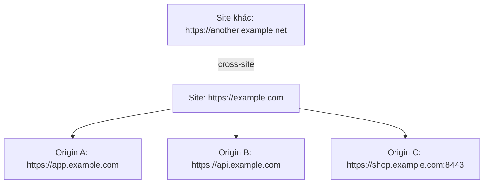

# Site là gì?

> **Chương:** Site và origin  
> **Học phần:** Application Security — Browser Security (`SECURITY_APPLICATION_SECURITY_BROWSER_SECURITY`)

Khi nói “hai trang cùng website”, chúng ta có thể đang nói về giao diện, tên miền, máy chủ hoặc cùng một doanh nghiệp. Nhưng trong **browser security**, **site** là một khái niệm kỹ thuật: trình duyệt dùng nó để xác định mối quan hệ *same-site* và *cross-site*, đặc biệt khi quyết định có gửi cookie `SameSite` hay không.

**Site không đồng nghĩa với origin.** Hiểu sự khác nhau này là điều kiện cần để phân tích ranh giới giữa trình duyệt, cookie và ứng dụng web; đọc đúng hành vi của Same-Origin Policy (SOP), CORS, các cơ chế cách ly; và đánh giá khả năng phòng vệ XSS, CSRF, clickjacking bằng CSP, Trusted Types, security headers cùng kiểm chứng thực tế.

## 1. Mục tiêu học tập

Sau bài này, bạn có thể:

1. Xác định *site* của một URL HTTP(S) dựa trên **scheme** và **registrable domain**.
2. Phân biệt **public suffix**, **registrable domain**, **host**, **origin** và **site**.
3. Kết luận chính xác hai URL là *same-site/cross-site* và *same-origin/cross-origin* trong các tình huống phổ biến.
4. Giải thích vì sao hai subdomain có thể **same-site nhưng cross-origin**.
5. Nêu tác động của site tới `SameSite` cookie và CSRF, đồng thời xác định phần việc mà SOP, CORS và server vẫn phải đảm nhận.
6. Kiểm chứng phân loại origin/site và các request bằng DevTools trên hệ thống thử nghiệm.

## 2. Định nghĩa site trong trình duyệt hiện đại

Với URL HTTP(S) có tên miền thông thường, có thể hình dung **schemeful site** như sau:

```text
site = scheme + registrable domain
```

Trong đó:

- **Scheme** là giao thức, thường là `http` hoặc `https`.
- **Registrable domain** là tên miền có thể đăng ký ngay dưới public suffix, thường gọi là *eTLD+1*.
- **Subdomain**, đường dẫn, query string, fragment và **port** không làm thay đổi site khi scheme và registrable domain vẫn giống nhau.

Ví dụ:

```text
URL:                 https://shop.example.com:8443/cart?item=1
scheme:              https
host:                shop.example.com
public suffix:       com
registrable domain:  example.com
site:                https://example.com
origin:              https://shop.example.com:8443
```

Trong mô hình **schemeful same-site**, `http://example.com` và `https://example.com` là **cross-site**, dù registrable domain giống nhau. Điều này quan trọng khi kiểm tra cookie trong luồng chuyển từ HTTP sang HTTPS. Các browser hiện đại sử dụng ranh giới có tính scheme này cho quy tắc SameSite; không nên dựa vào tài liệu cũ chỉ so tên miền.

**Lưu ý về ngoại lệ:** Với URL dùng địa chỉ IP hoặc tên host không có registrable domain theo Public Suffix List, phép xác định site dùng chính host theo quy tắc tương ứng. Origin opaque, tài liệu `data:`/sandbox và một số ngữ cảnh frame có thêm quy tắc riêng. Công thức trên là mô hình thực dụng cho các website HTTP(S) có tên miền bình thường, không phải thuật toán đầy đủ cho mọi URL có thể xuất hiện trong web platform.

## 3. Public suffix và registrable domain là gì?

Không thể xác định site an toàn bằng cách tùy tiện lấy **hai nhãn cuối của hostname**.

Xem hai ví dụ:

| Hostname | Public suffix | Registrable domain | Site trên HTTPS |
| --- | --- | --- | --- |
| `api.example.com` | `com` | `example.com` | `https://example.com` |
| `shop.example.co.uk` | `co.uk` | `example.co.uk` | `https://example.co.uk` |

Ở ví dụ thứ hai, chỉ lấy `co.uk` sẽ sai: `co.uk` là public suffix; những chủ sở hữu khác nhau có thể đăng ký `example.co.uk` và `another.co.uk`. Nếu coi cả hai là cùng site, ranh giới bảo mật sẽ bị xóa nhầm.

**Public Suffix List (PSL)** là nguồn quy tắc giúp các browser và thư viện nhận biết đâu là hậu tố công cộng, bao gồm một số hậu tố cho nền tảng lưu trữ nhiều website dưới các tên miền con. Chẳng hạn, `github.io` được ghi nhận như một public suffix trong các ngữ cảnh liên quan; `alice.github.io` và `bob.github.io` vì thế không mặc nhiên được xem là cùng site chỉ vì đều kết thúc bằng `github.io`.

```text
news.example.co.uk
│    │       └─ public suffix: co.uk
│    └───────── registrable domain: example.co.uk
└────────────── subdomain: news
```

Không nên tự triển khai cách tính registrable domain bằng `host.split('.').slice(-2)`: cách này sai với nhiều country-code suffix, private suffix và các quy tắc đặc biệt. Nếu hệ thống server thật sự cần phân tích public suffix, hãy dùng thư viện có dữ liệu PSL cập nhật và xác định rõ trường hợp nào cần *site* theo mô hình browser.

## 4. Site khác origin thế nào?

**Origin** dùng bộ ba `scheme + host + port`. Hai URL chỉ **same-origin** khi cả ba thành phần giống nhau, có xét cổng mặc định chuẩn của giao thức. Trong khi đó, **site** dùng scheme và registrable domain (với miền thông thường), không dùng port.

Lấy `https://app.example.com` làm mốc:

| URL được so sánh | Same-origin? | Same-site? | Lý do |
| --- | --- | --- | --- |
| `https://app.example.com/profile` | Có | Có | Chỉ khác path |
| `https://app.example.com:443/api` | Có | Có | `443` là cổng HTTPS mặc định |
| `https://app.example.com:8443` | Không | Có | Khác port |
| `https://api.example.com` | Không | Có | Khác subdomain; cùng scheme và registrable domain |
| `http://app.example.com` | Không | Không | Khác scheme |
| `https://app.example.net` | Không | Không | Khác registrable domain |
| `https://other.example.com` | Không | Có | Khác subdomain; cùng site |

Từ đó, có một quan hệ cần nhớ:

> **Same-origin ⇒ same-site** đối với URL HTTP(S) thông thường, nhưng **same-site ⇏ same-origin**.

Một sơ đồ đơn giản:



Cả A, B, C thuộc cùng một site; chúng vẫn là ba origin khác nhau. SOP bảo vệ theo origin, nên script của A không đương nhiên được đọc DOM hoặc response thuộc B chỉ vì chúng same-site.

## 5. So sánh nhiều trường hợp dễ nhầm

| URL thứ nhất | URL thứ hai | Quan hệ site | Quan hệ origin |
| --- | --- | --- | --- |
| `https://a.example.com` | `https://b.example.com` | Same-site | Cross-origin |
| `https://example.com` | `https://example.com:9443` | Same-site | Cross-origin |
| `http://example.com` | `https://example.com` | Cross-site | Cross-origin |
| `https://a.example.co.uk` | `https://b.example.co.uk` | Same-site | Cross-origin |
| `https://example.co.uk` | `https://another.co.uk` | Cross-site | Cross-origin |
| `https://alice.github.io` | `https://bob.github.io` | Cross-site theo PSL | Cross-origin |
| `http://localhost:3000` | `http://localhost:5173` | Same-site | Cross-origin |
| `http://localhost:3000` | `http://127.0.0.1:3000` | Khác site | Cross-origin |

**Với `localhost` và IP:** Đây là môi trường thử nghiệm có các quy tắc xử lý riêng cho host, nên cần kiểm tra trên đúng browser và URL thực tế. Không nên lấy kết luận từ `localhost` rồi suy rộng không điều kiện cho tên miền public.

## 6. Trình duyệt dùng khái niệm site để làm gì?

Các cơ chế web dùng những ranh giới khác nhau; không thể thay `origin` bằng `site` hoặc ngược lại.

| Cơ chế | Ranh giới liên quan | Mục đích chính |
| --- | --- | --- |
| **Same-Origin Policy (SOP)** | Chủ yếu là origin | Hạn chế script đọc DOM và dữ liệu từ origin khác |
| **CORS** | Origin | Cho server chỉ định origin nào được phép đọc response cross-origin qua API browser |
| **Cookie `SameSite`** | Quan hệ same-site/cross-site của request | Điều chỉnh khi nào cookie được gửi theo ngữ cảnh site |
| **Cookie `Domain` / host-only** | Host và phạm vi domain cookie | Xác định những host nào nhận cookie, độc lập với việc origin khác port |
| **Fetch Metadata: `Sec-Fetch-Site`** | `same-origin`, `same-site`, `cross-site`, `none` | Cho server thêm tín hiệu về ngữ cảnh phát sinh request |
| **CSP `frame-ancestors`** | Danh sách nguồn ancestor được phép nhúng | Hạn chế trang nào có thể đưa tài liệu vào frame để chống clickjacking |

CSP, Trusted Types và các security headers quan trọng với bảo mật ứng dụng, nhưng **không làm khái niệm site trở thành ranh giới phân quyền**. Một script khai thác XSS trong origin hợp lệ vẫn có thể thực hiện những hành vi mà tài khoản và ứng dụng cho phép; server phải xác thực, phân quyền và kiểm tra trạng thái nghiệp vụ.

## 7. Vì sao SameSite có chữ “site”?

Giả sử người dùng đã đăng nhập `https://bank.example.com`, server cấp cookie phiên:

```http
Set-Cookie: session=abc123; Path=/; Secure; HttpOnly; SameSite=Lax
```

Khi browser định gửi một request, nó xét nhiều điều kiện như phạm vi host/domain, path, scheme bảo mật, thời hạn và **ngữ cảnh same-site/cross-site** của request. `SameSite` giúp hạn chế việc cookie tự được gửi trong nhiều request có nguồn từ site khác, nhờ đó giảm một lớp rủi ro **Cross-Site Request Forgery (CSRF)**.

| Thuộc tính | Hành vi chính | Giới hạn quan trọng |
| --- | --- | --- |
| `SameSite=Strict` | Không gửi cookie với request cross-site | Có thể ảnh hưởng điều hướng từ website khác vào ứng dụng |
| `SameSite=Lax` | Cho gửi trong request same-site và một số top-level navigation cross-site dùng phương thức an toàn | Không chặn mọi tình huống cross-site; không thay thế biện pháp chống CSRF |
| `SameSite=None; Secure` | Cho phép cookie trong ngữ cảnh cross-site theo quy tắc thuộc tính | Chính sách chặn/partition cookie bên thứ ba của browser có thể tiếp tục giới hạn việc gửi |

**Phân biệt “Lax được khai báo rõ” và mặc định của browser:** Một số browser có cơ chế mặc định linh hoạt cho cookie không khai báo `SameSite`, đặc biệt ngay sau khi cookie được đặt. Không nên lấy hành vi của cookie thiếu thuộc tính làm bằng chứng rằng `SameSite=Lax` tường minh cho phép mọi request tương tự.

### Tình huống rất quan trọng: subdomain độc hại

Giả sử:

- Ứng dụng chính: `https://account.example.com`.
- Subdomain `https://blog.example.com` bị takeover hoặc tồn tại lỗ hổng cho kẻ tấn công đưa nội dung lên.
- Browser coi hai URL này **same-site**, dù chúng **cross-origin**.

Một request được khởi tạo từ subdomain bị xâm nhập tới ứng dụng chính có thể có ngữ cảnh **same-site**. Cookie `SameSite=Strict` hoặc `Lax` không nên được xem là lớp phòng vệ đầy đủ với mối đe dọa này. Request có được gửi kèm cookie hay không vẫn tùy **phạm vi cookie**, chế độ credentials và loại request; nhưng **phân loại same-site** tự nó không chặn.

Vì vậy, các thao tác nhạy cảm vẫn cần **CSRF token phù hợp**, kiểm tra `Origin`/`Referer` hoặc biện pháp tương đương, đồng thời xác thực và phân quyền trên server. Nếu policy chỉ kiểm tra “đến từ cùng site” mà mặc nhiên tin mọi subdomain, một subdomain bị xâm nhập có thể vượt qua giả định tin cậy đó.

## 8. Cookie host-only và cookie chia sẻ domain

**SameSite** trả lời một phần câu hỏi “request có ngữ cảnh same-site hay cross-site?”, còn **`Domain`** trả lời “cookie có thuộc host đích hay không?”. Hai điều kiện này **độc lập** và phải đồng thời thỏa cùng các điều kiện cookie khác.

```http
# Cookie host-only: chỉ gửi tới host đã đặt cookie
Set-Cookie: sid=...; Path=/; Secure; HttpOnly; SameSite=Lax

# Cookie có phạm vi domain: có thể gửi tới các subdomain phù hợp
Set-Cookie: sid=...; Domain=example.com; Path=/; Secure; HttpOnly; SameSite=Lax
```

Với cookie đặt từ `account.example.com`:

- **Không có `Domain`**: cookie là *host-only*, không tự chia sẻ tới `blog.example.com` chỉ vì hai host same-site.
- **`Domain=example.com`**: cookie có phạm vi rộng hơn, có thể được gửi tới các subdomain phù hợp; trong thiết kế xác thực, điều này làm tăng phạm vi cần bảo vệ và rủi ro từ subdomain không đáng tin cậy.
- **Port không tạo ranh giới cookie**: một host có thể dùng nhiều port; không thể coi `:3000` và `:4000` là hai kho cookie độc lập chỉ vì chúng cross-origin.
- **`HttpOnly`** chặn JavaScript truy cập trực tiếp cookie qua `document.cookie`; nó không chặn request dùng cookie theo quy tắc browser.

Cookie phiên quan trọng thường nên giới hạn phạm vi tới host thực sự cần sử dụng. Nếu phù hợp, có thể dùng tiền tố `__Host-`:

```http
Set-Cookie: __Host-session=...; Path=/; Secure; HttpOnly; SameSite=Lax
```

Cookie mang prefix `__Host-` phải được đặt từ ngữ cảnh bảo mật, có `Secure`, `Path=/` và **không có `Domain`** trong các browser hỗ trợ quy tắc prefix này. Nó giúp giảm rủi ro chia sẻ/ghi đè cookie giữa subdomain, nhưng vẫn **không thay thế kiểm tra phiên, phân quyền hoặc chống CSRF**.

## 9. Một frontend và một API cùng site nhưng khác origin

Mô hình phổ biến:

```text
Frontend:  https://app.example.com
API:       https://api.example.com
```

Hai host **same-site**, vì đều là `https://example.com`. Nhưng chúng **cross-origin**, vì host khác nhau. Khi JavaScript của frontend gọi API bằng `fetch`, **SOP/CORS vẫn áp dụng**.

```js
const response = await fetch("https://api.example.com/profile", {
  credentials: "include",
});

if (!response.ok) throw new Error("API request failed");
const profile = await response.json();
```

Nếu server chủ động cho frontend đọc response credentialed, response CORS có thể cần:

```http
Access-Control-Allow-Origin: https://app.example.com
Access-Control-Allow-Credentials: true
Vary: Origin
```

Browser chỉ cho JavaScript đọc response khi điều kiện CORS được thỏa. Với request cross-origin có credentials, không thể dùng `Access-Control-Allow-Origin: *` để cấp quyền đọc response có credentials. Nếu API nhận nhiều origin trong allowlist, server cần so khớp origin chính xác theo chính sách đã kiểm duyệt; không phản chiếu tùy tiện mọi giá trị `Origin`.

**Ba câu hỏi phải kiểm tra độc lập:**

1. **Cookie có được gửi?** Kiểm tra `Domain`/host-only, `Path`, `Secure`, `SameSite`, chế độ `credentials` và chính sách cookie của browser.
2. **JavaScript có đọc được response?** Kiểm tra SOP và các response header CORS.
3. **Request có quyền truy cập dữ liệu?** Kiểm tra xác thực và phân quyền ở **server**.

Một response bị browser chặn đọc do CORS **không chứng minh request chưa đến server**. Những request không cần preflight có thể đã được gửi rồi mới bị browser ngăn JavaScript đọc kết quả. CORS cũng không chặn client tùy ý như `curl`. Khái niệm same-site không thay đổi trách nhiệm bảo vệ API của server.

## 10. Site và ngữ cảnh người dùng đang duyệt trang

Trong tình huống phổ biến, browser xác định request có same-site hay không dựa trên **site của ngữ cảnh đã khởi tạo request** so với site của URL đích; đối với cookie, khái niệm *site for cookies* còn liên quan đến tài liệu ở top-level và chuỗi frame tổ tiên.

Xem các tình huống:

| Trang/nguồn khởi tạo | Đích đến | Nhận xét |
| --- | --- | --- |
| `https://app.example.com` | `https://api.example.com` | Thông thường same-site, cross-origin |
| `https://evil.test` | `https://api.example.com` | Cross-site |
| `http://app.example.com` | `https://api.example.com` | Cross-site do khác scheme |
| Trang iframe cùng domain bị nhúng từ site khác | Request từ iframe tới domain của nó | Cần xét thêm ngữ cảnh top-level/ancestor, không chỉ so hai URL |

Do đó, không nên tự viết một hàm chỉ so registrable domain của `document.location` và URL API rồi tuyên bố đã tính đúng mọi quy tắc `SameSite` của browser. Mô hình hai URL rất hữu ích để học khái niệm; quyết định cookie thực tế còn phụ thuộc cấu trúc nhúng, loại điều hướng, thuộc tính cookie và phiên bản browser.

Header **`Sec-Fetch-Site`** có thể cung cấp thêm tín hiệu trên request, ví dụ:

```http
Sec-Fetch-Site: same-site
```

Các giá trị thường gặp gồm `same-origin`, `same-site`, `cross-site` và `none` (một số điều hướng do người dùng khởi tạo). Server có thể dùng tín hiệu này để **phòng vệ bổ sung** đối với request thay đổi trạng thái hoặc tải tài nguyên nhạy cảm. Không suy ra rằng `Sec-Fetch-Site: same-site` đồng nghĩa request đáng tin hoặc người dùng đã được xác thực.

## 11. Site có phải là ranh giới tin cậy không?

Site là **ranh giới chính sách trong browser**, không phải nhóm máy chủ hoặc subdomain mà ứng dụng có thể mặc nhiên tin tưởng hoàn toàn.

Trong một tổ chức có thể có nhiều chủ thể quản lý:

```text
https://accounts.example.com  → hệ thống xác thực
https://help.example.com      → dịch vụ hỗ trợ bên thứ ba
https://blog.example.com      → CMS của nhóm nội dung
https://legacy.example.com    → ứng dụng cũ
```

Các host này có thể cùng site, nhưng **không đồng nghĩa cùng mức độ tin cậy**. Một dịch vụ bên thứ ba quản lý subdomain, CMS dễ bị XSS, hoặc subdomain trỏ tới dịch vụ đã hết hạn có thể gây ra rủi ro như subdomain takeover và khai thác các giả định về SameSite, cookie scope hoặc allowlist.

Thiết kế an toàn cần:

- Giới hạn cookie xác thực theo host khi có thể; tránh dùng `Domain=example.com` chỉ vì các nhóm dịch vụ muốn “chia sẻ đăng nhập” mà chưa đánh giá tác động.
- Kiểm tra `Origin` cụ thể và phân quyền theo từng endpoint; không tin tất cả request chỉ vì có cùng eTLD+1.
- Dùng CSP, cơ chế chống XSS và Trusted Types (khi hỗ trợ) để giảm nguy cơ script không tin cậy chạy trên origin nhạy cảm.
- Dùng `frame-ancestors` và các chính sách nhúng thích hợp với clickjacking; quy tắc nhúng khác với quan hệ same-site.
- Giữ CSRF token/cơ chế chống CSRF phù hợp với ứng dụng dùng cookie phiên, kể cả khi đã cấu hình `SameSite`.

Đối với các nội dung không đáng tin cậy, việc chuyển chúng sang **registrable domain riêng** đôi khi giúp tạo ranh giới site rõ hơn; nhưng quyết định này vẫn cần xem xét xác thực, tích hợp, CSP, CORS và luồng người dùng thực tế.

## 12. Thực hành kiểm chứng bằng trình duyệt

Thực hiện trên môi trường local hoặc domain thử nghiệm mà bạn được quyền quản lý. Mục tiêu là **quan sát bằng chứng**, không dựa vào cảm giác “cùng website”.

### Bài thực hành A — Xác định origin từ URL

Mở DevTools → Console tại một trang thử nghiệm:

```js
const urls = [
  "https://app.example.com/profile",
  "https://app.example.com:8443/cart",
  "https://api.example.com/users",
  "http://app.example.com/",
];

console.table(urls.map((input) => ({
  url: input,
  origin: new URL(input).origin,
  host: new URL(input).host,
  hostname: new URL(input).hostname,
})));
```

**Quan sát:** `.origin` phản ánh scheme, hostname và port (port mặc định được chuẩn hóa). Không có thuộc tính chuẩn `.site` trên `URL`. Hãy tự lập thêm cột `site` theo kiến thức về PSL và schemeful site; **đừng** giả lập bằng cách lấy hai nhãn cuối hostname.

### Bài thực hành B — Same-site có tránh được CORS không?

1. Dùng hai hostname thử nghiệm `app.example.test` và `api.example.test` trỏ tới server bạn kiểm soát, cùng phục vụ qua HTTPS.
2. Từ trang ở `app.example.test`, gọi `fetch` tới API ở `api.example.test`.
3. Ban đầu không trả header CORS; xem Console và Network.
4. Thêm response CORS chỉ cho `https://app.example.test`, thử lại.

**Kỳ vọng:** Hai host cùng site nhưng khác origin, nên browser vẫn kiểm tra CORS trước khi cho JavaScript đọc response. Nếu endpoint trả nội dung không có xác thực, hãy thử gọi bằng client HTTP độc lập để thấy giới hạn của CORS. Cần triển khai certificate, DNS/hosts và server thử nghiệm phù hợp với môi trường; không dùng domain trên để gửi thông tin thật.

### Bài thực hành C — So sánh site và phạm vi cookie

Trên các subdomain lab đã kiểm soát, tạo hai cookie khác nhau: một cookie **host-only** và một cookie có `Domain` chung. Đặt `Secure; HttpOnly; SameSite=Lax`, sau đó quan sát **DevTools → Application/Storage → Cookies** và **Network → Request Headers/Cookies** khi gửi request tới host đích.

**Kỳ vọng:** Cùng site không bảo đảm mọi host nhận mọi cookie. Việc browser có gửi cookie phụ thuộc vào **host/domain** của cookie và các điều kiện còn lại. Nếu endpoint là cross-origin, `fetch` còn cần chế độ `credentials` phù hợp.

### Bài thực hành D — Request cross-site và SameSite

Từ một site thử nghiệm khác, điều hướng hoặc gửi form tới endpoint lab dùng cookie `SameSite=Lax`; so sánh request điều hướng top-level qua GET với request POST thay đổi trạng thái. Kiểm tra **cookie thực tế được đính kèm trong Network**, không chỉ xem request thành công hay thất bại.

**Kỳ vọng:** SameSite hạn chế cookie theo ngữ cảnh; sự hiện diện của CORS error không đủ kết luận request đã bị chặn. Endpoint nhạy cảm vẫn phải kiểm tra CSRF token/quy tắc nguồn và xác thực, phân quyền.

### Bài thực hành E — Đọc Fetch Metadata

Trên server lab, ghi lại giá trị `Sec-Fetch-Site` của các request từ cùng origin, khác subdomain cùng site và một site hoàn toàn khác. So sánh với bảng ở mục 4, đồng thời kiểm tra các request điều hướng trực tiếp.

**Kỳ vọng:** Giá trị header giúp quan sát ngữ cảnh mà browser phân loại; request `same-site` vẫn có thể cần từ chối nếu thiếu quyền hoặc CSRF token.

## 13. Các lỗi tư duy thường gặp

| Nhận định sai | Hiểu đúng |
| --- | --- |
| “Hai trang cùng `example.com` nghĩa là same-origin.” | Subdomain hoặc port khác là **cross-origin**, dù có thể same-site. |
| “`http://example.com` và `https://example.com` cùng site.” | Trong mô hình **schemeful same-site**, chúng khác site do scheme. |
| “Chỉ cần hai nhãn cuối để tìm site.” | Phải xét **Public Suffix List**; `example.co.uk` là một registrable domain. |
| “Có `SameSite=Strict` là chống được mọi CSRF.” | SameSite không thay thế CSRF token/kiểm tra nguồn; các subdomain cùng site có thể là mối đe dọa. |
| “Same-site thì `fetch` không cần CORS.” | CORS kiểm tra **origin**, không phải site. |
| “CORS chặn đọc response thì server an toàn.” | Request có thể vẫn tới server; server phải tự xác thực và phân quyền. |
| “`Domain=example.com` và không có `Domain` giống nhau.” | Một cookie được chia sẻ cho domain/subdomain phù hợp; cookie host-only gắn với host phát hành. |

## 14. Câu hỏi tự kiểm tra

1. Xác định site và origin của `https://pay.shop.example.co.uk:8443/order/17`. Vì sao cần biết `co.uk` là public suffix?
2. So sánh `https://app.example.com` với `https://api.example.com`: same-site hay same-origin? SOP/CORS còn áp dụng không?
3. Vì sao `http://example.com` và `https://example.com` là hai site khác nhau theo quy tắc schemeful?
4. Nếu cookie phiên chỉ có trên `accounts.example.com`, tại sao `shop.example.com` có thể không nhận cookie dù hai trang same-site?
5. Một subdomain bị takeover gây ảnh hưởng thế nào tới giả định “request same-site là đáng tin”?
6. `SameSite=Lax`, `HttpOnly` và CORS giải quyết ba vấn đề nào khác nhau?
7. Bạn cần xem ở đâu trong DevTools để phân biệt **request đã gửi**, **cookie đã đính kèm**, và **JavaScript được đọc response**?

## 15. Ghi nhớ

Trong browser security, **site** của một website HTTP(S) có tên miền thông thường được xác định từ **scheme + registrable domain**; **origin** được xác định từ **scheme + host + port**. Hai subdomain của cùng registrable domain có thể **same-site nhưng cross-origin**. Sự khác biệt này lý giải vì sao `SameSite` cookie, SOP và CORS điều chỉnh **những ranh giới khác nhau**.

Site là một đơn vị hữu ích để browser thực thi chính sách cookie, **không phải giấy bảo đảm các subdomain cùng tin cậy hoặc API đã an toàn**. Bảo vệ XSS, CSRF, clickjacking và dữ liệu ứng dụng cần kết hợp chính sách browser với thiết kế an toàn ở client và kiểm tra quyền thực tế trên server.
