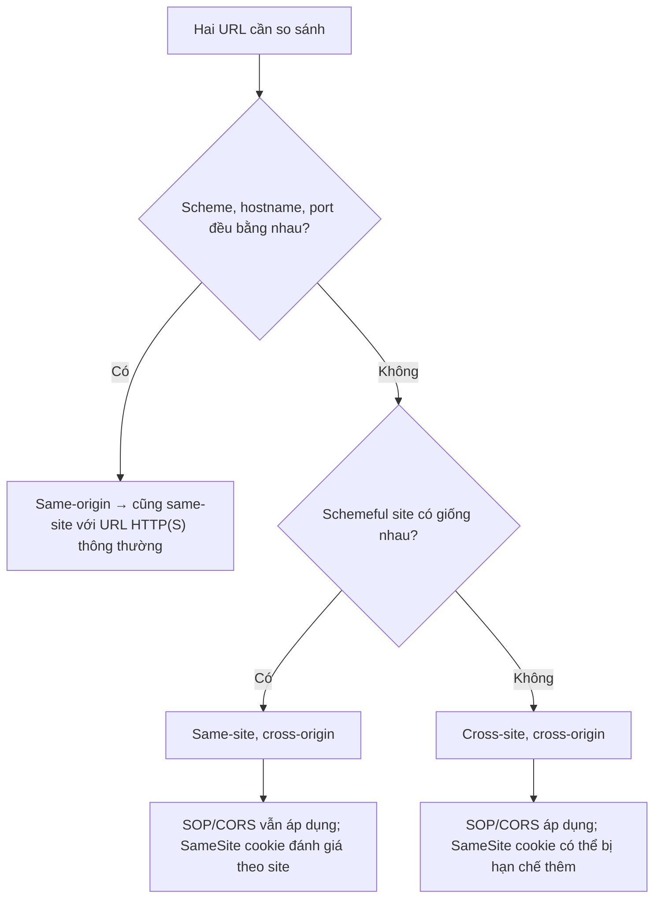
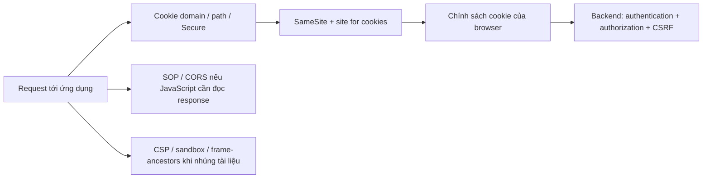

# Same-site: ranh giới site trong bảo mật trình duyệt

> **Chương:** Site và origin  
> **Chủ đề:** Same-site  
> **Module:** `SECURITY_APPLICATION_SECURITY_BROWSER_SECURITY` — phân tích ranh giới bảo mật giữa trình duyệt, origin, cookie và ứng dụng web để hiểu Same-Origin Policy, CORS và các cơ chế cách ly; thực hành phòng vệ XSS, CSRF, clickjacking bằng CSP, Trusted Types, security headers và kiểm chứng hành vi thực tế.

## Mục tiêu học tập

Sau bài này, bạn có thể:

1. Định nghĩa **site**, **schemeful site**, **same-site** và **cross-site**, phân biệt chúng với **same-origin** và **cross-origin**.
2. Xác định quan hệ site của hai URL từ scheme, hostname và **registrable domain** dựa trên Public Suffix List (PSL).
3. Phân tích browser có thể gửi cookie `SameSite=Strict`, `Lax` hoặc `None` khi nào, kể cả request từ iframe, `fetch` và điều hướng top-level.
4. Giải thích vì sao cùng site nhưng khác origin vẫn chịu **Same-Origin Policy** và **CORS**, và vì sao `SameSite` không thay thế chống **CSRF**.
5. Dùng Developer Tools và một thí nghiệm localhost để quan sát sự khác biệt giữa request **same-origin**, **same-site/cross-origin** và **cross-site**.

## 1. Same-site nghĩa là gì?

Trong ngữ cảnh bảo mật web, **site** là phạm vi quan hệ giữa các trang mà browser dùng trong nhiều cơ chế, đặc biệt là cookie `SameSite` và metadata `Sec-Fetch-Site`. Với URL HTTP(S), khái niệm phổ biến hiện nay là **schemeful site**: tổ hợp của **scheme** (`http` hoặc `https`) và **registrable domain** (thường gọi eTLD+1).

Hai URL là **same-site** khi chúng có cùng schemeful site; ngược lại là **cross-site**. Đây là một ranh giới khác với origin:

- **Origin** gồm **scheme + hostname + port**: `https://shop.example.test:443`.
- **Site** đối với hostname thông thường gồm **scheme + registrable domain**: `https://example.test`.
- Port và subdomain không làm thay đổi site nếu scheme và registrable domain giữ nguyên.
- Scheme thay đổi từ `http` sang `https` sẽ thay đổi **schemeful site**, kể cả khi hostname giống nhau.

Ví dụ, trang `https://shop.example.test` gọi API `https://api.example.test` là **same-site nhưng cross-origin**. Trình duyệt có thể coi request đó là cùng site đối với `SameSite` cookie, nhưng JavaScript vẫn cần tuân theo **SOP/CORS** khi đọc response của API.

> **Định nghĩa cốt lõi:** *Same-site* mô tả quan hệ giữa các **site**; *same-origin* mô tả quan hệ giữa các **origin**. Cùng site **không** trao quyền đọc DOM hoặc HTTP response xuyên origin.

## 2. Cách browser xác định site

### 2.1. Schemeful site

Với một URL HTTPS có hostname thông thường, ta có thể hình dung:

```text
https://login.accounts.example.co.uk:8443/profile
│       │                           │
│       └─ Hostname                 └─ Port và path không nằm trong site
└─ Scheme

Origin        = (https, login.accounts.example.co.uk, 8443)
Schemeful site = (https, example.co.uk)
```

**Registrable domain** là nhãn đứng ngay trước public suffix cộng với public suffix. Browser xác định public suffix theo **Public Suffix List**, không đơn giản bằng cách lấy hai nhãn cuối hostname:

- Với `www.example.com`: public suffix thường là `com`, registrable domain là `example.com`.
- Với `login.example.co.uk`: public suffix là `co.uk`, registrable domain là `example.co.uk`.
- Với những nền tảng cho thuê tên miền dưới một public suffix được PSL ghi nhận, ví dụ `a.github.io` và `b.github.io`, hai subdomain được xem là **hai registrable domain khác nhau**, vì `github.io` là một public suffix trong PSL.

**Không** viết logic bảo mật bằng `hostname.split('.').slice(-2)`. Cách này sai với `co.uk` và nhiều đuôi miền trên PSL, đồng thời không xử lý đúng trường hợp IP, localhost hoặc public suffix đặc biệt.

### 2.2. Localhost, IP và opaque origin

Với địa chỉ không có registrable domain theo PSL, chẳng hạn `localhost` hoặc địa chỉ IP, thuật toán site sử dụng quy tắc phù hợp cho hostname đó. Trong bài lab:

- `http://localhost:3000` và `http://localhost:4000`: **same-site**, **cross-origin** (khác port).
- `http://localhost:3000` và `http://127.0.0.1:4000`: **cross-site** (khác hostname/site), dù cả hai cùng trỏ về máy cục bộ.
- `http://localhost:3000` và `https://localhost:3000`: **cross-site** do khác scheme, đồng thời khác origin.

Một số ngữ cảnh như tài liệu `data:`, iframe bị sandbox thành opaque origin hoặc scheme đặc biệt không khớp mô hình hostname HTTP(S) thông thường. Khi phân tích thực tế, cần xét cách browser tính **site for cookies** của ngữ cảnh khởi tạo, không chỉ so hai chuỗi URL.

### 2.3. Bảng phân biệt origin và site

Lấy `https://app.example.test` làm URL tham chiếu:

| URL đích | Same-origin? | Same-site? | Lý do |
|---|---:|---:|---|
| `https://app.example.test/profile` | Có | Có | Cùng scheme, host và port |
| `https://app.example.test:443` | Có | Có | Port 443 là mặc định của HTTPS |
| `https://app.example.test:8443` | Không | Có | Port khác, site không phụ thuộc port |
| `https://api.example.test` | Không | Có | Subdomain khác nhưng cùng registrable domain và scheme |
| `http://app.example.test` | Không | Không | Khác scheme theo quy tắc schemeful site |
| `https://app.other.test` | Không | Không | Registrable domain khác |
| `https://app.example.test.evil.test` | Không | Không | Host thuộc `evil.test`, không phải `example.test` |

Điều quan trọng không phải URL nhìn có vẻ cùng thương hiệu hay cùng máy chủ, mà là **origin/site được browser tính ra**.

## 3. Ba phạm vi dễ bị đánh đồng



| Ranh giới | Thành phần chính | Cơ chế tiêu biểu | Điều không được suy ra |
|---|---|---|---|
| **Origin** | Scheme + host + port | Same-Origin Policy, DOM isolation, CORS | Một request khác origin không phải lúc nào cũng cross-site |
| **Site** | Scheme + registrable domain (các ngoại lệ theo loại host) | Cookie `SameSite`, `Sec-Fetch-Site` | Same-site không cấp quyền đọc DOM/API cross-origin |
| **Cookie scope** | Domain/host-only, Path, Secure và thuộc tính khác | Có gửi cookie tới một URL không | Cookie cùng site không có nghĩa cookie được chia sẻ giữa mọi subdomain |

Ví dụ, cookie **host-only** do `shop.example.test` đặt sẽ không tự động được gửi đến `api.example.test` chỉ vì hai URL same-site. Việc gửi cookie cần đồng thời thỏa điều kiện **host/domain, path, scheme/`Secure`, thời hạn, SameSite và chính sách trình duyệt**.

Một cookie đặt `Domain=example.test` có thể được gửi đến các subdomain đáp ứng điều kiện, nhưng phạm vi Domain **không** cho phép script của subdomain này đọc DOM của subdomain khác. Cũng không nên dùng Domain rộng cho session nếu không cần; cookie `__Host-` giúp ép cookie gắn với host, có `Secure`, `Path=/` và không có `Domain`.

## 4. Same-site tác động thế nào đến cookie?

### 4.1. Cookie được gửi khi thỏa nhiều điều kiện

Một máy chủ có thể trả:

```http
Set-Cookie: __Host-session=<token-ngau-nhien>; Path=/; Secure; HttpOnly; SameSite=Lax
```

Trình duyệt chỉ xem xét gửi cookie đó nếu request thỏa các điều kiện phạm vi và chính sách. Trong đó:

- `Secure` yêu cầu kênh được browser coi là bảo mật; `HttpOnly` ngăn JavaScript đọc cookie qua `document.cookie`.
- `Path=/` áp dụng cookie trên toàn bộ đường dẫn host. Không có `Domain` là **host-only**, nên không tự gửi tới các sibling subdomain.
- `SameSite` hạn chế **điều kiện ngữ cảnh same-site/cross-site** khi cookie được đính vào request.

Vì vậy, `SameSite` **không** định nghĩa cookie thuộc host nào; `Domain`/host-only cũng **không** quyết định một request đang trong ngữ cảnh same-site hay cross-site.

### 4.2. Strict, Lax, None

| Thuộc tính | Request same-site phù hợp cookie scope | Request cross-site từ iframe/fetch | Điều hướng top-level cross-site GET |
|---|---|---|---|
| `SameSite=Strict` | Có thể gửi | Không gửi | Không gửi |
| `SameSite=Lax` | Có thể gửi | Thường không gửi | Thường gửi nếu là điều hướng top-level với phương thức an toàn |
| `SameSite=None; Secure` | Có thể gửi | Có thể gửi nếu browser chấp nhận cookie bên thứ ba | Có thể gửi |

**Diễn giải chính xác:**

- **Strict**: giới hạn mạnh nhất với cross-site request. Có thể khiến người dùng từ một website khác theo link sang ứng dụng nhưng chưa mang session cookie ở request đầu tiên.
- **Lax**: giữ cookie trong nhiều request same-site và **một số** điều hướng top-level cross-site bằng phương thức an toàn như GET. Nó không có nghĩa mọi GET cross-site đều mang cookie: `fetch`, ảnh và iframe không phải điều hướng top-level.
- **None**: bỏ hạn chế SameSite, nhưng yêu cầu `Secure` và vẫn chịu cơ chế chặn/partition cookie bên thứ ba của browser. Không thể mặc định rằng một cookie `None` sẽ luôn đi kèm.

Nếu **không khai báo** `SameSite`, nhiều browser dùng mặc định gần với `Lax`. Một số browser có ngoại lệ giới hạn thời gian cho cookie vừa được tạo khi giá trị SameSite bị bỏ trống; không thiết kế CSRF protection dựa trên mặc định này. Hãy khai báo rõ giá trị phù hợp với luồng sản phẩm.

### 4.3. Bối cảnh request quyết định trạng thái same-site

Không đủ để nói “URL A và B cùng site” khi phân tích một request. Browser còn xét **site for cookies** của ngữ cảnh khởi tạo:

1. **Tài liệu top-level** (trang chính trong tab) có site để so với đích request.
2. **Iframe lồng nhau** có thể được xem là có ngữ cảnh cross-site nếu một ancestor thuộc site khác. Một iframe ở cùng site với tài nguyên nó gọi chưa chắc được đối xử như một trang top-level cùng site khi nó nằm dưới một trang cross-site.
3. **Redirect**, điều hướng, loại request và phương thức có thể ảnh hưởng điều kiện cookie. Không chỉ nhìn URL cuối hoặc thuộc tính `SameSite`.
4. Chính sách quyền riêng tư của từng browser có thể chặn hoặc phân vùng cookie của bên thứ ba ngay cả khi `SameSite=None`.

Ví dụ, khi `https://portal.other.test` nhúng iframe `https://pay.example.test`, iframe đang sống trong cây tài liệu có ancestor cross-site. Hãy kiểm tra Network thực tế thay vì mặc định mọi request từ iframe tới `https://api.example.test` đều được xử lý là same-site.

## 5. Ví dụ thực tế về các luồng request

Giả sử người dùng đang đăng nhập ở `https://account.example.test` và server đặt session cookie host-only với `SameSite=Lax`.

| Tình huống | Quan hệ site của ngữ cảnh | Điều cần kiểm tra |
|---|---|---|
| Mã của chính `account.example.test` gọi `/api/me` | Same-origin và same-site | Cookie có thể gửi nếu khớp scope; không cần CORS |
| Mã ở `shop.example.test` gửi form POST đến `account.example.test` | Same-site nhưng cross-origin | `SameSite=Lax` **không tự chặn**; cần CSRF protection |
| Mã ở `shop.example.test` gọi `fetch('https://account.example.test/api')` | Same-site nhưng cross-origin | Cookie có thể đủ điều kiện, nhưng CORS và `credentials` vẫn quyết định có gửi/đọc được dữ liệu |
| Mã ở `evil.test` gửi form POST tới `account.example.test` | Cross-site | Cookie Lax/Strict thường không đi kèm; server vẫn cần chống CSRF |
| Người dùng nhấp link GET từ `evil.test` sang `account.example.test` | Điều hướng top-level cross-site | Cookie Lax thường có thể đi kèm, Strict không; GET không được dùng để thay đổi trạng thái |
| `evil.test` nhúng iframe `account.example.test` | Cross-site trong iframe | Cookie Lax/Strict thường không gửi; trang đích có thể cấm nhúng bằng CSP |

Với `fetch`, trang cũng phải đặt `credentials: 'include'` khi muốn gửi cookie tới **origin khác**, kể cả khi same-site:

```js
// Script chạy tại https://shop.example.test
const response = await fetch('https://account.example.test/api/profile', {
  credentials: 'include',
});
```

Sau đó, để JavaScript **đọc response**, API phải cho phép origin gọi bằng CORS có credentials:

```http
Access-Control-Allow-Origin: https://shop.example.test
Access-Control-Allow-Credentials: true
Vary: Origin
```

Header `Access-Control-Allow-Origin: *` không cho phép browser đọc response khi credentials được bao gồm. CORS **không sửa** `SameSite` và không mở phạm vi cookie; ngược lại `SameSite` không cấp quyền CORS.

## 6. Same-site không đồng nghĩa cùng mức độ tin cậy

### 6.1. Nguy cơ CSRF từ sibling subdomain

Giả sử ứng dụng chính chạy ở `https://bank.example.test`, còn `https://marketing.example.test` cho đối tác tải nội dung chưa được kiểm soát. Cả hai có cùng schemeful site `https://example.test` nhưng **khác origin**.

Nếu attacker kiểm soát nội dung ở `marketing.example.test`, họ có thể tạo form gửi POST tới `bank.example.test/transfer`:

```html
<!-- Ví dụ mô tả cơ chế CSRF trong môi trường học tập. -->
<form action="https://bank.example.test/change-preference" method="POST">
  <input type="hidden" name="value" value="attacker-chosen">
  <button type="submit">Tiếp tục</button>
</form>
```

Nếu người dùng đã đăng nhập `bank.example.test`, cookie của **bank** vẫn có thể được browser đính vào request, **kể cả khi cookie có `SameSite=Strict`**, vì request xuất phát từ bối cảnh same-site. `HttpOnly` cũng không ngăn browser đính cookie tự động.

Điều đó không cấp cho script trên marketing quyền đọc DOM ngân hàng, nhưng là rủi ro với endpoint thay đổi trạng thái nếu server thiếu kiểm soát. Biện pháp phòng vệ:

1. Yêu cầu **CSRF token** được ràng buộc với phiên hoặc cơ chế tương đương đã thiết kế đúng; áp dụng cho mọi thao tác thay đổi trạng thái dùng cookie.
2. Kiểm tra `Origin` của request so với origin được phép; cân nhắc `Referer` làm tín hiệu phụ và Fetch Metadata (`Sec-Fetch-Site`, `Sec-Fetch-Mode`, `Sec-Fetch-Dest`) như lớp bổ sung.
3. Duy trì xác thực, phân quyền trên từng thao tác; không dùng GET cho thay đổi trạng thái; cân nhắc xác nhận lại với hành động nhạy cảm.
4. Tách nội dung không tin cậy sang **site** riêng khi cần ranh giới mạnh hơn; hạn chế cookie `Domain` quá rộng và kiểm soát subdomain bị takeover.

### 6.2. Vì sao kiểm tra mỗi `Sec-Fetch-Site: same-site` là chưa đủ?

Browser hiện đại có thể gửi header Fetch Metadata mô tả quan hệ request:

```http
Sec-Fetch-Site: same-origin
```

Các giá trị thường gặp:

| Giá trị `Sec-Fetch-Site` | Ý nghĩa khái quát |
|---|---|
| `same-origin` | Request từ ngữ cảnh cùng origin |
| `same-site` | Request từ ngữ cảnh cùng site nhưng không cùng origin |
| `cross-site` | Request từ ngữ cảnh khác site |
| `none` | Một số request do người dùng trực tiếp khởi tạo, không có site khởi tạo theo cách thông thường |

Một chính sách chặn `cross-site` có thể giúp giảm nhiều tấn công, nhưng sẽ **không chặn** nguồn same-site như sibling subdomain không đáng tin. Với endpoint nhạy cảm, cần đánh giá liệu có nên yêu cầu `same-origin` hoặc CSRF token và kiểm tra `Origin` cụ thể.

Không mọi client đều gửi Fetch Metadata; một HTTP client ngoài browser có thể tự tạo header. Header này là **tín hiệu hỗ trợ của browser**, không phải bằng chứng xác thực hoặc phân quyền của người dùng.

### 6.3. Same-site với XSS và clickjacking

- **XSS** là script không đáng tin chạy trong origin của ứng dụng bị ảnh hưởng. SOP và SameSite không ngăn mã XSS đã chạy trong origin đó sử dụng DOM hoặc gửi request với phiên hiện tại. Dùng output encoding theo ngữ cảnh, sanitizer khi cần HTML, CSP và Trusted Types tại DOM sink được hỗ trợ.
- **Clickjacking** liên quan việc nhúng trang trong iframe để lừa thao tác. Dù iframe khác origin và script tấn công không đọc DOM bên trong, giao diện vẫn có thể bị lạm dụng. Dùng `Content-Security-Policy: frame-ancestors 'none'` hoặc allowlist cụ thể; `X-Frame-Options` làm lớp tương thích.
- **CORS** kiểm soát việc script đọc response cross-origin. Nó không khiến sibling subdomain có quyền truy cập DOM ứng dụng chính, cũng không thay CSRF token.

## 7. Liên hệ Same-site với các lớp bảo vệ khác



Các lớp trên giải quyết những câu hỏi **khác nhau**. Việc cookie đã được gửi không suy ra server nên chấp nhận thao tác; việc CORS từ chối JavaScript đọc response cũng không chắc server chưa nhận request.

| Cơ chế | Bảo vệ chính | Không thay thế |
|---|---|---|
| Same-Origin Policy | DOM/JS isolation và giới hạn truy cập tài nguyên theo origin | SameSite cookie, CSRF token |
| CORS | Quyền JavaScript đọc HTTP response cross-origin | Authentication/authorization, CSRF |
| `SameSite` cookie | Hạn chế gửi cookie theo bối cảnh same-site/cross-site | CSRF đầy đủ, kiểm tra `Origin` |
| `HttpOnly` cookie | Ngăn JavaScript đọc trực tiếp cookie | Chống XSS hoặc request dùng session |
| CSP / Trusted Types | Giảm bề mặt XSS và thao tác DOM nguy hiểm | Làm sạch dữ liệu và kiểm tra nghiệp vụ |
| CSP `frame-ancestors` | Hạn chế trang nào được nhúng ứng dụng | SOP, xác thực |
| COOP/COEP và site isolation | Bổ sung ranh giới cửa sổ, tài nguyên và triển khai cách ly | Quyền DOM cross-origin hoặc bảo vệ CSRF |

## 8. Thực hành: quan sát same-site khác cross-origin

Thí nghiệm sử dụng Node.js và hai HTTP server trên máy cục bộ. Hai endpoint trên port 4000 là:

- `http://localhost:4000`: **same-site**, **cross-origin** với trang chính ở `http://localhost:3000`.
- `http://127.0.0.1:4000`: **cross-site**, **cross-origin** với trang chính, dù cùng máy.

Chúng ta dùng cookie `SameSite=Strict` và `Sec-Fetch-Site` để quan sát. Với thử nghiệm HTTP cục bộ, cookie cố tình **không có `Secure`** để hoạt động trên môi trường lab; **trong ứng dụng thật, luôn dùng HTTPS và cookie session có `Secure`**.

### 8.1. Tạo file `same-site-lab.cjs`

```js
const http = require('node:http');

function html(res, body) {
  res.writeHead(200, {
    'Content-Type': 'text/html; charset=utf-8',
    'Cache-Control': 'no-store',
  });
  res.end(body);
}

const app = `<!doctype html>
<html lang="vi">
<head><meta charset="utf-8"><title>Same-site lab</title></head>
<body>
  <h1>Same-site khác same-origin</h1>
  <p>Trước tiên đặt cookie ở cả hai host bằng link bên dưới.</p>
  <p>
    <a href="http://localhost:4000/set-cookie" target="_blank" rel="noopener">
      1. Đặt Strict cookie cho localhost
    </a>
  </p>
  <p>
    <a href="http://127.0.0.1:4000/set-cookie" target="_blank" rel="noopener">
      2. Đặt Strict cookie cho 127.0.0.1
    </a>
  </p>
  <button id="same">Gọi localhost:4000 (same-site)</button>
  <button id="cross">Gọi 127.0.0.1:4000 (cross-site)</button>
  <pre id="result"></pre>
  <p>Xem log server và tab Network để biết cookie nào đã được gửi.</p>
  <script>
    async function probe(url) {
      const result = document.querySelector('#result');
      result.textContent = 'Đang gửi request tới ' + url;
      try {
        // no-cors cho phép gửi request thử nghiệm, nhưng response là opaque:
        // script không được đọc nội dung API cross-origin.
        const response = await fetch(url, {
          mode: 'no-cors',
          credentials: 'include',
          cache: 'no-store',
        });
        result.textContent =
          'Đã hoàn tất yêu cầu thử nghiệm; response.type=' + response.type +
          '. Hãy đọc log server.';
      } catch (error) {
        result.textContent = 'Request lỗi: ' + error.message;
      }
    }
    document.querySelector('#same').onclick = () => {
      probe('http://localhost:4000/probe');
    };
    document.querySelector('#cross').onclick = () => {
      probe('http://127.0.0.1:4000/probe');
    };
  </script>
</body>
</html>`;

http.createServer((req, res) => {
  if (req.url === '/') return html(res, app);
  res.writeHead(404);
  res.end('Not found');
}).listen(3000, () => {
  console.log('App: http://localhost:3000');
});

http.createServer((req, res) => {
  if (req.url === '/set-cookie') {
    res.writeHead(200, {
      'Content-Type': 'text/plain; charset=utf-8',
      // Cookie demo, dùng HTTP local; không sử dụng cấu hình này trong production.
      'Set-Cookie': 'lab_strict=1; Path=/; HttpOnly; SameSite=Strict',
    });
    return res.end('Đã đặt cookie Strict cho host này. Quay lại tab app.');
  }
  if (req.url === '/probe') {
    const site = req.headers['sec-fetch-site'] || '(không có header)';
    const hasCookie = /(?:^|;\s*)lab_strict=1(?:;|$)/.test(
      req.headers.cookie || ''
    );
    console.log(
      'Host:', req.headers.host,
      '| Sec-Fetch-Site:', site,
      '| Có Strict cookie:', hasCookie
    );
    res.writeHead(200, {
      'Content-Type': 'text/plain; charset=utf-8',
      'Cache-Control': 'no-store',
    });
    return res.end('Xem log server');
  }
  res.writeHead(404);
  res.end('Not found');
}).listen(4000, () => {
  console.log('API: http://localhost:4000 và http://127.0.0.1:4000');
});
```

Chạy:

```sh
node same-site-lab.cjs
```

### 8.2. Thao tác trên trình duyệt

1. Mở `http://localhost:3000`. Nhấn lần lượt hai link **Đặt Strict cookie**; mỗi link mở một tab top-level tại đúng host đích. Khi thấy thông báo thành công, quay lại tab app. Hãy đảm bảo trước đó chưa có cookie cũ cùng tên; có thể dùng profile thử nghiệm riêng hoặc xóa cookie lab qua DevTools.
2. Mở **Developer Tools → Network**, giữ tab Console và xem terminal Node.js.
3. Nhấn nút **Gọi localhost:4000 (same-site)**. Quan sát request từ localhost port 3000 sang port 4000; đó là cross-origin nhưng same-site.
4. Nhấn nút **Gọi 127.0.0.1:4000 (cross-site)**. Đích dùng hostname khác; request cross-site với ứng dụng.
5. So sánh header `Sec-Fetch-Site` trong request và kết quả `Có Strict cookie` mà API in ra. Kết quả chính cần ghi nhận nằm ở **server log**, vì `fetch(..., { mode: 'no-cors' })` không cho JavaScript đọc nội dung response.

| Lượt gọi từ `http://localhost:3000` | Quan hệ | `Sec-Fetch-Site` thường thấy | Strict cookie trong điều kiện bình thường |
|---|---|---|---|
| `http://localhost:4000/probe` | Same-site, cross-origin | `same-site` | Có, nếu cookie cho host localhost đã được đặt |
| `http://127.0.0.1:4000/probe` | Cross-site, cross-origin | `cross-site` | Không, dù cookie cho 127.0.0.1 đã được đặt |

Browser có thể áp dụng thêm giới hạn quyền riêng tư hoặc chính sách mạng. Nếu kết quả khác dự kiến, hãy kiểm tra cookie đã được đặt dưới **đúng host**, request có đến server không, mục Cookies/Blocked Reason trong DevTools, cũng như header `Sec-Fetch-Site` được browser hỗ trợ. Không dựa duy nhất vào thông báo ở giao diện app.

**Điểm học được:** Cùng site không làm hai cổng trở thành một origin. Với `no-cors`, response đọc từ JavaScript vẫn là **opaque**. Tuy vậy, request same-site có thể mang cookie `Strict` và request cross-site thường không mang cookie này. Đây là **hai lớp chính sách độc lập**.

### 8.3. Bài tập mở rộng

1. Dự đoán điều gì xảy ra nếu cookie demo đổi từ `SameSite=Strict` sang `SameSite=Lax`. Trong thí nghiệm `fetch` cross-site, cookie Lax thường vẫn **không** được gửi; sau đó thử một điều hướng top-level GET cross-site để so sánh.
2. Thêm route `/probe` trên cổng 3000 và gọi bằng `fetch('/probe')`. Dự đoán `Sec-Fetch-Site` với request **same-origin**.
3. Thử gửi `POST` bằng HTML form từ `http://localhost:3000` tới `http://localhost:4000/probe` (sau khi thêm xử lý route tương ứng) và quan sát liệu Strict cookie của localhost có được đính kèm. Giải thích tại sao **SameSite không bảo vệ khỏi CSRF same-site**.
4. Đổi URL trang chính sang một host khác và suy luận lại site for cookies; kiểm tra bằng Network thay vì chỉ dựa trên hostname của API.

## 9. Phương pháp chẩn đoán lỗi SameSite thực tế

Khi ứng dụng đăng nhập xong nhưng request không kèm cookie, hoặc một flow iframe/OAuth gặp lỗi phiên:

1. **Xác định top-level site và ngữ cảnh request.** Có iframe cross-site hoặc ancestor cross-site nào không? Request là `fetch`, form, ảnh hay điều hướng top-level?
2. **Tính origin và schemeful site riêng biệt.** Ghi scheme, hostname, port, registrable domain; tra PSL khi có `co.uk` hay public suffix của nền tảng hosting.
3. **Kiểm tra cookie scope trước.** Host-only hay `Domain`? `Path` có khớp? Cookie hết hạn chưa? Có `Secure`, `HttpOnly`, tên prefix và partition key đặc biệt nào không?
4. **Kiểm tra `SameSite` và chính sách cookie bên thứ ba.** `Strict`/`Lax` thường không gửi trong subresource/fetch cross-site; `None; Secure` vẫn có thể bị chặn.
5. **Kiểm tra `fetch credentials` và CORS.** Same-site nhưng khác origin vẫn cần `credentials: 'include'` nếu script chủ động muốn gửi cookie qua `fetch`; để đọc response có credentials cần cấu hình CORS phù hợp.
6. **Quan sát DevTools và server log.** So sánh request `Origin`, `Sec-Fetch-Site`, `Cookie`, reason bị chặn cookie, preflight nếu có và response thực tế.
7. **Đánh giá bảo mật server.** Một request có cookie hợp lệ có thể là CSRF; server phải kiểm tra token/Origin, authentication và authorization đúng mục đích.

### Những nhầm lẫn cần tránh

| Nhận định sai | Cách hiểu đúng |
|---|---|
| “Same-site là chung một hostname.” | Subdomain và port có thể khác nhưng vẫn same-site |
| “Chỉ cần lấy hai nhãn cuối domain.” | Phải dùng PSL/registrable domain; `example.co.uk` là ví dụ điển hình |
| “Same-site tức là same-origin, không cần CORS.” | Same-site khác origin vẫn chịu SOP/CORS |
| “Có `SameSite=Strict` là miễn nhiễm CSRF.” | Request từ sibling subdomain same-site vẫn có thể mang cookie |
| “Cookie của `app.example.test` tự động gửi sang `api.example.test`.” | Cần khớp host-only/Domain và các thuộc tính khác |
| “`SameSite=None` bảo đảm cookie bên thứ ba được gửi.” | Browser có thể chặn hoặc phân vùng cookie bên thứ ba |
| “`Lax` được gửi với mọi GET cross-site.” | Chủ yếu cho một số **điều hướng top-level** an toàn; không mặc nhiên gửi trong `fetch`/iframe |
| “CORS chặn hết CSRF.” | CORS kiểm soát quyền đọc response của script, không ngăn mọi request được gửi |
| “`Sec-Fetch-Site` là bằng chứng client đáng tin.” | Đây là metadata hỗ trợ phòng vệ browser, không phải authentication |

## 10. Câu hỏi tự kiểm tra

**Câu 1.** `https://login.example.co.uk` và `https://shop.example.co.uk:8443` same-origin hay same-site?  
**Trả lời:** Same-site vì cùng scheme và registrable domain `example.co.uk`, nhưng cross-origin vì khác hostname và port.

**Câu 2.** Vì sao `https://a.github.io` và `https://b.github.io` không nên mặc định xem là cùng site?  
**Trả lời:** `github.io` có thể là public suffix theo PSL; registrable domain của hai hostname là khác nhau.

**Câu 3.** Một `fetch` từ `https://app.example.test` tới `https://api.example.test` có cần CORS để JavaScript đọc response không?  
**Trả lời:** Có, vì khác origin dù same-site. Nếu muốn gửi cookie cross-origin phải xét thêm `credentials`, cookie scope và chính sách browser.

**Câu 4.** Cookie `SameSite=Lax` có được gửi khi người dùng nhấp link GET từ `https://news.other.test` đến `https://account.example.test` không?  
**Trả lời:** Thường có, nếu là điều hướng top-level an toàn và cookie còn thỏa các điều kiện phạm vi, Secure và chính sách trình duyệt.

**Câu 5.** Site `https://marketing.example.test` có thể gây CSRF tới `https://account.example.test` dù session cookie `SameSite=Strict` không?  
**Trả lời:** Có thể, vì đây là same-site dù cross-origin. Server cần CSRF token/kiểm tra Origin cùng authentication và authorization.

**Câu 6.** Vì sao iframe đặt tại `https://pay.example.test` có thể gặp cookie cross-site dù request của nó cũng tới `https://api.example.test`?  
**Trả lời:** Nếu iframe được nhúng trong một cây tài liệu có ancestor thuộc site khác, site for cookies của iframe có thể mang ngữ cảnh cross-site; không được chỉ so hai hostname cuối.

**Câu 7.** Có nên sửa lỗi cookie bằng `Access-Control-Allow-Origin: *` và `SameSite=None` trên mọi endpoint không?  
**Trả lời:** Không. Cần xác định chính xác ngữ cảnh, phạm vi cookie và nhu cầu truy cập. CORS wildcard không hợp lệ cho response có credentials; `SameSite=None` làm tăng bề mặt cross-site và vẫn chịu chính sách của browser.

## Tổng kết

**Same-site** là quan hệ giữa các URL dựa trên **schemeful site** (thường là scheme + registrable domain xác định bằng PSL), khác với quan hệ **same-origin** dựa trên scheme + hostname + port. Browser dùng ranh giới site để xét cookie `SameSite` và Fetch Metadata; còn SOP/CORS vẫn áp dụng độc lập khi JavaScript truy cập dữ liệu khác origin. Trong thiết kế bảo mật, cần xem site, origin, cookie scope và ngữ cảnh request là những điều kiện khác nhau, đồng thời duy trì **CSRF protection, xác thực và phân quyền** ở server, cùng CSP, Trusted Types và security headers ở phía trình duyệt.
