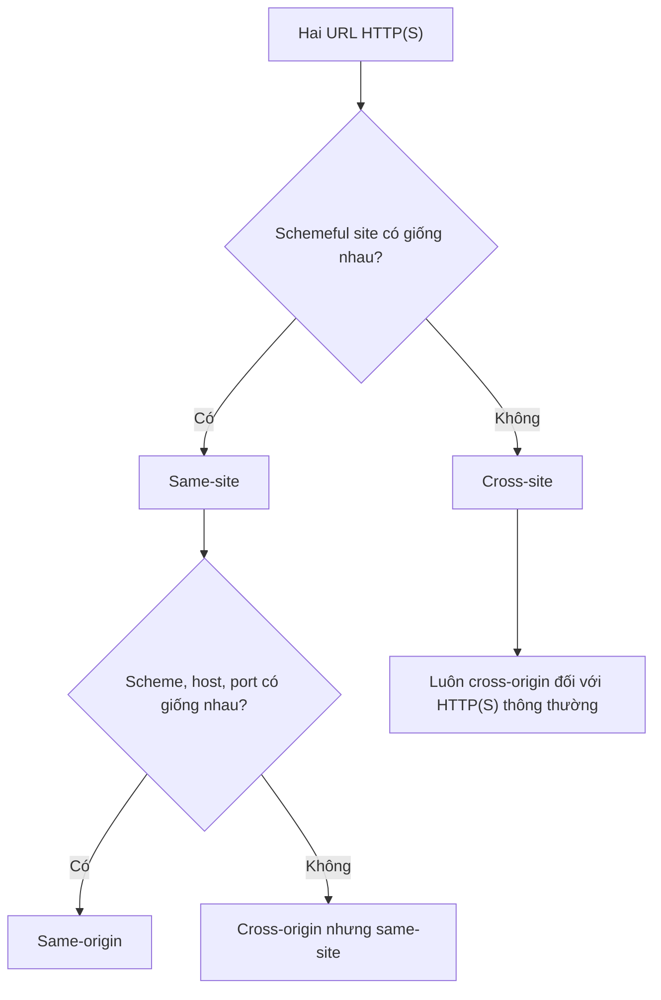
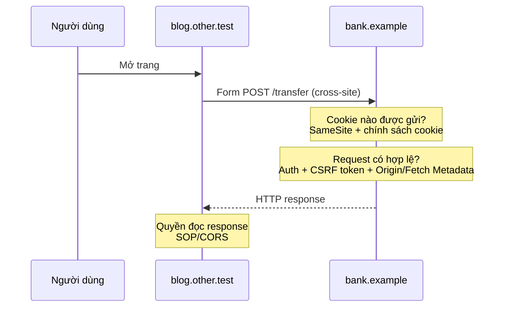

# Cross-site: ranh giới giữa các site trong bảo mật trình duyệt

## 1. Cross-site là gì và vì sao quan trọng?

Trong bảo mật web, hai URL được gọi là **cross-site** khi chúng thuộc **hai site khác nhau** theo cách tính đang được trình duyệt và chính sách liên quan sử dụng. Với HTTP(S) hiện đại, phép so sánh phổ biến là **schemeful same-site**: một site được nhận diện bằng **scheme** và **registrable domain** (tên miền có thể đăng ký, thường ký hiệu eTLD+1). Khi không có registrable domain, chẳng hạn một số địa chỉ IP hoặc `localhost`, phép xác định dùng quy tắc riêng tương ứng với host.

Ví dụ:

- `https://shop.example.com` và `https://news.example.org`: **cross-site**, vì registrable domain khác nhau.
- `https://shop.example.com` và `https://api.example.com`: **same-site**, nhưng **cross-origin**, vì host khác nhau.
- `http://shop.example.com` và `https://shop.example.com`: **cross-site** theo **schemeful** same-site, dù hostname giống nhau.
- `https://shop.example.com:443` và `https://shop.example.com:8443`: **same-site**, nhưng **cross-origin** do port khác.

Phân loại cross-site tác động đến nhiều quyết định bảo mật: trình duyệt có gửi **SameSite cookie** hay không, server có nên chặn request nhạy cảm dựa trên **Fetch Metadata** không, tài nguyên nhúng được chấp nhận theo chính sách nào, và ứng dụng có thể trở thành nạn nhân của **CSRF** hoặc **clickjacking** ra sao.

Bài học thuộc chương **Site và origin** của module **SECURITY_APPLICATION_SECURITY_BROWSER_SECURITY**. Để phân tích ranh giới bảo mật giữa trình duyệt, origin, cookie và ứng dụng web, ta sẽ kết nối khái niệm cross-site với **Same-Origin Policy (SOP)**, **CORS**, **Site Isolation**, và thực hành phòng vệ **XSS, CSRF, clickjacking** qua CSP, Trusted Types cùng security headers.

### Mục tiêu học tập

Sau bài này, bạn có thể:

1. Phân biệt **same-origin**, **cross-origin**, **same-site** và **cross-site** trên các cặp URL.
2. Giải thích **schemeful site**, registrable domain, vai trò **Public Suffix List**, port và các trường hợp localhost/IP.
3. Dự đoán tác động của **SameSite=Strict/Lax/None** đối với request cross-site, bao gồm form, iframe, fetch và điều hướng.
4. Hiểu vì sao SameSite cookie và CORS không thay thế kiểm tra CSRF, cũng như vì sao same-site không có nghĩa là đáng tin.
5. Dùng `Sec-Fetch-Site`, `Origin`, `Referer` và các security headers đúng ngữ cảnh.
6. Tự quan sát hành vi thực tế trong DevTools bằng một thí nghiệm cục bộ.

## 2. Những ranh giới phải phân biệt

### 2.1. Origin: scheme + host + port

Đối với URL HTTP(S) thông thường, **origin** dựa trên bộ ba:

```text
scheme + host + port

https://shop.example.com:443
  │          │           │
scheme      host       default port
```

Hai origin chỉ giống nhau khi scheme, host và port khớp sau chuẩn hóa URL. Port mặc định thường bị loại khỏi dạng chuẩn hóa, nên `https://shop.example.com` và `https://shop.example.com:443` cùng origin.

**Same-Origin Policy** kiểm soát việc script truy cập DOM, dữ liệu và nhiều loại tài nguyên giữa các origin. Do đó, chỉ cần khác subdomain hoặc port cũng có thể là **cross-origin**.

### 2.2. Site: scheme + registrable domain

Một **registrable domain** thường là một nhãn ngay trước hậu tố công cộng, xác định với sự trợ giúp của **Public Suffix List (PSL)**:

```text
https://checkout.shop.example.co.uk:8443/complete
  │               └─────┬───────┘
scheme          registrable domain:
                example.co.uk

Schemeful site: https + example.co.uk
Không xét subdomain "checkout.shop", port 8443 hay path.
```

**Không thể lấy eTLD+1 bằng cách luôn cắt hai nhãn cuối**. Với `example.co.uk`, `co.uk` là public suffix, nên registrable domain là `example.co.uk`. Một số nền tảng lưu trữ nhiều tenant sử dụng các entry trong PSL, chẳng hạn `github.io`; khi đó hai tenant riêng có thể được xem là khác site dù cùng kết thúc bằng `github.io`.

Đối với schemeful same-site, **scheme cũng thuộc site**. Vì vậy HTTP và HTTPS khác site. **Port không thuộc khóa so sánh site**, mặc dù nó thuộc origin.

> **Cẩn thận về thuật ngữ:** Tài liệu cũ có thể dùng khái niệm same-site không xét scheme. Khi đọc chính sách cookie hoặc tài liệu hiện đại, hãy xác định rõ cơ chế đang dùng **schemeful site**; đừng mặc định mọi thành phần của mọi trình duyệt có cùng một thuật toán.

### 2.3. Origin và site không phải ranh giới process

Site Isolation trong một số trình duyệt có thể phân chia renderer process theo site, nhưng **site không đồng nghĩa một OS process**. Việc hai tài liệu cross-site không bảo đảm mọi phiên bản trình duyệt đều có một process riêng cho mỗi tài liệu; việc hai tài liệu same-site cũng không làm chúng cùng origin.



**Quan hệ quan trọng:** Với những URL HTTP(S) bình thường, **same-origin suy ra same-site**, còn **same-site không suy ra same-origin**.

## 3. Phân loại cross-site qua ví dụ

Lấy `https://app.example.com:443` làm URL chuẩn:

| URL so sánh | Same-origin? | Same-site? | Giải thích |
|---|---|---|---|
| `https://app.example.com/dashboard` | Có | Có | Chỉ khác path |
| `https://APP.example.com:443` | Có | Có | Host được chuẩn hóa chữ thường; port HTTPS mặc định |
| `https://app.example.com:8443` | Không | Có | Khác port |
| `https://api.example.com` | Không | Có | Khác subdomain, cùng registrable domain và scheme |
| `http://app.example.com` | Không | Không | Khác scheme theo schemeful same-site |
| `https://app.example.org` | Không | Không | Khác registrable domain |
| `https://example.com` | Không | Có | Site cùng `https + example.com` |
| `https://evil-example.com` | Không | Không | Chuỗi tên gần giống không làm trùng registrable domain |
| `https://example.com.attacker.test` | Không | Không | Host thực thuộc domain khác |

Các cặp khác cần chú ý:

| Cặp URL | Phân loại đáng chú ý |
|---|---|
| `https://a.example.co.uk` / `https://b.example.co.uk` | Same-site, cross-origin, nếu `example.co.uk` là registrable domain |
| `https://alice.github.io` / `https://bob.github.io` | Cross-site khi PSL nhận `github.io` là public suffix |
| `http://localhost:3000` / `http://localhost:4000` | Same-site nhưng cross-origin do khác port |
| `http://localhost:3000` / `http://127.0.0.1:3000` | Khác site và origin vì host khác |
| `https://127.0.0.1` / `http://127.0.0.1` | Cross-site theo schemeful same-site |
| `https://a.example.com` / `https://b.example.com:9443` | Same-site nhưng cross-origin |
| `https://example.com` / `https://example.net` | Cross-site |

Đối với host là IP, localhost, URL nội bộ, `file:`, `data:` hoặc opaque origin, tránh tự áp công thức eTLD+1 theo suy luận chủ quan. Các môi trường đó có quy tắc riêng và có thể khác nhau theo chính sách cần xét.

### 3.1. Cùng site nhưng không đồng nghĩa đáng tin

`https://users.example.com` và `https://bank.example.com` có thể cùng site. Nhưng nếu `users.example.com` cho phép mỗi người tải HTML hoặc JS riêng, một người dùng độc hại có thể kiểm soát một **same-site origin**.

Hệ quả:

- SOP vẫn cách ly DOM giữa hai origin.
- Các **SameSite cookie** có thể vẫn được gửi khi tài liệu ở một subdomain yêu cầu tài nguyên từ subdomain khác, tùy host/domain cookie và điều kiện request.
- Một kiểm tra `Sec-Fetch-Site: same-site` **không bảo đảm** người gửi đáng tin, nhất là khi tồn tại subdomain takeover, hosting nhiều tenant hoặc ứng dụng kém tin cậy.

**Khuyến nghị:** Khi app con không thuộc cùng phạm vi tin cậy, hãy phân quyền theo origin, sử dụng host-only cookie hợp lý, CSRF token và kiểm tra phía server. Không nên mặc nhiên cấp quyền cao cho mọi subdomain của tổ chức.

## 4. Cross-site request là gì?

Một request **cross-site** xảy ra khi quan hệ site giữa ngữ cảnh khởi phát và đích request được chính sách liên quan phân loại là cross-site. Ví dụ người dùng đang ở `https://blog.other.test` và trang đó tạo request đến `https://bank.example`.

Các hành động có thể tạo request cross-site gồm:

- Điều hướng top-level qua liên kết hoặc `window.location`.
- Gửi form HTML (`GET` hoặc `POST`).
- Tải hình ảnh, script, CSS, iframe hoặc tài nguyên nhúng khác.
- Gửi `fetch`/XHR đến API khác site.
- Theo redirect qua domain khác.

Việc request được gửi **không** đồng nghĩa JavaScript của nguồn gửi được đọc response. Đó là hai câu hỏi riêng: **request có được gửi / có mang cookie không**, và **response có thể được script đọc không**.

### 4.1. Một sơ đồ request cross-site



Nếu server `bank.example` chỉ dựa vào sự tồn tại của cookie để chấp nhận chuyển tiền, trang cross-site có thể trở thành tác nhân gây **CSRF**. CORS không phải lớp bảo vệ chính cho tình huống này vì form có thể gửi request dù JavaScript không đọc được response.

### 4.2. Site for cookies phụ thuộc ngữ cảnh nhúng

Đối với cookie, phép tính same-site không đơn giản luôn là so sánh hai URL trần. **Site for cookies** của một tài liệu có thể phụ thuộc vào top-level site và chuỗi iframe tổ tiên.

Ví dụ:

```text
Top-level: https://shop.example
└── iframe: https://ads.other.test
    └── iframe/request: https://shop.example
```

Mặc dù request đích cuối có cùng URL site với top-level, script/frame trung gian thuộc site khác có thể khiến ngữ cảnh xét SameSite cookie bị coi là **cross-site**. Redirect và một số loại request cũng có quy tắc đặc biệt. Vì vậy, khi kiểm chứng cookie, hãy quan sát **thứ tự điều hướng, frame khởi phát và request thực tế** thay vì chỉ nhìn cặp hostname.

## 5. SameSite cookie và hành vi cross-site

Thuộc tính `SameSite` của cookie giúp trình duyệt hạn chế việc đính kèm cookie khi request xảy ra trong ngữ cảnh cross-site. Đây là lớp giảm thiểu CSRF quan trọng, nhưng không phải bảo vệ đầy đủ.

### 5.1. Ba chế độ phổ biến

| Cookie | Request same-site | Cross-site iframe / subresource / fetch | Cross-site top-level navigation |
|---|---|---|---|
| `SameSite=Strict` | Có thể gửi nếu khớp các thuộc tính cookie khác | Thường không gửi | Không gửi trong điều hướng cross-site thông thường |
| `SameSite=Lax` | Có thể gửi | Thường không gửi | Gửi cho điều hướng top-level dùng **phương thức an toàn**, điển hình GET |
| `SameSite=None; Secure` | Có thể gửi | Có thể gửi nếu chính sách cookie của trình duyệt cho phép | Có thể gửi nếu các điều kiện khác đáp ứng |

Giải thích bảng:

- **SameSite chỉ là một điều kiện**: cookie còn phải khớp host/Domain, Path, Secure, thời hạn, phân vùng lưu trữ và các giới hạn của trình duyệt.
- `SameSite=None` trong trình duyệt hiện đại cần đi cùng `Secure`; cookie `Secure` thông thường chỉ gửi qua HTTPS, với ngoại lệ phát triển cục bộ có thể khác theo trình duyệt.
- `SameSite=Lax` cho phép cookie trong một số **cross-site top-level navigation** bằng phương thức an toàn như GET. Vì thế endpoint dùng GET để thay đổi trạng thái là thiết kế rủi ro.
- Khi **không khai báo** `SameSite`, nhiều trình duyệt dùng hành vi mặc định kiểu Lax. Một số có biến thể cho cookie mới tạo trong thời gian ngắn, có thể cho phép vài request POST top-level. Không dựa vào mặc định hoặc quy tắc thời gian để thay bảo vệ CSRF.
- Các cơ chế chặn third-party cookie và cookie partitioning có thể khiến cookie `SameSite=None` vẫn không được gửi trong ngữ cảnh cross-site.

### 5.2. Ví dụ Set-Cookie

Cookie phiên với phòng vệ ưu tiên cùng site:

```http
Set-Cookie: __Host-session=abc123; Path=/; Secure; HttpOnly; SameSite=Lax
```

Ở đây `__Host-` là prefix yêu cầu các ràng buộc như `Secure`, `Path=/` và **không có** `Domain` trong trình duyệt hỗ trợ; điều này giúp cookie gắn với host đã đặt và giảm nguy cơ một sibling subdomain ghi đè. `HttpOnly` ngăn JavaScript đọc cookie trực tiếp, nhưng không ngăn request hợp lệ tự động kèm cookie.

Trong trường hợp yêu cầu bảo vệ điều hướng cross-site chặt hơn, có thể cân nhắc:

```http
Set-Cookie: __Host-session=abc123; Path=/; Secure; HttpOnly; SameSite=Strict
```

Một dịch vụ nhúng cross-site hợp lệ đôi khi cần:

```http
Set-Cookie: partner_session=abc123; Path=/; Secure; HttpOnly; SameSite=None
```

Cấu hình `None` làm cookie dễ xuất hiện trong ngữ cảnh third-party hơn nếu trình duyệt cho phép, nên yêu cầu bảo vệ CSRF và quyền truy cập phải đặc biệt rõ ràng. Không có cấu hình duy nhất phù hợp mọi ứng dụng; phải kiểm tra luồng đăng nhập, SSO, thanh toán, iframe và điều hướng từ nguồn ngoài.

### 5.3. Cookie host-only, Domain và port

Giả sử một cookie được đặt từ `https://app.example.com`:

- Không có `Domain`: **host-only**, thông thường chỉ áp dụng cho `app.example.com`, không tự gửi sang `api.example.com`.
- Có `Domain=example.com`: cookie có thể áp dụng cho các subdomain thuộc `example.com` khi thỏa điều kiện và không bị trình duyệt từ chối.
- **Port không là ranh giới cookie scope** giống origin. Cookie đủ điều kiện cho `http://localhost:8000` có thể được gửi đến `http://localhost:8001`.
- `SameSite` phân loại **ngữ cảnh cross-site**, không quyết định trực tiếp cookie thuộc host nào.

Điều này giải thích tại sao hai trang **cross-origin do khác port** vẫn có thể chia sẻ cookie host-only và là **same-site**.

### 5.4. Cross-site, third-party cookie và CHIPS

Trong ngữ cảnh trang đầu (`top-level site`) nhúng dịch vụ từ site khác, cookie dịch vụ thường được gọi là **third-party cookie**. Các trình duyệt có thể chặn hoặc hạn chế third-party cookie theo chính sách riêng, dù cookie khai báo `SameSite=None; Secure`.

Cookie có thuộc tính `Partitioned` (CHIPS, trong trình duyệt hỗ trợ) có thể được lưu theo khóa phân vùng gắn với top-level site; một dịch vụ nhúng trên hai site đầu khác nhau không nhất thiết dùng chung cùng một cookie partition. `Partitioned` cần `Secure` trong triển khai hỗ trợ.

Không đánh đồng **SameSite cookie** với **cookie partitioning**: một cơ chế liên quan việc gửi cookie theo ngữ cảnh site; cơ chế kia ảnh hưởng phạm vi lưu trữ/khóa truy cập của cookie.

## 6. Cross-site và CORS: hai chính sách khác nhau

**CORS (Cross-Origin Resource Sharing)** dựa trên quan hệ **origin**, không dựa đơn thuần trên quan hệ **site**. Đây là khác biệt cần nhớ khi một API ở `https://api.example.com` được gọi từ frontend `https://app.example.com`:

- Hai URL **same-site**.
- Hai URL **cross-origin**, vì khác hostname.
- Browser vẫn áp các quy tắc **CORS** cho `fetch` trong chế độ CORS.
- Cookie có thể được gửi hay không theo scope, SameSite, tùy chọn `credentials` và chính sách cookie, hoàn toàn độc lập với việc server cấp quyền đọc response qua CORS.

### 6.1. Một request cross-site và response CORS

Script ở `https://web.other.test` thực hiện:

```js
fetch("https://api.example.com/me", {
  method: "GET",
  credentials: "include"
})
  .then((response) => response.json())
  .then(console.log)
  .catch(console.error);
```

Trình duyệt có thể gửi request đến API; việc gửi credential còn tùy cookie và chính sách privacy. Để cho phép JavaScript **đọc response** của request credentialed, server cần phản hồi, ví dụ:

```http
Access-Control-Allow-Origin: https://web.other.test
Access-Control-Allow-Credentials: true
Vary: Origin
```

Với request CORS có credential, `Access-Control-Allow-Origin: *` **không hợp lệ** để cấp quyền đọc response. Server phải giới hạn origin được phép theo allowlist; không nên phản chiếu tùy ý mọi header `Origin`.

**CORS không tự động chống CSRF.** Một form cross-site có thể gửi POST với content type được hỗ trợ mà không cần API cấp quyền đọc response bằng CORS. Bảo vệ trạng thái ở server vẫn bắt buộc.

### 6.2. Phân biệt các lớp khi đánh giá request

| Câu hỏi | Cơ chế chính |
|---|---|
| Script có được đọc DOM của origin khác không? | SOP |
| JavaScript có được đọc HTTP response cross-origin không? | CORS, Fetch và một số cơ chế liên quan |
| Cookie có được đính kèm với request cross-site không? | SameSite, Domain/Path/Secure, credential mode, chính sách cookie |
| Server có chấp nhận hành động thay đổi dữ liệu không? | Xác thực, phân quyền, CSRF token, xác minh nguồn, kiểm tra nghiệp vụ |
| Tài nguyên được nhúng có bị giới hạn không? | CSP, CORP, COEP, CORS, loại tài nguyên |
| Trang có bị nhúng trong frame của site khác không? | CSP `frame-ancestors`, X-Frame-Options |
| Script injection có thể thực thi trong origin tin cậy không? | Encoding, sanitization, CSP, Trusted Types |

### 6.3. Same-site không mở khóa SOP

Hai iframe:

```text
Parent: https://app.example.com
Child:  https://reports.example.com
```

Dù cùng site, script từ parent vẫn **không được tự đọc DOM** của iframe child nếu khác origin. Nếu hai bên cần trao đổi dữ liệu, nên dùng `postMessage` với `targetOrigin` cụ thể và xác minh `event.origin`, `event.source` và schema của dữ liệu.

```js
const reportFrame = document.getElementById("report-frame");

window.addEventListener("message", (event) => {
  if (event.origin !== "https://reports.example.com") return;
  if (event.source !== reportFrame.contentWindow) return;
  if (event.data?.type !== "REPORT_READY") return;

  // Chỉ xử lý dữ liệu đã xác minh.
  console.log("Báo cáo sẵn sàng");
});
```

`event.origin` là **serialized origin** cụ thể. Không so sánh mỗi suffix `example.com` để chấp nhận tất cả sibling subdomain.

## 7. Cross-site và các tấn công ứng dụng web

### 7.1. CSRF: hành động được gửi từ site khác

Một kẻ tấn công kiểm soát `https://attacker.test` có thể nhúng form:

```html
<form
  action="https://bank.example/transfer"
  method="POST"
>
  <input type="hidden" name="to" value="attacker-account">
  <input type="hidden" name="amount" value="500">
</form>
```

Ví dụ chỉ mô phỏng một form để phân tích cơ chế CSRF. Nếu API chuyển tiền dựa hoàn toàn vào cookie phiên và chấp nhận request, có thể xảy ra CSRF, dù script bên tấn công không đọc được response.

Phòng vệ:

1. **CSRF token** khó đoán và kiểm tra server-side cho thao tác thay đổi trạng thái; thiết kế phù hợp session hoặc cơ chế stateless được bảo vệ.
2. Cookie `SameSite=Lax`/`Strict` khi tương thích yêu cầu sản phẩm.
3. Kiểm tra `Origin`, fallback `Referer` theo chính sách, và Fetch Metadata khi có.
4. Không tạo tác vụ thay đổi trạng thái qua phương thức GET; kiểm tra method và content type hợp lệ.
5. Xác minh quyền nghiệp vụ, session và các điều kiện đặc thù trước khi thực hiện hành động.

**Lưu ý:** Một attacker ở sibling subdomain **same-site nhưng cross-origin** có thể không bị SameSite cookie chặn. Vì vậy CSRF token và kiểm tra nguồn vẫn quan trọng.

### 7.2. XSS: cross-site không phải vấn đề duy nhất

XSS là việc dữ liệu không tin cậy khiến script được thực thi trong origin của ứng dụng nạn nhân. Nếu XSS đã xảy ra trên `https://bank.example`, script độc hoạt động **với quyền của origin đó**; SameSite cookie, CORS và Site Isolation không tự phân biệt script tốt với script độc trong cùng origin.

Lớp phòng vệ gồm output encoding theo ngữ cảnh, tránh DOM injection sink nguy hiểm, sanitization khi cần HTML, CSP phù hợp và **Trusted Types** ở môi trường hỗ trợ. Cookie `HttpOnly` giảm nguy cơ script đọc cookie trực tiếp, nhưng không loại bỏ nguy cơ script thực hiện thao tác trên ứng dụng.

### 7.3. Clickjacking: iframe từ site khác

Trang độc có thể nhúng ứng dụng nhạy cảm rồi dùng bố cục để dụ người dùng nhấn nút ngoài ý muốn. Việc cross-site không tự động cấm iframe; ứng dụng cần khai báo:

```http
Content-Security-Policy: frame-ancestors 'none'
```

Hoặc chỉ cho phép một số bên nhúng được tin:

```http
Content-Security-Policy: frame-ancestors 'self' https://portal.example.com
```

`frame-ancestors` kiểm soát **origin của các trang tổ tiên được phép nhúng**, không cho phép tất cả nguồn same-site theo mặc định. `X-Frame-Options: DENY` hoặc `SAMEORIGIN` có thể hỗ trợ trình duyệt cũ, nhưng không thay thế danh sách origin cụ thể của CSP.

### 7.4. Site Isolation: giảm rủi ro ở tầng process

Trong Chromium, **Site Isolation** nhằm tách biệt dữ liệu của các site trong renderer process, giảm tác động của một số lỗi renderer và side-channel. Đây là lớp bảo vệ của kiến trúc trình duyệt, không thay cho SOP/CORS, CSRF token hoặc input validation.

Với một iframe cross-site, Chromium có thể dùng **Out-of-Process Iframe (OOPIF)**, nhưng không nên suy luận rằng mỗi URL luôn có một process riêng. Quy tắc chính xác phụ thuộc phiên bản, nền tảng và cấu hình trình duyệt.

## 8. Fetch Metadata: quan sát site của nguồn request

Trình duyệt hỗ trợ có thể tự gắn các header **Fetch Metadata**, giúp server phân biệt request đến từ cùng origin, cùng site hay site khác. Đáng chú ý:

| Giá trị `Sec-Fetch-Site` | Ý nghĩa điển hình |
|---|---|
| `same-origin` | Nguồn khởi phát cùng origin với đích |
| `same-site` | Khác origin nhưng cùng site theo thuật toán của trình duyệt |
| `cross-site` | Nguồn khởi phát khác site |
| `none` | Request không gắn với nguồn site theo cách thông thường, ví dụ người dùng nhập URL trực tiếp trên thanh địa chỉ |

Các header bổ sung như `Sec-Fetch-Mode`, `Sec-Fetch-Dest`, `Sec-Fetch-User` mô tả kiểu điều hướng/request, đích tài nguyên và tương tác người dùng trong trường hợp áp dụng.

Ví dụ request từ trang khác site:

```http
POST /api/profile HTTP/1.1
Host: app.example.com
Origin: https://other.test
Sec-Fetch-Site: cross-site
Sec-Fetch-Mode: cors
Sec-Fetch-Dest: empty
```

**Lưu ý:** Đây là minh họa; header thực tế phụ thuộc request. `Sec-Fetch-Site` có thể bị ảnh hưởng bởi chuỗi redirect và ngữ cảnh ancestor. Script chạy trong trình duyệt không được tự ý đặt các header `Sec-Fetch-*`; tuy vậy client ngoài browser có thể giả lập HTTP header, nên chúng **không phải xác thực**.

### 8.1. Ví dụ middleware chặn cross-site state-changing request

Ví dụ Express dưới đây áp dụng cho endpoint nội bộ **không chủ đích nhận POST cross-site**:

```js
function blockUnexpectedCrossSiteWrites(req, res, next) {
  const changesState = !["GET", "HEAD", "OPTIONS"].includes(req.method);
  const fetchSite = req.get("Sec-Fetch-Site");

  if (changesState && fetchSite === "cross-site") {
    return res.status(403).json({
      error: "Cross-site write is not allowed"
    });
  }

  return next();
}

// Gắn middleware trước các route thay đổi trạng thái nội bộ.
// app.use("/api/account", blockUnexpectedCrossSiteWrites);
// app.post("/api/account/email", csrfProtection, requireLogin, handler);
```

Middleware này chỉ là **lớp bổ sung**: cần CSRF token, xác thực/phân quyền, kiểm tra `Origin` và các cơ chế khác. Với app có OAuth callbacks, webhook, payment redirect hoặc form cross-site hợp lệ, phải có ngoại lệ theo endpoint và cơ chế xác minh riêng. Các request không mang `Sec-Fetch-Site` cần chính sách fallback rõ ràng, không mặc nhiên xem là đáng tin.

### 8.2. Kiểm tra Origin và Referer

Với request nhạy cảm, server có thể áp allowlist origin:

```text
Cho phép:
  Origin: https://app.example.com

Từ chối hoặc xử lý theo chính sách:
  Origin: https://evil.example.net
  Origin: null
  Origin bị thiếu
```

Không nên kiểm tra bằng `startsWith("https://app.example.com")` vì `https://app.example.com.attacker.test` có cùng tiền tố nhưng không cùng origin. Dùng phép so khớp **origin chuẩn hóa chính xác** và quy tắc riêng cho các request thiếu header.

`Referer` có thể thiếu do Referrer-Policy, điều hướng hoặc cơ chế privacy. Khi có, cần parse và so sánh origin, không so chuỗi bằng tiền tố. **Origin/Referer là tín hiệu bảo vệ trong browser**, không phải cơ chế xác thực người dùng.

## 9. Những security headers liên quan

Một ứng dụng cần chống các mối đe dọa cross-site thường phối hợp nhiều header:

| Header | Tác dụng | Điều cần lưu ý |
|---|---|---|
| `Content-Security-Policy: frame-ancestors ...` | Hạn chế bên được phép nhúng trang | Phòng vệ clickjacking, dựa trên origin của ancestors |
| `Content-Security-Policy: script-src ...` | Kiểm soát nguồn script và inline script | Giảm bề mặt XSS; ưu tiên nonce/hash và chính sách chặt |
| `Content-Security-Policy: require-trusted-types-for 'script'` | Yêu cầu Trusted Types tại một số DOM injection sink | Hỗ trợ phụ thuộc trình duyệt; không thay thế encoding/sanitization |
| `Cross-Origin-Resource-Policy` (CORP) | Chỉ định khả năng resource được nạp trong một số ngữ cảnh cross-origin no-cors | Có các giá trị `same-origin`, `same-site`, `cross-origin` |
| `Cross-Origin-Embedder-Policy` (COEP) | Đặt yêu cầu cho tài nguyên cross-origin được nhúng | Dùng cùng các chính sách liên quan cho cross-origin isolation |
| `Cross-Origin-Opener-Policy` (COOP) | Kiểm soát quan hệ browsing context với cửa sổ/popup | Có thể thay đổi hành vi mở popup và luồng đăng nhập |
| `Referrer-Policy` | Giới hạn dữ liệu URL gửi trong `Referer` | Không phải lớp chống CSRF đầy đủ |
| `Set-Cookie` với `SameSite` | Giới hạn cookie gửi trong request cross-site | Còn phụ thuộc host/domain/path/secure và chính sách browser |

### 9.1. CORP `same-site` không đồng nghĩa CORS

Ví dụ:

```http
Cross-Origin-Resource-Policy: same-site
```

Chính sách CORP trên response có thể cho phép **một số kiểu tải resource no-cors** từ same-site, nhưng ngăn tải bởi nguồn cross-site khi áp dụng. Nó **không** biến hai origin cùng site thành same-origin và **không** cấp cho script quyền đọc response qua CORS.

Một response với `Cross-Origin-Resource-Policy: same-origin` nghiêm ngặt hơn về origin; `cross-origin` là cho phép tải qua cross-origin theo ngữ cảnh CORP. Hãy xem xét tài nguyên công khai, CDN, iframe, ảnh và script hiện tại trước khi đổi header.

### 9.2. COOP/COEP và cross-origin isolation

```http
Cross-Origin-Opener-Policy: same-origin
Cross-Origin-Embedder-Policy: require-corp
```

Cặp header trên là cấu hình thường gặp khi ứng dụng cần **cross-origin isolation**, với các điều kiện bổ sung về secure context và resource. COOP quan tâm mối quan hệ browsing context; COEP yêu cầu tài nguyên nhúng đáp ứng cơ chế thích hợp. Các header này có thể làm gián đoạn SSO, popup, iframe hoặc tải tài nguyên nếu áp không phù hợp.

Cross-origin isolation, Site Isolation và SameSite cookie **không phải cùng một tính năng**, dù đều dùng thuật ngữ "site/origin/isolation".

## 10. Thực hành: kiểm chứng same-site và cross-site trên localhost

Thí nghiệm tạo ba origin HTTP cục bộ. Chúng giúp quan sát **port là thành phần của origin nhưng không phải site**, và **SameSite=Lax cookie** không được gửi trong iframe cross-site thông thường.

### 10.1. Chuẩn bị

Cần Node.js hiện đại, trình duyệt desktop và DevTools. Tạo một file `cross-site-lab.mjs`:

```js
import http from "node:http";

const ports = [8000, 8001, 8002];

function respond(req, res, port) {
  const url = new URL(req.url, "http://lab.invalid");
  res.setHeader("Cache-Control", "no-store");

  if (url.pathname === "/set-cookie") {
    res.setHeader("Set-Cookie", "lab=lax; Path=/; SameSite=Lax; HttpOnly");
    res.setHeader("Content-Type", "text/plain; charset=utf-8");
    res.end("Da dat cookie lab=lax tren host hien tai. Quay lai trang cha.");
    return;
  }

  if (url.pathname === "/echo") {
    res.setHeader("Content-Type", "text/plain; charset=utf-8");
    res.end([
      "port: " + port,
      "Host: " + (req.headers.host || "(missing)"),
      "Sec-Fetch-Site: " + (req.headers["sec-fetch-site"] || "(missing)"),
      "Cookie: " + (req.headers.cookie || "(none)")
    ].join("\n"));
    return;
  }

  if (port === 8000 && url.pathname === "/") {
    res.setHeader("Content-Type", "text/html; charset=utf-8");
    res.end(
      "<!doctype html><meta charset='utf-8'>" +
      "<title>Same-site and cross-site</title>" +
      "<h1>Top-level: http://localhost:8000</h1>" +
      "<p>Frame A: same-site, cross-origin (other port)</p>" +
      "<iframe src='http://localhost:8001/echo' width='600' height='110'></iframe>" +
      "<p>Frame B: cross-site, cross-origin (other host)</p>" +
      "<iframe src='http://127.0.0.1:8002/echo' width='600' height='110'></iframe>"
    );
    return;
  }

  res.writeHead(404, { "Content-Type": "text/plain; charset=utf-8" });
  res.end("Not found");
}

for (const port of ports) {
  http.createServer((req, res) => respond(req, res, port))
    .listen(port, "127.0.0.1", () => console.log("Listening on port " + port));
}
```

Chạy:

```bash
node cross-site-lab.mjs
```

Chỉ dùng các server này để học trên máy cá nhân; tắt chương trình khi xong và không đưa code minh họa vào môi trường production.

### 10.2. Các bước quan sát

1. Mở `http://localhost:8000/set-cookie` để đặt host-only cookie `lab=lax` cho `localhost`.
2. Mở `http://127.0.0.1:8002/set-cookie` để đặt cookie cùng tên cho host `127.0.0.1`. Đây là **hai cookie khác nhau**, vì host khác.
3. Mở `http://localhost:8000/` để xem hai iframe. Mở DevTools → **Network**, chọn yêu cầu `/echo` của từng iframe và xem Request Headers.
4. Quan sát iframe A (`localhost:8001`): nguồn là `localhost:8000` nên thường có `Sec-Fetch-Site: same-site`. Cookie `lab=lax` cho `localhost` có thể được gửi vì cookie không phân biệt port và request ở ngữ cảnh same-site.
5. Quan sát iframe B (`127.0.0.1:8002`): nguồn là `localhost:8000` nên thường có `Sec-Fetch-Site: cross-site`. Cookie `SameSite=Lax` cho `127.0.0.1` không được gửi trong iframe cross-site thông thường.
6. Mở trực tiếp `http://127.0.0.1:8002/echo` trên thanh địa chỉ. Cookie của host đó có thể xuất hiện trong top-level navigation, cho thấy khác biệt giữa **truy cập trực tiếp** và **iframe cross-site**.

**Nếu kết quả khác dự kiến:** Kiểm tra cookie có thực sự được lưu chưa, chế độ chặn third-party cookie, browser profile, chính sách loopback/localhost và cột **Request Cookies/Blocked Reason** trong DevTools. Một số trình duyệt có thể báo `Sec-Fetch-Site` theo ngữ cảnh khác hoặc không gửi header Fetch Metadata. Thử trình duyệt mục tiêu và ghi nhận chính xác phiên bản khi báo cáo.

**Lưu ý bảo mật trong lab:** Các origin sử dụng HTTP loopback để tiện thực hành; không dùng cookie demo này làm mô hình session production. `Secure` nên được dùng cho phiên thật qua HTTPS.

### 10.3. So sánh thêm bằng URL API

Trên Console của bất kỳ trang HTTP(S) nào, kiểm tra:

```js
const examples = [
  "https://shop.example.com",
  "https://api.example.com",
  "http://shop.example.com",
  "https://shop.example.com:8443"
];

console.table(examples.map((value) => {
  const u = new URL(value);
  return {
    url: value,
    origin: u.origin,
    protocol: u.protocol,
    hostname: u.hostname,
    port: u.port || "(default)"
  };
}));
```

`URL.origin` giúp quan sát **origin**. JavaScript chuẩn không cung cấp một API phổ quát để lấy chính xác eTLD+1 / schemeful site cho mọi host; không tự cắt chuỗi bằng `split(".").slice(-2)` rồi coi là thuật toán bảo mật. Với logic server-side cần xét registrable domain, hãy dùng thư viện PSL được duy trì và cập nhật.

### 10.4. Bài tập tình huống từ thí nghiệm

Giả sử `http://localhost:8001` là một ứng dụng không tin cậy do bên thứ ba kiểm soát nhưng cùng host `localhost` với app ở port 8000. Hãy trả lời:

- `SameSite=Lax` có tự ngăn ứng dụng port 8001 gửi POST đến port 8000 không?
- SOP có ngăn script từ port 8001 đọc trực tiếp DOM của port 8000 không?
- Nếu app port 8000 thay đổi dữ liệu chỉ dựa vào cookie mà không có CSRF token, còn rủi ro gì?
- Nếu app port 8000 dùng `Sec-Fetch-Site: same-site` làm điều kiện đủ để cấp quyền quản trị, sai ở đâu?

**Định hướng:** Port khác làm hai origin khác nhau, nên SOP chặn DOM trực tiếp; nhưng site giống nhau và cookie cùng host có thể xuất hiện ở request. `SameSite` không thay thế CSRF token; `Sec-Fetch-Site: same-site` không xác thực nguồn đáng tin hoặc quyền người dùng.

## 11. Các lỗi hiểu sai thường gặp

| Nhận định sai | Giải thích chính xác |
|---|---|
| "Khác origin thì luôn cross-site." | Khác subdomain hoặc port có thể cross-origin nhưng vẫn same-site. |
| "Cùng eTLD+1 là luôn same-site." | Schemeful site còn xét scheme; HTTP và HTTPS khác site. |
| "Site luôn là hai nhãn hostname cuối." | Phải xét Public Suffix List, bao gồm các suffix dài và entry hosting đặc biệt. |
| "Cross-site request sẽ bị trình duyệt chặn hoàn toàn." | Nhiều form, navigation và subresource request vẫn gửi được; hạn chế phụ thuộc loại request/chính sách. |
| "CORS bảo vệ mọi endpoint khỏi CSRF." | CORS chủ yếu kiểm soát khả năng script đọc response; hành động phía server cần cơ chế CSRF. |
| "SameSite=Lax ngăn mọi cross-site request." | Cookie vẫn có thể gửi trong top-level navigation phương thức an toàn; request khác có thể đến server dù thiếu cookie. |
| "SameSite=None luôn khiến third-party cookie được gửi." | Chính sách chặn third-party cookie, partitioning và các thuộc tính khác còn quyết định. |
| "Same-site nghĩa là tin cậy." | Subdomain có thể bị takeover, lưu nội dung do người dùng kiểm soát hoặc nằm ở ranh giới tin cậy khác. |
| "Header Sec-Fetch-Site tự xác thực người dùng." | Đây chỉ là tín hiệu trình duyệt về ngữ cảnh; cần auth, quyền và kiểm tra CSRF. |
| "Site Isolation thay SOP và CORS." | Site Isolation giảm rủi ro ở tầng tiến trình; SOP/CORS là ranh giới dữ liệu ở tầng web. |

## 12. Checklist thiết kế và đánh giá bảo mật

Khi phân tích một request trong ứng dụng web, hãy kiểm tra theo thứ tự:

1. **URL:** Xác định scheme, host, port và registrable domain với PSL; phân biệt origin và schemeful site.
2. **Ngữ cảnh:** Request là navigation, iframe, form POST, subresource hay fetch? Có redirect và frame tổ tiên cross-site không?
3. **Cookie:** Các thuộc tính `Domain`/host-only, `Path`, `Secure`, `HttpOnly`, `SameSite`, `Partitioned` có phù hợp với yêu cầu không?
4. **Quyền đọc:** SOP/CORS có cho phép script đọc response hay không? Response có phản chiếu `Origin` thiếu kiểm soát không?
5. **Quyền ghi:** Server có xác thực, phân quyền, kiểm tra CSRF token, Origin/Referer/Fetch Metadata và tránh state-changing GET không?
6. **Nguồn nhúng:** CSP `frame-ancestors` có ngăn clickjacking? Các chính sách CORP/COEP/COOP được áp đúng nơi?
7. **Nội dung không tin cậy:** Encoding, sanitization, CSP và Trusted Types có giảm lỗ hổng XSS không?
8. **Ranh giới nội bộ:** Những subdomain same-site có thực sự được quản lý cùng mức tin cậy hay có tenant, nội dung người dùng và rủi ro takeover?
9. **Kiểm chứng:** Đã chạy DevTools để xem Cookie/Blocked Reason, Request Headers, Network, Console và hành vi của trình duyệt mục tiêu chưa?

## 13. Câu hỏi ôn tập

1. `https://app.example.com` và `https://api.example.com`: same-site hay cross-site? Same-origin hay cross-origin?
2. `http://app.example.com` và `https://app.example.com`: tại sao được coi là cross-site theo schemeful same-site?
3. Vì sao `https://alice.github.io` và `https://bob.github.io` có thể khác site?
4. Nếu cookie có `SameSite=Lax`, trường hợp nào cookie vẫn có thể đi trong cross-site top-level navigation?
5. Một form POST cross-site bị CORS chặn đọc response. Server đã đủ an toàn khỏi CSRF chưa?
6. Tại sao sibling subdomain bị chiếm quyền có thể là nguy cơ dù app dùng SameSite cookie?
7. `Sec-Fetch-Site: none` có nghĩa server có thể bỏ qua kiểm tra session và phân quyền không?
8. Hai trang `localhost` khác port có thể chia sẻ cookie host-only không? Tại sao?
9. Khi nào `frame-ancestors` hữu ích hơn việc chỉ kiểm soát CORS?
10. Vì sao Site Isolation không tự bảo vệ ứng dụng khỏi XSS trong origin của chính ứng dụng?

**Đáp án định hướng:** (1) Same-site, cross-origin. (2) Khác scheme. (3) PSL có entry `github.io`, khiến từng tenant có thể có registrable domain riêng. (4) Điều hướng top-level với phương thức an toàn như GET, nếu các điều kiện cookie khác cũng đạt. (5) Chưa; cần CSRF token/kiểm tra nguồn/quyền phía server. (6) SameSite có thể cho cookie trong request từ nguồn same-site nhưng không đáng tin. (7) Không; nó là tín hiệu về ngữ cảnh request, không phải xác thực. (8) Có, vì cookie không được phân tách theo port như origin. (9) Khi cần hạn chế site/origin nào được phép nhúng trang nhằm chống clickjacking. (10) XSS chạy trong origin được phép và có thể làm những gì script hợp lệ của origin đó được phép.

## 14. Tài liệu tham khảo

- [MDN — Same-site and cross-site](https://developer.mozilla.org/en-US/docs/Glossary/Site): Giải thích site, schemeful same-site và sự khác biệt với origin.
- [MDN — Same-origin policy](https://developer.mozilla.org/en-US/docs/Web/Security/Same-origin_policy): Quyền truy cập giữa các origin.
- [MDN — Set-Cookie / SameSite](https://developer.mozilla.org/en-US/docs/Web/HTTP/Reference/Headers/Set-Cookie): Điều kiện gửi cookie và các thuộc tính bảo mật.
- [MDN — Sec-Fetch-Site](https://developer.mozilla.org/en-US/docs/Web/HTTP/Reference/Headers/Sec-Fetch-Site): Phân loại request theo nguồn.
- [OWASP — Cross-Site Request Forgery Prevention Cheat Sheet](https://cheatsheetseries.owasp.org/cheatsheets/Cross-Site_Request_Forgery_Prevention_Cheat_Sheet.html): Chiến lược CSRF token, SameSite và các kiểm tra nguồn.
- [OWASP — Fetch Metadata Request Headers](https://cheatsheetseries.owasp.org/cheatsheets/Fetch_Metadata_Request_Headers_Cheat_Sheet.html): Defense-in-depth với `Sec-Fetch-*`.
- [Public Suffix List](https://publicsuffix.org/): Dữ liệu tham chiếu để nhận diện public suffix và registrable domain.
- [web.dev — SameSite cookies explained](https://web.dev/articles/samesite-cookies-explained): Tình huống gửi cookie same-site và cross-site.
- [Chromium — Site Isolation](https://www.chromium.org/Home/chromium-security/site-isolation/): Cách ly site ở tầng trình duyệt.

**Kết nối kiến thức:** Cross-site mô tả một ranh giới **site** có ảnh hưởng mạnh đến cookie và ngữ cảnh request. SOP/CORS sử dụng **origin**; CSRF protection và phân quyền do ứng dụng triển khai; CSP, Trusted Types, CORP/COEP/COOP và Site Isolation tạo các lớp phòng vệ khác. Xác định đúng ranh giới của từng cơ chế giúp tránh đánh giá sai một request là "an toàn" chỉ vì nó same-site hoặc vì response bị CORS chặn đọc.
