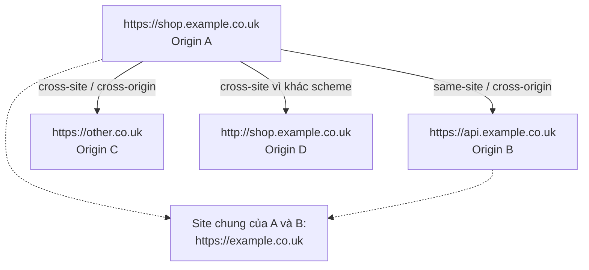

# Registrable domain: hiểu đúng eTLD+1 trong bảo mật trình duyệt

**Chương:** Site và origin  
**Mô-đun:** `SECURITY_APPLICATION_SECURITY_BROWSER_SECURITY` — phân tích ranh giới bảo mật giữa trình duyệt, origin, cookie và ứng dụng web; thực hành bảo vệ XSS, CSRF, clickjacking bằng CSP, Trusted Types, security headers và kiểm chứng hành vi thực tế.

Khi nhìn thấy `https://shop.example.co.uk` và `https://api.example.co.uk`, nhiều người biết đây là hai **origin khác nhau** nhưng chưa chắc chúng có **cùng site** hay không. Để trả lời, trình duyệt cần khái niệm **registrable domain**: phần tên miền được xác định bằng cách lấy *public suffix* cộng thêm một nhãn ngay bên trái, thường được gọi là **eTLD+1**.

Registrable domain là thành phần cốt lõi khi diễn giải **same-site**, cookie `SameSite`, giới hạn thuộc tính `Domain`, phân vùng lưu trữ và một số chính sách bảo mật trên web. Nhưng registrable domain **không phải origin**, cũng không chứng minh rằng mọi subdomain đều thuộc cùng một chủ thể đáng tin.

## 1. Mục tiêu bài học

Sau bài học, bạn có thể:

1. Xác định đúng *public suffix*, *registrable domain* và các subdomain của một hostname.
2. Giải thích vì sao `example.co.uk` là registrable domain của `shop.example.co.uk`, thay vì `co.uk`.
3. Phân biệt **same-origin**, **schemeful same-site** và **cross-site**, kể cả khi khác cổng hoặc giao thức.
4. Dự đoán phạm vi cookie host-only, cookie có thuộc tính `Domain` và tác động của `SameSite`.
5. Nhận diện rủi ro từ subdomain không đáng tin, shared hosting, open redirect và CORS allowlist quá rộng.
6. Dùng thư viện hiểu Public Suffix List (PSL) để kiểm chứng thay vì tách chuỗi hostname bằng dấu chấm.

## 2. Public suffix và registrable domain là gì?

**Public suffix** là một hậu tố tên miền mà tại đó các chủ thể bên ngoài có thể đăng ký hoặc được cấp không gian tên độc lập, tùy chính sách của nhà cung cấp. Ví dụ phổ biến:

- `com` là public suffix một nhãn.
- `co.uk` là public suffix nhiều nhãn.
- `github.io` nằm trong phần **PRIVATE** của Public Suffix List; với cách tính có xét phần này, mỗi website như `alice.github.io` có site riêng so với `bob.github.io`.

**Registrable domain** (eTLD+1) là tên miền gồm public suffix và **một nhãn ngay bên trái**. Ví dụ:

```text
shop.api.example.co.uk
│    │   └───┬────┘
│    │       └── registrable domain: example.co.uk
│    └─────────── subdomain: api
└──────────────── subdomain: shop

public suffix: co.uk
registrable domain: example.co.uk
hostname đầy đủ: shop.api.example.co.uk
```

Từ “eTLD” (*effective top-level domain*) thường xuất hiện trong thuật ngữ **eTLD+1**. eTLD ở đây tương ứng với public suffix mà trình duyệt xác định từ PSL, **không** đồng nghĩa lúc nào cũng chỉ là nhãn TLD cuối cùng như `com` hoặc `uk`.

### Ví dụ phân tích

| Hostname | Public suffix | Registrable domain | Các nhãn subdomain |
| --- | --- | --- | --- |
| `example.com` | `com` | `example.com` | Không có |
| `www.example.com` | `com` | `example.com` | `www` |
| `api.dev.example.com` | `com` | `example.com` | `api.dev` |
| `example.co.uk` | `co.uk` | `example.co.uk` | Không có |
| `shop.example.co.uk` | `co.uk` | `example.co.uk` | `shop` |
| `alice.github.io` | `github.io` nếu xét phần PRIVATE | `alice.github.io` | Không có |
| `docs.alice.github.io` | `github.io` nếu xét phần PRIVATE | `alice.github.io` | `docs` |
| `bob.github.io` | `github.io` nếu xét phần PRIVATE | `bob.github.io` | Không có |

Phân tích với `github.io` đặc biệt quan trọng: `alice.github.io` và `bob.github.io` có thể do **hai người dùng độc lập** quản lý. Nếu coi cả hai cùng site chỉ vì cùng đuôi `github.io`, một hệ thống bảo mật có thể kết luận sai về mức độ tin cậy.

> **Giới hạn thuật ngữ:** eTLD+1 thường phản ánh ranh giới được đăng ký hoặc cấp phát, nhưng không phải bằng chứng pháp lý về quyền sở hữu hay một “ranh giới tin cậy” hoàn chỉnh. Chủ sở hữu một registrable domain có thể giao subdomain cho các nhóm, đối tác, khách hàng hoặc dịch vụ bên ngoài.

## 3. Vì sao phải dùng Public Suffix List?

Giả sử lập trình viên tính “domain gốc” bằng hai nhãn cuối:

```javascript
function guessRegistrableDomain(hostname) {
  return hostname.split(".").slice(-2).join(".");
}

console.log(guessRegistrableDomain("shop.example.co.uk"));
// "co.uk" — SAI!
```

`co.uk` là public suffix, không phải registrable domain của `shop.example.co.uk`. Cách làm này còn sai với nhiều hậu tố nhiều nhãn, ví dụ các cấu trúc tên miền theo quốc gia và những nền tảng shared hosting trong phần PRIVATE của PSL.

### 3.1. Public Suffix List chứa gì?

[Public Suffix List](https://publicsuffix.org/) là tập dữ liệu về những hậu tố tên miền để ứng dụng và trình duyệt xác định ranh giới đăng ký/cấp phát. PSL thường được chia thành:

- **ICANN:** quy tắc tương ứng với các hậu tố do hệ thống đăng ký tên miền quản lý.
- **PRIVATE:** quy tắc của các nền tảng cấp không gian tên riêng cho nhiều bên, chẳng hạn hosting theo subdomain.

PSL không chỉ gồm các dòng tên miền đơn giản: nó còn hỗ trợ **wildcard rule** và **exception rule**. Thuật toán phải chọn quy tắc phù hợp nhất, không chỉ tìm đoạn chuỗi xuất hiện ở cuối hostname.

Bộ dữ liệu có thể thay đổi theo thời gian và phiên bản trình duyệt/thư viện; các kết quả ở trường hợp ranh giới phải được kiểm tra theo PSL đang sử dụng. Một domain xuất hiện trong phần PRIVATE có thể tạo hành vi **site/cookie boundary** khác với kết quả của thư viện chỉ đọc phần ICANN.

### 3.2. Cách tư duy về thuật toán

Với một hostname HTTP(S) thông thường:

1. Chuẩn hóa hostname đúng quy tắc DNS/IDNA mà thư viện sử dụng; loại bỏ sự mơ hồ do chữ hoa, Unicode hay dấu chấm cuối.
2. Tìm **public suffix** bằng thuật toán tra PSL, có tính đến wildcard và exception.
3. Nếu còn ít nhất một nhãn nằm trước public suffix, lấy đúng **một nhãn đó** cộng hậu tố để thành registrable domain.
4. Phần còn lại nằm bên trái registrable domain là các subdomain.
5. Nếu hostname là IP, `localhost` hoặc một tên không xác định được registrable domain, **không tự bịa eTLD+1**. Những trường hợp này cần logic riêng trong chuẩn web và ứng dụng.

Một thư viện chuyên dụng như `tldts` hoặc bộ phân tích PSL được duy trì là lựa chọn thích hợp cho code nghiệp vụ. Tránh regex hoặc `split(".").slice(-2)`.

## 4. Registrable domain khác origin và site như thế nào?

Ba thuật ngữ thường bị trộn lẫn:

- **Hostname:** tên host của URL, ví dụ `api.example.com`.
- **Origin:** bộ ba **scheme + host + port**, ví dụ `https://api.example.com:8443`.
- **Schemeful site:** thông thường là **scheme + registrable domain** (không gồm port), ví dụ `https://example.com`.

Với host không có registrable domain theo quy tắc liên quan, việc tính site có cơ chế fallback hoặc trường hợp đặc biệt. Site của opaque origin cũng có quy tắc riêng. Bảng dưới tập trung vào HTTPS/HTTP hostname DNS thông thường.

### 4.1. So sánh cùng origin và cùng site

Chọn trang tham chiếu:

```text
https://shop.example.co.uk:443/home
origin = https://shop.example.co.uk
site   = https://example.co.uk
```

| URL đối chiếu | Cùng origin? | Cùng schemeful site? | Lý do |
| --- | --- | --- | --- |
| `https://shop.example.co.uk/cart` | Có | Có | Khác path nhưng cùng bộ ba origin |
| `https://api.example.co.uk/data` | Không | Có | Khác host; cùng registrable domain và HTTPS |
| `https://shop.example.co.uk:8443/cart` | Không | Có | Port ảnh hưởng origin, không ảnh hưởng site |
| `http://shop.example.co.uk/home` | Không | Không | Scheme HTTP khác HTTPS trong schemeful same-site |
| `https://shop.example.com/home` | Không | Không | Registrable domain khác |
| `https://customer.example.co.uk/home` | Không | Có | Subdomain khác, nhưng vẫn cùng schemeful site |
| `https://other.co.uk/home` | Không | Không | eTLD+1 khác; chỉ trùng public suffix `co.uk` |

**Hệ quả quan trọng:** hai ứng dụng có thể **same-site nhưng cross-origin**. Same-Origin Policy (SOP) vẫn ngăn script ở `shop.example.co.uk` tự do đọc DOM hoặc `localStorage` của `api.example.co.uk`. Trình duyệt có thể xem chúng là same-site khi xét cookie, nhưng điều đó **không mở quyền DOM**.



### 4.2. Site không phải câu trả lời cho mọi chính sách

Khi đọc tài liệu web, phải hỏi **cơ chế đang dùng origin hay site**:

| Cơ chế | Phạm vi/đơn vị so sánh chính | Hệ quả |
| --- | --- | --- |
| SOP đối với DOM, Web Storage | Origin | Hai subdomain same-site không được tự đọc DOM của nhau |
| `fetch` mặc định với `mode: "cors"` | CORS khi cross-origin | API same-site vẫn cần CORS cho việc đọc response cross-origin |
| `fetch` mặc định `credentials: "same-origin"` | Origin | Request sang subdomain khác không tự gửi credentials theo mặc định này |
| Cookie `SameSite` | Site và ngữ cảnh request | Khác origin nhưng same-site có thể vẫn gửi cookie đủ điều kiện |
| Cookie `Domain` | Domain-match và public suffix rules | Cookie có thể áp dụng cho nhiều subdomain nếu được đặt hợp lệ |
| CSP `script-src 'self'`, `connect-src 'self'` | Origin của tài liệu được bảo vệ | `'self'` không đồng nghĩa với mọi subdomain cùng eTLD+1 |
| `postMessage` `targetOrigin`/`event.origin` | Origin | Cần xác thực đúng scheme, host, port |
| CSRF | Quy tắc của request và session phía server | SameSite là một lớp phòng vệ, không thay thế CSRF token |

Trong một số chuẩn, cụm **“site for cookies”** còn tính đến top-level context và chuỗi ancestor của iframe. Vì vậy không thể quyết định mọi trường hợp cookie chỉ bằng việc so hai URL tĩnh.

## 5. Cookie: lý do registrable domain trở nên quan trọng

Cookie có thể được giới hạn tại một host hoặc được mở rộng đến domain cha hợp lệ. Trình duyệt phải ngăn website tùy ý đặt cookie lên **public suffix** để không một trang tại `foo.co.uk` có thể tạo cookie áp dụng cho mọi trang dưới `co.uk`.

### 5.1. Host-only cookie và Domain cookie

Giả sử response đến từ `https://app.example.co.uk`:

```http
Set-Cookie: session=abc; Secure; HttpOnly; Path=/; SameSite=Lax
```

**Không có thuộc tính `Domain`** ⇒ cookie **host-only**, chỉ áp dụng cho host `app.example.co.uk` (theo các điều kiện khác). Cookie không tự áp dụng cho `api.example.co.uk`.

Ngược lại:

```http
Set-Cookie: locale=vi; Domain=example.co.uk; Path=/; Secure; SameSite=Lax
```

Cookie có `Domain=example.co.uk` có thể được gửi đến `example.co.uk` và các subdomain phù hợp, bao gồm `app.example.co.uk` và `api.example.co.uk`. Thuộc tính `Domain` **không** đặt một ranh giới origin; cookie cũng **không** phân biệt port.

Các ví dụ cần phân biệt:

| Header từ `app.example.co.uk` | Kết quả khái niệm | Vì sao |
| --- | --- | --- |
| `Set-Cookie: a=1; Path=/; Secure` | Host-only của `app.example.co.uk` | Không có `Domain` |
| `Set-Cookie: a=1; Domain=example.co.uk; Secure` | Có thể áp dụng cho domain cha và subdomain | Parent domain hợp lệ, không phải public suffix |
| `Set-Cookie: a=1; Domain=co.uk; Secure` | Bị trình duyệt từ chối | `co.uk` là public suffix |
| `Set-Cookie: a=1; Domain=other.co.uk; Secure` | Bị từ chối | Host phát cookie không thuộc domain đó |
| `Set-Cookie: a=1; Domain=api.example.co.uk; Secure` | Bị từ chối | Host `app.example.co.uk` không thuộc domain anh em `api.example.co.uk` |

Nếu người dùng được cấp trang `alice.github.io`, quy tắc PSL phần PRIVATE giúp ngăn trang này đặt cookie `Domain=github.io` để ảnh hưởng các trang `bob.github.io` độc lập. Đây là một ví dụ rõ ràng cho lợi ích của registrable-domain boundary.

### 5.2. Cookie an toàn cho phiên đăng nhập

Với session chỉ cần trên một host, ưu tiên cookie host-only cùng thuộc tính bảo vệ:

```http
Set-Cookie: __Host-session=opaque-session-id; Path=/; Secure; HttpOnly; SameSite=Lax
```

Tiền tố `__Host-` yêu cầu cookie có `Secure`, `Path=/` và **không có `Domain`** (trên trình duyệt hỗ trợ), giúp giảm rủi ro cookie bị mở rộng/ghi đè từ subdomain không mong muốn. `HttpOnly` ngăn JavaScript đọc giá trị qua `document.cookie`; `SameSite` hỗ trợ hạn chế một số tình huống CSRF; `Secure` yêu cầu truyền qua kênh an toàn theo quy tắc trình duyệt.

Không sử dụng cookie `Domain=example.com` chỉ vì “toàn bộ ứng dụng thuộc cùng site”. Một subdomain có khả năng tạo response, đặc biệt khi bị chiếm quyền, có thể tác động tới cookie có phạm vi cha. **Chia sẻ cookie xuyên subdomain** là quyết định kiến trúc cần cân nhắc rủi ro.

### 5.3. SameSite không thay thế SOP, CORS hay chống CSRF

Cookie `SameSite` được xét theo quan hệ site, không chỉ theo origin.

Giả sử người dùng đã đăng nhập `https://bank.example.com`:

- `https://reports.example.com` và `https://bank.example.com` thường **same-site** (cùng scheme HTTPS và registrable domain `example.com`).
- `https://attacker.example.net` và `https://bank.example.com` là **cross-site**.

Nếu `reports.example.com` do bên ít tin cậy kiểm soát, code tại đó vẫn có thể thử gửi request tới `bank.example.com`. Cookie `SameSite=Strict`/**Lax** có thể được gửi trong request **same-site** nếu các điều kiện khác phù hợp. Do đó, chỉ dựa vào `SameSite` không bảo vệ đầy đủ các thao tác nhạy cảm khỏi subdomain cùng site bị tấn công hoặc không đáng tin.

Phía máy chủ phải kiểm tra xác thực, phân quyền, **CSRF token** hoặc cơ chế bảo vệ tương đương, và có thể kiểm tra `Origin`/`Referer`, Fetch Metadata như `Sec-Fetch-Site` theo chính sách phù hợp. `Sec-Fetch-Site: same-site` chỉ nói về quan hệ site; **không có nghĩa request đến từ một origin đã được cấp quyền**.

## 6. Hai subdomain cùng site vẫn cần CORS

Ứng dụng ở `https://app.example.com` gọi API tại `https://api.example.com`:

```javascript
const response = await fetch("https://api.example.com/profile", {
  credentials: "include"
});

if (!response.ok) throw new Error("API error");
const profile = await response.json();
```

Hai host khác nhau nên đây là **cross-origin fetch**, dù cùng site. Nếu cần để JavaScript ở app đọc response có credentials, API phải trả chính sách CORS thích hợp:

```http
Access-Control-Allow-Origin: https://app.example.com
Access-Control-Allow-Credentials: true
Vary: Origin
```

Cùng lúc, cookie của API phải đủ điều kiện được gửi theo host/domain, `Secure`, `SameSite`, chính sách cookie và chế độ credentials. Header CORS chỉ giải quyết **quyền đọc response từ JavaScript**; không tự đặt cookie, không vô hiệu CSRF và không cấp quyền nghiệp vụ.

**Sai lầm nguy hiểm:** thấy hai host có cùng eTLD+1 rồi mặc định tin mọi origin dạng `https://*.example.com`. Nếu có subdomain cho khách hàng tự đăng nội dung, một origin trong wildcard có thể chứa JavaScript do attacker kiểm soát. Nếu API cho phép CORS credentials từ bất kỳ origin cùng eTLD+1, phản hồi nhạy cảm có nguy cơ lộ cho tenant đó.

Khuyến nghị: duy trì allowlist **origin cụ thể** theo scheme, hostname và port; kiểm tra server-side cho từng action. Tránh phản xạ origin request từ một regex hậu tố quá rộng.

Ví dụ kiểm tra thông điệp từ một iframe có nguồn gốc đối tác:

```javascript
const trustedOrigin = "https://partner.example.com";
const iframe = document.querySelector("#partner-frame");

window.addEventListener("message", (event) => {
  if (event.origin !== trustedOrigin) return;
  if (event.source !== iframe.contentWindow) return;

  const data = event.data;
  if (!data || typeof data !== "object") return;
  if (data.type !== "resize") return;
  if (!Number.isInteger(data.height)) return;
  if (data.height < 200 || data.height > 1000) return;

  iframe.style.height = data.height + "px";
});
```

Đừng dùng `event.origin.endsWith("example.com")` để xác thực người gửi: nó có thể vô tình chấp nhận host như `evil-example.com` và vẫn mở rộng tin cậy tới nhiều subdomain hợp lệ nhưng không đáng tin.

## 7. Ranh giới registrable domain trong hệ thống nhiều tenant

Nhà cung cấp có thể cho khách hàng đặt nội dung trên các host như:

```text
alice.platform.example.com
bob.platform.example.com
api.platform.example.com
```

Cả ba có cùng registrable domain `example.com`, nhưng Alice và Bob là **hai tenant không được tin cậy lẫn nhau**. Nếu trang Alice bị XSS, mã độc thuộc origin Alice, vẫn khác origin Bob hoặc API theo SOP; tuy nhiên mối quan hệ same-site có thể khiến một số cookie `SameSite` được gửi tới API trong các request do Alice tạo.

Các nguy cơ cần quản lý:

1. **Subdomain takeover:** bản ghi DNS/CNAME cũ trỏ đến dịch vụ chưa được chiếm hữu có thể cho kẻ khác phát nội dung trên subdomain cùng site.
2. **Cookie tossing / cookie injection:** subdomain kém tin cậy có thể tạo cookie có `Domain` rộng, gây nhầm lẫn nếu máy chủ xử lý trùng tên cookie không an toàn.
3. **CORS allowlist quá rộng:** tin mọi origin cùng eTLD+1 có thể cấp quyền đọc API cho tenant độc lập.
4. **SameSite bị hiểu quá mức:** request từ tenant độc hại có thể được xem là same-site dù không phải nguồn request được phép.
5. **XSS trong một tenant:** SOP vẫn tách các origin, nhưng nếu dùng chung script, postMessage thiếu kiểm tra hoặc cookie có scope rộng, lỗ hổng có thể lan sang thành phần khác.

**Thiết kế khuyến nghị:** phục vụ nội dung do khách hàng kiểm soát trên **registrable domain riêng** hoặc nền tảng có quy tắc PSL PRIVATE thích hợp khi mô hình hoạt động yêu cầu tách site; dùng cookie host-only; cấp CORS và quyền giao tiếp theo origin cụ thể; thực thi auth, authorization và CSRF bảo vệ ở server.

Đăng ký một quy tắc trong phần PRIVATE của PSL **không phải một nút cấu hình bảo mật tức thời**: nó cần quy trình quản trị và được trình duyệt/thư viện tiếp nhận; kết quả có thể khác giữa các phiên bản dữ liệu. Thiết kế bảo mật phải bảo vệ được hệ thống ngay cả trước khi mọi client cập nhật.

## 8. Registrable domain tác động tới các security headers ra sao?

Một số cơ chế áp dụng theo origin hoặc theo chính sách riêng, không mặc định dựa trên registrable domain:

| Tình huống | Cấu hình phù hợp | Cần nhớ |
| --- | --- | --- |
| Trang không muốn bị site khác nhúng | `Content-Security-Policy: frame-ancestors 'none'` | Header nằm trên **response của trang cần bảo vệ**, chống clickjacking |
| Chỉ cho đúng ứng dụng của mình nhúng | `frame-ancestors 'self'` hoặc allowlist origin cụ thể | `'self'` là quan hệ origin, không có nghĩa cùng eTLD+1 |
| Script chỉ tải từ origin hiện tại | `script-src 'self'` | Không tự cho phép mọi subdomain cùng registrable domain |
| Kết nối chỉ đến origin hiện tại | `connect-src 'self'` | Nếu cần API ở subdomain khác, khai báo nguồn API rõ ràng |
| API cho ứng dụng khác đọc phản hồi | CORS allowlist origin cụ thể | Tránh mở credentials cho mọi subdomain cùng site |
| Đưa HTML không tin cậy vào DOM | DOM API an toàn, escaping/sanitizer, Trusted Types khi hỗ trợ | Registrable domain không làm nội dung HTML trở nên an toàn |

Ví dụ, trang `https://app.example.com` có thể cần gửi API tại `https://api.example.com`:

```http
Content-Security-Policy: default-src 'self'; connect-src 'self' https://api.example.com; script-src 'self'; object-src 'none'; base-uri 'self'; frame-ancestors 'none'
X-Content-Type-Options: nosniff
Referrer-Policy: strict-origin-when-cross-origin
```

Đây là cấu hình **minh họa**. Trong ứng dụng thực, CSP phải phù hợp với script, style, iframe và luồng API đang dùng; `script-src 'self'` cũng hạn chế script inline nếu không có cơ chế nonce/hash phù hợp. Với XSS, ngoài CSP nên sử dụng output encoding, xử lý dữ liệu theo ngữ cảnh và Trusted Types để giảm rủi ro DOM sinks trên trình duyệt hỗ trợ.

## 9. Lab: tự tính eTLD+1 bằng thư viện PSL

Mục tiêu của lab là quan sát kết quả khác nhau giữa **origin**, **registrable domain** và **schemeful site**.

Thư viện `tldts` là một ví dụ cho việc tra PSL. Bạn có thể dùng thư viện khác được cập nhật thường xuyên, nhưng cần xác định rõ có bật **PRIVATE domains** hay không.

Tạo project Node.js mới (không dùng dữ liệu đăng nhập thật):

```bash
npm init -y
npm install tldts
```

Tạo file `registrable-domain-lab.mjs`:

```javascript
import { getDomain, getPublicSuffix } from "tldts";

const urls = [
  "https://www.example.com:8443/account",
  "https://api.example.com/data",
  "http://api.example.com/data",
  "https://shop.example.co.uk/",
  "https://alice.github.io/",
  "https://bob.github.io/",
  "https://docs.alice.github.io/",
  "http://localhost:3000/",
  "http://localhost:4000/",
  "https://127.0.0.1:8443/"
];

function describe(rawUrl) {
  const url = new URL(rawUrl);
  const host = url.hostname.toLowerCase();
  const options = { allowPrivateDomains: true };

  const publicSuffix = getPublicSuffix(host, options);
  const registrableDomain = getDomain(host, options);

  // Chỉ để minh họa HTTPS/HTTP. Một số origin đặc biệt
  // và tên host không có eTLD+1 cần quy tắc chuyên biệt.
  const siteHost = registrableDomain ?? host;
  const schemefulSite = url.protocol + "//" + siteHost;

  return {
    url: rawUrl,
    origin: url.origin,
    publicSuffix,
    registrableDomain,
    schemefulSite
  };
}

for (const rawUrl of urls) {
  console.log(describe(rawUrl));
}
```

Chạy:

```bash
node registrable-domain-lab.mjs
```

Dự kiến kết quả chính:

| URL | Registrable domain | Schemeful site minh họa |
| --- | --- | --- |
| `https://www.example.com:8443` | `example.com` | `https://example.com` |
| `https://api.example.com` | `example.com` | `https://example.com` |
| `http://api.example.com` | `example.com` | `http://example.com` |
| `https://shop.example.co.uk` | `example.co.uk` | `https://example.co.uk` |
| `https://alice.github.io` | `alice.github.io` khi bật PRIVATE | `https://alice.github.io` |
| `https://bob.github.io` | `bob.github.io` khi bật PRIVATE | `https://bob.github.io` |
| `https://docs.alice.github.io` | `alice.github.io` khi bật PRIVATE | `https://alice.github.io` |
| `http://localhost:3000` | Thường không có eTLD+1 | Dùng host: `http://localhost` |
| `http://localhost:4000` | Thường không có eTLD+1 | Dùng host: `http://localhost` |
| `https://127.0.0.1:8443` | Không có eTLD+1 | Dùng IP: `https://127.0.0.1` |

**Thí nghiệm 1 — cổng:** So `http://localhost:3000` với `http://localhost:4000`. Origin khác vì port, nhưng site thông thường giống nhau. Đừng dùng hai port để mô phỏng các host **cross-site**.

**Thí nghiệm 2 — scheme:** So `http://api.example.com` với `https://api.example.com`. Registrable domain giống nhau nhưng schemeful site khác nhau.

**Thí nghiệm 3 — PRIVATE:** Chuyển `allowPrivateDomains` thành `false` rồi quan sát `alice.github.io` và `bob.github.io`. Một phép tính chỉ xét phần ICANN có thể cho ra ranh giới site khác với cách tính xét phần PRIVATE. Đây là lý do phải chọn chế độ PSL phù hợp với chính sách đang triển khai.

**Thí nghiệm 4 — lỗi split:** Dùng `guessRegistrableDomain("shop.example.co.uk")` ở mục 3 và đối chiếu với kết quả thư viện. Ghi lại vì sao `co.uk` không thể là miền đăng ký của website đó.

**Thí nghiệm 5 — quan sát trên trình duyệt:** Trong môi trường phát triển có quyền quản lý các host thử nghiệm, mở DevTools → Application/Storage → Cookies và Network. Tạo một cookie host-only và một cookie có `Domain` hợp lệ; truy cập hai subdomain, xem cookie nào được gửi. Dùng HTTPS nếu thử `Secure` và đừng dùng cookie phiên thật. Khi thử fetch cross-origin same-site, xem `Origin`, `Sec-Fetch-Site` (nếu trình duyệt gửi), CORS headers và credentials mode.

**Giới hạn lab:** `schemefulSite` ở trên là công thức minh họa cho URL HTTP(S) thông thường, không thay thế thuật toán site của trình duyệt cho opaque origins, IP literals, tài liệu đặc biệt hoặc ngữ cảnh iframe nhiều ancestor. Việc thư viện trả `null` đối với một tên không chứng minh rằng tên đó không bao giờ dùng được làm host. Phạm vi cookie thật còn phụ thuộc `Path`, `Secure`, `SameSite`, partitioning, `Domain` và chính sách browser.

## 10. Những ngộ nhận thường gặp

**“Registrable domain luôn là hai nhãn cuối.”** Sai. `example.co.uk` và các quy tắc PSL nhiều nhãn/PRIVATE là phản ví dụ.

**“Hai subdomain cùng registrable domain là cùng origin.”** Sai. `https://app.example.com` và `https://api.example.com` khác hostname nên khác origin.

**“Khác port tức là cross-site.”** Sai với cách tính schemeful site HTTP(S) thông thường; port ảnh hưởng origin, không trực tiếp ảnh hưởng site.

**“Cùng eTLD+1 nghĩa là thuộc cùng bên đáng tin.”** Sai. Subdomain có thể do khách hàng, nhà thầu, nền tảng hosting hoặc kẻ đã chiếm quyền quản lý.

**“Cookie có `SameSite=Strict` sẽ chặn mọi CSRF từ subdomain khác.”** Sai. Subdomain cùng schemeful site thường vẫn là same-site; server phải có cơ chế bảo vệ request đổi trạng thái.

**“`Domain=.example.com` và `Domain=example.com` tạo hai kiểu scope khác nhau.”** Trên trình duyệt hiện đại, dấu chấm đầu của `Domain` bị bỏ qua theo cách xử lý cookie hiện hành; vấn đề chính là **có hay không có thuộc tính Domain**, chứ không phải dấu chấm đầu.

**“CORS không cần thiết vì API cùng site.”** Sai. Đọc response bằng JavaScript từ origin khác vẫn phải tuân thủ CORS.

**“Chỉ cần nhận `event.origin` có đuôi `example.com` là đủ an toàn.”** Sai. So khớp hậu tố có thể nhận nhầm host giả hoặc subdomain không đáng tin. Cần kiểm tra origin chính xác và ngữ nghĩa thông điệp.

**“Public Suffix List vĩnh viễn không đổi.”** Sai. Tập quy tắc có thể cập nhật, nên cần sử dụng dữ liệu được duy trì và hiểu khác biệt phiên bản.

## 11. Checklist khi thiết kế hệ thống nhiều subdomain

Trước khi áp dụng chính sách cookie/CORS hay phân quyền cho các host thuộc một doanh nghiệp, hãy xác định:

1. **Hostname nào thực sự là eTLD+1?** Tra PSL đầy đủ, kể cả PRIVATE khi phù hợp; tránh dùng phép tách chuỗi thủ công.
2. **Các thành phần có cùng origin hay chỉ cùng site?** Xác định scheme, host và port trước khi diễn giải SOP hoặc CORS.
3. **Subdomain nào do ai kiểm soát?** Có tenant, đối tác, nội dung người dùng hay DNS/CNAME dễ bị takeover không?
4. **Cookie phải áp dụng tới host nào?** Ưu tiên host-only và `__Host-` cho session. Chỉ dùng `Domain` khi thật sự cần chia sẻ và đã đánh giá rủi ro.
5. **Ứng dụng có chống CSRF độc lập với SameSite không?** Đánh giá cả request từ subdomain cùng site nhưng không đáng tin.
6. **CORS và postMessage xác thực gì?** So scheme + host + port của origin được phép; kiểm tra source, payload và quyền trên server.
7. **CSP/security headers đặt ở response nào?** `frame-ancestors` bảo vệ trang bị nhúng; `script-src`, `connect-src` và Trusted Types bảo vệ bề mặt XSS riêng của từng ứng dụng.
8. **Đã quan sát trong DevTools chưa?** Xem từng request, cookie, `Origin`, `Sec-Fetch-Site`, CORS và các chính sách chặn tài nguyên ở trình duyệt mục tiêu.

### Câu hỏi tự kiểm tra

**Câu 1.** Registrable domain của `img.cdn.example.co.uk` là gì?  
**Đáp án:** `example.co.uk` vì public suffix là `co.uk`.

**Câu 2.** `https://shop.example.com:443` và `https://shop.example.com:8443` có cùng origin, cùng site không?  
**Đáp án:** Khác origin do port, nhưng cùng schemeful site `https://example.com`.

**Câu 3.** Vì sao `alice.github.io` có thể được tách site khỏi `bob.github.io`?  
**Đáp án:** `github.io` có thể được xét như public suffix trong phần PRIVATE của PSL, để mỗi tên cấp cho khách hàng có registrable domain riêng.

**Câu 4.** Trang `https://app.example.com` có tự đọc `localStorage` của `https://api.example.com` vì hai trang same-site không?  
**Đáp án:** Không. Web Storage chịu ranh giới origin; hai host khác nhau.

**Câu 5.** Cookie session có `SameSite=Lax`, API ngân hàng và trang do attacker kiểm soát cùng `example.com`. Có nên coi đây là đủ chống CSRF?  
**Đáp án:** Không. Request có thể là same-site; cần CSRF token, kiểm tra nguồn và xác thực/phân quyền trên server.

**Câu 6.** Có nên đặt `Domain=co.uk` để chia sẻ cookie giữa nhiều website `*.co.uk`?  
**Đáp án:** Không. `co.uk` là public suffix, nên trình duyệt từ chối nỗ lực thiết lập cookie phạm vi đó.

## 12. Tóm lược mô hình cần nhớ

**Public suffix** là ranh giới tên miền theo PSL; **registrable domain (eTLD+1)** là public suffix cộng một nhãn ngay bên trái. Đối với HTTP(S) thông thường, **schemeful site** chủ yếu kết hợp scheme với registrable domain, còn **origin** dùng scheme, hostname và port.

Từ đó, ta hiểu vì sao **same-site không nhất thiết same-origin**: cookie `SameSite` có thể xem hai subdomain thuộc cùng site, nhưng SOP vẫn tách DOM và Web Storage; cross-origin Fetch vẫn cần CORS; script, iframe và API cần kiểm soát quyền riêng. Khi có subdomain không đáng tin hoặc shared hosting, sự tương đồng eTLD+1 **không phải** bằng chứng đủ để chia sẻ cookie, cấp CORS hay bỏ CSRF token.

### Tài liệu tham khảo

- [Public Suffix List](https://publicsuffix.org/) — quy tắc public suffix và giải thích danh sách ICANN/PRIVATE.
- [MDN — Same-origin policy](https://developer.mozilla.org/en-US/docs/Web/Security/Same-origin_policy).
- [MDN — Set-Cookie](https://developer.mozilla.org/en-US/docs/Web/HTTP/Reference/Headers/Set-Cookie).
- [MDN — Cross-Origin Resource Sharing (CORS)](https://developer.mozilla.org/en-US/docs/Web/HTTP/Guides/CORS).
- [web.dev — SameSite and same-origin](https://web.dev/articles/same-site-same-origin).

