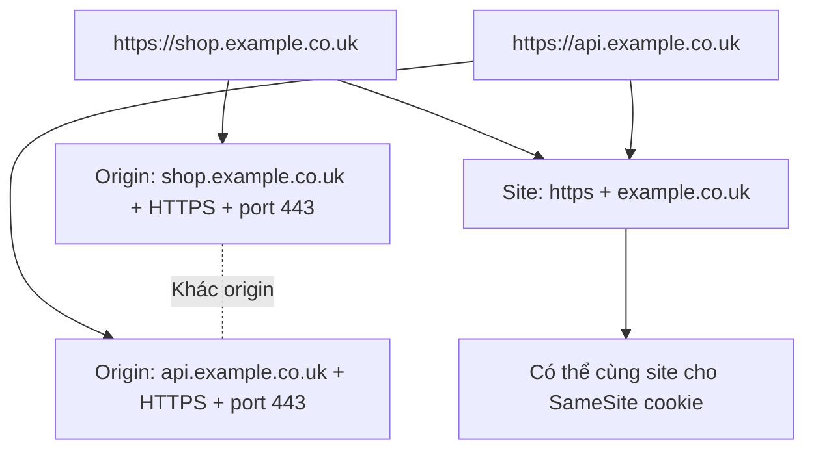

# Public suffix — ranh giới miền trong mô hình site và origin

> **Chương:** Site và origin  
> **Mục tiêu:** Hiểu public suffix, Public Suffix List (PSL), registrable domain (eTLD+1), quy tắc xác định site và origin; vận dụng khi thiết kế cookie, chống CSRF, CORS, cách ly tenant và kiểm chứng chính sách trên trình duyệt.

## 1. Vì sao cần khái niệm public suffix?

Giả sử người dùng đang mở các địa chỉ:

- `https://cart.shop.example.co.uk`
- `https://login.example.co.uk`
- `https://alice.github.io`
- `https://bob.github.io`

Hai trang đầu có thể thuộc cùng tổ chức quản lý tên miền `example.co.uk`. Ngược lại, hai trang sau có thể do **hai người khác nhau** xuất bản trên một nền tảng hosting chung, dù đều kết thúc bằng `github.io`.

Nếu một chương trình chỉ lấy **hai nhãn cuối** của hostname để xác định “miền gốc”, nó sẽ kết luận sai. Với `cart.shop.example.co.uk`, hai nhãn cuối là `co.uk`, vốn là vùng đăng ký dùng chung. Với `alice.github.io` và `bob.github.io`, lấy `github.io` cũng có thể gom hai tenant độc lập thành cùng một site.

Trình duyệt cần biết nơi nào là **hậu tố tên miền công cộng** và đâu là phần tên miền do một chủ thể đăng ký hoặc quản lý riêng. Những thông tin này ảnh hưởng trực tiếp tới phạm vi cookie và cách phân loại request **same-site/cross-site**.

**Public suffix** là một ranh giới phân tách tên miền dùng cho những mục đích đó; **Public Suffix List (PSL)** là bộ quy tắc hỗ trợ xác định ranh giới này.

## 2. Định nghĩa: public suffix, PSL và registrable domain

**Public suffix** là phần hậu tố của một hostname mà dưới đó các chủ thể độc lập có thể được phép đăng ký hoặc được cấp tên miền trực tiếp. Public suffix không nhất thiết chỉ có một nhãn.

**Registrable domain** là public suffix cộng với **một nhãn ngay bên trái nó**. Tên gọi phổ biến trong lập trình là **eTLD+1** (*effective top-level domain plus one*). Những nhãn nằm trước registrable domain là phần subdomain.

| Hostname | Public suffix | Registrable domain (eTLD+1) | Subdomain |
| --- | --- | --- | --- |
| `shop.example.com` | `com` | `example.com` | `shop` |
| `cart.shop.example.co.uk` | `co.uk` | `example.co.uk` | `cart.shop` |
| `api.example.com.au` | `com.au` | `example.com.au` | `api` |
| `alice.github.io` | `github.io` khi bao gồm PRIVATE | `alice.github.io` | Không có |
| `bob.github.io` | `github.io` khi bao gồm PRIVATE | `bob.github.io` | Không có |
| `co.uk` | `co.uk` | Không có nhãn bên trái | Không áp dụng |

```text
cart.shop.example.co.uk
│    │    │       └─┬─┘
│    │    │         └── public suffix: co.uk
│    │    └──────────── registrable domain: example.co.uk
└────┴───────────────── subdomain: cart.shop
```

**PSL không phải danh sách mọi domain đã đăng ký.** Một bản ghi PSL mô tả quy tắc ranh giới, không cho biết `example.co.uk` đang được ai sở hữu hoặc website tại đó có đáng tin hay không.

Thuật ngữ “effective top-level domain” cũng không đồng nghĩa với **TLD trong DNS**. `uk` là TLD, trong khi `co.uk` là ví dụ public suffix nhiều nhãn. Tương tự, `io` là TLD nhưng `github.io` có thể được coi là public suffix trong phần PRIVATE.

## 3. Vì sao không thể suy ra public suffix bằng DNS hay số lượng nhãn?

DNS trả lời câu hỏi hostname có bản ghi gì hoặc trỏ đến đâu. Nó không thể tự xác định ranh giới đăng ký chung, chính sách của registry và ranh giới giữa các tenant trên dịch vụ hosting.

| Khái niệm | Chức năng | Ví dụ |
| --- | --- | --- |
| **TLD** | Nhãn cấp cao nhất dưới gốc DNS | `com`, `uk`, `io` |
| **Public suffix** | Ranh giới đăng ký hoặc ranh giới phân tách dùng chung theo PSL | `com`, `co.uk`, `github.io` với PRIVATE |
| **Registrable domain** | Một nhãn ngay trước public suffix | `example.com`, `example.co.uk`, `alice.github.io` |
| **Subdomain** | Các nhãn bổ sung nằm trước registrable domain | `cart.shop` trong `cart.shop.example.co.uk` |

Một hàm `hostname.split(".").slice(-2)` sẽ trả về `co.uk` cho `cart.shop.example.co.uk`, dù trang thường được quản lý dưới `example.co.uk`. Cách làm này còn thất bại với public suffix wildcard và quy tắc ngoại lệ.

Trong các tên miền đặc biệt như IP, `localhost`, tên nội bộ hoặc URL mang opaque origin, không thể áp dụng máy móc cùng một công thức eTLD+1. Trình duyệt và thư viện URL/PSL cần quy tắc riêng tùy loại đầu vào.

## 4. Cách PSL biểu diễn quy tắc và xử lý ngoại lệ

PSL chứa nhiều dạng quy tắc:

1. **Quy tắc thông thường:** ví dụ `co.uk`, chỉ định hậu tố có thể được chia sẻ cho nhiều miền đăng ký.
2. **Quy tắc wildcard:** dạng `*.suffix`, cho biết một nhãn tương ứng bên trái cũng là thành phần của public suffix.
3. **Quy tắc ngoại lệ:** có dấu `!` trước tên; điều chỉnh một trường hợp đặc biệt mà wildcard có thể khớp quá rộng.

Ví dụ minh họa cú pháp:

```text
co.uk
*.ck
!www.ck
```

Giả sử quy tắc wildcard `*.ck` có hiệu lực, với hostname `a.b.ck` thì public suffix có thể là `b.ck` và registrable domain là `a.b.ck`. Khi gặp ngoại lệ như `!www.ck`, thuật toán phải xử lý quy tắc ngoại lệ trước khi kết luận suffix.

Đây là lý do nên dùng **thuật toán PSL và dữ liệu danh sách được duy trì**, thay vì viết regex hoặc cắt nhãn cố định. Quy tắc có thể thay đổi theo thời gian, nên ví dụ tên miền cụ thể cần được đối chiếu với bản PSL mà môi trường thực đang sử dụng.

Việc xác định public suffix theo PSL thường gồm: chuẩn hóa hostname, tìm các quy tắc khớp, áp dụng cách ưu tiên quy tắc cụ thể/ngoại lệ và lấy một nhãn bên trái suffix làm registrable domain, nếu có. Nếu hostname chỉ là public suffix thì **không có registrable domain** trong phép phân tích đó.

## 5. Hai phần ICANN và PRIVATE của Public Suffix List

PSL có hai nhóm quy tắc cần phân biệt:

| Nhóm | Mục đích chính | Ví dụ |
| --- | --- | --- |
| **ICANN** | Phân tách tên miền theo quy tắc đăng ký công cộng và registry | `com`, `co.uk`, `com.au` |
| **PRIVATE** | Cho phép nhà cung cấp hosting tách các tên miền/tenant do khách hàng độc lập quản lý | `github.io` là ví dụ phổ biến |

Giả sử Alice có `alice.github.io`, Bob có `bob.github.io`. Nếu một thư viện **bỏ qua PRIVATE**, nó có thể coi `io` là suffix và `github.io` là registrable domain cho cả hai. Nếu thư viện **bao gồm PRIVATE** và có quy tắc `github.io`, registrable domain sẽ lần lượt là `alice.github.io` và `bob.github.io`.

Kết quả khác biệt này quan trọng đối với **phân loại same-site/cross-site**, ranh giới cookie và bảo mật dịch vụ đa tenant. Tuy nhiên, hai hostname vốn đã **khác origin** vì khác host, bất kể chế độ PRIVATE. PSL không phải cơ chế tạo ra Same-Origin Policy.

Các thư viện và trình duyệt không nhất thiết có cùng phiên bản PSL hoặc cùng tùy chọn xử lý PRIVATE. Khi dùng eTLD+1 trong kiểm tra bảo mật, phải biết rõ **dữ liệu và chế độ** của thành phần thực thi, đồng thời kiểm thử các trường hợp hosting nhiều tenant.

## 6. Từ public suffix đến site; phân biệt với origin

Một URL HTTP(S) thông thường có **origin** gồm:

```text
origin = scheme + hostname + port
```

Trong các cơ chế dùng **schemeful same-site**, site thường được xác định bằng:

```text
site = scheme + registrable domain
```

Đây là công thức giải thích cho hostname DNS thông thường có registrable domain. Với IP literal, `localhost`, opaque origin và một số URL đặc biệt, trình duyệt có quy tắc riêng.

So sánh với `https://shop.example.co.uk/cart`:

| URL | Cùng origin? | Cùng site theo schemeful same-site? | Giải thích |
| --- | --- | --- | --- |
| `https://shop.example.co.uk/orders` | Có | Có | Cùng scheme, hostname, port |
| `https://api.example.co.uk/products` | Không | Có | Khác hostname, cùng eTLD+1 và scheme |
| `https://support.example.co.uk/` | Không | Có | Subdomain khác trong cùng site |
| `http://shop.example.co.uk/` | Không | Không | Scheme HTTP khác HTTPS |
| `https://shop.other.co.uk/` | Không | Không | Registrable domain khác |
| `https://shop.example.co.uk:8443/` | Không | Có | Khác port; port không thuộc site |



**Hệ quả:** “cùng site” không đồng nghĩa “cùng quyền đọc dữ liệu”. `https://app.example.com` và `https://api.example.com` vẫn khác origin, nên JavaScript thường phải được API cho phép CORS mới đọc được response. SOP vẫn ngăn truy cập tùy ý vào DOM của iframe khác origin.

## 7. Cookie, public suffix và supercookie

Một vai trò quan trọng của PSL là ngăn website thiết lập cookie có phạm vi quá rộng trên những hậu tố dùng chung. Giả sử server ở `https://shop.example.co.uk` trả:

```http
Set-Cookie: shared=attacker; Domain=co.uk; Path=/; Secure
```

Nếu browser chấp nhận `Domain=co.uk`, một website dưới `co.uk` có thể tác động đến cookie dành cho nhiều website không liên quan. Loại phạm vi quá rộng này thường được gọi là **supercookie** trong ngữ cảnh public suffix.

Do đó, trình duyệt hiện đại thường **từ chối cookie với thuộc tính `Domain` trỏ tới public suffix** như `co.uk` hoặc `com`. Các ví dụ:

| Cookie do `shop.example.co.uk` gửi | Kỳ vọng | Giải thích |
| --- | --- | --- |
| `sid=1; Domain=co.uk; Path=/; Secure` | Bị từ chối | `co.uk` là public suffix |
| `sid=1; Domain=example.co.uk; Path=/; Secure` | Có thể được chấp nhận | Domain cha thích hợp, không phải public suffix |
| `sid=1; Domain=other.co.uk; Path=/; Secure` | Bị từ chối | Không nằm trong phạm vi host gửi cookie |
| `sid=1; Path=/; Secure; HttpOnly` | Cookie host-only | Không khai báo `Domain` nên chỉ gắn với host phát hành |

Ví dụ giả định này còn phụ thuộc kết nối HTTPS, trạng thái cookie, quyền của trình duyệt và ngữ cảnh request. Không dùng các endpoint production không thuộc quyền quản lý để thử nghiệm.

### Host-only cookie và prefix `__Host-`

Khi chỉ cần cookie phiên tại một host, ứng dụng nên cân nhắc cookie không có thuộc tính `Domain`:

```http
Set-Cookie: __Host-session=opaque-session; Path=/; Secure; HttpOnly; SameSite=Lax
```

Ở browser hỗ trợ prefix, `__Host-` yêu cầu `Secure`, `Path=/` và **không có `Domain`**. Cơ chế này giúp giảm một số rủi ro subdomain khác đặt cookie trùng tên trên miền cha.

PSL, host-only cookie, `HttpOnly` và `SameSite` xử lý những vấn đề **khác nhau**:

- **PSL:** bảo vệ ranh giới tên miền dùng chung, đặc biệt chống cookie vượt public suffix.
- **Host-only và `__Host-`:** thu hẹp phạm vi cookie trong một hệ thống có nhiều subdomain.
- **`HttpOnly`:** ngăn mã JavaScript đọc giá trị cookie qua `document.cookie`, không ngăn browser gửi cookie phù hợp trong request.
- **`Secure`:** giới hạn truyền cookie qua kết nối bảo mật; **`SameSite`:** điều tiết gửi cookie trong ngữ cảnh same-site/cross-site.

`Path` là thuộc tính phạm vi gửi cookie, **không phải ranh giới bảo mật tin cậy** giữa những ứng dụng chia sẻ host. Port cũng không phân tách cookie giống cách port phân biệt origin.

## 8. `SameSite`, subdomain và CSRF

Cookie `SameSite` sử dụng quan hệ site; trong mô hình *schemeful same-site*, scheme cũng tham gia xác định. Vì `app.example.co.uk` và `api.example.co.uk` có thể cùng site nhưng khác origin, một request giữa chúng có thể được xem là same-site theo chính sách cookie, dù JavaScript vẫn bị giới hạn đọc response bởi CORS.

```text
https://app.example.co.uk  →  https://api.example.co.uk
Khác origin, cùng site (cùng scheme + example.co.uk).

https://app.example.co.uk  →  https://login.other.co.uk
Khác origin, khác site.

http://app.example.co.uk   →  https://api.example.co.uk
Khác origin và khác site trong mô hình schemeful same-site.
```

`SameSite=Lax` giảm gửi cookie trong nhiều ngữ cảnh cross-site, nhưng có những trường hợp điều hướng top-level được phép theo điều kiện của chính sách. `SameSite=Strict` chặt hơn trong ngữ cảnh cross-site. `SameSite=None` thường cần `Secure` và vẫn có thể bị ảnh hưởng bởi chính sách cookie bên thứ ba của trình duyệt.

**Một subdomain cùng site không mặc nhiên đáng tin.** Giả sử `uploads.example.com` cho người dùng đưa HTML hoặc nội dung tùy chỉnh lên, trong khi `app.example.com` có chức năng chuyển tiền. Request từ `uploads` có thể thuộc cùng site với `app` dù hai origin khác nhau. Bởi vậy, ứng dụng vẫn cần CSRF token, kiểm tra `Origin`/`Referer` khi thích hợp, quyền tài khoản và chống thay đổi trạng thái qua GET.

PSL hỗ trợ phân loại site; nó không tự xác thực hành động của người dùng và không thay thế CSRF protection.

## 9. Private suffix trong dịch vụ nhiều tenant

Một nền tảng hosting có thể cấp các địa chỉ:

```text
alice.hosting.example
bob.hosting.example
```

Nếu `hosting.example` được sử dụng làm public suffix trong nhóm PRIVATE của các bộ thực thi phù hợp, hai tenant có thể được tách thành hai registrable domain. Điều này hạn chế nguy cơ cùng-site và cookie được dùng chung quá rộng theo cách phân loại dựa vào PSL.

| Rủi ro | PSL/PRIVATE giúp gì? | Vẫn cần phòng vệ gì? |
| --- | --- | --- |
| Tenant đặt cookie cho miền dùng chung | Có thể làm browser từ chối cookie Domain trên private suffix | Host-only session cookie, giám sát phạm vi cookie |
| Hai tenant bị xem nhầm cùng site | Có thể phân biệt registrable domain của từng tenant | CSRF token và kiểm tra quyền ở server |
| Tenant đọc DOM của tenant khác | Không phải nhiệm vụ của PSL; SOP đã phân tách hostname khác origin | Kiểm tra nguồn `postMessage`, quyền iframe và dữ liệu chia sẻ |
| Tenant chiếm subdomain hoặc nội dung của tenant khác | Không xử lý | Quy trình cấp phát/thu hồi hostname, DNS và chống subdomain takeover |
| Script XSS chạy trong origin của tenant | Không xử lý | Output encoding, CSP, Trusted Types, phân quyền dữ liệu |

Việc thêm quy tắc PRIVATE là lựa chọn quản trị phù hợp với dịch vụ, nhưng không nên coi đó là phương án thay thế cho cách ly ứng dụng, xác thực và phân quyền.

## 10. Public suffix không quyết định những quyền nào?

### SOP và CORS vẫn dùng origin

**Same-Origin Policy** bảo vệ ranh giới đọc DOM và dữ liệu giữa những origin. Với HTTP response chéo origin, **CORS** cho phép server xác định origin nào được script đọc nội dung.

Ví dụ frontend tại `https://app.example.co.uk` gọi API tại `https://api.example.co.uk`, response API có thể trả:

```http
Access-Control-Allow-Origin: https://app.example.co.uk
Vary: Origin
```

Header này cần chỉ đúng **origin**, không phải chuỗi `example.co.uk` được hiểu ngầm như toàn bộ subdomain. Nếu dùng credentials, còn có điều kiện CORS riêng và cookie vẫn phải đáp ứng chính sách gửi; server phải kiểm tra xác thực, phân quyền từng tài nguyên.

### PSL không tự chống XSS, clickjacking hay chiếm phiên

XSS chạy trong origin của ứng dụng có thể đọc dữ liệu mà ứng dụng được phép đọc, bất kể PSL. **CSP**, **Trusted Types**, xử lý dữ liệu theo ngữ cảnh và tránh DOM sink nguy hiểm giúp giảm rủi ro này. Clickjacking cần CSP `frame-ancestors` hoặc `X-Frame-Options` ở những môi trường thích hợp. Cookie `Secure`/`HttpOnly`, CSRF token và kiểm tra quyền ở server vẫn là lớp độc lập.

### PSL cũng không chứng minh quyền sở hữu hay độ tin cậy

Một PSL parser có thể cho biết `example.com` là registrable domain. Nó **không thể chứng minh** doanh nghiệp cụ thể đang sở hữu miền, chứng chỉ HTTPS hợp lệ, hostname không bị chiếm, hay nội dung trang không phải phishing. Đây là những kiểm tra thuộc cơ chế khác.

## 11. Phân tích PSL an toàn trong mã nguồn

Không cắt hostname bằng số lượng nhãn cố định:

```js
// Sai với co.uk, com.au, wildcard, ngoại lệ và private suffix.
function lastTwoLabels(hostname) {
  return hostname.split(".").slice(-2).join(".");
}
```

Thay vào đó, dùng thư viện có dữ liệu PSL được duy trì. Ví dụ với thư viện `tldts` trong hệ sinh thái JavaScript (sau khi cài dependency):

```js
import { parse } from "tldts";

for (const address of [
  "https://cart.shop.example.co.uk",
  "https://alice.github.io",
  "https://bob.github.io",
]) {
  const result = parse(address, { allowPrivateDomains: true });
  console.log({
    address,
    hostname: result.hostname,
    publicSuffix: result.publicSuffix,
    registrableDomain: result.domain,
    isPrivate: result.isPrivate,
  });
}
```

Kỳ vọng: `cart.shop.example.co.uk` có suffix `co.uk`, domain `example.co.uk`; `alice.github.io` và `bob.github.io` được tách riêng khi `github.io` nằm trong PRIVATE của bản PSL đang được dùng.

Khi đưa code vào hệ thống thực, kiểm tra những điểm sau:

1. **Phiên bản PSL:** quy tắc có thể được thêm, bỏ hoặc sửa theo thời gian. Đảm bảo có chiến lược cập nhật và kiểm thử khi thay đổi.
2. **Bật/tắt PRIVATE:** tùy mục đích, ứng dụng có thể cần phân tích cả quy tắc của nhà cung cấp dịch vụ. Không đoán giá trị mặc định của thư viện.
3. **Chuẩn hóa URL/hostname:** sử dụng parser URL tin cậy, xét IDN/punycode, dấu chấm cuối, chữ hoa/thường và tên miền không hợp lệ.
4. **Trường hợp đặc biệt:** `localhost`, IP, hostname nội bộ, opaque origin hoặc chỉ có public suffix cần được xử lý riêng; không tự bịa eTLD+1.
5. **Mục đích bảo mật:** so sánh eTLD+1 để phân loại site **khác** với kiểm tra origin được phép gọi API, nhận thông điệp hay truy cập dữ liệu.

### Tránh so sánh hostname bằng hậu tố chuỗi không kiểm soát

```js
// Không dùng để xác minh đối tác được cấp quyền:
hostname.endsWith("example.com");
```

Biểu thức trên có thể cho phép hostname `attackerexample.com`. Nếu có một trường hợp nghiệp vụ thực sự cần so khớp subdomain của một miền, ít nhất phải kiểm tra ranh giới nhãn:

```js
function withinDomain(hostname, domain) {
  const host = hostname.toLowerCase();
  const base = domain.toLowerCase();
  return host === base || host.endsWith("." + base);
}
```

Ví dụ này chỉ minh họa việc **so khớp nhãn**; trước khi dùng để ra quyết định bảo mật, phải parse/chuẩn hóa hostname, kiểm tra scheme/port khi cần, đánh giá nguy cơ subdomain không tin cậy và kiểm tra quyền ở server. Với CORS hoặc `postMessage`, **danh sách origin cụ thể** thường dễ kiểm toán hơn việc cho phép mọi subdomain.

## 12. Kiểm chứng trên trình duyệt và thư viện

### Thí nghiệm A — từ chối cookie ở public suffix

Trên một **ứng dụng HTTPS thử nghiệm do bạn sở hữu** có hostname minh họa `shop.example.co.uk`, cấu hình endpoint trả ba response header:

```http
Set-Cookie: too-wide=1; Domain=co.uk; Path=/; Secure; SameSite=Lax
Set-Cookie: parent-scope=1; Domain=example.co.uk; Path=/; Secure; SameSite=Lax
Set-Cookie: host-only=1; Path=/; Secure; HttpOnly; SameSite=Lax
```

Trong DevTools, xem **Network → Response Headers** và thông tin blocked cookies; sau đó vào **Application/Storage → Cookies**. Kỳ vọng cookie có `Domain=co.uk` bị từ chối; cookie `Domain=example.co.uk` có thể được chấp nhận nếu điều kiện khác thỏa; cookie không có `Domain` gắn với host phát hành. Cookie `HttpOnly` cần quan sát trong DevTools, không phải đọc bằng `document.cookie`.

Tên miền chỉ minh họa; khi thử nghiệm thật, thay bằng hostname mà bạn quản lý và suffix tương ứng từ PSL.

### Thí nghiệm B — cùng site nhưng không cùng origin

Trên môi trường thử nghiệm có hai host HTTPS riêng biệt `app.example.co.uk` và `api.example.co.uk`:

1. Mở ứng dụng ở `app` và xem `location.origin` trong Console.
2. Gọi `fetch("https://api.example.co.uk/data")`; quan sát header `Origin`, `Access-Control-Allow-Origin` và preflight nếu có.
3. Dùng DevTools Network kiểm tra request có đi hay không và JavaScript có đọc được response hay không.
4. Kiểm tra cookie và thuộc tính `Domain`, `SameSite`. Kết luận hai host có thể **cùng site** nhưng **khác origin**.

Không tắt SOP hoặc mở rộng CORS chỉ để làm bài thử thành công. Một lỗi CORS không luôn có nghĩa request chưa đến máy chủ.

### Thí nghiệm C — so sánh quy tắc PRIVATE

Phân tích `alice.github.io` và `bob.github.io` với một thư viện PSL lần lượt ở chế độ ICANN-only và chế độ bao gồm PRIVATE. Ghi lại public suffix, registrable domain và kết luận same-site/cross-site; xác nhận kết quả với phiên bản PSL cụ thể của thư viện.

Thí nghiệm này kiểm tra **phân loại miền**. Nó không cấp quyền đọc trang hoặc dữ liệu của bất kỳ tenant nào.

## 13. Tình huống thiết kế: nhiều subdomain, nhiều mức tin cậy

Một ứng dụng thương mại điện tử có các host:

```text
https://app.example.com
https://api.example.com
https://uploads.example.com
https://pay.example.com
```

Chúng có thể cùng registrable domain `example.com` và cùng site khi scheme giống nhau, nhưng từng origin có mức tin cậy khác nhau. Host `uploads` có thể chứa nội dung của khách hàng, còn `pay` phục vụ giao dịch nhạy cảm.

Một thiết kế phòng vệ phù hợp:

- **Không chia sẻ cookie rộng hơn nhu cầu.** Xem xét host-only cookie hoặc prefix `__Host-` cho phiên đăng nhập. Không mặc định dùng `Domain=example.com` chỉ vì các host cùng site.
- **Giới hạn quyền đọc API.** CORS chỉ cho origin frontend hợp lệ; xác thực, phân quyền và CSRF protection thực thi phía server.
- **Cách ly nội dung không tin cậy.** Với upload do người dùng kiểm soát, đánh giá tách host/registrable domain, CSP và sandbox để giảm XSS và ảnh hưởng lẫn nhau.
- **Chống clickjacking.** Trang thanh toán có thể dùng CSP `frame-ancestors 'none'` nếu không có nhu cầu được nhúng.
- **Kiểm chứng thực tế.** Xem cookie, Network, Console, response headers và các tình huống subdomain bị thay thế hoặc chiếm quyền.

Đưa `uploads` sang một registrable domain riêng có thể thay đổi ranh giới site, nhưng không tự động thay thế các biện pháp bảo vệ phiên, quyền và dữ liệu.

## 14. Ngộ nhận thường gặp

| Ngộ nhận | Cách hiểu đúng |
| --- | --- |
| “Public suffix chỉ là TLD.” | Có public suffix nhiều nhãn và cả suffix PRIVATE của nhà cung cấp hosting. |
| “eTLD+1 luôn là hai nhãn cuối.” | Quy tắc `co.uk`, wildcard, exception và PRIVATE khiến cách cắt cố định sai. |
| “Hai subdomain cùng eTLD+1 là cùng origin.” | Origin còn xét hostname, scheme và port. |
| “Cùng site nghĩa là được đọc DOM và response của nhau.” | SOP/CORS vẫn kiểm soát quyền đọc giữa các origin. |
| “`SameSite` đã thay được CSRF token.” | Same-site có thể chứa subdomain kém tin cậy; máy chủ cần kiểm tra ý định và quyền. |
| “PSL chứng thực ai sở hữu tên miền.” | PSL chỉ mô tả ranh giới phân loại tên miền. |
| “PRIVATE luôn được bật trong mọi thư viện.” | Phải kiểm tra tùy chọn và phiên bản cụ thể. |
| “Browser chặn `Domain=co.uk` nghĩa là cookie đã an toàn.” | Vẫn cần phạm vi host, `Secure`, `HttpOnly`, `SameSite`, chống XSS/CSRF và kiểm tra phiên. |
| “CORS có thể nhận mỗi eTLD+1 để tự cho phép mọi subdomain.” | CORS quyết định theo origin, không tự mở mọi host trong registrable domain. |

## 15. Câu hỏi tự kiểm tra

1. Vì sao `co.uk` có thể là public suffix dù TLD DNS là `uk`?
2. Với `cart.shop.example.co.uk`, hãy xác định public suffix, registrable domain và subdomain.
3. Vì sao khi bật phần PRIVATE, `alice.github.io` và `bob.github.io` có thể trở thành hai site khác nhau?
4. Vì sao `https://api.example.co.uk` là cross-origin nhưng có thể same-site với `https://app.example.co.uk`?
5. Cookie `Domain=co.uk` có thể dẫn tới rủi ro gì nếu trình duyệt chấp nhận?
6. Vì sao cookie `SameSite=Lax` không tự bảo vệ mọi thao tác nhạy cảm trên hệ thống nhiều subdomain?
7. Vì sao kiểm tra `hostname.split(".").slice(-2)` hoặc `hostname.endsWith("example.com")` có thể gây lỗi bảo mật?
8. Khi muốn JavaScript từ frontend đọc HTTP response API, nên cấu hình CORS theo origin hay chỉ theo eTLD+1?

**Ghi nhớ:** PSL giúp phân biệt public suffix với miền có thể đăng ký riêng (**registrable domain/eTLD+1**). Từ đó trình duyệt hỗ trợ xác định **site** và ngăn cookie vượt khỏi ranh giới hậu tố dùng chung. Nhưng **public suffix, site và origin không phải một khái niệm**: SOP/CORS bảo vệ quyền đọc giữa origin; cookie/`SameSite` phụ thuộc phạm vi cookie và site; CSP, Trusted Types, CSRF protection và authorization vẫn bảo vệ những lớp khác của ứng dụng. Mọi chính sách cần được thiết kế theo đúng ranh giới và kiểm chứng trên trình duyệt thực.
