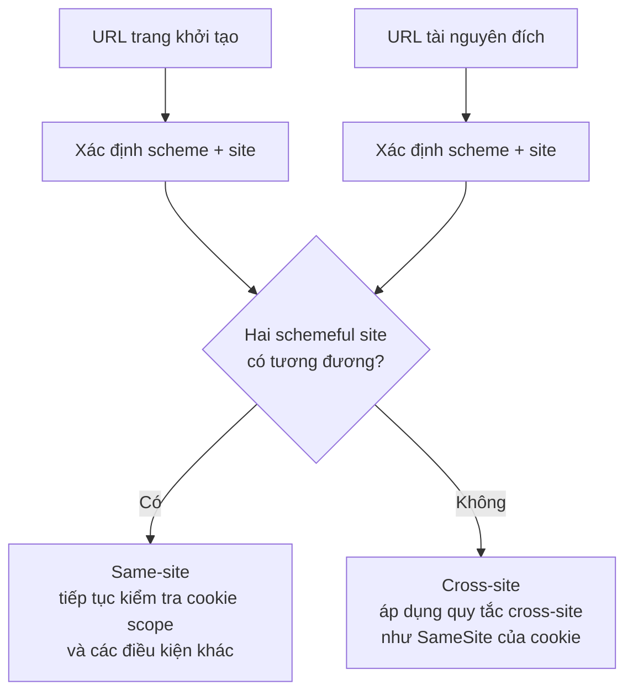

# Schemeful same-site: khi nào hai URL được xem là cùng site?

## 1. Vấn đề: “cùng tên miền” chưa đủ để kết luận cùng site

Giả sử ứng dụng web có giao diện ở `https://app.example.com` và API ở `https://api.example.com`. Hai URL này **khác origin**, nhưng thông thường **cùng site**. Ngược lại, `http://app.example.com` và `https://app.example.com` có cùng hostname nhưng **khác site** theo mô hình *schemeful same-site*.

Sự khác nhau này quyết định cách trình duyệt xử lý một số ranh giới quan trọng, đặc biệt là **cookie `SameSite`**, đồng thời ảnh hưởng đến cách diễn giải các tín hiệu như `Sec-Fetch-Site`. Nếu nhầm *site* với *origin*, người phát triển dễ gặp hai lỗi:

- Tưởng rằng hai subdomain cùng site thì JavaScript được đọc response cross-origin mà không cần CORS.
- Tưởng rằng `SameSite=Lax` hoặc `SameSite=Strict` vẫn xem việc chuyển từ HTTP sang HTTPS trên cùng một hostname là same-site.

Bài học thuộc chương **Site và origin** của module `SECURITY_APPLICATION_SECURITY_BROWSER_SECURITY`. Mục tiêu của module là hiểu ranh giới giữa trình duyệt, origin, cookie và ứng dụng; từ đó thiết kế phòng vệ XSS, CSRF, clickjacking bằng những cơ chế phù hợp như CORS, CSP, Trusted Types và security headers. Trong phạm vi bài này, trọng tâm là **cách xác định schemeful site và hệ quả bảo mật**, đặc biệt khi ứng dụng sử dụng cookie đăng nhập.

### Sau bài học, bạn cần làm được

1. Phân biệt `origin`, `registrable domain` và `schemeful site`.
2. Tự phân loại các cặp URL thành **same-origin**, **cross-origin nhưng same-site**, hoặc **cross-site**.
3. Giải thích tại sao đổi `http` thành `https` có thể thay đổi điều kiện gửi cookie `SameSite`.
4. Dự đoán cookie trong các trường hợp `fetch`, điều hướng top-level, biểu mẫu và iframe.
5. Dùng DevTools để xác minh `Origin`, `Sec-Fetch-Site`, `Cookie`, `Set-Cookie` và CORS headers mà không gộp lẫn các cơ chế.

## 2. Từ URL đến origin và schemeful site

### 2.1. Origin: scheme + host + port

Với URL HTTP(S), **origin** được xác định bằng bộ ba:

```text
origin = (scheme, host, port)
```

Ví dụ:

```text
https://app.example.com/profile
        │             └── path không thuộc origin
        └── host = app.example.com
scheme = https
port   = 443 (ngầm định)
```

`https://app.example.com` và `https://api.example.com` khác host nên khác origin. `https://app.example.com:8443` và `https://app.example.com` khác port nên cũng khác origin. Same-Origin Policy (SOP) sử dụng ranh giới origin để hạn chế quyền truy cập trực tiếp qua DOM, JavaScript và nhiều API của trình duyệt.

### 2.2. Registrable domain không phải “hai nhãn cuối hostname”

Một **registrable domain** (thường gọi là *eTLD+1*) là phần tên miền gồm **public suffix** cộng thêm một nhãn đứng ngay trước nó. Cách xác định cần tham chiếu **Public Suffix List (PSL)**, thay vì cắt chuỗi hostname theo dấu chấm.

| Hostname | Public suffix liên quan | Registrable domain |
| --- | --- | --- |
| `app.example.com` | `com` | `example.com` |
| `api.example.com` | `com` | `example.com` |
| `shop.example.co.uk` | `co.uk` | `example.co.uk` |
| `blog.example.co.uk` | `co.uk` | `example.co.uk` |

Với các nền tảng hosting chia sẻ, PSL còn có thể chứa những **private suffix** để hai khách hàng trên một dịch vụ không mặc nhiên bị xem là cùng site. Chính sách thực tế của trình duyệt và phiên bản PSL có thể ảnh hưởng kết quả. Đừng viết hàm tự lấy hai thành phần cuối hostname để kiểm tra cùng site.

### 2.3. Schemeful site: scheme + registrable domain

Với hostname có registrable domain theo mô hình thường gặp:

```text
schemeful site = (scheme, registrable domain)

https://app.example.com:8443/cart
  │               │
  │               └── registrable domain = example.com
  └── scheme = https

schemeful site → (https, example.com)
```

**Port, path, query và fragment không quyết định site.** Host có thể là các subdomain khác nhau miễn cùng registrable domain và cùng scheme.

Điểm mấu chốt của từ **schemeful** là scheme **được tính vào** phép so sánh. Trước mô hình này, cách phân loại *schemeless same-site* không phân biệt `http` và `https` khi phần domain tương ứng giống nhau; với *schemeful same-site*, chúng được xem là **cross-site**.

Đối với địa chỉ IP, `localhost`, host không có registrable domain và những URL có opaque origin, phải áp dụng quy tắc tương ứng của trình duyệt thay vì ép chúng vào công thức eTLD+1. Trong các ví dụ phát triển cục bộ thông dụng, hai cổng trên cùng `http://localhost` có thể là **same-site nhưng cross-origin**; `localhost` và `127.0.0.1` không nên coi là cùng site.

## 3. Phân loại URL: bảng đối chiếu

Lấy `https://app.example.com:443/dashboard` làm **URL mốc**:

| URL so sánh | Same-origin? | Schemeful same-site? | Lý do |
| --- | :---: | :---: | --- |
| `https://app.example.com/settings` | Có | Có | Chỉ khác path |
| `https://app.example.com:443/api` | Có | Có | Port HTTPS mặc định vẫn là 443 |
| `https://app.example.com:8443/api` | Không | Có | Port khác làm đổi origin, không làm đổi site |
| `https://api.example.com/data` | Không | Có | Subdomain khác, cùng `https` và `example.com` |
| `https://example.com/` | Không | Có | Host khác, cùng registrable domain |
| `http://app.example.com/` | Không | **Không** | Scheme HTTP khác HTTPS |
| `http://api.example.com/` | Không | **Không** | Dù cùng domain, scheme khác |
| `https://app.other-example.com/` | Không | Không | Registrable domain khác |
| `https://app.example.com.attacker.test/` | Không | Không | Host thực nằm dưới `attacker.test`, dù chứa chuỗi `example.com` |

Các trường hợp phát triển cục bộ:

| Hai URL | Quan hệ origin | Quan hệ site trong trường hợp thông thường |
| --- | --- | --- |
| `http://localhost:3000` và `http://localhost:4000` | Khác origin | Cùng site |
| `http://localhost:3000` và `https://localhost:3000` | Khác origin | Khác site vì scheme |
| `http://localhost:3000` và `http://127.0.0.1:3000` | Khác origin | Khác site |
| `https://shop.example.co.uk` và `https://api.example.co.uk` | Khác origin | Cùng site vì registrable domain là `example.co.uk` |

Khi cần phân tích một request thực tế, **đừng chỉ nhìn URL đích**: còn phải xác định nó xuất phát từ document nào, document đó có nằm trong iframe hay không, và trình duyệt đang áp dụng loại chính sách nào. Thuật ngữ *site for cookies* có những quy tắc bổ sung sẽ được giải thích ở phần sau.

## 4. Vì sao scheme được đưa vào định nghĩa same-site?

HTTP và HTTPS có mức bảo vệ truyền tải khác nhau. Nếu xem chúng là cùng site chỉ dựa trên hostname, một trang HTTP kém tin cậy hơn có thể được đối xử giống trang HTTPS khi browser xác định ngữ cảnh gửi cookie.

Ví dụ:

```text
Trang khởi tạo: http://app.example.com
API đích:       https://api.example.com

Theo site không xét scheme: (example.com) == (example.com)
Theo schemeful site:       (http, example.com) != (https, example.com)
Kết quả: cross-site
```

Việc phân loại cross-site giúp các cơ chế như `SameSite` không vô tình coi một request bắt nguồn từ HTTP là tương đương request từ HTTPS chỉ vì có chung registrable domain. **Schemeful same-site không nâng cấp HTTP thành HTTPS, không tự mã hóa dữ liệu và không thay thế xác thực.** Nó thay đổi cách đánh giá quan hệ site để những chính sách sử dụng site có thể ra quyết định chặt chẽ hơn.



Sơ đồ trên minh họa phép so sánh cơ bản. Với **iframe và các chuỗi điều hướng phức tạp**, site được sử dụng để quyết định gửi cookie còn phụ thuộc ngữ cảnh tổ tiên, nên một URL “trông có vẻ cùng site” vẫn có thể chịu hạn chế cross-site.

## 5. Ảnh hưởng trực tiếp: cookie `SameSite`

Cookie phiên thường được server đặt bằng `Set-Cookie`; browser quyết định cookie có được lưu/gửi trên request tiếp theo hay không. Thuộc tính **`SameSite`** dùng quan hệ site để hạn chế việc cookie được gửi trong những ngữ cảnh cross-site.

Ví dụ một cookie phiên trên HTTPS:

```http
Set-Cookie: __Host-session=opaque-session-id; Path=/; Secure; HttpOnly; SameSite=Lax
```

Trong ví dụ này:

- `Secure`: chỉ gửi cookie qua ngữ cảnh kết nối an toàn theo quy tắc browser.
- `HttpOnly`: JavaScript không đọc cookie qua `document.cookie`.
- `SameSite=Lax`: giới hạn gửi cookie trong một số ngữ cảnh cross-site.
- Prefix `__Host-`: yêu cầu cookie có `Secure`, `Path=/` và **không có `Domain`**. Cookie vì vậy được ràng buộc với host thiết lập, dù điều kiện *same-site* vẫn là một phép kiểm tra riêng.

**SameSite không thay thế cookie scope.** Trước khi cookie có thể được gửi, browser còn phải xét host/domain phù hợp, path, thời hạn, Secure, chính sách lưu trữ/third-party cookie, ngữ cảnh request và các giới hạn khác. Có cùng site **không** có nghĩa mọi cookie của subdomain A sẽ tự động được gửi đến subdomain B.

### 5.1. `Strict`, `Lax`, `None` khác nhau như thế nào?

| Thuộc tính | Hành vi chính |
| --- | --- |
| `SameSite=Strict` | Cookie chỉ được gửi trong ngữ cảnh được xem là same-site theo quy tắc tương ứng |
| `SameSite=Lax` | Gửi trong ngữ cảnh same-site; ngoài ra thường gửi trong **điều hướng top-level** cross-site dùng phương thức **safe** (ví dụ GET), nếu các điều kiện khác cho phép |
| `SameSite=None; Secure` | Không hạn chế cookie chỉ vì quan hệ site, nhưng vẫn phải qua các kiểm tra khác và có thể bị chính sách third-party cookie của browser chặn |

Một số browser áp dụng `Lax` theo mặc định khi cookie không khai báo `SameSite`, đôi khi có ngoại lệ ngắn hạn cho một số `POST` top-level ngay sau khi cookie được đặt. **Không phụ thuộc vào ngoại lệ hoặc mặc định này để bảo vệ CSRF**; hãy khai báo `SameSite` rõ ràng và kiểm tra phía server.

### 5.2. Ma trận request và cookie

Giả sử cookie hợp lệ cho **host đích `api.example.com`**, chưa hết hạn, và mọi điều kiện ngoài `SameSite` đều được thỏa. Cột dưới cho biết **ảnh hưởng riêng của `SameSite`**, không phải cam kết cookie thực tế luôn được gửi.

| Trang/ngữ cảnh khởi tạo → đích | Quan hệ site | `Strict` | `Lax` | `None; Secure` |
| --- | --- | :---: | :---: | :---: |
| `https://app.example.com` gọi `fetch` → `https://api.example.com` | Same-site | Cho phép | Cho phép | Cho phép |
| `http://app.example.com` gọi `fetch` → `https://api.example.com` | **Cross-site** do scheme | Chặn | Chặn | Có thể cho phép |
| `https://external.test` gọi `fetch` → `https://api.example.com` | Cross-site | Chặn | Chặn | Có thể cho phép |
| Người dùng nhấp liên kết từ `https://external.test` tới `https://api.example.com/page` bằng top-level GET | Cross-site | Chặn | Thường cho phép | Có thể cho phép |
| Trang `https://external.test` gửi top-level form `POST` → `https://api.example.com` | Cross-site | Chặn | Thông thường chặn | Có thể cho phép |
| `https://external.test` nhúng `https://api.example.com` qua iframe | Cross-site | Chặn | Chặn | Có thể cho phép |

Ở cột `None; Secure`, “có thể cho phép” có nghĩa **SameSite không chặn vì quan hệ site**; cookie thực tế còn phụ thuộc third-party cookie blocking, phân vùng cookie, quyền riêng tư, sandbox, chính sách browser và phạm vi cookie. Bảng không mô tả các ngoại lệ đặc thù của từng trình duyệt.

Điểm đáng chú ý: **cross-origin nhưng same-site** vẫn đủ điều kiện theo `SameSite=Strict` hoặc `Lax` khi cookie phù hợp host đích. Tuy nhiên, **cross-site do khác scheme** có thể khiến cookie `Lax` không được gửi với `fetch`, ngay cả khi tên miền đăng ký giống nhau.

### 5.3. “Site for cookies” còn phụ thuộc vào iframe và tổ tiên

Trong các quyết định liên quan đến cookie, browser không luôn chỉ so sánh URL của document đang chạy với URL request đích. Trình duyệt còn xác định **site for cookies** dựa trên ngữ cảnh của tài liệu, bao gồm quan hệ với tài liệu top-level và các ancestor của iframe.

Ví dụ:

```text
https://partner.test                   (trang top-level)
└── iframe https://app.example.com     (cross-site với top-level)
    └── fetch https://api.example.com  (cùng schemeful site với iframe)
```

Nếu chỉ nhìn hai URL cuối, `app.example.com` và `api.example.com` có cùng schemeful site. Tuy vậy, **iframe đang nằm trong ngữ cảnh nhúng cross-site**; browser có thể coi site for cookies của tài liệu nhúng là opaque/cross-site, khiến cookie `Lax` hoặc `Strict` không được gửi với request mà bạn tưởng là “nội bộ”. Các cơ chế cookie partitioning và chặn third-party cookie còn có thể tạo thêm khác biệt.

Khi phân tích lỗi cookie trong iframe, hãy ghi lại **toàn bộ chuỗi top-level → iframe → request**, không chỉ hai hostname liên quan trực tiếp.

## 6. Same-site không cấp quyền đọc response: vai trò riêng của SOP và CORS

Đây là một nhầm lẫn rất phổ biến:

```text
Trang: https://app.example.com
API:   https://api.example.com

So sánh site:   SAME-SITE
So sánh origin: CROSS-ORIGIN (host khác)
```

JavaScript từ trang app muốn **đọc** API bằng `fetch` vẫn phải tuân thủ SOP/CORS. Không thể bỏ qua CORS chỉ vì hai dịch vụ cùng site.

Ví dụ phía client:

```js
const response = await fetch("https://api.example.com/profile", {
  credentials: "include"
});

if (!response.ok) throw new Error("Không lấy được hồ sơ");
const profile = await response.json();
```

Với cross-origin `fetch`, chế độ credentials mặc định là `same-origin`. Do đó, nếu cần browser gửi cookie tới API khác origin, cần lựa chọn `credentials: "include"` một cách có chủ đích. Cookie được gửi hay không vẫn do `SameSite`, cookie scope và chính sách browser quyết định.

API phải trả những CORS headers phù hợp khi cho phép frontend đọc response có credentials:

```http
Access-Control-Allow-Origin: https://app.example.com
Access-Control-Allow-Credentials: true
Vary: Origin
```

Không dùng `Access-Control-Allow-Origin: *` để JavaScript đọc credentialed CORS response; browser sẽ từ chối tổ hợp wildcard và credentials.

Phân biệt rõ ba câu hỏi:

| Câu hỏi | Cơ chế liên quan |
| --- | --- |
| Hai URL có cùng origin không? | So sánh scheme + host + port |
| Request có đi kèm cookie đăng nhập không? | Cookie scope, `SameSite`, credentials mode, Secure, chính sách browser |
| JavaScript có đọc được response cross-origin không? | SOP và chính sách CORS do browser thực thi |

Ngay cả khi CORS cho phép đọc response, server vẫn phải **xác thực và phân quyền**. CORS không phải hệ thống đăng nhập.

## 7. Schemeful same-site và CSRF: những ranh giới không thể bỏ qua

**Cross-Site Request Forgery (CSRF)** xảy ra khi một bên khác khiến trình duyệt của người dùng đã đăng nhập gửi request thay đổi trạng thái tới ứng dụng, sử dụng credentials mà browser tự gắn và server thiếu kiểm tra ý định hợp lệ.

Schemeful same-site hỗ trợ hạn chế một số cookie gắn với request cross-site; tuy nhiên, nó **không phải cơ chế phòng vệ CSRF đầy đủ**:

1. **Same-site không đồng nghĩa cùng mức tin cậy.** Một subdomain do đối tác quản lý hoặc bị chiếm quyền có thể là *same-site nhưng cross-origin* với ứng dụng chính. Ví dụ `https://promo.example.com` và `https://bank.example.com` thường cùng site, nên `SameSite=Strict` không tự chặn request do trang `promo` khởi tạo tới `bank` nếu cookie phù hợp đích.
2. **`SameSite=Lax` có trường hợp ngoại lệ điều hướng top-level an toàn.** Vì thế server không được dùng `GET` cho thao tác thay đổi trạng thái.
3. **Cookie có `SameSite=None` và một số trường hợp browser đặc thù** làm phát sinh những luồng cross-site khác nhau.
4. **Máy khách ngoài browser** và mã chạy do XSS trong origin ứng dụng không bị ngăn bởi cookie `SameSite` theo cách một trang cross-site bị giới hạn.

Với endpoint nhạy cảm như đổi email, tạo giao dịch, đổi mật khẩu, server nên triển khai kết hợp:

- CSRF token không thể đoán trước và được kiểm tra phía server, hoặc cơ chế tương đương được thiết kế chặt chẽ.
- Kiểm tra `Origin` theo danh sách origin thực sự được phép; có thể dùng `Referer` phù hợp làm tín hiệu dự phòng.
- Phân tích Fetch Metadata (`Sec-Fetch-Site`, `Sec-Fetch-Mode`, `Sec-Fetch-Dest`) khi browser cung cấp, với xử lý tương thích cho client không gửi các header đó.
- Cookie có phạm vi tối thiểu và `SameSite` phù hợp; xác thực và phân quyền cho từng hành động.

**Không đồng nhất “same-site” với “trusted”.** Nếu ứng dụng có các subdomain không cùng mức quản trị, việc tự động cho phép tất cả request `Sec-Fetch-Site: same-site` có thể để lọt tấn công từ subdomain không đáng tin.

### Fetch Metadata quan sát được gì?

Với nhiều request từ trình duyệt hiện đại, server có thể nhận một trong các giá trị:

```http
Sec-Fetch-Site: same-origin
Sec-Fetch-Site: same-site
Sec-Fetch-Site: cross-site
Sec-Fetch-Site: none
```

`same-origin` biểu thị quan hệ cùng origin; `same-site` biểu thị cùng site nhưng khác origin trong bối cảnh thích hợp; `cross-site` biểu thị request có ngữ cảnh cross-site; `none` thường xuất hiện ở một số điều hướng trực tiếp do người dùng khởi tạo. Đây là **metadata do browser tạo** để máy chủ đánh giá ngữ cảnh, không phải bằng chứng xác thực danh tính. Các quy tắc phát sinh giá trị có thể phụ thuộc chuỗi redirect, iframe và loại request.

Không phải mọi client hay phiên bản browser đều gửi các header này. Đừng coi request thiếu Fetch Metadata là có cùng mức tin cậy với request hợp lệ đã được xác minh.

## 8. Tình huống triển khai: chuyển hệ thống từ HTTP sang HTTPS

Giả sử ứng dụng đang từng bước nâng cấp:

```text
Giai đoạn chuyển tiếp:
  Frontend: http://app.example.com
  API:      https://api.example.com

Giai đoạn hoàn chỉnh:
  Frontend: https://app.example.com
  API:      https://api.example.com
```

Trong giai đoạn chuyển tiếp, frontend và API là **cross-site theo schemeful same-site**, dù có chung registrable domain. Một cookie `SameSite=Lax` dành cho API có thể không được gửi trong lời gọi `fetch` từ trang frontend HTTP. Khi cả hai chuyển sang HTTPS, cặp URL lại trở thành **same-site**, nhưng vẫn là **cross-origin**, nên các yêu cầu CORS tiếp tục có hiệu lực.

| Vấn đề quan sát | Khi frontend HTTP gọi API HTTPS | Sau khi frontend và API đều HTTPS |
| --- | --- | --- |
| Quan hệ schemeful site | Cross-site | Same-site |
| Quan hệ origin | Cross-origin | Cross-origin |
| Cookie `SameSite=Lax` với `fetch` | Bị hạn chế bởi SameSite | Có thể gửi nếu các điều kiện cookie/credentials khác phù hợp |
| Quyền đọc response API | Vẫn cần CORS | Vẫn cần CORS |
| Bảo vệ chống nghe lén của trang frontend | HTTP chưa được bảo vệ bởi TLS | HTTPS bảo vệ kết nối |

**Cách triển khai hợp lý:** chuyển trang frontend và các tài nguyên nhạy cảm sang HTTPS một cách nhất quán; xác định redirect, cookie `Secure`, CORS allowlist và đường dẫn đăng nhập theo URL thực tế; kiểm thử các luồng qua iframe/popup nếu có; cân nhắc HSTS khi toàn bộ host/subdomain cần thiết đã sẵn sàng. Không dùng `SameSite=None` chỉ để “chữa” lỗi cookie trong quá trình chuyển đổi mà chưa hiểu lý do hệ thống có request cross-site.

Lưu ý: HTTP → HTTPS là chuyển sang bảo mật truyền tải tốt hơn, nhưng việc **đang có trang HTTP làm initiator** vẫn tạo ra ranh giới schemeful site khác với một trang HTTPS. Trình duyệt có thể tự nâng cấp một số request qua HSTS; khi đó cần xem **URL được sử dụng sau nâng cấp** trong DevTools.

## 9. Thực hành A: cross-origin nhưng same-site trên localhost

Bài thực hành này giúp kiểm chứng rằng **port khác nhau làm đổi origin nhưng không làm đổi site**. Dùng Node.js đã cài sẵn. Trong một thư mục thử nghiệm riêng, tạo file `site-lab.js` với nội dung:

```js
const http = require("node:http");

const appOrigin = "http://localhost:3000";
const apiOrigin = "http://localhost:4000";

const page = `<!doctype html>
<html lang="vi">
<meta charset="utf-8">
<title>Schemeful site demo</title>
<h1>Trang http://localhost:3000</h1>
<p>Hai cổng trên localhost là cross-origin nhưng same-site.</p>
<button id="session">Tạo cookie demo</button>
<button id="inspect">Đọc kết quả từ API</button>
<pre id="output"></pre>
<script>
  const output = document.querySelector("#output");

  async function callApi(path, method = "GET") {
    try {
      const result = await fetch("http://localhost:4000" + path, {
        method,
        credentials: "include"
      });
      const data = await result.json();
      output.textContent += JSON.stringify(data, null, 2) + "\\n";
    } catch (error) {
      output.textContent += "Request lỗi: " + error.message + "\\n";
    }
  }

  document.querySelector("#session").onclick =
    () => callApi("/session", "POST");
  document.querySelector("#inspect").onclick =
    () => callApi("/inspect");
</script>
</html>`;

http.createServer((req, res) => {
  res.writeHead(200, { "Content-Type": "text/html; charset=utf-8" });
  res.end(page);
}).listen(3000, "localhost", () => {
  console.log("App: " + appOrigin);
});

http.createServer((req, res) => {
  res.setHeader("Access-Control-Allow-Origin", appOrigin);
  res.setHeader("Access-Control-Allow-Credentials", "true");
  res.setHeader("Vary", "Origin");

  if (req.url === "/session" && req.method === "POST") {
    // Chỉ dùng trong lab HTTP localhost: không có dữ liệu/phiên thật.
    res.setHeader(
      "Set-Cookie",
      "lab_session=demo; Path=/; HttpOnly; SameSite=Lax"
    );
  }

  res.setHeader("Content-Type", "application/json; charset=utf-8");
  const cookie = req.headers.cookie || "";
  res.end(JSON.stringify({
    route: req.url,
    origin: req.headers.origin || null,
    secFetchSite: req.headers["sec-fetch-site"] || null,
    cookieReceived: cookie.split(";").some(
      part => part.trim() === "lab_session=demo"
    )
  }));
}).listen(4000, "localhost", () => {
  console.log("API: " + apiOrigin);
});
```

Chạy trong thư mục chứa file:

```bash
node site-lab.js
```

Mở `http://localhost:3000`, vào **DevTools → Network** và **Application/Storage → Cookies**, nhấn **Tạo cookie demo** rồi **Đọc kết quả từ API**.

**Điều cần quan sát:**

1. Request đến `localhost:4000` là **cross-origin** vì port khác. Với trình duyệt hỗ trợ Fetch Metadata, `Sec-Fetch-Site` thường là `same-site`.
2. Response từ API có CORS headers cho `http://localhost:3000`; nếu bỏ `Access-Control-Allow-Origin`, JavaScript sẽ không đọc được response dù request có thể đã đến API.
3. Sau khi đặt cookie `SameSite=Lax`, request `GET /inspect` có thể gửi `lab_session` vì hai URL cùng schemeful site và lời gọi dùng `credentials: "include"`.
4. Cookie HTTP không có `Secure` trong bài chỉ là **dữ liệu giả cho môi trường cục bộ**. Khi triển khai phiên đăng nhập thật, cần HTTPS, `Secure`, `HttpOnly` và kiểm tra CSRF ở server.
5. **Cookie không được cô lập theo port.** Cookie host-only của `localhost` có thể áp dụng cho các cổng khác trên cùng host, khác với origin của JavaScript. Đừng dùng hai cổng như hai miền bảo mật cookie độc lập.

Đổi `credentials: "include"` thành mặc định (`same-origin`) rồi thử lại: JavaScript có thể vẫn gọi API thành công về mặt CORS nếu server cho phép, nhưng cookie dành cho request cross-origin không còn được gửi theo chế độ credentials mặc định. Dùng cửa sổ riêng hoặc xóa cookie lab trước khi kiểm thử lại nếu trạng thái đã tồn tại.

### Thực hành B: khác scheme ngay trên cùng hostname

Phép thử tiếp theo cần **một server HTTPS có chứng chỉ hợp lệ và được browser tin cậy** (có thể dùng chứng chỉ phát triển tin cậy do công cụ nội bộ tạo). Dùng:

```text
Trang khởi tạo: http://localhost:3000
API đích:       https://localhost:4443
```

Tại API HTTPS, thử đặt cookie `Secure; HttpOnly; SameSite=Lax` phù hợp và tạo endpoint chỉ trả giá trị boolean cho biết browser có gửi cookie hay không. Thử `fetch(..., { credentials: "include" })` từ trang HTTP, rồi đổi trang khởi tạo thành HTTPS trên một cổng khác và thử lại. Kiểm tra CORS allowlist phù hợp ở mỗi lần.

| Phép thử | Quan hệ schemeful site dự kiến | Quan sát về cookie `Lax` qua `fetch` |
| --- | --- | --- |
| `http://localhost:3000` → `https://localhost:4443` | Cross-site | Thông thường bị SameSite hạn chế |
| `https://localhost:3000` → `https://localhost:4443` | Same-site | Có thể gửi nếu cookie scope, credentials và các quy tắc khác cho phép |

Đây là **thử nghiệm bổ sung**; không sửa tập tin lab thành HTTP giả dạng HTTPS và không bỏ qua cảnh báo chứng chỉ TLS để coi là một kết quả production hợp lệ. Một số browser có ngoại lệ dành riêng cho `localhost`, vì vậy nên kiểm chứng tương tự trên các hostname phát triển có HTTPS tin cậy nếu cần kết luận về môi trường triển khai thực tế.

## 10. Những sai lầm phổ biến và cách nhận diện

| Nhận định dễ sai | Cách hiểu đúng |
| --- | --- |
| “Cùng `example.com` là cùng origin.” | Subdomain khác vẫn khác origin; cùng site không miễn SOP. |
| “Port khác thì cũng khác site.” | Port thuộc origin, thông thường **không** thuộc schemeful site. |
| “HTTP và HTTPS trên cùng host là same-site.” | Khác scheme nên **cross-site** theo schemeful same-site. |
| “Để tìm site, cứ lấy hai nhãn cuối hostname.” | Registrable domain cần Public Suffix List; ví dụ `example.co.uk`. |
| “`SameSite=Strict` chỉ cho request same-origin.” | `Strict` kiểm tra site; request cross-origin nhưng same-site vẫn có thể gửi cookie phù hợp. |
| “CORS cho phép cookie được gửi.” | CORS kiểm soát quyền đọc response; cookies còn chịu credentials mode, SameSite, scope và chính sách browser. |
| “SameSite=Lax chặn mọi CSRF.” | `Lax` có ngoại lệ top-level safe navigation; cùng site còn có thể chứa subdomain không đáng tin. |
| “Nếu hai URL cùng site thì cookie sẽ giống nhau.” | Cookie còn có domain/host/path và flags; site là điều kiện bổ sung. |
| “Iframe từ `app.example.com` tới `api.example.com` luôn được xem same-site cho cookie.” | Ngữ cảnh top-level/ancestor cross-site và partitioning có thể thay đổi xử lý cookie. |
| “`Sec-Fetch-Site: same-site` đồng nghĩa request an toàn.” | Đây là tín hiệu ngữ cảnh, không phải xác thực; subdomain cùng site vẫn có thể bị kiểm soát bởi bên không tin cậy. |

## 11. Bài tập tình huống: thiết kế cookie cho ứng dụng nhiều subdomain

**Bối cảnh:** một công ty vận hành `https://shop.example.com` (giao diện), `https://api.example.com` (API), `https://promo.example.com` (trang chiến dịch do bên thứ ba phát triển) và `https://help.example.net` (trang trợ giúp). API sử dụng cookie phiên và có endpoint đổi địa chỉ giao hàng.

Hãy thực hiện theo các bước:

1. Lập ma trận **same-origin/same-site/cross-site** giữa bốn URL; chỉ ra trang nào cùng site nhưng **không nên mặc nhiên được tin cậy**.
2. Thiết kế cookie phiên host-only cho API, chẳng hạn `__Host-session` trên HTTPS, và mô tả vì sao `Domain=.example.com` làm mở rộng phạm vi cookie không cần thiết.
3. Viết cấu hình CORS cho phép `shop.example.com` đọc response credentialed của API và từ chối việc cho JavaScript ở `promo.example.com` đọc dữ liệu nhạy cảm khi không được phép.
4. Thiết kế bảo vệ CSRF ở endpoint đổi địa chỉ: token được server xác minh, kiểm tra `Origin`, và kiểm tra phân quyền. Giải thích vì sao trang `promo.example.com` là một trường hợp cần xem xét dù cùng site.
5. Phân tích hai thời điểm triển khai: `http://shop.example.com` gọi `https://api.example.com`, sau đó `https://shop.example.com` gọi cùng API. Dự đoán ảnh hưởng schemeful same-site đến cookie `Lax`.
6. Thử đặt ứng dụng vào iframe của `help.example.net` và ghi nhận tình trạng cookie; nếu có tích hợp cần thiết, đánh giá thiết kế giao tiếp và framing phù hợp, thay vì chỉ nới `SameSite` vô điều kiện.

**Mẫu bảng báo cáo:**

| Luồng thử | Origin/site | Cookie dự kiến | Browser cho JS đọc response? | Server có cho phép hành động? | Bằng chứng |
| --- | --- | --- | --- | --- | --- |
| Shop HTTPS → API HTTPS | Cross-origin, same-site | Tùy scope, credentials, SameSite | Tùy CORS | Tùy auth/authorization | Network + headers |
| Shop HTTP → API HTTPS | Cross-origin, cross-site | `Lax` bị hạn chế với `fetch` | Tùy CORS | Tùy auth/authorization | Network + Cookies |
| Promo HTTPS → API HTTPS | Cross-origin, same-site | Có thể gửi | Không nếu CORS không cho đọc | Phải từ chối yêu cầu nhạy cảm không hợp lệ | Network + log server |
| Help → iframe Shop → API | Có chuỗi nhúng cross-site | Cần kiểm thử theo site for cookies/third-party policy | Tùy CORS | Tùy auth/authorization | Frame tree + Network |

**Đạt yêu cầu** khi có thể giải thích từng kết quả bằng đúng lớp: phép so sánh site, cookie scope và SameSite, quyền đọc CORS, hoặc việc server từ chối do kiểm tra bảo mật. Việc response trả HTTP 200, Console báo CORS hay cookie vắng mặt là các hiện tượng khác nhau, phải ghi nhận bằng chứng riêng.

## 12. Câu hỏi tự kiểm tra

**Câu 1.** `https://app.example.com:8443` và `https://api.example.com` có cùng origin và cùng site không?  
**Đáp án:** Khác origin (host và có thể port khác), nhưng cùng schemeful site `(https, example.com)`.

**Câu 2.** `http://app.example.com` và `https://app.example.com` khác nhau thế nào khi xét cookie `SameSite`?  
**Đáp án:** Chúng khác schemeful site nên được xem cross-site trong các phép kiểm tra tương ứng; `Lax` và `Strict` có thể hạn chế cookie với `fetch` giữa hai URL này.

**Câu 3.** Vì sao `https://shop.example.co.uk` và `https://api.example.co.uk` thường là same-site?  
**Đáp án:** Public suffix là `co.uk`; registrable domain chung là `example.co.uk`; scheme đều `https`.

**Câu 4.** Một `fetch` từ `https://app.example.com` đến `https://api.example.com` có mặc nhiên kèm cookie vì same-site không?  
**Đáp án:** Không. Hai URL cross-origin; `fetch` mặc định dùng credentials mode `same-origin`. Cần chọn `credentials: "include"` nếu phù hợp và cookie phải vượt qua mọi kiểm tra áp dụng.

**Câu 5.** `SameSite=Strict` có bảo vệ endpoint đổi email khỏi một subdomain cùng site bị chiếm quyền không?  
**Đáp án:** Không đầy đủ. Trang subdomain cùng scheme/site có thể khởi tạo request được xem same-site; endpoint cần CSRF token, kiểm tra nguồn và phân quyền phía server.

**Câu 6.** Tại sao iframe `https://app.example.com` nằm trong trang `https://partner.test` có thể không gửi cookie `Lax` đến `https://api.example.com`?  
**Đáp án:** Site for cookies của iframe còn chịu ảnh hưởng từ ngữ cảnh top-level/ancestor cross-site, đồng thời browser có thể chặn hoặc phân vùng third-party cookie.

**Câu 7.** Nếu Network xuất hiện `Sec-Fetch-Site: same-site` nhưng Console báo CORS, đây có phải mâu thuẫn không?  
**Đáp án:** Không. Same-site và same-origin là hai phép so sánh khác nhau; CORS áp dụng cho quyền đọc response cross-origin.

### Ghi nhớ

**Schemeful same-site = cùng scheme và cùng site theo quy tắc registrable domain (với các trường hợp host đặc biệt được xử lý riêng).** Port thường không làm đổi site; **HTTP khác HTTPS** ngay cả trên cùng hostname. Kết quả same-site ảnh hưởng đến các chính sách như cookie `SameSite`, nhưng không trao quyền đọc DOM/response xuyên origin và không bảo đảm request an toàn. Khi thiết kế ứng dụng thực tế, hãy luôn kiểm tra riêng **origin → site for cookies → cookie scope → CORS → xác thực, phân quyền và CSRF phía server**.
