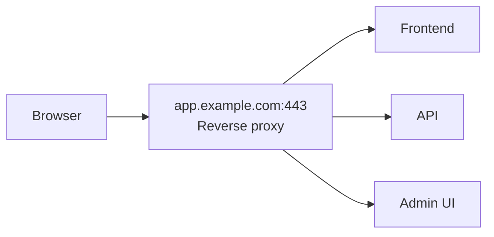
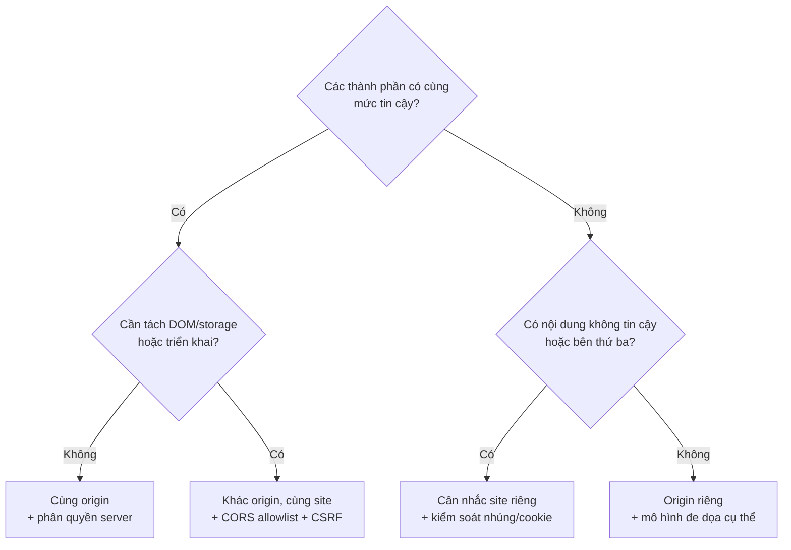

# Đánh đổi site và origin

Khi thiết kế ứng dụng web, lựa chọn **đặt giao diện, API, nội dung người dùng và dịch vụ đăng nhập ở cùng origin, khác origin nhưng cùng site, hay ở các site riêng** quyết định trực tiếp đến khả năng cách ly, cách gửi cookie, cách chia sẻ dữ liệu và độ phức tạp vận hành. Không có một cách bố trí tên miền phù hợp với mọi hệ thống: ranh giới càng tách bạch có thể càng giảm phạm vi ảnh hưởng của mã độc, nhưng thường cần thêm CORS, cơ chế trao đổi thông điệp, cấu hình cookie và kiểm thử tích hợp.

Bài học thuộc chương **Site và origin** của module **Browser Security** (`SECURITY_APPLICATION_SECURITY_BROWSER_SECURITY`). Nội dung phân tích ranh giới giữa trình duyệt, origin, cookie và ứng dụng web để làm rõ **Same-Origin Policy (SOP)**, **CORS**, cơ chế cách ly, và quan hệ với phòng vệ **XSS, CSRF, clickjacking** bằng **CSP, Trusted Types, security headers** cùng kiểm chứng thực tế.

## 1. Mục tiêu học tập

Sau khi học, bạn có thể:

1. Xác định hai URL **same-origin**, **cross-origin nhưng same-site**, hay **cross-site**; giải thích tại sao việc phân loại quan trọng.
2. Đánh giá lợi ích và chi phí bảo mật khi dùng chung origin hoặc tách subdomain/site cho frontend, API, SSO, nội dung người dùng và bên thứ ba.
3. Phân biệt ranh giới **SOP/CORS/DOM/storage** với ranh giới **SameSite/cookie/CSRF**.
4. Thiết kế luồng đăng nhập và API bằng cookie có phạm vi tối thiểu, CORS allowlist và xác thực/phân quyền ở server.
5. Nhận diện rủi ro từ **subdomain không đáng tin cậy**, Domain cookie, iframe, `postMessage` và cơ chế cách ly.
6. Dùng DevTools quan sát một cặp URL **cùng site nhưng khác origin** và kiểm chứng cookie được gửi độc lập với quyền đọc response.

## 2. Site và origin: giống tên nhưng khác mục đích

### 2.1. Origin là ranh giới của nhiều quyền JavaScript

Trong ngữ cảnh HTTP(S) thông thường, **origin = scheme + host + port**. Browser so sánh chính xác ba thành phần này; path, query và fragment không tính vào origin.

```text
https://app.example.com:443/account?id=42
  │      │              │
  │      │              └── port 443 (mặc định của HTTPS)
  │      └───────────────── host app.example.com
  └──────────────────────── scheme https

Origin chuẩn hóa: https://app.example.com
```

Hai tài liệu cùng origin nhìn chung có thể tương tác với DOM của nhau theo các API được phép, chia sẻ một số storage theo origin và gửi `fetch()` cùng origin mà không cần CORS. **SOP** áp đặt giới hạn mạnh hơn khi mã web muốn đọc dữ liệu từ origin khác. Origin cũng liên quan đến phạm vi của `localStorage`, `IndexedDB`, Service Worker và các Web API khác; trình duyệt có thể áp dụng thêm cách phân vùng lưu trữ trong ngữ cảnh bên thứ ba.

### 2.2. Site là ranh giới quan trọng đối với cookie

Đối với các quy tắc *schemeful same-site* hiện đại, **site** thường gồm **scheme + registrable domain**. Registrable domain được xác định dựa trên **Public Suffix List (PSL)**, vì thế không thể luôn cắt lấy đúng hai nhãn cuối của hostname.

Ví dụ, `shop.example.co.uk` và `api.example.co.uk` có cùng registrable domain là `example.co.uk`. Trong ví dụ HTTP(S) dưới đây, `https://app.example.com` và `https://api.example.com` **cùng site** nhưng **khác origin**. Ngược lại, `http://app.example.com` và `https://app.example.com` khác cả origin lẫn *schemeful site* do khác scheme.

Quy tắc site có các trường hợp đặc biệt cho host như IP, `localhost` và scheme đặc biệt; khi thiết kế cookie trên hệ thống thực, cần kiểm tra hành vi của browser mục tiêu.

### 2.3. Ma trận phân loại hai URL

Giả sử tài liệu hiện tại là `https://app.example.com/dashboard`:

| URL cần truy cập | Same-origin? | Same-site? | Điều cần nhớ |
| --- | :---: | :---: | --- |
| `https://app.example.com/api/me` | Có | Có | JavaScript gọi cùng origin; không có bài toán CORS xuyên origin |
| `https://api.example.com/me` | Không | Có | JavaScript cần xét CORS nếu muốn đọc response; cookie `SameSite` vẫn xem là same-site |
| `https://app.example.com:8443/me` | Không | Có | Port phân tách origin nhưng không phân tách site; cookie không lấy port làm ranh giới |
| `http://app.example.com/me` | Không | Không | Khác scheme; còn có vấn đề bảo mật khi đi từ HTTPS xuống HTTP |
| `https://login.example.net/authorize` | Không | Không | Cross-site; cookie và luồng đăng nhập chịu quy tắc khác |
| `https://evil.example.com/page` | Không | Có | Nếu là subdomain kém tin cậy, **same-site không có nghĩa cùng mức tin cậy** |

**Ba khái niệm cần tách riêng:**

- **Same-origin**: quyền tương tác của script, DOM và nhiều API/storage được quyết định phần lớn theo origin.
- **Same-site**: các chính sách như cookie `SameSite` và request metadata `Sec-Fetch-Site` phân loại quan hệ ở mức site.
- **Same-application/same-owner**: quan hệ nghiệp vụ do tổ chức xác định; browser **không** tự biết hai subdomain có thuộc cùng đội quản lý hay an toàn ngang nhau.

## 3. Những quyền thực sự thay đổi khi tách origin hoặc site

| Tài nguyên / cơ chế | Phân chia chủ yếu theo | Hệ quả thiết kế |
| --- | --- | --- |
| Đọc DOM của iframe/cửa sổ | Origin, cùng các hạn chế sandbox và chính sách browser | Tách origin giảm khả năng đọc trực tiếp DOM; có thể dùng `postMessage` được kiểm tra chặt |
| `fetch()` / XHR đọc response | Origin và CORS, cùng các chính sách bổ sung | API khác origin cần response CORS hợp lệ nếu mã browser muốn đọc |
| `localStorage`, `IndexedDB` | Origin; đôi khi còn bị phân vùng theo top-level site/ngữ cảnh | Tách origin giúp chia kho lưu trữ; không nên giả định storage nhúng bên thứ ba luôn truy cập như first-party |
| Cookie `Domain`, host-only, `Path` | Host/domain và path của URL request; không theo port | Khác port vẫn có thể nhận cùng cookie; `Path` không tạo biên giới tin cậy tương đương origin |
| Cookie `SameSite` | Site của request so với ngữ cảnh site | Tách subdomain mà vẫn cùng site không tự chặn CSRF từ subdomain bị chiếm |
| CSP `script-src`, `connect-src` | Chính sách tài liệu và danh sách nguồn được cho phép | Tách origin có thể làm tăng số điểm phải khai báo và kiểm thử CSP |
| Framing (`frame-ancestors`) | Chính sách response của trang bị nhúng | Có thể ngăn clickjacking, không phụ thuộc đơn thuần vào việc same-site |
| Service Worker | Origin và scope theo path đăng ký | Không thể dùng một Service Worker thông thường để điều khiển mọi subdomain tùy ý |
| HTTP client trên server | Mạng, xác thực và chính sách server | Không chịu browser SOP/CORS; phải bảo vệ quyền truy cập và tránh SSRF |

Không được suy từ một ranh giới sang ranh giới khác. Ví dụ **cookie được browser đính kèm** vào request không đồng nghĩa **JavaScript được đọc response**; **API cho phép CORS** cũng không có nghĩa người gọi được cấp quyền với tài khoản.

## 4. Đánh đổi thứ nhất: dùng chung một origin

Giả sử doanh nghiệp dùng reverse proxy để công bố cả giao diện và API dưới một host:

```text
https://app.example.com/         -> frontend
https://app.example.com/api/...  -> backend API
https://app.example.com/admin/   -> trang quản trị
```



**Điểm thuận lợi:**

- Frontend gọi `/api/orders` theo đường dẫn tương đối; browser không cần kiểm tra CORS xuyên origin cho request đó.
- Cookie host-only có thể dùng cho nhiều đường dẫn hợp lệ trên cùng host, giảm cấu hình cross-origin `credentials`.
- Triển khai HTTPS, redirect, observability và quản lý DNS có thể tập trung qua một điểm vào.
- Một số luồng đăng nhập và chia sẻ trạng thái giao diện đơn giản hơn.

**Chi phí và giới hạn bảo mật:**

- Các ứng dụng cùng origin chia sẻ ranh giới SOP. Nếu một trang ít tin cậy bị XSS, mã chạy ở origin đó có thể có quyền truy cập nhiều DOM API, storage và endpoint cùng origin hơn mong muốn.
- Tách đường dẫn `/admin` và `/blog` **không** tự tạo cách ly origin. `Path` của cookie hoặc route của proxy không phải lớp phân quyền đáng tin cậy.
- Một Service Worker có scope rộng được cài từ cùng origin có thể tác động đến nhiều request trong scope của nó; cần quản lý quyền phát hành và scope cẩn thận.
- Cần CSP, kiểm soát nội dung có thể thực thi và phân quyền phía server để giảm phạm vi ảnh hưởng.

**Khi phù hợp:** giao diện và API cùng một ranh giới tin cậy, do cùng đội kiểm soát và không có ứng dụng con ít tin cậy được phép phát JavaScript dưới origin đó. Không đặt tài nguyên HTML/JavaScript do người dùng tùy ý tải lên cùng origin với ứng dụng có phiên nhạy cảm.

## 5. Đánh đổi thứ hai: khác origin nhưng vẫn cùng site

Đây là kiến trúc phổ biến cho SPA, API, trang quản trị và các dịch vụ nội bộ:

```text
https://app.example.com    -> giao diện
https://api.example.com    -> API
https://admin.example.com  -> quản trị
```

Các host có **origin riêng** nhưng **cùng schemeful site** là `https://example.com`.

### 5.1. Lợi ích của tách origin

Một trang tại `app.example.com` không được dùng SOP để đọc trực tiếp DOM của `admin.example.com`. Các origin có thể có riêng `localStorage`, `IndexedDB`, Service Worker, CSP và luồng triển khai. Điều này giúp khoanh vùng một số lỗ hổng phía client và giảm việc vô tình chia sẻ trạng thái JavaScript.

Tách origin cũng cho phép mỗi ứng dụng có vòng đời triển khai, chính sách tài nguyên và cấu hình CDN riêng. Tuy nhiên, **SOP không phải phân quyền backend**: API luôn phải xác thực và kiểm tra quyền trên mỗi thao tác quan trọng.

### 5.2. Chi phí của tách origin: CORS và cookie

Ví dụ JavaScript ở `https://app.example.com` gọi:

```js
const response = await fetch('https://api.example.com/profile', {
  credentials: 'include',
});
if (!response.ok) throw new Error(`HTTP ${response.status}`);
const profile = await response.json();
```

Server API có thể trả các header sau **khi đã cho phép origin**:

```http
Access-Control-Allow-Origin: https://app.example.com
Access-Control-Allow-Credentials: true
Vary: Origin
Content-Type: application/json
```

- `Access-Control-Allow-Origin` chỉ định browser origin nào được đọc response; với credentials không dùng `*`.
- `Access-Control-Allow-Credentials: true` là yêu cầu cần có để browser cho script đọc response CORS có credentials.
- `credentials: 'include'` cho phép browser gửi credential thích hợp với request xuyên origin; cookie vẫn chịu `Domain`, `Path`, `Secure`, `SameSite` và chính sách trình duyệt.
- Với một số method/header, browser còn gửi preflight `OPTIONS`. API phải cho phép preflight hợp lệ; các kiểm tra xác thực/phân quyền vẫn thực hiện cho request thực.

**Cùng site không bỏ được yêu cầu CORS khi khác origin.** Ngược lại, nếu cookie `SameSite=Lax` phù hợp và request là same-site, thuộc tính này có thể **cho phép** cookie gửi đến API, bất chấp khác origin, với điều kiện `fetch()` đã chọn chế độ credentials phù hợp.

### 5.3. Cookie host-only thường tốt hơn cookie dùng chung toàn domain

API đặt phiên riêng:

```http
Set-Cookie: __Host-session=<opaque-value>; Path=/; Secure; HttpOnly; SameSite=Lax
```

Với browser hỗ trợ tiền tố `__Host-`, cookie cần `Secure`, `Path=/`, **không có `Domain`**; khi nhận từ `api.example.com`, cookie có phạm vi host là `api.example.com`. Browser không gửi cookie này cho `app.example.com` chỉ vì hai host cùng site. Script ở `app.example.com` vẫn có thể gọi API có credentials, và browser gửi cookie host-only tới API khi các điều kiện được đáp ứng.

Ngược lại, cookie:

```http
Set-Cookie: session=<opaque-value>; Domain=example.com; Path=/; Secure; HttpOnly; SameSite=Lax
```

có phạm vi domain rộng hơn, thường được gửi tới `app.example.com`, `api.example.com` và các subdomain phù hợp. Đây là tiện ích khi **thực sự cần** một cookie trên nhiều subdomain, nhưng tăng nơi nhận cookie, rủi ro cấu hình và rủi ro tương tác với subdomain yếu hoặc bị chiếm quyền. Dấu chấm đầu trong `Domain=.example.com` không làm thay đổi bản chất phạm vi theo quy tắc cookie hiện đại.

`HttpOnly` ngăn JavaScript đọc trực tiếp cookie, nhưng không ngăn request được gửi kèm cookie. `Path` cũng chỉ giới hạn phạm vi gửi cookie, không phải biện pháp cách ly an toàn giữa các ứng dụng cùng origin.

### 5.4. Rủi ro đáng chú ý: một subdomain không đáng tin cậy

Giả sử `https://preview.example.com` cho người ngoài tải HTML/JavaScript tùy ý, còn `https://billing.example.com` lưu phiên thanh toán. Hai origin được SOP cách ly, **nhưng vẫn cùng site**.

Nếu bảo vệ CSRF chỉ dựa vào `SameSite=Lax` hoặc `SameSite=Strict`, request từ `preview.example.com` đến `billing.example.com` vẫn có thể được phân loại **same-site**. Cookie phiên đủ điều kiện có thể được gửi đến billing, ngay cả khi trang preview không đọc được response do SOP/CORS. Nếu server thực hiện thay đổi trạng thái mà không xác minh ý định, đây có thể thành đường tấn công CSRF.

Vì vậy:

1. Không coi tất cả subdomain trong một registrable domain đều đáng tin như nhau.
2. Bảo vệ các hành động thay đổi trạng thái bằng CSRF token hoặc cơ chế tương đương phù hợp; kiểm tra `Origin` và chính sách Fetch Metadata khi thích hợp.
3. Kiểm tra xác thực, phân quyền và quyền sở hữu tài nguyên trên server, kể cả khi CORS giới hạn origin đọc response.
4. Thu hẹp phạm vi cookie; hạn chế cookie `Domain` dùng chung nếu không thật sự cần.
5. Kiểm soát DNS, CNAME và vòng đời dịch vụ để tránh **subdomain takeover**.

**CORS không phải hàng rào chặn CSRF**: request có thể tới và được xử lý tại server, ngay cả khi browser không cho JavaScript ở origin khác đọc response.

## 6. Đánh đổi thứ ba: tách hẳn site

Đôi khi cần cách ly mạnh hơn giữa ứng dụng chính và khu vực ít tin cậy hoặc một đối tác độc lập:

```text
https://app.example.com       -> ứng dụng chính
https://files.example.net     -> nội dung do người dùng tải lên
https://identity.example.org  -> nhà cung cấp danh tính / SSO
```

Các URL minh họa nằm ở các **registrable domain khác nhau** và là **cross-site** với nhau.

### 6.1. Điểm mạnh về cách ly

Tách site tạo thêm ranh giới đối với chính sách cookie `SameSite`. Cookie host-only của ứng dụng chính cũng không bị gửi tới hostname của site nội dung khác. Đây là lợi ích quan trọng khi phục vụ HTML, SVG hoặc nội dung người dùng có thể chứa script, so với đặt cùng host hoặc subdomain cùng site với ứng dụng chính.

Tuy nhiên, site riêng không có nghĩa được phép bỏ qua các biện pháp khác. Tài nguyên được phục vụ có thể bị khai thác bởi ứng dụng người dùng nếu nó nhúng mã hoạt động, thiết lập quan hệ `postMessage` quá rộng, hoặc cho phép tải tài nguyên nguy hiểm. Cần đặt `Content-Type` chính xác, `X-Content-Type-Options: nosniff`, `Content-Disposition: attachment` khi chỉ cho tải tệp, cùng CSP và chính sách nhúng phù hợp với nội dung.

### 6.2. Chi phí tích hợp tăng

Nếu ứng dụng gọi API ở site khác bằng JavaScript, vẫn cần CORS như mọi trường hợp **khác origin**. Nếu luồng xác thực dựa vào cookie trong ngữ cảnh cross-site, `SameSite=Lax` hoặc `Strict` có thể không cho gửi trong nhiều request nhúng/`fetch()`; `SameSite=None; Secure` là điều kiện cookie thường cần cho các ngữ cảnh cross-site tương ứng, nhưng **không bảo đảm** cookie được sử dụng do các browser có thể chặn hoặc phân vùng cookie bên thứ ba.

Đối với đăng nhập SSO, nên ưu tiên một giao thức và luồng được thiết kế cho browser, ví dụ **OpenID Connect Authorization Code Flow với PKCE**, sử dụng điều hướng cấp cao và tạo session riêng tại ứng dụng sau khi xác minh đầy đủ mã và các tham số chống giả mạo. Tránh tự thiết kế cách trao đổi mật khẩu hoặc gắn mã truy cập nhạy cảm vào các URL dễ rò rỉ.

Một số tình huống hợp pháp cần cookie nhúng cross-site có thể xét cơ chế cookie **`Partitioned` (CHIPS)** khi được hỗ trợ; nó phân vùng trạng thái theo ngữ cảnh top-level site, không thay thế cơ chế danh tính hay kiểm tra quyền. Khả năng hỗ trợ và chính sách theo dõi thay đổi giữa các trình duyệt, cần kiểm thử trên nhóm browser thực tế.

### 6.3. Đừng cố làm mọi thứ thành cross-site

Tách site tăng chi phí DNS/TLS, quản lý phiên, chuyển hướng, bảo vệ logout, gửi dữ liệu giữa các origin, cấu hình CSP/CORS và hỗ trợ vận hành. Với một frontend và API hoàn toàn cùng mức tin cậy, tách site chỉ để “an toàn hơn” có thể làm hệ thống phức tạp mà không giảm được các lỗ hổng nghiệp vụ như IDOR/BOLA hoặc lỗi authorization.

Ranh giới hợp lý cần xuất phát từ **mô hình đe dọa**: đối tượng nào có thể kiểm soát mã hay nội dung, họ cần được phép đọc gì, khi một vùng bị xâm nhập thì vùng nào còn được bảo vệ, và có yêu cầu hợp tác với bên thứ ba hay không.

## 7. So sánh các phương án kiến trúc

| Phương án | Lợi ích chính | Đánh đổi phải giải quyết | Phù hợp nhất khi |
| --- | --- | --- | --- |
| **A. Chung origin**: `app.example.com` phục vụ UI + `/api` | Ít cấu hình CORS, cookie và routing đơn giản | Các phần cùng origin chia sẻ ranh giới script/DOM/storage; một XSS có thể lan phạm vi tác động | Một ứng dụng và API cùng mức tin cậy, đội sở hữu chung |
| **B. Khác origin, cùng site**: `app.example.com` + `api.example.com` | Cách ly nhiều Web API theo origin, deploy độc lập | CORS, cookie host-only, CSRF từ subdomain cùng site, quản lý allowlist | UI/API hoặc microfrontend cần tách triển khai và cách ly DOM |
| **C. Khác site**: `app.example.com` + `files.example.net` | Tách thêm ranh giới site/cookie; giảm ghép nối với nội dung ít tin cậy | Tích hợp và đăng nhập cross-site, privacy restrictions, DNS/TLS | Nội dung người dùng, bên thứ ba, vùng có mức tin cậy thấp |
| **D. Backend-for-Frontend (BFF)**: browser gọi cùng origin BFF; BFF gọi API khác origin | Giữ credential/API token nhạy cảm phía server, tránh CORS tại browser → BFF | Vận hành thêm server, bảo vệ CSRF/session, chống SSRF, kiểm soát quyền API | Ứng dụng browser có backend tin cậy, cần kiểm soát token phía server |



Sơ đồ là **công cụ đặt câu hỏi kiến trúc**, không phải luật bắt buộc. Một hệ thống thật có thể kết hợp mọi phương án: BFF ở origin chính, API ở hạ tầng riêng và miền tệp tải lên ở site khác.

## 8. Phòng vệ XSS, CSRF và clickjacking trong các phương án

### 8.1. XSS: origin là ranh giới của mã thực thi

Một XSS trên `app.example.com` khiến script độc hại chạy **trong origin của app**. Script có thể gọi những API mà app được phép gọi và đọc dữ liệu DOM được phép, dù session cookie có `HttpOnly`. Tách `admin.example.com` ra origin khác có thể hạn chế quyền đọc trực tiếp DOM/storage của admin, nhưng vẫn phải bảo vệ API và CSRF cho các thao tác quan trọng.

```js
// Không an toàn: dữ liệu người dùng được đưa vào HTML parser.
output.innerHTML = new URLSearchParams(location.search).get('message') ?? '';

// Dùng khi chỉ cần hiển thị văn bản.
output.textContent = new URLSearchParams(location.search).get('message') ?? '';
```

Ưu tiên DOM API an toàn, encode đầu ra theo ngữ cảnh và sanitize HTML nếu sản phẩm cho phép HTML do người dùng nhập. Server có thể thêm CSP theo phạm vi tài liệu:

```http
Content-Security-Policy: default-src 'self'; script-src 'self'; object-src 'none'; base-uri 'self'; frame-ancestors 'none'
```

Chính sách ví dụ trên có thể chặn script inline hợp lệ của ứng dụng; cấu hình thực tế cần xét nonce/hash, framework, tài nguyên bên thứ ba và thử nghiệm với `Content-Security-Policy-Report-Only`. **Trusted Types** có thể giảm việc đưa chuỗi tùy ý vào một số DOM sink nguy hiểm (khi browser hỗ trợ và cấu hình đúng), nhưng không tự sanitize và không thay thế việc sửa lỗi XSS.

### 8.2. CSRF: site thường rộng hơn biên giới ứng dụng tin cậy

Cookie `SameSite` được browser áp dụng theo **site**; nó không biết trang `preview.example.com` đã bị người ngoài kiểm soát hay chưa. Vì vậy:

- Dùng token chống CSRF hoặc cơ chế tương đương cho request thay đổi trạng thái khi xác thực dựa trên cookie.
- Xác minh `Origin`/Fetch Metadata theo chính sách backend; `Sec-Fetch-Site: same-site` **không** đồng nghĩa request đến từ origin được tin cậy.
- Không dùng GET để thay đổi dữ liệu và luôn xác thực/phân quyền tại server.
- Nếu sử dụng **double-submit cookie**, cần thiết kế đúng để tránh cookie injection từ subdomain; token được ký và gắn với phiên là một biện pháp thường dùng.

CORS chỉ quyết định browser có cho **script đọc response xuyên origin** hay không. Một form hoặc request đủ điều kiện vẫn có thể tác động tới server trước khi quyền đọc bị chặn.

### 8.3. Clickjacking và giao tiếp iframe

Khác origin có thể ngăn trang cha **đọc DOM iframe**, nhưng không tự ngăn người dùng bị lừa **bấm** vào iframe. Trang nhạy cảm không cần nhúng nên trả:

```http
Content-Security-Policy: frame-ancestors 'none'
X-Frame-Options: DENY
```

`frame-ancestors` phải được gửi qua **HTTP response header**. Khi cần iframe hợp pháp, dùng allowlist origin và kiểm thử trên môi trường triển khai. Nếu hai frame khác origin cần trao đổi dữ liệu, dùng `postMessage` với `targetOrigin` cụ thể và kiểm tra `event.origin`/schema dữ liệu ở phía nhận; không dựa vào việc cùng site để coi mọi thông điệp đáng tin cậy.

### 8.4. Các security headers giúp bổ sung ranh giới

| Header / cơ chế | Mục tiêu | Đánh đổi hoặc lưu ý |
| --- | --- | --- |
| `Content-Security-Policy` | Giới hạn script, kết nối, nhúng và một số sink | Cần chính sách riêng cho từng tài liệu/origin và kiểm thử tích hợp |
| `X-Content-Type-Options: nosniff` | Giảm xử lý nội dung sai MIME trong một số ngữ cảnh | Phải đặt `Content-Type` phù hợp |
| `Strict-Transport-Security` | Khuyến khích cưỡng chế HTTPS cho host sau khi browser ghi nhận chính sách | Cân nhắc kỹ `includeSubDomains` nếu không phải mọi subdomain hỗ trợ HTTPS |
| `Cross-Origin-Resource-Policy` (CORP) | Hạn chế một số cách nhúng tài nguyên xuyên site/origin ở chế độ tải phù hợp | Không thay thế CORS để JavaScript đọc response |
| `Cross-Origin-Opener-Policy` (COOP) | Cách ly quan hệ giữa các cửa sổ cấp cao | Có thể ảnh hưởng popup/OAuth redirect |
| `Cross-Origin-Embedder-Policy` (COEP) | Siết yêu cầu với tài nguyên nhúng | Phải kiểm tra tài nguyên từ CDN/đối tác |
| `Permissions-Policy` | Giới hạn một số browser features | Có thể ảnh hưởng camera, micro, geolocation |

**Cross-origin isolation** thường cần kết hợp COOP và COEP cùng điều kiện hỗ trợ khác. Đây là lựa chọn nâng cao cho một số ứng dụng, không phải thay thế xác thực, CSRF hay XSS defense.

## 9. Thực hành: cùng site, khác origin, cookie và CORS hoạt động độc lập

Thí nghiệm dùng **Node.js 18+** và hai port của `localhost`:

```text
http://localhost:3000  -> giao diện trong browser
http://localhost:3001  -> API có cookie phiên demo
```

Hai URL **khác origin** vì khác port, nhưng trong trường hợp HTTP `localhost` thông thường chúng **cùng site**. Ví dụ tránh tài khoản thật, khóa bí mật thật và không cần database.

### 9.1. Viết API

Tạo `api.mjs` trong **thư mục thực hành riêng**:

```js
import { createServer } from 'node:http';

const appOrigin = 'http://localhost:3000';
const allowCors = true; // Sau đó thử đổi thành false.

createServer((req, res) => {
  const origin = req.headers.origin ?? '(none)';
  const hasDemoCookie = /(?:^|;\s*)demo_sid=local-demo(?:;|$)/.test(
    req.headers.cookie ?? '',
  );
  console.log('[API]', req.method, req.url, { origin, hasDemoCookie });

  res.setHeader('Cache-Control', 'no-store');

  if (req.url === '/login') {
    // Chỉ cho demo trên HTTP localhost; KHÔNG phải cookie production.
    res.setHeader('Set-Cookie', 'demo_sid=local-demo; Path=/; HttpOnly; SameSite=Lax');
    res.setHeader('Content-Type', 'text/plain; charset=utf-8');
    res.end('Cookie demo da duoc dat. Quay lai trang port 3000.');
    return;
  }

  if (req.url === '/whoami') {
    if (allowCors && req.headers.origin === appOrigin) {
      res.setHeader('Access-Control-Allow-Origin', appOrigin);
      res.setHeader('Access-Control-Allow-Credentials', 'true');
      res.setHeader('Vary', 'Origin');
    }
    res.setHeader('Content-Type', 'application/json; charset=utf-8');
    res.end(JSON.stringify({ hasDemoCookie, origin }));
    return;
  }

  res.writeHead(404).end('Not found');
}).listen(3001, () => console.log('API: http://localhost:3001'));
```

API chỉ **kiểm tra sự hiện diện của cookie demo** để minh họa luồng gửi cookie; nó không có hệ thống xác thực thực tế. Một ứng dụng thật phải dùng giá trị phiên không đoán được, xác thực server-side, CSRF defense và cookie bảo mật phù hợp (thường là `Secure; HttpOnly; SameSite=...` trên HTTPS).

### 9.2. Viết trang giao diện

Tạo `app.mjs` trong cùng thư mục:

```js
import { createServer } from 'node:http';

const html = `<!doctype html>
<html lang="vi">
<head><meta charset="utf-8"><title>Same-site vs same-origin</title></head>
<body>
  <h1>Cùng site, khác origin</h1>
  <p>Mở http://localhost:3001/login trong tab khác để đặt cookie demo.</p>
  <button id="default">Fetch mặc định</button>
  <button id="include">Fetch credentials: include</button>
  <pre id="output"></pre>
  <script>
    const api = 'http://localhost:3001/whoami';
    async function call(label, credentials) {
      const output = document.querySelector('#output');
      try {
        const response = await fetch(api, { credentials });
        output.textContent += label + ': ' + await response.text() + '\\n';
      } catch (error) {
        output.textContent += label + ': ' + error.message + '\\n';
      }
    }
    document.querySelector('#default').onclick = () =>
      call('same-origin (mặc định)', 'same-origin');
    document.querySelector('#include').onclick = () =>
      call('include', 'include');
  </script>
</body>
</html>`;

createServer((_req, res) => {
  res.setHeader('Content-Type', 'text/html; charset=utf-8');
  res.setHeader('Cache-Control', 'no-store');
  res.end(html);
}).listen(3000, () => console.log('App: http://localhost:3000'));
```

Chạy mỗi lệnh trong **một terminal riêng**:

```bash
node api.mjs
```

```bash
node app.mjs
```

### 9.3. Quan sát bằng DevTools

1. Mở `http://localhost:3001/login` để browser nhận cookie host-only `demo_sid`. Quay lại `http://localhost:3000`.
2. Mở **DevTools → Network**. Nhấn nút **Fetch mặc định**. Trong terminal API, `hasDemoCookie` sẽ là `false` ở request này vì `fetch()` mặc định dùng `credentials: 'same-origin'` và URL API **khác origin**.
3. Nhấn **Fetch credentials: include**. Request gửi tới `localhost:3001` được phép kèm cookie phù hợp. Vì hai port cùng site và cookie `SameSite=Lax`, giá trị `hasDemoCookie` dự kiến là `true`. Browser đọc được JSON vì API phát CORS headers hợp lệ cho origin `3000` và cho phép credentials.
4. Dừng API, đổi `allowCors = false`, chạy lại và tải lại trang `3000`. Nhấn **Fetch credentials: include**: server vẫn có thể ghi `hasDemoCookie: true`, nhưng browser **không cho JavaScript đọc JSON**, `fetch()` thường bị reject vì CORS.
5. Mở trực tiếp `http://localhost:3001/whoami` trên một tab. Browser có thể hiển thị JSON khi điều hướng trang sang API. Đó là hành vi **điều hướng**, không chứng minh JavaScript ở `localhost:3000` được đọc response.

| Tình huống | Cookie được gửi tới API? | JavaScript ở `3000` đọc được JSON? |
| --- | :---: | :---: |
| `credentials: 'same-origin'`, CORS cho phép | Không trong request `fetch` xuyên origin này | Có, nhưng `hasDemoCookie: false` |
| `credentials: 'include'`, CORS cho phép | Có, nếu cookie hợp lệ và trình duyệt cho phép | Có, `hasDemoCookie: true` |
| `credentials: 'include'`, CORS bị tắt | Vẫn có thể có | Không, vì response không thỏa CORS |
| Điều hướng trực tiếp sang `3001/whoami` | Theo cookie policy của URL đích | Người dùng thấy trang mới; không phải quyền đọc xuyên origin của script cũ |

**Một điểm dễ bỏ sót:** cookie thông thường **không phân tách theo port**. Cookie host-only do `localhost:3001` đặt cũng có thể được gửi tới các request khác đến host `localhost` ở port khác, nếu các thuộc tính và chính sách cho phép. Vì vậy thử nghiệm này **không** đại diện cho hai subdomain khác host về phạm vi host-only cookie. Trong production, nên dùng các hostname riêng `app.example.com` và `api.example.com`, và cookie host-only của API sẽ không được gửi tới host app chỉ vì cùng site.

Các trình duyệt có thể hiển thị lỗi CORS khác câu chữ; hãy đối chiếu **Network request headers**, **response headers**, log server và kết quả code thay vì chỉ nhìn Console.

### 9.4. Câu hỏi sau thí nghiệm

- Vì sao `localhost:3000` và `localhost:3001` cần CORS, dù cookie `SameSite=Lax` có thể được gửi?
- Nếu API không có CORS headers nhưng server log vẫn thấy cookie, request đã bị chặn ở ranh giới nào?
- Vì sao một cookie host-only ở `api.example.com` không tự được gửi tới `app.example.com`, còn cookie `Domain=example.com` thì có thể?
- Nếu thay API thành endpoint thay đổi mật khẩu hoặc chuyển tiền, những kiểm tra server nào phải có ngoài CORS?

**Đáp án trọng tâm:** CORS xét **origin** và giới hạn quyền đọc response của JavaScript; `SameSite` và phạm vi cookie điều khiển **khi nào browser gửi cookie**; xác thực, phân quyền và CSRF defense phải được kiểm tra riêng ở **server**.

## 10. Quy trình chọn ranh giới cho hệ thống thật

Khi chuẩn bị thêm một microfrontend, API, trang preview hoặc nhà cung cấp SSO, hãy trả lời tuần tự:

1. **Ai điều khiển mã?** Các thành phần cùng một đội phát hành hay có mã người dùng/đối tác? Nếu có mã không tin cậy, cân nhắc origin riêng hoặc site riêng.
2. **Cần chia sẻ loại dữ liệu nào?** DOM, storage, cookie, session hay chỉ JSON API? Tránh chia sẻ quyền rộng hơn nhu cầu.
3. **Mức lan truyền khi bị XSS là gì?** Tách origin có thể ngăn đọc DOM/storage trực tiếp của vùng khác; vẫn phải kiểm tra endpoint API.
4. **Subdomain nào có thể bị chiếm hoặc tùy biến?** Kiểm tra DNS, tenant custom domain, upload HTML, preview deployment, CNAME và rủi ro dùng cookie domain rộng.
5. **Cần tích hợp đăng nhập hay nhúng cross-site không?** Lựa chọn redirect/OIDC, BFF hoặc giao thức tin cậy phù hợp; kiểm tra cookie privacy restrictions.
6. **Biện pháp nào kiểm soát truy cập dữ liệu thực tế?** CORS và SOP không phải thay thế cho authentication, authorization, CSRF token, validation hoặc giám sát.
7. **Có kiểm chứng trên browser mục tiêu?** Dùng Network, Application/Cookies, Console, Security để xem `Origin`, `Sec-Fetch-Site`, `Access-Control-Allow-*`, `Set-Cookie`, CSP violations và hành vi iframe.

### Sai lầm thường gặp

| Kết luận sai | Cách hiểu đúng |
| --- | --- |
| “Khác subdomain là khác site.” | Thường khác **origin**, nhưng có thể vẫn **cùng site** nếu scheme và registrable domain trùng nhau. |
| “Cùng site thì `fetch()` không cần CORS.” | Khác origin vẫn cần CORS để JavaScript đọc response xuyên origin. |
| “Đặt `SameSite=Strict` bảo vệ mọi request từ subdomain.” | Subdomain cùng site có thể vẫn gửi request same-site; cần CSRF defense và ranh giới tin cậy rõ ràng. |
| “Tách API sang subdomain thì cookie sẽ tự động đi theo.” | Cookie còn phụ thuộc host/Domain, Path, Secure, SameSite, credentials và chính sách browser. |
| “Cookie `Domain=example.com` an toàn như host-only cookie.” | Phạm vi rộng hơn có thể khiến thêm nhiều subdomain nhận cookie hoặc ảnh hưởng việc quản lý cookie. |
| “Không có CORS thì API được bảo vệ.” | CORS chủ yếu bảo vệ quyền đọc response trong browser; client khác và một số request web vẫn có thể gửi yêu cầu. |
| “Phân chia đường dẫn là đủ để cách ly JavaScript.” | `/admin` và `/public` trên cùng origin không có ranh giới SOP riêng. |
| “Tách site luôn tốt hơn.” | Tách site tăng cách ly ở một số khía cạnh nhưng cũng tăng độ phức tạp identity, cookie, browser privacy và vận hành. |

## 11. Tự đánh giá

**Câu 1.** `https://shop.example.com` gọi `https://api.example.com`. Hai URL có quan hệ gì? JavaScript có thể đọc response nếu API không cấu hình CORS?

**Gợi ý:** Chúng khác origin do host khác, nhưng cùng schemeful site. JavaScript bị SOP/CORS giới hạn quyền đọc response khi không có CORS cho phép.

**Câu 2.** Tại sao đặt nội dung upload HTML trên `uploads.example.com` chưa chắc là mức cách ly phù hợp với ứng dụng giao dịch ở `bank.example.com`?

**Gợi ý:** Hai subdomain khác origin nhưng có thể cùng site. Script không tin cậy từ uploads có thể ảnh hưởng tới một số luồng dùng cookie same-site hoặc làm lộ các sai sót CSRF/thiết kế domain cookie. Cân nhắc site riêng cho nội dung không tin cậy.

**Câu 3.** Browser có thể gửi cookie của `api.example.com` khi frontend gọi `fetch()` với `credentials: 'include'`. Điều này có cho phép frontend đọc response không?

**Gợi ý:** Không tự động. API cần CORS hợp lệ, gồm `Access-Control-Allow-Origin` cụ thể và `Access-Control-Allow-Credentials: true` nếu dùng credentials; server phải kiểm tra quyền dữ liệu.

**Câu 4.** Khi nào reverse proxy cho frontend và API cùng origin là lựa chọn hợp lý?

**Gợi ý:** Khi hai thành phần cùng mức tin cậy, ít yêu cầu cách ly DOM/storage và cần luồng same-origin đơn giản; vẫn phải phòng XSS, CSRF và kiểm soát quyền server.

**Câu 5.** Vì sao `http://app.example.com` và `https://app.example.com` không được coi là cùng schemeful site dù registrable domain giống nhau?

**Gợi ý:** Scheme là một phần trong định nghĩa *schemeful same-site*; HTTP và HTTPS khác scheme.

**Câu 6.** Trong thí nghiệm localhost, API ghi nhận có cookie nhưng browser báo lỗi CORS. Kết luận nào là đúng?

**Gợi ý:** Request có thể đã đến server kèm cookie, nhưng browser từ chối cho JavaScript đọc response. Không dùng lỗi CORS để xác định thao tác server chưa xảy ra.

## Tài liệu tham khảo

- MDN — [Same-origin policy](https://developer.mozilla.org/en-US/docs/Web/Security/Same-origin_policy), [Cross-Origin Resource Sharing (CORS)](https://developer.mozilla.org/en-US/docs/Web/HTTP/Guides/CORS).
- MDN — [Using HTTP cookies](https://developer.mozilla.org/en-US/docs/Web/HTTP/Guides/Cookies), [Set-Cookie](https://developer.mozilla.org/en-US/docs/Web/HTTP/Reference/Headers/Set-Cookie), [Using the Fetch API](https://developer.mozilla.org/en-US/docs/Web/API/Fetch_API/Using_Fetch).
- MDN — [Content Security Policy](https://developer.mozilla.org/en-US/docs/Web/HTTP/CSP), [Trusted Types API](https://developer.mozilla.org/en-US/docs/Web/API/Trusted_Types_API), [Window.postMessage()](https://developer.mozilla.org/en-US/docs/Web/API/Window/postMessage).
- web.dev — [SameSite cookies explained](https://web.dev/articles/samesite-cookies-explained) và [Schemeful Same-Site](https://web.dev/articles/schemeful-samesite).
- OWASP Cheat Sheet Series — [Cross-Site Request Forgery Prevention](https://cheatsheetseries.owasp.org/cheatsheets/Cross-Site_Request_Forgery_Prevention_Cheat_Sheet.html), [Cross Site Scripting Prevention](https://cheatsheetseries.owasp.org/cheatsheets/Cross_Site_Scripting_Prevention_Cheat_Sheet.html), [Clickjacking Defense](https://cheatsheetseries.owasp.org/cheatsheets/Clickjacking_Defense_Cheat_Sheet.html).
