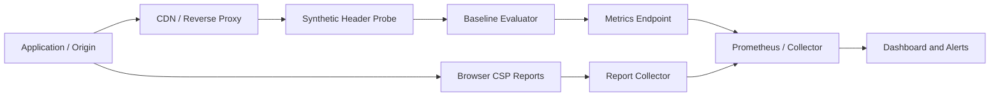

# Security header metric

> **Chương:** Giám sát  
> **Chủ đề:** Security header metric  
> **Module:** SECURITY_APPLICATION_SECURITY_BROWSER_SECURITY — phân tích ranh giới bảo mật giữa trình duyệt, origin, cookie và ứng dụng web để hiểu Same-Origin Policy, CORS và các cơ chế cách ly. Thực hành phòng vệ XSS, CSRF, clickjacking bằng CSP, Trusted Types, security headers và kiểm chứng hành vi thực tế.

## Mục tiêu học tập

Sau bài học, bạn có thể:

1. Xây dựng bộ metric đo mức độ triển khai security headers theo nhóm route và loại response.
2. Phân biệt header coverage, policy correctness, runtime violation và configuration drift.
3. Chọn đúng header cần giám sát theo loại nội dung, transport và kiến trúc ứng dụng.
4. Thu thập CSP violation reports mà không làm lộ dữ liệu nhạy cảm hoặc tạo metric cardinality quá cao.
5. Định nghĩa dashboard, alert và SLO có ngưỡng hành động rõ ràng.
6. Kiểm tra header ở response cuối cùng sau redirect, CDN, reverse proxy và application server.
7. Triển khai một audit job đơn giản và xuất metric theo định dạng Prometheus.
8. Diễn giải kết quả để ưu tiên khắc phục thay vì chỉ tạo một điểm số bảo mật tổng hợp.

## 1. Security header metric là gì?

Security header metric là chỉ số dùng để theo dõi việc các HTTP security headers được triển khai và duy trì đúng trên những response mà ứng dụng phục vụ. Metric giúp trả lời các câu hỏi vận hành:

- Bao nhiêu phần trăm HTML document có CSP phù hợp?
- Bao nhiêu response có `X-Content-Type-Options: nosniff`?
- Có route nào đột ngột mất `Referrer-Policy` sau deploy không?
- HSTS có được gửi trên toàn bộ HTTPS host cần bảo vệ không?
- CSP đang tạo bao nhiêu violation report, directive nào bị vi phạm và xu hướng có tăng không?
- Header do origin phát ra có bị CDN hoặc proxy ghi đè/xóa không?

Không nên đo bảo mật chỉ bằng việc header có mặt hay không. Ví dụ, `Content-Security-Policy: default-src * 'unsafe-inline' 'unsafe-eval'` có header nhưng policy rất rộng. Tương tự, `Access-Control-Allow-Origin: *` không phải một security header bảo vệ mọi ứng dụng; tính phù hợp phụ thuộc chức năng và dữ liệu được expose.

Một chương trình monitoring tốt tách bốn nhóm:

| Nhóm metric | Câu hỏi | Ví dụ |
|---|---|---|
| Coverage | Header/policy có được áp dụng trên response cần thiết không? | Tỷ lệ HTML có CSP |
| Quality | Giá trị có đáp ứng baseline không? | CSP không có unsafe-eval, HSTS có max-age đạt ngưỡng |
| Runtime behavior | Browser thực sự gặp điều gì? | CSP violation theo directive/disposition |
| Drift/availability | Cấu hình có thay đổi ngoài dự kiến không? | Route mất header, CDN trả policy khác origin |

Metric là tín hiệu giúp điều tra và cải thiện. Nó không chứng minh ứng dụng không có XSS, CSRF hoặc lỗ hổng authorization.

## 2. Phân loại security headers theo phạm vi áp dụng

Không phải mọi header đều phải xuất hiện trên mọi response. Hãy định nghĩa baseline theo route class, content type, transport và chức năng.

| Header | Mục đích chính | Phạm vi thường cần giám sát |
|---|---|---|
| `Content-Security-Policy` | Giới hạn nguồn và hành vi nội dung của document | HTML document; policy có thể khác theo app/page |
| `Content-Security-Policy-Report-Only` | Quan sát policy dự kiến mà chưa enforce | Giai đoạn rollout hoặc policy thử nghiệm |
| `Strict-Transport-Security` | Yêu cầu browser dùng HTTPS cho host | HTTPS response trên host đã sẵn sàng triển khai HSTS |
| `X-Content-Type-Options: nosniff` | Ngăn một số MIME sniffing cho script/style | Static resources, API và response có thể bị diễn giải sai MIME |
| `Referrer-Policy` | Kiểm soát thông tin referrer gửi đi | Thường đặt trên document; có thể đặt rộng hơn theo kiến trúc |
| `Permissions-Policy` | Giới hạn browser features | Document/iframe có nhu cầu feature cụ thể |
| `X-Frame-Options` | Hạn chế framing theo cơ chế legacy | Document cần tương thích browser cũ; CSP frame-ancestors là lựa chọn hiện đại |
| `Cross-Origin-Opener-Policy` (COOP) | Tách browsing context group | Document cần isolation phù hợp |
| `Cross-Origin-Embedder-Policy` (COEP) | Yêu cầu điều kiện embed resource cross-origin | Document chủ động triển khai cross-origin isolation |
| `Cross-Origin-Resource-Policy` (CORP) | Kiểm soát context được phép load resource | Resource có chính sách embed cross-origin cụ thể |
| `Cache-Control` | Kiểm soát cache behavior | Response có yêu cầu freshness/privacy; không phải security header thay thế các header trên |

### 2.1. CSP cần metric theo policy, không chỉ presence

Các tín hiệu chất lượng CSP có thể gồm:

- Policy được gửi trên HTML document.
- Có `default-src` hoặc các directive nguồn cụ thể phù hợp.
- `object-src 'none'` nếu ứng dụng không cần plugin object.
- `base-uri` được giới hạn.
- `frame-ancestors` phản ánh chính sách framing.
- Không có `unsafe-eval` nếu ứng dụng không cần tính năng này.
- `unsafe-inline` được loại bỏ hoặc được kiểm soát bằng nonce/hash khi kiến trúc cho phép.
- Nonce được tạo ngẫu nhiên cho từng response và không bị reuse sai cách.
- Policy enforce và Report-Only được phân biệt rõ.

Không dùng một regex duy nhất để chấm CSP. CSP là ngôn ngữ policy có directive, fallback, source expression và semantics riêng. Bộ kiểm tra nên parse policy hoặc dùng CSP evaluator phù hợp, sau đó áp dụng baseline theo ứng dụng.

### 2.2. HSTS chỉ có ý nghĩa trên HTTPS

HSTS được browser học từ response HTTPS. Header nhận qua HTTP không có tác dụng theo cơ chế HSTS chuẩn. Vì vậy, metric HSTS phải phân loại response theo scheme:

- HTTPS host cần HSTS: header phải có, `max-age` đạt baseline và `includeSubDomains`/`preload` chỉ bật khi đã đánh giá toàn bộ subdomain.
- HTTP endpoint redirect: kiểm tra redirect sang HTTPS; không đánh giá HSTS như thể response HTTP đã cài policy.
- Localhost/dev: thường loại khỏi production HSTS coverage hoặc dùng baseline riêng.

`includeSubDomains` có thể ảnh hưởng mọi subdomain, kể cả host legacy hoặc dịch vụ bên thứ ba dưới cùng domain. `preload` tạo cam kết vận hành dài hạn và cần tuân thủ điều kiện của preload program; không bật chỉ để tăng metric.

### 2.3. X-Frame-Options và frame-ancestors

`X-Frame-Options` có các giá trị legacy như `DENY` và `SAMEORIGIN`. Với policy hiện đại, CSP `frame-ancestors` có khả năng biểu đạt linh hoạt hơn và là cơ chế ưu tiên. Metric nên kiểm tra policy framing hiệu lực và compatibility requirement thay vì buộc mọi response phải có cả hai header trong mọi trường hợp.

### 2.4. COOP, COEP và CORP không phải baseline phổ quát

Các header cross-origin isolation có thể làm hỏng tích hợp với popup OAuth, payment, analytics, worker hoặc tài nguyên bên thứ ba nếu triển khai không đúng. Chỉ đánh giá chúng trên route/app cần isolation. Metric phải ghi rõ policy mong đợi và owner, không đánh dấu thiếu trên toàn hệ thống chỉ vì một ứng dụng không cần COEP.

## 3. Thiết kế metric có thể hành động

Một metric tốt có định nghĩa rõ ràng, denominator ổn định, phạm vi áp dụng và người chịu trách nhiệm.

### 3.1. Header coverage

Với một header h và route class r:

```text
coverage(h, r) =
  eligible responses có header h
  -------------------------------- × 100%
  tổng eligible responses thuộc route class r
```

Ví dụ: trong 500 HTML document responses thuộc nhóm `customer-app`, 485 response có CSP:

```text
CSP coverage = 485 / 500 × 100% = 97%
```

Denominator phải chỉ gồm response mà header đó áp dụng. Không đưa API JSON, ảnh hoặc redirect vào mẫu số CSP document coverage nếu baseline không yêu cầu CSP trên chúng.

### 3.2. Policy compliance

Presence không đồng nghĩa compliance. Định nghĩa một response là compliant khi tất cả rule áp dụng đều đạt:

```text
policy_compliance =
  eligible responses đạt toàn bộ rule
  ----------------------------------- × 100%
  tổng eligible responses đã audit
```

Ví dụ một HTML response có CSP nhưng chứa `unsafe-eval` trong khi baseline cấm, HSTS thiếu `max-age` hoặc Referrer-Policy có giá trị không được chấp nhận. Response đó có header coverage nhưng không đạt policy compliance.

### 3.3. Missing và invalid counts

Theo dõi riêng:

- `security_header_missing_total`: số response thiếu header bắt buộc.
- `security_header_invalid_total`: số response có header nhưng giá trị không đạt baseline.
- `security_header_audit_total`: tổng response được audit.
- `security_header_audit_errors_total`: số lần audit không lấy được response hoặc không phân tích được header.

Không gộp audit error vào missing header. Timeout hoặc 502 từ scanner là vấn đề quan sát; không chứng minh origin đã bỏ header.

### 3.4. Drift metric

Drift là thay đổi ngoài dự kiến so với baseline đã phê duyệt. Có thể theo dõi:

- Header biến mất sau deployment.
- Giá trị CSP thay đổi hoặc xuất hiện source expression mới.
- HSTS `max-age` giảm bất thường.
- Header trùng lặp hoặc bị proxy ghi đè.
- Origin và edge trả policy khác nhau.
- Một route mới chưa có trong inventory.

Drift alert nên kèm route class, environment, release/build ID và header name. Tránh gửi toàn bộ URL có query chứa token hoặc thông tin cá nhân vào alert.

### 3.5. Runtime violation metrics

CSP report có thể cho biết browser đã chặn hoặc quan sát một hành vi vi phạm policy. Theo dõi:

- Số report theo `effective-directive`.
- Số report theo `disposition` (`enforce` hoặc `report`).
- Số report theo ứng dụng/route class.
- Tỷ lệ tăng so với baseline theo thời gian.
- Số report từ browser version hoặc release cohort nếu dữ liệu đã được chuẩn hóa.

Một CSP report không nhất thiết là tấn công. Có thể do script hợp lệ chưa nằm trong allowlist, extension browser, browser plugin, lỗi deploy hoặc nội dung third-party. Phải phân loại trước khi alert mức nghiêm trọng.

## 4. Định nghĩa inventory và baseline

Trước khi tạo dashboard, lập inventory các bề mặt cần đo:

| Thuộc tính | Ví dụ |
|---|---|
| Application | `customer-portal` |
| Environment | `production` |
| Route class | `html-document`, `api-private`, `static-asset`, `download` |
| Transport | `https`, `http-redirect`, `local-dev` |
| Owner | Team chịu trách nhiệm |
| Header baseline | CSP, HSTS, nosniff, Referrer-Policy... |
| Audit source | Origin probe, CDN probe, browser report |
| Frequency | Mỗi deploy, hàng giờ hoặc hàng ngày |

### 4.1. Ví dụ baseline theo route class

| Route class | Header kỳ vọng | Lý do |
|---|---|---|
| HTML document | CSP, Referrer-Policy, nosniff, Permissions-Policy, COOP nếu cần | Bảo vệ document và browser capabilities |
| Private API | nosniff, cache policy phù hợp; CORS chỉ theo integration đã duyệt | API không phải HTML document; kiểm soát dữ liệu và cache |
| Public static asset | nosniff, Content-Type đúng, CORP nếu cần | Ngăn MIME mismatch và định nghĩa embedding |
| User download | nosniff, Content-Disposition attachment, private/no-store khi nhạy cảm | Tránh render active content ngoài ý muốn |
| HTTPS host | HSTS theo host policy | Ép browser dùng HTTPS sau khi đã nhận HSTS |

Không áp dụng máy móc baseline của HTML cho API hoặc file download. Một API có thể không cần CSP; một ảnh public có thể cần CORP hoặc không tùy cách nhúng; COEP chỉ phù hợp khi ứng dụng đã xử lý mọi cross-origin resource requirement.

### 4.2. Baseline phải có version và owner

Lưu baseline cùng mã nguồn hoặc cấu hình có review. Mỗi thay đổi cần:

1. Lý do nghiệp vụ/kỹ thuật.
2. Route class và môi trường bị ảnh hưởng.
3. Rủi ro tương thích.
4. Người phê duyệt.
5. Thời điểm hiệu lực và rollback plan.

Không sửa ngưỡng metric để làm dashboard xanh nếu policy thực tế chưa được đánh giá. Nếu policy cần nới lỏng, ghi nhận exception có thời hạn, owner và biện pháp bù trừ.

## 5. Thu thập CSP violation reports

CSP có thể gửi report khi browser phát hiện hành vi vi phạm policy. Report giúp phát hiện script, style, frame hoặc resource chưa phù hợp với CSP đang triển khai.

### 5.1. Report-Only trong giai đoạn rollout

Khi triển khai policy mới, có thể gửi cả policy đang enforce và policy quan sát:

```http
Content-Security-Policy: default-src 'self'; object-src 'none'; base-uri 'self'
Content-Security-Policy-Report-Only: default-src 'self'; script-src 'self'; object-src 'none'; base-uri 'self'; report-uri /csp-report
```

Policy Report-Only ghi nhận vi phạm nhưng không chặn resource. Nó giúp phát hiện dependency còn thiếu trước khi chuyển policy sang enforce. Report-Only không phải bằng chứng rằng policy enforce đã hoạt động.

### 5.2. report-uri và Reporting API

`report-uri` là cơ chế cũ vẫn hữu ích cho compatibility:

```http
Content-Security-Policy: default-src 'self'; object-src 'none'; report-uri /csp-report
```

Reporting API hiện đại có thể cấu hình endpoint:

```http
Reporting-Endpoints: csp-endpoint="https://reports.example.test/csp"
Content-Security-Policy: default-src 'self'; object-src 'none'; report-to csp-endpoint; report-uri /csp-report
```

Hỗ trợ `report-to` và format report thay đổi theo browser/version; `report-uri` có thể được giữ làm fallback trong giai đoạn tương thích. Test trên browser mục tiêu và xác nhận request report thực sự tới collector.

### 5.3. Thu thập report an toàn

CSP report là input do client gửi. Collector phải:

- Chấp nhận đúng content type/format đã hỗ trợ.
- Giới hạn kích thước body và rate limit theo nguồn.
- Parse JSON an toàn; từ chối payload malformed hoặc quá lớn.
- Chỉ giữ field cần cho phân tích như directive, disposition và loại resource.
- Redact hoặc loại document URI, blocked URI, referrer, sample và query string nếu có thể chứa dữ liệu nhạy cảm.
- Không render report field trực tiếp vào HTML dashboard; escape khi hiển thị.
- Không coi report là bằng chứng xác thực về người gửi; client có thể giả mạo request.

Không đưa raw `document-uri`, `blocked-uri`, `source-file`, nonce hoặc sample vào metric label. Những giá trị này có thể chứa URL động, query nhạy cảm hoặc dữ liệu do attacker kiểm soát.

### 5.4. Chuẩn hóa directive và disposition

Metric nên map `effective-directive` về danh sách hữu hạn, ví dụ:

- `script-src`
- `style-src`
- `img-src`
- `connect-src`
- `frame-src`
- `object-src`
- `base-uri`
- `form-action`
- `default-src`
- `other`

Disposition nên giới hạn thành `enforce`, `report` hoặc `unknown`. Nếu report chứa giá trị lạ, map về `other` thay vì tạo label mới cho từng chuỗi không giới hạn.

Một report có thể được browser gửi nhiều lần hoặc giả mạo. Dùng sampling/deduplication nếu cần, nhưng không làm mất khả năng phát hiện một đợt violation mới. Metric đếm report là telemetry, không phải số lượng tấn công đã xác minh.

## 6. Dashboard, alert và SLO

Dashboard cần giúp người vận hành thấy được độ phủ, chất lượng và thay đổi theo thời gian. Nên có ít nhất các panel:

1. Coverage ratio theo application, environment, route class và header.
2. Policy compliance ratio theo route class.
3. Missing/invalid response count theo header.
4. Audit errors và thời điểm lần audit thành công gần nhất.
5. CSP reports theo directive/disposition trong khoảng thời gian.
6. Drift events theo deployment/build.
7. HSTS coverage theo HTTPS host.

### 6.1. Metric exposition kiểu Prometheus

Ví dụ metric:

```text
security_header_coverage_ratio{
  application="customer-portal",
  environment="production",
  route_class="html-document",
  header="content-security-policy"
} 1.0

security_header_policy_compliance_ratio{
  application="customer-portal",
  environment="production",
  route_class="html-document"
} 0.98

security_header_missing_responses{
  application="customer-portal",
  environment="production",
  route_class="html-document",
  header="referrer-policy"
} 2

csp_violation_reports_total{
  application="customer-portal",
  environment="production",
  route_class="html-document",
  effective_directive="script-src",
  disposition="enforce"
} 12
```

Coverage ratio nằm trong khoảng 0 đến 1. Missing response là gauge của lần audit gần nhất; CSP report count là counter tích lũy.

### 6.2. Tránh cardinality bùng nổ

Chỉ dùng label có tập giá trị hữu hạn và ổn định:

- `application`
- `environment`
- `route_class`
- `header`
- `effective_directive`
- `disposition`

Không dùng raw URL/path có ID, query string, user ID, session ID, IP, `blocked-uri` hoặc CSP sample làm label. Các giá trị này có thể tạo hàng triệu series, làm monitoring chậm và tăng chi phí.

Nếu cần điều tra một report cụ thể, lưu bản đã redact trong log/event store có retention và access control phù hợp; metric chỉ giữ nhóm tổng hợp.

### 6.3. Alert theo tác động

Ví dụ alert:

| Alert | Điều kiện minh họa | Hành động |
|---|---|---|
| Required header missing | Coverage dưới 100% ở route class critical trong hai lần audit liên tiếp | Kiểm tra deploy, middleware và CDN |
| Policy drift | Header value khác baseline đã phê duyệt | So sánh origin/edge và release |
| Audit unavailable | Không có lần audit thành công trong khoảng thời gian quy định | Kiểm tra scanner, DNS, TLS và endpoint |
| CSP violation spike | Report rate tăng mạnh so với baseline | Phân loại release, directive và nguồn resource |
| HSTS regression | HTTPS host production mất HSTS hoặc max-age giảm dưới ngưỡng | Kiểm tra TLS termination và proxy config |

Không alert mức critical cho mọi CSP report đơn lẻ. Dùng rate, severity, route class và xu hướng; nhóm report lặp lại để giảm noise.

### 6.4. Đặt SLO thực tế

Ví dụ SLO có thể là:

- 100% HTML route class critical đạt header coverage.
- 99.9% eligible response đạt policy compliance trong cửa sổ 30 ngày.
- Không có HSTS regression trên HTTPS host production.
- Audit job có success rate trên 99% và dữ liệu không cũ quá 24 giờ.

Ngưỡng phải dựa trên rủi ro, kiến trúc và khả năng vận hành. Không dùng một SLO chung cho mọi header và mọi route.

## 7. Kiến trúc thu thập metric

Một pipeline thực tế thường có các thành phần:



### 7.1. Synthetic probe

Probe gọi các URL đại diện cho từng route class, đọc response headers cuối cùng và so sánh với baseline. Nên kiểm tra cả origin và public edge:

- Origin probe giúp xác định application server đã gửi gì.
- Edge probe giúp phát hiện CDN/reverse proxy xóa, thêm hoặc ghi đè header.
- Redirect probe cần ghi nhận từng hop hoặc ít nhất response cuối cùng và URL đích.
- Probe phải có timeout, giới hạn response body và allowlist host để tránh trở thành SSRF proxy.

Không để scanner nhận URL tùy ý từ request bên ngoài. Danh sách target phải là cấu hình tin cậy, có allowlist scheme/host/port và không cho truy cập metadata IP hoặc private network ngoài phạm vi kiểm thử.

### 7.2. Browser telemetry

Synthetic probe không biết mọi resource mà người dùng thật tải hoặc CSP violation chỉ xuất hiện trong một số browser context. CSP reports bổ sung tín hiệu runtime nhưng có sampling, duplicate, browser support và khả năng spoofing.

Kết hợp hai nguồn:

- Probe đo cấu hình server có thể lặp lại.
- Browser report đo hành vi policy được quan sát trong client thực.

Không dùng browser report làm nguồn duy nhất để kết luận coverage. Người dùng có thể không truy cập route, report có thể bị chặn hoặc bị giả mạo.

### 7.3. Kiểm tra response cuối cùng

Header có thể thay đổi qua nhiều lớp:

1. Application middleware.
2. Web server/reverse proxy.
3. CDN/edge worker.
4. Redirect và error handler.
5. Object storage/static hosting.

Đo ở browser-facing response và đối chiếu với origin khi có drift. Chú ý header trùng lặp: browser có thể kết hợp hoặc xử lý khác nhau theo từng header; không giả định hai CSP header sẽ được hợp nhất như một policy đơn giản. Nhiều CSP policy cùng tồn tại thường được áp dụng đồng thời, tạo hiệu lực chặt hơn.

## 8. Thực hành: security header metric với Node.js

Lab tạo một server có nhiều route class và một audit endpoint. Audit job gọi các route trong inventory, kiểm tra header presence và giá trị theo baseline, sau đó xuất coverage/compliance và số lượng missing/invalid theo Prometheus text format.

Lab có một route document cố ý cấu hình yếu để thấy coverage và compliance khác nhau. Đây là lỗi mô phỏng để kiểm thử metric; không dùng cấu hình đó trong ứng dụng thật.

### 8.1. Tạo file `security-header-metric-lab.cjs`

```js
const http = require('node:http');

const HOST = '127.0.0.1';
const PORT = 3000;
const BASE_URL = 'http://' + HOST + ':' + PORT;
const APPLICATION = 'security-header-lab';
const ENVIRONMENT = 'local';

const documentHtml = [
  '<!doctype html>',
  '<html lang="vi"><head><meta charset="utf-8">',
  '<meta name="viewport" content="width=device-width, initial-scale=1">',
  '<title>Security header metric lab</title></head><body>',
  '<h1>Security header metric lab</h1>',
  '<p>Route này có header theo baseline.</p>',
  '<a href="/csp-report-demo">Mở CSP Report-Only demo</a>',
  '</body></html>',
].join('\n');

const driftHtml = [
  '<!doctype html>',
  '<html lang="vi"><head><meta charset="utf-8">',
  '<title>Intentional header drift</title></head><body>',
  '<h1>Intentional weak policy for metric testing</h1>',
  '</body></html>',
].join('\n');

const cspDemoHtml = [
  '<!doctype html><html lang="vi"><meta charset="utf-8">',
  '<title>CSP report-only demo</title><body>',
  '<h1>CSP Report-Only demo</h1>',
  '<p>Inline script runs, while the Report-Only policy should report it.</p>',
  '<script>document.body.dataset.reportOnlyDemo = "executed";</script>',
  '</body></html>',
].join('\n');

function send(res, status, headers, body = '') {
  res.writeHead(status, headers);
  res.end(body);
}

function commonDocumentHeaders() {
  return {
    'Content-Type': 'text/html; charset=utf-8',
    'X-Content-Type-Options': 'nosniff',
    'Referrer-Policy': 'strict-origin-when-cross-origin',
    'Permissions-Policy': 'camera=(), microphone=(), geolocation=()',
    'Cross-Origin-Opener-Policy': 'same-origin',
    'Content-Security-Policy': "default-src 'self'; script-src 'self'; object-src 'none'; base-uri 'self'; frame-ancestors 'none'; report-uri /csp-report",
    'Cache-Control': 'no-store',
  };
}

async function readLimitedBody(req, limit = 16384) {
  const chunks = [];
  let size = 0;
  for await (const chunk of req) {
    size += chunk.length;
    if (size > limit) throw new Error('Report body too large');
    chunks.push(chunk);
  }
  return Buffer.concat(chunks).toString('utf8');
}

const knownDirectives = new Set([
  'script-src', 'style-src', 'img-src', 'connect-src',
  'frame-src', 'object-src', 'base-uri', 'form-action', 'default-src',
]);
const cspCounts = new Map();
const reportWindows = new Map();

function allowCspReport(req) {
  const now = Date.now();
  for (const [key, window] of reportWindows) {
    if (now - window.startedAt >= 60000) reportWindows.delete(key);
  }

  const key = req.socket.remoteAddress || 'unknown';
  const current = reportWindows.get(key);
  if (!current || now - current.startedAt >= 60000) {
    reportWindows.set(key, { startedAt: now, count: 1 });
    return true;
  }
  if (current.count >= 60) return false;
  current.count += 1;
  return true;
}

function normalizeDirective(value) {
  if (typeof value !== 'string') return 'other';
  const normalized = value.toLowerCase().trim().split(/\s+/)[0];
  return knownDirectives.has(normalized) ? normalized : 'other';
}

function normalizeDisposition(value) {
  return value === 'enforce' || value === 'report' ? value : 'unknown';
}

function recordCspReport(payload) {
  const reports = Array.isArray(payload)
    ? payload.map((item) => item?.body || item)
    : payload?.['csp-report']
      ? [payload['csp-report']]
      : [payload];

  for (const report of reports) {
    const directive = normalizeDirective(
      report?.['effective-directive'] || report?.['violated-directive']
    );
    const disposition = normalizeDisposition(report?.disposition);
    const key = directive + '|' + disposition;
    cspCounts.set(key, (cspCounts.get(key) || 0) + 1);
  }
}

const server = http.createServer(async (req, res) => {
  const url = new URL(req.url, BASE_URL);

  if (req.method === 'GET' && url.pathname === '/document') {
    return send(res, 200, commonDocumentHeaders(), documentHtml);
  }

  if (req.method === 'GET' && url.pathname === '/document-drift') {
    return send(res, 200, {
      'Content-Type': 'text/html; charset=utf-8',
      'X-Content-Type-Options': 'nosniff',
      'Permissions-Policy': 'camera=(), microphone=(), geolocation=()',
      'Content-Security-Policy': "default-src * 'unsafe-inline' 'unsafe-eval'; object-src *",
      'Cache-Control': 'no-store',
    }, driftHtml);
  }

  if (req.method === 'GET' && url.pathname === '/csp-report-demo') {
    return send(res, 200, {
      'Content-Type': 'text/html; charset=utf-8',
      'Content-Security-Policy-Report-Only': "default-src 'self'; script-src 'self'; object-src 'none'; report-uri /csp-report",
      'X-Content-Type-Options': 'nosniff',
      'Cache-Control': 'no-store',
    }, cspDemoHtml);
  }

  if (req.method === 'GET' && url.pathname === '/api/private') {
    return send(res, 200, {
      'Content-Type': 'application/json; charset=utf-8',
      'X-Content-Type-Options': 'nosniff',
      'Cache-Control': 'private, no-store',
    }, JSON.stringify({ ok: true, scope: 'private-api' }));
  }

  if (req.method === 'GET' && url.pathname === '/assets/app.js') {
    return send(res, 200, {
      'Content-Type': 'text/javascript; charset=utf-8',
      'X-Content-Type-Options': 'nosniff',
      'Cross-Origin-Resource-Policy': 'same-origin',
      'Cache-Control': 'public, max-age=31536000, immutable',
    }, 'console.log("static asset");');
  }

  if (req.method === 'GET' && url.pathname === '/download/file') {
    return send(res, 200, {
      'Content-Type': 'application/octet-stream',
      'Content-Disposition': 'attachment; filename="sample.bin"',
      'X-Content-Type-Options': 'nosniff',
      'Cache-Control': 'private, no-store',
    }, 'synthetic download');
  }

  if (req.method === 'POST' && url.pathname === '/csp-report') {
    if (!allowCspReport(req)) {
      return send(res, 429, { 'Cache-Control': 'no-store' }, 'Report rate limit exceeded');
    }
    try {
      const contentType = String(req.headers['content-type'] || '')
        .split(';')[0]
        .trim()
        .toLowerCase();
      if (!['application/csp-report', 'application/reports+json', 'application/json'].includes(contentType)) {
        return send(res, 415, { 'Cache-Control': 'no-store' }, 'Unsupported report content type');
      }
      const raw = await readLimitedBody(req);
      const payload = raw ? JSON.parse(raw) : {};
      recordCspReport(payload);
      return send(res, 204, { 'Cache-Control': 'no-store' });
    } catch {
      return send(res, 400, { 'Cache-Control': 'no-store' }, 'Invalid or oversized report');
    }
  }

  if (req.method === 'GET' && url.pathname === '/metrics') {
    try {
      const result = await runAudit();
      return send(res, 200, {
        'Content-Type': 'text/plain; version=0.0.4; charset=utf-8',
        'Cache-Control': 'no-store',
      }, result);
    } catch (error) {
      console.error('[audit] failed:', error.message);
      return send(res, 503, { 'Cache-Control': 'no-store' }, 'Audit unavailable');
    }
  }

  return send(res, 404, {
    'Content-Type': 'text/plain; charset=utf-8',
    'X-Content-Type-Options': 'nosniff',
    'Cache-Control': 'no-store',
  }, 'Not found');
});

const inventory = [
  {
    path: '/document',
    routeClass: 'html-document',
    rules: [
      ['content-security-policy', (v) =>
        ["default-src 'self'", "object-src 'none'", "base-uri 'self'", "frame-ancestors 'none'"]
          .every((part) => v.includes(part)) &&
        !v.includes("'unsafe-eval'") && !v.includes("'unsafe-inline'")],
      ['x-content-type-options', (v) => v.toLowerCase() === 'nosniff'],
      ['referrer-policy', (v) => v.toLowerCase() === 'strict-origin-when-cross-origin'],
      ['permissions-policy', (v) =>
        ['camera=()', 'microphone=()', 'geolocation=()'].every((part) => v.includes(part))],
      ['cross-origin-opener-policy', (v) => v.toLowerCase() === 'same-origin'],
    ],
  },
  {
    path: '/document-drift',
    routeClass: 'html-document',
    rules: [
      ['content-security-policy', (v) =>
        ["default-src 'self'", "object-src 'none'", "base-uri 'self'", "frame-ancestors 'none'"]
          .every((part) => v.includes(part)) &&
        !v.includes("'unsafe-eval'") && !v.includes("'unsafe-inline'")],
      ['x-content-type-options', (v) => v.toLowerCase() === 'nosniff'],
      ['referrer-policy', (v) => v.toLowerCase() === 'strict-origin-when-cross-origin'],
      ['permissions-policy', (v) =>
        ['camera=()', 'microphone=()', 'geolocation=()'].every((part) => v.includes(part))],
      ['cross-origin-opener-policy', (v) => v.toLowerCase() === 'same-origin'],
    ],
  },
  {
    path: '/api/private',
    routeClass: 'api-private',
    rules: [
      ['x-content-type-options', (v) => v.toLowerCase() === 'nosniff'],
      ['cache-control', (v) => /private/i.test(v) && /no-store/i.test(v)],
    ],
  },
  {
    path: '/assets/app.js',
    routeClass: 'static-asset',
    rules: [
      ['x-content-type-options', (v) => v.toLowerCase() === 'nosniff'],
      ['cross-origin-resource-policy', (v) => v.toLowerCase() === 'same-origin'],
      ['cache-control', (v) => /immutable/i.test(v)],
      ['content-type', (v) => /javascript/i.test(v)],
    ],
  },
  {
    path: '/download/file',
    routeClass: 'download',
    rules: [
      ['x-content-type-options', (v) => v.toLowerCase() === 'nosniff'],
      ['content-disposition', (v) => /attachment/i.test(v)],
      ['cache-control', (v) => /private/i.test(v) && /no-store/i.test(v)],
    ],
  },
];

function label(value) {
  return String(value).replace(/\\/g, '\\\\').replace(/"/g, '\\"').replace(/\n/g, '\\n');
}

async function runAudit() {
  const headerStats = new Map();
  const classStats = new Map();
  const auditErrors = new Map();

  for (const item of inventory) {
    const classStat = classStats.get(item.routeClass) || { eligible: 0, compliant: 0 };
    classStats.set(item.routeClass, classStat);

    try {
      const response = await fetch(BASE_URL + item.path, { redirect: 'manual' });
      await response.body?.cancel();
      if (response.status < 200 || response.status >= 300) {
        throw new Error('Unexpected status ' + response.status);
      }

      classStat.eligible += 1;
      let responseCompliant = true;
      for (const [header, validate] of item.rules) {
        const key = item.routeClass + '|' + header;
        const stat = headerStats.get(key) || { eligible: 0, present: 0, compliant: 0, missing: 0, invalid: 0 };
        stat.eligible += 1;
        const value = response.headers.get(header);

        if (value === null) {
          stat.missing += 1;
          responseCompliant = false;
        } else {
          stat.present += 1;
          if (validate(value)) {
            stat.compliant += 1;
          } else {
            stat.invalid += 1;
            responseCompliant = false;
          }
        }
        headerStats.set(key, stat);
      }

      if (responseCompliant) classStats.get(item.routeClass).compliant += 1;
    } catch (error) {
      auditErrors.set(item.routeClass, (auditErrors.get(item.routeClass) || 0) + 1);
      console.error('[audit] route failed:', item.routeClass, error.message);
    }
  }

  const lines = [];
  function emit(name, help, type, samples) {
    lines.push('# HELP ' + name + ' ' + help);
    lines.push('# TYPE ' + name + ' ' + type);
    lines.push(...samples);
  }

  const coverageSamples = [];
  const missingSamples = [];
  const invalidSamples = [];
  for (const [key, stat] of headerStats) {
    const [routeClass, header] = key.split('|');
    const labels = 'application="' + APPLICATION + '",environment="' + ENVIRONMENT +
      '",route_class="' + routeClass + '",header="' + header + '"';
    coverageSamples.push('security_header_coverage_ratio{' + labels + '} ' + (stat.present / stat.eligible));
    missingSamples.push('security_header_missing_responses{' + labels + '} ' + stat.missing);
    invalidSamples.push('security_header_invalid_responses{' + labels + '} ' + stat.invalid);
  }
  emit('security_header_coverage_ratio', 'Fraction of eligible responses containing a required header.', 'gauge', coverageSamples);
  emit('security_header_missing_responses', 'Missing required headers in the latest audit.', 'gauge', missingSamples);
  emit('security_header_invalid_responses', 'Present but non-compliant headers in the latest audit.', 'gauge', invalidSamples);

  const complianceSamples = [];
  const eligibleSamples = [];
  const errorSamples = [];
  for (const [routeClass, stat] of classStats) {
    const labels = 'application="' + APPLICATION + '",environment="' + ENVIRONMENT +
      '",route_class="' + routeClass + '"';
    if (stat.eligible > 0) {
      complianceSamples.push('security_header_policy_compliance_ratio{' + labels + '} ' +
        (stat.compliant / stat.eligible));
    }
    eligibleSamples.push('security_header_audit_eligible_responses{' + labels + '} ' + stat.eligible);
    errorSamples.push('security_header_audit_errors{' + labels + '} ' + (auditErrors.get(routeClass) || 0));
  }
  emit('security_header_policy_compliance_ratio', 'Fraction of eligible responses passing all applicable rules.', 'gauge', complianceSamples);
  emit('security_header_audit_eligible_responses', 'Eligible responses evaluated in the latest audit.', 'gauge', eligibleSamples);
  emit('security_header_audit_errors', 'Probe errors in the latest audit, separate from missing headers.', 'gauge', errorSamples);
  lines.push('# TYPE security_header_audit_timestamp_seconds gauge');
  lines.push('security_header_audit_timestamp_seconds ' + Math.floor(Date.now() / 1000));

  const cspSamples = [];
  for (const [key, count] of cspCounts) {
    const [directive, disposition] = key.split('|');
    cspSamples.push('csp_violation_reports_total{application="' + APPLICATION +
      '",environment="' + ENVIRONMENT + '",route_class="html-document",effective_directive="' +
      label(directive) + '",disposition="' + label(disposition) + '"} ' + count);
  }
  emit('csp_violation_reports_total', 'Accepted CSP reports grouped by normalized directive and disposition.', 'counter', cspSamples);

  return lines.join('\n') + '\n';
}

server.listen(PORT, HOST, () => {
  console.log('Open ' + BASE_URL + '/document');
  console.log('Metrics at ' + BASE_URL + '/metrics');
});
```

### 8.2. Chạy lab và đọc metric

```sh
node security-header-metric-lab.cjs
```

Mở các URL:

- `http://127.0.0.1:3000/document` — HTML theo baseline.
- `http://127.0.0.1:3000/document-drift` — HTML cố ý có CSP yếu và thiếu Referrer-Policy/COOP.
- `http://127.0.0.1:3000/api/private` — API riêng tư.
- `http://127.0.0.1:3000/assets/app.js` — static JavaScript.
- `http://127.0.0.1:3000/download/file` — response tải xuống.
- `http://127.0.0.1:3000/metrics` — chạy audit và trả Prometheus metrics.

Audit sẽ cho thấy:

- `html-document` có CSP coverage 100% vì cả hai document đều có header.
- CSP policy compliance thấp hơn vì `/document-drift` chứa nguồn quá rộng và `unsafe-*`.
- Referrer-Policy coverage thấp hơn 100% vì route drift bị thiếu header.
- API, asset và download được đánh giá theo rule riêng của từng route class.

Lab chạy HTTP localhost nên không đánh giá HSTS. HSTS cần probe trên HTTPS host thật; không tính HSTS là missing cho route local HTTP.

### 8.3. Gửi CSP report thử nghiệm

Có thể mở `http://127.0.0.1:3000/csp-report-demo` bằng browser để quan sát Report-Only policy. Hoặc gửi report tổng hợp giả lập:

```sh
curl -i -X POST http://127.0.0.1:3000/csp-report \
  -H "Content-Type: application/csp-report" \
  --data "{\"csp-report\":{\"effective-directive\":\"script-src\",\"disposition\":\"report\"}}"
```

Sau đó tải lại `/metrics` và tìm `csp_violation_reports_total`. Lab chỉ giữ directive/disposition đã chuẩn hóa; nó không lưu raw URL, sample hoặc report body.

Collector trong lab chỉ nhận `application/csp-report`, `application/reports+json` hoặc `application/json`, giới hạn body 16 KiB và áp dụng fixed-window rate limit 60 report/phút/IP. Đây là cơ chế minh họa trong một process; production cần rate limit phân tán, retention, authentication/network controls phù hợp và giám sát collector riêng.

Audit error được đếm riêng và không đưa vào denominator của policy compliance. Chỉ response nhận được và đánh giá thành công mới được tính là eligible; nếu probe lỗi, metric audit error tăng để dashboard không nhầm lỗi quan sát thành policy failure.

### 8.4. Kiểm tra bằng curl

```sh
curl -sSI http://127.0.0.1:3000/document
curl -sSI http://127.0.0.1:3000/document-drift
curl -sS http://127.0.0.1:3000/metrics
```

Curl xác minh response headers và metric exposition, nhưng không thực thi CSP hoặc HSTS như browser. Để kiểm tra CSP report runtime, mở trang demo bằng browser và xem Network/Console.

## 9. Diễn giải kết quả và khắc phục

Khi metric xấu đi, điều tra theo thứ tự:

1. Xác định route class và rule nào thất bại.
2. Lấy response header cuối cùng từ browser-facing endpoint.
3. So sánh với response origin để tìm lớp đã thay đổi header.
4. Kiểm tra deployment, middleware, proxy, CDN và error handler.
5. Xác định policy thay đổi có chủ ý hay là regression.
6. Kiểm tra ảnh hưởng chức năng trước khi rollback hoặc siết policy.
7. Cập nhật baseline sau khi thay đổi được review và phê duyệt.

Không sửa policy bằng cách thêm wildcard hoặc `unsafe-inline` chỉ để loại CSP reports. Trước hết xác định resource nào cần được tin cậy; dùng nonce/hash, self-hosting hoặc allowlist hẹp khi phù hợp.

## 10. Checklist vận hành security header metrics

- [ ] Có inventory ứng dụng, môi trường, route class và owner.
- [ ] Baseline xác định header áp dụng theo loại response và transport.
- [ ] Coverage và policy compliance được đo riêng.
- [ ] Missing header được phân biệt với invalid value và audit error.
- [ ] CSP được đánh giá theo directive/semantics, không chỉ presence.
- [ ] Report-Only và enforce được phân biệt trong telemetry.
- [ ] CSP collector có giới hạn body, rate limit, parse an toàn và redaction.
- [ ] Metric labels dùng tập giá trị hữu hạn; không chứa raw URL hoặc user data.
- [ ] HSTS chỉ được đánh giá trên HTTPS host phù hợp.
- [ ] COOP/COEP/CORP chỉ được yêu cầu ở ứng dụng/route cần chúng.
- [ ] Probe kiểm tra response cuối cùng qua CDN/proxy và đối chiếu origin.
- [ ] Redirect, error response và static hosting có test riêng.
- [ ] Audit error và last-success timestamp có dashboard/alert.
- [ ] Alert dựa trên route critical, xu hướng và tác động.
- [ ] Exception có owner, lý do và thời hạn.
- [ ] Có quy trình rollback và review khi baseline thay đổi.
- [ ] Browser telemetry được xem là tín hiệu, không phải bằng chứng xác thực.

## 11. Câu hỏi tự kiểm tra

**1.** Header coverage đo điều gì?  
**Trả lời:** Tỷ lệ response đủ điều kiện có header được yêu cầu trên tổng response đủ điều kiện trong route class tương ứng.

**2.** Vì sao coverage 100% chưa chứng minh policy an toàn?  
**Trả lời:** Header có thể hiện diện nhưng giá trị quá rộng hoặc sai baseline; cần đo policy compliance riêng.

**3.** Vì sao không đưa API JSON vào mẫu số CSP document coverage?  
**Trả lời:** CSP document baseline áp dụng cho HTML document; denominator phải chỉ chứa response mà rule thực sự áp dụng.

**4.** Vì sao HSTS không nên được đánh giá từ HTTP localhost response?  
**Trả lời:** Browser chỉ học HSTS từ HTTPS response; môi trường HTTP local không phải mẫu phù hợp cho HSTS coverage.

**5.** Content-Security-Policy-Report-Only khác enforce thế nào?  
**Trả lời:** Report-Only ghi nhận vi phạm mà không chặn resource; enforce vừa ghi nhận vừa áp dụng policy.

**6.** Vì sao CSP report không được xem là bằng chứng chắc chắn về tấn công?  
**Trả lời:** Report có thể đến từ dependency hợp lệ, lỗi deploy, extension hoặc client giả mạo.

**7.** Vì sao không dùng blocked-uri làm metric label?  
**Trả lời:** Giá trị không giới hạn, có thể chứa URL/query nhạy cảm và tạo cardinality rất cao.

**8.** Synthetic probe và browser CSP report bổ sung cho nhau thế nào?  
**Trả lời:** Probe đo cấu hình server có thể lặp lại; browser report cung cấp tín hiệu runtime từ client thực.

**9.** Khi header có ở origin nhưng mất ở browser-facing response, cần kiểm tra đâu?  
**Trả lời:** Reverse proxy, CDN, edge worker, redirect, error handler và static hosting.

**10.** Vì sao không bật COEP hoặc HSTS preload chỉ để tăng điểm metric?  
**Trả lời:** Chúng có tác động tương thích và vận hành rộng; chỉ triển khai khi kiến trúc và toàn bộ domain/resource đã sẵn sàng.

## Tổng kết

Security header metrics cần đo coverage, policy quality, runtime behavior và configuration drift theo route class/transport. Header presence không đồng nghĩa policy an toàn; CSP cần được đánh giá theo directive, HSTS chỉ có ý nghĩa trên HTTPS và COOP/COEP/CORP chỉ nên yêu cầu ở nơi cần isolation. CSP reports bổ sung tín hiệu runtime nhưng phải được giới hạn, chuẩn hóa và redact. Synthetic probes kiểm tra response cuối cùng sau CDN/proxy, còn browser reports giúp quan sát vi phạm trong client. Dashboard và alert cần dùng label hữu hạn, denominator đúng, tách audit error khỏi missing header và gắn mỗi exception với owner. Metric giúp ưu tiên hành động và phát hiện regression; nó không thay thế review policy hoặc kiểm thử bảo mật ứng dụng.
