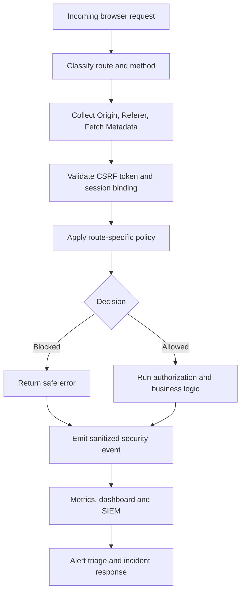

# CSRF detection

## Mục tiêu bài học

Sau bài này, bạn có thể:

- Xây dựng cơ chế giám sát để phát hiện request có dấu hiệu Cross-Site Request Forgery (CSRF).
- Phân biệt tín hiệu từ CSRF token, `Origin`, `Referer`, Fetch Metadata và cookie `SameSite`.
- Thiết kế telemetry phía server cho request bị từ chối và các thao tác nhạy cảm được chấp nhận.
- Nhận diện hành vi bất thường theo route, method, session, tài khoản, tenant và nguồn request.
- Giảm false positive do browser privacy policy, luồng SSO, payment, iframe hoặc client cũ.
- Tạo dashboard, cảnh báo và quy trình phản ứng khi có dấu hiệu CSRF.
- Kiểm thử detection bằng fixture nhiều origin và xác minh log không chứa token, cookie hoặc dữ liệu nhạy cảm.

## 1. CSRF detection là gì?

Cross-Site Request Forgery (CSRF) là kiểu tấn công khiến browser của người dùng gửi request đến một ứng dụng mà người dùng đã đăng nhập. Vì browser có thể tự đính kèm cookie hoặc credential khác, server có thể nhầm request do trang bên ngoài kích hoạt là hành động hợp lệ của người dùng.

CSRF detection là việc thu thập và phân tích tín hiệu ở server để nhận biết request có khả năng được khởi tạo từ một site không đáng tin hoặc thiếu bằng chứng chống CSRF. Detection hỗ trợ phát hiện tấn công, điều tra và đo hiệu quả kiểm soát. Nó không thay thế việc xác minh CSRF token, kiểm tra `Origin`, Fetch Metadata hoặc authorization trước khi thực hiện thao tác.

Một request bị từ chối vì thiếu token có thể là tấn công, nhưng cũng có thể do form cũ, session vừa rotate, tab mở lâu hoặc client không cập nhật token. Một request có `Sec-Fetch-Site: cross-site` có thể là hành vi tấn công, nhưng cũng có thể thuộc luồng đăng nhập SSO hoặc callback hợp lệ. Vì vậy, detection cần kết hợp nhiều tín hiệu với ngữ cảnh của endpoint và hành động.

Mục tiêu vận hành là trả lời:

- Request nào đang cố thay đổi trạng thái bằng credential của browser?
- Request có đến từ origin/site dự kiến không?
- CSRF proof có hợp lệ và gắn với session hiện tại không?
- Browser gửi những Fetch Metadata nào?
- Endpoint nào có tỷ lệ CSRF rejection tăng bất thường?
- Có thao tác nhạy cảm nào thành công trong ngữ cảnh đáng ngờ không?
- Những request bị từ chối là tấn công hay lỗi tích hợp/client?

## 2. Xác định bề mặt cần giám sát

Không phải mọi request đều có cùng rủi ro CSRF. Hãy lập danh sách endpoint có thể thay đổi trạng thái hoặc tạo tác động có giá trị.

| Nhóm endpoint | Ví dụ | Mức ưu tiên giám sát |
| --- | --- | --- |
| Tài khoản | Đổi email, password, MFA, địa chỉ hoặc thông tin hồ sơ. | Rất cao |
| Tài chính | Tạo giao dịch, chuyển tiền, cập nhật phương thức thanh toán. | Rất cao |
| Quản trị | Thay đổi role, mời user, xóa thành viên, thay đổi tenant settings. | Rất cao |
| Session/identity | Login, logout, liên kết tài khoản, đổi phương thức xác thực. | Cao |
| Dữ liệu nghiệp vụ | Tạo, sửa, xóa tài liệu, đơn hàng hoặc cấu hình. | Cao |
| Tác vụ phụ trợ | Đánh dấu đã đọc, cập nhật preference, đổi theme. | Trung bình |
| Đọc dữ liệu | GET/HEAD tải danh sách hoặc xem trang. | Thấp hơn đối với CSRF side effect, nhưng vẫn cần kiểm tra rò rỉ và authorization |

Các endpoint thay đổi trạng thái không được dùng `GET`, `HEAD` hoặc `OPTIONS`. Nếu một request GET làm thay đổi dữ liệu, browser có thể tự gửi request đó qua link, image, prefetch hoặc navigation. Detection có thể phát hiện bất thường nhưng cần sửa semantics của endpoint.

### 2.1. Lập route inventory

Với mỗi route, ghi:

- Route template, method và loại dữ liệu thay đổi.
- Có dùng cookie/session hoặc credential tự động gửi không.
- CSRF defense nào đang áp dụng.
- Có chấp nhận request cross-origin hợp lệ không, ví dụ SSO hoặc payment callback.
- Origin/host được phép và loại browser/client hỗ trợ.
- Mức độ tác động nếu request được thực hiện trái phép.
- Owner và request ID/log field cần để điều tra.

Ưu tiên giám sát route có session cookie và thay đổi trạng thái. API chỉ dùng bearer token được JavaScript chủ động gắn vào `Authorization` header có mô hình CSRF khác với cookie tự động gửi, nhưng vẫn cần bảo vệ token khỏi XSS và xác minh authorization. Nếu bearer token được đặt trong cookie, request vẫn có thể chịu rủi ro CSRF.

## 3. Các tín hiệu phát hiện CSRF

Không có một header đơn lẻ đủ để kết luận một request là CSRF. Mỗi tín hiệu có độ tin cậy, phạm vi và giới hạn riêng.

### 3.1. CSRF token validation

CSRF token là tín hiệu trực tiếp quan trọng. Server có thể dùng synchronizer token gắn với session hoặc signed double-submit cookie được ràng buộc an toàn với session. Token phải khó đoán, được xác minh server-side và không được chấp nhận chỉ vì client gửi một chuỗi có hình thức hợp lệ.

Detection nên ghi nhận kết quả validation theo reason code:

| Kết quả | Ý nghĩa | Cách phân tích |
| --- | --- | --- |
| `valid` | Token hợp lệ với session/request context. | Không chứng minh toàn bộ request an toàn; vẫn kiểm tra authorization và các tín hiệu khác. |
| `missing` | Request cần token nhưng không có token. | Có thể là cross-site request hoặc client/form cũ. |
| `invalid` | Token không khớp, sai chữ ký hoặc sai định dạng. | Tín hiệu đáng chú ý; kiểm tra session binding và client behavior. |
| `expired` | Token hết hạn hoặc session/token đã rotate. | Có thể là tab cũ, session refresh hoặc replay theo policy. |
| `session_mismatch` | Token không gắn với session hiện tại. | Tín hiệu mạnh hơn, cần điều tra account/session và flow đổi tài khoản. |
| `not_required` | Route không yêu cầu CSRF token theo thiết kế. | Phải có lý do rõ; không áp dụng cho endpoint thay đổi trạng thái dùng cookie nếu không có biện pháp tương đương. |

Không ghi giá trị token vào log. Chỉ ghi reason code, route template, method, request ID và identifier đã được pseudonymize nếu cần tương quan.

### 3.2. Origin header

Header `Origin` cho biết origin khởi tạo một số request. Với request thay đổi trạng thái được browser gửi, `Origin` thường là tín hiệu hữu ích để đối chiếu với allowlist.

Ví dụ:

```http
POST /api/profile/email HTTP/1.1
Origin: https://app.example.com
Content-Type: application/json
```

Nếu endpoint chỉ nhận request từ `https://app.example.com`, một origin khác là tín hiệu cần kiểm tra. Server nên so sánh origin đã parse theo scheme, host và port với allowlist chính xác; không dùng phép kiểm tra chuỗi con như `origin.includes("example.com")`.

Giới hạn cần lưu ý:

- `Origin` có thể vắng mặt trong một số request/context hoặc client không phải browser.
- Giá trị `null` có thể xuất hiện với opaque origin, sandboxed document hoặc một số ngữ cảnh đặc biệt.
- Client HTTP không phải browser có thể tự đặt header `Origin`; header này không phải bằng chứng xác thực danh tính.
- Luồng SSO, payment hoặc tích hợp cross-origin có thể cần allowlist riêng.

Không cho phép `Origin: null` một cách tổng quát. Nếu một luồng hợp lệ cần opaque origin, thiết kế một cơ chế xác thực riêng, hẹp và có kiểm thử.

### 3.3. Referer header

`Referer` có thể cung cấp URL của document nguồn, hữu ích khi `Origin` không có. Tuy nhiên, `Referrer-Policy`, browser privacy settings, redirect và HTTPS-to-HTTP downgrade có thể làm header bị rút gọn hoặc loại bỏ.

Khi sử dụng:

- Parse URL và so sánh origin chính xác.
- Không yêu cầu path/query phải luôn có vì policy thường chỉ gửi origin cross-origin.
- Không coi `Referer` bị thiếu là bằng chứng tấn công.
- Không ghi query hoặc fragment thô vào log; chúng có thể chứa token hoặc dữ liệu cá nhân.
- Ưu tiên `Origin` khi có và dùng `Referer` như tín hiệu bổ sung/fallback theo policy endpoint.

Một request không có `Referer` có thể hoàn toàn hợp lệ. Detection chỉ nên nâng mức rủi ro khi kết hợp với token thiếu, `Sec-Fetch-Site` đáng ngờ hoặc endpoint có tác động cao.

### 3.4. Fetch Metadata

Browser hiện đại có thể gửi các header `Sec-Fetch-*` để mô tả ngữ cảnh request. Các header thường dùng:

| Header | Giá trị/ý nghĩa | Hỗ trợ detection |
| --- | --- | --- |
| `Sec-Fetch-Site` | `same-origin`, `same-site`, `cross-site`, `none`. | Tín hiệu quan trọng về quan hệ giữa initiator và target. |
| `Sec-Fetch-Mode` | `navigate`, `cors`, `no-cors`, `same-origin`, `websocket`. | Cho biết mode của request. |
| `Sec-Fetch-Dest` | `document`, `iframe`, `image`, `script`, `empty` và các destination khác. | Giúp nhận biết request navigation, subresource hoặc Fetch/XHR. |
| `Sec-Fetch-User` | Thường có `?1` khi navigation được kích hoạt bởi người dùng. | Tín hiệu phụ để phân biệt một số top-level navigation. |

Ví dụ request do trang khác khởi tạo:

```http
POST /account/change-email HTTP/1.1
Origin: https://attacker.example
Sec-Fetch-Site: cross-site
Sec-Fetch-Mode: navigate
Sec-Fetch-Dest: document
Cookie: [redacted]
```

Với endpoint thay đổi trạng thái, `Sec-Fetch-Site: cross-site` thường là tín hiệu đáng chú ý. Nhưng `same-site` không đồng nghĩa `same-origin`: subdomain khác có thể bị chiếm hoặc do bên thứ ba quản lý. Nếu endpoint chỉ dành cho app origin, cần kiểm tra origin cụ thể thay vì tin `same-site`.

Giới hạn:

- Browser cũ hoặc client không phải browser có thể không gửi Fetch Metadata.
- Non-browser client có thể tự giả mạo header.
- `Sec-Fetch-User` không phải bằng chứng xác thực người dùng hay consent cho nghiệp vụ.
- Luồng SSO, top-level navigation và tích hợp được thiết kế có thể tạo request cross-site hợp lệ.
- Header mô tả ngữ cảnh request, không chứng minh người dùng thực sự có ý định thực hiện hành động.

Hãy dùng Fetch Metadata như một lớp tín hiệu và policy bổ sung, không phải nguồn authorization.

### 3.5. Cookie và SameSite

Cookie `SameSite` ảnh hưởng việc browser gửi cookie trong ngữ cảnh cross-site:

- `Strict`: giới hạn cookie trong ngữ cảnh same-site chặt hơn.
- `Lax`: cho phép một số top-level safe navigation, nhưng hạn chế nhiều request cross-site khác.
- `None`: cho phép cookie trong cross-site context theo quy tắc browser và cần `Secure`.

Detection phía server không phải lúc nào cũng biết browser đã bỏ cookie vì `SameSite`, third-party cookie policy hay lý do khác. Có thể ghi nhận session cookie có mặt/không có mặt dưới dạng boolean, nhưng không ghi giá trị. Không suy luận “cookie không có = CSRF” vì session hết hạn, user chưa đăng nhập hoặc browser privacy policy cũng có thể gây ra điều đó.

SameSite là lớp giảm rủi ro, không thay CSRF token hoặc authorization. Các luồng top-level GET và endpoint dùng sai method vẫn có thể tạo vấn đề nếu ứng dụng thay đổi trạng thái qua safe method.

## 4. Phân biệt CSRF với CORS và XSS

Các cơ chế này thường xuất hiện cùng lúc trong log nhưng không nên đánh đồng.

| Cơ chế | Vấn đề chính | Ý nghĩa đối với detection |
| --- | --- | --- |
| CSRF | Browser gửi request có credential đến ứng dụng mà không có ý định hợp lệ của người dùng. | Theo dõi token, origin, Fetch Metadata và hành vi state-changing. |
| CORS | JavaScript origin nào được đọc response cross-origin. | CORS error không tự chứng minh có CSRF; simple form request vẫn có thể được gửi. |
| SOP | Giới hạn việc đọc giữa các origin/browsing context. | Attacker có thể kích hoạt một số request dù không đọc được response. |
| XSS | Script không tin cậy chạy trong origin ứng dụng. | XSS có thể đọc token CSRF và thực hiện request cùng origin; CSRF token không bảo vệ khỏi XSS cùng origin. |
| Authorization | Principal được phép làm gì trên resource. | Một request có CSRF proof hợp lệ vẫn phải qua authorization. |

CORS không phải CSRF protection. Một form HTML cross-site có thể gửi một số request đơn giản mà không cần preflight; browser chặn attacker đọc response nhưng request vẫn có thể tạo side effect. Ngược lại, nếu một Fetch cross-origin cần preflight và preflight thất bại, browser thường không gửi actual request đó. Không suy luận mọi request cross-site đều bị CORS chặn.

XSS có thể vô hiệu hóa nhiều biện pháp CSRF vì script chạy trong origin hợp lệ có thể đọc token mà ứng dụng đặt trong DOM hoặc response. Do đó, cần đồng thời phòng vệ XSS bằng safe DOM APIs, CSP, Trusted Types và kiểm soát dependency.

## 5. Thiết kế telemetry cho CSRF

Detection chỉ hữu ích nếu server ghi đủ dữ liệu để phân tích mà không thu thập credential hoặc nội dung không cần thiết.

### 5.1. Event schema

Một event có thể gồm:

| Field | Ví dụ | Ghi chú |
| --- | --- | --- |
| `event_name` | `csrf.validation.rejected` | Tên event ổn định. |
| `timestamp` | ISO-8601 UTC | Đồng bộ thời gian giữa app, gateway và SIEM. |
| `request_id` | `req-7f31-demo` | Correlation ID đã được gateway/app quản lý. |
| `route_template` | `/account/:accountId/email` | Không ghi raw URL hoặc query string. |
| `method` | `POST` | Phân biệt safe và state-changing method. |
| `csrf_result` | `missing`, `invalid`, `expired` | Reason code, không có token value. |
| `origin_class` | `allowed`, `mismatch`, `null`, `missing` | Không cần ghi full origin nếu không cần; nếu cần, chuẩn hóa và allowlist. |
| `fetch_site` | `cross-site`, `same-site`, `same-origin`, `none`, `missing`, `other` | Chuẩn hóa giá trị. |
| `fetch_mode` | `navigate`, `cors`, `no-cors`, `same-origin`, `missing` | Không tin như danh tính client. |
| `fetch_dest` | `document`, `empty`, `iframe`, `missing` | Tín hiệu context. |
| `referer_class` | `same-origin`, `external`, `missing`, `invalid` | Không ghi URL đầy đủ. |
| `session_present` | `true`/`false` | Boolean; không ghi session cookie/ID thô. |
| `principal_key` | pseudonymous identifier | Chỉ dùng khi cần correlation và có kiểm soát truy cập. |
| `tenant_key` | pseudonymous tenant ID | Hạn chế truy cập và retention. |
| `action_risk` | `high`, `medium`, `low` | Phân loại theo route inventory. |
| `decision` | `blocked`, `allowed`, `challenge` | Kết quả policy. |

Không ghi:

- CSRF token, session ID, cookie value, Authorization header hoặc refresh token.
- Password, payment details, nội dung form hoặc request/response body mặc định.
- Full URL có query/fragment vì có thể chứa token, email hoặc dữ liệu cá nhân.
- Tọa độ, nội dung clipboard, thông tin media hoặc dữ liệu nghiệp vụ không liên quan.

Nếu cần lưu IP để phát hiện abuse, xác định mục đích, quyền truy cập, retention và biện pháp pseudonymization phù hợp. Không coi hash IP không salt là dữ liệu vô danh tuyệt đối.

### 5.2. Log request bị từ chối và request thành công

Chỉ log rejection sẽ bỏ lỡ trường hợp request đáng ngờ vượt qua kiểm soát. Chỉ log request thành công cũng làm khó phân biệt request hợp lệ với request đã bị chặn.

Nên ghi hai loại event:

- **Validation event:** kết quả kiểm tra token, Origin, Fetch Metadata và policy decision.
- **Sensitive action event:** hành động nhạy cảm đã được thực hiện sau khi qua CSRF validation và authorization.

Kết hợp hai event bằng `request_id`, principal pseudonymous key và route template. Với thao tác quan trọng, event thành công cần ghi action code, resource class, result và correlation ID, không ghi payload đầy đủ.

### 5.3. Chuẩn hóa reason code

Tránh dùng message exception tự do làm dimension chính vì nội dung thay đổi theo phiên bản và có thể chứa dữ liệu. Chuẩn hóa mã như:

```text
csrf_token_missing
csrf_token_invalid
csrf_token_expired
csrf_session_mismatch
origin_mismatch
origin_null_not_allowed
fetch_metadata_cross_site
fetch_metadata_invalid
referer_origin_mismatch
csrf_policy_exception
```

Một request có thể có nhiều tín hiệu. Hãy lưu reason chính và danh sách signal code đã chuẩn hóa nếu cần, nhưng không biến một request thành nhiều event đếm trùng trong dashboard.

## 6. Detection pipeline

Một pipeline giám sát CSRF có thể tổ chức như sau:



Thứ tự xử lý nên bảo đảm request không thực hiện business logic trước khi CSRF validation và authorization hoàn tất. Event có thể được ghi đồng bộ hoặc qua queue tùy yêu cầu độ tin cậy; nếu dùng async logging, cần có cơ chế tránh mất toàn bộ event trong thời điểm hệ thống lỗi.

### 6.1. Đánh giá theo route

Không áp cùng một policy cho mọi endpoint. Ví dụ:

- API state-changing chỉ dành cho app origin: yêu cầu token hợp lệ; kiểm tra Origin khi có; dùng Fetch Metadata để từ chối cross-site context theo policy.
- OAuth/SSO callback: xác minh `state`, PKCE và redirect binding theo giao thức; không bỏ qua bảo vệ chỉ vì route là callback.
- Payment return: xác minh chữ ký/server-to-server event và trạng thái giao dịch; không tin query parameter hoặc browser navigation là bằng chứng thanh toán.
- Webhook: xác thực chữ ký và nguồn theo giao thức webhook; Fetch Metadata không phải tín hiệu chính.
- Public endpoint không dùng cookie/session: đánh giá threat model riêng; không áp dụng CSRF token máy móc.

Mọi exception phải có owner, lý do, phạm vi, thời hạn review và test chứng minh.

## 7. Quy tắc phát hiện và tương quan

### 7.1. Request cross-site trên endpoint thay đổi trạng thái

Tín hiệu:

- Method là `POST`, `PUT`, `PATCH` hoặc `DELETE`.
- Route có session cookie hoặc credential tự động gửi.
- `Sec-Fetch-Site: cross-site`.
- Origin không nằm trong allowlist hoặc không khớp ứng dụng.
- CSRF token thiếu/không hợp lệ.

Khi nhiều tín hiệu cùng xuất hiện trên route nhạy cảm, đây là sự kiện ưu tiên cao. Nếu token hợp lệ nhưng Fetch Metadata là cross-site, không tự động kết luận tấn công; có thể là flow đã được thiết kế. Cần đối chiếu route policy và session.

### 7.2. Burst token failure

Một nguồn hoặc nhiều session có thể gửi nhiều request với token thiếu/sai vào cùng route. Theo dõi:

- Số lần reject trong cửa sổ thời gian.
- Số principal/session pseudonymous khác nhau.
- Số route bị thử.
- Tỷ lệ reject so với tổng request state-changing.
- Có request thành công bất thường ngay sau chuỗi reject không.

Burst có thể là bot, scanner hoặc lỗi deploy làm token không được render. Kết hợp browser family, release ID, route và thời điểm triển khai để phân biệt.

### 7.3. Origin mismatch lặp lại

Theo dõi các origin class không hợp lệ theo route. Một origin lạ xuất hiện một lần có thể là scanner hoặc tích hợp chưa được đăng ký; một origin lặp lại trên nhiều user và route nhạy cảm cần điều tra.

Không đưa raw origin vào metric label nếu có nguy cơ cardinality cao. Có thể dùng nhóm `allowlisted`, `known_partner`, `unknown`, `null`, `missing` và lưu giá trị đã chuẩn hóa trong security event có kiểm soát khi cần điều tra.

### 7.4. Fetch Metadata bất thường

Ví dụ:

- State-changing request có `Sec-Fetch-Site: cross-site` và `Sec-Fetch-Dest: document`.
- Route chỉ dành cho app origin nhưng request đến với `same-site` từ subdomain không được tin cậy.
- Endpoint nhạy cảm nhận `Sec-Fetch-Mode: no-cors` trong khi client bình thường dùng Fetch/XHR.
- Request có header Fetch Metadata thiếu đột ngột sau một thay đổi browser/client.

Không dùng một giá trị `Sec-Fetch-*` làm điều kiện duy nhất cho mọi endpoint. Header có thể thiếu ở browser cũ, non-browser client hoặc luồng đặc biệt. Hãy theo dõi coverage theo browser family và route.

### 7.5. Hành động thành công trong ngữ cảnh đáng ngờ

Đây là nhóm cần ưu tiên vì request đã qua được các lớp kiểm soát hoặc exception. Ví dụ:

- Sensitive action thành công sau một chuỗi CSRF rejection cùng session.
- User/tenant nhận hành động mà trước đó không có hoạt động UI tương ứng trong hệ thống telemetry (chỉ là tín hiệu phụ, vì không phải mọi UI event đều được ghi).
- Request thành công từ origin class không thường dùng cho route.
- Nhiều tài khoản thực hiện cùng hành động từ một nguồn trong thời gian ngắn.

Không coi thiếu client-side click telemetry là bằng chứng CSRF. Client telemetry có thể bị chặn, mất do mạng hoặc không được bật. Dùng backend action log và policy decision làm nguồn sự thật.

## 8. Ví dụ middleware ghi nhận CSRF rejection

Ví dụ Express minh họa một lớp policy cho route dùng session cookie. Các hàm `verifyCsrfToken`, `audit.emit` và `getPseudonymousPrincipal` là abstraction của ứng dụng, cần được triển khai theo hệ thống thực tế.

```js
const APP_ORIGIN = "https://app.example.com";
const SAFE_METHODS = new Set(["GET", "HEAD", "OPTIONS"]);

function normalizeFetchSite(value) {
  const allowed = new Set([
    "same-origin",
    "same-site",
    "cross-site",
    "none"
  ]);
  return allowed.has(value) ? value : value ? "other" : "missing";
}

function csrfReject(req, res, reason) {
  audit.emit({
    event_name: "csrf.validation.rejected",
    request_id: req.id,
    route_template: req.route?.path ?? "unmatched",
    method: req.method,
    reason,
    fetch_site: normalizeFetchSite(req.get("Sec-Fetch-Site")),
    fetch_mode: req.get("Sec-Fetch-Mode") ?? "missing",
    fetch_dest: req.get("Sec-Fetch-Dest") ?? "missing",
    origin_class: classifyOrigin(req.get("Origin"), APP_ORIGIN),
    session_present: Boolean(req.session),
    principal_key: getPseudonymousPrincipal(req.user),
    action_risk: req.securityRouteRisk ?? "unknown",
    decision: "blocked"
  });

  return res.status(403).json({ error: "request_rejected" });
}

function csrfMonitoringAndProtection(req, res, next) {
  if (SAFE_METHODS.has(req.method)) return next();

  const origin = req.get("Origin");
  const fetchSite = normalizeFetchSite(req.get("Sec-Fetch-Site"));

  if (origin === "null") {
    return csrfReject(req, res, "origin_null_not_allowed");
  }

  if (origin && origin !== APP_ORIGIN) {
    return csrfReject(req, res, "origin_mismatch");
  }

  if (fetchSite === "cross-site") {
    return csrfReject(req, res, "fetch_metadata_cross_site");
  }

  const tokenResult = verifyCsrfToken(req);
  if (!tokenResult.valid) {
    return csrfReject(req, res, tokenResult.reason);
  }

  return next();
}
```

Đây là ví dụ cho một ứng dụng chỉ nhận unsafe request từ app origin và không có cross-site exception. Trong production, cần xử lý `Origin` vắng mặt theo policy rõ ràng, kiểm tra `Referer` như fallback nếu thiết kế yêu cầu, và cấu hình exception riêng cho SSO/payment callback. Không mặc định mọi request không có `Origin` đều hợp lệ.

Trong middleware thực tế, `req.route` có thể chưa có trước khi router match; nên lấy route template sau khi định tuyến hoặc dùng route metadata được gắn từ router. Không dùng `req.originalUrl` làm route label vì có thể chứa query nhạy cảm. Nếu app hỗ trợ nhiều origin, so sánh với allowlist cấu hình và parse origin bằng URL parser.

Đoạn code trên dùng `Sec-Fetch-Site` như một điều kiện từ chối cho route được bảo vệ. Chỉ áp dụng khi đã xác nhận mọi luồng hợp lệ của route đều same-origin/site theo policy. Nếu có SSO hoặc partner flow, hãy định nghĩa rule riêng thay vì bỏ qua validation toàn cục.

## 9. Dashboard và metric

Dashboard nên giúp đội vận hành nhận biết xu hướng, route bị nhắm tới và tác động đến user hợp lệ.

Các metric gợi ý:

| Metric | Dimension phù hợp | Câu hỏi |
| --- | --- | --- |
| `csrf_validation_total` | route template, method, result | Tổng request đã được kiểm tra. |
| `csrf_rejected_total` | route template, reason, browser family | Rejection tăng ở route hoặc browser nào? |
| `csrf_origin_mismatch_total` | route, origin class | Có nguồn ngoài allowlist đang thử request không? |
| `csrf_fetch_site_total` | route, fetch site, decision | Request cross-site đang được xử lý ra sao? |
| `csrf_token_failure_ratio` | route, release, reason | Có deploy làm token validation lỗi hàng loạt không? |
| `sensitive_action_allowed_total` | action class, route, risk | Có hành động nhạy cảm thành công bất thường không? |
| `csrf_exception_total` | route, exception ID | Exception nào đang được dùng và với tần suất nào? |

Không đưa raw URL, session ID, token, user ID hoặc origin tùy ý làm metric label vì có thể gây cardinality cao và lộ dữ liệu. Dùng route template và nhóm origin. Chi tiết điều tra nên nằm trong security event có access control.

### 9.1. Biểu đồ nên có

- CSRF validation và rejection theo thời gian.
- Rejection theo reason code và route risk.
- Tỷ lệ token failure theo release/build.
- Fetch Metadata `cross-site` trên unsafe method.
- Origin mismatch theo origin class.
- Sensitive action success/reject theo action class.
- Top route có tỷ lệ rejection tăng nhanh.
- Phân bố theo browser family/version ở mức tổng hợp.

Luôn hiển thị cả số tuyệt đối và tỷ lệ. Tỷ lệ 100% trên một request không có cùng ý nghĩa với 10.000 request bị từ chối trong một phút.

## 10. Alerting và ngưỡng phát hiện

Không nên gửi alert cho mọi request thiếu token. Hãy kết hợp mức rủi ro route, số lượng, tốc độ tăng và nhiều tín hiệu độc lập.

Một số rule gợi ý:

| Rule | Điều kiện ví dụ | Mức ưu tiên |
| --- | --- | --- |
| CSRF high-risk attempt | Route tài chính/quản trị + token invalid/missing + Origin mismatch hoặc `cross-site`. | Cao |
| CSRF rejection burst | Rejection vượt baseline và vượt ngưỡng số lượng tối thiểu trong cửa sổ ngắn. | Trung bình đến cao |
| Token failures after deploy | Token failure tăng đồng thời trên nhiều browser sau release. | Cao, có thể là regression |
| Origin spray | Nhiều origin lạ thử cùng route nhạy cảm. | Cao nếu có pattern rõ |
| Cross-site action accepted | Sensitive action được phép trong context cross-site ngoài exception đã duyệt. | Rất cao |
| Exception usage spike | Route exception nhận nhiều request hơn baseline. | Trung bình đến cao |

Ngưỡng số cụ thể phải được hiệu chỉnh theo traffic và baseline của hệ thống. Một cách tiếp cận là yêu cầu đồng thời:

- Mức tối thiểu request để tránh alert vì một sự kiện đơn lẻ.
- Tỷ lệ rejection cao hơn baseline của route.
- Tốc độ tăng đáng kể trong cửa sổ 5–15 phút.
- Ít nhất hai tín hiệu độc lập, ví dụ token invalid cùng origin mismatch.
- Route có action risk cao hoặc nhiều principal bị ảnh hưởng.

Alert cho hành động nhạy cảm đã thành công trong context cross-site hoặc origin mismatch ngoài allowlist có thể cần ngưỡng thấp hơn vì impact lớn. Tuy nhiên, cần kiểm tra exception đã phê duyệt trước khi paging.

### 10.1. Phân biệt tấn công với lỗi triển khai

Một đợt `csrf_token_missing` tăng có thể do:

- Deploy frontend không gửi hidden token hoặc header.
- Backend rotate session nhưng trang cũ vẫn còn mở.
- CDN cache HTML có token cũ hoặc token dùng chung sai cách.
- Một browser update thay đổi cookie behavior.
- Một integration hợp lệ không được thêm vào allowlist.
- Tấn công tự động gửi request không có token.

Đối chiếu thời điểm deploy, release ID, browser family, route và user impact trước khi kết luận. Nếu rejection tăng đồng loạt ngay sau release và tập trung trên một phiên bản frontend, ưu tiên kiểm tra regression. Nếu origin lạ và token failure tập trung vào một route nhạy cảm từ nhiều account, tăng mức nghi ngờ tấn công.

## 11. False positive và ngoại lệ hợp lệ

Detection CSRF có thể tạo false positive nếu bỏ qua ngữ cảnh tích hợp.

### 11.1. SSO và OAuth/OIDC callback

Luồng đăng nhập có thể điều hướng cross-site giữa identity provider và ứng dụng. Bảo vệ callback bằng giao thức tương ứng:

- `state` ngẫu nhiên, ràng buộc với phiên khởi tạo.
- PKCE cho authorization code flow khi áp dụng.
- Kiểm tra issuer, audience, redirect URI và nonce theo giao thức.
- Không bỏ qua kiểm tra chỉ vì callback đến từ identity provider.

Callback có thể dùng top-level navigation và cookie behavior khác với Fetch/XHR. Tạo rule riêng cho endpoint callback, ghi exception ID và kiểm thử luồng hợp lệ lẫn callback giả.

### 11.2. Payment provider

Payment return URL có thể được browser điều hướng từ site của nhà cung cấp. Không coi navigation đó là bằng chứng giao dịch đã thanh toán. Xác minh trạng thái qua server-to-server notification hoặc API có chữ ký/credential, kiểm tra transaction ID và idempotency.

Nếu provider gửi form POST cross-site, dùng cơ chế xác thực callback theo giao thức được hỗ trợ. Không tắt CSRF protection trên toàn bộ payment route chỉ để cho callback hoạt động.

### 11.3. Browser privacy và Referrer-Policy

`Referer` có thể vắng mặt hoặc chỉ còn origin do policy. Third-party cookie restriction có thể làm cookie không được gửi trong iframe. Các trường hợp này không tự chứng minh CSRF.

Detection cần ưu tiên token validation và route policy; xem header thiếu là `missing` để theo dõi coverage, không tự động gắn nhãn `attack`.

### 11.4. Client cũ và non-browser client

Browser cũ có thể không gửi Fetch Metadata. Native app, CLI hoặc service integration có thể không có `Sec-Fetch-*`. Nếu endpoint hỗ trợ các client này, xác định authentication mechanism riêng, ví dụ bearer token hoặc mutual authentication, và không dùng header browser làm bằng chứng duy nhất.

Client không phải browser có thể giả mạo `Origin` và `Sec-Fetch-*`. Không dùng chúng để xác thực client hoặc bỏ qua CSRF token cho cookie-authenticated endpoint.

## 12. Phản ứng khi phát hiện CSRF

Khi detection tạo alert, quy trình phản ứng nên bắt đầu từ request và hành động thực tế.

1. Xác định route, method, action risk, request ID và thời điểm.
2. Xem CSRF token result, Origin class, Referer class và Fetch Metadata đã chuẩn hóa.
3. Kiểm tra request có session cookie hay principal nào được xác thực; không mở hoặc sao chép giá trị credential.
4. Đối chiếu sensitive action log để biết request có tạo thay đổi trạng thái hay đã bị chặn.
5. Kiểm tra nguồn request, account/tenant bị ảnh hưởng và các request liên quan trong cùng khoảng thời gian.
6. Đối chiếu deploy, feature flag, SSO/payment exception và browser update để loại trừ regression.
7. Nếu có hành động trái phép thành công, xử lý theo incident response: khóa/revoke session liên quan, đảo ngược giao dịch nếu quy trình cho phép, bảo toàn log an toàn và đánh giá phạm vi.
8. Sửa nguyên nhân ở server-side validation, cookie policy, route semantics hoặc exception scope.
9. Bổ sung regression test và theo dõi metric sau khi triển khai.

Không chặn toàn bộ một quốc gia, ASN hoặc browser family chỉ từ một CSRF signal. Nếu cần rate limit hoặc block, áp dụng theo route/session/account với căn cứ và thời hạn rõ; tránh gây gián đoạn diện rộng cho người dùng hợp lệ.

### 12.1. Mức độ sự cố

| Mức | Ví dụ | Hành động |
| --- | --- | --- |
| Informational | Một request thiếu Referer, token hợp lệ và route ít rủi ro. | Ghi nhận, không paging. |
| Low | Một vài token failure trên route thông thường, không có action thành công. | Theo dõi trend và kiểm tra client behavior. |
| Medium | Rejection burst hoặc origin mismatch lặp lại trên route state-changing. | Điều tra nguồn, kiểm tra account/tenant và rule liên quan. |
| High | Nhiều tín hiệu mạnh trên route tài chính/quản trị hoặc nhiều principal bị nhắm tới. | Kích hoạt security on-call và đánh giá containment. |
| Critical | Sensitive action trái phép đã thành công hoặc có bằng chứng thay đổi dữ liệu. | Incident response, revoke/contain, đánh giá tác động và thông báo theo quy trình tổ chức. |

Mức severity cuối cùng cần xét impact thực tế, số lượng user/resource và khả năng đảo ngược.

## 13. Tích hợp WAF, gateway và SIEM

WAF hoặc API gateway có thể phát hiện pattern request, rate anomaly và một số header bất thường. Tuy nhiên, CSRF token thường gắn với session và logic nghiệp vụ nên ứng dụng vẫn phải validate ở server.

Rà soát tích hợp:

- Reverse proxy có giữ `Origin`, `Referer` và `Sec-Fetch-*` nguyên vẹn không?
- Header do client gửi có bị proxy tự ghi đè hoặc chuẩn hóa sai không?
- `X-Forwarded-*` có chỉ được tin từ proxy đáng tin không?
- Gateway có tạo request ID và chuyển tiếp nhất quán đến application log không?
- WAF rule có làm block nhầm SSO/payment callback không?
- SIEM có chuẩn hóa event và loại bỏ credential trước khi ingest không?
- Metric label có giới hạn cardinality và không chứa raw token/URL không?

Nếu ứng dụng tin header do proxy thêm, chỉ chấp nhận header đó khi request đến từ proxy đáng tin và proxy xóa giá trị client tự gửi trước khi thêm giá trị mới. Không dùng header `X-Forwarded-Origin` hoặc header tùy biến do client có thể tự đặt làm bằng chứng origin nếu không có trust boundary rõ.

## 14. Kiểm thử CSRF detection

Kiểm thử detection cần xác minh cả quyết định bảo vệ lẫn event được phát ra. Chỉ kiểm tra status `403` chưa đủ nếu log không ghi reason hoặc event chứa dữ liệu nhạy cảm.

| Kịch bản | Cách kiểm tra | Kết quả mong đợi |
| --- | --- | --- |
| Token hợp lệ, same-origin | Gửi state-changing request từ app test với token hợp lệ. | Request được xử lý; event validation ghi `valid` hoặc metric tương ứng. |
| Token thiếu | Gửi request fixture thiếu CSRF token. | Request bị từ chối trước business logic; event reason `csrf_token_missing`. |
| Token sai | Gửi token giả trong môi trường test. | Request bị từ chối; event `csrf_token_invalid`; không log token. |
| Origin mismatch | Gửi từ attacker test origin. | Route policy từ chối; event origin class `mismatch`. |
| Fetch Metadata cross-site | Gửi browser request từ attacker origin. | Route được bảo vệ từ chối theo policy; event `cross-site`. |
| Referer bị loại bỏ | Dùng policy `no-referrer` trên fixture. | Không tự kết luận tấn công chỉ vì Referer thiếu; token và policy vẫn được kiểm tra. |
| SameSite cookie không gửi | Dùng cross-site context và cookie policy test. | Request không được xác thực hoặc bị từ chối; không coi cookie absence tự nó là CSRF. |
| SSO callback hợp lệ | Chạy flow callback test với state/PKCE hợp lệ. | Callback được xử lý qua exception hẹp và có log phù hợp. |
| SSO state sai | Thay state trong callback test. | Callback bị từ chối và có event reason riêng. |
| Sensitive action thành công | Gửi request hợp lệ từ app test. | Có action audit event gắn request ID; không có payload nhạy cảm. |
| Burst rejection | Phát số lượng request test nhỏ theo kịch bản giới hạn. | Metric tăng và alert rule test được kích hoạt đúng ngưỡng lab. |
| Telemetry privacy | Kiểm tra event/log đã phát. | Không có cookie, token, body hoặc raw query/fragment. |

### 14.1. Browser test với nhiều origin

Dựng ba origin HTTPS trong staging:

```text
https://app.example.test       Ứng dụng và endpoint thay đổi trạng thái
https://attacker.test          Trang tạo request cross-site
https://idp.example.test       Identity provider giả lập cho SSO test
```

Từ `attacker.test`, tạo form POST đến endpoint test. Dùng user test đã đăng nhập ở `app.example.test`. Xác nhận server từ chối vì thiếu CSRF proof hoặc origin không hợp lệ, state không đổi và event detection có reason code.

Sau đó chạy luồng app same-origin hợp lệ và SSO callback giả lập để bảo đảm rule không chặn nhầm. Không dùng endpoint thanh toán hoặc dữ liệu production trong lab.

### 14.2. Test log schema

Test tự động nên đọc security event từ test sink và assert:

- Có `request_id`, route template, method, decision và reason code.
- Fetch Metadata được chuẩn hóa.
- Principal identifier đã pseudonymize theo quy định.
- Không có field tên `cookie`, `authorization`, `csrf_token`, `session_id` hoặc body.
- URL không chứa query/fragment nhạy cảm.
- Một request chỉ tạo event theo quy ước, không nhân đôi metric.

Không chỉ tìm tên field; kiểm tra cả nested object và chuỗi message để tránh token bị nhúng trong error text.

## 15. Ví dụ truy vấn phân tích log

Ví dụ SQL giả định bảng `security_events` đã lưu event được làm sạch:

```sql
SELECT
  route_template,
  reason,
  COUNT(*) AS rejected_requests,
  COUNT(DISTINCT principal_key) AS affected_principals
FROM security_events
WHERE event_name = 'csrf.validation.rejected'
  AND timestamp >= CURRENT_TIMESTAMP - INTERVAL '15 minutes'
GROUP BY route_template, reason
ORDER BY rejected_requests DESC;
```

Truy vấn này giúp tìm route và reason có rejection tăng trong 15 phút gần nhất. Cú pháp interval và tên cột cần điều chỉnh theo hệ quản trị log/database. `principal_key` nên là identifier pseudonymous; không dùng raw session ID làm dimension.

Ví dụ truy vấn request có nhiều tín hiệu:

```sql
SELECT
  route_template,
  method,
  COUNT(*) AS suspicious_requests
FROM security_events
WHERE event_name = 'csrf.validation.rejected'
  AND method IN ('POST', 'PUT', 'PATCH', 'DELETE')
  AND reason IN (
    'csrf_token_invalid',
    'csrf_session_mismatch',
    'origin_mismatch',
    'fetch_metadata_cross_site'
  )
  AND action_risk = 'high'
  AND timestamp >= CURRENT_TIMESTAMP - INTERVAL '10 minutes'
GROUP BY route_template, method
ORDER BY suspicious_requests DESC;
```

Đây là truy vấn điều tra, không phải rule alert hoàn chỉnh. Hãy thêm baseline, ngưỡng tối thiểu, exception ID và điều kiện giảm false positive trước khi paging.

## 16. Những lỗi thường gặp

| Lỗi | Hậu quả | Cách khắc phục |
| --- | --- | --- |
| Chỉ log CSRF token sai | Bỏ lỡ origin mismatch, Fetch Metadata và hành động nhạy cảm đã thành công. | Ghi validation event cùng sensitive action audit event. |
| Ghi token/session cookie vào log | Credential có thể bị dùng lại nếu log bị lộ. | Chỉ ghi reason code và identifier pseudonymous. |
| Coi thiếu Referer là tấn công | False positive do Referrer-Policy hoặc browser privacy. | Dùng như tín hiệu phụ; kết hợp token và context. |
| Tin `Sec-Fetch-Site` là danh tính client | Non-browser client có thể giả mạo header. | Dùng như tín hiệu browser context, không thay authentication. |
| Coi `same-site` là `same-origin` | Subdomain khác có thể bị chiếm hoặc không đáng tin. | So sánh origin chính xác cho route chỉ nhận app origin. |
| Dùng CORS thay CSRF protection | Form cross-site vẫn có thể gửi request đơn giản. | Validate token/Origin/Fetch Metadata và authorization server-side. |
| Block mọi request cross-site | Làm hỏng SSO, payment và tích hợp hợp lệ. | Policy theo route, exception hẹp và test cả allow/deny. |
| Alert cho từng token failure | Alert fatigue do form cũ hoặc deploy lỗi. | Baseline, ngưỡng, correlation và route risk. |
| Không ghi request thành công | Không phát hiện hành động trái phép đã vượt qua kiểm soát. | Audit các sensitive action với request ID. |
| Dùng raw URL làm metric label | Cardinality cao và có thể lộ query token. | Dùng route template và origin class. |
| Chỉ dựa vào WAF | WAF không hiểu đầy đủ session/token và nghiệp vụ. | Validate CSRF ở application; WAF là lớp bổ sung. |
| Không phân biệt lỗi deploy với tấn công | Có thể block user hợp lệ hoặc bỏ lỡ attack. | Đối chiếu release, browser, route và nhiều tín hiệu. |

## 17. Checklist vận hành CSRF detection

### Coverage

- [ ] Inventory tất cả endpoint thay đổi trạng thái dùng cookie/session.
- [ ] GET/HEAD/OPTIONS không thực hiện side effect nghiệp vụ.
- [ ] Route nhạy cảm có CSRF protection phù hợp và authorization độc lập.
- [ ] SSO, payment và partner callback có exception hẹp, owner và test riêng.

### Detection signals

- [ ] CSRF token validation có reason code chuẩn hóa.
- [ ] Origin được parse và so sánh chính xác với allowlist.
- [ ] Referer được xử lý như tín hiệu bổ sung, không bắt buộc trong mọi context.
- [ ] Fetch Metadata được thu thập và phân tích theo route/browser support.
- [ ] Cookie presence chỉ được ghi dạng boolean khi cần; không log giá trị.
- [ ] `same-site` không bị coi tương đương `same-origin`.

### Telemetry và alert

- [ ] Rejection event và sensitive action event có correlation ID.
- [ ] Log không chứa token, cookie, Authorization, body hoặc query nhạy cảm.
- [ ] Dashboard có số tuyệt đối, tỷ lệ, route risk và browser breakdown.
- [ ] Alert có baseline, ngưỡng tối thiểu và kiểm soát false positive.
- [ ] Metric label dùng route template/origin class, tránh cardinality cao.
- [ ] SIEM/WAF/gateway giữ header và request ID theo trust boundary rõ.

### Response

- [ ] Có quy trình xác minh request có tạo side effect hay không.
- [ ] Có cách revoke session và xử lý resource bị thay đổi trái phép.
- [ ] Có bước phân biệt attack với deploy/client regression.
- [ ] Có regression test cho từng finding và exception.

## 18. Bài thực hành

Xây dựng một staging app có session cookie, endpoint đổi email giả lập, trang attacker và một identity provider giả lập. Dùng dữ liệu test.

1. Lập inventory endpoint state-changing và xác định route risk.
2. Bổ sung CSRF token validation và Origin allowlist cho endpoint đổi email.
3. Thu thập `Sec-Fetch-Site`, `Sec-Fetch-Mode`, `Sec-Fetch-Dest` và Referer class ở server.
4. Phát event `csrf.validation.rejected` với reason code khi request bị từ chối.
5. Phát event riêng cho sensitive action thành công và nối bằng request ID.
6. Tạo request hợp lệ same-origin, request thiếu token và request cross-site từ attacker origin.
7. Tạo SSO callback hợp lệ và callback có state sai; xác minh exception không làm yếu route khác.
8. Tạo burst nhỏ có giới hạn để kiểm tra metric, dashboard và alert threshold.
9. Kiểm tra false positive khi Referer bị loại bỏ hoặc Fetch Metadata không có.
10. Kiểm tra log/event không chứa cookie, token, Authorization, raw query hoặc body.
11. Viết truy vấn tìm route có rejection tăng và xác minh kết quả với request fixture.
12. Lập báo cáo gồm tín hiệu, quyết định, action outcome, false positive đã loại trừ và bước phản ứng.

Hoàn thành bài thực hành khi bạn phát hiện được request cross-site đáng ngờ, chứng minh request bị chặn trước business logic, ghi nhận được reason và action outcome bằng telemetry đã làm sạch, đồng thời không cảnh báo sai các luồng SSO hoặc browser privacy hợp lệ.
