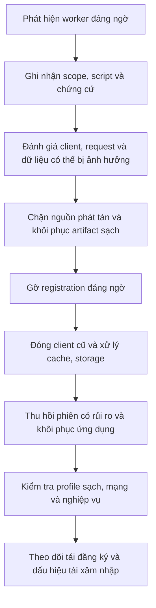

# Ứng phó sự cố: Malicious service worker

Service worker độc hại có thể tiếp tục ảnh hưởng đến người dùng sau khi đội phát triển đã sửa mã nguồn hoặc triển khai bản vá trên máy chủ. Trình duyệt lưu đăng ký service worker theo origin và có thể dùng worker đó để xử lý request của các trang nằm trong phạm vi quản lý. Vì vậy, xử lý sự cố cần đồng thời xác minh mã worker, chặn nguồn phát tán, gỡ đăng ký trong trình duyệt, xử lý dữ liệu lưu trữ và kiểm tra các phiên người dùng có thể đã bị ảnh hưởng.

Bài học này trình bày quy trình ứng phó khi phát hiện service worker bị thay đổi trái phép, bị lợi dụng để phân phối nội dung giả mạo hoặc can thiệp vào request và response của ứng dụng web.

## 1. Mục tiêu và phạm vi

Khi hoàn tất xử lý, đội ứng phó cần trả lời được các câu hỏi sau:

- Service worker nào bị nghi ngờ, được đăng ký từ script URL nào và quản lý những đường dẫn nào?
- Mã độc được đưa vào qua XSS, tài khoản triển khai bị lộ, CDN, máy chủ tĩnh hay một thay đổi hợp lệ bị cấu hình sai?
- Worker đã điều khiển những trang nào, có thể đã sửa response, thu thập dữ liệu ứng dụng hoặc gửi request thay mặt người dùng hay không?
- Đã chặn được nguồn phát tán, gỡ đăng ký, xử lý cache và dữ liệu liên quan, thu hồi phiên có rủi ro và xác minh bản sạch hay chưa?

Service worker thuộc một origin và chỉ có thể điều khiển client nằm trong scope được cấp. Mặc định, scope tối đa gắn với thư mục chứa file script; header `Service-Worker-Allowed` trên response của script có thể cho phép scope rộng hơn. Nếu worker được đặt ở `/sw.js` và đăng ký với scope `/`, nó có thể quản lý nhiều trang trong origin đó. Worker không vượt qua ranh giới origin để đọc trực tiếp bộ nhớ của một website khác.

## 2. Hiểu đúng khả năng và giới hạn của service worker

Service worker chạy trong worker global scope, tách khỏi DOM của trang và được trình duyệt đánh thức theo sự kiện. Nó không phải một tiến trình chạy liên tục. Đăng ký có thể tồn tại lâu dài dù trình duyệt đã dừng worker sau khi xử lý xong một sự kiện. Các sự kiện `fetch`, `install`, `activate`, `message`, `push` và `sync` là những điểm cần xem xét khi điều tra; khả năng hỗ trợ một số sự kiện phụ thuộc trình duyệt.

| Thành phần | Ý nghĩa khi điều tra |
|---|---|
| `scriptURL` | Đường dẫn script đã đăng ký. So sánh với URL và artifact được phê duyệt. |
| `scope` | Phạm vi URL mà registration có thể điều khiển. Scope rộng làm tăng số trang có thể bị ảnh hưởng. |
| `installing`, `waiting`, `active` | Các worker ở những giai đoạn khác nhau của vòng đời. Cần kiểm tra cả ba, không chỉ worker đang active. |
| `fetch` handler | Có thể xử lý request của client được điều khiển và trả response từ mạng, cache hoặc mã tự tạo. |
| Cache Storage | Có thể lưu HTML, JavaScript, API response hoặc dữ liệu khác mà ứng dụng chủ động đưa vào Cache API. |
| IndexedDB | Có thể lưu trạng thái và dữ liệu theo origin để dùng giữa các lần worker được đánh thức. |
| Push và Background Sync | Có thể đánh thức worker khi có sự kiện phù hợp, kể cả lúc người dùng không mở trang, tùy trình duyệt và quyền đã cấp. |

Một worker độc hại có thể hiển thị trang đăng nhập giả, sửa nội dung trả về, phân phối JavaScript đã bị thay đổi, chuyển hướng người dùng hoặc gửi request có thông tin mà mã trong worker có thể truy cập. Nó cũng có thể thực hiện request cùng origin với quyền của người dùng đang đăng nhập. Điều này có thể gây ra hành động trái phép ngay cả khi cookie phiên được đặt `HttpOnly` và JavaScript không đọc được giá trị cookie đó. Worker không được đọc trực tiếp cookie `HttpOnly`; trình duyệt vẫn áp dụng Same-Origin Policy, CORS và các giới hạn của Fetch API đối với dữ liệu cross-origin.

Không kết luận một worker là độc hại chỉ vì mã có `skipWaiting()` hoặc `clients.claim()`. Đây là các API hợp lệ để cập nhật ứng dụng nhanh hơn. Cần đánh giá nguồn script, scope, nội dung mã, thời điểm triển khai, hành vi mạng và dữ liệu thực tế. Ngược lại, một worker hợp lệ về tên và URL vẫn có thể bị thay nội dung tại máy chủ hoặc CDN.

## 3. Dấu hiệu và nguồn chứng cứ

Các dấu hiệu thường gặp gồm:

- Người dùng vẫn thấy nội dung cũ, trang giả mạo hoặc JavaScript bất thường sau khi máy chủ đã triển khai bản sửa.
- DevTools hiển thị registration có `scriptURL` hoặc `scope` không nằm trong danh sách ứng dụng được phê duyệt.
- Response của trang thay đổi theo thiết bị hoặc profile trình duyệt; mở cửa sổ riêng tư hay profile sạch lại cho kết quả khác.
- Cache Storage xuất hiện cache name, thời điểm hoặc nội dung không khớp với quy ước phát hành.
- Worker đang ở trạng thái `waiting` hoặc `active` với script hash khác artifact đã phát hành.
- Log mạng ghi nhận request bất thường đến script worker, endpoint thu thập dữ liệu, endpoint xác thực hoặc tên miền không thuộc ứng dụng.
- Người dùng báo có request hoặc thao tác trái phép, dù mã máy chủ hiện tại không còn chứa hành vi đó.

Không phải dấu hiệu nào cũng đủ để kết luận xâm nhập. Một cache cũ, worker đang `waiting` hoặc request đến endpoint bên thứ ba có thể là hành vi hợp lệ. Cần đối chiếu với lịch sử triển khai, cấu hình CDN, mã nguồn đã duyệt và thời điểm xảy ra sự cố.

Trước khi xóa registration hoặc storage, hãy lưu các thông tin có thể mất:

1. Origin, URL trang đang mở, thời điểm quan sát và phiên bản trình duyệt.
2. `scriptURL`, `scope`, trạng thái của `installing`, `waiting`, `active` và worker đang điều khiển trang.
3. Danh sách Cache Storage, tên database IndexedDB liên quan, thời gian và các URL đáng ngờ.
4. HAR hoặc log mạng cần thiết, response header và bản sao script worker cùng các script được import.
5. SHA-256 của script thu thập được và hash artifact sạch đã phát hành để so sánh.
6. Log triển khai, lịch sử thay đổi CDN, quyền truy cập tài khoản build/deploy và log xác thực liên quan.

HAR và bản sao request có thể chứa token, dữ liệu cá nhân hoặc thông tin phiên. Lưu chứng cứ trong kho có phân quyền, giới hạn người truy cập và thời hạn lưu phù hợp. Không gửi nguyên HAR lên kênh công khai hoặc đính kèm vào ticket không được bảo vệ.

## 4. Quy trình ứng phó

### Bước 1: Kích hoạt xử lý và xác định mức ảnh hưởng

Ghi nhận thời điểm phát hiện, ứng dụng và origin bị ảnh hưởng, nhóm người dùng báo cáo, trình duyệt, đường dẫn và hành vi quan sát được. Chỉ định người phụ trách kỹ thuật, bảo mật và vận hành để thống nhất quyết định cô lập và khôi phục.

Đánh giá mức độ theo scope và dữ liệu mà ứng dụng xử lý. Worker ở scope `/` có thể ảnh hưởng nhiều trang trong origin; worker chỉ ở `/portal/` có phạm vi hẹp hơn. Nếu worker điều khiển trang có đăng nhập, cần đánh giá nguy cơ thực hiện request thay mặt người dùng, đọc nội dung ứng dụng hiển thị và làm giả response. Nếu có bằng chứng dữ liệu hoặc phiên bị lộ, mở rộng xử lý sang hệ thống xác thực, API và quy trình thông báo sự cố tương ứng.

### Bước 2: Thu thập registration và kiểm tra script

Mở DevTools của trình duyệt trên origin bị ảnh hưởng. Trong tab **Application** (tên có thể khác theo trình duyệt), xem mục **Service Workers** để ghi lại script URL, scope, trạng thái và client đang được điều khiển. Kiểm tra **Cache Storage** và **IndexedDB** trong cùng khu vực lưu trữ. Dùng tab **Network** với Preserve log để quan sát request script worker, response và các request bất thường.

API sau giúp liệt kê registration và cache của origin hiện tại. Chạy nó trong DevTools Console trên đúng origin và lưu kết quả trước khi thực hiện thao tác gỡ bỏ. Kết quả console là dữ liệu hỗ trợ; hãy đối chiếu với bảng Service Workers của DevTools và chứng cứ từ máy chủ.

```js
async function inspectServiceWorkerState() {
  if (!('serviceWorker' in navigator)) {
    return { supported: false };
  }

  const registrations = await navigator.serviceWorker.getRegistrations();
  const workers = registrations.map((registration) => ({
    scope: registration.scope,
    updateViaCache: registration.updateViaCache,
    installing: registration.installing && {
      scriptURL: registration.installing.scriptURL,
      state: registration.installing.state,
    },
    waiting: registration.waiting && {
      scriptURL: registration.waiting.scriptURL,
      state: registration.waiting.state,
    },
    active: registration.active && {
      scriptURL: registration.active.scriptURL,
      state: registration.active.state,
    },
  }));

  return {
    origin: location.origin,
    controller: navigator.serviceWorker.controller && {
      scriptURL: navigator.serviceWorker.controller.scriptURL,
      state: navigator.serviceWorker.controller.state,
    },
    registrations: workers,
    cacheNames: await caches.keys(),
  };
}

inspectServiceWorkerState().then(console.log);
```

`getRegistrations()` và `caches.keys()` chỉ trả dữ liệu thuộc origin hiện tại. `navigator.serviceWorker.controller` mô tả worker đang điều khiển trang hiện tại; giá trị `null` có thể xuất hiện khi trang chưa được điều khiển hoặc không có worker. Đừng suy ra rằng toàn bộ trình duyệt sạch chỉ từ một lần chạy đoạn mã này.

Tải script worker và các dependency từ nguồn chứng cứ đáng tin cậy, sau đó so sánh hash với artifact trong pipeline phát hành. Kiểm tra các handler `fetch`, `message`, `push`, `sync`, thao tác Cache API, request đến endpoint lạ và logic thay đổi response. Kiểm tra cả script import; chỉ kiểm tra file entry point có thể bỏ sót mã độc được nạp từ dependency cùng origin.

### Bước 3: Chặn nguồn phát tán

Trước khi dọn trình duyệt diện rộng, bảo đảm máy chủ có thể cung cấp bản sạch và kẻ tấn công không thể ghi đè lại script. Tùy nguyên nhân, thực hiện các việc sau:

- Thu hồi hoặc xoay vòng thông tin xác thực triển khai, token CI/CD và quyền ghi CDN đã bị lộ.
- Khôi phục `sw.js` và dependency từ artifact đã xác minh; kiểm tra hash trên origin và các điểm phân phối CDN.
- Purge bản script độc hại tại CDN hoặc reverse proxy sau khi đã lưu chứng cứ cần thiết.
- Sửa XSS, dependency, pipeline hoặc quyền truy cập đã cho phép thay đổi script; nếu trang vẫn chứa mã đăng ký độc hại, loại bỏ đường đăng ký đó trong bản phát hành sạch.
- Khi cần thời gian xử lý, tạm thời vô hiệu hóa chức năng đăng ký service worker trong ứng dụng hoặc phục vụ một bản phát hành an toàn không đăng ký worker.

Việc thay file trên máy chủ chưa chứng minh trình duyệt đã ngừng dùng worker cũ. Registration và Cache Storage đã tồn tại trên thiết bị vẫn cần được xử lý riêng. Log máy chủ có thể cho thấy request tải script nhưng thường không chứng minh trực tiếp rằng một trình duyệt đã đăng ký hoặc kích hoạt worker.

### Bước 4: Gỡ registration đáng ngờ

Sau khi đã lưu chứng cứ và xác nhận nguồn phát tán đã được chặn, gỡ registration trong DevTools **Application → Service Workers → Unregister** (tên mục có thể khác theo trình duyệt). Chỉ gỡ registration thuộc origin và scope đã xác minh. Nếu có nhiều ứng dụng hợp lệ cùng origin, không xóa hàng loạt theo phỏng đoán.

Có thể dùng API để gỡ một scope đã xác định. Thay `/app/` bằng scope chính xác đã được xác minh trong DevTools:

```js
async function unregisterKnownScope() {
  const expectedScope = new URL('/app/', location.origin).href;
  const registrations = await navigator.serviceWorker.getRegistrations();
  const targets = registrations.filter(
    (registration) => registration.scope === expectedScope,
  );

  const results = await Promise.all(
    targets.map((registration) => registration.unregister()),
  );

  return targets.map((registration, index) => ({
    scope: registration.scope,
    unregistered: results[index],
  }));
}

unregisterKnownScope().then(console.table);
```

Đoạn mã này chỉ tìm registration trong origin của trang hiện tại. Chỉ chạy sau khi đã xác minh origin và scope, trong ngữ cảnh DevTools đáng tin cậy. `unregister()` trả về kết quả gỡ registration; nó không đảm bảo worker đã ngừng điều khiển mọi tab đang mở ngay lập tức. Các client đã được điều khiển có thể tiếp tục dùng worker cũ cho đến khi không còn client phù hợp. Đóng toàn bộ tab, cửa sổ và PWA của origin bị ảnh hưởng, sau đó mở lại ứng dụng từ một phiên trình duyệt sạch.

Nếu trang vẫn có mã độc có thể đăng ký lại worker, registration có thể xuất hiện lần nữa. Vì vậy, phải hoàn tất bước chặn nguồn phát tán trước khi yêu cầu người dùng mở lại ứng dụng.

### Bước 5: Xử lý Cache Storage và dữ liệu liên quan

Gỡ registration không tự xóa Cache Storage, IndexedDB hoặc dữ liệu ứng dụng khác. Sau khi lưu chứng cứ, xác định cache và database do ứng dụng quản lý rồi xóa các mục bị ảnh hưởng. Nếu cần làm sạch toàn bộ dữ liệu của origin, dùng chức năng Clear site data của trình duyệt theo quy trình đã phê duyệt; thao tác này có thể đăng xuất người dùng và xóa dữ liệu ứng dụng cục bộ.

Ví dụ dưới đây chỉ xóa cache có prefix đã biết. Thay `app-shell-` bằng quy ước cache thực tế sau khi đã xác minh; không chạy với prefix rộng nếu origin chứa nhiều ứng dụng.

```js
async function deleteKnownApplicationCaches() {
  const approvedPrefix = 'app-shell-';
  const names = await caches.keys();
  const targets = names.filter((name) => name.startsWith(approvedPrefix));
  const deleted = await Promise.all(
    targets.map((name) => caches.delete(name)),
  );

  return targets.map((name, index) => ({
    cache: name,
    deleted: deleted[index],
  }));
}

deleteKnownApplicationCaches().then(console.table);
```

Cache API là bộ lưu trữ do ứng dụng chủ động điều khiển. Header HTTP `Cache-Control: no-store` không thay thế việc kiểm tra mã gọi `cache.put()` hoặc `cache.addAll()`. Với dữ liệu nhạy cảm, ứng dụng phải chủ động tránh đưa response vào Cache Storage. Xóa cache cũng không tự xóa dữ liệu trong IndexedDB; chỉ xóa database đã xác định thuộc ứng dụng và đã lưu chứng cứ cần thiết.

### Bước 6: Khôi phục phiên và dịch vụ

Nếu điều tra cho thấy worker có thể đã thực hiện request trái phép, thu thập dữ liệu hoặc can thiệp luồng xác thực, phối hợp với đội định danh để thu hồi session và refresh token có rủi ro. Xoay vòng secret hoặc API key khi có bằng chứng chúng bị lộ; không xoay khóa ký toàn hệ thống chỉ vì phát hiện một worker nếu chưa có căn cứ. Rà soát log API, giao dịch và thay đổi dữ liệu trong khoảng thời gian worker có thể đã hoạt động.

Triển khai lại ứng dụng từ artifact sạch đã xác minh. Kiểm tra response của script worker, header bảo mật, CDN và dependency. Nếu ứng dụng cần service worker, đăng ký lại từ bản phát hành sạch với scope tối thiểu. Nếu chưa đủ tin cậy, giữ chức năng offline hoặc đăng ký worker tắt cho đến khi nguyên nhân được xử lý.

### Bước 7: Xác minh và theo dõi

Thực hiện xác minh trên profile trình duyệt đã được làm sạch và trên một số thiết bị đại diện:

1. Registration đáng ngờ không còn trong DevTools; nếu ứng dụng giữ worker hợp lệ, script URL, scope và hash phải khớp danh sách phát hành.
2. Tab cũ đã đóng; tab mới không còn bị worker cũ điều khiển. Kiểm tra `navigator.serviceWorker.controller` sau khi tải lại trang.
3. Cache Storage và IndexedDB không còn dữ liệu độc hại đã xác định; dữ liệu hợp lệ cần thiết vẫn hoạt động.
4. Network panel cho thấy script và dependency được tải từ nguồn đúng, response hash khớp artifact và không có request lạ.
5. Đăng nhập, đăng xuất, điều hướng, tải tài nguyên, gọi API và các luồng nghiệp vụ quan trọng hoạt động bình thường.
6. Sau một chu kỳ cập nhật và một lần khởi động lại trình duyệt, worker không tự xuất hiện lại ngoài dự kiến.

Theo dõi request đến script worker, thay đổi hash, thay đổi scope, lỗi CSP, endpoint bất thường và hoạt động xác thực sau khôi phục. Với hệ thống lớn, kết hợp log CDN/server, telemetry trình duyệt và báo cáo người dùng; không coi một nguồn log đơn lẻ là bằng chứng đầy đủ.

## 5. Luồng xử lý tổng quát



## 6. Tình huống minh họa

Một ứng dụng quản trị phát hành bản sửa XSS vào buổi sáng. Đến chiều, một số người dùng vẫn thấy biểu mẫu đăng nhập lạ và trình duyệt gửi request đến endpoint không thuộc hệ thống. Máy chủ hiện tại trả HTML sạch, nhưng DevTools trên một máy bị ảnh hưởng cho thấy registration ở scope `/` với script URL `/sw.js`. Hash của script tải từ origin không khớp artifact trong pipeline. Cache Storage còn một cache chứa bundle JavaScript không có trong bản phát hành.

Đội ứng phó lưu thông tin registration, script, cache name, HAR và log triển khai trước khi thay đổi trình duyệt. Điều tra phát hiện tài khoản CDN bị chiếm quyền và file `/sw.js` đã bị thay thế. Đội vận hành thu hồi thông tin xác thực CDN, khôi phục artifact sạch, purge bản độc hại và kiểm tra các điểm phân phối. Đội ứng dụng xác nhận mã XSS đã được vá để trang không thể đăng ký lại worker ngoài dự kiến.

Sau đó, đội hỗ trợ gỡ registration trên các thiết bị bị ảnh hưởng, đóng các tab và PWA cũ, xóa cache đã xác định, rồi yêu cầu người dùng mở lại ứng dụng. Đội định danh thu hồi các phiên có hoạt động đáng ngờ; đội API rà soát request và dữ liệu bị thay đổi trong khoảng thời gian phơi nhiễm. Kiểm tra trên profile sạch xác nhận worker mới có hash đúng, scope đúng, không có cache lạ và luồng đăng nhập hoạt động bình thường.

Tình huống này cho thấy bản sửa phía máy chủ chỉ giải quyết nguồn phát tán. Cần xử lý trạng thái đã lưu trên từng trình duyệt và xác minh các hành động có thể đã được thực hiện trong thời gian worker độc hại hoạt động.

## 7. Phòng ngừa tái diễn

**Giới hạn scope và điểm đăng ký.** Đặt script worker tại đường dẫn phù hợp với phạm vi cần quản lý. Chỉ dùng `Service-Worker-Allowed` khi có yêu cầu rõ ràng; scope rộng như `/` làm tăng số trang có thể bị ảnh hưởng. Duy trì một điểm đăng ký có thể kiểm tra trong mã ứng dụng và review mọi thay đổi liên quan.

**Áp dụng CSP phù hợp.** Dùng `worker-src` để giới hạn nguồn worker mà tài liệu được phép tạo, ví dụ `worker-src 'self'` khi ứng dụng chỉ cần worker cùng origin. Nếu cần giới hạn chặt hơn, xây dựng allowlist nguồn và đường dẫn phù hợp với cách triển khai. `worker-src 'self'` vẫn cho phép nhiều đường dẫn cùng origin, vì vậy không thay thế kiểm soát mã nguồn, quyền ghi và quy trình phát hành. Kiểm thử CSP trước khi áp dụng rộng để tránh chặn worker hợp lệ.

**Bảo vệ pipeline và nguồn phân phối.** Bảo vệ tài khoản CI/CD, CDN và quyền ghi file tĩnh bằng MFA, quyền tối thiểu, phê duyệt thay đổi và log bất biến. Lưu artifact cùng hash phát hành; kiểm tra file thực tế tại origin và CDN sau triển khai. Tránh để nội dung worker được chỉnh sửa thủ công ngoài pipeline.

**Thiết kế cache có chủ đích.** Chỉ cache tài nguyên công khai, có phiên bản và phù hợp với offline. Không đưa trang xác thực, response cá nhân hoặc dữ liệu nhạy cảm vào Cache Storage. Kiểm tra cả nhánh fallback offline và logic cập nhật để worker cũ không phục vụ bundle đã bị thu hồi. Nhớ rằng Cache API có thể lưu response theo lệnh của ứng dụng dù HTTP cache header không cho phép lưu trong HTTP cache.

**Theo dõi thay đổi và hành vi.** Theo dõi hash của script worker và dependency, thay đổi `Service-Worker-Allowed`, request đến script bất thường, báo cáo CSP và endpoint lạ. Duy trì quy trình hỗ trợ người dùng cung cấp thông tin DevTools mà không làm lộ token hoặc dữ liệu cá nhân.

**Chuẩn bị runbook.** Ghi rõ owner của origin, scope hợp lệ, cache prefix, vị trí artifact sạch, cách purge CDN, cách gỡ registration trên từng trình duyệt và điều kiện thu hồi session. Thực hành định kỳ trên môi trường kiểm thử để đội hỗ trợ biết cách lưu chứng cứ trước khi xóa site data.

## 8. Sai lầm thường gặp

| Sai lầm | Hậu quả | Cách xử lý đúng |
|---|---|---|
| Chỉ triển khai lại `sw.js` | Trình duyệt vẫn có thể dùng registration và cache cũ. | Chặn nguồn phát tán, gỡ registration, đóng client cũ và xác minh lại. |
| Chỉ gọi `unregister()` | Cache Storage và IndexedDB vẫn còn; tab đang mở có thể còn bị worker cũ điều khiển. | Xử lý client và storage theo từng bước sau khi lưu chứng cứ. |
| Xóa toàn bộ site data ngay khi phát hiện | Mất chứng cứ và có thể xóa dữ liệu hợp lệ cần cho điều tra. | Thu thập trước, xác định phạm vi, rồi mới dọn dữ liệu có kiểm soát. |
| Coi `skipWaiting()` là bằng chứng mã độc | Có thể quy kết nhầm một cơ chế cập nhật hợp lệ. | Đối chiếu script, hash, scope, thời điểm và hành vi. |
| Dựa vào `Cache-Control: no-store` để ngăn Cache API | Ứng dụng vẫn có thể chủ động lưu response bằng Cache API. | Kiểm tra và sửa logic cache trong worker. |
| Cho người dùng mở lại trang trước khi chặn nguồn phát tán | Trang có thể đăng ký lại worker độc hại. | Sửa nguồn phát tán và mã đăng ký trước khi khôi phục client. |

## 9. Checklist kết thúc sự cố

- [ ] Đã ghi nhận origin, scope, script URL, trạng thái worker và client bị ảnh hưởng.
- [ ] Đã lưu script, dependency, cache metadata, log mạng và thông tin triển khai cần thiết.
- [ ] Đã xác định và chặn nguồn phát tán; artifact sạch đã được xác minh tại origin/CDN.
- [ ] Đã gỡ registration đáng ngờ và đóng các client cũ thuộc origin bị ảnh hưởng.
- [ ] Đã xử lý Cache Storage, IndexedDB và dữ liệu liên quan theo phạm vi đã xác định.
- [ ] Đã rà soát request, hành động nghiệp vụ và phiên xác thực trong khoảng thời gian phơi nhiễm.
- [ ] Đã khôi phục ứng dụng và kiểm tra trên profile sạch, gồm cả trường hợp khởi động lại trình duyệt.
- [ ] Đã bổ sung giám sát và cập nhật runbook, quyền triển khai hoặc cấu hình CSP cần thiết.

Chỉ đóng sự cố khi đội phụ trách có thể chứng minh worker đang được phân phối là bản đã duyệt, các registration và dữ liệu độc hại đã được xử lý, các phiên có rủi ro đã được đánh giá và ứng dụng hoạt động bình thường sau khi trình duyệt tạo client mới.
