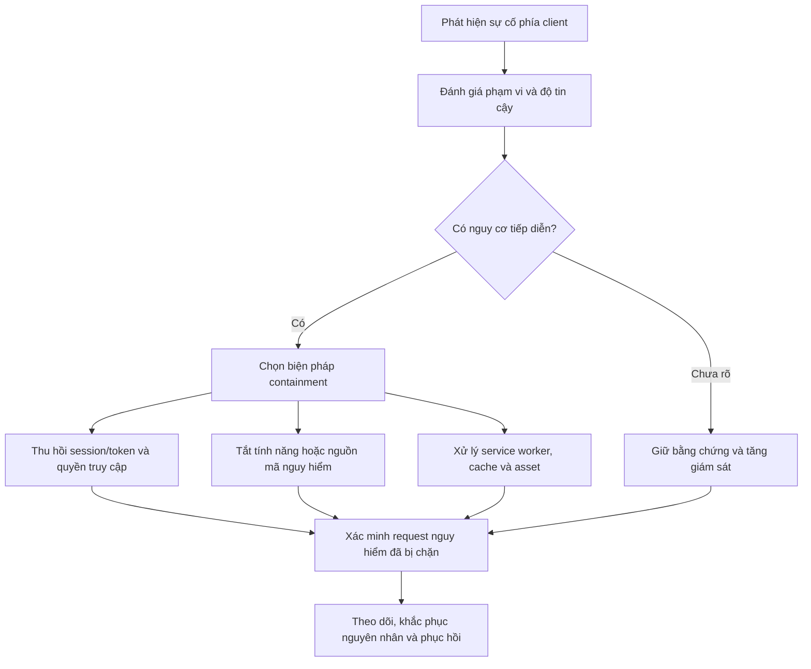

# Containment client

Containment client là tập hợp hành động khẩn cấp nhằm giới hạn tác động của sự cố lên trình duyệt, phiên làm việc và mã đang chạy ở phía người dùng. Trong ứng dụng web, client có thể đang giữ session cookie, access token, dữ liệu trong bộ nhớ, Cache Storage, service worker và các bundle JavaScript đã tải từ trước. Khi xảy ra XSS, dependency bị xâm phạm, rò rỉ token hoặc mã frontend độc hại, những trạng thái này có thể tiếp tục duy trì rủi ro ngay cả sau khi máy chủ đã được sửa.

Mục tiêu của containment là ngăn client tiếp tục thực hiện hành vi nguy hiểm, giảm quyền của phiên bị ảnh hưởng, ngăn tải thêm mã độc và giữ lại bằng chứng cần thiết để điều tra. Việc chặn phải được thực thi bằng các cơ chế mà tổ chức kiểm soát được, đặc biệt là phía máy chủ, gateway và nền tảng quản lý thiết bị. Mã JavaScript chạy trong trình duyệt của người dùng có thể bị sửa hoặc bỏ qua, nên một nút “disable” ở frontend không thể là biện pháp ngăn chặn duy nhất.

Trong module bảo mật ứng dụng web, containment client gắn với ranh giới trình duyệt, origin, cookie, CSP, Trusted Types, service worker và security headers. Bài học trình bày cách chọn biện pháp theo loại sự cố, cô lập phiên và tính năng, xử lý cache/client cũ, phối hợp với người dùng và xác minh rằng hành vi nguy hiểm đã dừng.

## Mục tiêu

Sau bài học, bạn có thể:

- Xác định client, phiên và tài nguyên frontend có thể còn chịu ảnh hưởng sau sự cố.
- Chọn biện pháp containment phù hợp với XSS, token leak, dependency compromise hoặc hành vi cross-origin bất thường.
- Thu hồi session và token ở phía máy chủ, đồng thời hạn chế quyền truy cập của client bị ảnh hưởng.
- Tắt tính năng hoặc đường tải mã nguy hiểm bằng feature flag, gateway và cấu hình triển khai.
- Xử lý service worker, Cache Storage, CDN cache và bundle cũ theo cách có kiểm soát.
- Bảo toàn bằng chứng, thông báo cho người dùng và xác minh hiệu quả của containment.
- Lập kế hoạch khôi phục sau khi nguyên nhân gốc đã được xử lý.

## Containment client trong vòng đời ứng phó sự cố

Containment là giai đoạn giới hạn thiệt hại trong khi đội kỹ thuật đang điều tra và chuẩn bị khắc phục triệt để. Không cần chờ biết toàn bộ nguyên nhân mới hành động nếu đã có bằng chứng đáng tin cậy về việc mã độc đang chạy hoặc session bị lạm dụng. Tuy nhiên, mức độ chặn cần tương xứng với tác động và phải có người chịu trách nhiệm.



Một kế hoạch containment tốt trả lời được bốn câu hỏi: client nào có thể bị ảnh hưởng, quyền nào cần thu hồi, mã hoặc tính năng nào cần ngừng cung cấp và cách nào xác nhận rủi ro đã giảm. Ghi lại thời điểm, người quyết định, phạm vi áp dụng và điều kiện rollback cho từng hành động.

## Xác định bề mặt client bị ảnh hưởng

Trước khi chọn hành động, xác định những thành phần có thể tiếp tục duy trì sự cố:

| Thành phần | Ví dụ rủi ro | Câu hỏi cần xác minh |
|---|---|---|
| Session cookie | Kẻ tấn công tiếp tục dùng phiên đã bị đánh cắp | Session có thể bị thu hồi tức thời ở server không? |
| Access/refresh token | Token bị đọc qua XSS hoặc ghi vào log | Token còn hiệu lực bao lâu và có cơ chế revoke không? |
| JavaScript bundle | Client tiếp tục chạy mã bị lỗi hoặc bị chèn | Asset nào chứa mã và URL/version nào được phân phối? |
| Service worker | Worker cũ tiếp tục điều khiển trang và phục vụ asset cache | Worker scope, version và trạng thái activation là gì? |
| Cache Storage | HTML/API response hoặc asset cũ còn được dùng | Cache nào do ứng dụng quản lý và có thể xóa an toàn? |
| CDN/browser cache | Client tải lại asset cũ từ cache | Cache key, TTL và invalidation đã được cấu hình ra sao? |
| Third-party script | SDK hoặc script ngoài tiếp tục chạy trong origin ứng dụng | Host nào cung cấp script và có thể tắt tích hợp không? |
| Feature/route | Chức năng dễ bị khai thác vẫn mở | Có thể vô hiệu hóa ở server hoặc feature flag không? |
| Browser extension/device | Extension độc hại hoặc thiết bị bị kiểm soát | Có nền tảng endpoint management để cô lập không? |

Phân loại client theo dữ liệu và quyền đã tiếp xúc: người dùng thường, quản trị viên, nhân viên hỗ trợ, tenant, browser family, phiên bản bundle và khoảng thời gian tải mã. Không thu thập fingerprint quá mức hoặc ghi session identifier thô chỉ để tìm phạm vi. Ưu tiên request ID, mã phiên giả danh và dữ liệu inventory đã được tổ chức phê duyệt.

## Chọn mức containment

Không phải mọi sự cố đều cần tắt toàn bộ ứng dụng. Chọn phạm vi hẹp nhất vẫn ngăn được hành vi nguy hiểm, nhưng mở rộng ngay khi chưa thể xác định ranh giới ảnh hưởng.

| Mức | Biện pháp | Khi phù hợp |
|---|---|---|
| Theo dõi tăng cường | Tăng log quyết định, rate limit và cảnh báo | Tín hiệu chưa xác nhận hoặc tác động thấp, cần thêm bằng chứng |
| Giới hạn chức năng | Tắt route, nút, API hoặc tích hợp cụ thể | Một tính năng hoặc luồng xử lý bị ảnh hưởng rõ ràng |
| Thu hồi phiên | Revoke session, refresh token hoặc credential liên quan | Có nguy cơ phiên/token bị lộ hoặc bị sử dụng trái phép |
| Cô lập tenant/nhóm client | Từ chối truy cập theo tenant, user hoặc client group | Phạm vi đã xác định và có thể phân biệt an toàn |
| Chặn nguồn mã | Gỡ script, package, CDN path hoặc asset bị xâm phạm | Nguồn mã cụ thể đang cung cấp nội dung độc hại |
| Tạm dừng ứng dụng/luồng | Đưa route hoặc toàn bộ ứng dụng về chế độ bảo trì | Không thể ngăn tác động bằng biện pháp hẹp hơn |

Ghi rõ lý do chọn mức, rủi ro còn lại và điều kiện mở lại. Nếu có nguy cơ dữ liệu nhạy cảm tiếp tục bị truy cập, ưu tiên ngăn quyền truy cập trước rồi mới tối ưu trải nghiệm người dùng.

## Thu hồi session và token phía máy chủ

Nếu client có thể đã lộ cookie phiên hoặc token, biện pháp có hiệu lực nhất thường là thu hồi quyền ở phía máy chủ. Xóa cookie bằng JavaScript không thể thu hồi cookie `HttpOnly` và cũng không vô hiệu hóa bản sao cookie đã bị đánh cắp.

### Session cookie

Với session được quản lý ở server, đánh dấu session bị revoke hoặc xóa bản ghi session tương ứng. Nếu sự cố ảnh hưởng nhiều phiên, có thể thu hồi theo user, tenant, nhóm phiên hoặc mốc thời gian tạo. Với tài khoản đặc quyền, cân nhắc yêu cầu đăng nhập lại và xác thực tăng cường sau khi revoke.

Response có thể yêu cầu trình duyệt xóa cookie bằng `Set-Cookie` với cùng tên, domain và path phù hợp, nhưng đây chỉ là dọn trạng thái phía browser. Hành động quyết định vẫn là server không chấp nhận session đã bị thu hồi.

```http
HTTP/1.1 401 Unauthorized
Set-Cookie: __Host-session=; Path=/; Secure; HttpOnly; SameSite=Lax; Max-Age=0
Cache-Control: no-store
```

Header trên minh họa xóa cookie có tiền tố `__Host-`; tên, thuộc tính và domain/path phải khớp cookie thực tế. Không thể dùng một header mẫu cho mọi cookie. Khi dùng `__Host-`, cookie cần `Secure`, `Path=/` và không có thuộc tính `Domain`.

### Access token và refresh token

Thu hồi refresh token hoặc token family để ngăn cấp token mới. Nếu access token là JWT tự chứa và API không kiểm tra trạng thái thu hồi, token có thể vẫn được chấp nhận đến khi hết hạn. Các lựa chọn vận hành gồm:

- Access token có thời hạn ngắn để giới hạn cửa sổ rủi ro.
- Token introspection hoặc denylist/version check ở API gateway/server.
- Thu hồi token family và buộc refresh lại bằng xác thực mới.
- Xoay vòng signing key chỉ khi phạm vi lộ khóa yêu cầu và đã đánh giá tác động toàn hệ thống.

Không xoay signing key hoặc thu hồi toàn bộ token toàn cục theo phản xạ nếu chỉ một phiên bị ảnh hưởng. Đây là hành động có thể làm gián đoạn nhiều dịch vụ. Ghi lại token type, issuer, audience và phạm vi revoke dưới dạng metadata an toàn; tuyệt đối không đưa token thô vào log sự cố.

### Xác minh sau khi revoke

Kiểm tra rằng:

1. Request dùng session/token cũ bị từ chối ở server.
2. Refresh token đã bị revoke không cấp được access token mới.
3. Client được yêu cầu đăng nhập lại hoặc nhận trạng thái phù hợp.
4. Các phiên không nằm trong phạm vi sự cố vẫn hoạt động nếu chính sách cho phép.
5. Log ghi nhận quyết định revoke mà không chứa credential.

Nếu API vẫn chấp nhận access token cũ do cơ chế xác minh không hỗ trợ revoke, ghi rõ khoảng thời gian token còn hiệu lực và áp dụng biện pháp bổ sung như denylist, giảm TTL hoặc chặn route nhạy cảm.

## Tắt tính năng và giới hạn quyền từ server

Feature flag giúp vô hiệu hóa một chức năng bị ảnh hưởng mà không cần chờ build frontend mới. Tuy nhiên, flag chỉ có ý nghĩa bảo mật khi backend cũng kiểm tra trạng thái. Ẩn nút hoặc bỏ route khỏi giao diện không ngăn người dùng gọi API trực tiếp.

Các hành động thường dùng:

- Tắt endpoint hoặc thao tác thay đổi trạng thái có lỗ hổng.
- Từ chối request tới route cụ thể ở gateway hoặc middleware.
- Tắt tích hợp third-party script, widget hoặc SDK đang bị xâm phạm.
- Chặn upload hoặc preview nội dung có thể kích hoạt XSS.
- Giới hạn quyền quản trị và yêu cầu xác thực lại cho thao tác nhạy cảm.
- Tắt một luồng callback hoặc postMessage bị xác định là không an toàn.

Ví dụ logic server-side:

```js
async function updateAccountEmail(req, res, next) {
  if (featureFlags.disableEmailChange) {
    return res.status(503).json({
      code: "FEATURE_TEMPORARILY_UNAVAILABLE",
      message: "Chức năng đang tạm thời không khả dụng."
    });
  }

  // Tiếp tục xác thực, kiểm tra CSRF, phân quyền và validation.
  return performEmailChange(req, res, next);
}
```

Ví dụ chỉ minh họa vị trí kiểm tra flag. Trong ứng dụng thực tế, flag cần được đọc từ cấu hình có quyền kiểm soát, có audit và cập nhật an toàn. Không để client gửi tham số như `?disableSecurity=true` để quyết định trạng thái bảo vệ.

Khi tắt chức năng, thông điệp người dùng nên giải thích hành động tạm thời và hướng liên hệ hỗ trợ. Không trả stack trace, tên hệ thống nội bộ hoặc chi tiết về cách khai thác.

## Chặn hoặc thay thế mã frontend bị ảnh hưởng

Nếu bundle hoặc script bên thứ ba bị xâm phạm, cần ngăn trình duyệt tải thêm nội dung đó. Xác định chính xác URL, version, hash, CDN host và các trang đang nhúng tài nguyên.

Các biện pháp có thể gồm:

- Gỡ script khỏi HTML/template và cấu hình loader.
- Chặn host/path qua CSP `script-src`, `worker-src` hoặc directive phù hợp.
- Cập nhật asset sang bản đã xác minh và phát hành bundle mới.
- Thu hồi hoặc thay đổi khóa, credential mà script bên thứ ba có thể đã truy cập.
- Vô hiệu hóa tag manager hoặc widget từ hệ thống quản trị của nhà cung cấp.
- Kiểm tra source map, dynamic import và worker để đảm bảo không còn đường tải mã cũ.

CSP có thể giúp chặn tải hoặc thực thi một số nguồn mã, nhưng không phải công cụ thu hồi session. Nếu script độc hại đã chạy, nó có thể đã đọc dữ liệu hoặc gửi request trước khi policy mới được áp dụng. Cần điều tra khả năng token, dữ liệu biểu mẫu và thông tin người dùng đã bị lộ.

Không thêm `unsafe-inline`, `unsafe-eval` hoặc wildcard host vào CSP để khắc phục nhanh lỗi sau containment. Thay đổi policy cần được thử nghiệm trên route bị ảnh hưởng và kiểm tra report trước khi triển khai rộng.

## Xử lý service worker và Cache Storage

Service worker có thể tiếp tục điều khiển các trang đã mở và trả nội dung từ Cache Storage. Nếu worker hoặc asset bị xâm phạm, chỉ triển khai bundle mới trên server có thể chưa đủ để mọi client nhận được mã sạch.

### Phát hành service worker thay thế

Một worker mới có thể được triển khai để thay thế worker cũ theo vòng đời cài đặt và activation. Cần xác định scope, file worker, chiến lược update và điều kiện activate. Không giả định browser lập tức chuyển tất cả tab đang mở sang worker mới; trang đang được điều khiển có thể tiếp tục dùng worker cũ cho tới khi vòng đời phù hợp hoàn tất.

Quy trình có thể gồm:

1. Xác minh artifact worker sạch và cấu hình scope chính xác.
2. Phát hành worker mới với version/cache namespace mới.
3. Kiểm tra update được phát hiện trên browser mục tiêu.
4. Khi worker mới activate, xóa các cache do ứng dụng quản lý đã được xác định là không còn an toàn.
5. Điều hướng hoặc yêu cầu tải lại client theo thời điểm phù hợp.
6. Theo dõi tỷ lệ client còn dùng worker cũ và lỗi tải asset.

Ví dụ xóa các cache có namespace do ứng dụng sở hữu trong service worker mới:

```js
const ACTIVE_CACHE_PREFIX = "browser-security-app-";
const CURRENT_CACHE = "browser-security-app-v8";

self.addEventListener("activate", (event) => {
  event.waitUntil((async () => {
    const names = await caches.keys();
    await Promise.all(
      names
        .filter((name) => name.startsWith(ACTIVE_CACHE_PREFIX) && name !== CURRENT_CACHE)
        .map((name) => caches.delete(name))
    );

    await self.clients.claim();
  })());
});
```

Đoạn mã chỉ xóa cache thuộc namespace mà ứng dụng sở hữu. Không xóa mọi cache trong origin vì ứng dụng khác hoặc tính năng khác có thể đang dùng chúng. `clients.claim()` giúp worker active nhận quyền điều khiển các client phù hợp trong scope; nó không đảm bảo mọi tab đã tải lại mã ứng dụng. Cần kiểm tra luồng update trên trình duyệt thực tế.

### Giới hạn của việc xóa cache

Ứng dụng web không thể tùy ý xóa toàn bộ HTTP cache của trình duyệt hoặc dữ liệu của origin khác. Có thể:

- Xóa Cache Storage do service worker của ứng dụng quản lý.
- Thay đổi URL/version asset để client tải bundle mới.
- Invalidate CDN/reverse proxy cache theo quy trình nhà cung cấp.
- Trả header cache phù hợp cho HTML, manifest và response nhạy cảm.
- Hướng dẫn người dùng tải lại trang hoặc đăng nhập lại khi cần.

Không dùng `Clear-Site-Data` một cách rộng rãi nếu chưa đánh giá tác động. Phạm vi phụ thuộc directive: `storage` và `cache` áp dụng cho dữ liệu của origin, còn `cookies` có thể xóa cookie thuộc registrable domain và các subdomain của nó. Vì vậy, thao tác xóa cookie có thể làm người dùng đăng xuất khỏi nhiều ứng dụng cùng domain gốc. Chọn directive hẹp, xác minh phạm vi theo trình duyệt mục tiêu và thử nghiệm trước.

## Containment theo loại sự cố

### XSS đang bị khai thác

Nếu phát hiện stored/reflected/DOM XSS có khả năng khai thác:

1. Tắt hoặc giới hạn route/feature tạo ra sink nguy hiểm.
2. Chặn payload hoặc dữ liệu độc hại ở server theo quy tắc nghiệp vụ; không chỉ ẩn nội dung ở frontend.
3. Sửa output encoding, sanitizer hoặc DOM sink; triển khai CSP/Trusted Types phù hợp như lớp phòng vệ bổ sung.
4. Xác định các phiên đã truy cập trang bị ảnh hưởng trong khoảng thời gian nghi vấn.
5. Revoke session/token nếu script có thể đã truy cập hoặc sử dụng chúng.
6. Kiểm tra hành vi request bất thường, thay đổi email, thêm credential hoặc thao tác thay mặt người dùng.
7. Phát hành asset sạch, xử lý service worker/cache và yêu cầu client cập nhật.

Không giả định XSS chỉ ảnh hưởng người đã mở trang tại thời điểm phát hiện. Stored XSS có thể tiếp tục kích hoạt với người dùng mở bản ghi bị ảnh hưởng sau này. Cần xử lý dữ liệu đã lưu và các đường hiển thị liên quan.

### Token hoặc session bị lộ

Xác định loại credential, thời gian có thể bị lộ, issuer, audience và các API chấp nhận nó. Revoke đúng phạm vi, chặn refresh, yêu cầu xác thực lại và theo dõi việc sử dụng token cũ. Nếu token nằm trong URL, log, analytics hoặc browser storage, sửa cả nguồn phát sinh và quy trình thu thập để ngăn rò rỉ lặp lại.

Nếu credential đã bị gửi tới bên thứ ba, đánh giá dữ liệu mà credential cho phép truy cập. Xóa token khỏi giao diện không làm bản sao ở bên ngoài mất hiệu lực.

### Dependency hoặc third-party script bị xâm phạm

Tắt nguồn phân phối mã, gỡ phiên bản bị ảnh hưởng khỏi bundle/CDN, xác minh package sạch và build lại trong môi trường đáng tin cậy. Kiểm tra install script, pipeline, registry token và quyền của nhà cung cấp. Nếu script đã chạy trong origin chính, xem xét session/token và dữ liệu mà nó có thể đọc được.

Nếu không thể xác định script nào bị ảnh hưởng, tạm dừng tích hợp hoặc route phụ thuộc vào nó. Không chỉ đổi URL CDN sang một URL khác chưa xác minh.

### Origin hoặc CORS bị cấu hình sai

Thu hẹp allowlist theo origin đầy đủ, bỏ phản chiếu `Origin` tùy ý và tắt credentials nếu không cần. Kiểm tra các route trả dữ liệu theo session, preflight và response cache. Nếu origin lạ đã đọc được response, điều tra phạm vi dữ liệu có thể đã bị lộ và thu hồi session khi phù hợp.

Không coi CORS deny là bằng chứng request chưa tới server. Với request đơn giản hoặc thao tác có tác dụng phụ, cần xác minh trạng thái dữ liệu ở backend.

### Browser extension hoặc thiết bị bị xâm phạm

Ứng dụng web không thể gỡ một extension hoặc cô lập thiết bị của người dùng chỉ bằng JavaScript. Nếu tổ chức quản lý thiết bị, phối hợp với endpoint management/IT để vô hiệu hóa extension, cách ly thiết bị hoặc thu hồi chứng thư/credential theo quy trình. Đối với người dùng bên ngoài, cung cấp hướng dẫn hỗ trợ và thu hồi session phía server. Không yêu cầu người dùng cài một extension mới chưa được xác minh để “làm sạch” trình duyệt.

## Thông báo và hỗ trợ người dùng

Thông báo containment nên rõ ràng, đúng phạm vi và không tiết lộ chi tiết có thể giúp tái tạo tấn công. Nội dung thường cần nêu:

- Chức năng nào đang tạm thời không khả dụng.
- Người dùng có cần tải lại trang, đăng nhập lại hoặc hoàn tất xác minh không.
- Cách liên hệ bộ phận hỗ trợ qua kênh chính thức.
- Việc nào người dùng cần kiểm tra, chẳng hạn rà soát hoạt động tài khoản gần đây.
- Thời điểm cập nhật tiếp theo nếu chức năng bị gián đoạn kéo dài.

Không gửi link đăng nhập qua kênh không xác minh hoặc yêu cầu người dùng cung cấp mật khẩu, OTP, cookie hay token cho đội hỗ trợ. Nếu cần xác thực lại, điều hướng tới trang đăng nhập chính thức trong origin đã được xác minh.

Với ứng dụng nội bộ, phối hợp help desk để chuẩn bị hướng dẫn cho người dùng bị logout hoặc mất cache. Với ứng dụng công khai, cân nhắc trang trạng thái và thông báo trong ứng dụng. Chỉ thông báo phạm vi đã được xác nhận; không khẳng định dữ liệu không bị ảnh hưởng khi điều tra chưa hoàn tất.

## Bảo toàn bằng chứng trong lúc containment

Containment có thể làm thay đổi trạng thái client và server. Trước hoặc đồng thời với hành động, lưu những bằng chứng cần thiết mà không làm chậm biện pháp ngăn chặn khẩn cấp:

- Timestamp, request ID, route, method và quyết định server.
- Phiên bản bundle, hash artifact, URL script và phiên bản service worker.
- CSP violation, browser error và event telemetry đã được lọc.
- Thay đổi cấu hình feature flag, CORS, CSP, gateway và cache.
- Danh sách session/token bị revoke ở dạng định danh an toàn.
- Phạm vi client/tenant và kết quả xác minh sau hành động.

Không lưu token, cookie, mật khẩu, OTP hoặc toàn bộ dữ liệu biểu mẫu vào ticket. Nếu cần lấy mẫu forensic từ thiết bị do tổ chức quản lý, thực hiện theo quy trình pháp chứng và quyền truy cập được phê duyệt. Không yêu cầu người dùng gửi profile trình duyệt hoặc dữ liệu cá nhân rộng hơn mức cần thiết.

Ghi lại thời điểm trước/sau của mỗi thay đổi để có thể tái dựng timeline. Lưu cấu hình cũ và mới trong kho có kiểm soát, cùng người thực hiện và lý do. Nếu cần xóa asset hoặc cache, lưu hash và metadata trước khi thay thế để hỗ trợ điều tra.

## Xác minh containment đã có hiệu lực

Không kết thúc containment chỉ vì giao diện hiển thị thông báo hoặc một request trả `403`. Kiểm tra bằng nhiều góc nhìn:

| Kiểm tra | Bằng chứng mong đợi |
|---|---|
| Session cũ | Request dùng session đã revoke bị server từ chối |
| Token cũ | Refresh bị từ chối; access token cũ không còn quyền hoặc hết hạn theo kế hoạch |
| API bị tắt | Gọi trực tiếp endpoint cũng bị từ chối ở server/gateway |
| Script bị gỡ | HTML/bundle mới không còn tham chiếu nguồn mã bị xâm phạm |
| CSP mới | Response header có policy mong muốn trên các route liên quan; vi phạm được theo dõi |
| Service worker | Client nhận worker mới; cache namespace cũ do ứng dụng sở hữu được xử lý |
| CDN/cache | Request mới nhận asset sạch theo version/hash đã xác minh |
| Dữ liệu nghiệp vụ | Không còn thay đổi trái phép sau thời điểm containment |
| Tích hợp hợp lệ | SSO, thanh toán và các luồng không liên quan vẫn hoạt động theo thiết kế |
| Telemetry | Event ghi nhận đúng quyết định và không chứa bí mật |

Thử cả client mới và client đã mở từ trước. Kiểm tra browser engine được hỗ trợ, tab đang hoạt động, tab mở lại sau khi offline và thiết bị quay lại sau thời gian dài. Một số client có thể giữ asset cũ hoặc chưa nhận được worker mới ngay lập tức.

## Khôi phục sau containment

Containment là biện pháp tạm thời. Chỉ mở lại tính năng khi nguyên nhân gốc đã được khắc phục và bằng chứng kiểm thử đáp ứng yêu cầu.

Trước khi phục hồi:

1. Xác nhận lỗ hổng hoặc nguồn mã độc đã được loại bỏ.
2. Review code/config và hoàn tất kiểm thử bảo mật liên quan.
3. Xác minh session/token, cache, service worker và bundle có trạng thái sạch.
4. Triển khai canary hoặc nhóm người dùng giới hạn trước.
5. Theo dõi lỗi, CSP report, request bị từ chối và dấu hiệu tái diễn.
6. Mở dần tính năng theo kế hoạch; giữ khả năng tắt lại nhanh.
7. Cập nhật runbook, baseline và thông tin hỗ trợ.

Nếu không thể khôi phục an toàn trong thời gian dự kiến, tiếp tục duy trì trạng thái hạn chế và thông báo rõ cho người dùng. Không xóa cảnh báo hoặc đóng incident chỉ vì lưu lượng bất thường đã giảm sau khi chặn.

## Runbook mẫu: XSS trong một route tài khoản

Tình huống: đội giám sát phát hiện payload XSS được lưu trong một trường hồ sơ. Khi người dùng mở trang hồ sơ, script chạy trong origin chính và có thể gửi request bằng quyền phiên hiện tại.

| Thời điểm | Hành động | Chủ trì | Xác nhận |
|---|---|---|---|
| T0 | Mở incident, lưu request ID và xác định route/dữ liệu bị ảnh hưởng | Incident lead | Có timeline và phạm vi sơ bộ |
| T0 + vài phút | Tắt route hoặc chức năng render trường bị ảnh hưởng ở server | Application team | Request trực tiếp cũng bị chặn |
| Đồng thời | Kiểm tra session và token có thể bị truy cập; revoke phiên trong phạm vi phù hợp | Identity team | Credential cũ bị từ chối |
| Tiếp theo | Sửa encoding/sanitizer, kiểm thử payload và triển khai bundle sạch | Frontend team | Payload hiển thị như văn bản, không thực thi |
| Tiếp theo | Cập nhật CSP/Trusted Types nếu phù hợp; phát hành service worker/cache version mới | Platform team | Client nhận asset sạch |
| Sau triển khai | Kiểm tra request, CSP report, session và trạng thái hồ sơ | SOC/Application team | Không còn hành vi trái phép |
| Phục hồi | Mở lại route theo canary sau khi review | Incident lead | Theo dõi ổn định và có rollback |

Mốc thời gian chỉ là ví dụ. Trong sự cố thật, ưu tiên theo mức độ tác động, khả năng khai thác và quy trình phản ứng của tổ chức. Không chờ đủ mọi nhóm tham gia mới thực hiện biện pháp ngăn chặn đã được phê duyệt.

## Thực hành

Trong môi trường lab, tạo một ứng dụng giả lập có session cookie, một route hiển thị dữ liệu người dùng và service worker quản lý cache có version. Dùng dữ liệu giả lập, không dùng tài khoản thật.

Thực hiện tình huống XSS giả lập:

1. Ghi lại route, bundle version, service worker version và trạng thái session ban đầu.
2. Mô phỏng phát hiện dữ liệu có thể kích hoạt XSS; tắt route render ở server bằng feature flag.
3. Revoke session thử nghiệm và xác minh request với cookie cũ bị từ chối.
4. Triển khai bản sửa hiển thị dữ liệu bằng API DOM an toàn, kiểm thử payload không thực thi.
5. Phát hành service worker version mới và chỉ xóa cache namespace do ứng dụng sở hữu.
6. Tải lại trang bằng client mới và client đã mở trước đó; xác minh asset mới được dùng.
7. Theo dõi log, CSP report và trạng thái nghiệp vụ để xác nhận không còn request trái phép.
8. Phục hồi route theo canary và diễn tập rollback.

Hoàn thiện báo cáo gồm phạm vi client, quyết định containment, session/token đã revoke ở dạng giả danh, asset/cache đã thay đổi, bằng chứng xác minh và điều kiện phục hồi. Nêu rõ giới hạn còn lại, chẳng hạn access token tự chứa chưa thể revoke tức thời hoặc một số client offline chưa nhận bản cập nhật.

## Ghi nhớ

- Containment client giới hạn tác động lên trình duyệt, phiên, mã frontend và cache đang tồn tại.
- Thu hồi session/token phải được thực thi ở server; xóa cookie trong JavaScript không vô hiệu hóa bản sao đã bị đánh cắp.
- Feature flag chỉ bảo vệ được khi backend hoặc gateway cũng kiểm tra trạng thái.
- CSP và Trusted Types là lớp phòng vệ; chúng không thay thế điều tra dữ liệu hoặc thu hồi credential sau XSS.
- Service worker và Cache Storage cần được cập nhật theo vòng đời; ứng dụng không thể tùy ý xóa toàn bộ browser cache.
- Bảo toàn bằng chứng nhưng không lưu token, cookie, mật khẩu hoặc dữ liệu cá nhân không cần thiết.
- Xác minh bằng request thực tế, trạng thái nghiệp vụ và client cũ/mới trước khi kết thúc containment.
- Chỉ phục hồi khi nguyên nhân gốc đã được xử lý, kiểm thử đạt và có khả năng rollback.
