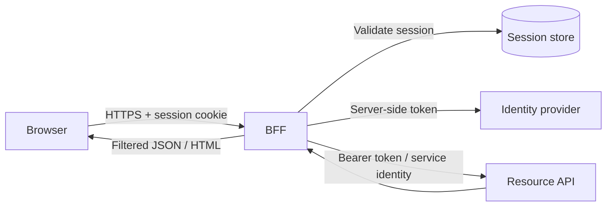
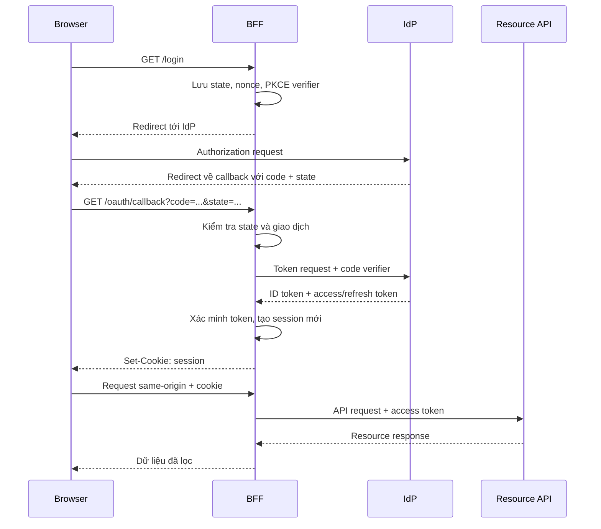

# Backend for frontend

Backend for frontend (BFF) là một lớp backend được thiết kế riêng cho một giao diện hoặc nhóm giao diện cụ thể. Với ứng dụng web, BFF đứng giữa trình duyệt và các dịch vụ nghiệp vụ, nhận request cùng cookie phiên từ browser, xác thực phiên ở phía server, lấy token cần thiết từ nơi lưu an toàn rồi gọi các API nội bộ. Trình duyệt nhận dữ liệu nghiệp vụ đã được chọn lọc, không cần giữ access token của các API phía sau.

BFF tạo ra một ranh giới tin cậy hữu ích cho ứng dụng web có nhiều dịch vụ hoặc cần tích hợp với hệ thống định danh. Nó giúp tập trung việc quản lý phiên, token, kiểm tra quyền, chống CSRF và kiểm soát dữ liệu trả về. BFF không tự động làm ứng dụng an toàn: mã JavaScript độc hại vẫn có thể gửi request dưới phiên người dùng, backend vẫn có thể bị SSRF hoặc lỗi phân quyền, và dữ liệu nhạy cảm vẫn có thể bị lộ qua log hoặc cache nếu thiết kế không cẩn thận.

Bài học này tập trung vào BFF trong kiến trúc bảo mật trình duyệt: ranh giới origin, cookie và session, OAuth/OIDC, token phía server, CSRF, XSS, CORS, kiểm soát API và vận hành.

## 1. BFF giải quyết vấn đề gì?

Một SPA thường gọi trực tiếp nhiều API từ trình duyệt. Nếu frontend tự nhận và lưu access token, token có thể bị đọc bởi JavaScript chạy cùng origin. Lưu trong localStorage hoặc sessionStorage khiến mã XSS có thể lấy token và gửi ra ngoài. Lưu token trong biến bộ nhớ giảm thời gian tồn tại sau khi tải lại trang nhưng vẫn không ngăn script độc hại sử dụng token khi ứng dụng đang chạy.

BFF thay đổi vị trí của credential. Browser chỉ giữ một cookie phiên có thuộc tính bảo vệ; access token và refresh token được lưu phía server và chỉ BFF sử dụng khi gọi resource API. Resource API không cần mở CORS cho browser của người dùng nếu mọi request đi qua BFF cùng origin.

| Mô hình | Credential trong browser | Đường gọi API | Rủi ro và đặc điểm |
|---|---|---|---|
| SPA gọi API trực tiếp | Thường có access token trong memory hoặc storage | Browser → resource API | Token có thể bị script cùng origin đánh cắp; cần cấu hình CORS và token handling ở client |
| BFF | Cookie phiên opaque, thường HttpOnly | Browser → BFF → resource API | Token giữ ở server; cần bảo vệ cookie, CSRF và phiên BFF |
| Server-rendered truyền thống | Cookie phiên | Browser → application server | Có ranh giới phiên tương tự BFF; backend thường kết xuất HTML |
| API gateway dùng chung | Tùy client, thường bearer token | Client → gateway → service | Gateway tập trung định tuyến và policy; chưa chắc hiểu nhu cầu riêng của từng giao diện |

BFF hữu ích khi giao diện web cần truy cập nhiều API, cần giữ token ngoài JavaScript hoặc cần kết hợp dữ liệu từ nhiều dịch vụ. Với một ứng dụng đơn giản đã có server-side session, việc thêm một dịch vụ BFF riêng có thể làm tăng độ phức tạp mà không tạo thêm lợi ích đáng kể. BFF cũng không thay thế API gateway: gateway thường phục vụ nhiều loại client và xử lý concern ở biên hệ thống, còn BFF tối ưu hợp đồng API cho một frontend.

## 2. Ranh giới tin cậy và luồng request

Một kiến trúc điển hình gồm browser, BFF, identity provider và các resource API. Browser chỉ giao tiếp với BFF qua origin của ứng dụng. BFF xác minh cookie phiên, kiểm tra quyền và gọi các dịch vụ nội bộ bằng credential phía server.



Các vùng tin cậy cần được phân định rõ:

- **Browser:** môi trường không đáng tin cậy. Người dùng có thể sửa request, chạy JavaScript tùy ý, cài extension hoặc gửi request ngoài giao diện.
- **BFF:** điểm thực thi xác thực phiên, kiểm tra quyền, chống CSRF, lọc dữ liệu và kiểm soát đích gọi upstream.
- **Session store:** nơi lưu trạng thái phiên và liên kết phiên với token phía server. Cần giới hạn quyền đọc, mã hóa và thời hạn.
- **Identity provider (IdP):** phát hành token hoặc xác minh danh tính theo giao thức đã cấu hình.
- **Resource API:** vẫn phải xác minh token, audience, scope và quyền nghiệp vụ theo hợp đồng của nó. Không nên mặc định mọi request từ BFF đều hợp lệ.

Mỗi ranh giới cần có xác thực kênh, xác thực danh tính dịch vụ và quyền tối thiểu. Chỉ vì một request đến từ BFF không có nghĩa nó được phép truy cập mọi tài nguyên. Nếu BFF dùng service credential để gọi API, resource API vẫn cần biết thao tác đó đang thay mặt principal nào và có quyền thực hiện hay không.

## 3. Luồng đăng nhập với OAuth 2.0 và OpenID Connect

Một cách triển khai phổ biến là BFF hoạt động như OAuth confidential client. BFF bắt đầu Authorization Code Flow, giữ state, nonce và PKCE verifier ở phía server, nhận authorization code tại callback rồi đổi code ở token endpoint. Browser không nhận access token hoặc refresh token.

Luồng khái quát:

1. Browser truy cập /login trên BFF.
2. BFF tạo giao dịch đăng nhập ngẫu nhiên, lưu state, nonce, PKCE verifier và thời hạn trong kho giao dịch phía server.
3. BFF chuyển browser tới authorization endpoint của IdP với response_type=code, client_id, redirect_uri, state, nonce và code_challenge.
4. Người dùng xác thực tại IdP. IdP chuyển browser về callback BFF với authorization code và state.
5. BFF kiểm tra state, thời hạn và tính dùng một lần của giao dịch; sau đó đổi code tại token endpoint bằng PKCE verifier và cơ chế xác thực client phù hợp.
6. BFF xác minh kết quả OIDC, issuer, audience, chữ ký, thời hạn và các claim bắt buộc. Nonce phải khớp giao dịch đã lưu.
7. BFF tạo session ID mới, lưu session cùng token hoặc tham chiếu token phía server và đặt cookie phiên cho browser.
8. Browser gọi BFF bằng cookie phiên; BFF dùng access token phù hợp để gọi resource API.



State chống việc callback bị ghép với giao dịch đăng nhập khác; PKCE ràng buộc authorization code với client đã tạo verifier; nonce liên kết ID token với yêu cầu xác thực OIDC. Đây là các kiểm tra riêng, không thay thế lẫn nhau. Giao dịch phải có thời hạn ngắn, được dùng một lần và bị xóa sau khi hoàn tất hoặc thất bại.

BFF phải xác minh chữ ký ID token bằng khóa tin cậy từ issuer đã cấu hình, kiểm tra iss, aud, exp, iat và nonce; nếu có azp, kiểm tra theo yêu cầu giao thức. Không nhận issuer hoặc JWKS URL tùy ý từ request. Chỉ tin cấu hình issuer đã đăng ký. Nếu BFF dùng access token dạng opaque, cần introspection hoặc cơ chế xác minh theo hợp đồng của IdP.

Authorization code, token và lỗi callback có thể xuất hiện trong URL hoặc log của proxy. Sau khi callback hoàn tất, redirect browser tới URL sạch, không chứa code hay state. Cấu hình access log để loại bỏ query nhạy cảm; tránh tải tài nguyên bên thứ ba trên callback page trước khi URL được làm sạch.

## 4. Quản lý session và cookie của BFF

Browser cần một định danh phiên ngẫu nhiên, opaque và không mang ý nghĩa quyền hạn. BFF ánh xạ cookie đó tới session record phía server. Session record có thể lưu principal reference, thời điểm đăng nhập, assurance level, thời hạn idle/absolute, token reference và trạng thái thu hồi.

Cookie phiên cho ứng dụng HTTPS thường có dạng:

```http
Set-Cookie: __Host-app_session=<opaque-random-value>; Path=/; Secure; HttpOnly; SameSite=Lax
```

Các thuộc tính có ý nghĩa:

- **Secure:** browser chỉ gửi cookie qua HTTPS.
- **HttpOnly:** JavaScript không đọc được cookie qua document.cookie; điều này giảm khả năng đánh cắp trực tiếp cookie qua XSS.
- **SameSite=Lax:** hạn chế gửi cookie trong nhiều ngữ cảnh cross-site; cần kiểm thử luồng OAuth callback và điều hướng.
- **Path=/:** cookie có phạm vi toàn bộ ứng dụng.
- **Prefix __Host-:** yêu cầu cookie có Secure, Path=/ và không có Domain, giúp giảm nguy cơ subdomain ghi đè cookie cùng tên.

Cookie phải chứa giá trị ngẫu nhiên đủ mạnh, không chứa JWT hoặc JSON quyền hạn có thể đọc và sửa ở client. Session ID không được xuất hiện trong URL. Nếu dùng cookie khác thay vì prefix __Host-, cần hiểu rõ phạm vi Domain và Path; cookie domain rộng có thể bị subdomain ít tin cậy tác động.

Tạo session ID mới sau khi đăng nhập, sau khi hoàn tất MFA hoặc khi nâng quyền để chống session fixation. Khi logout, thu hồi session phía server trước hoặc đồng thời với việc gửi cookie hết hạn. Xóa cookie trên browser không tự thu hồi bản ghi session hoặc token ở server.

Một số luồng OAuth/OIDC dùng response mode form POST hoặc yêu cầu điều hướng cross-site có thể không tương thích với SameSite=Lax theo cách ứng dụng dự kiến. Chỉ chuyển sang SameSite=None; Secure khi thực sự cần, đồng thời bổ sung CSRF protection và kiểm thử trên browser hỗ trợ. Không chọn SameSite=None như một mặc định tiện lợi.

Session cần có cả idle timeout và absolute lifetime. Idle timeout giới hạn thời gian không hoạt động; absolute lifetime giới hạn tổng thời gian sống kể cả khi có request liên tục. Với thao tác nhạy cảm, yêu cầu xác thực lại hoặc assurance level phù hợp thay vì chỉ dựa vào việc cookie vẫn hợp lệ.

## 5. Chống CSRF cho request dùng cookie

Cookie được browser tự động gửi theo request phù hợp. Vì vậy, nếu attacker dụ người dùng đang đăng nhập gửi một request thay đổi trạng thái tới BFF, browser có thể đính kèm session cookie mà người dùng không chủ ý. Đây là nền tảng của Cross-Site Request Forgery.

BFF nên áp dụng nhiều lớp:

1. Dùng cookie SameSite phù hợp làm lớp giảm thiểu đầu tiên.
2. Yêu cầu CSRF token cho các thao tác thay đổi trạng thái. Token phải được liên kết với session hoặc giao dịch, có tính không đoán được và được kiểm tra phía server.
3. Kiểm tra Origin với danh sách origin chính xác cho các request thay đổi trạng thái; có thể dùng Referer làm phương án bổ sung khi phù hợp.
4. Dùng Fetch Metadata như Sec-Fetch-Site để từ chối các request cross-site không cần thiết.
5. Không dùng GET cho thao tác thay đổi dữ liệu, đăng xuất hoặc hành động có tác động nghiệp vụ.
6. Kiểm tra Content-Type và schema body; không coi việc đổi content type là cơ chế CSRF độc lập.

Một mẫu request có CSRF token:

```http
POST /bff/api/profile/email HTTP/1.1
Host: app.example.test
Cookie: __Host-app_session=<opaque-session>
Origin: https://app.example.test
Content-Type: application/json
X-CSRF-Token: <session-bound-token>

{"email":"new-address@example.test"}
```

Token có thể được cấp qua một endpoint cùng origin và đưa vào memory của frontend. Nếu JavaScript đọc được CSRF token, điều đó không làm token trở thành credential đăng nhập; nó chỉ là bằng chứng bổ sung để server phân biệt request hợp lệ theo thiết kế. BFF vẫn phải kiểm tra session và origin. Không đặt CSRF token trong URL hoặc log.

Double-submit cookie có thể dùng trong một số kiến trúc, nhưng cần token được ràng buộc mật mã với session hoặc ký an toàn; một cookie CSRF tùy ý mà attacker có thể ghi qua subdomain không phải giải pháp chắc chắn. Với BFF có session server-side, synchronizer token thường dễ diễn giải và kiểm soát.

CORS không phải cơ chế CSRF tổng quát. CORS chủ yếu quyết định JavaScript ở origin khác có được đọc response hay không; một số request cross-site vẫn có thể được gửi. Không dựa vào việc browser chặn đọc response để bảo vệ thao tác thay đổi trạng thái.

## 6. XSS vẫn là rủi ro của BFF

BFF giữ access token ngoài JavaScript nhưng không làm XSS biến mất. Nếu attacker thực thi script trong origin ứng dụng, script đó thường có thể gọi endpoint BFF bằng session cookie tự động được browser gửi. HttpOnly ngăn script đọc cookie, nhưng không ngăn script gửi request dưới phiên hiện tại và đọc response mà ứng dụng có quyền đọc.

Vì vậy, BFF cần đi cùng các biện pháp bảo vệ XSS:

- Escape output theo ngữ cảnh HTML, attribute, URL và JavaScript; không ghép chuỗi dữ liệu người dùng vào mã thực thi.
- Sanitize HTML khi sản phẩm thực sự cần hiển thị rich text.
- Dùng CSP với nonce hoặc hash cho script; tránh cho phép rộng unsafe-inline và unsafe-eval.
- Dùng Trusted Types ở ứng dụng tương thích để kiểm soát các sink DOM nguy hiểm.
- Hạn chế script bên thứ ba, kiểm tra nguồn và quyền của tag manager, analytics hoặc widget.
- Không đưa token, session ID, CSRF secret hoặc dữ liệu nhạy cảm vào DOM, URL hay client-side telemetry.
- Giảm quyền của các endpoint BFF và yêu cầu xác thực lại cho thao tác rủi ro cao.

CSP và Trusted Types giảm khả năng thực thi script không mong muốn, nhưng không thay thế việc sửa nguyên nhân XSS. Nếu script độc hại đã chạy trong origin, nó có thể thực hiện nhiều thao tác như người dùng. Đối với thao tác nhạy cảm, cần kiểm tra quyền và có thể yêu cầu xác nhận hoặc step-up authentication ở server.

## 7. Kiểm tra quyền ở BFF và resource API

BFF thường biết user session và có thể chuyển tiếp request tới nhiều service. Điều này tạo nguy cơ confused deputy: client yêu cầu BFF dùng quyền của service để đọc hoặc thay đổi dữ liệu mà người dùng không được phép truy cập.

Mỗi endpoint BFF phải xác minh:

- Session còn hiệu lực và principal đã được xác thực.
- Người dùng có quyền thực hiện hành động cụ thể.
- Tài nguyên mục tiêu thuộc phạm vi mà principal được phép truy cập.
- Request body và path parameter đáp ứng schema, giới hạn kích thước và quy tắc nghiệp vụ.
- Token upstream có đúng audience, scope và thời hạn cho resource API.
- Resource API tiếp tục kiểm tra quyền đối với tài nguyên nếu nó là nơi sở hữu dữ liệu hoặc quyết định nghiệp vụ.

Không dựa vào việc nút bị ẩn trong UI. Không tin userId, tenantId, role hoặc isAdmin do browser gửi. BFF phải lấy principal từ session đã xác minh và kiểm tra quyền trên dữ liệu phía server. Với hệ thống multi-tenant, tenant context phải được ràng buộc với principal và kiểm tra ở mỗi request; không cho client tùy ý đổi tenant ID.

Nếu BFF dùng service-to-service credential có quyền rộng, phải giới hạn endpoint và tham số mà client có thể điều khiển. Ưu tiên token delegation hoặc token exchange với audience/scope cụ thể khi kiến trúc IdP hỗ trợ. Nếu dùng service identity, BFF phải thực thi authorization của người dùng trước khi sử dụng quyền dịch vụ.

## 8. Proxy upstream an toàn và phòng SSRF

Một BFF thường gọi nhiều upstream API. Không tạo endpoint proxy tổng quát như /bff/proxy?url=... rồi lấy URL từ browser. Attacker có thể điều khiển BFF truy cập địa chỉ nội bộ, metadata service, localhost hoặc một host bên ngoài không được phép. Đây là dạng Server-Side Request Forgery (SSRF).

Thiết kế an toàn cần:

- Ánh xạ route BFF tới upstream cố định trong cấu hình phía server.
- Allowlist hostname, scheme và port; chỉ dùng HTTPS cho upstream production.
- Không cho client truyền URL tuyệt đối, host header hoặc redirect destination tùy ý.
- Kiểm tra redirect của upstream; không tự động theo redirect sang host ngoài allowlist.
- Chặn địa chỉ loopback, link-local, private và metadata network nếu không có nhu cầu rõ ràng; kiểm tra DNS resolution và chống DNS rebinding theo nền tảng.
- Đặt timeout, giới hạn kích thước response, số lần redirect và concurrency.
- Không chuyển tiếp mọi header từ browser. Chỉ forward các header được chọn; tự tạo Authorization, Host, trace context và identity context phía server.
- Không chuyển tiếp cookie phiên BFF tới upstream trừ khi có thiết kế riêng được đánh giá.
- Lọc response headers để không lộ token, cookie nội bộ hoặc thông tin hạ tầng.

Ví dụ mapping route:

```text
GET  /bff/api/orders       -> https://orders.internal/v1/orders
GET  /bff/api/orders/{id}  -> https://orders.internal/v1/orders/{id}
POST /bff/api/payments     -> https://payments.internal/v1/payments
GET  /bff/api/profile      -> https://identity.internal/v1/profile
```

Các route trên là mapping cố định do backend định nghĩa. Client chỉ cung cấp ID và dữ liệu nghiệp vụ cần thiết; BFF kiểm tra định dạng và quyền trước khi gọi upstream. Không cho client đổi hostname hoặc path prefix để biến BFF thành open proxy.

## 9. Lưu trữ và sử dụng token phía server

Access token và refresh token cần được lưu trong session store hoặc token vault có kiểm soát truy cập. Không ghi token vào log, trace, exception, metric label hoặc URL. Hạn chế quyền đọc token theo service identity; mã hóa khi truyền và khi lưu theo khả năng của nền tảng. Nếu dùng encryption at rest, quản lý khóa qua KMS hoặc secret manager, có quy trình rotation và audit truy cập.

BFF cần biết token thuộc issuer nào, audience nào, scope nào, thời hạn nào và được dùng cho service nào. Không dùng một access token có quyền rộng cho mọi upstream chỉ vì BFF có thể truy cập nhiều API. Khi cần gọi nhiều resource server, lấy token phù hợp cho từng audience hoặc dùng token exchange theo chính sách IdP.

Refresh token rotation cần được xử lý phía server. Khi refresh thành công, thay token cũ bằng token mới một cách nguyên tử trong session/token store. Nếu hai request đồng thời cùng refresh, một request có thể khiến request kia bị coi là reuse. Có thể dùng khóa theo session hoặc cơ chế single-flight để gom các refresh đồng thời. Nếu phát hiện reuse thực sự, xử lý theo chính sách thu hồi token family và phát event bảo mật; không ghi token bị nghi ngờ vào log.

Khi access token hết hạn, BFF có thể refresh rồi retry request an toàn một lần. Không retry vô hạn và không tự động phát lại thao tác không idempotent như thanh toán hoặc tạo đơn nếu chưa có idempotency key. Nếu refresh thất bại do token bị thu hồi, đánh dấu session cần xác thực lại, xóa token phía server và trả lỗi xác thực phù hợp.

## 10. CORS, origin và security headers

Khi browser chỉ gọi BFF cùng origin, resource API nội bộ thường không cần cho phép origin browser qua CORS. BFF gọi resource API từ server; CORS không áp dụng cho server-to-server request như nó áp dụng cho browser. Điều này giảm cấu hình cross-origin ở browser, nhưng không có nghĩa BFF được miễn kiểm soát truy cập hoặc resource API không cần xác thực.

Nếu frontend và BFF thực sự ở hai origin khác nhau, cần cấu hình CORS chính xác. Với credentialed request, chỉ cho phép origin cụ thể, bật credentials có chủ đích và trả Vary: Origin khi response phụ thuộc origin. Không kết hợp Access-Control-Allow-Origin: * với Access-Control-Allow-Credentials: true. Đồng thời giữ CSRF token và kiểm tra Origin vì CORS không thay thế CSRF defense.

Các response HTML từ BFF nên có security headers phù hợp với ứng dụng: CSP, X-Content-Type-Options: nosniff, Referrer-Policy, Permissions-Policy, HSTS trên HTTPS và chính sách chống framing bằng frame-ancestors. Đặt header ở lớp tạo response cuối cùng và kiểm tra các trang lỗi, redirect, callback cùng route được reverse proxy phục vụ.

Với CSP, connect-src phải cho phép endpoint BFF mà frontend cần gọi. Không cần đưa các resource API nội bộ vào connect-src nếu browser không gọi trực tiếp chúng. Điều này giúp thu hẹp bề mặt kết nối của frontend. Các script, font, ảnh và iframe vẫn cần allowlist theo tài nguyên thật.

## 11. Lọc response, cache và dữ liệu trả về

BFF nên trả đúng dữ liệu mà giao diện cần. Không chuyển tiếp nguyên response upstream nếu response có token, internal ID, debug field, stack trace hoặc dữ liệu của tenant khác. Dùng response DTO có allowlist, chuẩn hóa lỗi và loại bỏ header nội bộ.

Các response có thông tin tài khoản, session hoặc dữ liệu nhạy cảm thường cần:

```http
Cache-Control: no-store
Pragma: no-cache
```

Không cache response nhạy cảm trong CDN hoặc shared proxy nếu cache key không ràng buộc đầy đủ danh tính và quyền. Ngay cả cache riêng của browser cũng cần chính sách rõ cho trang tài khoản và dữ liệu nhạy cảm. Khi dùng cache cho dữ liệu không nhạy cảm, kiểm tra tenant, authorization context, Vary và thời gian sống để tránh trả dữ liệu của người dùng này cho người dùng khác.

Không để service worker cache response BFF có cookie hoặc dữ liệu cá nhân nếu không có chiến lược rõ ràng. Cache API có thể giữ dữ liệu sau logout hoặc chuyển tài khoản trên cùng browser profile. Khi đăng xuất, xóa các cache ứng dụng phù hợp và bảo đảm server không còn chấp nhận session cũ. Tuy nhiên, xóa cache client chỉ là dọn dữ liệu giao diện, không thay thế thu hồi session ở server.

Chuẩn hóa lỗi để tránh tiết lộ liệu một tài khoản có tồn tại, upstream nào đang chạy, hostname nội bộ hay token validation detail. Ghi chi tiết kỹ thuật vào log bảo vệ với correlation ID; trả thông báo phù hợp cho browser.

## 12. Logout, thu hồi và thay đổi trạng thái phiên

Logout cần kết thúc phiên ở phía server. Quy trình thường gồm xác minh CSRF cho thao tác logout, đánh dấu session revoked, xóa hoặc thu hồi token liên quan theo khả năng của IdP, xóa cookie browser và phát sự kiện audit. Nếu ứng dụng hỗ trợ logout tại IdP hoặc front-channel/back-channel logout, phải xác minh issuer, audience và tính hợp lệ của thông điệp logout theo giao thức.

Một endpoint logout không nên dùng GET vì trình duyệt hoặc nội dung nhúng có thể kích hoạt điều hướng ngoài ý muốn. Dùng POST có CSRF protection. Khi người dùng đổi mật khẩu, gỡ MFA, thay đổi email khôi phục hoặc quản trị viên thu hồi truy cập, xác định session/token nào cần bị vô hiệu hóa và phát event để giám sát.

Nếu access token đã được phát hành cho resource API và không hỗ trợ revoke tức thời, thu hồi session BFF không nhất thiết làm token đã sao chép mất hiệu lực ngay lập tức. Giảm thời hạn token, giới hạn audience/scope, dùng introspection hoặc cơ chế denylist theo nhu cầu rủi ro. Không tuyên bố logout đã thu hồi mọi token nếu kiến trúc không bảo đảm điều đó.

## 13. Khả năng mở rộng và độ tin cậy

BFF thường chạy nhiều instance. Session state và token không nên chỉ tồn tại trong memory của một instance nếu request tiếp theo có thể đến instance khác. Dùng session store dùng chung hoặc định tuyến có chủ đích, có TTL và cơ chế thu hồi. Sticky session có thể giảm chuyển instance nhưng không thay thế chiến lược lưu trạng thái bền vững.

Các điểm cần xử lý:

- **Session consistency:** cập nhật token, session rotation và logout phải nhất quán giữa các instance.
- **Concurrent refresh:** tránh hai request cùng xoay refresh token; dùng lock hoặc single-flight theo session.
- **Timeout:** đặt deadline tổng cho chuỗi BFF và upstream; timeout một service không nên giữ request vô hạn.
- **Circuit breaker:** hạn chế request tới upstream đang lỗi, nhưng không biến lỗi upstream thành login success.
- **Retry:** chỉ retry lỗi tạm thời và thao tác có thể lặp an toàn; dùng idempotency key cho thao tác ghi.
- **Backpressure:** giới hạn số request đồng thời và kích thước payload để BFF không bị cạn tài nguyên.
- **Graceful degradation:** trả lỗi rõ khi một chức năng phụ không khả dụng; không trả dữ liệu cache thuộc người dùng khác.
- **Key rotation:** cập nhật secret và khóa mã hóa mà không làm mất khả năng đọc session/token đang còn hiệu lực theo kế hoạch.

BFF là điểm tập trung traffic và có thể trở thành bottleneck. Theo dõi latency riêng của BFF, thời gian chờ session store, IdP và từng upstream. Tối ưu aggregation song song chỉ khi các request độc lập; giới hạn concurrency và hủy request phụ khi client đã ngắt kết nối.

## 14. Quan sát và audit BFF

Log BFF nên giúp trả lời ai đã thực hiện thao tác gì, trên route nào, kết quả ra sao và request đã gọi upstream nào. Chỉ ghi tham chiếu principal/session đã giả danh, route template, outcome, reason code, latency và correlation ID. Không ghi cookie, bearer token, authorization code, CSRF token hoặc body nhạy cảm.

Các sự kiện vận hành và bảo mật có thể gồm:

| Event | Ý nghĩa |
|---|---|
| bff.session.created | Phiên BFF mới được tạo sau xác thực |
| bff.session.revoked | Phiên bị thu hồi |
| bff.csrf.rejected | Request bị từ chối do kiểm tra CSRF |
| bff.authorization.denied | Principal không có quyền thực hiện hành động |
| bff.upstream.request_failed | Request tới resource API thất bại |
| bff.token.refresh_succeeded | Token được refresh thành công |
| bff.token.refresh_failed | Refresh không hoàn tất |
| bff.token.reuse_detected | Có dấu hiệu refresh token bị dùng lại |
| bff.proxy.destination_rejected | Đích upstream không thuộc allowlist |
| bff.response.filtered | Trường dữ liệu bị loại theo response contract |

Theo dõi các chỉ số như tỷ lệ request 401/403/429/5xx, tỷ lệ CSRF reject, refresh failure, số session bị thu hồi, upstream latency, số destination bị từ chối và độ trễ session store. Phân tích theo route template và service; không đặt user ID, session ID hoặc IP đầy đủ làm metric label có cardinality cao.

## 15. Kiểm thử bảo mật BFF

Kiểm thử BFF cần bao phủ browser, session store, IdP và resource API. Một số kịch bản trọng yếu:

| Kịch bản | Kết quả mong đợi |
|---|---|
| Người dùng chưa đăng nhập gọi endpoint riêng tư | BFF trả 401 hoặc chuyển tới luồng đăng nhập theo hợp đồng |
| Session hết hạn hoặc bị thu hồi | BFF từ chối request và không gọi upstream bằng token cũ |
| Session cookie bị JavaScript đọc | Không đọc được do HttpOnly |
| Session ID cũ được dùng sau đăng nhập hoặc nâng quyền | Bị từ chối sau khi session được rotate |
| Request thay đổi trạng thái thiếu CSRF token | Bị từ chối |
| Request cross-site có Origin không hợp lệ | Bị từ chối theo policy |
| Browser tự gửi event login success giả | Không làm thay đổi trạng thái session hoặc audit backend |
| Người dùng sửa userId hoặc tenantId | BFF kiểm tra principal và quyền; không truy cập dữ liệu ngoài phạm vi |
| Client truyền URL nội bộ vào tham số proxy | Request bị từ chối; không phát sinh kết nối tới host đó |
| Upstream redirect tới hostname ngoài allowlist | BFF không tự động theo redirect |
| Upstream trả token hoặc header nội bộ ngoài hợp đồng | BFF loại bỏ trước khi trả cho browser |
| Hai request đồng thời refresh token | Xử lý đồng bộ; không tạo reuse giả ngoài chính sách |
| Logout rồi phát lại cookie cũ | Session bị từ chối ở server |
| Cache được dùng sau khi đổi tài khoản | Không trả dữ liệu của session trước |
| BFF hoặc session store timeout | Lỗi được ghi nhận; không bỏ qua xác thực hoặc phân quyền |

Kiểm tra cấu hình cookie trong DevTools Application và Network. Dùng Network panel để xem Set-Cookie, redirect callback, request BFF và response cache headers; không sao chép cookie hoặc token thật vào ticket hay báo cáo. Dùng test tự động để xác minh CSRF, authorization, session rotation và route allowlist. Kiểm thử tích hợp phải xác nhận resource API từ chối token sai audience hoặc scope, kể cả khi request đi qua BFF.

Thử các tình huống lỗi và race condition: IdP chậm, token endpoint trả lỗi, session store không sẵn sàng, upstream timeout, request bị retry và logout đồng thời với refresh. Kiểm tra log để chắc chắn không có credential, query string nhạy cảm hoặc body đăng nhập.

## 16. Khi nào nên dùng BFF?

BFF phù hợp khi frontend cần truy cập nhiều backend, token cần được giữ phía server, API cần được điều chỉnh theo giao diện hoặc ứng dụng cần một điểm tập trung cho session và security policy. BFF đặc biệt hữu ích khi browser không nên biết credential của các resource API.

BFF có thể không cần thiết nếu ứng dụng đã có server-side session và backend monolith cung cấp đầy đủ chức năng, hoặc nếu một SPA công khai cần truy cập API công khai với OAuth public-client flow được thiết kế đúng. Việc thêm BFF làm tăng hạ tầng, latency, vận hành session và trách nhiệm bảo mật. Hãy chọn theo threat model, số lượng upstream, yêu cầu token và năng lực vận hành.

Khi có nhiều frontend khác nhau, có thể dùng BFF riêng cho từng frontend hoặc nhóm trải nghiệm. Tránh biến một BFF thành lớp API tổng quát có quyền truy cập mọi service và mọi tenant. Hợp đồng route, quyền và response nên gắn với nhu cầu cụ thể của frontend.

## 17. Checklist triển khai

- [ ] Browser chỉ giữ cookie phiên opaque; access/refresh token được quản lý phía server.
- [ ] BFF dùng Authorization Code Flow với state, nonce và PKCE; callback kiểm tra giao dịch dùng một lần.
- [ ] ID token được xác minh issuer, audience, chữ ký, thời hạn và nonce theo OIDC.
- [ ] Cookie có Secure, HttpOnly, SameSite phù hợp; đánh giá __Host-, Path=/ và không đặt Domain.
- [ ] Session ID được rotate sau đăng nhập, MFA hoặc nâng quyền; có idle timeout và absolute lifetime.
- [ ] Request thay đổi trạng thái có CSRF protection; kiểm tra Origin và Fetch Metadata phù hợp.
- [ ] CSP, output encoding và Trusted Types được áp dụng để giảm XSS; thao tác nhạy cảm có kiểm tra phía server.
- [ ] Mỗi route BFF kiểm tra principal, tenant, scope và quyền nghiệp vụ.
- [ ] Upstream được ánh xạ bằng allowlist; không có open proxy hoặc redirect tùy ý.
- [ ] Token có audience/scope tối thiểu, được bảo vệ trong session/token store và không xuất hiện trong log.
- [ ] Response DTO lọc dữ liệu; cache và service worker không làm lộ dữ liệu giữa các session.
- [ ] Logout thu hồi session phía server và xử lý token theo khả năng thực tế của IdP.
- [ ] Pipeline log có correlation ID, audit, retention và giám sát lỗi/độ trễ.
- [ ] Đã kiểm thử CSRF, XSS impact, authorization, SSRF, refresh race, logout, cache và lỗi upstream.

BFF tạo ra một điểm kiểm soát rõ ràng giữa trình duyệt và các dịch vụ nghiệp vụ. Khi cookie chỉ đại diện cho session opaque, token được giữ phía server, mỗi request được kiểm tra quyền và đích upstream được giới hạn, ứng dụng giảm đáng kể credential exposure ở browser. Hiệu quả bảo vệ chỉ đạt được khi BFF được vận hành cùng CSRF defense, phòng chống XSS, quản lý session, kiểm soát dữ liệu và kiểm thử xuyên suốt các ranh giới tin cậy.
