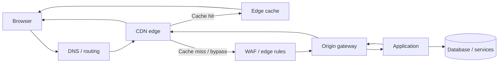

# Content delivery network

## Mục tiêu bài học

Sau bài này, bạn có thể:

- Giải thích CDN đứng ở đâu trong luồng browser, edge, origin và các lớp cache.
- Thiết kế cache policy để phân phối tài nguyên public hiệu quả mà không làm lộ response cá nhân.
- Rà soát cache key, `Vary`, cookie, Authorization và các header ảnh hưởng representation.
- Phát hiện nguy cơ web cache poisoning, cache deception và cache mix-up giữa các user hoặc tenant.
- Triển khai TLS, origin lockdown, security headers, CORS và CSP nhất quán qua CDN.
- Bảo vệ signed URL/cookie, purge và quy trình invalidation khi nội dung hoặc quyền thay đổi.
- Kết hợp WAF, rate limit, bot control và logging ở edge với authorization ở origin.
- Kiểm thử hành vi CDN/browser thực tế, bao gồm cache hit/miss, cross-origin response và dữ liệu nhạy cảm.

## 1. CDN trong kiến trúc browser security

Content Delivery Network (CDN) là mạng lưới máy chủ edge phân phối nội dung gần người dùng. Browser gửi request đến hostname public; DNS, anycast hoặc cơ chế định tuyến của nhà cung cấp đưa request đến edge phù hợp. Edge có thể trả response từ cache, thực thi policy, lọc request hoặc chuyển tiếp về origin server.

CDN thường giúp giảm latency, giảm tải origin, hấp thụ traffic lớn và cung cấp các lớp bảo vệ như DDoS mitigation, WAF, bot detection và TLS termination. Tuy nhiên, CDN cũng trở thành một thành phần có thể nhìn thấy hoặc thay đổi HTTP request/response. Nếu cache key, header forwarding hoặc origin trust được cấu hình sai, CDN có thể làm rò dữ liệu giữa người dùng, làm sai CORS/CSP hoặc tạo đường truy cập vòng qua lớp bảo vệ.

Một luồng điển hình:



Luồng thực tế có thể đặt WAF trước hoặc sau cache, có origin shield, load balancer, API gateway hoặc nhiều origin. Cần xác định thứ tự xử lý trong cấu hình đang dùng vì nó ảnh hưởng request nào được cache, request nào được kiểm tra và response header nào được sửa.

### 1.1. Các lớp cache khác nhau

Browser security cần phân biệt:

| Lớp | Ai quản lý? | Phạm vi | Câu hỏi bảo mật |
| --- | --- | --- | --- |
| Browser HTTP cache | Browser | Theo HTTP caching rules và browser profile | Response có được lưu cục bộ và dùng lại sau logout không? |
| CDN/shared cache | Nhà cung cấp CDN hoặc reverse proxy | Có thể dùng chung cho nhiều người dùng | Cache key có phân biệt mọi yếu tố làm thay đổi response không? |
| Origin/reverse proxy cache | Hạ tầng của ứng dụng | Theo cấu hình proxy/cache | Cache có dùng đúng auth context và tenant không? |
| Service Worker Cache Storage | Code của website | Theo origin/storage partition | Service worker có lưu response riêng tư ngoài policy không? |
| Back/Forward Cache (BFCache) | Browser | Snapshot của document trong history | Trang cũ có hiển thị dữ liệu nhạy cảm sau logout hoặc account switch không? |

Các lớp này độc lập. `Cache-Control: no-store` là chỉ thị cho HTTP caches; nó không phải lệnh xóa Cache Storage do service worker ghi thủ công, không purge CDN đã cấu hình sai và không nên được hiểu là cơ chế quản lý mọi trạng thái BFCache. Mỗi lớp cần policy và test riêng.

## 2. Trust boundary giữa browser, edge và origin

CDN thường kết thúc TLS public, đọc request, có thể giải mã body, xử lý cookie và thêm hoặc xóa header. Điều đó có nghĩa edge nằm trong trust boundary của ứng dụng.

Trước khi cấu hình, xác định:

- Browser kết nối TLS đến hostname nào và certificate nào được trình bày?
- CDN có kết thúc TLS hay truyền TLS xuyên suốt đến origin?
- CDN kết nối origin bằng HTTPS và có xác minh certificate/hostname không?
- Origin có thể bị truy cập trực tiếp qua IP hoặc hostname nội bộ không?
- Header nào do client gửi, header nào do edge tạo và header nào origin được phép tin?
- Cache, WAF, bot rule và response transform chạy theo thứ tự nào?
- Log nào ở edge và origin có chứa URL, cookie, token hoặc body không?

Một CDN được tin cậy có thể thực thi policy, nhưng không làm cho request từ browser trở nên đáng tin. Header như `X-Forwarded-For`, `X-Forwarded-Proto` hoặc custom client IP chỉ đáng tin nếu origin chỉ nhận request từ proxy được xác thực và proxy ghi đè giá trị do client gửi.

### 2.1. TLS từ browser đến edge và từ edge đến origin

TLS public bảo vệ request giữa browser và CDN edge. Nếu edge kết thúc TLS rồi gửi HTTP không mã hóa đến origin qua mạng không tin cậy, dữ liệu có thể bị đọc hoặc sửa trên chặng thứ hai.

Yêu cầu vận hành:

- Dùng HTTPS cho mọi hostname public.
- Edge kết nối origin bằng HTTPS; bật certificate validation và hostname verification.
- Dùng certificate origin có hostname/SAN đúng; không tắt kiểm tra certificate để xử lý lỗi kết nối.
- Cân nhắc mTLS hoặc authenticated origin pull nếu nhà cung cấp và kiến trúc hỗ trợ.
- Chặn truy cập trực tiếp vào origin từ Internet nếu chỉ CDN được phép phục vụ traffic public.
- Quản lý rotation certificate và theo dõi ngày hết hạn ở cả edge lẫn origin.

Ví dụ response public:

```http
HTTP/1.1 200 OK
Strict-Transport-Security: max-age=31536000
Content-Type: text/html; charset=utf-8
X-Content-Type-Options: nosniff
```

Chỉ bật `includeSubDomains` hoặc HSTS preload sau khi mọi subdomain nằm trong phạm vi đã sẵn sàng HTTPS. HSTS có thể khiến browser không thể quay lại HTTP trong thời hạn policy; cấu hình sai trên domain có nhiều hệ thống cũ có thể gây gián đoạn.

### 2.2. Khóa origin khỏi truy cập vòng qua CDN

Nếu attacker gọi trực tiếp origin, họ có thể bỏ qua WAF, rate limit, bot rule, header normalization hoặc access control tại edge. Origin nên chỉ nhận traffic từ CDN/gateway được tin cậy.

Các biện pháp có thể kết hợp:

- Firewall/security group chỉ cho phép dải IP edge được cập nhật từ nhà cung cấp.
- Authenticated origin pull hoặc mTLS để xác minh kết nối đến từ CDN.
- Origin hostname riêng, không công khai trong nội dung hoặc DNS không cần thiết.
- Xác minh `Host` và TLS SNI; từ chối hostname không thuộc danh sách.
- Dùng network ACL và identity của gateway nội bộ khi có nhiều tầng proxy.
- Giám sát request đến origin không có dấu hiệu CDN hợp lệ.

Chỉ allowlist IP CDN có thể phức tạp khi dải IP thay đổi hoặc dùng chung cho nhiều tenant. Chỉ kiểm tra một header bí mật do edge thêm cũng chưa đủ nếu origin vẫn truy cập được và attacker có thể đoán/đọc header đó. Ưu tiên xác thực kết nối ở tầng network/TLS và giới hạn header trust.

### 2.3. Trust proxy headers

Origin có thể cần biết IP client hoặc scheme gốc để tạo redirect, audit hoặc rate limit. Không tin `X-Forwarded-For` hay `X-Forwarded-Proto` từ mọi kết nối.

Thiết kế đúng:

1. Firewall chỉ cho proxy đáng tin kết nối vào origin.
2. Proxy loại bỏ header forwarding do client gửi.
3. Proxy tạo lại header từ kết nối thực tế và chain proxy đã xác minh.
4. Application chỉ tin số hop hoặc proxy cụ thể đã cấu hình.
5. Log cả nguồn kết nối trực tiếp và client IP đã chuẩn hóa theo trust chain.

Nếu origin nhận trực tiếp từ Internet, attacker có thể tự đặt `X-Forwarded-Proto: https` hoặc `X-Forwarded-For` để làm sai redirect, secure-cookie logic hoặc audit. Không dùng header forwarding làm authentication.

## 3. Cache key và cache policy

CDN dùng cache key để xác định response nào có thể được dùng lại cho request khác. Cache key thường dựa trên URL và có thể bổ sung query, header, cookie hoặc các yếu tố tùy cấu hình.

Nguyên tắc quan trọng: nếu response thay đổi theo một yếu tố đầu vào, cache phải phân biệt yếu tố đó hoặc bypass cache. Nếu không, request của user A có thể nhận response được tạo cho user B.

### 3.1. Public static assets

Tài nguyên có tên chứa content hash, ví dụ `app.8a4c1d.js`, thường phù hợp với cache dài hạn:

```http
HTTP/1.1 200 OK
Content-Type: text/javascript; charset=utf-8
Cache-Control: public, max-age=31536000, immutable
X-Content-Type-Options: nosniff
```

Khi nội dung thay đổi, build tạo URL mới. `immutable` giúp browser không cần revalidate trong thời hạn freshness. Chỉ dùng cache dài cho asset thực sự bất biến; không tái sử dụng cùng URL cho nội dung đã thay đổi.

### 3.2. HTML và response động

HTML có thể chứa dữ liệu theo user, nonce CSP, feature flag hoặc cấu hình tenant. Nếu CDN cache chung HTML đó, response có thể bị dùng lại cho người khác.

Với trang cá nhân hoặc response chứa dữ liệu nhạy cảm, cấu hình rõ:

```http
Cache-Control: private, no-store
```

Đồng thời cấu hình CDN bypass cache cho route/session tương ứng. Không chỉ dựa vào một rule mặc định hoặc giả định CDN tự bypass khi thấy cookie.

`private` ngăn shared cache lưu response theo HTTP caching semantics; `no-store` yêu cầu cache không lưu response. Nhưng cấu hình CDN có thể có custom rule ghi đè hoặc cache cưỡng bức. Cần kiểm tra behavior ở edge, không chỉ nhìn header origin.

### 3.3. Bảng cache policy tham khảo

| Loại nội dung | Policy thường dùng | Ghi chú |
| --- | --- | --- |
| JS/CSS/ảnh có content hash | `public, max-age=31536000, immutable` | URL mới cho mỗi build. |
| Public image/font không đổi thường xuyên | `public, max-age` phù hợp | Có purge hoặc versioning khi thay đổi. |
| HTML public không cá nhân hóa | `public, max-age` ngắn hoặc revalidate | Kiểm tra feature flag, locale và cookie có làm đổi body không. |
| API public, dữ liệu chung | Cache có TTL ngắn và key rõ | Phân tích query/header làm thay đổi response. |
| API cá nhân hoặc tenant-specific | `private, no-store` và CDN bypass | Không cache dùng chung theo session trừ khi có thiết kế partition rõ. |
| Login, token, callback | Thường `no-store`, CDN bypass | Tránh cache redirect, state, code hoặc response xác thực. |
| Response chứa `Set-Cookie` | Policy tường minh, thường bypass/no-store nếu session | Không dựa vào `Set-Cookie` một mình để ngăn cache. |
| Download riêng tư | `private, no-store` hoặc signed delivery có scope | Xác minh cache key, authorization và TTL. |

## 4. Cookie và Authorization qua CDN

CDN có thể nhận request chứa `Cookie` hoặc `Authorization`. Nếu cache key không phân biệt user mà response phụ thuộc credential, cache shared có nguy cơ trả nhầm nội dung.

### 4.1. Authenticated route

Với endpoint cần session cookie:

- Bypass CDN cache theo route hoặc policy rõ.
- Giữ authorization ở origin/application; không tin rằng request qua CDN đã được xác thực.
- Trả `Cache-Control: private, no-store` cho dữ liệu cá nhân.
- Không xóa `Cookie` trước khi origin cần nó để xác thực.
- Không thêm cookie/session vào cache key như giải pháp mặc định; điều đó tạo cardinality cao và dễ gây lưu dữ liệu nhạy cảm trong shared cache.
- Kiểm tra response `Set-Cookie` và mọi redirect trong luồng login.

Không phải mọi CDN đều xử lý `Set-Cookie` giống nhau. Có cấu hình có thể cache response dù có `Set-Cookie`, có cấu hình bypass hoặc strip header. Phải kiểm tra tài liệu và rule cụ thể của nhà cung cấp.

### 4.2. Authorization header

Response cho request có `Authorization` có các quy tắc shared-cache riêng theo HTTP semantics, nhưng CDN có thể có custom cache rule. Với API cá nhân, cấu hình bypass/no-store tường minh thay vì dựa vào default behavior.

Không loại bỏ `Authorization` ở edge trước khi origin kiểm tra. Nếu edge xác thực token thay origin, cần xác định rõ identity assertion được ký hoặc bảo vệ như thế nào và origin chỉ tin edge đã xác thực.

### 4.3. Không cache response cá nhân bằng Vary: Cookie một cách tùy tiện

`Vary: Cookie` có thể làm cache phân biệt response theo toàn bộ Cookie header. Điều này dễ tạo nhiều cache variant, tăng chi phí và vẫn có thể sai nếu cookie không phải yếu tố duy nhất ảnh hưởng response. Với dữ liệu cá nhân, bypass cache thường dễ kiểm soát hơn.

Nếu có use case cache theo một segment công khai, hãy tạo cache key rõ với field không nhạy cảm, giới hạn số variant và chứng minh không thể trộn user/tenant. Không đưa session ID hoặc token vào cache key có thể bị log hoặc quan sát ở edge.

## 5. Vary và response thay đổi theo request header

`Vary` thông báo response phụ thuộc vào request header nào. Shared cache cần dùng các header đó để phân biệt variant.

Ví dụ content negotiation:

```http
Vary: Accept-Encoding
```

Nếu response CORS phản chiếu origin đã allowlist:

```http
Access-Control-Allow-Origin: https://app.example.com
Vary: Origin
```

Nếu response thay đổi theo `Accept-Language`, cần cân nhắc `Vary: Accept-Language`. Với preflight được cache, response có thể phụ thuộc `Origin`, `Access-Control-Request-Method` và `Access-Control-Request-Headers`; cache key phải phản ánh các yếu tố liên quan hoặc bypass cache OPTIONS.

Không thêm `Vary: *` như một cách sửa cache key thông thường; nó có semantics riêng và có thể làm response không tái sử dụng được. Hãy xác định đúng request header làm thay đổi representation.

### 5.1. CORS và CDN

Giả sử API chỉ cho phép hai origin. Origin server có thể phản chiếu origin sau khi kiểm tra allowlist. Khi response được cache, nếu CDN không phân biệt Origin, response cho `app.example.com` có thể được trả cho `partner.example.net` với `Access-Control-Allow-Origin` sai.

Yêu cầu:

- Chỉ phản chiếu origin sau khi kiểm tra allowlist chính xác.
- Gửi `Vary: Origin` khi response thay đổi theo Origin.
- Đảm bảo CDN tôn trọng `Vary` hoặc cấu hình cache key tương đương.
- Với credentialed CORS, không dùng `Access-Control-Allow-Origin: *`.
- Kiểm soát `Access-Control-Allow-Credentials`, method và allowed headers.
- Xem xét bypass cache cho preflight hoặc tạo cache key đủ `Origin`, method và requested headers.
- Không cho CDN tự thêm wildcard CORS header vào mọi response.

Ví dụ preflight response:

```http
HTTP/1.1 204 No Content
Access-Control-Allow-Origin: https://app.example.com
Access-Control-Allow-Credentials: true
Access-Control-Allow-Methods: POST, OPTIONS
Access-Control-Allow-Headers: Authorization, Content-Type
Vary: Origin, Access-Control-Request-Method, Access-Control-Request-Headers
```

Đây là ví dụ cho một allowlisted origin. Nếu không cần credentialed cross-origin request, tránh bật credentials. CORS không thay authorization và không ngăn mọi cross-site request được gửi.

## 6. CSP và security headers ở edge

CDN có thể thêm, sửa hoặc xóa response headers. Nếu origin và edge cùng phát security header, có thể xuất hiện nhiều giá trị hoặc policy mâu thuẫn. Browser sẽ xử lý theo semantics của từng header; không giả định header sau cùng luôn ghi đè header trước.

### 6.1. CSP

Một CSP có thể được phát từ origin hoặc edge:

```http
Content-Security-Policy: default-src 'self'; script-src 'self'; object-src 'none'; base-uri 'self'; frame-ancestors 'none'
```

Rà soát:

- Một nơi có ownership rõ cho policy enforcing.
- CDN không thêm CSP thứ hai làm policy vô tình chặt hơn hoặc không tương thích.
- HTML và CSP header được cập nhật đồng bộ.
- Nonce CSP không bị tái sử dụng do cache shared.
- Report endpoint và CSP report không bị cache sai hoặc làm lộ dữ liệu.
- `frame-ancestors` áp dụng cho document response ở edge thực tế.

### 6.2. CSP nonce và HTML caching

Nonce phải khó đoán và gắn với response cụ thể. Nếu CDN cache HTML có nonce trong body cùng CSP header, nhiều người dùng có thể nhận cùng nonce trong thời gian cache. Điều này làm suy yếu mục đích của nonce và có thể tạo vấn đề khi HTML/header bị tách phiên bản.

Các lựa chọn:

- Không cache shared HTML có nonce; dùng `private, no-store` hoặc bypass cache.
- Sinh nonce mới ở edge cho mỗi response và đồng bộ nonce giữa HTML/header sau khi transform.
- Với nội dung tĩnh, cân nhắc hash-based CSP khi phù hợp.
- Không dùng `unsafe-inline` để xử lý lỗi nonce do cache.

Nếu CDN có HTML rewrite hoặc edge function, test body và CSP header sau transform trên nhiều request riêng biệt, không chỉ kiểm tra response origin.

### 6.3. Các header khác

Header nên được kiểm tra tại browser-facing response:

| Header | Mục đích | Điểm cần rà soát ở CDN |
| --- | --- | --- |
| `Strict-Transport-Security` | Yêu cầu browser dùng HTTPS cho host. | Chỉ phát trên HTTPS; `includeSubDomains`/preload phải phù hợp toàn bộ domain. |
| `X-Content-Type-Options: nosniff` | Hạn chế MIME sniffing trong các context được chuẩn hóa. | Không bị xóa hoặc áp dụng sai loại response. |
| `Content-Security-Policy` | Giới hạn resource/script/frame. | Không duplicate hoặc ghi đè sai; nonce/hash nhất quán. |
| `Referrer-Policy` | Giới hạn referrer gửi đi. | Áp dụng cho HTML/document; không để edge rule yếu hơn policy origin ngoài dự kiến. |
| `Cross-Origin-Opener-Policy` | Cô lập browsing context/opener. | Giữ header trên document response; kiểm tra popup/SSO. |
| `Cross-Origin-Embedder-Policy` | Điều kiện embed tài nguyên cross-origin cho cross-origin isolation. | Kiểm tra tài nguyên bên thứ ba và response header tương ứng. |
| `Cross-Origin-Resource-Policy` | Giới hạn context được tải resource. | Đảm bảo policy phù hợp CDN asset và embed use case. |
| `Permissions-Policy` | Giới hạn browser features trong document/frame. | Không thêm quyền rộng hoặc xóa policy tại edge. |
| `X-Frame-Options` | Legacy framing control. | Không mâu thuẫn với CSP `frame-ancestors`; ưu tiên policy CSP hiện đại. |
| `Cache-Control` | Điều khiển HTTP cache. | CDN custom rule không được vô tình override cho response riêng tư. |

## 7. Web cache poisoning

Web cache poisoning xảy ra khi attacker khiến cache lưu response bị ảnh hưởng bởi input không được đưa vào cache key, sau đó response đó được phục vụ cho request khác.

Ví dụ khái quát:

- Application tạo link tuyệt đối hoặc redirect dựa trên `Host`/forwarded host.
- CDN cache response theo path nhưng không phân biệt header host/variant làm thay đổi body.
- Attacker gửi header bất thường khiến origin tạo nội dung bị ảnh hưởng.
- CDN lưu response đó và phục vụ lại cho user khác cùng cache key.

### 7.1. Unkeyed input

Một request header hoặc query có thể ảnh hưởng response nhưng không nằm trong cache key. Các ứng viên cần rà soát:

- `Host` và forwarded host/proto.
- `Origin` nếu response CORS thay đổi theo origin.
- `Accept`, `Accept-Language`, `Accept-Encoding`.
- Custom header được dùng để chọn tenant, locale, experiment hoặc feature.
- Query parameter có ảnh hưởng body nhưng bị bỏ khỏi cache key.
- Cookie hoặc Authorization khi response phụ thuộc user/session.

Không phải mọi header đều cần thêm vào cache key. Hãy loại bỏ hoặc chuẩn hóa input không cần thiết ở edge/origin, hoặc bypass cache cho route có response phụ thuộc input đó.

### 7.2. Cache key normalization

CDN và origin cần diễn giải URL nhất quán. Các khác biệt như thứ tự query, percent-encoding, dấu slash, path case, duplicate parameter hoặc encoded path separator có thể khiến edge và origin chọn resource khác nhau.

Rà soát:

- Quy tắc canonicalization path/query ở edge và application.
- Cách xử lý duplicate query parameter.
- Percent-encoding và double encoding.
- Trailing slash, path case và dot segment.
- Host header và alternate hostname.
- Query parameter tracking có thể bỏ khỏi key chỉ khi chắc chắn không ảnh hưởng response.

Không bỏ query khỏi cache key hàng loạt. Nếu query điều khiển nội dung hoặc quyền, việc bỏ nó có thể trả nhầm response. Cache key cần đủ chính xác nhưng tránh chứa token hoặc dữ liệu nhạy cảm không cần thiết.

### 7.3. Phòng vệ

- Cache allowlist theo route/resource thay vì cache mọi response mặc định.
- Chỉ cache GET/HEAD và loại response đã xác định là public; không cache unsafe method.
- Validate `Host` và forwarded headers tại edge/origin.
- Chuẩn hóa URL nhất quán trước khi cache và trước khi route đến origin.
- Không để untrusted header/query điều khiển redirect hoặc nội dung response.
- Dùng `Vary` hoặc cache key tùy chỉnh cho yếu tố thực sự làm thay đổi representation.
- Bypass cache cho authenticated/dynamic route.
- Kiểm tra response sau nhiều request với input khác nhau để xác nhận không bị trộn.

## 8. Web cache deception

Web cache deception là tình huống attacker khiến một URL chứa dữ liệu cá nhân bị xử lý như tài nguyên tĩnh bởi cache, trong khi origin vẫn trả nội dung tài khoản. Ví dụ khái quát là thêm một suffix có vẻ giống file tĩnh vào route cá nhân, trong khi application routing bỏ qua suffix đó nhưng CDN cache rule lại coi URL là asset.

Rủi ro xuất hiện khi:

- CDN cache dựa trên phần mở rộng `.css`, `.jpg`, `.js` mà không xác minh resource thực sự public.
- Application route linh hoạt hoặc bỏ qua phần path không mong đợi.
- Response riêng tư không có `private, no-store`.
- Cache key/route normalization khác giữa edge và origin.

Phòng vệ:

- Không cache theo phần mở rộng đơn thuần nếu origin có dynamic route.
- Bypass cache cho route account/API/session bất kể suffix.
- Origin trả `Cache-Control: private, no-store` cho response cá nhân.
- Dùng route allowlist rõ cho static asset.
- Kiểm thử URL biến thể có suffix, duplicate slash, encoded path và query.
- Kiểm tra response cache status từ edge sau request đầu tiên và request thứ hai.

## 9. Redirect, error response và status code

CDN có thể cache redirect hoặc error response theo default TTL hoặc custom rule. Redirect login, callback, 404 và 5xx cần được xem xét riêng.

- Không cache redirect chứa `state`, authorization code, session context hoặc URL cá nhân.
- Không cache 401/403 theo user chung nếu response phụ thuộc session.
- Không cache 404/500 dài hạn khi deployment hoặc origin có thể phục hồi nhanh.
- Kiểm tra `Location` không phản chiếu untrusted Host hoặc open redirect parameter.
- Đảm bảo redirect HTTP → HTTPS không tạo vòng lặp do edge/origin hiểu sai `X-Forwarded-Proto`.
- Kiểm tra CDN không biến response riêng tư thành trang lỗi public có chứa thông tin nội bộ.

Nếu dùng stale-if-error hoặc serve-stale, chỉ áp dụng cho nội dung public đã xác định. Không dùng stale cache để tiếp tục phục vụ dữ liệu riêng tư sau khi session hoặc quyền đã bị thu hồi.

## 10. Signed URL và signed cookie

Signed URL/cookie thường được dùng để cấp quyền tải asset hoặc file private qua CDN mà không phải chuyển toàn bộ byte qua application server. Chúng là bearer credential: ai có URL/cookie hợp lệ đều có thể sử dụng trong phạm vi chữ ký cho phép.

Một thiết kế an toàn cần giới hạn:

- Resource/object cụ thể hoặc path hẹp.
- HTTP method được phép.
- Thời gian hết hạn ngắn phù hợp nhu cầu.
- IP/device binding chỉ khi phù hợp và không gây lỗi cho mạng di động/proxy.
- Content disposition và loại response nếu cần.
- Quyền download/read, không vô tình cấp write/list.
- Khả năng revoke hoặc rotate key khi nghi ngờ bị lộ.

Không đưa token vào log, analytics, referrer hoặc error message. Query string của signed URL có thể xuất hiện trong browser history, CDN log, proxy log và screenshot. Dùng `Referrer-Policy: no-referrer` hoặc policy phù hợp cho trang chứa link; hạn chế third-party resource trên trang đó.

### 10.1. Cache signed content

CDN có thể cache file theo object URL trong khi kiểm tra chữ ký trước khi phục vụ. Cần bảo đảm chữ ký được xác minh cho mỗi request trước khi trả cache hit, hoặc cache key/policy thực thi đúng thời hạn và scope. Không giả định cache hit bỏ qua authorization an toàn.

Kiểm thử:

- URL hết hạn không truy cập được dù object còn trong cache.
- Token cho object A không tải được object B.
- Method không được ký bị từ chối.
- Token bị revoke hoặc signing key rotate có hiệu lực theo SLA đã công bố.
- Cache không phục vụ response đã hết quyền sau TTL/invalidation.
- Log edge không lưu đầy đủ chữ ký.

## 11. Purge và cache invalidation

Khi nội dung thay đổi hoặc quyền bị thu hồi, hệ thống cần biết cache nào phải xóa và mất bao lâu để thay đổi có hiệu lực.

Các cơ chế:

- Versioned URL/content hash: tạo URL mới cho asset mới.
- Purge theo URL: xóa một object hoặc route cụ thể.
- Purge theo tag/surrogate key: xóa nhóm nội dung liên quan.
- TTL: chờ cache tự hết hạn.
- Revalidation với ETag/Last-Modified: cache hỏi origin trước khi dùng lại.
- Browser cache policy: kiểm soát lưu và revalidate ở client.
- Service worker update/cache cleanup: xóa cache do ứng dụng quản lý.

Purge CDN không xóa browser HTTP cache, Cache Storage, dữ liệu IndexedDB hoặc BFCache. Khi logout/account switch, cần dọn state ở application/browser và revoke session phía server; không trông chờ purge CDN xử lý mọi lớp.

### 11.1. Purge cho nội dung nhạy cảm

Nếu response riêng tư vô tình bị cache:

1. Bypass cache ngay cho route liên quan.
2. Purge object/tag và kiểm tra edge POP cần thiết.
3. Xác minh origin trả `private, no-store`.
4. Kiểm tra browser/service worker cache và account state.
5. Xác định response có thể đã được phục vụ cho user khác không.
6. Giữ log metadata phục vụ điều tra nhưng không xuất credential.
7. Sửa cache key/rule gốc và thêm regression test.

Không chỉ purge một URL nếu cùng lỗi áp dụng cho nhiều biến thể query, host, encoding hoặc path. Xác định phạm vi cache key bị ảnh hưởng.

## 12. WAF, DDoS và rate limiting ở edge

CDN có thể giảm tác động của volumetric DDoS và lọc một số request độc hại trước origin. WAF có thể kiểm tra URL, header, body, bot signal và rate pattern.

Nhưng edge security có giới hạn:

- WAF không thay thế authorization ở application.
- Rate limit theo IP có thể ảnh hưởng người dùng chung NAT hoặc mobile carrier.
- Bot detection có thể tạo false positive với crawler hợp lệ, accessibility tool hoặc client privacy.
- WAF không hiểu đầy đủ business state và không thể xác minh mọi CSRF token/session binding nếu không tích hợp application.
- Cache có thể hấp thụ request nhưng không bảo vệ endpoint động nếu bypass cache.

Thiết kế rate limit theo nhiều chiều:

- IP/network ở mức edge.
- Session/principal/tenant ở application.
- Route và action risk.
- Request rate, concurrency, bytes và thời gian xử lý.
- Login, password reset, export, download và endpoint tốn tài nguyên.

Khi edge chặn request, trả response ổn định, không tiết lộ rule nội bộ và ghi event có request ID. Đảm bảo request ID được chuyển đến origin khi request được forward.

## 13. Edge functions và header transformation

Một số CDN hỗ trợ edge worker/function để rewrite URL, thay header, xác thực signed request, xử lý redirect hoặc render response gần người dùng. Code chạy ở edge trở thành một phần của security-critical application path.

Rà soát:

- Source code, dependency và release của edge function có owner không?
- Có kiểm tra input URL/header/query và giới hạn body size không?
- Function có xóa header do client giả mạo trước khi tạo trusted header không?
- Có thể vô tình đưa cookie/token vào cache key hoặc log không?
- Có giữ nguyên `Cache-Control`, `Vary`, `Set-Cookie`, CSP và CORS semantics không?
- Có timeout, CPU/memory limit và fallback an toàn không?
- Có test trên nhiều POP hoặc staging environment không?
- Rollback có thể thực hiện nhanh khi edge deployment lỗi không?

Không đặt secret dài hạn trong code hoặc biến môi trường không được bảo vệ. Dùng secret management của nhà cung cấp, hạn chế scope và có quy trình rotation.

## 14. Logging và quyền riêng tư ở CDN

CDN log thường thấy hostname, path, query, IP, user agent, status, cache status và đôi khi request/response header. Các dữ liệu này có thể chứa thông tin cá nhân hoặc credential.

Thiết kế logging:

- Loại bỏ hoặc redact Authorization, Cookie, Set-Cookie và signed query parameter.
- Không log body mặc định; nếu cần forensic, dùng allowlist field và retention ngắn.
- Chuẩn hóa path/route để tránh ghi email, account ID hoặc dữ liệu cá nhân trong URL.
- Giới hạn quyền truy cập log edge; phân tách quyền vận hành và quyền đọc dữ liệu nhạy cảm.
- Đồng bộ request ID giữa edge, gateway và application.
- Thiết lập retention, region/data residency và quy trình export theo chính sách tổ chức.
- Kiểm tra vendor support, subprocessor và quyền truy cập support của nhà cung cấp.
- Không gửi URL có signed token đến analytics hoặc third-party monitoring.

Edge log nên đủ để điều tra cache hit/miss, rule ID, status và latency mà không lưu credential. Nếu cần xác định user, dùng pseudonymous key được quản lý ở application thay vì ghi session cookie.

## 15. Monitoring và cảnh báo CDN security

Các metric hữu ích:

| Metric | Mục đích |
| --- | --- |
| Cache hit ratio theo route class | Phát hiện cache behavior thay đổi bất thường. |
| Cache status của route private | Xác minh endpoint riêng tư luôn bypass hoặc không cache. |
| Origin request rate | Nhận biết cache miss spike hoặc traffic bypass. |
| 4xx/5xx theo edge/origin | Phân biệt edge block với lỗi application. |
| WAF rule hit theo rule ID | Theo dõi pattern bị chặn và false positive. |
| TLS handshake/certificate errors | Phát hiện certificate hết hạn hoặc cấu hình origin TLS sai. |
| CORS preflight/response failures | Phát hiện header bị thiếu hoặc cache variant sai. |
| CSP violation/report rate | Phát hiện header drift hoặc script/resource mới. |
| Purge latency/failure | Đo thời gian nội dung cũ còn có thể được phục vụ. |
| Signed URL expiry/rejection | Phát hiện token reuse, hết hạn hoặc sai scope. |
| Origin direct-access attempts | Phát hiện traffic đi vòng qua CDN. |

Không dùng raw URL/query, token, cookie hoặc IP đầy đủ làm metric label. Phân nhóm theo route template, POP, rule ID, cache policy và origin class để hạn chế cardinality.

### 15.1. Alert gợi ý

- Route private có cache hit hoặc edge cache status không phải bypass.
- CORS response cho một origin khác với allowlist hoặc cache variant bị trộn.
- CSP/HSTS/security header biến mất sau deploy CDN.
- Origin nhận traffic trực tiếp không có authenticated proxy context.
- Tăng đột biến WAF block trên endpoint login hoặc payment sau thay đổi rule.
- Signed URL hết hạn vẫn tải được file từ cache.
- Purge thất bại hoặc vượt SLA với nội dung bị thu hồi.
- TLS origin validation failure hoặc certificate sắp hết hạn.

Ngưỡng alert cần dựa trên baseline và impact. Một cache hit trên static asset là bình thường; cache hit trên route trả dữ liệu cá nhân có thể là sự cố nghiêm trọng.

## 16. Kiểm thử CDN và browser security

Kiểm thử cần đi qua hostname public/CDN thật của staging, không chỉ gọi origin trực tiếp. So sánh response từ edge với response origin để phát hiện header rewrite, cache key mismatch và policy drift.

### 16.1. Kiểm tra cache hit/miss

Gửi cùng request hai lần và quan sát header do nhà cung cấp cung cấp, ví dụ `Age`, `Via`, `X-Cache` hoặc cache status tương đương. Tên header phụ thuộc CDN.

Test nên xác minh:

- Static asset public có thể cache và trả hit sau request đầu.
- HTML/API cá nhân luôn bypass hoặc không được shared-cache lưu.
- Request user A không thể nhận response của user B.
- Query/header làm thay đổi response được đưa vào cache key hoặc route bị bypass.
- CDN không cache response `Set-Cookie` theo cách làm lộ session.
- Redirect/error response không giữ dữ liệu cá nhân hoặc state nhạy cảm.

Không kết luận cache hit chỉ từ `Age` hoặc một header đơn lẻ nếu nhà cung cấp có semantics khác. Dùng log/analytics của CDN và response marker test để xác nhận.

### 16.2. Kiểm tra CORS qua edge

Gửi request từ origin được phép và origin không được phép. Kiểm tra:

- `Access-Control-Allow-Origin` khớp allowlist.
- `Vary: Origin` hiện diện khi response thay đổi theo Origin.
- CDN cache không trả CORS header của origin A cho origin B.
- Credentialed CORS không dùng wildcard.
- Preflight cache key hoặc bypass xử lý đúng Origin/method/headers.
- Actual request không được gửi sau preflight fail trong trường hợp cần preflight.

Kiểm tra bằng browser `fetch()` từ các trang có origin khác nhau; API client trực tiếp không thực thi CORS giống browser.

### 16.3. Kiểm tra CSP và security headers

Tải document qua CDN và đọc response headers trong browser DevTools. So sánh nhiều request và nhiều POP nếu staging hỗ trợ.

- CSP có đúng policy, không duplicate ngoài dự kiến.
- Nonce trong HTML khớp CSP header và thay đổi theo response nếu thiết kế yêu cầu nonce per response.
- HSTS chỉ xuất hiện trên HTTPS và scope phù hợp.
- `nosniff`, Referrer-Policy, Permissions-Policy, COOP/COEP/CORP không bị mất.
- CDN không thay đổi Content-Type hoặc Content-Disposition ngoài policy.

### 16.4. Kiểm tra cache poisoning/deception

Trong staging, dùng marker vô hại để thử header/query/path variants. Không thử trên cache production dùng chung.

- Gửi hai request cùng URL nhưng khác `Origin`, `Host` hoặc custom header có thể ảnh hưởng response.
- Xác nhận cache key phân biệt hoặc edge/origin từ chối input không hợp lệ.
- Thử route cá nhân với suffix giống file tĩnh và xác nhận cache bypass.
- Thử duplicate query, percent-encoding, trailing slash và path case.
- Xác nhận response của một test user không xuất hiện trong request của test user khác.
- Kiểm tra purge làm mất response ở các edge cần thiết.

### 16.5. Ma trận test

| Kịch bản | Cách kiểm tra | Kết quả mong đợi |
| --- | --- | --- |
| Static asset | Gọi URL content-hash hai lần. | Cache hit hợp lệ; nội dung cùng hash. |
| Private API | Gọi bằng user A rồi user B. | Không có shared cache hit; mỗi user chỉ nhận dữ liệu của mình. |
| Cookie response | Login/refresh trên staging. | Không cache shared response xác thực; Set-Cookie đúng scope. |
| Authorization response | Gọi API bằng hai token test. | Không trộn response theo cache key. |
| CORS allow | Fetch từ origin allowlisted. | Browser đọc được response; `Vary: Origin` đúng. |
| CORS deny | Fetch từ attacker origin. | Browser không đọc được response; CDN không phát nhầm allow header. |
| Preflight | Gửi method/header cần OPTIONS. | Edge/origin trả policy đúng; cache không trộn variant. |
| CSP nonce | Tải document nhiều lần. | Nonce/header/body nhất quán và không bị dùng chung ngoài thiết kế. |
| Origin lockdown | Gọi origin trực tiếp trong lab từ nguồn không được phép. | Kết nối bị chặn hoặc xác thực thất bại. |
| Forwarded header spoof | Gửi X-Forwarded-For/Proto giả qua edge. | Edge xóa/ghi đè; origin dùng giá trị từ trust chain. |
| Cache deception | Thêm suffix tĩnh vào route account. | Route vẫn bypass cache; không có private response hit. |
| Signed URL | Dùng URL hết hạn/sai object/sai method. | CDN từ chối kể cả khi object đã nằm trong cache. |
| Purge | Purge marker asset hoặc private route fixture. | Cache cũ bị loại bỏ theo SLA; browser/SW được test riêng. |
| Header drift | So sánh origin và edge response. | Security headers đúng và không duplicate/mất ngoài thiết kế. |

## 17. Ví dụ kiểm tra bằng command line

`curl` hữu ích để quan sát header và cache behavior qua hostname CDN. Nó không mô phỏng SOP/CORS enforcement của browser.

Kiểm tra header:

```bash
curl -sS -D - -o /dev/null https://static.example.test/assets/app.8a4c1d.js
```

Gửi hai request để so sánh cache status:

```bash
curl -sS -D first.headers -o first.body https://static.example.test/assets/app.8a4c1d.js
curl -sS -D second.headers -o second.body https://static.example.test/assets/app.8a4c1d.js
```

Thử Origin khác nhau trên staging:

```bash
curl -sS -D - -o /dev/null \
  -H 'Origin: https://app.example.test' \
  https://api.example.test/public-data

curl -sS -D - -o /dev/null \
  -H 'Origin: https://attacker.test' \
  https://api.example.test/public-data
```

Các lệnh trên chỉ quan sát server/edge response. `curl` có thể tự đặt header `Origin`; server không được coi header đó là bằng chứng browser hoặc người dùng. Dùng Playwright/browser thật để xác minh CORS.

Không lưu header/body chứa `Set-Cookie`, Authorization hoặc signed URL vào artifact chia sẻ. Với endpoint riêng tư, dùng account fixture và output đã redact.

## 18. Những lỗi thường gặp

| Lỗi | Hậu quả | Cách khắc phục |
| --- | --- | --- |
| Cache mọi GET mặc định | GET có thể trả profile hoặc dữ liệu cá nhân. | Cache allowlist theo route và response class. |
| Nghĩ có Cookie là CDN tự bypass | Rule custom có thể vẫn cache response hoặc strip cookie. | Bypass rõ cho route auth/private và kiểm tra edge behavior. |
| Dùng `Vary: Cookie` cho mọi API | Cache variant bùng nổ và có thể vẫn sai theo tenant/auth context. | Bypass private response; chỉ vary theo field public cần thiết. |
| Phản chiếu Origin mà thiếu `Vary: Origin` | CDN có thể trả CORS header của origin khác. | Allowlist origin, `Vary: Origin` và cache key đúng. |
| Cache HTML có CSP nonce | Nonce có thể bị dùng lại giữa response hoặc lệch header/body. | Không shared-cache nonce HTML hoặc tạo nonce mới tại edge mỗi response. |
| Chỉ khóa origin bằng header bí mật | Header có thể bị lộ/giả mạo nếu origin public. | Kết hợp firewall, authenticated origin pull/mTLS và header trust. |
| Tin X-Forwarded-For từ client | IP spoof làm sai rate limit/audit. | Chỉ tin proxy chain đã xác minh; edge ghi đè header. |
| Dựa vào `Set-Cookie` để bypass cache | CDN có thể có semantics/config khác. | Dùng Cache-Control và CDN bypass rule tường minh. |
| Purge CDN nhưng bỏ browser/SW cache | Người dùng vẫn thấy nội dung cũ hoặc dữ liệu đã logout. | Xử lý từng lớp cache và account state riêng. |
| Dùng stale-if-error cho response riêng tư | Dữ liệu cũ có thể tiếp tục được phục vụ sau revoke. | Chỉ stale public content; private route bypass. |
| Log toàn bộ query signed URL | Token có thể bị replay. | Redact query, giới hạn log và dùng TTL/revoke phù hợp. |
| Dùng WAF thay authorization | Request hợp lệ về cú pháp vẫn có thể truy cập resource trái quyền. | Authorization ở application cho từng action/resource. |

## 19. Checklist kiến trúc và vận hành CDN

### Network và origin trust

- [ ] TLS browser-to-edge và edge-to-origin được bật, certificate được xác minh.
- [ ] Origin chỉ nhận traffic từ proxy/CDN được xác thực.
- [ ] Host/SNI được allowlist; request hostname lạ bị từ chối.
- [ ] Forwarded headers được edge ghi đè và origin chỉ tin proxy chain hợp lệ.
- [ ] Có monitoring cho origin direct-access và certificate expiry.

### Cache isolation

- [ ] Static assets có content hash và cache policy dài hạn phù hợp.
- [ ] HTML/API cá nhân có `private, no-store` và CDN bypass.
- [ ] Cache key phản ánh mọi input làm thay đổi public representation.
- [ ] Không cache authenticated response theo shared key.
- [ ] CORS dynamic response có `Vary: Origin` và cache key đúng.
- [ ] Preflight cache hoặc bypass được cấu hình rõ.
- [ ] Không có cache rule chỉ dựa vào phần mở rộng file cho dynamic route.
- [ ] Signed URL được xác minh trước cache delivery và có TTL/scope hẹp.

### Browser security headers

- [ ] CSP có owner, policy nhất quán và nonce/hash không bị cache sai.
- [ ] HSTS chỉ bật với domain đã sẵn sàng HTTPS.
- [ ] `nosniff`, Referrer-Policy, Permissions-Policy và COOP/COEP/CORP được giữ đúng.
- [ ] Content-Type và Content-Disposition không bị edge transform sai.
- [ ] Header không bị duplicate hoặc override ngoài dự kiến.

### Operations và monitoring

- [ ] Có purge/invalidation process và SLA.
- [ ] Có dashboard cache status, origin traffic, WAF, TLS, CORS/CSP và purge.
- [ ] Log edge redact credential và query nhạy cảm.
- [ ] Edge function có code owner, review, test và rollback.
- [ ] Có test từ hostname CDN public của staging trên browser thật.
- [ ] Có quy trình incident khi phát hiện private response bị cache shared.

## 20. Bài thực hành

Xây dựng staging architecture gồm `app.example.test`, `api.example.test`, `static.example.test` và một CDN test distribution. Dùng hai test account, marker riêng và nội dung không nhạy cảm.

1. Vẽ request path từ browser qua CDN, WAF, origin gateway đến application; ghi rõ nơi TLS kết thúc.
2. Khóa origin để chỉ CDN/gateway được xác thực có thể kết nối.
3. Cấu hình static content-hash asset với cache dài hạn và HTML/API cá nhân với `private, no-store` cùng CDN bypass.
4. Gọi private API bằng user A rồi user B; xác nhận không có cache hit dùng chung và không trộn response.
5. Cấu hình CORS allowlist cho app origin, `Vary: Origin` và preflight policy; thử origin attacker.
6. Kiểm tra CSP, HSTS, `nosniff`, Referrer-Policy và Permissions-Policy tại response qua edge.
7. Nếu dùng CSP nonce, tải nhiều response và xác minh body/header được ghép đúng, nonce không bị cache reuse ngoài thiết kế.
8. Thử cache key với Origin, query, forwarded host và path variants bằng marker vô hại; xác nhận không cache poisoning/deception.
9. Tạo signed URL test với scope object/method/TTL; xác minh URL hết hạn hoặc sai scope bị từ chối ngay cả khi cache đã có object.
10. Thực hiện purge và đo thời gian invalidation ở edge; kiểm tra browser HTTP cache và service worker riêng.
11. Kiểm tra edge logs đã redact cookie, Authorization và signed query; đối chiếu request ID với origin.
12. Viết báo cáo gồm cache policy, trust boundary, test evidence, browser/CDN behavior, exception và owner.

Hoàn thành bài thực hành khi CDN chỉ cache nội dung public theo cache key có thể giải thích, response cá nhân không bị dùng chung, origin không thể bị truy cập vòng qua edge, security headers/CORS được browser nhận đúng và các thay đổi nội dung/quyền có quy trình invalidation được kiểm chứng.
