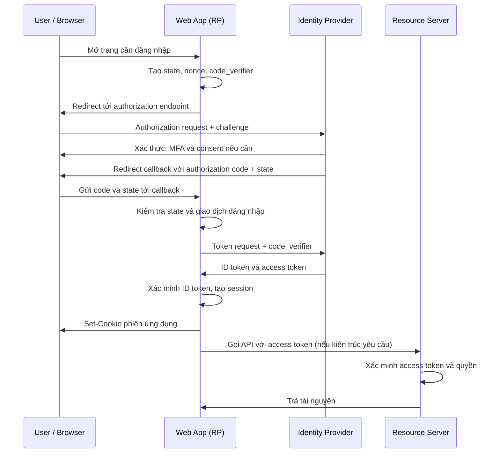
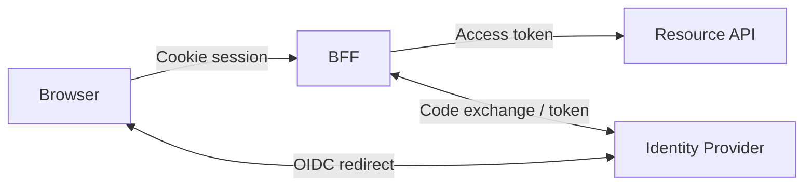

# Identity provider trong kiến trúc ứng dụng web

Identity Provider (IdP) là hệ thống chịu trách nhiệm xác thực danh tính và phát hành bằng chứng xác thực cho các ứng dụng tin cậy. Thay vì mỗi ứng dụng tự quản lý mật khẩu, MFA, phiên đăng nhập và quy trình khôi phục tài khoản, tổ chức có thể dùng một IdP chung để người dùng đăng nhập một lần và truy cập nhiều ứng dụng theo chính sách được kiểm soát.

Trong trình duyệt, IdP thường tham gia vào luồng điều hướng giữa ứng dụng và miền xác thực. Ứng dụng chuyển người dùng tới IdP, IdP xác thực người dùng rồi trả kết quả về callback đã đăng ký. Những bước chuyển hướng này tạo ra ranh giới tin cậy giữa nhiều origin, cookie, token và ứng dụng. Cấu hình sai redirect URI, xác minh token không đầy đủ, lưu token không an toàn hoặc xử lý logout sai có thể làm lộ tài khoản dù IdP vẫn hoạt động bình thường.

Trong module bảo mật trình duyệt, IdP cần được hiểu cùng Same-Origin Policy, cookie, CORS, CSRF, CSP và các cơ chế bảo vệ phiên. Bài học tập trung vào kiến trúc liên kết danh tính cho ứng dụng web bằng OpenID Connect (OIDC), OAuth 2.0 và SAML 2.0, đồng thời phân biệt vai trò xác thực của IdP với quyền truy cập API.

Sau bài học, bạn có thể:

- Phân biệt Identity Provider, Relying Party, OAuth client và Resource Server.
- Giải thích luồng đăng nhập OIDC Authorization Code với PKCE và luồng SAML SSO.
- Xác minh state, nonce, redirect URI, ID token, access token và chữ ký.
- Chọn mô hình SPA, Backend for Frontend (BFF) hoặc server-rendered phù hợp.
- Thiết kế cookie, callback, logout và quản lý phiên an toàn qua nhiều origin.
- Vận hành metadata, signing key, JWKS, rotation, MFA và provisioning.
- Kiểm thử các lỗi federation thường gặp mà không làm lộ thông tin xác thực.

## 1. IdP và các thành phần trong hệ thống định danh

IdP quản lý hoặc liên kết danh tính người dùng, thực hiện xác thực theo chính sách và cung cấp thông tin xác thực cho ứng dụng. IdP có thể hỗ trợ mật khẩu, passkey, MFA, đăng nhập doanh nghiệp, federation với nhà cung cấp khác và quy trình khôi phục tài khoản.

Các vai trò quan trọng:

| Thành phần | Vai trò | Ví dụ trách nhiệm |
|---|---|---|
| Identity Provider (IdP) | Xác thực danh tính và phát hành assertion/token | Xác minh người dùng, MFA, quản lý phiên IdP |
| Relying Party (RP) | Ứng dụng tin cậy kết quả xác thực từ IdP | Kiểm tra ID token hoặc SAML assertion, tạo phiên ứng dụng |
| OAuth Client | Ứng dụng yêu cầu quyền truy cập tài nguyên | Gửi authorization request và đổi authorization code |
| Resource Server | API bảo vệ tài nguyên | Xác minh access token, scope và quyền truy cập |
| User Agent | Trình duyệt hoặc ứng dụng người dùng điều khiển | Điều hướng, lưu cookie, xử lý callback |
| Authorization Server | Thành phần cấp authorization grant và token theo OAuth 2.0 | Cấp authorization code/access token |
| Directory / Identity Store | Nơi lưu hoặc liên kết hồ sơ danh tính | Tài khoản, nhóm, thuộc tính và trạng thái người dùng |

Một sản phẩm có thể gộp IdP và Authorization Server trong cùng nền tảng, nhưng khái niệm vẫn khác nhau. OIDC thêm lớp xác thực danh tính lên OAuth 2.0; OAuth 2.0 tự nó là framework ủy quyền, không phải giao thức đăng nhập.

### 1.1. IdP không đồng nghĩa với ứng dụng

Ứng dụng không nên tự suy ra danh tính chỉ từ việc browser quay về callback. Callback chỉ là điểm nhận kết quả. RP phải kiểm tra kết quả theo giao thức, xác minh chữ ký và các claim cần thiết, sau đó mới tạo phiên ứng dụng.

Tương tự, việc IdP xác thực thành công không tự cấp quyền tới mọi tài nguyên. Resource Server vẫn phải kiểm tra access token, audience, scope, tenant và quyền nghiệp vụ. Một người dùng có thể đăng nhập thành công nhưng không có quyền xem hồ sơ hoặc thực hiện giao dịch cụ thể.

### 1.2. Federation và Single Sign-On

Federation cho phép một hệ thống chấp nhận danh tính đã được xác thực bởi một hệ thống khác dựa trên quan hệ tin cậy và giao thức chung. Single Sign-On (SSO) là trải nghiệm đăng nhập một lần để truy cập nhiều ứng dụng trong phạm vi phiên và chính sách được cho phép.

SSO không có nghĩa mọi ứng dụng chia sẻ cùng cookie. Cookie của `id.example.test` không tự động được gửi tới `app.example.test`; trình duyệt phân tách cookie theo domain, path, Secure, SameSite và các quy tắc khác. SSO thường hoạt động nhờ điều hướng tới IdP, nơi browser đã có phiên IdP, rồi quay lại từng RP với một kết quả xác thực mới.

## 2. Các giao thức thường dùng

### 2.1. OpenID Connect

OIDC là lớp xác thực xây dựng trên OAuth 2.0. OIDC định nghĩa ID token và các endpoint/claim để RP biết người dùng đã được xác thực bởi issuer nào. ID token thường là JWT được ký bởi IdP.

Các thành phần chính:

- **Issuer (`iss`):** định danh IdP phát hành token.
- **Subject (`sub`):** định danh người dùng trong phạm vi issuer.
- **Audience (`aud`):** client hoặc RP mà ID token hướng tới.
- **Expiration (`exp`):** thời điểm token hết hạn.
- **Issued At (`iat`):** thời điểm token được phát hành.
- **Nonce:** giá trị gắn authorization request với ID token để giảm nguy cơ replay/mix-up trong luồng OIDC.
- **Authorization Code:** mã ngắn hạn được đổi lấy token tại token endpoint.
- **Access Token:** credential dùng để truy cập Resource Server theo audience/scope được cấp.
- **Refresh Token:** credential dùng để lấy access token mới nếu client được phép và chính sách hỗ trợ.

ID token dành cho RP để xác nhận sự kiện đăng nhập và danh tính. Access token dành cho Resource Server. Không gửi ID token tới API như thể nó là access token, và không dùng access token để thay thế kiểm tra ID token trong callback đăng nhập.

### 2.2. OAuth 2.0

OAuth 2.0 cho phép client nhận quyền truy cập giới hạn tới tài nguyên thay mặt resource owner hoặc theo cơ chế được định nghĩa. Access token thể hiện quyền được cấp; nó không nhất thiết chứng minh người đang cầm token là người dùng nào theo ngữ nghĩa đăng nhập.

Một API cần xác minh token theo issuer, audience/resource, thời hạn, scope/role và chính sách riêng. Không chấp nhận token chỉ vì token có vẻ là JWT hoặc có chữ ký hợp lệ; chữ ký hợp lệ với issuer khác hoặc audience khác không làm token phù hợp với API.

### 2.3. SAML 2.0

SAML 2.0 thường dùng trong SSO doanh nghiệp. IdP phát hành SAML Response chứa assertion đã ký; browser chuyển response tới Assertion Consumer Service (ACS) của Service Provider (SP), thường qua HTTP-POST binding.

SP phải xác minh chữ ký theo metadata/key tin cậy, issuer, audience, recipient, destination, thời hạn, `InResponseTo` và chống replay. Phân tích XML cần dùng thư viện SAML đã được kiểm chứng; không tự viết parser hoặc tự kiểm tra XML signature bằng cách tìm chuỗi trong tài liệu.

### 2.4. Chọn giao thức

| Nhu cầu | Lựa chọn thường gặp | Điểm cần kiểm soát |
|---|---|---|
| Ứng dụng web mới cần đăng nhập và API | OIDC Authorization Code + PKCE | Token validation, redirect URI, session, API audience |
| Ứng dụng SPA gọi API | OIDC Code + PKCE; cân nhắc BFF | Token exposure, XSS, refresh token và cookie/CSRF |
| Tích hợp SSO doanh nghiệp hiện hữu | SAML 2.0 hoặc OIDC theo khả năng hai bên | Metadata, signing key, assertion replay và clock skew |
| Ủy quyền truy cập API | OAuth 2.0 | Scope, audience, token lifetime và authorization tại API |
| Dịch vụ nội bộ hoặc workload | OAuth client credentials hoặc cơ chế workload identity | Không dùng flow tương tác người dùng thay cho service identity |

Không chọn giao thức chỉ vì tên sản phẩm IdP hỗ trợ. Cần xét loại client, khả năng bảo vệ secret, nơi lưu phiên, kiến trúc API và mức hỗ trợ của hệ sinh thái.

## 3. Luồng OIDC Authorization Code với PKCE

Đối với ứng dụng web mới, Authorization Code Flow với PKCE là lựa chọn phổ biến. PKCE ràng buộc authorization code với một `code_verifier` do client tạo, giảm nguy cơ kẻ khác đổi được code bị chặn hoặc đánh cắp.

Luồng tổng quát:



Các bước chi tiết:

1. RP tạo `state` ngẫu nhiên, `nonce` ngẫu nhiên và cặp PKCE `code_verifier`/`code_challenge`.
2. RP lưu dữ liệu giao dịch trong session hoặc kho tạm có thời hạn, ràng buộc với browser session.
3. Browser điều hướng tới authorization endpoint với `response_type=code`, `client_id`, `redirect_uri`, `scope=openid ...`, `state`, `nonce`, `code_challenge` và `code_challenge_method=S256`.
4. IdP xác thực người dùng theo chính sách, có thể yêu cầu MFA hoặc consent.
5. IdP chuyển browser về redirect URI đã đăng ký với authorization code và state.
6. RP xác minh state khớp giao dịch đang chờ và chưa được sử dụng.
7. RP gửi code cùng `code_verifier` tới token endpoint qua kênh TLS; confidential client xác thực theo phương thức đã đăng ký.
8. RP xác minh ID token và tạo phiên ứng dụng mới.
9. RP chuyển người dùng tới trang đích nội bộ đã được kiểm tra an toàn.

### 3.1. PKCE

`code_verifier` là chuỗi ngẫu nhiên có entropy đủ lớn. `code_challenge` cho phương thức S256 là Base64URL của SHA-256 trên verifier.

```javascript
const randomBytes = crypto.getRandomValues(new Uint8Array(32));
const codeVerifier = base64UrlEncode(randomBytes);

const digest = await crypto.subtle.digest(
  "SHA-256",
  new TextEncoder().encode(codeVerifier)
);
const codeChallenge = base64UrlEncode(new Uint8Array(digest));
```

`base64UrlEncode` ở đây là hàm helper phải loại bỏ padding `=` và thay `+` bằng `-`, `/` bằng `_`. Ví dụ chỉ minh họa việc tạo giá trị; trong ứng dụng thực tế, ưu tiên thư viện OIDC đã được kiểm chứng và API crypto của nền tảng.

PKCE không thay thế `state`, redirect URI validation hoặc xác minh ID token. Mỗi authorization request cần verifier riêng; không dùng lại verifier giữa các lần đăng nhập.

### 3.2. State và chống CSRF

`state` liên kết callback với giao dịch đăng nhập mà RP đã khởi tạo. RP phải kiểm tra giá trị trả về khớp chính xác với giao dịch đang chờ, còn hiệu lực và chưa được dùng. Không chỉ kiểm tra state có tồn tại.

Nếu state được lưu trong cookie hoặc session, cần ràng buộc cookie với callback flow và cân nhắc SameSite theo response mode. State nên có entropy cao và không chứa thông tin nhạy cảm hay URL đích không được kiểm tra.

### 3.3. Nonce

`nonce` gắn ID token nhận được với authorization request. Khi RP gửi nonce, nó phải kiểm tra claim `nonce` trong ID token khớp đúng giá trị đã lưu cho giao dịch. Nonce không thay thế state: state bảo vệ liên kết giao dịch callback, còn nonce giúp phát hiện ID token bị phát lại hoặc bị đưa nhầm từ một giao dịch khác. RP cũng phải xác minh `iss` để bảo đảm token đến từ issuer đã cấu hình.

## 4. Xác minh ID token và access token

Không tin token chỉ vì nó được trả về từ callback hoặc giải mã JWT thành công. Giải mã payload không xác minh chữ ký. RP phải dùng thư viện OIDC/JWT phù hợp, metadata tin cậy và thuật toán được cho phép.

### 4.1. Kiểm tra ID token

RP cần xác minh tối thiểu:

- Chữ ký hợp lệ theo key của issuer đã cấu hình và thuật toán được cho phép.
- `iss` khớp chính xác issuer mong đợi.
- `aud` chứa client ID của RP.
- Nếu `aud` có nhiều giá trị, kiểm tra `azp` theo quy tắc OIDC khi áp dụng.
- `exp` chưa hết hạn và `iat` hợp lý; áp dụng clock skew nhỏ, có giới hạn.
- `nonce` khớp authorization request nếu request đã gửi nonce.
- `sub` tồn tại và được dùng làm định danh ổn định trong phạm vi issuer.
- `auth_time`, `acr`, `amr` nếu ứng dụng có yêu cầu mức xác thực hoặc freshness cụ thể.

Nếu RP gọi UserInfo endpoint, claim `sub` trong UserInfo response phải khớp `sub` trong ID token. Không trộn thuộc tính từ một UserInfo response không gắn đúng subject với phiên đăng nhập hiện tại.

Không dùng email làm khóa định danh duy nhất nếu chưa xử lý đúng issuer, tính xác minh email và thay đổi địa chỉ. Cặp `(iss, sub)` thường là định danh federated ổn định cho một RP.

### 4.2. Kiểm tra access token ở Resource Server

Resource Server phải xác minh token theo profile của issuer:

- Chữ ký hoặc cơ chế introspection phù hợp.
- Issuer và audience/resource server chính xác.
- `exp`, `nbf` nếu có, và thời gian phát hành hợp lệ.
- Scope, role hoặc authorization details cần cho endpoint.
- Tenant, subject và các ràng buộc đối tượng theo chính sách ứng dụng.

Nếu access token là opaque token, API có thể dùng introspection hoặc cơ chế kiểm tra được issuer hỗ trợ. Không giả định mọi access token đều là JWT.

### 4.3. JWKS và key rotation

OIDC discovery metadata thường cung cấp `jwks_uri`, nơi RP lấy public key để xác minh chữ ký. Cache JWKS để tránh gọi IdP ở mọi request, nhưng phải hỗ trợ refresh khi gặp `kid` chưa biết và theo chính sách rotation.

Khi IdP xoay signing key, nên có giai đoạn overlap: public key mới xuất hiện trước khi token ký bằng key mới; key cũ được giữ đủ lâu để xác minh token còn hiệu lực. RP cần refresh JWKS có kiểm soát, tránh gọi liên tục theo `kid` tùy biến để không tạo DoS. Nếu không xác minh được chữ ký, từ chối token thay vì bỏ qua lỗi.

## 5. Redirect URI và callback an toàn

Redirect URI là ranh giới tin cậy quan trọng. Nếu IdP chuyển authorization code hoặc assertion tới một URL do kẻ tấn công kiểm soát, tài khoản có thể bị chiếm hoặc dữ liệu xác thực bị lộ.

Nguyên tắc:

- Đăng ký redirect URI chính xác theo client và môi trường.
- So khớp chính xác scheme, host, port và path; không dùng wildcard rộng.
- Chỉ dùng HTTPS cho endpoint production.
- Không chuyển code/token qua open redirect hoặc URL forward tùy biến.
- Không dùng redirect URI do query parameter tùy ý điều khiển.
- Callback phải xử lý code một lần, kiểm tra state và loại bỏ tham số nhạy cảm khỏi URL sau khi xử lý.
- Đặt `Referrer-Policy` phù hợp để authorization code trong URL callback không bị gửi sang origin khác qua Referer.

Ví dụ cấu hình callback:

```text
https://app.example.test/oidc/callback
```

Không đăng ký `https://*.example.test/*` nếu IdP hoặc client không có cơ chế ràng buộc chặt. Một subdomain bị chiếm quyền có thể trở thành nơi nhận authorization code nếu wildcard quá rộng.

### 5.1. Kiểm soát return URL

Sau đăng nhập, ứng dụng có thể cần quay về trang người dùng đang mở. Lưu đường dẫn nội bộ tương đối đã được kiểm tra trong giao dịch state/session. Không chấp nhận URL tuyệt đối tùy ý như `https://attacker.example/` hoặc dạng protocol-relative `//attacker.example/`.

Nếu phải hỗ trợ nhiều domain, dùng allowlist origin chính xác và kiểm tra sau khi parse URL; không chỉ kiểm tra chuỗi có chứa tên miền hợp lệ.

### 5.2. Callback và lịch sử trình duyệt

Authorization code trong callback URL có thời hạn ngắn và chỉ dùng một lần, nhưng vẫn là dữ liệu nhạy cảm. Sau khi xử lý, dùng redirect tới URL sạch để loại code khỏi address bar và browser history hiện tại. Không log query callback, không đưa URL đầy đủ vào analytics và không tải third-party resource trước khi loại bỏ tham số nhạy cảm.

## 6. Cookie và phiên ứng dụng qua nhiều origin

IdP và RP thường ở hai origin khác nhau. Cookie IdP chỉ thuộc phạm vi IdP; cookie RP thuộc phạm vi ứng dụng. Browser không cho JavaScript của RP đọc cookie HttpOnly của IdP, và RP không nên cố chia sẻ session cookie giữa các domain.

Ví dụ cookie phiên ứng dụng:

```http
Set-Cookie: __Host-app_session=<opaque>; Path=/; Secure; HttpOnly; SameSite=Lax
```

Thuộc tính cần xem xét:

| Thuộc tính | Vai trò |
|---|---|
| `Secure` | Chỉ gửi cookie qua HTTPS trong điều kiện trình duyệt quy định |
| `HttpOnly` | Ngăn JavaScript đọc cookie qua `document.cookie` |
| `SameSite` | Kiểm soát cookie trong ngữ cảnh same-site/cross-site, hỗ trợ giảm CSRF |
| `Path=/` | Đặt phạm vi path toàn ứng dụng; cần thiết cho prefix `__Host-` |
| Không có `Domain` | Giữ cookie dạng host-only và đáp ứng prefix `__Host-` |

`SameSite=Lax` thường phù hợp với cookie phiên RP trong nhiều luồng top-level GET callback. Nếu dùng OIDC `response_mode=form_post`, callback là cross-site POST; cookie giao dịch có thể không được gửi với Lax. Cần thiết kế correlation transaction riêng và chỉ dùng `SameSite=None; Secure` khi thực sự cần, có CSRF protection và kiểm tra browser compatibility. Không hạ SameSite toàn bộ cookie phiên chỉ để làm callback hoạt động.

### 6.1. Tạo phiên mới sau đăng nhập

Sau khi xác minh assertion/token, RP nên tạo session ID mới và vô hiệu hóa session ID trước đăng nhập để ngăn session fixation. Session nên được lưu server-side hoặc trong hệ thống session tin cậy; cookie chỉ mang giá trị opaque, khó đoán.

Không đặt ID token, access token hoặc refresh token trực tiếp vào cookie JavaScript-readable. Nếu dùng cookie chứa token, phải hiểu rõ giới hạn kích thước, CSRF, rotation, revocation và cách Resource Server nhận token. Mô hình BFF thường đơn giản hóa việc giữ token ở server.

## 7. SPA, BFF và server-rendered application

Kiến trúc client ảnh hưởng tới nơi lưu token và cách browser gửi request.

### 7.1. SPA là public client

JavaScript chạy trong browser không thể giữ client secret an toàn. SPA phải được đăng ký như public client và dùng Authorization Code + PKCE. Không nhúng client secret vào bundle, biến môi trường build hoặc source map.

Nếu SPA giữ access token trong memory, token vẫn có thể bị mã độc XSS đọc trong thời gian trang chạy. `localStorage` và `sessionStorage` tồn tại trong phạm vi JavaScript origin và có thể bị XSS đọc; không nên lưu refresh token dài hạn ở đó. CSP, Trusted Types, output encoding và dependency security vẫn cần thiết.

### 7.2. Backend for Frontend (BFF)

BFF là backend cùng phục vụ browser, giữ access/refresh token ở phía server và cấp cookie session HttpOnly cho browser. Browser gọi BFF bằng cookie phiên; BFF gọi API bằng access token.



Ưu điểm:

- Token không xuất hiện trong JavaScript runtime hoặc browser storage.
- BFF có thể quản lý refresh token, token rotation và logout ở server.
- Browser chỉ cần cookie session HttpOnly.

Rủi ro cần kiểm soát:

- Cookie session tự động được browser gửi, nên BFF phải có CSRF protection.
- CORS và origin cần được giới hạn nếu BFF/API khác origin.
- BFF trở thành thành phần nhạy cảm cần hardening, rate limit, logging và HA.
- Không trả token từ BFF về client qua endpoint debug hoặc response không cần thiết.

### 7.3. Server-rendered web app

Ứng dụng server-rendered thường có thể dùng confidential client để đổi code tại backend, giữ token ở server và tạo session cookie. Client secret phải lưu trong secret manager hoặc hệ thống cấu hình bảo mật, có rotation và giới hạn quyền. Không gửi secret xuống browser.

### 7.4. Chọn kiến trúc

| Mô hình | Token ở đâu | Session browser | Rủi ro chính |
|---|---|---|---|
| SPA thuần | Có thể ở memory; tránh persistent browser storage cho refresh token | Không nhất thiết có server session | XSS có thể lấy token đang dùng |
| SPA + BFF | Server giữ token | Cookie HttpOnly | CSRF và bảo mật BFF |
| Server-rendered | Server giữ token | Cookie HttpOnly | Secret management và session security |

Với ứng dụng xử lý dữ liệu nhạy cảm hoặc cần refresh token dài hạn, BFF/server-side session thường giúp thu hẹp bề mặt token trong browser. Lựa chọn cuối cùng phụ thuộc năng lực vận hành và yêu cầu sản phẩm.

## 8. CORS, CSRF và ranh giới origin

OIDC redirect thường đi qua nhiều origin, nhưng redirect không làm các origin trở thành cùng một origin. Same-Origin Policy tiếp tục áp dụng. JavaScript trên RP không thể đọc nội dung trang IdP, cookie IdP hoặc response tùy ý từ IdP trừ khi có cơ chế chia sẻ rõ ràng.

### 8.1. CORS không phải xác thực

CORS quyết định JavaScript từ origin nào được phép đọc response cross-origin. Nó không xác minh người dùng, không cấp quyền cho API và không ngăn mọi request cross-site được gửi. Resource Server phải xác minh access token và authorization độc lập.

Nếu RP gọi API khác origin, chỉ cho phép origin cần thiết. Với credentials, không dùng `Access-Control-Allow-Origin: *` cùng `Access-Control-Allow-Credentials: true`; phải trả origin cụ thể và cấu hình cookie phù hợp.

### 8.2. CSRF trong ứng dụng dùng cookie

Cookie session được browser tự động đính kèm theo quy tắc cookie. Do đó, endpoint thay đổi trạng thái phải có CSRF protection phù hợp: synchronizer token, double-submit được thiết kế đúng, kiểm tra Origin/Referer hoặc Fetch Metadata và các biện pháp theo kiến trúc.

OIDC `state` bảo vệ callback của luồng đăng nhập; nó không tự động bảo vệ mọi POST trong ứng dụng sau khi đăng nhập. BFF cần CSRF token hoặc cơ chế tương đương cho các thao tác thay đổi trạng thái.

### 8.3. Login CSRF và account linking

Kẻ tấn công có thể cố khiến nạn nhân đăng nhập vào tài khoản do kẻ tấn công kiểm soát hoặc liên kết nhầm danh tính với tài khoản hiện tại. RP phải ràng buộc callback với giao dịch bắt đầu từ browser, xác minh state/nonce, và yêu cầu xác thực lại hoặc xác nhận rõ ràng khi liên kết tài khoản IdP mới.

Không tự động liên kết tài khoản chỉ vì email từ hai issuer giống nhau. Kiểm tra issuer, subject, trạng thái `email_verified` theo hợp đồng IdP và chính sách sở hữu tài khoản. Việc liên kết danh tính là thao tác nhạy cảm cần audit.

## 9. MFA, passkey và mức độ xác thực

IdP có thể thực hiện MFA hoặc passkey. RP cần biết mức xác thực đã đạt được nếu ứng dụng yêu cầu bước xác thực mạnh, chẳng hạn thay đổi thông tin bảo mật hoặc giao dịch giá trị cao.

OIDC có các claim liên quan:

- `acr`: Authentication Context Class Reference, mô tả ngữ cảnh/mức xác thực theo thỏa thuận giữa RP và IdP.
- `amr`: Authentication Methods References, mô tả phương thức đã dùng, nếu IdP cung cấp.
- `auth_time`: thời điểm người dùng được xác thực, hữu ích để kiểm tra freshness.

RP phải định nghĩa rõ giá trị `acr` được chấp nhận và mapping với chính sách IdP. Không giả định mọi IdP dùng cùng một giá trị `acr` hoặc luôn phát hành `amr`.

Với thao tác nhạy cảm, có thể yêu cầu reauthentication hoặc step-up authentication. Kiểm tra `auth_time` và mức `acr` theo hợp đồng, không chỉ dựa vào việc người dùng đã có phiên SSO.

Passkey/WebAuthn giúp chống phishing tốt hơn mật khẩu và OTP truyền thống khi được triển khai đúng. IdP vẫn phải bảo vệ quy trình đăng ký, khôi phục, thêm authenticator và thu hồi thiết bị. RP nên nhận kết quả xác thực qua giao thức liên kết đã kiểm tra, không tự suy ra passkey đã được dùng từ giao diện browser.

## 10. Logout và kết thúc phiên

Đăng xuất khỏi ứng dụng RP, đăng xuất khỏi IdP và kết thúc mọi phiên SSO là các hành động khác nhau.

- **RP local logout:** xóa session cookie và vô hiệu hóa session phía server.
- **OIDC RP-Initiated Logout:** RP điều hướng tới end-session endpoint của IdP, có thể gửi `id_token_hint` và `post_logout_redirect_uri` theo hỗ trợ của IdP.
- **Front-channel logout:** IdP thông báo cho RP qua browser/front-channel theo cơ chế được hỗ trợ; phụ thuộc cookie và chính sách browser.
- **Back-channel logout:** IdP gửi logout token trực tiếp tới endpoint backend RP; RP xác minh token và kết thúc session liên quan.
- **SAML Single Logout:** trao đổi LogoutRequest/LogoutResponse giữa SP và IdP theo cấu hình federation.

Không giả định xóa cookie RP sẽ kết thúc phiên IdP. Người dùng có thể được đăng nhập lại ngay khi quay lại ứng dụng vì phiên IdP vẫn còn hiệu lực. Ngược lại, logout IdP không nhất thiết xóa mọi session local nếu RP không nhận và xử lý thông báo logout.

Logout token hoặc request cần xác minh issuer, audience, thời hạn, chữ ký và chống replay theo giao thức. RP nên hỗ trợ local logout ngay cả khi IdP tạm thời không khả dụng, đồng thời xử lý rõ trạng thái federation chưa kết thúc.

## 11. SAML SSO: kiểm tra assertion an toàn

Trong SAML Web Browser SSO, browser thường chuyển SAML Response từ IdP tới ACS của SP. Assertion có thể chứa NameID, attributes, Conditions, AudienceRestriction, SubjectConfirmation và chữ ký.

SP cần kiểm tra:

- Chữ ký hợp lệ trên đúng phần tử assertion/response theo profile được hỗ trợ.
- Signing certificate đến từ metadata đã được xác thực và tin cậy.
- Issuer đúng IdP đã cấu hình.
- AudienceRestriction chứa SP entity ID mong đợi.
- Recipient và Destination khớp ACS/endpoint dự kiến.
- `NotBefore`/`NotOnOrAfter` hợp lệ với clock skew có giới hạn.
- `InResponseTo` khớp AuthnRequest còn chờ khi dùng SP-initiated SSO.
- Assertion ID/Response ID chưa được dùng để chống replay.
- NameID và attributes được mapping theo chính sách, không tự động cấp quyền quá mức.

XML Signature Wrapping là nhóm lỗi nghiêm trọng khi parser hoặc ứng dụng xác minh một node nhưng sau đó đọc một node khác. Dùng thư viện SAML được kiểm chứng, cấu hình parser chống XXE và tuân theo profile triển khai; không tự xử lý XML bằng regex hoặc chọn assertion theo vị trí tùy ý.

Metadata SAML có thể chứa entity ID, SSO endpoint, ACS, binding và signing/encryption certificate. Xác minh nguồn metadata, bảo vệ quy trình cập nhật và có kế hoạch rollover certificate trước khi key cũ hết hạn.

## 12. Discovery, metadata và cấu hình IdP

OIDC Discovery cho phép RP lấy metadata từ issuer đã cấu hình, thường qua `/.well-known/openid-configuration`. Metadata có thể cung cấp authorization endpoint, token endpoint, userinfo endpoint, JWKS URI, supported scopes, response types và signing algorithms.

Ví dụ một phần metadata:

```json
{
  "issuer": "https://id.example.test",
  "authorization_endpoint": "https://id.example.test/authorize",
  "token_endpoint": "https://id.example.test/token",
  "jwks_uri": "https://id.example.test/.well-known/jwks.json",
  "response_types_supported": ["code"],
  "subject_types_supported": ["public"]
}
```

Metadata phải được lấy từ issuer đã cấu hình và xác minh `issuer` khớp chính xác. Không cho người dùng truyền issuer tùy ý vào ứng dụng rồi tự động discovery; điều này có thể tạo SSRF hoặc tin cậy IdP giả mạo.

Các cấu hình cần quản lý:

- Issuer và tenant/realm.
- Client ID và loại client (public/confidential).
- Redirect URI và post-logout redirect URI.
- Allowed grant/response type và PKCE method.
- Scope, claims và mapping nhóm/role.
- Token signing/encryption algorithm được phép.
- JWKS refresh và key rotation.
- Token/session lifetime, MFA và reauthentication policy.
- CORS và endpoint browser-facing cần thiết.

Không bật grant type hoặc response mode chỉ vì thư viện hỗ trợ. Vô hiệu hóa flow cũ không cần thiết như implicit flow hoặc resource owner password credentials theo hướng dẫn bảo mật OAuth hiện đại.

## 13. Quản lý tài khoản và provisioning

IdP thường là nguồn danh tính chính, nhưng vòng đời tài khoản cần đồng bộ với ứng dụng. Các sự kiện gồm tạo tài khoản, thay đổi nhóm, khóa tài khoản, nghỉ việc, xóa tài khoản và thay đổi thuộc tính.

Có thể dùng SCIM hoặc cơ chế provisioning khác để đồng bộ user/group từ IdP tới ứng dụng. Khi provisioning:

- Xác minh nguồn và quyền của provisioning client.
- Giới hạn scope và quyền ghi.
- Xử lý idempotency và retry để tránh tạo bản ghi trùng.
- Có quy tắc disable/deprovision rõ ràng.
- Audit thay đổi role/group và người khởi tạo.
- Không cấp quyền cao chỉ dựa trên thuộc tính do người dùng tự sửa.

Đăng nhập thành công không có nghĩa tài khoản vẫn được phép sử dụng ứng dụng. RP nên kiểm tra trạng thái tài khoản local, tenant, policy và quyền nghiệp vụ phù hợp; sự kiện disable cần vô hiệu hóa session/token theo khả năng hệ thống.

## 14. Giám sát và vận hành IdP

IdP là thành phần trọng yếu. Sự cố IdP có thể làm người dùng không đăng nhập được nhiều ứng dụng, còn lỗi cấu hình federation có thể chỉ ảnh hưởng một RP hoặc tenant.

Metric vận hành nên theo dõi:

| Metric | Ý nghĩa |
|---|---|
| Authorization success/failure rate | Tỷ lệ authorization request hoàn tất hoặc thất bại |
| Login success rate | Tỷ lệ đăng nhập thành công theo IdP, tenant và client |
| Token endpoint error rate | Lỗi đổi code, refresh token hoặc client authentication |
| MFA challenge failure | Lỗi hoặc từ chối bước MFA |
| Callback validation failure | State, nonce, issuer, audience hoặc chữ ký không hợp lệ |
| JWKS refresh failure | RP không lấy được signing key mới |
| Federation latency | Thời gian từ redirect tới callback và token exchange |
| Logout completion | Tỷ lệ phiên được kết thúc theo luồng yêu cầu |
| Provisioning lag | Độ trễ đồng bộ user/group/disable |

Không ghi authorization code, ID token, access token, refresh token, assertion, cookie hoặc mật khẩu vào log. Dùng correlation ID ngẫu nhiên không chứa dữ liệu danh tính và có thời hạn; kiểm soát truy cập vào log xác thực.

### 14.1. Cảnh báo

Thiết lập cảnh báo cho:

- Login failure tăng mạnh so với baseline.
- Token endpoint hoặc discovery/JWKS endpoint lỗi.
- Callback validation failure tăng bất thường.
- Signing key sắp hết hạn hoặc key rotation thất bại.
- Tỷ lệ MFA failure hoặc account lockout tăng đột ngột.
- Provisioning disable bị trễ.
- IdP latency vượt ngưỡng ảnh hưởng đăng nhập.

Phân biệt lỗi người dùng nhập sai thông tin, chính sách từ chối hợp lệ, lỗi browser/network và lỗi hạ tầng IdP. Không tự động khóa tài khoản chỉ vì một số lần callback hoặc request thất bại có thể do mạng.

## 15. Kiểm thử bảo mật tích hợp IdP

Kiểm thử trên tenant và tài khoản thử nghiệm. Không thử token replay, sửa assertion hoặc đổi redirect tới hệ thống bên ngoài khi chưa được phép.

### Bài tập A: Kiểm tra OIDC Authorization Code + PKCE

1. Tạo RP test client với redirect URI chính xác.
2. Bắt đầu authorization request với state, nonce và PKCE S256.
3. Xác minh IdP trả callback về đúng URI.
4. Thử callback với state sai hoặc giao dịch hết hạn trong môi trường test.
5. Đổi code với verifier đúng và xác minh ID token.
6. Kiểm tra code không thể đổi lần thứ hai.

Kết quả cần đạt: RP từ chối state sai, nonce sai, code đã dùng hoặc token có issuer/audience không hợp lệ.

### Bài tập B: Kiểm tra cookie và callback

1. Quan sát cookie IdP và cookie RP trên hai origin.
2. Xác minh cookie phiên RP có Secure, HttpOnly, SameSite và phạm vi phù hợp.
3. Kiểm tra callback GET và `form_post` nếu ứng dụng hỗ trợ cả hai.
4. Xác minh correlation cookie/session còn khả dụng mà không hạ chính sách toàn bộ cookie.
5. Kiểm tra session ID được rotate sau login.

Kết quả cần đạt: browser gửi đúng cookie trong từng flow và callback không chấp nhận giao dịch không được khởi tạo.

### Bài tập C: Kiểm tra token validation

Với token test, xác minh các trường hợp issuer sai, audience sai, token hết hạn, nonce sai, chữ ký không hợp lệ và `kid` không tồn tại. RP/API phải từ chối token theo hợp đồng và không fallback sang bỏ qua xác minh.

Kết quả cần đạt: ID token chỉ được RP chấp nhận, access token chỉ được Resource Server chấp nhận theo audience/scope.

### Bài tập D: Kiểm tra logout và provisioning

1. Đăng nhập vào RP test và tạo session.
2. Thực hiện local logout và xác minh session cookie không còn dùng được.
3. Thử RP-initiated logout nếu IdP hỗ trợ.
4. Disable user trong IdP test hoặc gửi sự kiện provisioning.
5. Xác minh RP xử lý trạng thái tài khoản/session theo chính sách.

Kết quả cần đạt: phân biệt được local logout, IdP logout và deprovisioning; không để session cũ tiếp tục hoạt động ngoài chính sách.

## 16. Các lỗi kiến trúc thường gặp

| Lỗi | Rủi ro | Biện pháp |
|---|---|---|
| Dùng OAuth như giao thức đăng nhập mà không có OIDC | Không có hợp đồng xác thực danh tính đầy đủ | Dùng OIDC hoặc profile xác thực được chuẩn hóa |
| Dùng implicit flow cho SPA mới | Token đi qua front-channel và tăng nguy cơ lộ | Authorization Code + PKCE |
| Không kiểm tra state | Login CSRF hoặc callback injection | Ràng buộc state với giao dịch browser |
| Không kiểm tra nonce | ID token replay/mix-up | Lưu và xác minh nonce |
| Redirect URI wildcard/open redirect | Code/assertion có thể bị chuyển tới origin không tin cậy | Exact redirect allowlist và kiểm tra return URL |
| Tin JWT chỉ vì decode thành công | Chấp nhận token giả hoặc token sai audience | Xác minh chữ ký, issuer, audience, thời hạn và claim |
| Dùng ID token gọi API | Sai mục đích token và audience | Dùng access token phù hợp Resource Server |
| Lưu refresh token trong localStorage | XSS có thể lấy token dài hạn | BFF hoặc thiết kế token lifecycle phù hợp |
| Cookie callback không phù hợp SameSite | Callback mất correlation/session | Thiết kế theo response mode và CSRF protection |
| CORS được xem như authorization | API có thể vẫn bị gọi bởi client không tin cậy | Xác thực và phân quyền tại server |
| Không xử lý logout federation | Phiên IdP hoặc RP còn hoạt động ngoài kỳ vọng | Xác định rõ local, front/back-channel và IdP logout |
| Tin email để tự động link account | Liên kết nhầm danh tính hoặc takeover | Dùng issuer + subject và quy trình xác nhận |
| SAML parser tự viết | XML signature wrapping, XXE và replay | Thư viện SAML đã kiểm chứng, validation đầy đủ |

## 17. Checklist kiến trúc Identity Provider

- [ ] Issuer, tenant và metadata IdP được cấu hình từ nguồn tin cậy.
- [ ] RP/client được đăng ký đúng loại public hoặc confidential.
- [ ] Dùng OIDC Authorization Code + PKCE cho browser-based public client.
- [ ] Redirect URI và post-logout redirect URI khớp chính xác allowlist.
- [ ] State, nonce và PKCE verifier được tạo ngẫu nhiên, lưu an toàn và dùng một lần.
- [ ] ID token được xác minh chữ ký, issuer, audience, thời hạn và nonce.
- [ ] Access token được Resource Server xác minh audience, scope và quyền.
- [ ] JWKS cache/refresh và signing key rotation có kế hoạch.
- [ ] Session cookie có Secure, HttpOnly, SameSite và phạm vi phù hợp.
- [ ] Session ID được rotate sau đăng nhập; callback loại bỏ code khỏi URL.
- [ ] BFF/API có CSRF protection và CORS allowlist nếu cần.
- [ ] Token và assertion không xuất hiện trong log, analytics hoặc browser storage không an toàn.
- [ ] MFA/step-up và account linking có chính sách rõ ràng.
- [ ] Logout, deprovisioning và session revocation có hành vi được định nghĩa.
- [ ] SAML assertion (nếu dùng) được xác minh đầy đủ và chống replay.
- [ ] Monitoring có metric login, token, callback, key rotation và provisioning.
- [ ] Có test cho browser callback, token validation, cookie và logout.

IdP tạo ra một điểm xác thực dùng chung, nhưng mỗi RP vẫn phải kiểm tra kết quả liên kết và bảo vệ phiên của chính ứng dụng. Kiến trúc an toàn cần kết hợp giao thức chuẩn, redirect URI chính xác, PKCE/state/nonce, xác minh token, cookie đúng phạm vi, CSRF protection và quy trình vận hành key/metadata. Khi các ranh giới này được thiết kế rõ, SSO có thể cải thiện trải nghiệm đăng nhập mà vẫn giữ được tính toàn vẹn của danh tính và quyền truy cập.
