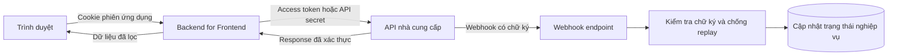

# Third-party integration

Tích hợp bên thứ ba giúp ứng dụng web sử dụng dịch vụ thanh toán, đăng nhập, bản đồ, phân tích hành vi, hỗ trợ khách hàng và nhiều năng lực khác. Mỗi tích hợp đưa thêm một tổ chức, một miền mạng, một thành phần chạy hoặc một luồng dữ liệu vào hệ thống. Vì vậy, quyết định tích hợp cũng là quyết định mở rộng ranh giới tin cậy của ứng dụng.

Trong trình duyệt, điểm cần hiểu rõ nhất là **nơi tải mã không đồng nghĩa với nơi mã được cách ly**. Một tệp JavaScript tải từ CDN của nhà cung cấp nhưng chạy trực tiếp trong trang vẫn có quyền của trang đó. Ngược lại, một widget chạy trong iframe khác origin có ranh giới origin riêng và phải giao tiếp qua các cơ chế cross-origin được thiết kế rõ ràng. Ở phía máy chủ, gọi API nhà cung cấp hoặc nhận webhook có mô hình bảo mật khác với gọi API từ trình duyệt.

## Mục tiêu học tập

Sau bài học, người học có thể:

- Phân biệt tích hợp bằng JavaScript nhúng, iframe, điều hướng OAuth, API từ trình duyệt và API server-to-server.
- Xác định quyền mà một thành phần bên thứ ba nhận được khi chạy trong trang và dữ liệu mà nó có thể quan sát.
- Chọn cơ chế phù hợp giữa Same-Origin Policy, CORS, CSP, SRI, sandbox, `postMessage`, cookie và CSRF.
- Thiết kế luồng xác thực với nhà cung cấp mà không đưa bí mật dài hạn vào mã trình duyệt.
- Kiểm chứng tích hợp theo origin, quyền, dữ liệu, phiên, chính sách trình duyệt và khả năng thu hồi.

## 1. Xác định ranh giới tin cậy của tích hợp

Trước khi chọn SDK hoặc viết mã, hãy xác định thành phần nào thực sự chạy ở đâu, dưới danh tính origin nào và có thể đọc hoặc gửi dữ liệu gì. Tên miền của nhà cung cấp xuất hiện trong URL tải tài nguyên không đủ để kết luận rằng mã được cách ly.

| Kiểu tích hợp | Nơi thực thi | Ranh giới chính | Rủi ro cần xem xét |
|---|---|---|---|
| JavaScript SDK được nhúng bằng `script` | Trong document của ứng dụng | Cùng execution context và origin với trang nhúng | Đọc DOM, form, dữ liệu hiển thị; gọi API theo quyền của trang; thay đổi giao diện; quan sát sự kiện người dùng |
| Widget trong iframe cross-origin | Document riêng của nhà cung cấp | Same-Origin Policy ngăn trang cha đọc trực tiếp DOM của iframe | Giao tiếp `postMessage`, cấu hình sandbox, quyền iframe, dữ liệu gửi vào widget |
| Điều hướng hoặc popup tới nhà cung cấp | Trang top-level hoặc cửa sổ riêng | Origin thay đổi; luồng quay về phải xác thực | Redirect giả mạo, CSRF đăng nhập, kiểm tra `state`, `nonce`, redirect URI |
| Trình duyệt gọi API nhà cung cấp | Mã ứng dụng gửi request cross-origin | SOP và CORS kiểm soát việc đọc response trong trình duyệt | Lộ token, cấu hình CORS rộng, CSRF nếu dùng cookie, dữ liệu bị gửi sai nơi |
| Backend gọi API nhà cung cấp | Máy chủ ứng dụng | Chính sách xác thực và mạng giữa hai backend | Lộ API key, quyền quá rộng, quản lý secret, timeout và retry |
| Nhà cung cấp gọi webhook | Backend nhận request đến | Endpoint công khai và cơ chế xác minh nguồn gửi | Giả mạo request, phát lại sự kiện, xử lý trùng, sai thứ tự |

### JavaScript tải từ bên ngoài vẫn có quyền của trang

Giả sử trang `https://shop.example` tải SDK từ `https://cdn.vendor.example/sdk.js`. Trình duyệt tải tệp từ CDN, nhưng sau khi thực thi, SDK hoạt động trong document của `shop.example`. Nó có thể truy cập DOM mà JavaScript của trang được phép truy cập, đọc nội dung mà trang hiển thị, đăng ký listener, sửa form và gửi request. SOP không tạo một sandbox riêng cho từng thẻ `script`.

Điều này có nghĩa là một SDK bị xâm phạm, một bản phát hành độc hại hoặc một tài khoản nhà cung cấp bị chiếm quyền có thể trở thành sự cố bảo mật của ứng dụng. Quyền truy cập thực tế còn phụ thuộc CSP, sandbox của môi trường, quyền của trang và các biện pháp bảo vệ khác, nhưng không nên coi nguồn tải khác origin là một lớp cách ly.

### Iframe tạo document và origin riêng

Một iframe cross-origin có document riêng. SOP ngăn trang cha tùy ý đọc DOM hoặc biến JavaScript bên trong iframe, và ngăn iframe tùy ý đọc DOM của trang cha. Hai phía vẫn có thể trao đổi thông điệp bằng `postMessage`, nhưng ứng dụng phải kiểm tra origin, cửa sổ gửi và cấu trúc dữ liệu.

Iframe giảm quyền trực tiếp của widget đối với trang, nhưng không tự động làm widget an toàn. Widget vẫn có thể nhận dữ liệu nhạy cảm mà trang gửi vào, điều hướng trong phạm vi được cấp, gửi request và sử dụng các tính năng trình duyệt được cho phép. Cần cấu hình sandbox, Permissions Policy và CSP theo đúng nhu cầu.

## 2. Lập threat model trước khi tích hợp

Một threat model ngắn nhưng cụ thể giúp tránh việc chỉ kiểm tra SDK có chạy được hay không. Với mỗi tích hợp, ghi nhận:

1. **Tài sản:** phiên đăng nhập, access token, thông tin thanh toán, hồ sơ khách hàng, dữ liệu giỏ hàng, nội dung form, mã đơn hàng và dữ liệu phân tích.
2. **Chủ thể:** người dùng, mã của ứng dụng, mã bên thứ ba, iframe của nhà cung cấp, backend ứng dụng, backend nhà cung cấp và hệ thống nhận webhook.
3. **Luồng dữ liệu:** dữ liệu nào đi ra, đi vào, đi qua URL, message, cookie, header, form hoặc log.
4. **Quyền:** thành phần nào được đọc DOM, lưu cookie, mở popup, gửi request, truy cập camera hoặc thanh toán.
5. **Điểm tin cậy:** điều gì chứng minh danh tính nhà cung cấp, tính toàn vẹn của tệp, tính hợp lệ của message và tính xác thực của webhook.
6. **Khả năng thu hồi:** ai có thể tắt tích hợp, thu hồi token, đổi secret, chặn domain hoặc quay lại phiên bản trước.

Ví dụ, một widget đánh giá sản phẩm có thể chỉ cần nhận mã sản phẩm và hiển thị danh sách đánh giá. Nếu trang gửi toàn bộ đối tượng người dùng, email, địa chỉ giao hàng và access token vào widget, quyền dữ liệu đã vượt quá chức năng cần thiết. Hãy truyền mã tham chiếu tối thiểu; để backend kiểm tra quyền và cung cấp dữ liệu đã được lọc.

## 3. Kiểm soát JavaScript bên thứ ba

Nếu SDK phải chạy trực tiếp trong trang, hãy xem nó như một phần mã có quyền cao của ứng dụng. Chỉ tải SDK khi tính năng cần thiết, dùng URL phiên bản cụ thể, kiểm soát tính toàn vẹn và giới hạn các kết nối mà trang được phép tạo.

### Ưu tiên phiên bản bất biến và SRI

Subresource Integrity (SRI) cho phép trình duyệt kiểm tra nội dung tải về khớp với hash đã khai báo. Ví dụ dưới đây minh họa cấu trúc; giá trị hash phải được tạo từ đúng tệp phát hành đã kiểm tra, không được sao chép chuỗi giả định:

```html
<script
  src="https://cdn.vendor.example/sdk/4.2.1/sdk.min.js"
  integrity="sha384-REPLACE_WITH_REAL_RELEASE_HASH"
  crossorigin="anonymous"
  defer></script>
```

SRI phù hợp với tài nguyên có nội dung ổn định. Nếu URL luôn trỏ tới bản `latest` và nhà cung cấp thay nội dung thường xuyên, hash sẽ không còn khớp và trình duyệt chặn tài nguyên. Hãy ghim phiên bản bất biến, xác minh hash trong quy trình cập nhật và có kế hoạch nâng cấp. Với tài nguyên cross-origin, máy chủ cung cấp tài nguyên cần trả header CORS phù hợp để trình duyệt xác minh SRI.

SRI bảo vệ tính toàn vẹn của tệp tại thời điểm tải; nó không chứng minh mã là an toàn, không giới hạn quyền của mã và không bảo vệ các request động mà SDK tạo ra sau đó.

### Dùng Content Security Policy để giới hạn nguồn

CSP là chính sách do ứng dụng gửi qua response header. Các directive như `script-src`, `connect-src` và `frame-src` giới hạn những nguồn mà trang có thể dùng cho từng loại tài nguyên. Các dòng trong ví dụ được tách ra để dễ đọc; khi gửi qua HTTP, ghép chúng thành một giá trị header duy nhất:

```http
Content-Security-Policy:
  default-src 'self';
  base-uri 'self';
  object-src 'none';
  frame-ancestors 'self';
  script-src 'self' 'nonce-{RANDOM_PER_RESPONSE}' https://cdn.vendor.example;
  connect-src 'self' https://api.vendor.example;
  frame-src https://checkout.vendor.example;
  img-src 'self' data: https://images.vendor.example;
  form-action 'self' https://identity.vendor.example;
  upgrade-insecure-requests
```

Nonce phải được sinh ngẫu nhiên cho từng response và gắn đúng vào các thẻ script inline được phép. Hãy điều chỉnh từng directive theo luồng thực tế; ví dụ trên không phải cấu hình có thể áp dụng nguyên trạng cho mọi ứng dụng. `frame-src` kiểm soát iframe mà trang của bạn tải. `frame-ancestors` kiểm soát những trang nào được phép nhúng ứng dụng của bạn. Hai directive giải quyết hai hướng khác nhau.

Không thêm một domain vào `script-src` chỉ để làm cho SDK hoạt động mà không đánh giá quyền của mã ở domain đó. Tránh `unsafe-inline` và `unsafe-eval` khi kiến trúc cho phép. Có thể triển khai `Content-Security-Policy-Report-Only` trước để thu thập vi phạm, điều chỉnh danh sách nguồn rồi mới bật chính sách thực thi. Báo cáo CSP cũng cần được giới hạn và lọc để tránh thu thập URL hoặc dữ liệu nhạy cảm ngoài ý muốn.

### Giảm thời gian và phạm vi thực thi

- Chỉ tải SDK trên trang thực sự sử dụng tính năng; không tải toàn cục nếu không cần.
- Ưu tiên tải sau khi người dùng yêu cầu hoặc sau khi có sự đồng ý phù hợp với mục đích xử lý dữ liệu.
- Không truyền session cookie, access token, thông tin thanh toán hoặc dữ liệu cá nhân đầy đủ vào biến toàn cục mà SDK có thể đọc.
- Theo dõi phiên bản, chủ sở hữu nghiệp vụ, domain, mục đích, quyền và ngày đánh giá lại của từng script.
- Dùng Trusted Types cùng CSP để giảm nguy cơ DOM XSS tại các sink nguy hiểm nếu ứng dụng hỗ trợ; Trusted Types không cách ly SDK bên thứ ba và không thay thế việc kiểm soát script.
- Có cơ chế tắt nhanh SDK hoặc chặn domain khi nhà cung cấp gặp sự cố.

## 4. Cô lập widget bằng iframe

Khi nhà cung cấp cung cấp widget có thể chạy trong iframe, đây thường là lựa chọn phù hợp cho chức năng cần giao diện độc lập như thanh toán, xác minh danh tính hoặc hỗ trợ khách hàng. Trang cha nên chỉ gửi dữ liệu tối thiểu mà widget cần.

```html
<iframe
  id="vendor-widget"
  src="https://widget.vendor.example/embed"
  title="Widget của nhà cung cấp"
  sandbox="allow-scripts allow-forms allow-same-origin"
  referrerpolicy="strict-origin"
  loading="lazy"></iframe>
```

Các quyền trong `sandbox` phải được chọn theo chức năng thật. Bỏ `allow-scripts` nếu nội dung không cần JavaScript; bỏ `allow-forms` nếu không cần gửi form; không cấp `allow-top-navigation`, popup hoặc download nếu không có yêu cầu rõ ràng. `allow-same-origin` giữ origin thực của tài liệu iframe thay vì ép nó thành opaque origin. Chỉ cân nhắc cấp quyền này khi cần dùng cookie, storage hoặc xác thực origin của message; với iframe của một origin nhà cung cấp tách biệt, nó vẫn khác origin với trang cha. Không kết hợp `allow-scripts` và `allow-same-origin` cho nội dung không đáng tin cậy cùng origin với trang cha, vì tài liệu đó có thể có cách tự gỡ hạn chế sandbox.

Thuộc tính `allow` (Permissions Policy cho iframe) nên chỉ cấp tính năng cần thiết, ví dụ quyền thanh toán hoặc camera nếu có lý do nghiệp vụ và người dùng được thông báo. CSP `frame-src` của trang cha cũng cần giới hạn origin iframe được phép tải.

## 5. Trao đổi dữ liệu an toàn bằng postMessage

`window.postMessage` cho phép hai browsing context khác origin gửi thông điệp. API này là cầu nối có chủ đích qua SOP, vì vậy cả bên gửi và bên nhận đều phải xác thực đích và nguồn.

Trang cha có thể kiểm tra message như sau:

```javascript
const frame = document.querySelector("#vendor-widget");
const trustedOrigin = "https://widget.vendor.example";

window.addEventListener("message", (event) => {
  if (event.origin !== trustedOrigin) return;
  if (event.source !== frame.contentWindow) return;

  const message = event.data;
  if (message === null || typeof message !== "object") return;
  if (message.type === "widget.ready") {
    frame.contentWindow.postMessage(
      { type: "widget.init", locale: "vi-VN" },
      trustedOrigin
    );
    return;
  }
  if (message.type !== "checkout.completed") return;
  if (typeof message.orderId !== "string") return;
  if (message.orderId.length === 0 || message.orderId.length > 100) return;

  // Chỉ dùng message để cập nhật giao diện.
  // Backend vẫn phải xác minh trạng thái đơn hàng với nhà cung cấp.
  showPendingConfirmation(message.orderId);
});
```

Các nguyên tắc quan trọng:

- So sánh `event.origin` với origin đầy đủ đã cấu hình, gồm scheme, hostname và port nếu có. Không dùng kiểm tra chuỗi lỏng như `endsWith("vendor.example")`.
- Kiểm tra `event.source` để bảo đảm message đến từ đúng cửa sổ iframe hoặc popup dự kiến.
- Kiểm tra kiểu, kích thước và các trường được phép của `event.data`. Xem message như input không đáng tin cậy.
- Khi gửi, dùng `targetOrigin` cụ thể. Không dùng `"*"` cho dữ liệu có ý nghĩa bảo mật.
- Không thực hiện thao tác nhạy cảm chỉ vì nhận được message như `payment.success`, `role.changed` hoặc `account.verified`. Backend phải xác minh trạng thái với nguồn có thẩm quyền.
- Nếu có thể, thiết lập một kênh `MessageChannel` riêng sau khi hoàn tất handshake đã xác thực; vẫn phải xác thực origin và source trong bước thiết lập ban đầu.

Iframe sandbox có opaque origin có thể phát message với `event.origin` là `"null"`. Không coi giá trị này là danh tính đáng tin cậy và không cho phép message từ origin `null` thực hiện hành động nhạy cảm. Nếu cần xác thực origin của nhà cung cấp, hãy thiết kế iframe và sandbox để giữ origin riêng có thể kiểm tra, hoặc thay đổi giao thức để không trao quyền dựa trên message đó.

## 6. CORS khi trình duyệt gọi API bên thứ ba

Same-Origin Policy hạn chế JavaScript đọc response từ origin khác. CORS là cơ chế để máy chủ đích tuyên bố origin nào được phép đọc response trong trình duyệt. CORS không phải cơ chế xác thực người gọi, không thay thế authorization và không bảo đảm request cross-origin không được gửi đi.

Một request đơn giản có thể được trình duyệt gửi tới máy chủ cross-origin dù JavaScript không được phép đọc response. Với request cần preflight, trình duyệt gửi `OPTIONS` trước để hỏi máy chủ về method và header được phép. Vì vậy, không thể dùng việc “CORS chặn response” làm biện pháp chống CSRF.

Ví dụ, nếu API chỉ phục vụ ứng dụng `https://shop.example`, máy chủ có thể trả:

```http
Access-Control-Allow-Origin: https://shop.example
Vary: Origin
Access-Control-Allow-Methods: GET, POST
Access-Control-Allow-Headers: Content-Type, Authorization, X-Request-ID
```

Nếu cần gửi cookie cross-origin, máy chủ phải cho phép credentials và chỉ định origin cụ thể:

```http
Access-Control-Allow-Origin: https://shop.example
Access-Control-Allow-Credentials: true
Vary: Origin
```

Không kết hợp `Access-Control-Allow-Credentials: true` với `Access-Control-Allow-Origin: *`. Nếu máy chủ phản hồi origin động dựa trên request, chỉ phản hồi những origin nằm trong allowlist chính xác; không phản chiếu bất kỳ giá trị `Origin` nào. Với phản hồi thay đổi theo origin, gửi `Vary: Origin` để cache không dùng nhầm response giữa các origin.

Trình duyệt có thể gửi preflight khi request dùng method hoặc header không đơn giản, ví dụ `Authorization` hoặc `X-Request-ID`. Endpoint `OPTIONS` phải trả chính sách nhất quán với request thực tế. API vẫn phải xác thực token, kiểm tra quyền trên từng tài nguyên, giới hạn tốc độ và ghi log an toàn. CORS chỉ điều khiển khả năng đọc response của mã chạy trong trình duyệt.

## 7. Cookie, phiên và CSRF trong tích hợp cross-site

Không thiết kế tích hợp với giả định cookie bên thứ ba luôn được trình duyệt gửi. Trình duyệt và chế độ riêng tư có thể chặn hoặc phân vùng cookie/storage bên thứ ba; hành vi còn phụ thuộc chính sách trình duyệt và ngữ cảnh sử dụng. Một widget dựa vào cookie cross-site có thể hoạt động khác nhau giữa trình duyệt, cấu hình và phiên người dùng.

Với cookie phiên của ứng dụng, cấu hình các thuộc tính phù hợp, ví dụ:

```http
Set-Cookie: __Host-session=...; Path=/; Secure; HttpOnly; SameSite=Lax
```

Tiền tố `__Host-` yêu cầu cookie có `Secure`, `Path=/` và không có `Domain`, giúp giới hạn cookie cho host đã đặt. `HttpOnly` ngăn JavaScript đọc cookie; nó không ngăn request tự động mang cookie. `SameSite=Lax` thường phù hợp cho phiên web có điều hướng top-level; chọn `Strict` hoặc `None` theo luồng thực tế và kiểm thử tác động. Cookie `SameSite=None` phải có `Secure`, nhưng vẫn có thể bị trình duyệt hoặc chính sách người dùng chặn trong ngữ cảnh third-party.

Nếu API dùng cookie để xác thực request thay đổi trạng thái, hãy triển khai bảo vệ CSRF như synchronizer token hoặc double-submit cookie được thiết kế đúng, kiểm tra `Origin`/`Referer` khi phù hợp và dùng SameSite như lớp phòng vệ bổ sung. Không coi CORS là lớp chống CSRF. Với tích hợp widget, ưu tiên token ngắn hạn, phạm vi hẹp và chỉ dùng cho đúng phiên hoặc đúng giao dịch; không chuyển cookie phiên chính của ứng dụng sang bên thứ ba.

## 8. Đăng nhập và ủy quyền với nhà cung cấp

Khi tích hợp identity provider bằng OAuth 2.0 hoặc OpenID Connect, ứng dụng phải xác minh cả luồng redirect lẫn token. Với ứng dụng chạy trong trình duyệt, Authorization Code Flow kết hợp Proof Key for Code Exchange (PKCE) là lựa chọn phù hợp cho public client. Với kiến trúc backend-for-frontend (BFF), backend có thể giữ token phía máy chủ và trình duyệt chỉ giữ cookie phiên của ứng dụng.

Các điểm cần kiểm soát:

- Đăng ký redirect URI chính xác, tránh wildcard và tránh redirect URI có thể bị người dùng điều khiển.
- Sinh `state` ngẫu nhiên, gắn với phiên đăng nhập và xác minh khi callback để chống CSRF trong luồng authorization.
- Dùng PKCE với `code_challenge` và xác minh `code_verifier` khi đổi authorization code.
- Với OpenID Connect, kiểm tra chữ ký, issuer (`iss`), audience (`aud`), thời hạn (`exp`) và `nonce` theo giao thức.
- Không đặt access token hoặc refresh token trong query string. URL có thể xuất hiện trong history, log, analytics và header referrer.
- Không lưu token dài hạn trong `localStorage` nếu có thể tránh; mã XSS hoặc SDK chạy cùng trang có thể đọc dữ liệu đó. Ưu tiên BFF giữ token phía server.
- Giới hạn scope, thời hạn token và quyền của client; có quy trình thu hồi khi người dùng ngắt kết nối hoặc nhà cung cấp gặp sự cố.

Nếu dùng popup, kiểm tra `origin` và `source` của message callback, ràng buộc callback với giao dịch đăng nhập đang chờ và xác minh kết quả ở backend. Không chấp nhận một message chỉ vì nó có trường `authenticated: true`.

## 9. API server-to-server và webhook

Khi backend gọi API của nhà cung cấp, request không chịu chính sách CORS của trình duyệt. Bảo vệ chính nằm ở xác thực máy chủ, quản lý secret, phân quyền và kiểm soát mạng.

- Lưu API key và client secret trong secret manager hoặc kho bí mật của môi trường triển khai; không nhúng chúng vào JavaScript, HTML, source map hoặc repository.
- Dùng credential riêng cho từng môi trường và từng tích hợp. Cấp scope nhỏ nhất, xoay vòng định kỳ và thu hồi được khi cần.
- Ưu tiên OAuth client credentials, mTLS hoặc chữ ký request theo khả năng nhà cung cấp; xác minh TLS và hostname của endpoint.
- Đặt timeout, giới hạn retry, backoff và circuit breaker để lỗi của nhà cung cấp không làm cạn tài nguyên ứng dụng.
- Lọc dữ liệu gửi đi và che token, secret, thông tin thanh toán khỏi log.

Webhook là request từ nhà cung cấp đến endpoint công khai của ứng dụng. Không tin payload chỉ vì URL khó đoán hoặc request đến từ một IP đã biết. Hãy xác minh chữ ký theo đặc tả nhà cung cấp, dùng raw request body nếu thuật toán yêu cầu, kiểm tra timestamp để giảm replay, so sánh chữ ký theo cách an toàn và lưu event ID để xử lý idempotent. Xác minh chữ ký trước khi thực hiện tác động nghiệp vụ; xử lý trùng và sai thứ tự theo trạng thái nghiệp vụ. Nếu provider hỗ trợ, đối chiếu sự kiện quan trọng với API của provider trước khi xác nhận giao dịch.

## 10. Giảm dữ liệu chia sẻ và bảo vệ quyền riêng tư

Mỗi trường dữ liệu gửi cho nhà cung cấp làm tăng tác động nếu tài khoản, SDK hoặc hệ thống của họ bị xâm phạm. Trước khi gửi, xác định mục đích và dữ liệu tối thiểu cần thiết. Ví dụ, một widget hỗ trợ có thể cần mã phiên hỗ trợ ngẫu nhiên và ngôn ngữ giao diện; nó có thể không cần access token, địa chỉ nhà hoặc toàn bộ lịch sử mua hàng.

Hãy xác định rõ:

- Dữ liệu nào được gửi, mục đích sử dụng và cơ sở cho phép xử lý.
- Dữ liệu được lưu ở đâu, trong bao lâu, có được dùng cho analytics hoặc huấn luyện hay không theo thỏa thuận.
- Nhà cung cấp có dùng subprocessors hay chia sẻ tiếp dữ liệu không.
- Cách xóa, xuất hoặc thu hồi dữ liệu khi người dùng hoặc doanh nghiệp yêu cầu.
- Dữ liệu nào bị loại khỏi URL, referrer, console log, telemetry và báo cáo lỗi.

Không đưa thông tin nhận dạng hoặc bí mật vào query string của iframe hay URL redirect. URL thường được ghi lại bởi browser history, proxy, server log và hệ thống phân tích. Khi cần truyền dữ liệu, ưu tiên POST hoặc kênh đã xác thực; vẫn phải giới hạn payload và thời hạn sử dụng.

## 11. Chọn kiến trúc tích hợp phù hợp

| Nhu cầu | Mẫu kiến trúc nên cân nhắc | Lý do bảo mật |
|---|---|---|
| Thanh toán hoặc nhập dữ liệu nhạy cảm | Hosted checkout hoặc iframe của nhà cung cấp | Giảm việc mã bên thứ ba chạy trong DOM của ứng dụng và giảm phạm vi dữ liệu ứng dụng phải xử lý |
| Gọi API có secret | Backend-for-frontend hoặc backend integration | Secret ở server; trình duyệt chỉ gọi API cùng origin của ứng dụng |
| Đăng nhập liên kết | Authorization Code + PKCE; BFF khi phù hợp | Ràng buộc redirect, giao dịch đăng nhập và token theo chuẩn |
| Widget nhỏ cần truy cập DOM để vẽ nội dung | SDK JavaScript đã được đánh giá, ghim phiên bản, SRI và CSP | Chấp nhận rõ ràng quyền cùng origin và giới hạn nguồn tải |
| Widget cần giao diện độc lập | Iframe cross-origin với sandbox và message schema | Tách DOM và dùng giao thức giao tiếp có kiểm tra |
| Cập nhật trạng thái từ nhà cung cấp | Webhook có chữ ký và xử lý idempotent | Xác thực nguồn sự kiện và chống phát lại/trùng lặp |

Một kiến trúc phổ biến cho API có bí mật là BFF:



Trong mô hình này, trình duyệt không biết API secret của nhà cung cấp. BFF xác thực người dùng bằng phiên ứng dụng, kiểm tra quyền trên tài nguyên, gọi API bên ngoài và chỉ trả dữ liệu cần thiết. Webhook đi qua endpoint riêng, được xác minh độc lập trước khi cập nhật trạng thái.

## 12. Quy trình đưa tích hợp vào production

**Trước khi phát triển:** ghi rõ mục đích, chủ sở hữu, domain, loại tích hợp, dữ liệu chia sẻ, quyền cần thiết, cơ chế xác thực, thời hạn lưu dữ liệu và cách tắt tích hợp. Đánh giá tài liệu bảo mật, quy trình cập nhật SDK, thông báo sự cố và khả năng thu hồi credential của nhà cung cấp.

**Trong khi phát triển:** dựng tích hợp ở môi trường thử nghiệm với dữ liệu giả; ghim phiên bản; cấu hình CSP và CORS theo allowlist; kiểm tra `postMessage`; giữ secret ở backend; xác minh chữ ký webhook; xử lý timeout và lỗi. Không dùng dữ liệu production thật để thử luồng chưa được kiểm soát.

**Trước khi phát hành:** kiểm tra Network panel để xác định mọi request, cookie, header và dữ liệu gửi ra; kiểm tra DOM và frame tree để xác định script chạy ở đâu; thử origin lạ gửi message; thử CORS từ origin không được phép; xác minh token không xuất hiện trong URL, storage hoặc log; thử trình duyệt chặn third-party cookie; kiểm tra CSP ở chế độ report-only rồi bật enforce khi phù hợp.

**Sau khi phát hành:** theo dõi phiên bản SDK, domain mới, CSP violation, lỗi CORS, tỷ lệ lỗi API, webhook không hợp lệ và thay đổi chính sách của trình duyệt. Định kỳ rà soát xem tích hợp còn cần thiết hay không. Khi có sự cố, tắt script hoặc iframe qua cấu hình, thu hồi token/secret, chặn endpoint hoặc domain liên quan, đánh giá dữ liệu đã bị gửi và khôi phục phiên bản đã kiểm tra.

## 13. Tình huống thực hành: tích hợp widget thanh toán

Một cửa hàng muốn nhúng widget thanh toán của `pay.vendor.example`. Widget cần hiển thị giao diện, nhận mã đơn hàng và thông báo khi người dùng hoàn tất. Hệ thống phải xử lý sao cho message từ widget không thể tự xác nhận đã thanh toán.

**Bước 1 — Chọn ranh giới.** Ưu tiên hosted checkout hoặc iframe cross-origin do nhà cung cấp vận hành. Không tải SDK vào trang nếu widget iframe đáp ứng được yêu cầu. CSP chỉ cho phép frame từ origin thanh toán đã xác minh.

**Bước 2 — Tạo phiên thanh toán ở backend.** Trình duyệt gửi yêu cầu tạo phiên tới endpoint cùng origin của cửa hàng. Backend xác thực phiên người dùng, kiểm tra quyền trên giỏ hàng, tính lại số tiền từ dữ liệu server và gọi API nhà cung cấp bằng credential lưu phía server. Backend trả về URL hoặc mã phiên ngắn hạn dành riêng cho giao dịch.

**Bước 3 — Khởi tạo iframe.** Trang chỉ truyền mã phiên hoặc URL được backend tạo. Không truyền API secret, cookie phiên hay dữ liệu thanh toán thô. Sandbox và Permissions Policy chỉ cấp quyền widget thực sự cần.

**Bước 4 — Xử lý message.** Trang kiểm tra `event.origin`, `event.source`, loại message và schema. Message `checkout.completed` chỉ làm giao diện hiển thị trạng thái đang xác minh; nó không được dùng để đánh dấu đơn hàng đã thanh toán.

**Bước 5 — Xác minh kết quả.** Backend nhận webhook, xác minh chữ ký và timestamp, chống xử lý trùng bằng event ID, rồi cập nhật trạng thái đơn hàng. Với sự kiện quan trọng, backend có thể truy vấn API nhà cung cấp để đối chiếu giao dịch. Trang lấy trạng thái cuối cùng từ backend của cửa hàng.

**Bước 6 — Kiểm thử lỗi.** Thử message từ origin khác, message sai schema, iframe bị đóng, webhook gửi lặp, chữ ký sai, webhook đến trễ, API timeout và trình duyệt chặn cookie bên thứ ba. Đơn hàng vẫn phải giữ trạng thái chưa thanh toán cho đến khi backend xác minh thành công.

## 14. Checklist rà soát bảo mật

- [ ] Đã xác định chính xác thành phần chạy trong trang, iframe, popup hay backend.
- [ ] Đã ghi lại domain, owner, phiên bản, quyền và dữ liệu của từng tích hợp.
- [ ] Không coi script tải từ domain khác là mã đã được cách ly khỏi trang.
- [ ] SDK có phiên bản cụ thể; SRI được dùng khi phù hợp và hash khớp tài nguyên phát hành.
- [ ] CSP giới hạn script, frame và kết nối theo nhu cầu; không thêm wildcard tùy tiện.
- [ ] Iframe có sandbox, Permissions Policy và `frame-src` tối thiểu cần thiết.
- [ ] `postMessage` xác minh origin, source, schema và dùng target origin cụ thể.
- [ ] CORS dùng allowlist chính xác; API vẫn xác thực và phân quyền độc lập.
- [ ] Cookie có thuộc tính phù hợp; CSRF được bảo vệ độc lập với CORS.
- [ ] OAuth/OIDC có redirect URI chính xác, `state`, PKCE và kiểm tra token theo giao thức.
- [ ] Secret chỉ ở backend; webhook được xác minh chữ ký và xử lý idempotent.
- [ ] Dữ liệu chia sẻ được tối thiểu hóa; token và dữ liệu nhạy cảm không nằm trong URL hoặc log.
- [ ] Có giám sát, chủ sở hữu, quy trình cập nhật và cách tắt/thu hồi tích hợp.

## 15. Câu hỏi tự kiểm tra

1. Một SDK được tải từ CDN khác origin có chạy trong một sandbox riêng không? Vì sao?
2. `frame-src` và `frame-ancestors` kiểm soát hai hướng nhúng nào?
3. Vì sao CORS không thể thay thế cơ chế chống CSRF?
4. Khi nhận message `payment.success` từ iframe, vì sao frontend không thể tự xác nhận đơn hàng đã thanh toán?
5. Vì sao không nên đặt access token trong query string hoặc `localStorage` khi có lựa chọn BFF?
6. Một webhook hợp lệ về chữ ký nhưng được gửi lặp lại cần được xử lý như thế nào?
7. Nếu widget phụ thuộc cookie bên thứ ba, những hành vi nào cần kiểm thử trên các trình duyệt mục tiêu?

Một tích hợp an toàn bắt đầu từ việc cấp đúng quyền và chia sẻ đúng dữ liệu cho đúng thành phần. Khi ranh giới được xác định rõ, các cơ chế của trình duyệt như SOP, CORS, CSP, sandbox và cookie có thể được phối hợp với xác thực backend, xác minh webhook và quy trình vận hành để kiểm soát rủi ro trong suốt vòng đời tích hợp.
