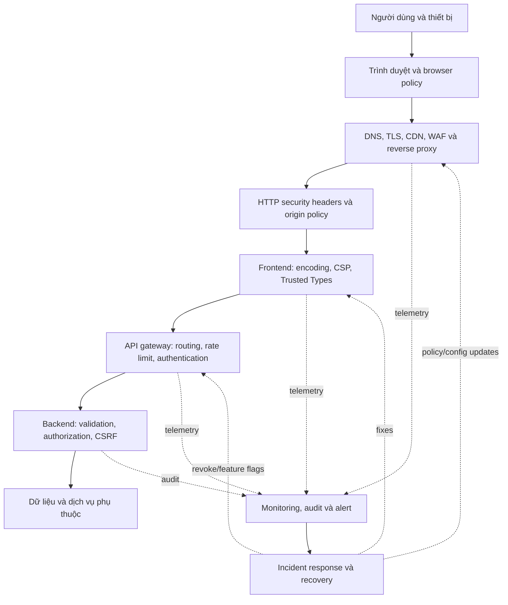

# Defense in depth

Defense in depth là cách thiết kế bảo mật bằng nhiều lớp kiểm soát bổ trợ nhau để một lỗi đơn lẻ không lập tức dẫn tới mất dữ liệu hoặc chiếm quyền toàn hệ thống. Trong ứng dụng web, các lớp này trải từ thiết bị và trình duyệt, origin, cookie, giao thức HTTP, frontend, API, dịch vụ phía máy chủ cho tới giám sát và ứng phó sự cố.

Một ứng dụng không thể dựa vào một header, một thư viện hoặc một bước kiểm tra ở frontend để bảo vệ toàn bộ luồng. Same-Origin Policy (SOP) giới hạn khả năng đọc dữ liệu giữa các origin; CORS cho phép server mở một số response cho origin được chọn; cookie `SameSite` giảm một số request cross-site; CSRF token xác minh request thay đổi trạng thái; output encoding và CSP giảm nguy cơ XSS; kiểm tra phân quyền ở server giới hạn dữ liệu mà tài khoản có thể truy cập. Mỗi cơ chế xử lý một phần rủi ro và có giới hạn riêng.

Trong phạm vi bảo mật ứng dụng web, defense in depth tập trung vào ranh giới trình duyệt, origin, cookie và ứng dụng. Mục tiêu là xác định lớp nào ngăn request, lớp nào giới hạn quyền đọc, lớp nào bảo vệ dữ liệu và lớp nào phát hiện hoặc giảm tác động khi một lớp thất bại.

## Mục tiêu

Sau bài học, bạn có thể:

- Giải thích nguyên tắc defense in depth và lý do cần nhiều lớp kiểm soát độc lập.
- Vẽ luồng dữ liệu và ranh giới tin cậy của một ứng dụng web.
- Phân bổ kiểm soát phù hợp cho browser, edge, frontend, API, backend và vận hành.
- Kết hợp SOP, CORS, cookie, CSRF, XSS, CSP, Trusted Types và kiểm tra phân quyền.
- Thiết kế hành vi fail-safe, giới hạn blast radius và giảm quyền tối thiểu.
- Xây dựng ma trận kiểm soát, kiểm thử lỗi từng lớp và xác minh lớp dự phòng.
- Theo dõi hiệu lực kiểm soát, xử lý ngoại lệ và cải tiến kiến trúc theo rủi ro.

## Defense in depth là gì?

Defense in depth sử dụng nhiều biện pháp có mục tiêu rõ ràng để bảo vệ tài sản trước các con đường tấn công khác nhau. Các lớp cần bổ trợ nhau, có phạm vi và giả định được ghi nhận. Nếu một lớp bị cấu hình sai, lớp khác vẫn có thể giảm khả năng khai thác hoặc giới hạn tác động.

Ví dụ, ứng dụng có thể dùng CSP để giới hạn nguồn script. Nếu một lỗi trong template vẫn tạo ra HTML nguy hiểm, CSP có thể ngăn một số payload thực thi. Tuy nhiên, nếu CSP có `unsafe-inline` rộng hoặc attacker có thể dùng script đã được allowlist, lớp này có thể thất bại. Output encoding đúng ngữ cảnh và Trusted Types tiếp tục giảm nguy cơ tạo sink nguy hiểm. Kiểm tra phân quyền ở server ngăn script chạy trong trình duyệt tự cấp thêm quyền truy cập dữ liệu. Audit log giúp phát hiện thao tác bất thường sau đó.

Defense in depth không có nghĩa là thêm thật nhiều công cụ. Một lớp chỉ có giá trị khi nó kiểm soát được một đường tấn công cụ thể, được cấu hình đúng, có thể kiểm chứng và không phụ thuộc hoàn toàn vào lớp đang bảo vệ. Hai middleware cùng dựa trên một giá trị header không đáng tin có thể cùng thất bại vì một giả định chung.

### Các nguyên tắc thiết kế

- **Nhiều ranh giới:** kiểm soát ở trình duyệt, gateway, API và hệ thống dữ liệu.
- **Độc lập tương đối:** lớp dự phòng không dựa hoàn toàn vào cùng một đầu vào hoặc thành phần dễ bị xâm phạm.
- **Quyền tối thiểu:** mỗi origin, service, script và người dùng chỉ nhận quyền cần thiết.
- **Fail-safe:** khi không thể xác minh quyền hoặc policy, hành động nhạy cảm phải bị từ chối an toàn.
- **Giới hạn blast radius:** tách tenant, service, origin, secret và môi trường để sự cố không lan rộng.
- **Quan sát được:** quyết định allow/deny có log và mã tương quan phù hợp.
- **Có thể phục hồi:** có cách thu hồi phiên, tắt chức năng, thay mã và rollback.

## Mô hình lớp bảo vệ cho ứng dụng web

Một kiến trúc điển hình có thể nhìn theo các lớp sau:



Các lớp trong sơ đồ không nhất thiết là các máy chủ riêng biệt. Chúng là vị trí kiểm soát trong luồng xử lý. Một hệ thống nhỏ có thể triển khai nhiều lớp trong cùng một reverse proxy hoặc backend, nhưng vẫn cần tách rõ trách nhiệm và kiểm tra được quyết định của từng lớp.

| Lớp | Mục tiêu chính | Ví dụ kiểm soát |
|---|---|---|
| Thiết bị và trình duyệt | Giảm rủi ro từ môi trường chạy client | Browser update, extension policy, profile isolation, secure context |
| DNS/TLS/edge | Bảo vệ kết nối và lọc lưu lượng sớm | HTTPS, HSTS, WAF, rate limit, DDoS protection |
| HTTP/browser policy | Giới hạn tương tác giữa tài liệu và nguồn | SOP, CORS, CSP, COOP, COEP, CORP, security headers |
| Frontend | Ngăn dữ liệu không tin cậy trở thành mã thực thi | Contextual output encoding, safe DOM APIs, Trusted Types, input handling |
| API/gateway | Xác thực request và kiểm soát luồng | Authentication, rate limit, request size, route allowlist |
| Backend/domain | Bảo vệ nghiệp vụ và dữ liệu | Authorization per object/action, CSRF validation, schema validation |
| Data/service | Giới hạn quyền và tác động lan truyền | Least-privilege DB role, service identity, network segmentation |
| Monitoring/response | Phát hiện, điều tra và giảm thiệt hại | Audit log, CSP reports, alert, token revoke, containment |

## Xác định tài sản và ranh giới tin cậy

Trước khi chọn lớp kiểm soát, xác định điều gì cần bảo vệ và nơi dữ liệu đi qua. Tài sản có thể gồm session, token, hồ sơ người dùng, dữ liệu thanh toán, cấu hình quản trị, mã JavaScript, nội dung HTML, dữ liệu lưu trữ phía trình duyệt và khả năng thực hiện thao tác nghiệp vụ.

Các ranh giới thường gặp:

- Giữa Internet và edge gateway.
- Giữa browser và server qua HTTPS.
- Giữa origin chính và origin bên thứ ba.
- Giữa trang cha và iframe.
- Giữa frontend và API.
- Giữa người dùng/tenant và tài nguyên nghiệp vụ.
- Giữa API và service hoặc cơ sở dữ liệu.
- Giữa môi trường production và pipeline build/deploy.

Với mỗi luồng, ghi rõ nguồn dữ liệu, đích, danh tính, quyền, dữ liệu nhạy cảm, cơ chế xác minh và điều kiện từ chối. Không xem một hostname là ranh giới đủ mạnh nếu nhiều ứng dụng không cùng mức tin cậy đang chia sẻ cookie domain, storage hoặc quyền truy cập.

### Ví dụ luồng cập nhật hồ sơ

Người dùng nhập email mới trong trang tài khoản. Trình duyệt gửi request tới API, cookie phiên được đính kèm theo quy tắc cookie, CSRF token được gửi cùng request, backend xác minh session, token, quyền và dữ liệu đầu vào rồi cập nhật hồ sơ. Kết quả được ghi audit và frontend hiển thị thông báo.

Các lớp có vai trò khác nhau:

1. HTTPS bảo vệ dữ liệu trên đường truyền.
2. Cookie `Secure`, `HttpOnly`, `SameSite` giảm khả năng lộ cookie và một số request cross-site.
3. CSRF token và kiểm tra nguồn request xác minh request thay đổi trạng thái.
4. Authentication xác định người dùng.
5. Authorization xác minh người dùng có quyền sửa đúng hồ sơ.
6. Validation kiểm tra email theo quy tắc nghiệp vụ.
7. Output encoding bảo vệ khi dữ liệu được hiển thị lại.
8. Audit log ghi nhận thay đổi và mã tương quan.

Nếu một lớp thất bại, các lớp khác vẫn có thể ngăn một phần hậu quả. Ví dụ, nếu request giả mạo vượt qua CSRF do lỗi cấu hình, kiểm tra quyền ở backend vẫn cần xác minh người dùng có quyền cập nhật tài nguyên cụ thể; nếu dữ liệu email chứa payload HTML, output encoding phải ngăn nó thực thi khi hiển thị.

## Lớp trình duyệt và origin

### Same-Origin Policy

SOP giới hạn cách script từ origin này đọc DOM, storage và nhiều tài nguyên của origin khác. Origin web gồm scheme, host và port. Path không tham gia phép so sánh.

SOP là lớp cô lập quan trọng nhưng không chặn mọi request cross-origin. Form, image, navigation và một số request có thể được gửi dù script không được đọc response. Vì vậy, không dùng SOP làm biện pháp duy nhất chống CSRF hoặc bảo vệ thao tác thay đổi trạng thái.

Kiểm thử lớp này bằng các trường hợp cùng origin, khác scheme, khác subdomain và khác port. Xác nhận trang khác origin không đọc được DOM hoặc storage riêng của ứng dụng, đồng thời các luồng cùng origin hợp lệ vẫn hoạt động.

### CORS

CORS cho phép server công bố response nào có thể được JavaScript từ origin khác đọc. Allowlist cần so sánh origin đầy đủ, không dùng wildcard hoặc phép so chuỗi con cho dữ liệu nhạy cảm. Khi dùng credentials, server cần trả origin cụ thể và `Access-Control-Allow-Credentials: true`; `Access-Control-Allow-Origin: *` không hợp lệ cho response credentialed.

CORS không xác thực người dùng, không phân quyền tài nguyên và không tự ngăn request form cross-origin. Backend vẫn cần xác minh session, quyền và CSRF. Một request có thể tới server dù browser không expose response cho script gọi nó.

### Cookie và session

Cookie phiên nên được cấu hình theo mục đích và phạm vi cần thiết. Các thuộc tính thường dùng:

- `Secure`: chỉ gửi cookie qua kết nối bảo mật.
- `HttpOnly`: ngăn JavaScript đọc cookie qua `document.cookie`.
- `SameSite`: kiểm soát một số ngữ cảnh gửi cookie cross-site.
- `Path` và `Domain`: giới hạn phạm vi request nhận cookie; tránh Domain quá rộng nếu không cần chia sẻ subdomain.
- Tiền tố `__Host-`: yêu cầu `Secure`, `Path=/` và không có `Domain` trong các trình duyệt hỗ trợ.

`HttpOnly` không ngăn trình duyệt tự gửi cookie. `SameSite` không thay thế CSRF token, đặc biệt khi có subdomain cùng site hoặc tích hợp cross-site. Cookie không được cô lập theo port như origin, vì vậy không nên đặt ứng dụng có mức tin cậy khác nhau trên cùng host và giả định port tạo ra ranh giới cookie.

### Fetch Metadata và navigation policy

Các header `Sec-Fetch-Site`, `Sec-Fetch-Mode` và `Sec-Fetch-Dest` cung cấp tín hiệu về ngữ cảnh request. Server có thể dùng chúng để từ chối một số request cross-site tới endpoint nhạy cảm, kết hợp với token và kiểm tra quyền. Đây là lớp bổ sung; client không phải trình duyệt có thể không gửi hoặc giả mạo header.

Với iframe, dùng `frame-ancestors` trong CSP hoặc `X-Frame-Options` tương thích để giới hạn nơi có thể nhúng ứng dụng. Nếu ứng dụng cần được nhúng, khai báo origin cụ thể và kiểm thử luồng đó. `frame-ancestors` có thể giới hạn chuỗi ancestor; `X-Frame-Options` có phạm vi và khả năng biểu đạt hẹp hơn, vì vậy cần chọn chính sách theo hỗ trợ trình duyệt.

## Lớp frontend: ngăn dữ liệu trở thành mã

Frontend thường xử lý dữ liệu đến từ URL, API, biểu mẫu, storage, postMessage và nội dung do người dùng tạo. Bất kỳ dữ liệu nào cũng cần được xem là không tin cậy cho tới khi được kiểm tra theo ngữ cảnh sử dụng.

### Contextual output encoding

Mã hóa đầu ra theo ngữ cảnh là lớp phòng vệ chính chống XSS. Chuỗi được chèn vào HTML text, thuộc tính HTML, URL, CSS hoặc JavaScript cần cách xử lý khác nhau. Ưu tiên API DOM an toàn như `textContent`, thuộc tính DOM có kiểm soát và cơ chế template mặc định escape.

```js
const message = apiResponse.message;
const statusNode = document.querySelector("#status");

// Hiển thị dữ liệu như văn bản, không phân tích chuỗi thành HTML.
statusNode.textContent = message;
```

Tránh dùng `innerHTML`, `insertAdjacentHTML` hoặc API tương tự với chuỗi không tin cậy. Nếu cần rich HTML, dùng sanitizer được duy trì, cấu hình allowlist rõ ràng và kiểm thử payload theo ngữ cảnh. Validation đầu vào hữu ích cho nghiệp vụ nhưng không thay thế output encoding.

### Trusted Types

Trusted Types giúp kiểm soát một số DOM sink nhạy cảm bằng cách yêu cầu dữ liệu đi qua policy tạo kiểu trusted. Khi được bật cùng CSP `require-trusted-types-for 'script'`, cơ chế này có thể giảm việc vô tình đưa chuỗi tùy ý vào sink như `innerHTML`.

Trusted Types không tự sanitize dữ liệu. Một policy quá rộng có thể biến thành đường bỏ qua nếu nó chấp nhận mọi chuỗi. Tạo policy hẹp, dùng sanitizer đã được kiểm thử và rà soát các sink mới sau khi cập nhật framework hoặc thư viện.

### Content Security Policy

CSP giới hạn nguồn script, style, image, frame, worker, kết nối và các loại tài nguyên khác. Policy nên ưu tiên nonce hoặc hash cho script inline cần thiết, giới hạn host và tránh `unsafe-inline`/`unsafe-eval` nếu không có lý do được đánh giá.

Ví dụ minh họa policy cơ bản; danh sách nguồn phải được điều chỉnh theo ứng dụng thực tế:

```http
Content-Security-Policy: default-src 'self'; object-src 'none'; base-uri 'self'; frame-ancestors 'none'; script-src 'self' 'nonce-{RANDOM_PER_RESPONSE}'; connect-src 'self' https://api.example.test; img-src 'self' data:; style-src 'self'; upgrade-insecure-requests
```

Nonce phải được tạo ngẫu nhiên cho từng response và dùng nhất quán trong header cùng các script được phép. Không dùng chuỗi placeholder cố định trong production. Trước khi enforce, có thể triển khai `Content-Security-Policy-Report-Only` để quan sát vi phạm và hoàn thiện policy. Report endpoint cần rate limit, giới hạn kích thước và xử lý nội dung như dữ liệu không tin cậy.

CSP là lớp giảm thiểu XSS và hạn chế tải mã từ nguồn ngoài; nó không thay thế sửa lỗi injection. Nếu script đã được allowlist hoặc có thể lấy nonce, CSP có thể không ngăn được payload.

## Lớp request và API

### Authentication

Xác thực xác định danh tính của principal. Dùng session hoặc token theo thiết kế, bảo vệ vòng đời credential, yêu cầu MFA/step-up cho thao tác nhạy cảm khi phù hợp và giới hạn thời hạn phiên. Không lưu secret trong JavaScript bundle hoặc log. Nếu dùng access token ở browser, đánh giá vị trí lưu, khả năng bị XSS đọc và cách revoke.

### Authorization tại server

Authorization phải được kiểm tra trên từng request và từng tài nguyên. Không tin `userId`, `tenantId`, role hoặc quyền do frontend gửi lên. Server xác định principal từ credential đã xác thực rồi kiểm tra principal có quyền thực hiện action trên object cụ thể hay không.

Ví dụ: người dùng có quyền sửa hồ sơ của mình không đồng nghĩa họ có quyền sửa hồ sơ bất kỳ chỉ bằng cách đổi ID trong URL. Kiểm tra object-level authorization ở backend, không chỉ kiểm tra quyền truy cập trang.

### CSRF protection

Với ứng dụng dùng cookie tự động gửi, các thao tác thay đổi trạng thái cần cơ chế chống CSRF phù hợp. Có thể kết hợp synchronizer token hoặc signed double-submit token, kiểm tra `Origin`/`Referer`, Fetch Metadata và `SameSite` cookie.

Không đặt thao tác thay đổi trạng thái qua GET. CORS không phải CSRF protection. Nếu token thiếu/sai hoặc nguồn request không hợp lệ, server phải từ chối trước khi thực hiện side effect. Kiểm thử bằng browser thật vì hành vi cookie phụ thuộc site, origin, navigation và browser policy.

### Validation và giới hạn request

Backend xác thực schema, kiểu dữ liệu, kích thước, định dạng và quy tắc nghiệp vụ. Giới hạn độ dài request, số lượng phần tử, upload size, thời gian xử lý và tốc độ để giảm rủi ro DoS hoặc abuse. Parse dữ liệu theo một quy tắc nhất quán; tránh các lớp hiểu khác nhau về URL, path, content type hoặc method override.

Thông điệp lỗi công khai nên ổn định và không tiết lộ stack trace, câu SQL, đường dẫn nội bộ hoặc secret. Log chi tiết ở server với quyền truy cập và retention phù hợp.

## Lớp hạ tầng và dịch vụ

### HTTPS, HSTS và security headers

HTTPS bảo vệ tính bí mật và toàn vẹn của kết nối. HSTS yêu cầu trình duyệt dùng HTTPS cho host theo chính sách; chỉ bật `includeSubDomains` và preload khi toàn bộ subdomain đã sẵn sàng. HSTS không thay thế cookie `Secure` hoặc kiểm soát quyền.

Các header khác có thể gồm:

| Header | Vai trò |
|---|---|
| `Strict-Transport-Security` | Buộc trình duyệt dùng HTTPS theo thời hạn và phạm vi đã khai báo |
| `Content-Security-Policy` | Giới hạn nguồn nội dung và hành vi tài liệu |
| `X-Content-Type-Options: nosniff` | Ngăn một số kiểu MIME sniffing |
| `Referrer-Policy` | Giới hạn thông tin URL được gửi trong Referer |
| `Permissions-Policy` | Giới hạn một số API/capability của trình duyệt |
| `Cross-Origin-Opener-Policy` | Kiểm soát quan hệ browsing context/opener |
| `Cross-Origin-Embedder-Policy` | Kiểm soát tài nguyên cross-origin được nhúng |
| `Cross-Origin-Resource-Policy` | Cho chủ tài nguyên giới hạn nơi có thể nhúng response |

Header cần được gửi nhất quán trên các route, kể cả response lỗi và redirect nếu phù hợp. Kiểm tra ở edge và origin server để tránh proxy xóa hoặc ghi đè policy.

### WAF, rate limit và network segmentation

WAF có thể chặn một số mẫu request độc hại và giảm lưu lượng tự động, nhưng không hiểu đầy đủ mọi quy tắc nghiệp vụ. Không dựa vào WAF để thay thế validation, authorization hoặc output encoding. Rate limit nên dựa trên nhiều tín hiệu phù hợp như principal, route, API key, tenant và nguồn mạng, tránh gây khóa nhầm người dùng sau NAT.

Giới hạn giao tiếp giữa service và database. Dùng service identity, credential riêng cho từng service và quyền database tối thiểu. Nếu frontend/API bị xâm phạm, segmentation và quyền hẹp giúp hạn chế việc truy cập sang hệ thống không liên quan.

### Supply chain và build pipeline

Bundle frontend là artifact có thể thực thi trong origin của ứng dụng. Bảo vệ dependency, registry, build runner, signing/provenance và quyền deploy. Dùng lockfile, review dependency update, quét advisory và xác minh nguồn package. Tách secret production khỏi job build không cần quyền phát hành.

Với script CDN, ghim phiên bản và dùng Subresource Integrity khi phù hợp. Giữ CSP allowlist hẹp. Một package build bị xâm phạm cũng có thể chèn mã vào bundle, vì vậy dependency development không nằm ngoài mô hình đe dọa.

## Lớp dữ liệu và quyền tối thiểu

Defense in depth tiếp tục ở backend và data layer:

- Tách quyền đọc/ghi theo service và chức năng.
- Dùng tài khoản database riêng với quyền tối thiểu.
- Giới hạn dữ liệu theo tenant ở truy vấn và tầng domain.
- Mã hóa dữ liệu nhạy cảm khi lưu và truyền theo yêu cầu.
- Quản lý secret trong secret manager, xoay vòng có kiểm soát.
- Dùng transaction và idempotency cho thao tác có tác dụng phụ.
- Ghi audit event cho thay đổi nhạy cảm.

Nếu API bị gọi trái phép, quyền database hẹp có thể ngăn service đọc hoặc sửa dữ liệu ngoài phạm vi. Tuy nhiên, nếu tất cả request đều dùng một tài khoản database có quyền cao, lỗi authorization ở ứng dụng có thể tạo blast radius lớn.

## Monitoring, detection và incident response

Không lớp phòng vệ nào bảo đảm ngăn mọi cuộc tấn công. Giám sát giúp phát hiện khi một lớp bị vượt qua hoặc cấu hình sai.

Theo dõi các sự kiện:

- CORS allow/deny, origin mới, `Origin: null` và Fetch Metadata bất thường.
- CSRF validation fail trên route thay đổi trạng thái.
- CSP violation và Trusted Types violation.
- Authentication failure, session reuse và hành vi truy cập tài nguyên bất thường.
- Dependency advisory, thay đổi bundle/hash và lỗi service worker.
- Thay đổi security header, allowlist, feature flag và cấu hình gateway.
- Audit log cho thao tác quản trị và thay đổi dữ liệu nhạy cảm.

Log cần có request ID, route template, decision code và principal pseudonymous khi phù hợp. Không ghi cookie, token, mật khẩu hoặc toàn bộ request body. CSP report và client telemetry phải được xem là dữ liệu không tin cậy, có giới hạn kích thước và rate limit.

Khi phát hiện sự cố, có thể thu hồi session/token, tắt route hoặc feature ở server, gỡ script bị xâm phạm, phát hành bundle/service worker sạch và xác minh request thực tế bị chặn. Giữ bằng chứng trước hoặc đồng thời với containment nếu không làm chậm hành động khẩn cấp. Chuẩn bị runbook và diễn tập định kỳ.

## Kiểm soát phải hoạt động khi một lớp thất bại

Một kiến trúc có chiều sâu cần mô tả rõ lớp dự phòng cho từng kịch bản:

| Kịch bản lỗi | Lớp đầu tiên có thể thất bại | Lớp tiếp theo cần giảm tác động |
|---|---|---|
| XSS trong trang hồ sơ | Output encoding hoặc sanitizer có lỗi | CSP/Trusted Types, quyền API tối thiểu, session revoke, audit |
| CSRF request vượt qua browser policy | `SameSite` không chặn request | CSRF token, Origin/Fetch Metadata validation, authorization server-side |
| CORS allowlist sai | CORS expose response cho origin ngoài dự kiến | Authentication, object-level authorization, data minimization, monitoring |
| Token bị đọc bởi script | `HttpOnly` không áp dụng cho token lưu trong JS | TTL ngắn, refresh rotation, revoke/introspection, step-up auth |
| Third-party script bị xâm phạm | CDN hoặc nhà cung cấp phân phối mã độc | SRI/version pinning, CSP, tắt tích hợp, token revoke, incident response |
| API bị gọi trực tiếp | Frontend ẩn nút hoặc route | Backend authorization, schema validation, rate limit, audit |
| Service worker giữ bundle cũ | CDN đã phát hành asset sạch nhưng worker còn cache | Worker version mới, cache namespace migration, server-side feature disable |
| Gateway/WAF bỏ lọt request | Quy tắc lọc edge không nhận diện được | Validation, authorization và transaction control ở backend |

Các lớp trong bảng không phải lúc nào cũng độc lập hoàn toàn. Ví dụ, CSP và Trusted Types đều phụ thuộc vào cấu hình frontend và có thể cùng bị suy yếu nếu policy được tạo quá rộng. Đánh giá giả định chung và tìm lớp bảo vệ ở ranh giới khác, đặc biệt là server authorization và quyền dữ liệu.

## Thiết kế fail-safe và giảm blast radius

Khi không thể xác minh danh tính, quyền hoặc tính hợp lệ của request, hệ thống nên từ chối thao tác nhạy cảm. Không tự động mở quyền khi dịch vụ policy timeout hoặc token validation không khả dụng. Nếu ứng dụng cần chế độ suy giảm, chỉ cho phép chức năng ít rủi ro và ghi nhận rõ giới hạn.

Giảm blast radius bằng cách:

- Tách origin cho nội dung không tin cậy, preview hoặc ứng dụng có mức tin cậy khác nhau.
- Tránh chia sẻ cookie Domain rộng giữa subdomain không cùng mức tin cậy.
- Dùng cookie host-only hoặc tiền tố `__Host-` khi phù hợp.
- Tách tenant và kiểm tra quyền ở từng object.
- Tách secret, service identity và quyền deploy theo môi trường.
- Hạn chế quyền third-party script và loại bỏ tích hợp không còn cần.
- Dùng feature flag server-side để tắt chức năng trong sự cố.
- Giữ asset immutable có version để rollback có thể xác định.

Không tạo ngoại lệ bảo mật vĩnh viễn chỉ để một tích hợp hoạt động. Mọi ngoại lệ CORS, CSP, cookie hoặc frame policy cần có chủ sở hữu, mục đích, phạm vi, thời hạn và kiểm thử định kỳ.

## Ma trận kiểm soát và bằng chứng

Để đánh giá defense in depth, lập ma trận nối tài sản, đe dọa, kiểm soát, vị trí thực thi và bằng chứng kiểm thử.

| Tài sản/đe dọa | Kiểm soát chính | Kiểm soát bổ trợ | Bằng chứng xác minh |
|---|---|---|---|
| Session cookie | Secure/HttpOnly/SameSite, server session | CSRF token, revoke, short session lifetime | Set-Cookie, browser storage, request cũ bị từ chối |
| Dữ liệu API | Authentication và object authorization | CORS allowlist, rate limit, audit | Test IDOR, decision log, response không lộ dữ liệu |
| DOM/XSS | Contextual output encoding | Sanitizer, Trusted Types, CSP | Payload test không thực thi, violation report |
| Cross-origin embed | SOP, CORS và frame policy | COOP/COEP/CORP, sandbox | Browser test, response header, postMessage validation |
| Thao tác thay đổi trạng thái | CSRF token và server authorization | SameSite, Origin, Fetch Metadata | Test thiếu/sai token, dữ liệu không đổi |
| Third-party code | Dependency review và version pinning | SRI, CSP, vendor isolation, kill switch | Lockfile/SBOM, hash, bundle diff, CSP policy |
| Sự cố đang diễn ra | Incident response và containment | Monitoring, feature flag, token revoke | Runbook, timeline, request bị chặn, recovery test |

Ma trận cần chỉ ra chủ sở hữu kiểm soát và tần suất kiểm tra. “Có header” hoặc “đã bật scanner” không phải bằng chứng đầy đủ; cần chứng minh header được gửi đúng route, scanner phát hiện đúng loại lỗi và quyết định server được thực thi.

## Kiểm thử kiến trúc defense in depth

Kiểm thử không chỉ xác nhận từng lớp hoạt động riêng mà còn kiểm tra hành vi khi một lớp bị vô hiệu hóa trong môi trường lab.

### Kiểm thử dương tính và âm tính

- Request cùng origin hợp lệ phải hoạt động.
- Origin ngoài allowlist không được đọc response nhạy cảm.
- Request thay đổi trạng thái thiếu/sai CSRF token phải bị từ chối.
- Người dùng không có quyền không thể đọc hoặc sửa object bằng cách đổi ID.
- Payload XSS được hiển thị như dữ liệu và không thực thi.
- Script ngoài allowlist bị CSP chặn.
- Message từ origin/window không tin cậy bị bỏ qua.
- Session/token đã revoke không thể tiếp tục truy cập.

### Kiểm thử lớp dự phòng

Trong môi trường thử nghiệm, mô phỏng một lớp bị lỗi có kiểm soát:

1. Tạm nới CORS ở lab để xác nhận backend vẫn kiểm tra authentication và authorization.
2. Trong browser context lab mà cookie thực sự được gửi, mô phỏng cookie `SameSite=None` để xác nhận CSRF token và origin policy vẫn bảo vệ thao tác; ghi nhận riêng nếu chính sách chặn third-party cookie làm cookie không được gửi.
3. Tắt CSP trong môi trường test để xác nhận output encoding vẫn ngăn payload XSS đã chọn.
4. Gọi API trực tiếp, bỏ qua frontend để xác nhận server vẫn kiểm tra quyền và schema.
5. Mô phỏng client giữ bundle cũ để xác nhận server-side feature flag có thể chặn thao tác nguy hiểm.

Chỉ thay đổi một lớp tại một thời điểm, dùng dữ liệu giả lập và khôi phục cấu hình ngay sau test. Không thử nghiệm bằng cách tắt bảo vệ trên production. Mục đích là chứng minh lớp dự phòng thực sự có tác dụng, không phải tìm cách duy trì trạng thái cấu hình yếu.

### Đánh giá kết quả

Với mỗi test, ghi lại:

- Tài sản và đe dọa đang kiểm tra.
- Lớp chính và lớp dự phòng được kỳ vọng.
- Điều kiện test và cấu hình đã thay đổi.
- Request/response, status và quyết định server.
- Trạng thái dữ liệu trước/sau.
- Log/audit event và mã tương quan.
- Lớp nào không hoạt động, giả định chung nào gây lỗi và hành động khắc phục.

Một test đạt khi hành vi nguy hiểm bị ngăn hoặc tác động được giới hạn theo yêu cầu, trong khi luồng hợp lệ vẫn hoạt động. Nếu mọi request đều bị từ chối, đó không phải bằng chứng kiến trúc tốt; cần test cả trường hợp được phép.

## Lỗi thiết kế thường gặp

| Lỗi | Vì sao nguy hiểm | Cách cải thiện |
|---|---|---|
| Chỉ dựa vào frontend | Người dùng có thể gọi API trực tiếp hoặc sửa JavaScript | Thực thi authorization và feature flag ở server |
| Coi CORS là xác thực | CORS chủ yếu kiểm soát khả năng đọc response trong browser | Xác thực, phân quyền và CSRF độc lập |
| Chỉ dùng SameSite chống CSRF | Subdomain cùng site hoặc cấu hình cookie có thể tạo đường request | Kết hợp token, Origin/Fetch Metadata và kiểm tra quyền |
| CSP quá rộng | Script độc hại có thể nằm trong nguồn được phép | Nonce/hash, allowlist hẹp, Trusted Types và encoding |
| Trusted Types policy nhận mọi chuỗi | Sink vẫn nhận dữ liệu nguy hiểm qua policy | Policy hẹp, sanitizer và test sink |
| Cookie Domain quá rộng | Subdomain ít tin cậy có thể ảnh hưởng phạm vi cookie | Host-only/`__Host-` khi phù hợp, tách origin |
| Một service dùng quyền database quá cao | Lỗi API có thể làm lộ nhiều dữ liệu | Least privilege và phân tách service/tenant |
| Log lưu toàn bộ request | Token, cookie và dữ liệu cá nhân có thể bị lộ | Structured logging, allowlist trường và retention |
| Không có đường revoke/rollback | Sự cố tiếp tục dù đã sửa code | Chuẩn bị token revoke, kill switch, asset version và runbook |

## Thực hành

Thiết kế kiến trúc bảo vệ cho một ứng dụng quản lý hồ sơ có frontend, API và một portal đối tác. Ứng dụng dùng session cookie và cho phép portal đọc một endpoint public qua CORS.

Thực hiện:

1. Vẽ luồng browser → frontend → API → database và đánh dấu origin/trust boundary.
2. Liệt kê tài sản: session, hồ sơ, email, bundle và dữ liệu public.
3. Chọn cookie policy, CORS allowlist, CSRF token và Fetch Metadata policy.
4. Xác định output encoding, CSP và Trusted Types cho dữ liệu hồ sơ.
5. Định nghĩa authentication và object-level authorization ở backend.
6. Bổ sung rate limit, audit log, alert và cơ chế revoke/feature disable.
7. Lập ma trận test dương tính, âm tính và lớp dự phòng.
8. Mô phỏng một lớp thất bại trong lab và chứng minh lớp tiếp theo giới hạn được tác động.

Viết báo cáo gồm sơ đồ, giả định tin cậy, kiểm soát chính/phụ, kết quả test, false positive, rủi ro còn lại và chủ sở hữu từng lớp. Dùng origin, tài khoản và dữ liệu giả lập; không thay đổi policy của production.

## Ghi nhớ

- Defense in depth dùng nhiều lớp kiểm soát bổ trợ để một lỗi đơn lẻ không gây mất kiểm soát toàn hệ thống.
- SOP, CORS, cookie, CSRF, CSP, Trusted Types và authorization giải quyết những vấn đề khác nhau.
- Kiểm tra quyền và quy tắc nghiệp vụ phải được thực thi ở server, kể cả khi frontend đã ẩn chức năng.
- Lớp dự phòng cần có giả định độc lập tương đối và được kiểm thử khi lớp chính thất bại.
- Least privilege, segmentation và feature flag server-side giúp giới hạn blast radius.
- Monitoring, audit, token revoke và incident response là một phần của kiến trúc bảo vệ.
- Đánh giá bằng hành vi thực tế, trạng thái dữ liệu và bằng chứng trên cả luồng hợp lệ lẫn luồng bị từ chối.
