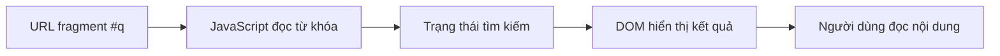
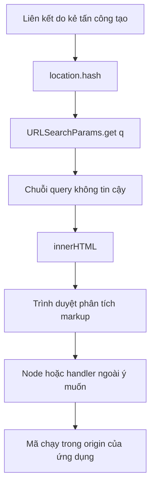

# Case study: XSS qua DOM

Một ứng dụng hỗ trợ khách hàng dạng single-page application (SPA) cho phép người dùng mở liên kết tìm kiếm được chia sẻ qua email. Sau một lần cập nhật giao diện, kẻ tấn công tạo một URL có nội dung HTML trong phần fragment. Khi nạn nhân mở liên kết, JavaScript phía trình duyệt đọc fragment và đưa chuỗi đó vào `innerHTML`. Trình duyệt phân tích chuỗi thành DOM, khiến mã xử lý sự kiện do kẻ tấn công chèn vào có thể chạy trong origin của ứng dụng.

Đây là một tình huống **DOM-based Cross-Site Scripting (DOM XSS)**. Lỗ hổng nằm trong luồng dữ liệu ở phía client: dữ liệu không tin cậy đi từ một nguồn có thể bị người dùng kiểm soát đến một điểm nhận có khả năng diễn giải HTML hoặc JavaScript. Máy chủ có thể chỉ trả về một trang HTML và file JavaScript hợp lệ; payload được đưa vào DOM sau khi trang đã tải.

Bài học này phân tích cách phát hiện, tái hiện, đánh giá tác động và khắc phục sự cố DOM XSS trong một ứng dụng web cùng origin. Trọng tâm là ranh giới giữa dữ liệu và mã thực thi trong trình duyệt, đồng thời áp dụng phòng vệ theo chiều sâu bằng API DOM an toàn, Content Security Policy (CSP) và Trusted Types.

## 1. Bối cảnh hệ thống

Ứng dụng giả định có địa chỉ `https://help.example.test`. Trang `/support` chạy SPA và cung cấp chức năng tìm kiếm bài viết trợ giúp. Để người dùng có thể chia sẻ trạng thái tìm kiếm mà không cần tải lại trang, ứng dụng lưu từ khóa trong URL fragment theo dạng `#q=...`.

Các thành phần liên quan:

| Thành phần | Trách nhiệm | Điểm cần chú ý |
|---|---|---|
| URL fragment | Lưu từ khóa tìm kiếm có thể chia sẻ | Người dùng có thể tự tạo fragment; fragment không được gửi trong HTTP request thông thường. |
| JavaScript của SPA | Đọc URL, cập nhật trạng thái tìm kiếm và kết xuất kết quả | Mã client có thể biến dữ liệu thành HTML nếu dùng API không an toàn. |
| DOM | Hiển thị từ khóa và kết quả cho người dùng | `innerHTML` yêu cầu trình duyệt phân tích chuỗi như markup. |
| Origin `https://help.example.test` | Ranh giới bảo mật của trang | Script được thực thi trong origin này có thể tương tác với tài nguyên cùng origin theo quyền của trang. |
| API tìm kiếm | Trả về bài viết phù hợp | Trong tình huống này API không phản chiếu payload; lỗi xuất hiện trước khi cần gọi API. |

Luồng bình thường được thiết kế như sau:



Lỗi xuất hiện ở bước cuối: ứng dụng cần hiển thị một chuỗi văn bản nhưng lại dùng API diễn giải chuỗi đó thành HTML.

## 2. Diễn biến sự cố

| Thời điểm | Sự kiện | Dữ liệu điều tra |
|---|---|---|
| 09:00 | Bản SPA mới được triển khai, bổ sung chức năng khôi phục từ khóa từ URL fragment. | Commit, build artifact và thời điểm triển khai. |
| 10:20 | Người dùng báo trang trợ giúp hiển thị nội dung bất thường sau khi mở liên kết tìm kiếm. | URL đầy đủ, trình duyệt, ảnh chụp và thời điểm xảy ra. |
| 10:35 | Nhóm hỗ trợ tái hiện được hành vi trên profile thử nghiệm. | Console, DOM snapshot và Network log. |
| 11:00 | Nhóm bảo mật tìm thấy dữ liệu từ `location.hash` được nối trực tiếp vào `innerHTML`. | Call stack, vị trí nguồn và điểm nhận trong mã. |
| 11:30 | Chức năng kết xuất tìm kiếm được vá để dùng `textContent`; bản vá được triển khai. | Diff, build hash và kiểm tra sau triển khai. |
| 13:00 | Hoàn tất kiểm tra hồi quy, rà soát phiên và telemetry liên quan. | Kết quả kiểm thử, log và quyết định đóng sự cố. |

Các mốc trên minh họa một quy trình điều tra. Khi xử lý sự cố thực tế, cần ghi lại thời gian theo múi giờ thống nhất và phân biệt thời điểm người dùng báo cáo với thời điểm payload đầu tiên có thể đã được khai thác.

## 3. Tái hiện và lần theo luồng dữ liệu

### 3.1. Mã có lỗ hổng

Đoạn mã rút gọn dưới đây mô phỏng lỗi trong thành phần kết quả tìm kiếm:

```js
const params = new URLSearchParams(location.hash.slice(1));
const query = params.get('q') || '';

const results = document.querySelector('#search-results');
results.innerHTML = `<p>Kết quả tìm kiếm cho: ${query}</p>`;
```

`URLSearchParams` giúp phân tích tham số và giải mã giá trị URL. Nó không làm cho giá trị trở nên an toàn để đưa vào HTML. Khi `query` chứa ký tự markup, phép nội suy tạo ra một chuỗi HTML hoàn chỉnh. Gán chuỗi này vào `innerHTML` khiến trình duyệt phân tích markup và tạo các node tương ứng.

### 3.2. URL kiểm thử

Trong môi trường kiểm thử được kiểm soát, có thể dùng URL sau để xác nhận hành vi chèn HTML:

```text
https://help.example.test/support#q=%3Cimg%20src%3Dx%20onerror%3Dalert(document.domain)%3E
```

Sau khi giải mã, giá trị `q` tương đương:

```html

```

Nếu ứng dụng kết xuất giá trị qua `innerHTML` và chính sách CSP cho phép inline event handler, trình duyệt có thể tạo phần tử ảnh, phát sinh lỗi tải ảnh và chạy handler. Hộp thoại `alert` chỉ là bằng chứng thực thi vô hại trong môi trường kiểm thử; không dùng payload kiểm thử để thu thập dữ liệu hoặc gửi thông tin ra ngoài.

Khả năng chạy payload còn phụ thuộc chính sách CSP, trình duyệt và ngữ cảnh kết xuất. Nếu CSP chặn inline handler, payload minh họa có thể không thực thi, nhưng luồng đưa dữ liệu không tin cậy vào HTML vẫn là lỗi cần sửa. Không dùng việc một payload cụ thể bị CSP chặn làm bằng chứng rằng sink đã an toàn.

Fragment sau dấu `#` không được gửi trong HTTP request thông thường. Vì vậy, log access của máy chủ có thể chỉ ghi nhận request đến `/support`, không có chuỗi payload. Đây là lý do điều tra DOM XSS cần xem xét mã client, URL mà người dùng mở, DOM và telemetry phía trình duyệt thay vì chỉ tìm chuỗi độc hại trong log máy chủ.

### 3.3. Xác định source và sink

| Loại | Trong tình huống | Vì sao quan trọng |
|---|---|---|
| Source | `location.hash`, cụ thể là tham số `q` | Kẻ tấn công có thể tạo liên kết với giá trị tùy ý. |
| Biến trung gian | `query` sau khi `URLSearchParams` phân tích | Việc giải mã URL không phải là làm sạch HTML. |
| Sink | `results.innerHTML` | Trình duyệt diễn giải chuỗi thành markup. |
| Context | Nội dung HTML bên trong phần tử kết quả | Dữ liệu có thể tạo node và thuộc tính sự kiện. |
| Điều kiện khai thác | Nạn nhân mở URL trên origin bị ảnh hưởng và chính sách trình duyệt cho phép hành vi được chèn | Mã chạy trong ngữ cảnh trang có thể sử dụng các quyền mà trang đang có. |

Sơ đồ luồng dữ liệu:



Điểm quyết định không nằm ở việc dữ liệu đến từ URL, form hay API. Lỗi xảy ra vì dữ liệu không tin cậy được đưa vào một sink diễn giải nó thành mã hoặc cấu trúc có thể hoạt động. Các nguồn khác cần kiểm tra gồm `location.search`, `location.pathname`, `document.referrer`, `postMessage`, `window.name`, dữ liệu từ Web Storage, IndexedDB và response API. Dữ liệu đã lưu trong trình duyệt vẫn có thể không đáng tin cậy nếu trước đó người dùng hoặc nội dung bị xâm nhập có thể ghi vào.

### 3.4. Phân biệt với reflected và stored XSS

| Loại XSS | Nơi payload được lưu hoặc truyền | Điểm thực thi thường gặp |
|---|---|---|
| Reflected XSS | Request được gửi đến máy chủ và phản chiếu trong response | Máy chủ tạo response chứa dữ liệu không được mã hóa theo context. |
| Stored XSS | Payload được lưu trong cơ sở dữ liệu hoặc hệ thống nội dung | Trang sau đó đọc dữ liệu lưu trữ và kết xuất không an toàn. |
| DOM-based XSS | Luồng dữ liệu được xử lý ở phía client, ví dụ từ URL fragment đến DOM | JavaScript đọc source và đưa dữ liệu vào sink nguy hiểm. |

Một ứng dụng có thể đồng thời có nhiều loại XSS. DOM XSS mô tả nơi luồng dữ liệu nguy hiểm hoàn tất và tạo ra lỗi; không nên chỉ phân loại dựa trên việc payload có xuất hiện trong URL hay không. Nếu dữ liệu từ máy chủ cũng được đưa qua JavaScript vào sink nguy hiểm, cần đánh giá cả nguồn dữ liệu và đường kết xuất đó.

## 4. Đánh giá tác động

Khi payload chạy trong trang `help.example.test`, mã được thực thi trong ngữ cảnh origin của ứng dụng. Tác động cụ thể phụ thuộc dữ liệu mà trang hiển thị, API mà người dùng có quyền gọi, cấu hình cookie và các biện pháp bảo vệ khác.

Các khả năng cần đánh giá:

- Đọc nội dung DOM mà người dùng hiện tại được phép xem, bao gồm thông tin hồ sơ hoặc dữ liệu hỗ trợ khách hàng đang hiển thị.
- Đọc token hoặc dữ liệu nhạy cảm được lưu trong biến JavaScript, Web Storage hoặc nơi khác có thể truy cập từ script.
- Gửi request cùng origin thay mặt người dùng và thực hiện hành động mà tài khoản đó được phép thực hiện.
- Thay đổi giao diện để hiển thị biểu mẫu giả, hướng người dùng đến nội dung lừa đảo hoặc làm sai lệch thông tin.
- Đọc response của request cùng origin mà trang có quyền truy cập và gửi dữ liệu ra ngoài nếu chính sách mạng cho phép.

Cookie có thuộc tính `HttpOnly` không thể được JavaScript đọc trực tiếp qua `document.cookie`. Tuy vậy, mã XSS chạy trong trang vẫn có thể gửi request cùng origin; trình duyệt có thể đính kèm cookie phù hợp theo quy tắc cookie và request. Vì vậy, `HttpOnly` giảm khả năng đánh cắp giá trị cookie nhưng không ngăn mọi hành động trái phép được thực hiện qua phiên đăng nhập hiện có.

Không mặc định rằng XSS cho phép đọc dữ liệu của mọi origin khác. Same-Origin Policy, CORS, sandbox và các giới hạn trình duyệt vẫn áp dụng. Cần xác định chính xác dữ liệu và API mà ứng dụng bị ảnh hưởng cho phép mã trong trang truy cập.

## 5. Điều tra và bảo toàn chứng cứ

Trước khi triển khai bản sửa hoặc xóa dữ liệu thử nghiệm, ghi lại thông tin cần thiết để xác định phạm vi:

1. URL đầy đủ mà người dùng đã mở, bao gồm fragment; thời điểm, múi giờ, trình duyệt và phiên bản ứng dụng.
2. Commit, build artifact, source map (nếu có), thời điểm phát hành và thay đổi gần nhất ở thành phần tìm kiếm.
3. DOM snapshot hoặc ảnh chụp cho thấy nội dung bất thường; vị trí node được tạo và thuộc tính liên quan.
4. Console log, call stack, breakpoint và vị trí source-to-sink trong JavaScript.
5. CSP response header, CSP violation report, cấu hình Trusted Types và các header bảo mật khác.
6. Telemetry client, request API, hành động tài khoản và báo cáo người dùng trong khoảng thời gian phơi nhiễm.
7. Hash của bundle đã phát hành và bản sao artifact cần thiết để phân tích.

Trong DevTools, có thể tái hiện trên profile thử nghiệm, đặt DOM breakpoint tại vùng kết quả hoặc breakpoint tại dòng gán `innerHTML`. Dùng tìm kiếm toàn bộ mã nguồn để rà soát các sink như `innerHTML`, `outerHTML`, `insertAdjacentHTML`, `document.write`, `srcdoc` và các API tạo script. Theo ngược dữ liệu về source để hiểu ai kiểm soát được giá trị và có bước biến đổi nào ở giữa.

Nếu ứng dụng dùng framework, kiểm tra cả API thoát khỏi cơ chế tự động escape, ví dụ `dangerouslySetInnerHTML` trong React, `v-html` trong Vue hoặc các API bypass sanitizer của framework. Việc framework tự escape nội suy văn bản ở một vị trí không chứng minh mọi vị trí kết xuất khác đều an toàn.

Lưu URL, HAR, DOM snapshot và log ở kho chứng cứ có phân quyền. Chúng có thể chứa mã định danh, thông tin tài khoản, dữ liệu khách hàng hoặc token. Không chia sẻ công khai URL có dữ liệu cá nhân hoặc bản HAR chưa được rà soát.

## 6. Nguyên nhân gốc

Nguyên nhân trực tiếp là code dùng `innerHTML` để hiển thị một giá trị chỉ cần được coi là văn bản. `URLSearchParams` thực hiện nhiệm vụ phân tích tham số URL nhưng không phải bộ lọc HTML. Việc dữ liệu nằm trong fragment cũng không làm nó đáng tin cậy; người dùng có thể sửa fragment trước khi tải trang hoặc chia sẻ liên kết do mình tạo.

Các yếu tố làm tăng khả năng khai thác trong tình huống này gồm:

- Code review tập trung vào việc khôi phục trạng thái tìm kiếm mà chưa rà soát source-to-sink.
- Kiểm thử chỉ dùng từ khóa thông thường, không có chuỗi chứa ký tự đặc biệt và markup.
- CSP thiếu, quá rộng hoặc cho phép inline event handler.
- Không có kiểm soát Trusted Types để phát hiện việc gán chuỗi tùy ý vào các sink HTML trong trình duyệt hỗ trợ.
- Không có quy ước thống nhất về API DOM an toàn cho nội dung văn bản và nội dung rich text.

Việc kiểm tra hoặc loại bỏ một số ký tự ở đầu vào không sửa được nguyên nhân gốc. Cùng một dữ liệu có thể đi qua nhiều context khác nhau; mã hóa phải phù hợp với context, và cách tốt nhất cho nội dung văn bản là dùng API không diễn giải HTML.

## 7. Khắc phục

### 7.1. Sửa sink để hiển thị văn bản

Với yêu cầu hiển thị từ khóa tìm kiếm, dùng `textContent`:

```js
const params = new URLSearchParams(location.hash.slice(1));
const query = params.get('q') || '';

const results = document.querySelector('#search-results');
const message = document.createElement('p');
message.textContent = `Kết quả tìm kiếm cho: ${query}`;

results.replaceChildren(message);
```

`textContent` tạo nội dung văn bản và không phân tích giá trị thành HTML. Các ký tự `<`, `>`, dấu nháy và chuỗi giống thẻ được hiển thị như văn bản. `createElement()` tạo phần tử theo tên tag do code kiểm soát; `textContent` gán dữ liệu không tin cậy vào phần nội dung văn bản.

Nếu chỉ cập nhật nội dung của một node có sẵn, có thể viết ngắn hơn:

```js
const message = document.querySelector('#search-message');
message.textContent = `Kết quả tìm kiếm cho: ${query}`;
```

Tránh thay `innerHTML` bằng `outerHTML`, `insertAdjacentHTML` hoặc `document.write`, vì các API đó vẫn diễn giải chuỗi thành markup. Cũng không nên tự viết hàm loại bỏ `<script>` bằng regex: XSS có thể đến từ thuộc tính sự kiện, URL nguy hiểm, SVG, MathML hoặc các cấu trúc HTML khác.

### 7.2. Nếu ứng dụng thực sự cần rich text

Một số ứng dụng cần hiển thị nội dung rich text do người dùng hoặc hệ thống nội dung cung cấp. Khi đó, phải dùng thư viện sanitizer được duy trì, cấu hình allowlist theo yêu cầu sản phẩm và cập nhật thư viện định kỳ. Chỉ cho phép các phần tử, thuộc tính và URL scheme cần thiết. Tránh cho phép handler sự kiện như `onerror`, `onclick`, các thẻ nhúng không cần thiết hoặc URL `javascript:`.

Ví dụ với DOMPurify đã được đóng gói và quản lý dependency trong ứng dụng:

```js
const safeHtml = DOMPurify.sanitize(untrustedMarkup, {
  ALLOWED_TAGS: ['p', 'strong', 'em', 'ul', 'ol', 'li', 'a'],
  ALLOWED_ATTR: ['href', 'title'],
});

richTextContainer.innerHTML = safeHtml;
```

Đây chỉ là ví dụ cấu hình tối thiểu. Ứng dụng phải kiểm thử allowlist theo nội dung thật, bảo đảm URL của liên kết chỉ dùng scheme phù hợp và không sửa chuỗi đã sanitize bằng thao tác nối hoặc thay thế sau đó. Sanitizer phải chạy tại ranh giới trước khi dữ liệu được đưa vào sink HTML.

Nếu không cần HTML, luôn ưu tiên `textContent`. Sanitizer không biến mọi chuỗi thành dữ liệu an toàn cho mọi context: HTML body, thuộc tính HTML, URL, CSS và JavaScript có quy tắc khác nhau.

Khi trình duyệt đang thực thi chính sách `require-trusted-types-for 'script'`, phép gán chuỗi `safeHtml` trực tiếp vào `innerHTML` trong ví dụ trên sẽ bị chặn ở trình duyệt có hỗ trợ enforcement. Trong trường hợp đó, chuyển kết quả sanitizer qua policy Trusted Types đã được phê duyệt như ví dụ tiếp theo.

### 7.3. Thêm Trusted Types để kiểm soát sink

Trusted Types giúp các trình duyệt hỗ trợ phân biệt chuỗi thông thường với giá trị được cấp qua policy tin cậy khi dữ liệu được đưa vào một số sink DOM nhạy cảm. Khi bật enforcement, các phép gán chuỗi trực tiếp vào sink được bảo vệ có thể bị chặn.

Ví dụ tạo policy chỉ dành cho nội dung rich text đã sanitize:

```js
const richTextPolicy = trustedTypes.createPolicy('app-rich-text', {
  createHTML(input) {
    return DOMPurify.sanitize(input, {
      ALLOWED_TAGS: ['p', 'strong', 'em', 'ul', 'ol', 'li', 'a'],
      ALLOWED_ATTR: ['href', 'title'],
      RETURN_TRUSTED_TYPE: false,
    });
  },
});

richTextContainer.innerHTML = richTextPolicy.createHTML(untrustedMarkup);
```

Policy trả về dữ liệu đã sanitize và trình duyệt tạo giá trị `TrustedHTML` từ policy đó. Tên policy phải khớp allowlist trong CSP. Không tạo policy kiểu “tin mọi chuỗi” như `createHTML: (input) => input`; cách đó chỉ hợp thức hóa dữ liệu không an toàn và làm mất lợi ích của Trusted Types.

Trusted Types không tự sanitize và không thay thế code an toàn. Cần quản lý policy tập trung, review nơi gọi policy, giới hạn số policy và kiểm thử tương thích. Enforcement hiện được hỗ trợ rõ nhất trên Chromium; các trình duyệt khác có thể chưa hỗ trợ hoặc có mức hỗ trợ khác nhau, nên vẫn phải giữ API DOM an toàn làm nền tảng.

### 7.4. Củng cố CSP

CSP tạo thêm một lớp phòng vệ để giảm khả năng thực thi script được chèn. Ví dụ chính sách khởi đầu cho ứng dụng không cần inline script:

```http
Content-Security-Policy: default-src 'self'; script-src 'self' 'nonce-{random-per-response}'; object-src 'none'; base-uri 'self'; frame-ancestors 'none'; require-trusted-types-for 'script'; trusted-types app-rich-text
```

Giá trị nonce phải được tạo ngẫu nhiên cho từng response và gắn đúng vào các thẻ script hợp lệ cần nonce. Không dùng chuỗi nonce cố định hoặc đưa nonce vào vị trí mà kẻ tấn công có thể kiểm soát. Nếu ứng dụng không dùng Trusted Types hoặc trình duyệt mục tiêu chưa hỗ trợ, cần triển khai chính sách phù hợp với chiến lược tương thích của sản phẩm; directive `require-trusted-types-for` và `trusted-types` chưa được hỗ trợ đồng đều trên mọi trình duyệt.

Không thêm `'unsafe-inline'` chỉ để làm ứng dụng cũ hoạt động nếu có thể loại bỏ inline script và event handler. CSP không thay thế sửa `innerHTML`: một chính sách yếu, cấu hình sai hoặc thay đổi tương lai có thể khiến payload chạy. Có thể triển khai `Content-Security-Policy-Report-Only` trước để thu thập vi phạm và xử lý các phụ thuộc hợp lệ, sau đó chuyển sang enforcement.

### 7.5. Rà soát toàn bộ luồng tương tự

Sau khi vá điểm tìm kiếm, rà soát các màn hình khác có nhận dữ liệu từ URL, `postMessage`, Web Storage, IndexedDB hoặc API rồi đưa vào DOM. Tạo quy ước trong code review: nội dung văn bản dùng `textContent`; tạo node bằng API DOM; HTML động chỉ được đi qua sanitizer đã phê duyệt và policy rõ ràng. Kiểm tra cả component dùng chung và các nhánh hiển thị lỗi, thông báo, tên file hoặc nội dung preview.

## 8. Kiểm thử hồi quy và xác minh sau triển khai

Kiểm thử cần chứng minh dữ liệu không tin cậy được giữ ở dạng văn bản và không tạo node hoặc hành vi ngoài ý muốn.

| Trường hợp | Dữ liệu kiểm thử | Kết quả mong đợi |
|---|---|---|
| Từ khóa thông thường | `cách đặt lại mật khẩu` | Hiển thị đúng từ khóa và kết quả tìm kiếm. |
| Ký tự HTML | `<b>test</b>` | Hiển thị nguyên văn như văn bản; không tạo phần tử `b`. |
| Thẻ ảnh có handler | `` | Không tạo phần tử `img` từ từ khóa; không có handler chạy. |
| Dấu nháy và dấu phân cách | `" ' < > &` | Không phá vỡ cấu trúc DOM hoặc thuộc tính. |
| Chuỗi URL đã mã hóa | Payload được percent-encode trong fragment | Sau khi phân tích, chuỗi vẫn chỉ được hiển thị dưới dạng văn bản. |
| Fragment rỗng hoặc thiếu `q` | `#`, `#q=` | Ứng dụng xử lý trạng thái rỗng ổn định. |
| Fragment sai định dạng | Chuỗi mã hóa không hợp lệ hoặc tham số lặp | Không làm trang crash; quy tắc chọn giá trị được xác định rõ. |
| Nội dung rich text hợp lệ | Đoạn văn có `strong`, `em`, `a` | Chỉ tag và thuộc tính trong allowlist được giữ lại. |

Ví dụ kiểm tra thủ công trên bản staging:

1. Mở DevTools và xóa trạng thái thử nghiệm cũ.
2. Mở URL fragment với chuỗi `<b>test</b>` đã encode.
3. Xác nhận giao diện hiển thị nguyên văn chuỗi và DOM không có node `b` được tạo từ từ khóa.
4. Thử chuỗi ảnh có event handler trong môi trường kiểm thử; xác nhận không có phần tử ảnh được chèn và không có JavaScript ngoài ý muốn chạy.
5. Kiểm tra Console, CSP report và Network để phát hiện lỗi do chính sách mới hoặc dependency chưa tương thích.
6. Thử lại trên các trình duyệt được hỗ trợ và trên profile sạch sau khi triển khai.

Có thể bổ sung kiểm thử tự động bằng Playwright hoặc công cụ browser test tương đương. Kiểm thử nên xác nhận cả nội dung hiển thị và cấu trúc DOM, thay vì chỉ kiểm tra không có hộp thoại `alert`. Ví dụ ý tưởng cho assertion:

```js
// Pseudocode: thay URL và selector theo ứng dụng kiểm thử.
const probe = '';
await page.goto(`/support#q=${encodeURIComponent(probe)}`);

await expect(page.locator('#search-results')).toContainText(probe);
await expect(page.locator('#search-results img')).toHaveCount(0);
await expect.poll(() => page.evaluate(() => window.__xssProbe === true))
  .toBe(false);
```

Đoạn kiểm thử là pseudocode minh họa; cần khởi tạo `window.__xssProbe` trong fixture và điều chỉnh route, selector, kiểu dữ liệu theo ứng dụng. Không đưa payload kiểm thử vào môi trường người dùng thật.

Sau khi triển khai, xác nhận bundle mới đang được phục vụ từ origin và CDN, hash khớp artifact, không còn đường code cũ dùng sink nguy hiểm cho tham số `q`, và các luồng tìm kiếm thông thường vẫn hoạt động. Nếu ứng dụng dùng service worker hoặc cache phía client, xác minh người dùng không tiếp tục nhận bundle cũ sau bản vá.

## 9. Bài học rút ra

**Dữ liệu từ trình duyệt luôn cần được xem là không tin cậy.** URL fragment không đi qua máy chủ nhưng vẫn có thể điều khiển luồng JavaScript phía client. Việc dữ liệu không xuất hiện trong access log không làm giảm mức độ cần điều tra.

**Chọn sink theo mục đích hiển thị.** Nếu yêu cầu là văn bản, `textContent` là lựa chọn phù hợp. Chỉ dùng HTML động khi sản phẩm thực sự cần markup và có sanitizer được quản lý.

**Theo dấu source-to-sink trong review và kiểm thử.** Xác định nguồn dữ liệu, mọi bước biến đổi, điểm nhận cuối cùng và context. Một hàm parse hoặc decode không phải bộ lọc XSS.

**CSP và Trusted Types tăng khả năng phòng vệ.** CSP giới hạn những gì trình duyệt được phép thực thi; Trusted Types kiểm soát việc đưa dữ liệu vào một số sink nhạy cảm trên trình duyệt hỗ trợ. Cả hai cần cấu hình, kiểm thử và giám sát phù hợp.

**Đánh giá phiên và hành động sau khai thác.** Nếu có khả năng mã độc đã chạy trong phiên người dùng, rà soát API request và hoạt động nghiệp vụ. Thu hồi session hoặc token có rủi ro theo bằng chứng và phối hợp với đội định danh.

## 10. Checklist đóng sự cố

- [ ] Đã ghi nhận URL, fragment, thời điểm, trình duyệt và phiên bản ứng dụng liên quan.
- [ ] Đã xác định chính xác source, sink, context và điều kiện thực thi.
- [ ] Đã bảo toàn artifact, DOM snapshot, call stack, CSP header và telemetry cần thiết.
- [ ] Đã thay sink văn bản bằng `textContent` hoặc API DOM an toàn.
- [ ] Nếu cần rich text, đã áp dụng sanitizer được duy trì với allowlist và kiểm tra URL scheme.
- [ ] Đã đánh giá CSP và Trusted Types phù hợp với trình duyệt mục tiêu.
- [ ] Đã rà soát các source-to-sink tương tự trong ứng dụng và framework.
- [ ] Đã kiểm thử chuỗi HTML, event handler, URL mã hóa và các trường hợp biên.
- [ ] Đã xác minh bundle sạch được phục vụ từ origin/CDN và cache client không giữ bản lỗi.
- [ ] Đã rà soát phiên, request và hành động nghiệp vụ có thể bị ảnh hưởng.
- [ ] Đã cập nhật quy tắc code review, kiểm thử hồi quy và giám sát CSP.

Chỉ đóng sự cố khi dữ liệu tìm kiếm được xử lý như văn bản, không còn đường thực thi qua sink đã xác định, bản phát hành sạch đã tới được người dùng và phạm vi hoạt động trong thời gian phơi nhiễm đã được đánh giá.
