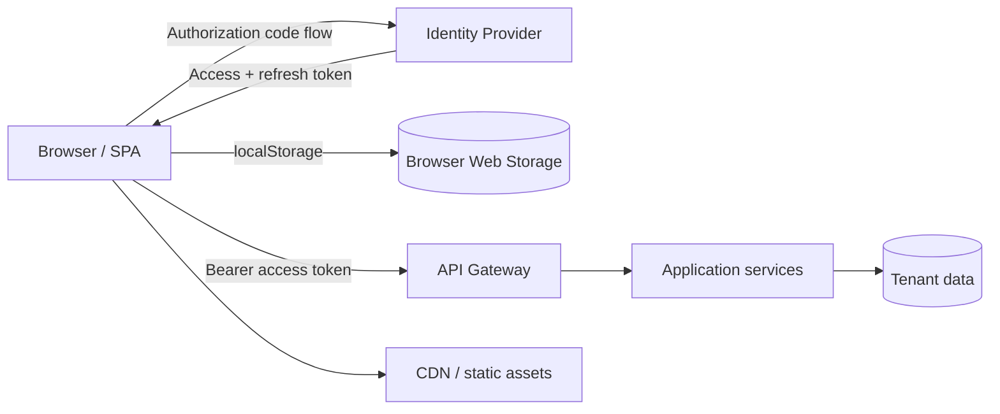
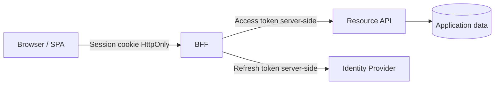

# Case token trong localStorage

## Mục tiêu case study

Case study này phân tích một sự cố giả lập trong ứng dụng SaaS dùng SPA: access token và refresh token được lưu trong `localStorage`. Một lỗ hổng XSS cho phép script chạy trong origin ứng dụng đọc token và gửi chúng ra ngoài. Người học sẽ lần theo chuỗi nguyên nhân, đánh giá phạm vi ảnh hưởng, chọn biện pháp containment, thiết kế lại kiến trúc xác thực và xây dựng regression test.

Sau khi hoàn thành, bạn có thể:

- Giải thích vì sao `localStorage` không phải kho an toàn cho bearer token.
- Phân tích cách XSS cùng origin đọc dữ liệu lưu trong Web Storage.
- Phân biệt việc xóa token ở browser với thu hồi token ở server.
- Điều tra dấu hiệu token bị sử dụng lại và xác định phạm vi session bị ảnh hưởng.
- So sánh BFF, HttpOnly cookie và access token lưu trong memory.
- Thiết kế CSRF protection khi chuyển sang cookie-based authentication.
- Đưa CSP, Trusted Types, dependency controls và monitoring vào defense in depth.
- Viết kiểm thử xác nhận token không còn được lưu lâu dài trong Web Storage.

## 1. Bối cảnh hệ thống

Một công ty cung cấp ứng dụng quản lý dự án dạng SaaS. Frontend là SPA được phân phối qua CDN tại `https://app.example.test`; API chạy tại `https://api.example.test`. Người dùng đăng nhập bằng OAuth/OIDC authorization code flow. Sau khi đăng nhập, frontend nhận access token và refresh token rồi lưu cả hai trong `localStorage` để giữ trạng thái đăng nhập qua reload và mở tab mới.

Kiến trúc trước sự cố:



Các quyết định ban đầu được đưa ra vì lý do tiện dụng:

- Token có thể được đọc sau reload mà không cần khôi phục session qua server.
- Nhiều tab có thể lấy token từ cùng `localStorage`.
- API dùng `Authorization: Bearer` nên nhóm phát triển cho rằng không cần CSRF token.
- Logout chỉ xóa hai key token trong `localStorage`.
- Access token có thời hạn 30 phút; refresh token có thời hạn 30 ngày và được dùng để cấp access token mới.
- SPA tải một thư viện analytics bên thứ ba và một số dependency từ pipeline frontend.

Ứng dụng dùng authorization code flow với PKCE cho public client. PKCE giúp bảo vệ authorization code trong quá trình đổi code, nhưng không bảo vệ access token hoặc refresh token sau khi chúng đã được cấp và đưa vào JavaScript/Web Storage. Một script XSS chạy trong origin vẫn có thể đọc token hiện có.

Kiến trúc này có một ranh giới tin cậy quan trọng: mọi JavaScript chạy trong origin `app.example.test` đều có thể đọc dữ liệu `localStorage` của origin đó. `localStorage` không có thuộc tính `HttpOnly`; browser không phân biệt script hợp lệ của ứng dụng với script độc hại đã chạy trong cùng origin.

## 2. Sự cố giả lập

### 2.1. Triệu chứng

Đội hỗ trợ nhận báo cáo rằng một quản trị viên dự án thấy một số file export được tải xuống mà họ không chủ động yêu cầu. Security monitoring phát hiện refresh token của tài khoản này được sử dụng từ một môi trường browser khác trong khoảng thời gian gần với lúc người dùng truy cập một trang có nội dung do người dùng khác tạo.

Điều tra ban đầu cho thấy:

- Tài khoản nạn nhân có quyền đọc và export dữ liệu trong một tenant.
- Một trường `projectDescription` được render bằng HTML mà không sanitize đúng cách.
- Payload được lưu trong database và xuất hiện lại khi quản trị viên mở trang dự án.
- Một script chạy trong page origin có thể đọc `localStorage`.
- Refresh token bị sử dụng để cấp access token mới sau khi nạn nhân rời trang.

Đây là tình huống giả lập dùng token và dữ liệu test. Không sử dụng token hoặc tài khoản thật để tái hiện.

### 2.2. Timeline

| Thời điểm | Sự kiện | Bằng chứng |
| --- | --- | --- |
| 09:02 | Người dùng mở trang dự án có mô tả được lưu từ trước. | Application log ghi route và request ID; không lưu nội dung mô tả thô. |
| 09:02:15 | Nội dung không tin cậy được đưa vào HTML sink. | Reproduction trong staging cho thấy markup được parse thành node. |
| 09:02:16 | Script chạy trong origin ứng dụng. | Browser test xác nhận sentinel script được thực thi. |
| 09:02:17 | Script đọc được các key token trong `localStorage`. | Test fixture chứng minh key/value cùng origin có thể được đọc. |
| 09:03 | Token bị sử dụng từ một client khác. | Identity provider ghi nhận refresh event và client metadata bất thường. |
| 09:05 | API nhận request export hợp lệ về mặt token. | API audit log có principal, scope, resource và request ID. |
| 09:14 | Người dùng báo cáo hoạt động lạ. | Support ticket và correlation ID. |
| 09:19 | Security on-call xác định khả năng token compromise. | Tương quan XSS report, refresh event và export audit. |
| 09:24 | Đội vận hành thu hồi refresh token family và session liên quan. | Identity provider xác nhận revoke; API từ chối refresh tiếp theo. |
| 09:31 | Route có nội dung bị ảnh hưởng được tạm thời chuyển sang render text. | Hotfix frontend/backend và kiểm thử staging. |
| 10:10 | Các session liên quan được đánh giá phạm vi ảnh hưởng. | Audit log, token family và export job được đối chiếu. |

Timeline minh họa cách nối sự kiện mà không ghi token thô. Thời điểm thực tế trong sự cố cần lấy từ log đồng bộ UTC và có thể khác nhau giữa browser, CDN, identity provider và API.

## 3. Chuỗi khai thác và nguyên nhân gốc

### 3.1. XSS mở đường vào origin

Ứng dụng lấy `projectDescription` từ API rồi chèn vào `innerHTML`. Nội dung do thành viên dự án tạo có thể chứa markup và event handler. Khi một người dùng có quyền mở trang, browser parse nội dung thành DOM và thực thi phần script/event handler nếu policy cho phép.

Ví dụ code lỗi ở mức khái niệm:

```js
// Không an toàn: dữ liệu do người dùng kiểm soát được parse thành HTML.
descriptionContainer.innerHTML = project.description;
```

Khi dữ liệu không tin cậy đi vào HTML sink, browser xử lý nó trong origin ứng dụng. XSS không cần vượt qua Same-Origin Policy: script đã chạy trong origin hợp lệ nên có thể tương tác với DOM và các API cùng origin.

### 3.2. Token trong localStorage bị đọc

Ứng dụng lưu token theo cách tương tự:

```js
// Thiết kế cũ, không phù hợp để lưu bearer token dài hạn.
localStorage.setItem("access_token", accessToken);
localStorage.setItem("refresh_token", refreshToken);
```

Script chạy cùng origin có thể gọi `localStorage.getItem()` với các key này. Không có thuộc tính Web Storage nào tương đương `HttpOnly` để ngăn JavaScript đọc token.

Trong case này, token là bearer credential: bên giữ token có thể sử dụng token trong phạm vi audience, scope và thời hạn được cấp. Nếu refresh token còn hiệu lực, attacker có thể tiếp tục xin access token mới sau khi access token ban đầu hết hạn.

Không cần một quyền browser đặc biệt để đọc `localStorage`. Isolated world của browser extension cũng không phải biện pháp bảo vệ cho website; script XSS trong page world đã ở đúng origin. CORS không ngăn script cùng origin đọc Web Storage.

### 3.3. Token bị dùng lại

Sau khi token bị lấy, request đến API có thể trông giống request hợp lệ:

```http
GET /api/projects/export HTTP/1.1
Host: api.example.test
Authorization: Bearer [redacted]
Accept: application/json
```

API kiểm tra chữ ký, expiry, audience và scope rồi chấp nhận. Nếu hệ thống chỉ dựa vào tính hợp lệ của bearer token, server không biết người gửi hiện tại là browser ban đầu hay một client khác đang giữ bản sao token.

Việc token được phát hành cho một SPA không tự động ràng buộc token với thiết bị. Nếu cần sender-constrained token, phải thiết kế cơ chế phù hợp như DPoP hoặc mTLS trong môi trường hỗ trợ; không thể đạt điều đó chỉ bằng cách đặt token trong một storage khác.

### 3.4. Nguyên nhân gốc và yếu tố góp phần

**Nguyên nhân trực tiếp:** dữ liệu do người dùng kiểm soát được đưa vào HTML sink không an toàn, dẫn đến XSS.

**Yếu tố làm tăng tác động:** access token và refresh token có thể đọc được từ `localStorage`, refresh token tồn tại lâu và không có cơ chế phát hiện/revoke token family đủ nhanh.

**Yếu tố góp phần:**

- CSP cho phép một số nguồn script rộng và không có Trusted Types enforcement.
- Không có regression test cho stored XSS trên trường mô tả dự án.
- Third-party script có quyền chạy trong page origin và được tải trên nhiều route.
- Logout chỉ xóa localStorage ở client, không thu hồi refresh token phía identity provider.
- Monitoring chưa tương quan XSS signal với refresh-token reuse và export action.
- API authorization kiểm tra scope nhưng không có xác nhận bổ sung cho export nhạy cảm.

Không nên kết luận “localStorage là nguyên nhân XSS”. XSS là lỗ hổng cho phép code không tin cậy chạy trong origin. `localStorage` làm token dễ bị lấy và tái sử dụng hơn, do đó khuếch đại tác động. Nếu token không nằm trong Web Storage, XSS vẫn có thể thực hiện hành động trong phiên hiện tại hoặc đọc dữ liệu mà page có quyền truy cập.

## 4. Tác động bảo mật

### 4.1. Tài khoản và dữ liệu

Nếu refresh token bị lộ, attacker có thể duy trì quyền truy cập lâu hơn thời hạn của access token. Tác động phụ thuộc:

- Scope và audience của token.
- Quyền của principal trong tenant.
- Thời hạn và rotation policy của refresh token.
- Khả năng revoke token/session.
- API có kiểm tra quyền trên từng resource hay chỉ kiểm tra role tổng quát.
- Các bước xác nhận bổ sung cho export, thanh toán hoặc thay đổi bảo mật.

Một token chỉ có `projects:read` không nên được dùng để export dữ liệu nhạy cảm nếu export cần scope riêng. Authorization phải được kiểm tra ở server cho từng action và resource.

### 4.2. Phạm vi ảnh hưởng

Đội ứng phó cần xác định:

- Những account đã mở route chứa payload trong khoảng thời gian có thể bị khai thác.
- Token family nào được refresh từ client bất thường.
- API request nào có dấu hiệu dùng token từ vị trí/browser không quen thuộc.
- File export hoặc dữ liệu nào đã được truy cập/tạo.
- Có tenant khác bị ảnh hưởng do payload được chia sẻ hoặc nội dung dùng chung không.
- Third-party script/dependency nào có mặt trên route bị ảnh hưởng.

Không dùng IP hoặc user-agent đơn lẻ để kết luận token bị đánh cắp. Người dùng có thể đổi mạng, dùng VPN hoặc cập nhật browser. Cần kết hợp token family, thời điểm, request pattern, action audit và tín hiệu người dùng.

### 4.3. Những điều không thể suy ra

- Không thể kết luận mọi người dùng mở trang đều bị lộ token nếu chưa có bằng chứng script thực thi và đọc storage.
- Không thể kết luận token đã bị sử dụng chỉ vì XSS tồn tại.
- Không thể coi việc không có refresh event bất thường là bằng chứng không có exfiltration.
- Không thể khẳng định xóa key khỏi localStorage thu hồi bản sao token attacker đã lấy.
- Không thể khẳng định HttpOnly cookie sẽ loại bỏ toàn bộ tác động của XSS.

## 5. Điều tra và thu thập bằng chứng

### 5.1. Bằng chứng phía browser

Trong staging hoặc profile tái hiện bằng dữ liệu giả, kiểm tra:

- Route và component render nội dung không tin cậy.
- Sink như `innerHTML`, `outerHTML`, `insertAdjacentHTML` hoặc template render thiếu escaping.
- Console CSP violation và request do script ngoài dự kiến khởi tạo.
- Network request bất thường đến domain không thuộc allowlist.
- Các key xác thực đang tồn tại trong localStorage/sessionStorage/IndexedDB.
- CSP, Trusted Types và security headers mà browser thực sự nhận.

Không yêu cầu người dùng production xuất toàn bộ localStorage, HAR hoặc heap snapshot. Các artifact này có thể chứa credential và dữ liệu cá nhân. Nếu cần thu thập, dùng tài khoản test hoặc quy trình forensic nội bộ có kiểm soát, redact dữ liệu trước khi chia sẻ.

### 5.2. Bằng chứng phía identity provider

Đối chiếu metadata an toàn:

- Token family hoặc grant identifier đã pseudonymize.
- Thời điểm refresh, revoke và reuse detection.
- Client ID, audience, scope và loại grant.
- Browser/device metadata ở mức cần thiết.
- IP/network signal đã được kiểm soát và retention phù hợp.
- Kết quả rotation và trạng thái token cũ sau khi token mới được cấp.

Không ghi access token hoặc refresh token vào log để điều tra. Nếu cần liên kết token cụ thể, dùng token ID hoặc fingerprint một chiều được thiết kế riêng, không dùng token thô.

### 5.3. Bằng chứng phía API và CDN

Đối chiếu:

- Request ID từ gateway đến application.
- Principal/tenant pseudonymous identifier.
- Route template, method, status, action class và resource class.
- Token validation result, scope và authorization decision.
- Export job ID, thời điểm tạo và kết quả download.
- CDN cache status và response policy của endpoint nhạy cảm.

API log nên ghi nhận action đã thực hiện, không ghi toàn bộ body hoặc Authorization header. Dữ liệu audit cần đủ để trả lời “ai đã làm gì, trên resource nào, lúc nào và quyết định authorization ra sao” mà không tạo thêm kho credential.

## 6. Containment trong sự cố

Mục tiêu đầu tiên là dừng việc phát hành credential mới và ngăn token đã lộ tiếp tục được sử dụng.

### 6.1. Thu hồi token và session

Thực hiện theo khả năng của identity provider:

1. Revoke refresh token family/grant liên quan.
2. Revoke session hoặc refresh token của các account có khả năng bị ảnh hưởng.
3. Nếu access token là JWT stateless, đánh giá TTL, introspection, denylist hoặc session-version check để xử lý token còn hiệu lực.
4. Thu hồi token của integration/client nếu phạm vi bị ảnh hưởng rộng.
5. Xác nhận token cũ không thể refresh hoặc gọi API sau khi revoke.
6. Yêu cầu đăng nhập lại sau khi nguyên nhân đã được xử lý.

Chỉ xóa `localStorage` không đủ. Attacker có thể đã sao chép token ra khỏi browser. Thu hồi phải xảy ra ở server/authorization server.

### 6.2. Chặn nguồn XSS

- Tạm thời render trường bị ảnh hưởng bằng `textContent` hoặc disable rich-text rendering.
- Nếu cần rich text, dùng sanitizer đã được review với allowlist element/attribute/protocol.
- Xóa hoặc quarantine nội dung payload đã lưu; không chỉ sửa một bản render.
- Tắt integration/script bên thứ ba có liên quan nếu có bằng chứng hoặc rủi ro cao.
- Deploy CSP enforcement phù hợp nếu policy đã được kiểm thử; tránh thêm `unsafe-inline` để giữ tính năng.
- Tìm cùng sink trong các route/component khác.

### 6.3. Bảo vệ dữ liệu và hành động đã xảy ra

- Kiểm tra export/download log và xác định dữ liệu đã truy cập.
- Thu hồi link download/signed URL còn hiệu lực nếu cần.
- Tạm dừng export nhạy cảm hoặc yêu cầu re-authentication/step-up authentication trong thời gian containment.
- Xử lý giao dịch hoặc thay đổi dữ liệu theo quy trình nghiệp vụ và pháp lý.
- Bảo toàn audit log và bằng chứng đã redact.

Không xóa log để “làm sạch” sự cố. Không purge dữ liệu điều tra trước khi bảo toàn bằng chứng cần thiết. Việc thông báo cho người dùng/đối tác thực hiện theo quy trình incident response của tổ chức.

## 7. Các phương án sửa kiến trúc xác thực

Không có một mô hình storage phù hợp cho mọi ứng dụng. Cần xét threat model, topology, yêu cầu SSO, API cross-origin, offline và mức độ nhạy cảm của dữ liệu.

### 7.1. Phương án A: Backend for Frontend (BFF)

BFF giữ access/refresh token ở server. Browser chỉ giữ session cookie opaque, được bảo vệ bằng `HttpOnly`, `Secure` và `SameSite` phù hợp. SPA gọi BFF cùng origin; BFF xác thực session rồi gọi API phía sau bằng token server-side.



Ưu điểm:

- Token OAuth không xuất hiện trong JavaScript hoặc Web Storage.
- Refresh token được giữ ở server và có thể quản lý rotation/revocation tập trung.
- Browser chỉ cần session cookie với scope hẹp.
- BFF có thể áp dụng authorization, rate limit và audit ở một điểm.
- Có thể giảm việc expose nhiều API origin trực tiếp cho SPA.

Đánh đổi:

- BFF cần quản lý session, scale, availability và server-side token storage.
- Cookie tự động gửi làm phát sinh yêu cầu CSRF protection.
- Cần thiết kế timeout, logout, session rotation và multi-tab behavior.
- Có thêm hop network và vận hành so với SPA gọi API trực tiếp.

Với ứng dụng web có dữ liệu nhạy cảm và backend do cùng tổ chức kiểm soát, BFF thường là lựa chọn mạnh để giữ OAuth token ngoài JavaScript.

### 7.2. Phương án B: HttpOnly cookie cho session/API

Nếu không dùng BFF riêng, backend có thể dùng cookie session hoặc cookie xác thực HttpOnly. Ví dụ:

```http
Set-Cookie: __Host-session=opaque-session-id; Path=/; Secure; HttpOnly; SameSite=Lax
Cache-Control: no-store
```

Ý nghĩa:

- `Secure`: browser chỉ gửi cookie qua HTTPS.
- `HttpOnly`: JavaScript không đọc cookie bằng `document.cookie`.
- `SameSite=Lax`: giảm việc gửi cookie trong nhiều cross-site context; cần đánh giá luồng login/SSO và navigation.
- `__Host-`: yêu cầu Secure, Path=/ và không có Domain attribute ở browser hỗ trợ prefix.
- Giá trị cookie nên là session identifier opaque, không nhúng dữ liệu nhạy cảm hoặc quyền có thể tự xác minh mà không cần server.

HttpOnly giảm khả năng đánh cắp cookie bằng JavaScript, nhưng XSS vẫn có thể thực hiện request cùng origin bằng cookie browser tự gửi và đọc response mà origin cho phép. Vì vậy, vẫn cần sửa XSS và áp dụng authorization.

Cookie-based auth cũng cần CSRF protection. Không dựa riêng vào `SameSite=Lax` cho mọi route và mọi luồng. Dùng CSRF token phù hợp, kiểm tra Origin/Fetch Metadata theo policy, không thay đổi trạng thái bằng GET và kiểm tra authorization ở server.

### 7.3. Phương án C: Access token chỉ ở memory

Một số SPA giữ access token ngắn hạn trong memory thay vì localStorage. Sau reload, ứng dụng phải lấy token mới qua một flow được bảo vệ, ví dụ BFF hoặc silent/session-based renewal phù hợp.

Ưu điểm:

- Token không tồn tại lâu dài trong Web Storage.
- Reload hoặc đóng tab làm mất bản copy trong memory tùy thiết kế.
- Giảm khả năng attacker đọc lại token từ storage sau khi người dùng rời trang.

Giới hạn:

- XSS đang chạy vẫn có thể đọc biến JavaScript nếu có cách truy cập hoặc gọi API thay mặt ứng dụng.
- Token có thể bị lấy khi đang ở memory.
- Đồng bộ nhiều tab và refresh cần thiết kế rõ.
- Không tự giải quyết CSRF nếu credential được chuyển sang cookie.

Memory storage là biện pháp giảm persistence của token, không phải ranh giới chống XSS. Không giữ refresh token dài hạn trong global object hoặc IndexedDB với giả định nó đã an toàn.

### 7.4. So sánh phương án

| Phương án | Token có thể đọc trực tiếp từ JavaScript? | Rủi ro CSRF | Điểm cần chú ý |
| --- | --- | --- | --- |
| Access + refresh token trong localStorage | Có | Thường thấp hơn nếu chỉ dùng Authorization header chủ động gắn, nhưng token dễ bị XSS lấy. | Persistence lâu, dễ exfiltrate và reuse. |
| Access token trong memory | Có thể, nếu script cùng origin truy cập được | Phụ thuộc credential được gửi thế nào. | Giảm persistence nhưng XSS runtime vẫn có thể lạm dụng. |
| HttpOnly session cookie | Không đọc được bằng JavaScript | Có, vì browser tự gửi cookie. | CSRF token, SameSite, Origin/Fetch Metadata và server authorization. |
| BFF + HttpOnly session cookie | OAuth token không có trong browser JavaScript | Có, cần CSRF protection cho BFF actions. | Tăng thành phần server nhưng giữ token phía server. |

Chọn phương án dựa trên kiến trúc và threat model. Với case này, đội chọn BFF vì ứng dụng có dữ liệu tenant nhạy cảm, không cần SPA giữ refresh token và backend nằm trong quyền kiểm soát của tổ chức.

## 8. Thiết kế CSRF sau khi chuyển sang cookie

Khi browser tự gửi session cookie, cần đảm bảo trang ngoài không thể ép browser thực hiện hành động thay đổi trạng thái.

Các lớp nên phối hợp:

- CSRF token gắn với session, được xác minh server-side.
- Kiểm tra `Origin` cho unsafe methods theo allowlist chính xác.
- Dùng Fetch Metadata như `Sec-Fetch-Site` để nhận diện cross-site request và áp policy theo route.
- Cookie `SameSite` phù hợp với luồng sản phẩm.
- Không dùng GET/HEAD cho thao tác thay đổi trạng thái.
- Authorization và validation dữ liệu ở server.
- CORS chỉ cấp origin cần thiết; không coi CORS là CSRF protection.

Ví dụ request từ SPA đến BFF cùng origin:

```js
await fetch("/bff/projects/123/export", {
  method: "POST",
  credentials: "same-origin",
  headers: {
    "Content-Type": "application/json",
    "X-CSRF-Token": csrfToken
  },
  body: JSON.stringify({ format: "csv" })
});
```

CSRF token trong ví dụ có thể được cấp qua bootstrap response hoặc cơ chế phù hợp với framework. Không đặt token vào URL. Token không thay authorization và không bảo vệ khỏi XSS cùng origin; script XSS có thể đọc token nếu ứng dụng expose nó cho JavaScript.

Nếu dùng synchronizer token, ràng buộc token với session và xác minh ở server. Nếu dùng signed double-submit cookie, bảo đảm token được ký/ràng buộc với session; không chấp nhận chỉ vì hai giá trị do client gửi giống nhau.

## 9. Phòng vệ XSS và giảm khả năng đánh cắp token

Việc chuyển token khỏi localStorage giảm impact nhưng không loại bỏ XSS. Case này cần sửa nguyên nhân trực tiếp và các lớp phòng vệ liên quan.

### 9.1. Safe DOM APIs

Nếu chỉ hiển thị văn bản:

```js
descriptionContainer.textContent = project.description;
```

Nếu sản phẩm cần rich text, dùng sanitizer được duy trì và cấu hình allowlist cho element, attribute và URL scheme. Không tự viết regex để lọc HTML. Cần kiểm thử cả SVG, MathML, event handler, URL protocol và nested markup theo parser/browser mục tiêu.

### 9.2. CSP nghiêm ngặt

Một CSP minh họa:

```http
Reporting-Endpoints: csp-endpoint="https://app.example.test/reports/csp"
Content-Security-Policy: default-src 'self'; script-src 'self' 'nonce-{per-response-random}'; object-src 'none'; base-uri 'self'; frame-ancestors 'none'; connect-src 'self' https://api.example.test; report-to csp-endpoint
```

Policy thực tế phải được thiết kế theo resource cần thiết. Nonce phải ngẫu nhiên, khó đoán và gắn với đúng response. Không cache shared HTML có nonce theo cách làm nonce bị tái sử dụng ngoài thiết kế. Bắt đầu bằng Report-Only khi rollout nếu cần, sau đó chuyển enforcing khi đã xử lý violation hợp lệ.

CSP là defense in depth. Nếu script độc hại chạy qua một nguồn được allowlist hoặc khai thác một gadget trong ứng dụng, CSP có thể không chặn được. Không dùng CSP thay safe DOM handling.

### 9.3. Trusted Types

Với browser hỗ trợ, `require-trusted-types-for 'script'` giúp các HTML injection sink yêu cầu TrustedHTML thay vì chuỗi tùy ý. Ứng dụng nên tạo policy hẹp, dùng sanitizer đã review và tránh policy mặc định cho phép mọi chuỗi.

Trusted Types không tự sanitize dữ liệu và không thay thế việc loại bỏ sink nguy hiểm. Cần test browser support và có fallback safe DOM API cho engine chưa hỗ trợ.

### 9.4. Third-party scripts và dependency

- Loại bỏ script bên thứ ba không cần trên route nhạy cảm.
- Tự host hoặc pin dependency khi phù hợp; review thay đổi version.
- Dùng Subresource Integrity cho tài nguyên CDN tĩnh khi kiến trúc hỗ trợ và nội dung bất biến.
- Giới hạn `script-src` theo nguồn cụ thể.
- Review quyền và dữ liệu mà analytics/tag manager thu thập.
- Có quy trình incident để disable vendor script nhanh.

SRI không phù hợp với mọi script động và không thay thế dependency review. Script được phép chạy trong origin vẫn có thể truy cập dữ liệu mà origin cho phép.

## 10. Refresh token rotation và reuse detection

Nếu kiến trúc vẫn sử dụng refresh token, cần giới hạn tác động của token bị sao chép:

- Dùng refresh token rotation: mỗi lần refresh cấp token mới và vô hiệu hóa token cũ theo policy.
- Phát hiện reuse token cũ và revoke token family/grant liên quan.
- Ràng buộc token với client, audience và scope phù hợp.
- Đặt expiry và inactivity timeout theo rủi ro.
- Có revoke endpoint/quy trình thu hồi session khi có incident.
- Theo dõi refresh bất thường mà không log token thô.
- Cân nhắc sender-constrained token khi client/server hỗ trợ và threat model yêu cầu.

Rotation không làm token theft trở nên vô hại. Attacker có thể dùng token mới trước người dùng và gây reuse signal; hệ thống phải xử lý race, đồng bộ tab và false positive. Nếu BFF giữ refresh token server-side, browser không cần nhận token này.

## 11. Kế hoạch khắc phục theo giai đoạn

### Giai đoạn 1: Containment

- Revoke token family và session có khả năng bị lộ.
- Chuyển nội dung bị ảnh hưởng sang render text hoặc sanitizer đã được kiểm chứng.
- Tắt script/integration có dấu hiệu liên quan.
- Tạm giới hạn export nhạy cảm hoặc yêu cầu step-up authentication khi cần.
- Xác minh token cũ không còn refresh được.

### Giai đoạn 2: Loại bỏ token khỏi Web Storage

- Triển khai BFF hoặc cookie session HttpOnly theo thiết kế được duyệt.
- Chuyển refresh token về server-side storage.
- Xóa logic đọc/ghi `access_token` và `refresh_token` từ localStorage.
- Xử lý migration: session cũ bị revoke, người dùng đăng nhập lại.
- Dọn các key cũ khỏi localStorage/sessionStorage/IndexedDB theo schema migration.
- Kiểm tra nhiều tab và account switching.

Không chỉ thêm code xóa key rồi giữ nguyên flow phát hành token. Nếu frontend vẫn nhận token và lưu lại sau lần refresh tiếp theo, sự cố sẽ tái diễn.

### Giai đoạn 3: XSS defense in depth

- Sửa mọi HTML sink trong luồng dữ liệu không tin cậy.
- Thêm CSP enforcing với nonce/hash phù hợp.
- Bật Trusted Types nơi hỗ trợ và xử lý các sink còn lại.
- Giảm third-party script và kiểm soát dependency.
- Bổ sung sanitizer regression test cho rich text.

### Giai đoạn 4: Session và authorization hardening

- Rotate session ID sau login và privilege change.
- Revoke server session khi logout, password reset hoặc account compromise.
- Đặt TTL, refresh rotation và reuse detection.
- Kiểm tra scope/audience và object-level authorization.
- Thêm CSRF protection cho cookie-authenticated unsafe methods.
- Dùng `Cache-Control: no-store` và CDN bypass cho response cá nhân.

### Giai đoạn 5: Monitoring và vận hành

- Cảnh báo XSS/CSP violation tăng đột biến.
- Theo dõi refresh reuse, token family revoke và session anomaly.
- Tương quan request ID giữa identity provider, BFF, API và export service.
- Đảm bảo log không chứa token, cookie, CSRF token hoặc response body nhạy cảm.
- Diễn tập revoke token và rollback edge/frontend config.

## 12. Regression test

Regression suite phải chứng minh token không còn được lưu trong Web Storage, XSS không thực thi và session mới có thể bị revoke.

### 12.1. Không lưu token trong localStorage/sessionStorage

Ví dụ Playwright kiểm tra key theo convention:

```ts
import { test, expect } from "@playwright/test";

test("authentication tokens are not stored in Web Storage", async ({ page }) => {
  await page.goto("https://app.example.test/login");
  await page.getByLabel("Username").fill("case-test-user");
  await page.getByLabel("Password").fill("test-password");
  await page.getByRole("button", { name: "Sign in" }).click();

  const storageKeys = await page.evaluate(() => ({
    local: Array.from({ length: localStorage.length }, (_, i) => localStorage.key(i)),
    session: Array.from({ length: sessionStorage.length }, (_, i) => sessionStorage.key(i))
  }));

  const keys = [...storageKeys.local, ...storageKeys.session]
    .filter((key): key is string => typeof key === "string")
    .map((key) => key.toLowerCase());

  expect(keys).not.toContain("access_token");
  expect(keys).not.toContain("refresh_token");
});
```

Đây là test theo tên key đã biết, không phải bằng chứng tuyệt đối không có credential. Cần rà cả code ghi storage, IndexedDB, Cache Storage và network response. Không log giá trị storage trong CI.

### 12.2. XSS payload không thực thi

```ts
test("stored project description is rendered as text", async ({ page }) => {
  await page.addInitScript(() => {
    (window as any).__xssMarker = false;
  });

  await page.goto("https://app.example.test/projects/test-project");
  const payload = '';

  await page.getByLabel("Project description").fill(payload);
  await page.getByRole("button", { name: "Save description" }).click();
  await page.reload();

  const description = page.getByTestId("project-description");
  await expect(description).toHaveText(payload);
  await expect(description.locator("img")).toHaveCount(0);
  expect(await page.evaluate(() => (window as any).__xssMarker)).toBe(false);
});
```

Nếu ứng dụng hỗ trợ rich text, expected DOM cần phản ánh allowlist đã thiết kế; không ép mọi markup thành text khi đó không phải yêu cầu sản phẩm. Test phải chứng minh event handler và URL nguy hiểm bị loại bỏ.

### 12.3. Cookie session có thuộc tính phù hợp

```ts
test("BFF session cookie is HttpOnly and Secure", async ({ page, context }) => {
  await page.goto("https://app.example.test/login");
  await page.getByLabel("Username").fill("case-test-user");
  await page.getByLabel("Password").fill("test-password");
  await page.getByRole("button", { name: "Sign in" }).click();

  const cookies = await context.cookies("https://app.example.test");
  const session = cookies.find((cookie) => cookie.name === "__Host-session");

  expect(session).toBeDefined();
  expect(session?.httpOnly).toBe(true);
  expect(session?.secure).toBe(true);
  expect(session?.path).toBe("/");
  expect(session?.sameSite).toBe("Lax");

  const visibleCookies = await page.evaluate(() => document.cookie);
  expect(visibleCookies).not.toContain("__Host-session=");
});
```

Không in giá trị cookie ra report. `SameSite` phải phù hợp với luồng sản phẩm; nếu dùng `None`, cần `Secure` và kiểm thử cross-site behavior riêng.

### 12.4. Logout thu hồi session phía server

Test cần:

1. Đăng nhập user test và ghi nhận session fixture ID ở test backend, không log cookie.
2. Gọi logout.
3. Gửi request tiếp theo bằng context cũ.
4. Xác nhận BFF/API trả 401 hoặc điều hướng đến login theo contract.
5. Xác nhận refresh token/session server-side đã bị revoke.
6. Đăng nhập user khác trong cùng profile và xác nhận không thấy dữ liệu user trước.

Chỉ kiểm tra cookie biến mất không chứng minh session đã bị revoke. Dùng test endpoint hoặc assertion ở identity/session store để xác nhận server state.

### 12.5. Test matrix

| Kịch bản | Kết quả mong đợi |
| --- | --- |
| Stored XSS ở project description | Payload hiển thị theo policy, không thực thi script/event handler. |
| Token storage inspection | Không có access/refresh token trong localStorage/sessionStorage. |
| IndexedDB/Cache Storage review | Không lưu credential hoặc response cá nhân ngoài thiết kế. |
| Cookie metadata | Session cookie có `HttpOnly`, `Secure`, Path/Domain và SameSite đúng. |
| CSRF form từ attacker origin | Request thay đổi trạng thái bị từ chối, state không đổi. |
| Same-origin request thiếu CSRF token | Bị từ chối theo contract. |
| Logout | Cookie hết hạn và session/token bị revoke ở server. |
| Refresh token reuse | Token cũ bị từ chối; token family xử lý theo policy. |
| Account switching | User B không thấy cache/storage/state riêng tư của user A. |
| CSP | Script không được cấp nonce/hash bị chặn. |
| Trusted Types | Raw string bị chặn ở sink được bảo vệ trên browser hỗ trợ. |
| CDN/cache | Response cá nhân không được shared-cache lưu hoặc phục vụ lại. |
| Monitoring | Có correlation ID và action audit; không có credential trong log. |

## 13. Bài học rút ra

1. `localStorage` là vùng lưu trữ tiện dụng theo origin, không phải vault cho bearer token. JavaScript cùng origin có thể đọc dữ liệu trong đó.
2. XSS và token storage là hai vấn đề liên quan nhưng khác nhau. Sửa storage giảm khả năng đánh cắp token; sửa XSS mới loại bỏ nguyên nhân cho phép script không tin cậy chạy.
3. Xóa token ở browser không thu hồi bản copy đã bị exfiltrate. Token/session phải được revoke ở server hoặc authorization server.
4. HttpOnly cookie giảm việc JavaScript đọc credential, nhưng XSS vẫn có thể thực hiện hành động bằng session browser. Cần XSS defense và authorization.
5. Cookie-based authentication cần CSRF protection. Không dùng CORS hoặc SameSite như lớp duy nhất.
6. BFF giúp giữ OAuth token ở server và giảm credential exposure trong browser, đổi lại cần quản lý session và CSRF.
7. Refresh token rotation, reuse detection, scope/audience hẹp và revoke path giảm thời gian attacker có thể duy trì truy cập.
8. CSP và Trusted Types là defense in depth; chúng không thay safe DOM API, sanitizer và dependency review.
9. Monitoring phải nối XSS signal, token lifecycle và sensitive action bằng request/correlation ID, đồng thời không ghi credential.
10. Regression test cần xác minh hành vi browser và server, không chỉ kiểm tra source code hoặc key storage đã biến mất.

## 14. Câu hỏi thảo luận

1. Vì sao việc đặt access token trong `localStorage` làm tăng tác động của XSS?
2. Nếu chỉ access token bị lấy nhưng refresh token không bị lộ, attacker có thể làm gì trong giới hạn TTL và scope?
3. Nếu chuyển sang HttpOnly cookie nhưng vẫn còn XSS, những hành động nào attacker vẫn có thể thực hiện?
4. Vì sao CORS không phải biện pháp chống CSRF?
5. Khi chuyển từ Bearer token trong Authorization header sang cookie session, những test nào phải được bổ sung?
6. Tại sao xóa `localStorage` sau incident không đủ để kết thúc containment?
7. Khi nào BFF là lựa chọn hợp lý hơn SPA giữ access token trong memory?
8. Làm sao phân biệt token refresh hợp lệ từ VPN/mobile network với token bị replay?
9. CSP nonce có thể bị suy yếu thế nào nếu CDN cache HTML và header không đúng cách?
10. Những log nào đủ để điều tra mà không cần lưu token, cookie hoặc response body?

Hoàn thành case study khi bạn có thể giải thích chuỗi XSS → đọc token từ Web Storage → token reuse → truy cập API; xác định được biện pháp containment ở server; đề xuất kiến trúc giảm credential exposure; và đưa ra test chứng minh XSS, CSRF, logout, token revocation cùng cache isolation được xử lý đúng.
