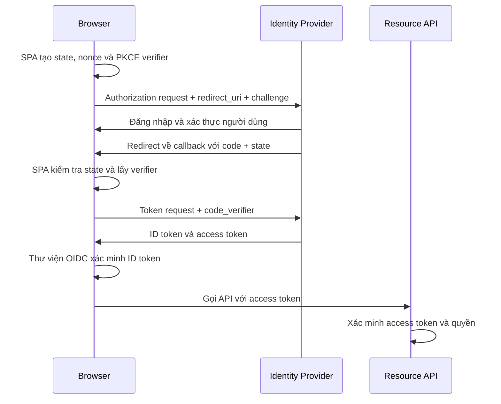
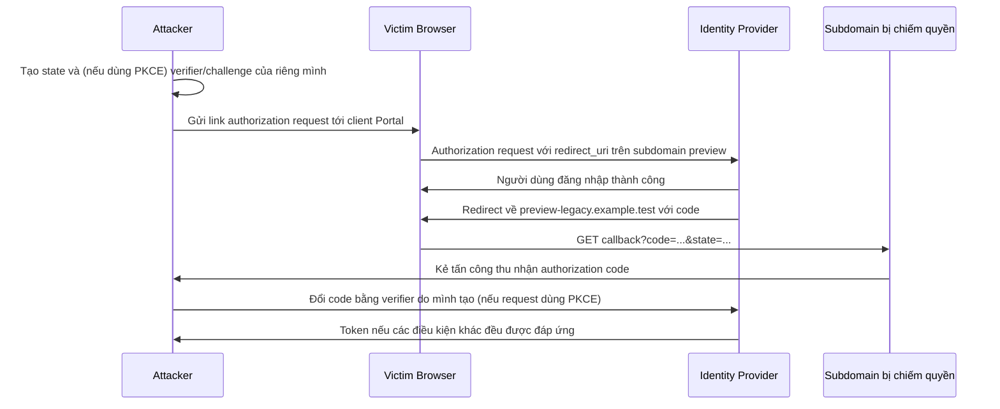

# Case study: OAuth redirect URI cấu hình sai

Một ứng dụng web dùng đăng nhập một lần (SSO) qua OAuth 2.0 và OpenID Connect (OIDC). Sau khi đội vận hành đổi domain, người dùng bắt đầu gặp lỗi `invalid_redirect_uri`. Để khôi phục đăng nhập nhanh, nhóm cấu hình IdP cho phép callback bằng wildcard trên toàn bộ subdomain. Một subdomain preview cũ vẫn trỏ tới dịch vụ hosting đã bị bỏ, và kẻ tấn công có thể đăng ký lại dịch vụ đó.

Vì ứng dụng là public client, chưa bắt buộc PKCE và IdP chấp nhận callback wildcard, kẻ tấn công có thể đưa browser của nạn nhân qua luồng đăng nhập hợp lệ rồi nhận authorization code tại subdomain do mình kiểm soát. Code có thể được đổi lấy token nếu không có cơ chế ràng buộc bổ sung. Đây là sự cố bắt nguồn từ một redirect URI được tin cậy quá rộng, kết hợp với quy trình quản lý subdomain và cấu hình client chưa an toàn.

Case study này phân tích diễn biến, ranh giới tin cậy bị phá vỡ, nguyên nhân gốc, cách khắc phục và các phép kiểm thử cần có để tránh tái diễn. Trọng tâm là kiểm soát redirect trong OIDC/OAuth, bảo vệ authorization code và xử lý điều hướng trong trình duyệt.

## 1. Bối cảnh hệ thống

Ứng dụng Portal phục vụ khách hàng tại `https://portal.example.test`. IdP chạy tại `https://id.example.test`. Portal là SPA public client, gọi API riêng để đọc hồ sơ và đơn hàng.

Trước đợt thay đổi domain, callback được đăng ký là:

```text
https://portal-old.example.test/oidc/callback
```

Sau khi chuyển sang domain mới, nhóm cập nhật frontend và DNS nhưng bỏ sót cấu hình redirect URI trong IdP. Người dùng đăng nhập bị trả về trang lỗi `invalid_redirect_uri` vì authorization request gửi `redirect_uri` mới chưa nằm trong danh sách được phép.

Để khắc phục nóng, cấu hình client bị đổi thành:

```text
https://*.example.test/oidc/callback
```

Quy tắc này cho phép mọi subdomain phù hợp với mẫu. Trong khi đó, `preview-legacy.example.test` là hostname cũ có CNAME tới một dịch vụ hosting đã bị xóa project. Một người ngoài có thể đăng ký lại project tương ứng và kiểm soát nội dung được phục vụ tại hostname đó.

Một số đặc điểm quan trọng của hệ thống tại thời điểm xảy ra sự cố:

| Thành phần | Trạng thái trước khi sửa |
|---|---|
| Client type | SPA public client |
| OAuth flow | Authorization Code |
| PKCE | Chưa bắt buộc ở IdP/client |
| Redirect URI | Wildcard cho mọi subdomain |
| Subdomain cũ | DNS còn trỏ tới dịch vụ hosting không còn project |
| State | Có gửi trong authorization request nhưng callback hợp lệ chỉ được kiểm tra ở Portal |
| ID token | Được xử lý ở Portal sau callback |
| Token storage | Access token được giữ trong JavaScript runtime |

OAuth Authorization Code là lựa chọn phù hợp cho SPA khi dùng PKCE. Tuy nhiên, chỉ chọn code flow chưa đủ; redirect URI phải được ràng buộc chính xác và public client cần dùng PKCE.

## 2. Diễn biến sự cố

### 2.1. Timeline

| Thời điểm | Sự kiện | Tác động |
|---|---|---|
| T-30 ngày | Portal bắt đầu chuyển sang domain mới | Callback cũ vẫn còn trong IdP |
| T-1 ngày | DNS và frontend được cập nhật | Authorization request dùng callback mới |
| T+0 | Người dùng nhận `invalid_redirect_uri` | Luồng đăng nhập bị gián đoạn |
| T+15 phút | Nhóm vận hành thêm wildcard callback để khôi phục dịch vụ | IdP bắt đầu tin cậy mọi subdomain khớp mẫu |
| T+2 ngày | Subdomain preview cũ được phát hiện có thể bị chiếm quyền | Xuất hiện callback nằm ngoài quyền kiểm soát của Portal |
| T+2 ngày | Nhóm bảo mật tái hiện việc IdP chuyển authorization code tới subdomain không tin cậy | Xác nhận nguy cơ lộ code |
| T+2 ngày | Wildcard bị gỡ, callback chính xác được đăng ký và PKCE S256 được bắt buộc | Redirect URI sai bị từ chối; PKCE bổ sung bảo vệ code của giao dịch hợp lệ |
| T+3 ngày | Kiểm tra toàn bộ callback, DNS và log xác thực | Xác nhận cấu hình mới và rà soát dấu hiệu lạm dụng |

### 2.2. Luồng đăng nhập bình thường



Điểm quan trọng: authorization code được gửi qua browser tới `redirect_uri`. Vì thế, IdP phải chắc chắn callback là endpoint đã đăng ký chính xác cho client. Browser không tự biết subdomain nào thuộc quyền kiểm soát của tổ chức; việc quyết định endpoint được tin cậy nằm ở cấu hình và validation của authorization server.

### 2.3. Luồng bị khai thác

Kẻ tấn công kiểm soát `preview-legacy.example.test` sau khi chiếm lại project hosting cũ. Vì IdP chấp nhận wildcard, authorization request có thể chỉ định callback trên hostname này.



Đây là luồng minh họa trong môi trường giả định. Tại thời điểm sự cố, client chưa bắt buộc PKCE nên code có thể được đổi mà không cần verifier. Ngay cả khi IdP yêu cầu PKCE, attacker vẫn có thể tự tạo challenge cho authorization request do mình khởi tạo; vì vậy wildcard callback vẫn cho phép code đi tới endpoint không tin cậy. Điều kiện quyết định là IdP chấp nhận redirect URI sai cho client.

### 2.4. Vì sao state chưa ngăn được sự cố?

`state` được tạo bởi Portal để ràng buộc callback với giao dịch đăng nhập mà Portal khởi tạo. Nhưng authorization response đã được gửi tới hostname của kẻ tấn công, nơi Portal không chạy và không thực hiện kiểm tra state. Kẻ tấn công nhận được code trước khi callback hợp lệ của Portal có cơ hội xác minh giao dịch.

State bảo vệ callback khi response quay về đúng RP và RP kiểm tra giá trị đó. State không sửa được một redirect URI sai mà authorization server đã chấp nhận.

### 2.5. Vì sao PKCE không cứu được redirect URI sai?

PKCE S256 bảo vệ authorization code khi kẻ tấn công chặn code của một giao dịch do client hợp lệ khởi tạo nhưng không biết `code_verifier` của giao dịch đó. Tuy nhiên, trong case study này, kẻ tấn công có thể tự tạo authorization request, tự chọn `code_verifier`, tính `code_challenge`, rồi đặt `redirect_uri` tới subdomain mà mình kiểm soát.

Khi nạn nhân mở link và đăng nhập tại IdP, authorization code được cấp cho client Portal nhưng trả về callback của kẻ tấn công. Vì kẻ tấn công đã tạo verifier tương ứng với challenge trong request, họ có thể đổi code nếu IdP cho phép public client dùng flow đó. `state` và `nonce` trong request cũng do kẻ tấn công tạo; callback Portal không được gọi nên Portal không có cơ hội kiểm tra state của giao dịch này.

Do đó, PKCE là biện pháp bắt buộc và rất quan trọng cho public client, nhưng không thay thế exact redirect URI validation. Trong kịch bản attacker-controlled authorization request, PKCE một mình không ngăn việc code được cấp tới callback sai. Biện pháp gốc vẫn là authorization server chỉ chấp nhận redirect URI đã đăng ký chính xác cho client, đồng thời ứng dụng kiểm tra state/nonce trong callback hợp lệ.

PKCE vẫn bảo vệ một tình huống khác: nếu kẻ tấn công chỉ chặn authorization code của giao dịch do Portal khởi tạo, họ không thể đổi code nếu không có verifier của Portal. Hai tình huống này cần được phân biệt khi đánh giá tác động.

## 3. Phân tích nguyên nhân gốc

Sự cố không đến từ một lỗi đơn lẻ. Các điều kiện sau kết hợp với nhau tạo thành đường tấn công.

| Nguyên nhân | Bằng chứng trong tình huống | Hệ quả |
|---|---|---|
| Redirect URI wildcard | IdP chấp nhận `https://*.example.test/oidc/callback` | Subdomain ngoài dự kiến được coi là callback hợp lệ |
| Subdomain không được quản lý | DNS còn CNAME tới dịch vụ hosting đã bị xóa project | Kẻ ngoài có thể chiếm hostname thuộc domain tổ chức |
| PKCE không bắt buộc | Public client không gửi hoặc IdP không yêu cầu verifier | Authorization code bị chặn có thể đổi thành token |
| Thay đổi nóng thiếu review | Wildcard được thêm để chữa lỗi đăng nhập | Mở rộng phạm vi tin cậy mà không đánh giá threat model |
| Inventory redirect thiếu | Không có danh sách callback theo client/môi trường | Callback cũ và hostname preview không được phát hiện |
| Kiểm thử chỉ theo happy path | Chỉ kiểm tra đăng nhập thành công trên domain chính | Không phát hiện IdP chấp nhận redirect ngoài danh sách chính xác |

### 3.1. Lỗi cấu hình và lỗi ứng dụng

Có hai lớp redirect cần phân biệt:

1. **OAuth `redirect_uri`:** URL authorization server dùng để trả authorization response về client. Authorization server phải xác minh URL này theo danh sách đã đăng ký cho đúng client.
2. **Return URL sau đăng nhập:** đường dẫn ứng dụng dùng để đưa người dùng tới trang đích sau khi callback đã được xử lý. Ứng dụng phải kiểm soát giá trị này riêng, không cho URL tùy ý điều khiển `Location`.

Một hệ thống có thể cấu hình OAuth `redirect_uri` chính xác nhưng vẫn có open redirect trong ứng dụng. Ngược lại, ứng dụng không có open redirect nhưng IdP chấp nhận wildcard callback thì authorization code vẫn có thể được gửi tới một endpoint không tin cậy.

### 3.2. Vì sao kiểm tra chuỗi đơn giản không đủ?

Các cách kiểm tra như `startsWith("https://portal.example.test")`, `endsWith("example.test")` hoặc tìm chuỗi domain trong URL đều có thể sai do userinfo, hostname gần giống, port, scheme, path normalization hoặc URL encoding.

Ví dụ các URL có vẻ gần giống nhưng không cùng origin:

```text
https://portal.example.test.attacker.example/oidc/callback
https://portal.example.test@attacker.example/oidc/callback
http://portal.example.test/oidc/callback
https://portal.example.test:8443/oidc/callback
```

Với web client, cách an toàn là đăng ký và so khớp chính xác redirect URI đã được cấu hình, bao gồm scheme, host, port, path và các thành phần được giao thức cho phép. Không dùng wildcard cho callback web thông thường. Các ngoại lệ có quy tắc riêng, chẳng hạn loopback redirect URI cho native app, không nên được áp dụng nhầm cho SPA hoặc web server.

## 4. Tác động tới người dùng và hệ thống

Nếu authorization code bị đánh cắp và đổi được thành token, kẻ tấn công có thể nhận danh tính hoặc quyền truy cập được cấp cho nạn nhân theo client, scope, audience và chính sách IdP. Tác động cụ thể phụ thuộc vào token lifetime, scope, API authorization và khả năng thu hồi phiên.

Các rủi ro gồm:

- Chiếm phiên hoặc truy cập dữ liệu trong phạm vi access token.
- Lộ thông tin profile nếu scope `openid profile email` được cấp và token/userinfo cho phép.
- Truy cập API nếu access token có audience và scope phù hợp.
- Login CSRF hoặc account confusion nếu ứng dụng không ràng buộc giao dịch với browser session.
- Phishing khi người dùng bị điều hướng tới hostname nhìn có vẻ thuộc domain tổ chức.
- Lộ code trong browser history, proxy log, access log hoặc hệ thống analytics nếu callback xử lý không đúng.

Không kết luận rằng mọi code bị lộ đều dẫn tới account takeover. Với confidential client, client authentication có thể ngăn bên thứ ba đổi code; với public client, PKCE là cơ chế ràng buộc quan trọng. Tuy nhiên, việc đưa authorization response tới origin không tin cậy vẫn là một vi phạm bảo mật cần xử lý.

## 5. Khắc phục ngay trong sự cố

Đội ứng phó cần chặn đường tấn công trước, sau đó mới hoàn thiện quy trình quản lý callback.

### 5.1. Thu hẹp redirect URI tại IdP

Gỡ wildcard và đăng ký đúng callback production:

```text
https://portal.example.test/oidc/callback
```

Nếu có staging, đăng ký callback staging riêng trên client hoặc tenant phù hợp:

```text
https://portal-staging.example.test/oidc/callback
```

Không dùng một wildcard chung cho production, staging, preview và môi trường developer. Mỗi môi trường cần client ID và redirect URI được quản lý riêng nếu có thể.

### 5.2. Bắt buộc PKCE S256

Đối với SPA/public client, yêu cầu Authorization Code + PKCE với `code_challenge_method=S256`. Không chấp nhận flow không có PKCE cho client này. `code_verifier` phải được tạo ngẫu nhiên cho từng giao dịch và giữ trong phạm vi phiên client đã khởi tạo; không ghi verifier vào log hoặc URL.

PKCE không thay thế state, nonce hay redirect URI validation. Cả ba cơ chế phải được kiểm tra độc lập.

### 5.3. Xử lý subdomain cũ

- Gỡ DNS record/CNAME không còn cần thiết.
- Kiểm kê toàn bộ subdomain và dịch vụ hosting được liên kết.
- Xóa callback, redirect, CORS allowlist và certificate mapping không còn dùng.
- Theo dõi Certificate Transparency, DNS change và domain ownership theo quy trình tổ chức.
- Có owner cho từng subdomain và quy trình decommission gồm xóa dịch vụ trước hoặc đồng thời với DNS.

Chỉ xóa DNS không phải lúc nào cũng đủ nếu một dịch vụ khác vẫn có thể được claim qua hostname cũ. Cần xác minh trạng thái nhà cung cấp và ownership trước khi đóng finding.

### 5.4. Kiểm tra token và phiên có khả năng bị ảnh hưởng

Rà soát authorization log, token endpoint log, callback access log và sự kiện đăng nhập bất thường trong cửa sổ thời gian wildcard có hiệu lực. Không tìm kiếm bằng cách in hoặc sao chép token ra báo cáo. Dùng client ID, redirect URI, thời điểm, request ID và fingerprint đã làm sạch.

Nếu có bằng chứng code/token bị lộ hoặc không thể loại trừ khả năng lạm dụng:

1. Vô hiệu hóa client configuration hoặc callback wildcard ngay.
2. Xoay client credential nếu client có secret và có dấu hiệu bị lộ.
3. Thu hồi refresh token/session liên quan theo khả năng IdP.
4. Buộc đăng nhập lại với nhóm tài khoản bị ảnh hưởng nếu đánh giá rủi ro yêu cầu.
5. Kiểm tra API audit log để tìm truy cập ngoài dự kiến.
6. Thông báo theo quy trình ứng phó và lưu bằng chứng đã loại bỏ token/PII.

Authorization code thường ngắn hạn và dùng một lần, nhưng không nên chỉ chờ code hết hạn nếu có khả năng refresh token hoặc phiên đã được cấp.

## 6. Thiết kế redirect an toàn

### 6.1. Allowlist redirect URI chính xác

Authorization server phải lưu tập redirect URI đã đăng ký cho từng client. Khi nhận authorization request, server so khớp URI theo quy tắc giao thức và từ chối nếu không khớp. Không tự động chuẩn hóa hoặc sửa URL theo cách làm thay đổi đích tin cậy.

Pseudocode tại authorization server:

```javascript
const registeredRedirectUris = new Set([
  "https://portal.example.test/oidc/callback"
]);

function validateRedirectUri(client, redirectUri) {
  const allowed = new Set(client.registeredRedirectUris);

  if (typeof redirectUri !== "string" || !allowed.has(redirectUri)) {
    throw new Error("invalid_redirect_uri");
  }

  return redirectUri;
}
```

Đoạn mã minh họa nguyên tắc so khớp chính xác ở authorization server; production nên dùng authorization server đã được kiểm chứng thay vì tự xây giao thức OAuth. Danh sách URI phải được quản lý theo client, môi trường và owner.

### 6.2. Không chuyển hướng tùy ý sau callback

Callback cần xử lý authorization response trước khi điều hướng người dùng. Không lấy `returnUrl`, `next`, `continue` hoặc `redirect` từ query string rồi đưa trực tiếp vào `Location`.

Ví dụ không an toàn:

```javascript
app.get("/oidc/callback", async (req, res) => {
  // Sai: URL ngoài có thể nhận code/state trước khi RP xác minh.
  res.redirect(req.query.returnUrl);
});
```

Ví dụ an toàn hơn dùng route key đã allowlist trong giao dịch server-side:

```javascript
const returnRoutes = {
  dashboard: "/dashboard",
  orders: "/orders",
  profile: "/profile"
};

app.get("/oidc/callback", async (req, res, next) => {
  try {
    const transaction = await loadPendingLogin(req);
    if (!transaction) return res.status(400).send("Invalid login transaction");

    if (typeof req.query.state !== "string" ||
        !constantTimeEqual(req.query.state, transaction.state)) {
      return res.status(400).send("Invalid state");
    }

    if (typeof req.query.code !== "string") {
      return res.status(400).send("Missing authorization code");
    }

    const tokens = await exchangeCode({
      code: req.query.code,
      redirectUri: "https://portal.example.test/oidc/callback",
      codeVerifier: transaction.codeVerifier
    });

    const identity = await validateIdToken(tokens.id_token, {
      issuer: transaction.issuer,
      audience: transaction.clientId,
      nonce: transaction.nonce
    });

    await createRotatedApplicationSession(req, res, identity, tokens);
    await consumePendingLogin(transaction.id);

    const destination = returnRoutes[transaction.returnRoute] ?? "/";
    res.set("Cache-Control", "no-store");
    res.set("Referrer-Policy", "no-referrer");
    return res.redirect(303, destination);
  } catch (error) {
    return next(error);
  }
});
```

Đây là pseudocode cho callback phía server/BFF để minh họa thứ tự kiểm tra. Trong SPA thuần, code exchange có thể diễn ra trong browser với PKCE; khi đó verifier phải được giữ trong giao dịch client và callback vẫn phải kiểm tra state/nonce trước khi chấp nhận kết quả. Hàm `exchangeCode` và `validateIdToken` phải dùng thư viện OIDC đã được kiểm chứng, xử lý lỗi và kiểm tra claim đầy đủ. Với OIDC response mode `form_post`, callback dùng POST và phải có route/middleware tương ứng. Không triển khai bằng cách tự viết phần xác minh chữ ký JWT.

### 6.3. Giữ callback sạch và không rò rỉ code

Authorization code có thể xuất hiện trong query string callback khi dùng response mode `query`. Callback nên:

- Xác minh state và giao dịch trước khi xử lý.
- Đổi code ngay qua back-channel TLS, với redirect URI giống chính xác giá trị trong authorization request.
- Không tải analytics, quảng cáo hoặc tài nguyên bên thứ ba trước khi loại bỏ code khỏi URL.
- Không ghi query callback vào access log, APM, error report hoặc analytics.
- Trả `Cache-Control: no-store` và `Referrer-Policy: no-referrer` phù hợp cho callback response.
- Chuyển browser tới URL nội bộ đã allowlist sau khi hoàn tất xử lý.

Không dùng fragment hoặc query parameter làm nơi lưu access token để chia sẻ giữa các trang. Không gửi code hoặc token qua `window.postMessage` nếu không có origin validation chặt chẽ và thiết kế cần thiết.

## 7. Các cơ chế phải phối hợp

Redirect URI chính xác là một lớp bảo vệ. Một luồng OIDC an toàn cần nhiều cơ chế phối hợp:

| Cơ chế | Bảo vệ | Không thay thế |
|---|---|---|
| Exact redirect URI | Giới hạn nơi authorization response được gửi tới | State, PKCE, token validation |
| `state` | Ràng buộc callback với giao dịch RP khởi tạo, giảm login CSRF | PKCE hoặc redirect allowlist |
| PKCE S256 | Ràng buộc code với verifier của client | Redirect URI validation, state, nonce |
| `nonce` | Liên kết ID token với request OIDC và phát hiện token replay/mix-up | State và chữ ký token |
| ID token validation | Xác minh issuer, audience, thời hạn, chữ ký và claim | API authorization |
| Access token validation | Giới hạn API theo audience, scope và quyền | Xác thực callback RP |
| Cookie/session policy | Bảo vệ phiên ứng dụng trong browser | CSRF protection và token validation |
| Return URL allowlist | Ngăn open redirect sau đăng nhập | OAuth redirect URI allowlist |

Không một cơ chế đơn lẻ nào thay thế toàn bộ các cơ chế còn lại.

## 8. Kiểm thử sau khi sửa

Kiểm thử trên IdP tenant và ứng dụng staging trước khi triển khai rộng. Các test phải xác minh cả luồng thành công và những redirect bị từ chối.

### 8.1. Ma trận kiểm thử redirect URI

| Test case | Đầu vào | Kết quả mong đợi |
|---|---|---|
| Callback production hợp lệ | URI chính xác đã đăng ký | Authorization server tiếp tục flow |
| Callback staging hợp lệ | URI staging đã đăng ký cho đúng client | Chỉ client/môi trường được phép sử dụng |
| Subdomain bất kỳ | `https://other.example.test/oidc/callback` | Từ chối nếu chưa đăng ký chính xác |
| Hostname gần giống | `portal.example.test.attacker.example` | Từ chối |
| Userinfo trick | `portal.example.test@attacker.example` | Từ chối |
| Sai scheme | `http://portal.example.test/oidc/callback` | Từ chối trong production |
| Sai port | `https://portal.example.test:8443/oidc/callback` | Từ chối nếu không đăng ký chính xác |
| Sai path | `/oidc/callback/extra` | Từ chối |
| Return URL ngoài | `https://attacker.example/` | Không được dùng làm đích sau login |
| Open redirect callback | Callback nhận `next` ngoài allowlist | Chỉ chuyển tới route nội bộ được phép |

### 8.2. Kiểm thử state, nonce và PKCE

- State thiếu, sai hoặc đã dùng phải bị từ chối.
- Giao dịch đăng nhập hết hạn phải bị từ chối.
- Nonce trong ID token phải khớp nonce đã lưu.
- Code không thể đổi nếu thiếu verifier hoặc dùng verifier sai.
- Authorization code chỉ được đổi một lần.
- ID token sai issuer, audience, chữ ký hoặc thời hạn phải bị từ chối.
- Client public không được dùng client secret nhúng trong JavaScript.

### 8.3. Kiểm thử browser và log

1. Mở DevTools Network trước khi đăng nhập.
2. Quan sát authorization request và xác nhận `redirect_uri` đúng chính xác.
3. Xác nhận `code_challenge_method=S256` và không có `code_verifier` trong URL.
4. Quan sát callback, kiểm tra state được xử lý và code không còn trong URL sau redirect sạch.
5. Kiểm tra cookie phiên có Secure, HttpOnly, SameSite và phạm vi phù hợp.
6. Xác minh callback không tải tài nguyên bên thứ ba trước khi xử lý code.
7. Kiểm tra access log/APM không ghi authorization code, state nhạy cảm hoặc token.
8. Thử return URL không hợp lệ và xác nhận browser chỉ tới route nội bộ.

Không chia sẻ HAR hoặc ảnh chụp Network có chứa code, cookie hay token. Nếu cần bằng chứng, che giá trị trước khi đưa vào ticket.

## 9. Phòng ngừa tái diễn trong vận hành

### 9.1. Quản lý redirect URI như cấu hình nhạy cảm

Mỗi client cần inventory gồm owner, client ID, môi trường, redirect URI, post-logout redirect URI, response mode và ngày rà soát. Thay đổi callback cần review bởi owner ứng dụng và nhóm định danh/bảo mật.

Không dùng wildcard để giảm công việc quản lý. Nếu nhiều ứng dụng cần callback, đăng ký từng URI cần thiết hoặc dùng một callback tập trung đã được bảo vệ và định tuyến nội bộ bằng dữ liệu giao dịch đáng tin cậy.

### 9.2. Quản lý vòng đời subdomain

- Mỗi subdomain có owner và mục đích sử dụng.
- Khi decommission, gỡ liên kết dịch vụ hosting trước khi bỏ kiểm soát project.
- Rà soát CNAME, DNS record, redirect và certificate mapping định kỳ.
- Giám sát hostname trỏ tới dịch vụ không còn được quản lý.
- Không cấp callback IdP cho preview domain dùng chung nếu không có cơ chế cô lập và vòng đời rõ ràng.

### 9.3. Quản lý môi trường và client

Tách client production, staging và development. Production không chấp nhận callback localhost hoặc preview domain. Client public phải yêu cầu PKCE S256. Confidential client phải bảo vệ secret tại server và dùng phương thức client authentication đã đăng ký.

### 9.4. Đưa kiểm thử vào CI/CD

Pipeline có thể kiểm tra:

- Danh sách redirect URI không chứa wildcard không được phê duyệt.
- Production callback chỉ dùng HTTPS và hostname chính thức.
- Không có callback trỏ tới domain đã decommission.
- PKCE được bật cho public client.
- Test state/nonce/token validation chạy trong integration test.
- Callback response có cache/referrer policy phù hợp.
- Route return URL không cho phép external redirect.

Kiểm tra tự động cấu hình phải đọc dữ liệu từ nguồn cấu hình được quản lý, không hardcode danh sách cũ trong test rồi bỏ sót thay đổi IdP.

## 10. Bài thực hành theo case study

Thực hiện trên tenant IdP và domain thử nghiệm do bạn kiểm soát. Không thử chiếm subdomain hoặc thu authorization code của người dùng thật.

### Bài tập A: Tái hiện lỗi cấu hình

1. Tạo một public client thử nghiệm.
2. Đăng ký một callback chính xác và một subdomain preview thử nghiệm.
3. Cấu hình test authorization server chấp nhận callback wildcard để mô phỏng lỗi.
4. Gửi authorization request tới callback preview.
5. Quan sát authorization response được gửi tới hostname được yêu cầu.

Kết quả cần đạt: giải thích được vì sao wildcard làm mở rộng phạm vi endpoint nhận authorization code.

### Bài tập B: Bật PKCE và thu hẹp callback

1. Gỡ wildcard khỏi cấu hình client.
2. Chỉ đăng ký callback chính xác.
3. Bật PKCE S256 bắt buộc.
4. Thử đổi code bằng verifier đúng và verifier sai.
5. Thử callback không đăng ký.

Kết quả cần đạt: callback không hợp lệ bị từ chối và code không thể đổi nếu không có verifier.

### Bài tập C: Kiểm tra open redirect sau callback

1. Tạo callback xử lý đăng nhập trên staging.
2. Gửi return URL nội bộ đã allowlist.
3. Gửi return URL tuyệt đối tới domain thử nghiệm khác.
4. Gửi URL dạng protocol-relative và hostname gần giống.
5. Xác minh mọi giá trị ngoài allowlist bị từ chối hoặc chuyển về trang mặc định.

Kết quả cần đạt: OAuth redirect URI và return URL sau login được kiểm tra độc lập.

## 11. Bài học rút ra

Sự cố bắt đầu bằng một lỗi vận hành dễ hiểu: callback chưa được cập nhật sau khi đổi domain. Nhưng biện pháp khắc phục bằng wildcard đã biến một lỗi sẵn sàng thành lỗ hổng bảo mật. Một subdomain bị bỏ quên có thể trở thành endpoint nhận authorization response nếu nó nằm trong phạm vi wildcard.

Điểm cần giữ trong thiết kế:

- Authorization server chỉ redirect tới URI đã đăng ký chính xác cho client.
- Public client dùng Authorization Code + PKCE S256.
- RP kiểm tra state, nonce và toàn bộ ID token trước khi tạo phiên.
- Return URL sau login được kiểm soát riêng, không nhận URL tùy ý.
- Callback xử lý code nhanh, tránh log và tránh tải tài nguyên bên thứ ba trước khi làm sạch URL.
- DNS/subdomain và redirect URI có owner, inventory và quy trình decommission.
- Kiểm thử negative case là một phần bắt buộc của release.

## 12. Checklist đóng sự cố

- [ ] Wildcard redirect URI đã được gỡ khỏi mọi client liên quan.
- [ ] Callback production và staging được đăng ký chính xác, tách môi trường.
- [ ] Public client bắt buộc PKCE S256.
- [ ] State và nonce được tạo, lưu, xác minh và dùng một lần.
- [ ] ID token được xác minh chữ ký, issuer, audience, thời hạn và nonce.
- [ ] Return URL sau login chỉ chấp nhận route nội bộ đã allowlist.
- [ ] Subdomain cũ và CNAME tới dịch vụ không còn owner đã được xử lý.
- [ ] Log IdP, callback và token endpoint đã được rà soát mà không lộ token.
- [ ] Refresh token/session có dấu hiệu bị ảnh hưởng đã được thu hồi theo đánh giá rủi ro.
- [ ] Test redirect URI sai, host gần giống, scheme/port/path sai đều bị từ chối.
- [ ] Browser test xác nhận callback sạch, cookie đúng policy và không tải third-party sớm.
- [ ] Inventory, owner và quy trình review thay đổi redirect đã được cập nhật.

OAuth redirect an toàn phụ thuộc vào việc giới hạn chính xác nơi authorization response được gửi tới và ràng buộc response với giao dịch mà client đã khởi tạo. Wildcard callback, subdomain không được quản lý và return URL tùy ý có thể phá vỡ ranh giới tin cậy của browser. Exact redirect URI, PKCE, state/nonce, token validation và kiểm thử negative case giúp ngăn một lỗi cấu hình đăng nhập trở thành sự cố lộ danh tính hoặc token.
