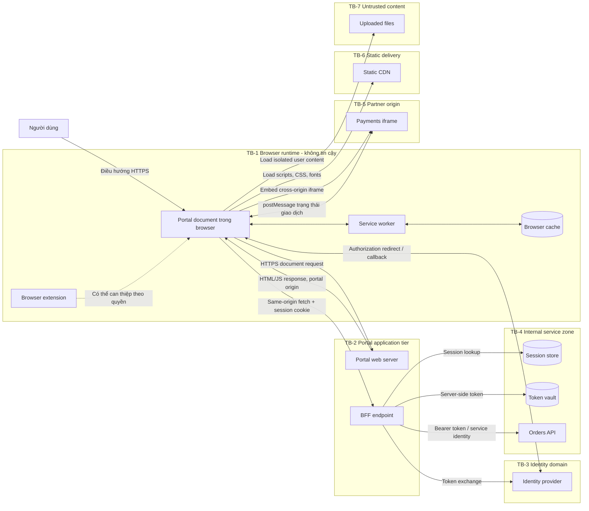
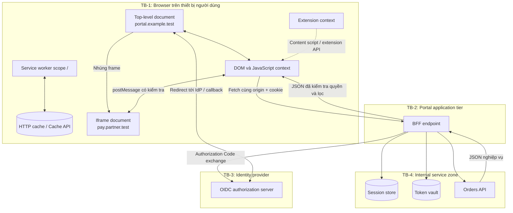

# Vẽ browser trust boundary

Browser trust boundary là ranh giới giữa các thành phần có mức độ tin cậy, quyền kiểm soát và khả năng truy cập dữ liệu khác nhau trong một ứng dụng web. Vẽ đúng ranh giới giúp nhóm phát triển nhìn thấy nơi dữ liệu đi qua, nơi credential được gửi, nơi mã có thể thực thi và nơi phải kiểm tra quyền. Sơ đồ này là đầu vào cho threat modeling, thiết kế cookie/CORS/CSP, kiểm thử bảo mật và xử lý sự cố.

Bài thực hành sử dụng một cổng khách hàng có đăng nhập, BFF, identity provider, API nghiệp vụ, CDN, iframe thanh toán và tiện ích mở rộng trình duyệt. Bạn sẽ lập sơ đồ theo các vùng tin cậy, đánh dấu luồng dữ liệu và credential, sau đó xác định mối đe dọa cùng biện pháp kiểm soát. Mục tiêu là tạo được một sơ đồ mà người khác có thể dùng để kiểm tra kiến trúc, thay vì chỉ vẽ các hộp máy chủ và đường kết nối.

## 1. Kết quả cần đạt

Sau bài thực hành, bạn có thể:

- Phân biệt origin, site, domain của cookie và ranh giới tin cậy.
- Nhận diện thành phần nào chạy trong browser, thành phần nào nằm phía server và ai kiểm soát chúng.
- Vẽ luồng navigation, fetch/XHR, cookie, token, iframe, postMessage, service worker và tài nguyên CDN.
- Đánh dấu dữ liệu nhạy cảm, credential, điểm vào và nơi thực thi mã.
- Giải thích Same-Origin Policy, CORS, SameSite, CSP và sandbox tác động lên luồng nào.
- Xác định rủi ro XSS, CSRF, clickjacking, token theft, confused deputy, SSRF và dữ liệu cache rò rỉ.
- Chuyển sơ đồ thành test case và checklist kiểm chứng.

Sơ đồ phải trả lời được các câu hỏi: ai gửi dữ liệu, gửi tới đâu, bằng cơ chế nào, credential nào tự động đi kèm, thành phần nhận tin cậy điều gì và kiểm tra nào được thực hiện trước khi hành động.

## 2. Bối cảnh hệ thống dùng trong bài tập

Một doanh nghiệp cung cấp cổng khách hàng tại `https://portal.example.test`. Người dùng đăng nhập để xem hồ sơ và đơn hàng, sau đó có thể thanh toán qua trang đối tác được nhúng bằng iframe.

Kiến trúc giả định gồm các thành phần sau:

| Thành phần | Địa chỉ hoặc vị trí | Vai trò | Mức tin cậy ban đầu |
|---|---|---|---|
| Browser tab | Máy người dùng | Hiển thị portal, chạy JavaScript và gửi request | Không đáng tin cậy |
| Portal frontend | `https://portal.example.test` | HTML, CSS, JavaScript và giao diện khách hàng | Mã do đội portal kiểm soát; dữ liệu đầu vào vẫn không đáng tin |
| BFF | `https://portal.example.test/bff/*` | Quản lý session, kiểm tra CSRF/quyền và gọi API phía server | Thành phần tin cậy của hệ thống |
| Session store | Mạng nội bộ | Lưu session opaque, trạng thái và tham chiếu token | Tin cậy cao, cần giới hạn truy cập |
| Identity provider | `https://login.identity.test` | Xác thực người dùng và thực hiện OAuth/OIDC | Bên tin cậy theo cấu hình issuer |
| Orders API | `https://orders.internal` | Cung cấp dữ liệu đơn hàng | Chỉ truy cập từ mạng/service được phép |
| Payments iframe | `https://pay.partner.test` | Thu thập thông tin thanh toán và xử lý giao dịch | Đối tác độc lập; không cùng trust domain |
| Static CDN | `https://static.example-cdn.test` | Phục vụ JavaScript, CSS, font và ảnh | Tin cậy theo nguồn phát hành và cấu hình CDN |
| Upload storage | `https://files.example-upload.test` | Phục vụ file người dùng tải lên | Nội dung không đáng tin cậy |
| Service worker | Scope `/` của portal | Cache tài nguyên và xử lý request trong scope của nó | Mã do portal phát hành, chạy trong origin portal |
| Browser extension | Trình duyệt người dùng | Có thể đọc/sửa trang theo quyền được cấp | Không do portal kiểm soát |

Đây là mô hình minh họa. Tên miền `.test` và `.internal` không phải địa chỉ dịch vụ thật. Khi làm bài với hệ thống thực tế, thay bằng hostname, cổng, reverse proxy, CDN, IdP và API thực tế; không suy ra một thành phần là tin cậy chỉ từ tên miền hoặc vị trí mạng.

### Luồng nghiệp vụ

1. Người dùng mở portal qua HTTPS.
2. Portal chuyển browser tới IdP để đăng nhập bằng OAuth 2.0/OIDC Authorization Code Flow.
3. BFF xử lý callback, xác minh kết quả đăng nhập và tạo session phía server.
4. Browser nhận cookie phiên opaque có `Secure`, `HttpOnly` và `SameSite` phù hợp.
5. JavaScript của portal gọi BFF cùng origin; browser tự gửi cookie theo quy tắc cookie.
6. BFF xác minh session, kiểm tra quyền và dùng token phía server để gọi Orders API.
7. Người dùng mở màn hình thanh toán; portal nhúng Payments iframe.
8. Portal và iframe trao đổi trạng thái qua `postMessage` theo một hợp đồng đã xác định.
9. Service worker có thể phục vụ tài nguyên đã cache hoặc chuyển tiếp request trong scope của nó.
10. Extension của người dùng có thể tương tác với trang tùy theo quyền mà người dùng đã cấp.

## 3. Phân biệt origin, site và cookie domain

Trước khi vẽ, hãy xác định các khái niệm này vì chúng tạo ra những ranh giới khác nhau.

**Origin** được xác định bởi bộ ba scheme, host và port. Ví dụ:

| URL | Origin | So sánh với portal |
|---|---|---|
| `https://portal.example.test/home` | `https://portal.example.test:443` | Cùng origin với portal |
| `https://portal.example.test:8443/home` | `https://portal.example.test:8443` | Khác origin do port |
| `http://portal.example.test/home` | `http://portal.example.test:80` | Khác origin do scheme |
| `https://api.example.test/data` | `https://api.example.test:443` | Khác origin do host |
| `https://login.identity.test/` | `https://login.identity.test:443` | Khác origin |

Same-Origin Policy (SOP) giới hạn việc một document hoặc script tương tác và đọc dữ liệu từ origin khác. SOP không ngăn mọi request cross-origin: browser vẫn có thể điều hướng, tải ảnh, gửi form hoặc gửi một số request; khả năng đọc response bằng JavaScript chịu các quy tắc riêng như CORS.

**Site** thường được hiểu theo schemeful site: scheme cùng registrable domain. Site được dùng trong một số cơ chế như SameSite cookie và Fetch Metadata. Hai subdomain có thể khác origin nhưng cùng site. Ví dụ `https://portal.example.test` và `https://api.example.test` là hai origin khác nhau nhưng thường cùng schemeful site. Vì vậy, SameSite cookie không thay thế kiểm tra origin hoặc CSRF token.

**Cookie domain** là phạm vi hostname mà cookie có thể được gửi tới. Cookie không được gắn với origin theo cách JavaScript origin hoạt động. Cookie không có thuộc tính `Domain` là host-only cookie. Cookie có `Domain=example.test` có thể được gửi tới các subdomain phù hợp, làm tăng phạm vi ảnh hưởng nếu một subdomain bị chiếm quyền.

Một cookie host-only dùng prefix `__Host-` phải có `Secure`, `Path=/` và không có `Domain`. Ví dụ:

```http
Set-Cookie: __Host-portal_session=<opaque-value>; Path=/; Secure; HttpOnly; SameSite=Lax
```

Cookie này được giới hạn cho host đã phát hành nó. Không đưa session ID, access token hoặc thông tin quyền hạn vào URL. Cookie `HttpOnly` không thể đọc bằng JavaScript, nhưng browser vẫn tự gửi cookie khi request đáp ứng các quy tắc cookie.

Khi vẽ, ghi riêng ba thuộc tính cho mỗi thành phần: origin, site và phạm vi cookie. Đừng gộp tất cả thành một nhãn “cùng domain”.

## 4. Xác định vùng tin cậy trước khi vẽ

Một trust boundary xuất hiện khi dữ liệu hoặc quyền đi qua một vùng có chủ sở hữu, chính sách bảo mật hoặc mức tin cậy khác. Ranh giới có thể nằm giữa browser và server, giữa hai origin, giữa ứng dụng và nhà cung cấp, hoặc giữa dữ liệu đã xác minh và dữ liệu chưa xác minh trong cùng một service.

Dùng các vùng sau cho bài tập:

| Vùng | Thành phần | Điều kiện để tin cậy |
|---|---|---|
| TB-1: Browser runtime | Browser tab/document portal, iframe, service worker, cache và extension | Thiết bị và mọi dữ liệu/request từ client đều không đáng tin cậy; mã trang chạy trong vùng này |
| TB-2: Portal application tier | Web server và BFF endpoint được công bố dưới portal origin | Tin cậy mã server đã phát hành; vẫn xác minh mọi request, cookie và dữ liệu browser gửi |
| TB-3: Identity domain | IdP và callback endpoints | Tin issuer đã cấu hình, kiểm tra state/nonce/PKCE và token |
| TB-4: Internal service zone | Session store, token vault, Orders API và token service | Chỉ service identity được phép; xác minh principal, audience, scope và quyền nghiệp vụ |
| TB-5: Partner origin | Payments iframe và API của đối tác | Tin theo hợp đồng tích hợp; xác minh message và giao dịch |
| TB-6: Static delivery | CDN và artifact phát hành | Tin theo quy trình build/sign/release và kiểm soát cache |
| TB-7: Untrusted content | File upload, ảnh, tài liệu và nội dung do người dùng tạo | Xem là dữ liệu không tin cậy; cách ly origin và xử lý theo loại nội dung |

Một thành phần có thể nằm trong cùng hạ tầng nhưng vẫn thuộc trust zone khác. Ngược lại, hai hostname khác nhau có thể cùng một tổ chức quản trị nhưng vẫn là hai origin và cần cấu hình CORS/credential riêng. Trust boundary được xác định bởi quyền kiểm soát, dữ liệu và giả định bảo mật; nó không chỉ là đường phân chia mạng.

Phân biệt origin với execution zone: document có origin `https://portal.example.test` được tải về và chạy trên thiết bị trong TB-1; endpoint `/bff/*` có thể cùng origin nhưng mã BFF thực thi phía server trong TB-2. Cùng origin giúp browser áp dụng quy tắc SOP/cookie nhất quán, nhưng không biến browser thành vùng tin cậy của server. Tương tự, site isolation và renderer process sandbox là cơ chế triển khai của browser; không dùng chúng thay cho xác thực, phân quyền hoặc ranh giới dữ liệu ở ứng dụng.

## 5. Vẽ sơ đồ context cấp hệ thống

Bắt đầu với sơ đồ context, chỉ đặt các actor và hệ thống có tương tác trực tiếp. Đánh dấu trust boundary bằng subgraph hoặc đường viền, không chỉ dùng màu. Mỗi mũi tên cần có tên giao thức hoặc dữ liệu quan trọng.



Sơ đồ này là bản đồ hệ thống, chưa phải sơ đồ luồng dữ liệu đầy đủ. Hãy bổ sung các đường phản hồi, các endpoint callback và các dịch vụ thực sự có quyền truy cập dữ liệu. Không nối trực tiếp Browser với Orders API nếu kiến trúc yêu cầu mọi request đi qua BFF.

Đối với một hệ thống lớn, vẽ sơ đồ context trước, sau đó tạo sơ đồ chi tiết cho từng luồng có dữ liệu nhạy cảm. Không nhồi mọi route và mọi header vào một hình khiến người xem không đọc được.

## 6. Vẽ chi tiết vùng browser và các luồng dữ liệu

Trong sơ đồ chi tiết, tách các thành phần bên trong browser: top-level document, iframe, service worker, browser storage, cache và extension. Chúng có quyền và nguồn mã khác nhau. BFF, session store và token vault phải được đặt trong các vùng server tương ứng, kể cả khi BFF dùng cùng hostname với frontend.



Trên mỗi luồng, ghi tối thiểu:

- **Source và destination:** thành phần nào khởi tạo, thành phần nào nhận.
- **Direction:** request, response, redirect, event hay message.
- **Protocol:** HTTPS, fetch, form submit, cookie, OAuth/OIDC, postMessage hoặc service-to-service.
- **Credential:** session cookie, CSRF token, authorization code, access token hoặc service identity.
- **Data classification:** public, internal, personal, sensitive hoặc secret.
- **Validation:** kiểm tra origin, session, token, schema, quyền hoặc message source ở đâu.
- **Failure behavior:** từ chối, redirect, fallback, retry hay ghi audit.

Một request từ Browser tới BFF có thể tự động kèm cookie, nhưng browser không tự chứng minh người dùng có quyền trên object ID trong URL. BFF phải xác minh session, lấy principal từ server-side session và kiểm tra quyền đối với object đó. Một request BFF tới Orders API có bearer token vẫn cần audience/scope và authorization theo nghiệp vụ.

## 7. Đánh dấu credential và dữ liệu nhạy cảm

Dùng ký hiệu thống nhất trong sơ đồ. Ví dụ: `C` cho credential, `S` cho secret, `P` cho personal data, `U` cho untrusted input và `A` cho authorization decision. Đừng đưa giá trị thật của secret vào sơ đồ hoặc tài liệu.

| Dữ liệu | Nơi xuất hiện | Nhãn | Quy tắc |
|---|---|---|---|
| Session cookie | Browser cookie jar → BFF | C | Opaque, Secure, HttpOnly, SameSite phù hợp; không log |
| CSRF token | Frontend memory → BFF header | C | Gắn với session/giao dịch; không đặt trong URL |
| Authorization code | IdP redirect → BFF callback | C | Dùng một lần, thời hạn ngắn, không log query |
| ID token | IdP → BFF token endpoint | C | Xác minh chữ ký, issuer, audience, thời hạn và nonce |
| Access token | Token vault → Resource API | C | Giữ phía server, audience/scope tối thiểu, không trả về browser |
| Refresh token | Token vault ↔ IdP | S | Bảo vệ chặt, rotation, xử lý reuse và concurrency |
| Hồ sơ khách hàng | Orders/Profile API → BFF → Browser | P | Kiểm tra quyền, lọc field, cache policy phù hợp |
| File upload | Browser → upload endpoint/storage | U | Kiểm tra nội dung, MIME, kích thước và cách ly origin |
| postMessage payload | Iframe ↔ portal | U | Kiểm tra origin/source/schema và trạng thái giao dịch |
| Browser telemetry | Browser → telemetry endpoint | U/P | Có thể bị giả mạo; giảm thiểu dữ liệu cá nhân |

Đánh dấu nơi dữ liệu được tạo, xác minh, biến đổi, lưu trữ và xóa. Đặc biệt, phân biệt token mà browser nhìn thấy với token chỉ tồn tại phía server. Nếu access token xuất hiện trong DevTools response của portal, sơ đồ BFF hoặc cách triển khai đã có điểm rò rỉ cần điều tra.

## 8. Phân tích SOP và CORS trên sơ đồ

SOP giới hạn việc đọc dữ liệu giữa origin. CORS là cơ chế server khai báo origin nào được phép đọc response qua browser. Khi vẽ CORS, hãy ghi rõ request nào là simple request, request nào cần preflight, request có credentials hay không và response header được trả từ server nào.

| Tình huống | Browser có thể gửi request? | JavaScript có thể đọc response? | Điều cần kiểm soát |
|---|---|---|---|
| Portal gọi BFF cùng origin | Có | Có, theo quyền của document | Session, CSRF, authorization |
| Portal gọi API khác origin không có CORS | Một số loại request vẫn gửi được | Bị chặn đọc bởi CORS nếu policy không cho phép | Không dựa CORS để chống CSRF |
| Portal gọi API khác origin có CORS phù hợp | Có; preflight nếu cần | Có theo policy | Allowlist origin, credentials, method/header |
| Portal submit form tới origin khác | Có thể | Thông thường script không đọc response cross-origin | CSRF và hành vi nghiệp vụ của endpoint nhận |
| Portal load ảnh từ CDN | Có | Hiển thị được; đọc pixel qua canvas có điều kiện CORS | Cache, nguồn phát hành và CORS nếu cần canvas |
| Iframe đối tác | Có thể nhúng nếu policy cho phép | DOM bị SOP cách ly | CSP frame-src/frame-ancestors, sandbox, postMessage |

Nếu browser cần gửi cookie trong CORS request cross-origin, client phải bật credentials và server phải trả origin cụ thể cùng `Access-Control-Allow-Credentials: true`. Không thể dùng `Access-Control-Allow-Origin: *` cho response credentialed. Nếu response thay đổi theo origin được phản chiếu, cần `Vary: Origin` để cache không phục vụ nhầm policy.

CORS không xác minh người dùng có quyền nghiệp vụ. Một origin được phép đọc API vẫn có thể gửi request với dữ liệu không hợp lệ hoặc truy cập object ngoài phạm vi. Server phải xác thực và phân quyền độc lập.

## 9. Phân tích cookie, SameSite và CSRF

Cookie được browser quản lý và tự gửi theo quy tắc domain, path, Secure, SameSite, expiry và context của request. Sơ đồ phải ghi nơi cookie được set, hostname nào nhận cookie, loại request nào mang cookie và server nào kiểm tra session.

Hãy kiểm tra các trường hợp:

- Cookie host-only cho `portal.example.test` không tự gửi tới `api.example.test`.
- Cookie có `Domain=example.test` có thể được gửi tới các subdomain phù hợp, làm tăng phạm vi tin cậy.
- `SameSite=Lax` thường cho phép cookie trong top-level safe navigation cross-site, nhưng hạn chế nhiều request subresource hoặc POST cross-site; cần kiểm thử luồng đăng nhập thật.
- `SameSite=None` yêu cầu `Secure` và cho phép cookie trong nhiều ngữ cảnh cross-site; phải có CSRF defense tương ứng.
- `HttpOnly` ngăn JavaScript đọc cookie, nhưng script XSS vẫn có thể gọi BFF bằng cookie tự động được gửi.
- `Secure` yêu cầu gửi cookie qua HTTPS; không bảo vệ cookie khỏi script chạy trong origin nếu script có thể tạo request HTTPS.

Đánh dấu mọi endpoint thay đổi trạng thái như đổi email, tạo đơn, thanh toán, thêm/xóa MFA và logout. Với mỗi endpoint, ghi CSRF control: synchronizer token hoặc double-submit an toàn, kiểm tra Origin, Fetch Metadata và method phù hợp. Không dùng GET cho thao tác thay đổi trạng thái.

Sơ đồ ví dụ cho request thay đổi email:

```http
POST /bff/profile/email HTTP/1.1
Host: portal.example.test
Cookie: __Host-portal_session=<opaque-session>
Origin: https://portal.example.test
Content-Type: application/json
X-CSRF-Token: <session-bound-token>

{"email":"new@example.test"}
```

Trong sơ đồ, cookie là credential do browser tự gửi; CSRF token là bằng chứng bổ sung mà frontend gửi rõ ràng; BFF kiểm tra cả hai cùng quyền thay đổi email. CORS không thay thế bước kiểm tra này.

## 10. Vẽ iframe, sandbox và postMessage

Iframe tạo một browsing context riêng. Nếu iframe có origin khác, SOP ngăn parent đọc trực tiếp DOM của frame và ngược lại. Ứng dụng thường cần trao đổi một số trạng thái qua `postMessage`, vì vậy phải thiết kế hợp đồng message thay vì mở quyền DOM.

Khi nhúng Payments iframe:

- `frame-src` trong CSP của portal quy định nguồn frame mà portal được phép tải.
- `frame-ancestors` trong CSP của trang thanh toán quy định origin nào được phép nhúng trang đó.
- `X-Frame-Options` có thể hỗ trợ một số trình duyệt cũ; CSP `frame-ancestors` là cơ chế hiện đại linh hoạt hơn.
- Thuộc tính `sandbox` trên iframe giới hạn tính năng của nội dung được nhúng. Chỉ cấp token như `allow-scripts`, `allow-forms` hoặc `allow-same-origin` khi luồng thực sự cần.
- Không ghép `allow-scripts` và `allow-same-origin` cho nội dung cùng origin với parent nếu điều đó làm nội dung có thể thoát khỏi mục đích sandbox.
- Không tin dữ liệu message chỉ vì nó đến từ iframe đã được nhúng; kiểm tra `event.origin`, `event.source`, schema, kích thước và trạng thái giao dịch.

Ví dụ gửi message an toàn theo origin dự kiến:

```javascript
const paymentFrame = document.querySelector("#payment-frame");
const paymentOrigin = "https://pay.partner.test";

paymentFrame.contentWindow.postMessage(
  {
    type: "PAYMENT_STATUS_REQUEST",
    version: 1,
    transactionRef: serverIssuedTransactionRef
  },
  paymentOrigin
);

window.addEventListener("message", (event) => {
  if (event.origin !== paymentOrigin) return;
  if (event.source !== paymentFrame.contentWindow) return;

  const message = event.data;
  if (!message || typeof message !== "object") return;
  if (message.type !== "PAYMENT_STATUS") return;
  if (message.version !== 1) return;
  if (typeof message.transactionRef !== "string") return;
  if (message.transactionRef !== serverIssuedTransactionRef) return;

  // Kiểm tra schema và trạng thái nghiệp vụ trước khi cập nhật UI.
});
```

`targetOrigin` nên là origin chính xác, không dùng wildcard cho frame có origin thông thường. Phía nhận cần xác minh cả `origin` lẫn `source`, sau đó kiểm tra schema và transaction reference. Message từ iframe chỉ là tín hiệu; trạng thái thanh toán cuối cùng phải được xác minh qua server-to-server hoặc API có thẩm quyền. Không hoàn tất đơn hàng chỉ vì frame gửi message “success”.

Với iframe sandbox có opaque origin, `event.origin` có thể là chuỗi `null`. Khi đó không thể xác thực bằng cách so sánh với hostname thông thường. Nếu bắt buộc giao tiếp, thiết kế handshake bằng capability ngẫu nhiên có thời hạn, kiểm tra `event.source`, ràng buộc channel và giảm quyền message. Tránh dùng `postMessage(..., "*")` như cách sửa lỗi tiện lợi.

## 11. Service worker, cache và extension trong trust model

Service worker chạy trong origin của ứng dụng và có thể kiểm soát request trong scope đã đăng ký. Nó có thể phục vụ cache offline, xử lý fetch event và ảnh hưởng dữ liệu browser nhận được. Vì vậy, service worker là một thành phần có quyền đáng kể trong sơ đồ. Ghi rõ script URL, scope, quy trình update và loại response được cache.

Không cache response chứa session, token hoặc dữ liệu cá nhân nếu không có chiến lược phân tách theo người dùng và xóa khi logout. Cache API có thể tồn tại qua lần tải trang và chuyển tài khoản. Nếu ứng dụng hỗ trợ nhiều tài khoản trên cùng profile, phải kiểm tra cache key và purge behavior. Service worker không nên nhận lệnh từ message không xác thực để truy cập URL hoặc dữ liệu tùy ý.

Browser extension có thể có content script chạy trong isolated world nhưng vẫn tương tác với DOM trang. Extension có quyền rộng có thể đọc nội dung hiển thị, sửa DOM hoặc quan sát request theo quyền đã cấp. Portal không thể coi extension là mã do mình kiểm soát. Khi điều tra, ghi nhận extension là một actor riêng; không đặt extension vào trust zone của ứng dụng chỉ vì nó chạy trong cùng browser.

Tài nguyên CDN cũng cần ranh giới rõ. Script được tải từ CDN và thực thi trong document có thể chạy với quyền của origin document. Việc script nằm ở hostname CDN không có nghĩa script bị giới hạn trong origin CDN. Kiểm soát pipeline phát hành, CSP, Subresource Integrity khi phù hợp và quyền quản trị CDN. Không phục vụ HTML/SVG/file upload không tin cậy trên cùng origin có cookie và quyền như portal.

## 12. Phân tích threat trên từng trust boundary

Sau khi vẽ sơ đồ, liệt kê mối đe dọa theo luồng. Dùng STRIDE hoặc một phương pháp threat modeling khác để tránh bỏ sót. Bảng dưới đây là mẫu khởi đầu.

| Ranh giới/luồng | Mối đe dọa | Tác động | Kiểm soát cần thể hiện |
|---|---|---|---|
| Browser → Portal | XSS hoặc input tampering | Script chạy trong origin portal, gọi BFF dưới session hiện tại | Output encoding, sanitization, CSP, Trusted Types, authorization server-side |
| Browser → BFF bằng cookie | CSRF | Request thay đổi trạng thái ngoài ý muốn | SameSite, CSRF token, Origin/Fetch Metadata, method đúng |
| Portal → IdP → callback | Login CSRF, code injection hoặc callback mix-up | Gắn nhầm phiên với tài khoản hoặc giao dịch khác | State, nonce, PKCE, issuer/redirect URI allowlist, code one-time |
| BFF → Orders API | Confused deputy hoặc over-privileged token | Đọc/sửa dữ liệu vượt quyền người dùng | Audience/scope tối thiểu, principal delegation, object-level authorization |
| Portal ↔ Payments iframe | Message spoofing hoặc clickjacking | Giả trạng thái thanh toán hoặc lừa người dùng thao tác | Origin/source/schema check, frame policy, xác minh trạng thái qua server |
| Browser → CDN | Script supply-chain compromise | Mã bên thứ ba chạy trong portal origin | CSP, SRI, quản trị release/CDN, dependency review |
| Browser → Upload storage | Stored XSS hoặc content sniffing | File được mở như nội dung chủ động trong portal origin | Origin riêng, MIME chính xác, nosniff, attachment/sandbox |
| Service worker → Cache | Cache poisoning hoặc dữ liệu chéo tài khoản | Trả response cũ hoặc dữ liệu người khác | Cache allowlist, cache key, purge, update integrity |
| Extension → DOM | Đọc hoặc sửa dữ liệu trang | Rò rỉ dữ liệu qua extension độc hại | Giảm dữ liệu hiển thị, cảnh báo thiết bị không quản lý, kiểm tra extension trong IR |
| BFF → Upstream URL | SSRF | BFF truy cập metadata, localhost hoặc mạng nội bộ | Upstream allowlist, DNS/IP validation, redirect control, timeout |

Với mỗi mối đe dọa, ghi thêm owner, khả năng khai thác, mức ảnh hưởng, control hiện có, bằng chứng kiểm thử và hành động còn thiếu. Không đánh giá rủi ro chỉ dựa trên tên control. Ví dụ, có CSP header chưa chứng minh CSP đủ chặt; có CSRF token chưa chứng minh mọi endpoint thay đổi trạng thái đều kiểm tra token.

## 13. Quy trình thực hành: vẽ từ hệ thống đến luồng chi tiết

Thực hiện theo các bước sau. Mỗi bước tạo ra một phần của deliverable.

### Bước 1: Kiểm kê actor và tài sản

Liệt kê người dùng, browser, extension, portal frontend, BFF, IdP, session store, token vault, API, CDN, iframe đối tác, upload storage và telemetry. Ghi owner, hostname, môi trường, dữ liệu sở hữu và quyền truy cập. Tách actor bên ngoài khỏi service do tổ chức quản lý.

### Bước 2: Liệt kê dữ liệu và credential

Lập danh sách session cookie, CSRF token, authorization code, ID/access/refresh token, dữ liệu cá nhân, file upload và message giữa iframe. Với từng loại, ghi nguồn tạo, nơi lưu, nơi truyền, thời hạn, ai có thể đọc và cách xóa.

### Bước 3: Ghi origin và cookie scope

Với từng document hoặc endpoint browser truy cập, ghi scheme, host, port. Xác định site, cookie host-only hay Domain cookie, SameSite, Secure, HttpOnly, Path và thời hạn. Ghi rõ CORS policy nếu browser cần đọc response cross-origin.

### Bước 4: Vẽ trust zone

Đặt các thành phần vào vùng theo quyền kiểm soát và giả định bảo mật. Tạo đường ranh giới tại browser/server, portal/IdP, portal/partner, portal/CDN và trusted/untrusted content. Đừng đặt các hệ thống chỉ vì cùng subnet vào chung một vùng nếu chúng có owner hoặc quyền khác nhau.

### Bước 5: Vẽ luồng và đánh nhãn

Vẽ request, response, redirect, event và message theo hướng thực tế. Mỗi đường ghi giao thức, credential, loại dữ liệu và kiểm tra ở destination. Dùng đường liền cho request/response, đường nét đứt cho event hoặc luồng tùy chọn; thêm legend để người xem hiểu ký hiệu.

### Bước 6: Đặt điểm kiểm soát

Gắn kiểm tra xác thực, phân quyền, CSRF, CORS, CSP, sandbox, token validation, schema validation, rate limit, logging và cache policy vào đúng thành phần thực thi. Nếu control nằm ở reverse proxy hoặc CDN, thể hiện rõ vị trí đó.

### Bước 7: Tạo threat list và test

Đi qua từng trust boundary, đặt câu hỏi: dữ liệu có thể bị giả mạo không, có thể bị đọc bởi bên khác không, credential có tự gửi không, redirect có đổi host không, message có thể giả mạo không, cache có thể dùng chéo session không? Chuyển mỗi câu trả lời rủi ro thành test case.

### Bước 8: Review với owner

Nhờ owner của frontend, identity, API, CDN, security và đối tác xác nhận sơ đồ. Ghi ngày xác minh, phiên bản kiến trúc và các giả định chưa được kiểm chứng. Sơ đồ trust boundary cần được cập nhật khi thêm origin, iframe, CDN, service worker, endpoint hoặc loại credential mới.

## 14. Bộ câu hỏi review sơ đồ

Dùng các câu hỏi sau khi review:

**Browser và origin**

- Có ghi scheme, host và port cho mọi origin không?
- Có nhầm “cùng site” với “cùng origin” không?
- Có thành phần browser nào bị bỏ sót như iframe, worker, cache hoặc extension không?
- Có nội dung không tin cậy được phục vụ dưới origin portal không?

**Cookie và session**

- Cookie nào được browser tự động gửi? Tới hostname nào?
- Cookie có Domain rộng hoặc subdomain không được quản lý không?
- Session ID có được rotate sau đăng nhập, MFA hoặc nâng quyền không?
- Logout có thu hồi session phía server hay chỉ xóa cookie?

**CORS và CSRF**

- Endpoint cross-origin nào cần CORS và tại sao?
- Credentialed CORS có allowlist origin cụ thể không?
- Endpoint thay đổi trạng thái có CSRF protection không?
- Có endpoint nào dùng GET để thay đổi dữ liệu không?

**Iframe và message**

- Origin nào được phép nhúng trang portal? Portal được phép nhúng origin nào?
- Iframe có sandbox và allow permissions tối thiểu không?
- postMessage có targetOrigin cụ thể, kiểm tra origin/source và schema không?
- Trạng thái thanh toán có được xác minh qua server không?

**BFF và API**

- Browser có bao giờ nhìn thấy access token hoặc refresh token không?
- BFF có thể bị điều khiển gọi URL tùy ý không?
- Resource API có kiểm tra audience, scope và quyền object-level không?
- Response có chứa dữ liệu hoặc header nội bộ không cần thiết không?

**CDN, file và telemetry**

- Script CDN có chạy với quyền của portal document không?
- Upload có được tách origin hoặc phục vụ dưới dạng attachment không?
- Cache có thể trả dữ liệu của session cũ hoặc người dùng khác không?
- Telemetry client có bị xem là dữ liệu không tin cậy không?

## 15. Kiểm chứng bằng DevTools và HTTP client

Sơ đồ cần được đối chiếu với hành vi thật. Trong DevTools:

1. Mở tab Network, bật Preserve log và kiểm tra redirect chain đăng nhập.
2. Xem response callback và xác minh cookie phiên được set với đúng thuộc tính.
3. Kiểm tra request browser → BFF có cookie, CSRF header và Origin như thiết kế.
4. Kiểm tra response headers: CSP, HSTS, Referrer-Policy, Permissions-Policy, nosniff, cache directives và CORS.
5. Mở Application/Storage để xem cookie, service worker registration và Cache Storage; không sao chép secret vào tài liệu.
6. Kiểm tra frame tree, origin của iframe và message listener trong Sources.
7. Kiểm tra console để phát hiện CSP violation, CORS failure, mixed content và lỗi postMessage.
8. Dùng Network Initiator để xác định script hoặc frame nào tạo request.

Có thể dùng curl để kiểm tra header của portal và route đại diện:

```bash
curl -sS -D - -o /dev/null https://portal.example.test/
curl -sS -D - -o /dev/null https://portal.example.test/bff/api/profile
curl -sS -D - -o /dev/null https://portal.example.test/oauth/callback
```

Các request trên là ví dụ kiểm tra header. Callback thật thường yêu cầu state/code hợp lệ; gọi trực tiếp bằng curl có thể trả lỗi và không chứng minh toàn bộ OAuth flow. Dùng browser test hoặc test harness có IdP giả lập để xác minh redirect, state, nonce, PKCE và cookie.

Không dùng `curl -k` để kết luận TLS an toàn. Không đưa cookie thật, bearer token, authorization code hoặc CSRF token vào command history, screenshot hay ticket. Khi cần kiểm tra request có cookie, dùng test account và credential tạm thời trong môi trường kiểm thử; xóa dữ liệu sau khi hoàn thành.

## 16. Ma trận kiểm thử theo trust boundary

| ID | Kiểm thử | Kết quả mong đợi |
|---|---|---|
| TB-01 | Thử đọc DOM của iframe cross-origin từ portal | SOP ngăn truy cập trực tiếp |
| TB-02 | Fetch cross-origin không có CORS allowlist | JavaScript không đọc được response |
| TB-03 | Gửi request thay đổi trạng thái cross-site bằng cookie | BFF từ chối khi thiếu CSRF proof hoặc Origin không hợp lệ |
| TB-04 | Thử cookie portal từ subdomain khác | Host-only/`__Host-` cookie không bị gửi tới subdomain |
| TB-05 | Đọc session cookie từ JavaScript | Không đọc được khi cookie là HttpOnly |
| TB-06 | Chèn message từ origin không phải payment partner | Listener từ chối |
| TB-07 | Gửi message đúng origin nhưng sai schema/transaction | Listener từ chối |
| TB-08 | Nhúng portal vào origin không được phép | `frame-ancestors` chặn |
| TB-09 | Tải script ngoài CSP allowlist | Browser chặn và ghi violation |
| TB-10 | Truy cập file upload HTML/SVG từ portal origin | File được cách ly hoặc phục vụ theo chính sách an toàn |
| TB-11 | Dùng service worker cache sau khi logout/đổi user | Không trả dữ liệu của session trước |
| TB-12 | Gửi URL metadata hoặc localhost tới BFF proxy | BFF từ chối và không tạo outbound connection |
| TB-13 | Gửi userId/tenantId của người khác tới BFF | Authorization từ chối |
| TB-14 | Upstream redirect tới host ngoài allowlist | BFF không theo redirect |
| TB-15 | Kiểm tra log và telemetry | Không có token, cookie, code hoặc dữ liệu nhạy cảm ngoài allowlist |
| TB-16 | Kiểm tra header trên redirect và response lỗi | Header cần thiết vẫn có mặt theo policy |

Ghi lại browser/version, môi trường, request ID, bước tái hiện, kết quả mong đợi, kết quả thực tế và bằng chứng đã loại bỏ dữ liệu nhạy cảm. Nếu một test không thể thực hiện do thiếu quyền hoặc môi trường, ghi rõ chưa xác minh thay vì đánh dấu PASS.

## 17. Các lỗi khi vẽ trust boundary

| Lỗi | Vì sao sai | Cách sửa |
|---|---|---|
| Vẽ một hộp “Browser” duy nhất | Bỏ sót iframe, service worker, cache và extension | Tách các browsing context và thành phần có quyền riêng |
| Coi mọi subdomain là cùng origin | Origin phụ thuộc scheme, host và port | Ghi origin tuple và site riêng |
| Coi CORS là xác thực hoặc CSRF protection | CORS kiểm soát việc đọc response cross-origin | Xác thực, phân quyền và CSRF ở server |
| Cho rằng HttpOnly ngăn XSS | Script vẫn có thể gọi endpoint bằng cookie tự động gửi | Phòng XSS và giới hạn quyền endpoint |
| Tin message từ iframe vì đã nhúng frame | Message có thể giả mạo hoặc sai giao dịch | Kiểm tra origin, source, schema và xác minh qua server |
| Coi script CDN là mã ngoài origin | Script chạy trong quyền của document đã tải nó | Kiểm soát pipeline, CSP, SRI và quyền CDN |
| Đặt file upload cùng origin portal | HTML/SVG chủ động có thể chạy trong vùng tin cậy portal | Tách site/origin và dùng MIME/attachment/sandbox |
| Bỏ qua service worker | Worker có thể intercept và cache request trong scope | Đưa worker, scope và cache vào sơ đồ |
| Chỉ vẽ luồng request | Không thấy dữ liệu trả về, redirect và side effect | Vẽ cả request, response, callback và event |
| Không đánh dấu credential | Không biết token/cookie được tạo, lưu và truyền ở đâu | Đánh dấu loại credential và điểm xác minh |
| Vẽ control ở sai lớp | Không xác định được ai thực thi chính sách | Đặt control tại browser, BFF, proxy, IdP hoặc API đúng nơi |

## 18. Deliverable và tiêu chí hoàn thành

Một bài vẽ hoàn chỉnh cần có:

1. Sơ đồ context toàn hệ thống với actor, origin và trust zone.
2. Sơ đồ chi tiết browser có top-level document, iframe, service worker, cache và extension.
3. Bảng origin/site/cookie scope cho các thành phần browser truy cập.
4. Danh sách luồng dữ liệu và credential kèm classification.
5. Bảng threat/control cho từng trust boundary.
6. Ma trận kiểm thử có kết quả và bằng chứng.
7. Danh sách giả định, điểm chưa xác minh, owner và ngày review.

Có thể dùng thang điểm sau để tự đánh giá:

| Tiêu chí | Điểm |
|---|---:|
| Actor, origin và trust zone được nhận diện đúng | 20 |
| Luồng request/response/redirect/message có hướng và giao thức | 20 |
| Cookie, token, dữ liệu nhạy cảm và điểm xác minh được đánh dấu | 20 |
| Threat và control gắn đúng trust boundary | 20 |
| Test case có kết quả, bằng chứng và trạng thái xác minh | 15 |
| Sơ đồ có legend, owner, version và ngày review | 5 |
| **Tổng** | **100** |

Một sơ đồ đạt yêu cầu phải cho reviewer xác định được nơi credential đi qua, nơi dữ liệu chưa tin cậy được xử lý, ai có quyền quyết định và test nào chứng minh control hoạt động. Nếu chỉ có các hộp “frontend”, “backend” và “database” mà không thể trả lời các câu hỏi này, sơ đồ chưa đủ chi tiết để dùng cho threat modeling.

## 19. Checklist cuối bài

- [ ] Đã liệt kê actor, browser context, service, third-party và dữ liệu không tin cậy.
- [ ] Đã ghi scheme, host, port, site và cookie scope riêng cho từng origin.
- [ ] Đã vẽ top-level document, iframe, service worker, cache và extension.
- [ ] Đã vẽ đầy đủ request, response, redirect, callback và postMessage.
- [ ] Đã đánh dấu cookie, CSRF token, authorization code, access token và refresh token.
- [ ] Đã ghi điểm xác thực, phân quyền, schema validation và nơi phát sinh quyết định.
- [ ] Đã xác định SOP/CORS, SameSite, CSP, frame-ancestors và sandbox áp dụng ở đâu.
- [ ] Đã đánh giá XSS, CSRF, clickjacking, SSRF, confused deputy, cache leakage và supply-chain risk.
- [ ] Đã chuyển threat thành test case có kết quả mong đợi.
- [ ] Đã ghi owner, version, giả định và các điểm chưa xác minh.

Browser trust boundary là mô hình về quyền kiểm soát và luồng dữ liệu. Khi sơ đồ thể hiện chính xác origin, credential, browsing context, đối tác và điểm kiểm tra ở server, nhóm có thể dùng nó để rà soát thiết kế, xây dựng test và nhận diện thay đổi kiến trúc có thể mở rộng bề mặt tấn công.
