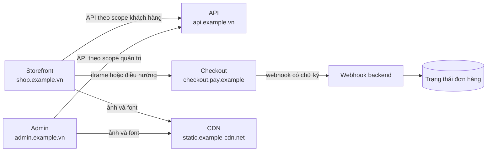

# Thiết kế origin policy

Một ứng dụng web thường gồm nhiều origin: storefront, trang quản trị, API, CDN và dịch vụ thanh toán. Mỗi origin có thể có mã, dữ liệu, phiên đăng nhập và chủ sở hữu khác nhau. Nếu cho phép quá rộng, một thành phần bị xâm phạm có thể đọc dữ liệu hoặc thực hiện hành động vượt quá nhu cầu. Nếu cấu hình quá chặt mà không hiểu luồng, tính năng hợp lệ sẽ bị chặn hoặc đội vận hành phải thêm ngoại lệ thiếu kiểm soát.

Thiết kế origin policy là quá trình xác định **origin nào được giao tiếp với origin nào, bằng cơ chế nào, cho loại dữ liệu và hành động nào**. Chính sách phải phối hợp Same-Origin Policy (SOP), CORS, Content Security Policy (CSP), cookie, iframe, `postMessage`, redirect và xác thực phía máy chủ. Không có một header duy nhất thay thế được toàn bộ các quyết định đó.

## Mục tiêu thực hành

Sau bài học, người học có thể:

- Xác định origin từ scheme, hostname và port; phân biệt origin với site.
- Lập danh mục origin, chủ sở hữu, tài sản và luồng dữ liệu của một ứng dụng nhiều miền.
- Viết ma trận allowlist theo từng nguồn, đích, route, method và loại dữ liệu.
- Chọn đúng cơ chế giữa SOP, CORS, CSP, cookie, CSRF, sandbox và `postMessage`.
- Triển khai chính sách theo môi trường, kiểm thử cả trường hợp được phép lẫn bị từ chối và theo dõi thay đổi sau phát hành.

## 1. Bài toán: một ứng dụng, nhiều origin

Giả sử một cửa hàng trực tuyến có kiến trúc sau. Các tên miền dùng trong bài là tên minh họa:

| Origin | Vai trò | Dữ liệu hoặc quyền chính |
|---|---|---|
| `https://shop.example.vn` | Storefront cho khách hàng | Danh mục, giỏ hàng, đơn hàng của người dùng đang đăng nhập |
| `https://admin.example.vn` | Trang quản trị | Dữ liệu khách hàng, hoàn tiền, thay đổi giá và quyền vận hành |
| `https://api.example.vn` | API JSON | Xác thực token, đọc và thay đổi dữ liệu theo quyền |
| `https://checkout.pay.example` | Trang thanh toán do nhà cung cấp vận hành | Phiên thanh toán và trạng thái giao dịch |
| `https://static.example-cdn.net` | CDN tài nguyên tĩnh | Hình ảnh và font công khai |

Storefront cần đọc danh mục và tạo đơn hàng. Trang quản trị cần gọi API quản trị với quyền cao hơn. Storefront có thể nhúng trang thanh toán. Cả hai trang tải hình ảnh và font từ CDN. Không có lý do để trang quản trị được nhúng vào website khác, để widget thanh toán đọc DOM cửa hàng, hoặc để CDN chạy JavaScript tùy ý trong trang.

Sơ đồ luồng ở mức khái quát:



Sơ đồ cho thấy các luồng có mục đích khác nhau. Chính sách cần cho phép từng luồng tối thiểu; việc một origin xuất hiện trong sơ đồ không có nghĩa nó được đọc mọi dữ liệu hoặc gọi mọi endpoint.

## 2. Xác định chính xác origin

Origin là bộ ba **scheme, host và port**. Path, query string và fragment không tham gia vào phép so sánh origin.

| URL | Origin | Quan hệ với `https://shop.example.vn` |
|---|---|---|
| `https://shop.example.vn/products/1` | `https://shop.example.vn` | Cùng origin |
| `https://shop.example.vn/cart` | `https://shop.example.vn` | Cùng origin |
| `http://shop.example.vn` | `http://shop.example.vn` | Khác origin vì scheme khác |
| `https://admin.example.vn` | `https://admin.example.vn` | Khác origin vì host khác |
| `https://shop.example.vn:8443` | `https://shop.example.vn:8443` | Khác origin vì port khác |
| `https://shop.example.vn:443` | `https://shop.example.vn` | Cùng origin sau khi chuẩn hóa port mặc định |

Hai URL có cùng origin khi scheme, host và port sau chuẩn hóa giống nhau. `https://shop.example.vn/a` và `https://shop.example.vn/b` cùng origin dù path khác nhau. Vì vậy, origin policy không thể dùng để phân quyền chi tiết cho từng path; API vẫn phải kiểm tra quyền trên từng route và tài nguyên.

### Origin khác site

Origin và site là hai khái niệm khác nhau. Trong ngữ cảnh cookie `SameSite`, site thường được xác định theo scheme và registrable domain (eTLD+1), có xét public suffix. Do đó, `https://shop.example.vn` và `https://api.example.vn` là hai origin khác nhau nhưng thường cùng site. Ngược lại, `https://shop.example.vn` và `https://checkout.pay.example` là cross-site.

Hệ quả thực tế:

- SOP và CORS làm việc theo origin.
- `SameSite` của cookie làm việc theo site.
- Một request có thể là cross-origin nhưng same-site. Cookie `SameSite=Lax` vẫn có thể được gửi trong ngữ cảnh same-site nếu các điều kiện khác phù hợp.
- Không dùng khái niệm “cùng site” để kết luận hai ứng dụng có thể đọc DOM hoặc response của nhau.

Một số tài liệu hoặc môi trường còn có origin opaque, chẳng hạn tài liệu được tạo bởi sandbox iframe không có `allow-same-origin`. Khi đó `event.origin` trong message có thể là chuỗi `"null"`. Không dùng `null` làm một mục allowlist chung; nhiều ngữ cảnh không liên quan có thể cùng biểu diễn origin theo cách này.

## 3. Lập threat model và nguyên tắc chính sách

Trước khi viết header, xác định điều gì cần bảo vệ và ai có thể tác động đến nó.

| Tài sản | Mối đe dọa | Quyết định cần đưa ra |
|---|---|---|
| Phiên khách hàng | Script bên thứ ba đọc DOM hoặc token; CSRF gửi request bằng cookie | Giảm script, giới hạn cookie, kiểm tra CSRF và quyền API |
| Phiên quản trị | Trang lạ nhúng trang quản trị hoặc script độc hại thao tác thay đổi dữ liệu | CSP nghiêm ngặt, `frame-ancestors 'none'`, xác thực mạnh và phân quyền server |
| Dữ liệu API | Origin không được phép đọc response hoặc người gọi truy cập tài nguyên trái quyền | CORS allowlist chính xác và authorization trên từng endpoint |
| Giao dịch thanh toán | Message giả mạo báo thanh toán thành công | Kiểm tra origin/source/schema; backend xác minh webhook hoặc API nhà cung cấp |
| Tài nguyên tĩnh | CDN bị cấu hình sai hoặc nội dung động bị nhúng như mã | Chỉ dùng CDN cho loại tài nguyên cần thiết; giới hạn bằng CSP và CORS phù hợp |

Áp dụng các nguyên tắc sau:

1. **Mặc định từ chối:** chỉ mở origin và khả năng thực sự cần.
2. **Cho phép theo mục đích:** `connect-src`, `frame-src`, CORS và cookie có phạm vi khác nhau; không dùng một danh sách chung cho mọi cơ chế.
3. **Phân tách môi trường:** development, staging và production có allowlist riêng. Không đưa `localhost`, preview deployment hoặc domain thử nghiệm vào production chỉ để tiện kiểm thử.
4. **Phân tách đặc quyền:** origin quản trị có quyền cao hơn phải có chính sách riêng và không được kế thừa ngoại lệ không cần thiết của storefront.
5. **Xác thực độc lập:** origin hợp lệ chỉ là điều kiện của một số luồng trình duyệt, không chứng minh người dùng có quyền trên dữ liệu.
6. **Có chủ sở hữu và ngày rà soát:** mỗi ngoại lệ cần lý do, người chịu trách nhiệm, môi trường áp dụng và thời điểm xem xét lại.

## 4. Xây dựng ma trận origin policy

Ma trận là tài liệu thiết kế trước khi cấu hình. Ghi rõ nguồn, đích, mục đích, loại giao tiếp, dữ liệu, phương thức xác thực và cơ chế kiểm soát.

| Nguồn | Đích | Mục đích | Kiểm soát được chọn |
|---|---|---|---|
| `shop.example.vn` | `api.example.vn` | Đọc danh mục, tạo đơn hàng | CORS chỉ cho origin storefront trên các route cần thiết; token và scope khách hàng; không dùng cookie cross-origin nếu không cần |
| `admin.example.vn` | `api.example.vn` | Quản trị sản phẩm và đơn hàng | CORS chỉ cho origin admin trên route quản trị; scope quản trị, MFA và authorization phía server |
| `shop.example.vn` | `checkout.pay.example` | Hiển thị hosted checkout | `frame-src` chỉ cho checkout; iframe sandbox theo tài liệu provider; `postMessage` xác thực origin/source/schema |
| `shop.example.vn` | `static.example-cdn.net` | Tải hình ảnh và font | CSP `img-src`/`font-src`; CORS cho font nếu cần; không cho CDN vào `script-src` khi không tải script |
| `admin.example.vn` | `static.example-cdn.net` | Tải hình ảnh và font | Chỉ cho loại tài nguyên thực sự sử dụng; chính sách admin không nới lỏng theo storefront |
| Origin bất kỳ | `admin.example.vn` | Nhúng trang quản trị | Từ chối bằng `frame-ancestors 'none'` |

Không viết một mục kiểu `*.example.vn` rồi dùng cho tất cả. Wildcard subdomain có thể bao gồm host staging cũ, dịch vụ thử nghiệm hoặc subdomain bị chiếm quyền. Hãy khai báo từng origin đầy đủ và giới hạn theo route. Nếu có nhiều tenant hoặc domain tùy chỉnh, cần một quy trình xác minh quyền sở hữu domain và quản lý allowlist riêng.

## 5. Phân biệt vai trò của SOP, CORS và CSP

Ba cơ chế thường bị gộp thành một “origin policy”, nhưng chúng kiểm soát các hướng khác nhau.

| Cơ chế | Ai đặt chính sách? | Nó kiểm soát điều gì? | Nó không làm gì? |
|---|---|---|---|
| Same-Origin Policy (SOP) | Quy tắc của trình duyệt | Cách một document hoặc script truy cập tài nguyên cross-origin | Không chặn mọi request cross-origin; không thay authorization của API |
| CORS | Máy chủ nhận request trả header; trình duyệt thực thi | Cho phép JavaScript ở origin được chỉ định đọc response | Không xác thực người dùng; không phải biện pháp chống CSRF; không chặn curl hoặc backend client |
| Content Security Policy (CSP) | Ứng dụng gửi response header | Giới hạn nguồn script, kết nối, frame, ảnh, form và các tài nguyên khác mà trang được phép dùng | Không cấp quyền đọc response API; không thay CORS hoặc authorization |

Ví dụ: `shop.example.vn` gửi `fetch()` tới `api.example.vn`. SOP khiến JavaScript không được tự do đọc response cross-origin. API có thể trả CORS cho phép storefront đọc response. CSP `connect-src` của trang cũng phải cho phép kết nối tới API. Cả ba điều kiện phải phù hợp; API vẫn xác thực token và quyền của người dùng.

Một request đơn giản cross-origin có thể được gửi dù response không được JavaScript đọc. Với request cần preflight, trình duyệt gửi `OPTIONS` trước khi gửi request thực. Vì vậy, không dựa vào việc CORS làm trình duyệt không đọc được response để bảo vệ thao tác thay đổi trạng thái.

## 6. Thiết kế CORS cho API

### Chọn allowlist theo route

API cần phân biệt quyền storefront và admin. Ví dụ chính sách ở mức thiết kế:

| Route group | Origin được đọc response | Method cần thiết | Header request |
|---|---|---|---|
| `/v1/catalog/*` | `https://shop.example.vn` | `GET` | `Authorization`, `X-Request-ID` nếu dùng |
| `/v1/orders/*` | `https://shop.example.vn` | `GET`, `POST` | `Authorization`, `Content-Type`, `X-Request-ID` |
| `/v1/admin/*` | `https://admin.example.vn` | Theo API quản trị thực tế | `Authorization`, `Content-Type`, `X-Request-ID` |

Nếu admin không cần gọi một route thì không đưa route đó vào allowlist admin. CORS allowlist không thay authorization: người dùng có token quản trị vẫn phải được backend kiểm tra vai trò, tenant, quyền trên đối tượng và trạng thái nghiệp vụ.

### Ví dụ response CORS không dùng cookie

Với SPA dùng access token trong header `Authorization`, request có thể dùng `credentials: "omit"`. API chỉ phản hồi origin chính xác đã được cho phép:

```http
Access-Control-Allow-Origin: https://shop.example.vn
Vary: Origin
Access-Control-Allow-Methods: GET, POST
Access-Control-Allow-Headers: Authorization, Content-Type, X-Request-ID
Access-Control-Max-Age: 600
```

Không cần `Access-Control-Allow-Credentials` trong mẫu này vì request không dùng cookie hoặc HTTP authentication tự động. Header `Authorization` thường làm request cần preflight; endpoint `OPTIONS` phải cho phép method và header đúng với request thực.

Ví dụ phía trình duyệt:

```javascript
const response = await fetch("https://api.example.vn/v1/orders", {
  method: "POST",
  mode: "cors",
  credentials: "omit",
  headers: {
    "Authorization": `Bearer ${accessToken}`,
    "Content-Type": "application/json",
    "X-Request-ID": requestId
  },
  body: JSON.stringify({ items })
});

if (!response.ok) {
  throw new Error(`API request failed: ${response.status}`);
}
```

Access token cần ngắn hạn, scope và audience phù hợp; với SPA, cân nhắc Authorization Code + PKCE và giữ token trong bộ nhớ khi có thể. Nếu không muốn JavaScript giữ token, dùng BFF để trình duyệt gọi endpoint cùng origin và backend gọi API.

### Xử lý preflight và origin động

Khi API phục vụ nhiều origin được duyệt, server có thể đọc `Origin`, kiểm tra bằng allowlist chính xác rồi phản hồi đúng origin đó. Không phản chiếu mọi giá trị `Origin` từ request.

```javascript
const corsPolicies = [
  {
    path: /^\/v1\/catalog(?:\/|$)/,
    origins: ["https://shop.example.vn"],
    methods: ["GET"],
    headers: ["authorization", "x-request-id"]
  },
  {
    path: /^\/v1\/orders(?:\/|$)/,
    origins: ["https://shop.example.vn"],
    methods: ["GET", "POST"],
    headers: ["authorization", "content-type", "x-request-id"]
  },
  {
    path: /^\/v1\/admin(?:\/|$)/,
    origins: ["https://admin.example.vn"],
    methods: ["GET", "POST", "PATCH", "DELETE"],
    headers: ["authorization", "content-type", "x-request-id"]
  }
];

function applyCors(req, res) {
  const policy = corsPolicies.find((rule) => rule.path.test(req.path));
  const origin = req.headers.origin;
  const vary = new Set(
    String(res.getHeader("Vary") || "")
      .split(",")
      .map((value) => value.trim())
      .filter(Boolean)
  );
  vary.add("Origin");
  if (req.method === "OPTIONS") {
    vary.add("Access-Control-Request-Method");
    vary.add("Access-Control-Request-Headers");
  }
  res.setHeader("Vary", [...vary].join(", "));

  if (!policy || !origin || !policy.origins.includes(origin)) {
    return false;
  }
  if (req.method !== "OPTIONS" && !policy.methods.includes(req.method.toUpperCase())) {
    return false;
  }

  res.setHeader("Access-Control-Allow-Origin", origin);

  if (req.method === "OPTIONS") {
    const requestedMethod = req.headers["access-control-request-method"];
    const requestedHeaders = String(
      req.headers["access-control-request-headers"] || ""
    )
      .split(",")
      .map((header) => header.trim().toLowerCase())
      .filter(Boolean);

    if (!policy.methods.includes(String(requestedMethod).toUpperCase())) {
      return false;
    }
    if (!requestedHeaders.every((header) => policy.headers.includes(header))) {
      return false;
    }

    res.setHeader("Access-Control-Allow-Methods", policy.methods.join(", "));
    res.setHeader(
      "Access-Control-Allow-Headers",
      policy.headers.join(", ")
    );
    res.setHeader("Access-Control-Max-Age", "600");
  }

  return true;
}
```

Đây là đoạn minh họa phần chọn origin; middleware production còn phải gắn chính sách method/header theo route, xử lý `OPTIONS` với status phù hợp và tiếp tục xác thực/authorization cho request thực. Đoạn code thêm `Vary` trước khi kiểm tra allowlist để cache phân biệt response theo origin kể cả khi không cấp CORS; nó cũng giữ lại các giá trị `Vary` đã có. Giá trị `false` chỉ có nghĩa là không cấp quyền đọc response qua CORS. Với preflight không hợp lệ, endpoint nên trả lỗi; request thực vẫn phải qua xác thực, authorization và CSRF protection phù hợp. Với cache preflight, cần phân biệt thêm `Access-Control-Request-Method` và `Access-Control-Request-Headers`.

Preflight thường không mang credential của request thực. Đừng yêu cầu access token để trả lời `OPTIONS`; hãy kiểm tra origin, method và header được yêu cầu, rồi chỉ cho phép cấu hình hợp lệ. Request thực vẫn phải qua xác thực và phân quyền.

Nếu origin không nằm trong allowlist, không gửi `Access-Control-Allow-Origin` cho nó. Đối với API chỉ dùng bởi browser, server có thể từ chối origin không mong đợi theo threat model. Nhưng nhớ rằng `Origin` không phải danh tính: client không phải trình duyệt có thể tự đặt header này. Không dựa vào CORS để bảo vệ API khỏi curl, script server-side hoặc ứng dụng di động.

### Khi thực sự cần cookie cross-origin

Nếu thiết kế dùng cookie cho API, cả trình duyệt và server phải cho phép credentials:

```javascript
fetch("https://api.example.vn/v1/profile", {
  credentials: "include"
});
```

API phải trả origin cụ thể và `Access-Control-Allow-Credentials: true`:

```http
Access-Control-Allow-Origin: https://shop.example.vn
Access-Control-Allow-Credentials: true
Vary: Origin
```

Không dùng `Access-Control-Allow-Origin: *` cùng credentials. Cookie phải có `Secure`, `HttpOnly` khi phù hợp và `SameSite` được chọn theo ngữ cảnh. Nếu frontend và API là hai subdomain HTTPS của cùng site, request vẫn cross-origin nhưng có thể same-site; `SameSite=Lax` không tự động ngăn mọi request giữa chúng. Với cookie-authenticated state-changing request, cần CSRF token và kiểm tra `Origin`/`Referer` theo thiết kế.

## 7. Thiết kế CSP riêng cho từng ứng dụng

CSP kiểm soát những nguồn mà một trang được phép tải hoặc kết nối. Hãy tạo chính sách theo từng loại tài nguyên thay vì thêm domain vào `default-src` hoặc `script-src` để xử lý nhanh một lỗi.

### Storefront

Ví dụ dưới đây cho storefront tải script từ chính origin, kết nối API, nhúng checkout và lấy ảnh/font từ CDN:

```http
Content-Security-Policy: default-src 'self'; base-uri 'self'; object-src 'none'; frame-ancestors 'none'; form-action 'self' https://checkout.pay.example; script-src 'self' 'nonce-{NONCE_PER_RESPONSE}'; style-src 'self' 'nonce-{NONCE_PER_RESPONSE}'; img-src 'self' data: https://static.example-cdn.net; font-src 'self' https://static.example-cdn.net; connect-src 'self' https://api.example.vn; frame-src https://checkout.pay.example; upgrade-insecure-requests
```

Nonce phải được sinh ngẫu nhiên cho từng response và gắn vào đúng các thẻ script/style inline được phép. Không dùng lại nonce giữa các response. Điều chỉnh directive theo tài nguyên thật của ứng dụng; nếu không dùng inline style, có thể không cần nonce trong `style-src`. Không thêm `unsafe-inline`, `unsafe-eval` hoặc wildcard chỉ để làm hết lỗi console.

### Trang quản trị

Trang quản trị có quyền cao nên có chính sách riêng, ví dụ không cho nhúng và không tải frame bên thứ ba:

```http
Content-Security-Policy: default-src 'self'; base-uri 'self'; object-src 'none'; frame-ancestors 'none'; form-action 'self'; script-src 'self' 'nonce-{NONCE_PER_RESPONSE}'; style-src 'self' 'nonce-{NONCE_PER_RESPONSE}'; img-src 'self' https://static.example-cdn.net; font-src 'self' https://static.example-cdn.net; connect-src 'self' https://api.example.vn
```

`frame-src` giới hạn iframe mà trang hiện tại được phép tải. `frame-ancestors` giới hạn những origin nào được phép nhúng trang hiện tại. Hai directive kiểm soát hai chiều khác nhau. `frame-ancestors 'none'` phù hợp với trang quản trị không có yêu cầu nhúng; nếu sản phẩm có luồng nhúng hợp lệ, chỉ định origin cụ thể và đánh giá rủi ro clickjacking.

### CSP và CDN

Nếu CDN chỉ phục vụ ảnh và font, chỉ thêm nó vào `img-src` và `font-src`. Không thêm CDN vào `script-src` theo thói quen. JavaScript từ CDN khi được nhúng bằng thẻ `script` vẫn chạy trong execution context của trang; domain tải tệp không tạo sandbox riêng. Nếu bắt buộc dùng script bên thứ ba, ghim phiên bản, dùng SRI khi tài nguyên bất biến, kiểm tra nhà cung cấp và giới hạn thời gian/phạm vi tải.

Triển khai CSP theo từng bước: thu thập tài nguyên hợp lệ, bật `Content-Security-Policy-Report-Only`, xem báo cáo và loại bỏ nguồn thừa, sau đó bật enforcement. Không để report endpoint trở thành nơi thu thập URL hoặc dữ liệu nhạy cảm ngoài ý muốn.

## 8. Cookie, site và CSRF

Cookie được gửi theo quy tắc domain, path, secure context và SameSite; cookie không được phân tách theo port. Vì vậy, hai dịch vụ khác port trên cùng host có thể nhận cùng cookie nếu các thuộc tính cookie cho phép.

Với phiên storefront, cookie host-only là lựa chọn tốt khi ứng dụng không cần chia sẻ cookie giữa subdomain:

```http
Set-Cookie: __Host-shop_session=OPAQUE_VALUE; Path=/; Secure; HttpOnly; SameSite=Lax
```

Tiền tố `__Host-` yêu cầu `Secure`, `Path=/` và không có thuộc tính `Domain`. Điều này giới hạn cookie vào host đã đặt. `HttpOnly` ngăn JavaScript đọc cookie nhưng không ngăn trình duyệt tự gửi cookie cùng request. `SameSite=Lax` thường phù hợp cho phiên web thông thường; luồng cross-site đặc biệt có thể cần thiết kế khác. Cookie `SameSite=None` phải có `Secure` và có thể chịu giới hạn cookie bên thứ ba của trình duyệt.

Không đặt `Domain=.example.vn` chỉ để chia sẻ phiên cho tiện. Cookie domain rộng làm tăng phạm vi subdomain có thể tác động đến cookie và khiến một ứng dụng yếu hơn ảnh hưởng phiên của ứng dụng khác. Nếu hai ứng dụng cần phiên riêng, hãy dùng cookie host-only riêng. Nếu cần SSO, dùng luồng identity provider có redirect và token được xác minh, không chia sẻ cookie thô giữa các ứng dụng.

SameSite là lớp phòng vệ bổ sung cho CSRF. Với endpoint dùng cookie và thay đổi trạng thái, áp dụng synchronizer token hoặc double-submit cookie được thiết kế đúng, kiểm tra `Origin`/`Referer` khi phù hợp, giới hạn method và content type, và không thực hiện thay đổi trạng thái qua GET. Kiểm tra CSRF phía server; CORS không thay thế các bước này.

## 9. Iframe và postMessage

Khi storefront nhúng checkout, SOP ngăn hai phía đọc DOM trực tiếp. Giao tiếp phải đi qua một giao thức message được kiểm tra.

```html
<iframe
  id="checkout-frame"
  src="https://checkout.pay.example/embed/session/SHORT_LIVED_ID"
  title="Thanh toán"
  sandbox="allow-scripts allow-forms allow-same-origin"
  allow="payment"
  referrerpolicy="strict-origin"></iframe>
```

Các token sandbox trong ví dụ là điểm bắt đầu, không phải danh sách mặc định cho mọi provider. Chỉ cấp `allow-scripts`, `allow-forms`, `allow-popups`, `allow-downloads` hoặc `allow-top-navigation` nếu luồng cần. `allow-same-origin` giữ origin thật của checkout để trang cha xác minh `event.origin`; vì iframe ở origin provider khác với storefront nên nó vẫn bị SOP cách ly với trang cha. Không kết hợp `allow-scripts` và `allow-same-origin` cho nội dung không đáng tin cậy cùng origin với trang cha, vì nội dung đó có thể tự gỡ sandbox.

Ví dụ kiểm tra message từ checkout:

```javascript
const checkoutFrame = document.querySelector("#checkout-frame");
const checkoutOrigin = "https://checkout.pay.example";
let checkoutInitialized = false;

window.addEventListener("message", (event) => {
  if (event.origin !== checkoutOrigin) return;
  if (event.source !== checkoutFrame.contentWindow) return;

  const data = event.data;
  if (data === null || typeof data !== "object") return;
  if (data.type === "checkout.ready") {
    if (!checkoutInitialized) {
      checkoutFrame.contentWindow.postMessage(
        { type: "checkout.initialize", locale: "vi-VN" },
        checkoutOrigin
      );
      checkoutInitialized = true;
    }
    return;
  }
  if (data.type !== "checkout.completed") return;
  if (typeof data.sessionId !== "string") return;
  if (data.sessionId.length === 0 || data.sessionId.length > 128) return;

  // Chỉ hiển thị trạng thái đang xác minh.
  // Backend xác nhận giao dịch qua webhook hoặc API provider.
  showPaymentPending(data.sessionId);
});
```

Trong hệ thống thực tế, chỉ gửi message khởi tạo sau handshake `checkout.ready` đã xác minh để tránh gửi trước khi iframe sẵn sàng. Ví dụ trên dùng `targetOrigin` chính xác và chỉ khởi tạo một lần. Không dùng `"*"` cho dữ liệu nhạy cảm. Không dùng message `checkout.completed` làm bằng chứng thanh toán; backend phải xác minh chữ ký webhook, timestamp, event ID và trạng thái giao dịch với nhà cung cấp.

Nếu iframe bị sandbox thành opaque origin, `event.origin` có thể là `"null"`; khi đó không thể xác thực provider bằng cách so sánh origin như trên. Hãy chọn cấu hình giữ origin provider nếu giao thức cần xác minh origin, hoặc thiết kế một luồng khác không trao quyền dựa vào message từ opaque origin.

## 10. Redirect và luồng đăng nhập

Redirect URI là đích quay về sau đăng nhập hoặc thanh toán. Đăng ký và kiểm tra URI chính xác, gồm scheme, host, port và path theo quy tắc của giao thức. Không cho người dùng truyền một URL bất kỳ rồi backend chuyển hướng đến đó.

Với OAuth 2.0/OIDC:

- Dùng Authorization Code Flow với PKCE cho public client.
- Sinh `state` ngẫu nhiên, gắn với phiên và xác minh khi callback để chống CSRF trong luồng authorization.
- Với OIDC, xác minh chữ ký, `iss`, `aud`, `exp` và `nonce` theo giao thức.
- Không đặt access token hoặc refresh token trong query string.
- Sau callback, chuyển hướng tới route nội bộ đã allowlist; tránh open redirect làm rò authorization code hoặc token.

Với redirect thanh toán, backend tạo phiên giao dịch và lưu quan hệ giữa phiên provider với đơn hàng nội bộ. Khi trình duyệt quay lại, trang hiển thị trạng thái chờ xác minh. Backend xác minh kết quả độc lập trước khi đánh dấu đơn hàng đã thanh toán.

## 11. Các header bổ trợ và giới hạn của chúng

Origin policy có thể cần các header khác tùy chức năng, nhưng không nên bật mọi cơ chế mà không hiểu tác động.

| Header | Mục đích | Khi nào cân nhắc |
|---|---|---|
| `Referrer-Policy: strict-origin-when-cross-origin` | Giới hạn thông tin referrer gửi sang origin khác | Là baseline hợp lý cho nhiều ứng dụng; chọn chặt hơn nếu URL chứa dữ liệu nhạy cảm |
| `Permissions-Policy` | Giới hạn tính năng trình duyệt như camera, microphone, geolocation, payment | Khi ứng dụng hoặc iframe không cần các quyền đó; chỉ cấp rõ ràng cho frame cần dùng |
| `Cross-Origin-Opener-Policy` (COOP) | Tách browsing context group và quan hệ opener | Khi cần cô lập popup/window hoặc bật cross-origin isolation; kiểm tra luồng OAuth/popup |
| `Cross-Origin-Embedder-Policy` (COEP) | Yêu cầu tài nguyên nhúng đáp ứng điều kiện CORS/CORP | Khi thật sự cần `crossOriginIsolated`, chẳng hạn một số API hiệu năng cao |
| `Cross-Origin-Resource-Policy` (CORP) | Chủ sở hữu tài nguyên giới hạn site/origin nào được nhúng tài nguyên | Với tài nguyên không cần chia sẻ cross-origin; kiểm tra ảnh/font/script dùng chung trước khi bật |

COOP, COEP và CORP không phải các biến thể của CORS. Chúng kiểm soát những khía cạnh khác nhau của việc mở cửa sổ, nhúng và cô lập tài nguyên. Bật COEP có thể làm hỏng việc tải tài nguyên cross-origin nếu CDN/provider không trả CORS hoặc CORP phù hợp. Chỉ triển khai khi có yêu cầu rõ và đã kiểm thử toàn bộ dependency.

## 12. Triển khai theo môi trường và vận hành allowlist

Không để allowlist rải rác trong nhiều file cấu hình khó kiểm soát. Quản lý danh sách origin theo service và môi trường, review thay đổi như một phần của thay đổi bảo mật.

Ví dụ cấu trúc cấu hình:

```yaml
environments:
  production:
    storefront_origins:
      - https://shop.example.vn
    admin_origins:
      - https://admin.example.vn
    api_origins:
      - https://api.example.vn
    checkout_origins:
      - https://checkout.pay.example
    static_origins:
      - https://static.example-cdn.net
  staging:
    storefront_origins:
      - https://shop.staging.example.vn
    admin_origins:
      - https://admin.staging.example.vn
    api_origins:
      - https://api.staging.example.vn
```

Đây là dữ liệu cấu hình minh họa; hệ thống cần xác thực schema và không tự ghép wildcard. Không đưa credential hoặc secret vào file allowlist. Nếu provider đổi domain, yêu cầu ticket có chủ sở hữu, lý do, bằng chứng domain chính thức, phạm vi directive/route cần mở, thời hạn và kế hoạch rollback.

Quy trình thay đổi nên gồm:

1. Xác định tính năng và data flow cần origin mới.
2. Kiểm tra origin đầy đủ, chứng thư TLS, chủ sở hữu và tài liệu provider.
3. Chỉ thêm origin vào directive hoặc route cần thiết; không tự động thêm vào tất cả allowlist.
4. Thử ở staging với dữ liệu giả, cả request hợp lệ và origin giả mạo.
5. Triển khai canary, theo dõi CSP violation, CORS error, lỗi frame và luồng đăng nhập/thanh toán.
6. Có khả năng rollback cấu hình hoặc tắt tích hợp nhanh.
7. Rà soát định kỳ và xóa origin không còn sử dụng.

## 13. Bài lab: kiểm chứng chính sách trên trình duyệt

### Chuẩn bị

Tạo bốn môi trường HTTPS hoặc dùng các host local đã ánh xạ riêng cho bài lab:

- `shop.lab.test`: trang storefront.
- `admin.lab.test`: trang quản trị.
- `api.lab.test`: API.
- `checkout.vendor.test`: iframe mô phỏng nhà cung cấp.

Để kiểm tra khác origin, các host phải được truy cập bằng scheme/port phù hợp và có chứng thư tin cậy trong môi trường lab. Có thể dùng hai port khác nhau trên cùng host để quan sát rằng port cũng tham gia xác định origin. Không đưa domain lab vào cấu hình production.

### Thí nghiệm 1 — SOP và CORS

1. Từ `shop.lab.test`, dùng `fetch()` gọi `api.lab.test` khi API chưa trả CORS. Quan sát request trong Network panel và lỗi đọc response trong Console.
2. Thêm CORS chỉ cho `https://shop.lab.test`; thử lại và xác nhận JavaScript đọc được response.
3. Gọi cùng API từ `https://admin.lab.test`; response không được JavaScript đọc nếu admin chưa nằm trong allowlist của route đó.
4. Thêm `Authorization` vào request để quan sát preflight `OPTIONS` và kiểm tra method/header được cho phép.
5. Gửi request từ một origin lạ. Xác nhận server không phản chiếu origin đó.

Kết quả cần ghi lại: request nào đã được gửi, request nào có preflight, response nào được đọc, header CORS nào xuất hiện và API có kiểm tra authorization hay không.

### Thí nghiệm 2 — CSP theo từng loại tài nguyên

1. Cấu hình `connect-src` chỉ cho `self` và `api.lab.test`; thử kết nối tới một origin khác.
2. Cấu hình `frame-src` chỉ cho `checkout.vendor.test`; thử nhúng iframe từ `evil.test`.
3. Giữ CDN trong `img-src` nhưng không có trong `script-src`; kiểm tra ảnh tải được còn script từ CDN bị chặn.
4. Bật `Content-Security-Policy-Report-Only`, thu thập vi phạm, sửa policy rồi chuyển sang enforcement.

Kết quả cần ghi lại: directive nào chặn tài nguyên, request có được gửi không, và báo cáo có chứa URL hoặc dữ liệu nhạy cảm không.

### Thí nghiệm 3 — Cookie và site

1. Đặt cookie host-only cho `shop.lab.test`; xác nhận cookie không tự gửi tới `api.lab.test`.
2. Đặt cookie riêng cho `api.lab.test`; gọi API bằng `credentials: "include"` và quan sát điều kiện CORS/credentials.
3. So sánh request từ subdomain cùng site với request từ `checkout.vendor.test`.
4. Thử `SameSite=Lax`, `Strict` và `None; Secure`; ghi lại hành vi trong top-level navigation, iframe và fetch.
5. Gửi request thay đổi trạng thái thiếu CSRF token; xác nhận backend từ chối.

Kết quả cần ghi lại: cookie nào được lưu, cookie nào được gửi, request là same-site hay cross-site, và server xử lý CSRF ra sao.

### Thí nghiệm 4 — Iframe và message

1. Nhúng checkout iframe từ origin provider đã định.
2. Gửi message hợp lệ từ iframe và kiểm tra `event.origin`, `event.source`.
3. Gửi message cùng schema từ một iframe origin khác; trang phải bỏ qua.
4. Gửi message sai kiểu dữ liệu, thiếu trường hoặc chứa payload quá dài; trang phải bỏ qua.
5. Thử sandbox opaque origin và quan sát `event.origin` là `"null"`.
6. Phát message `checkout.completed` giả; xác nhận giao diện chỉ hiện trạng thái đang xác minh và backend không đổi trạng thái đơn hàng.

### Lệnh hỗ trợ chẩn đoán

Có thể dùng `curl` để xem header server trả về:

```bash
curl -i \
  -H 'Origin: https://shop.lab.test' \
  https://api.lab.test/v1/catalog

curl -i -X OPTIONS \
  -H 'Origin: https://shop.lab.test' \
  -H 'Access-Control-Request-Method: POST' \
  -H 'Access-Control-Request-Headers: authorization,content-type' \
  https://api.lab.test/v1/orders
```

`curl` không thực thi SOP hoặc CORS như trình duyệt. Lệnh trên chỉ giúp xem response header và hành vi endpoint; phải kiểm tra bằng browser thực để xác nhận JavaScript có được đọc response hay không.

## 14. Ma trận kiểm thử âm và dương

| # | Tình huống | Kết quả mong đợi |
|---:|---|---|
| 1 | Storefront gọi route catalog từ origin được phép | CORS cho phép đọc response; API vẫn kiểm tra token |
| 2 | Admin gọi route quản trị với token hợp lệ | CORS và authorization đều cho phép |
| 3 | Storefront gọi route quản trị | Có thể bị CORS chặn đọc; backend vẫn phải từ chối do thiếu quyền |
| 4 | Origin `https://evil.example` gọi API | Không có ACAO cho origin này; không phản chiếu origin |
| 5 | Origin giả `https://shop.example.vn.attacker.test` | Bị từ chối vì không khớp chính xác |
| 6 | Origin dùng HTTP thay vì HTTPS | Bị từ chối nếu không nằm trong allowlist |
| 7 | Origin hợp lệ nhưng port khác | Bị từ chối nếu port đó chưa được khai báo |
| 8 | Request có `Authorization` nhưng preflight không cho phép header | Trình duyệt không gửi request thực |
| 9 | CORS credentials kết hợp wildcard origin | Cấu hình bị kiểm tra phát hiện và không được phát hành |
| 10 | Cookie-authenticated POST thiếu CSRF token | Backend trả lỗi và không đổi dữ liệu |
| 11 | Trang admin bị nhúng từ origin ngoài | Bị chặn bởi `frame-ancestors 'none'` |
| 12 | Storefront nhúng iframe từ domain lạ | Bị CSP `frame-src` chặn |
| 13 | Script từ CDN không nằm trong `script-src` | Bị CSP chặn |
| 14 | Message từ checkout có origin đúng nhưng source sai | Bị bỏ qua |
| 15 | Message từ origin sai có payload hợp lệ | Bị bỏ qua |
| 16 | Message báo thanh toán thành công nhưng webhook chưa xác minh | Đơn hàng vẫn ở trạng thái chờ xác minh |
| 17 | Request không có Origin từ backend client | Xử lý theo authentication/authorization server-to-server, không coi CORS là kiểm soát truy cập |
| 18 | Origin là `null` | Không được tự động tin cậy hoặc thêm wildcard để làm luồng hoạt động |

## 15. Các lỗi thiết kế thường gặp

- Dùng `Access-Control-Allow-Origin: *` cho API có credentials.
- Phản chiếu bất kỳ header `Origin` nào mà không kiểm tra allowlist.
- Dùng `endsWith("example.vn")` hoặc regex không neo để xác thực host; các host lookalike có thể vượt qua.
- Coi CORS là xác thực hoặc chống CSRF.
- Cho phép mọi subdomain bằng wildcard mà không kiểm kê subdomain cũ, preview hoặc dịch vụ của bên thứ ba.
- Thêm domain CDN vào `script-src` dù CDN chỉ cần phục vụ ảnh/font.
- Dùng cùng CSP và cookie policy cho trang quản trị và storefront dù mức đặc quyền khác nhau.
- Dùng cookie `Domain` rộng để chia sẻ phiên giữa nhiều ứng dụng.
- Dựa vào `SameSite` mà bỏ CSRF token hoặc kiểm tra nguồn request.
- Chấp nhận message `payment.success` như bằng chứng giao dịch đã hoàn tất.
- Để domain development hoặc staging lọt vào allowlist production.
- Dùng `curl` thành công để kết luận CORS đã hoạt động đúng trong browser.

## 16. Checklist hoàn thành thiết kế

- [ ] Đã lập inventory origin gồm scheme, host, port, môi trường và chủ sở hữu.
- [ ] Đã phân biệt origin với site và xác định các luồng cross-origin/same-site.
- [ ] Đã lập data-flow/threat model cho storefront, admin, API, CDN và provider.
- [ ] Allowlist CORS được giới hạn theo origin, route, method và header.
- [ ] API xác thực người dùng và authorization độc lập với CORS.
- [ ] Cấu hình credentials chỉ bật khi cần; cookie có scope và SameSite phù hợp.
- [ ] Endpoint thay đổi trạng thái có CSRF protection nếu dùng cookie tự động gửi.
- [ ] CSP được tách theo ứng dụng và loại tài nguyên; không có wildcard hoặc nguồn thừa.
- [ ] Trang nhạy cảm có `frame-ancestors` phù hợp; iframe có sandbox tối thiểu.
- [ ] `postMessage` kiểm tra origin, source, schema và target origin.
- [ ] Redirect URI chính xác; OAuth/OIDC có `state`, PKCE và kiểm tra token.
- [ ] Có kiểm thử negative cases, browser thực, log/monitoring và quy trình rollback.
- [ ] Allowlist có chủ sở hữu, lý do, ngày hết hạn hoặc lịch rà soát.

## 17. Bài tập thiết kế và câu hỏi tự kiểm tra

**Bài tập:** Một sản phẩm mới bổ sung `https://support.vendor.example` để hiển thị widget hỗ trợ trên storefront. Widget cần hiển thị mã đơn hàng hiện tại và cho phép khách gửi yêu cầu hỗ trợ. Hãy đề xuất thay đổi cho ma trận origin policy.

Trong câu trả lời, cần nêu rõ:

1. Widget nên chạy bằng script cùng trang hay iframe cross-origin? Giải thích quyền và dữ liệu của mỗi lựa chọn.
2. Nếu dùng iframe, `frame-src`, `sandbox`, Permissions Policy và `postMessage` cần thay đổi thế nào?
3. Mã đơn hàng nào được gửi vào widget? Làm sao backend kiểm tra người dùng có quyền truy cập đơn đó?
4. Widget có cần gọi API trực tiếp không? Nếu có, route nào và origin nào được CORS cho phép?
5. Dữ liệu hỗ trợ có chứa thông tin cá nhân không, được lưu bao lâu và có cơ chế xóa/thu hồi nào?
6. Làm sao kiểm thử origin giả, message giả và trường hợp cookie bên thứ ba bị chặn?

**Câu hỏi tự kiểm tra:**

1. Vì sao hai URL khác path có thể cùng origin, trong khi hai URL khác port thì khác origin?
2. Vì sao hai subdomain có thể cross-origin nhưng same-site?
3. SOP, CORS và CSP kiểm soát ba khía cạnh nào?
4. Vì sao CORS không ngăn được một client ngoài trình duyệt gọi API?
5. Khi nào cần `Access-Control-Allow-Credentials`, và vì sao không thể dùng cùng wildcard origin?
6. `frame-src` khác `frame-ancestors` ở hướng kiểm soát nào?
7. Vì sao cookie host-only giảm rủi ro so với `Domain=.example.vn`?
8. Vì sao message từ iframe không thể tự xác nhận thanh toán?
9. Nếu `event.origin` là `"null"`, cần xem xét điều gì trước khi thiết kế luồng message?
10. Khi nào nên chọn BFF để giảm số lượng browser cross-origin trust relationship?

Một origin policy tốt làm rõ từng mối quan hệ tin cậy, gắn quyền với đúng mục đích và có thể kiểm chứng bằng các trường hợp được phép lẫn bị từ chối. Khi chính sách được quản lý theo ứng dụng và môi trường, đội phát triển có thể thay đổi kiến trúc mà vẫn giữ được giới hạn quyền, khả năng quan sát và đường lui khi một tích hợp gặp sự cố.
