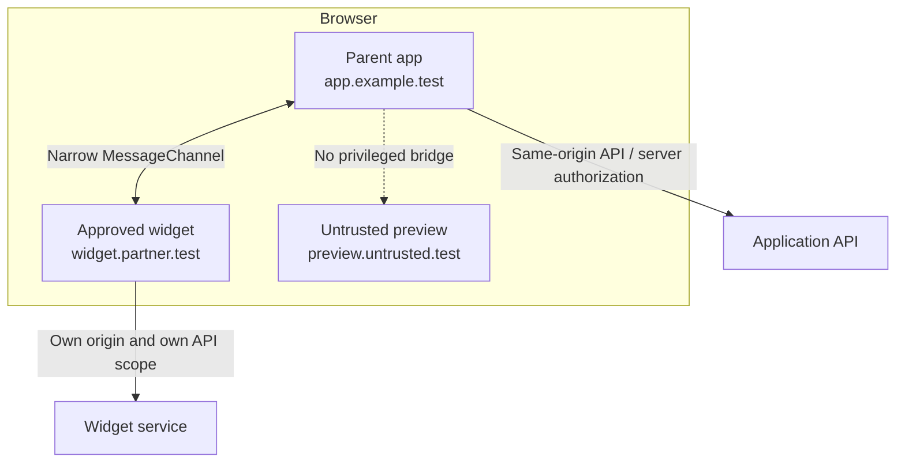

# Bảo vệ iframe và message

## Mục tiêu thực hành

Bài thực hành này xây dựng một trang quản lý dự án có hai loại iframe: một widget đáng tin cậy từ một origin đối tác đã được duyệt và một bản xem trước nội dung do người dùng cung cấp. Hai frame có mức tin cậy và nhu cầu giao tiếp khác nhau.

Sau bài này, bạn có thể:

- Phân biệt `frame-src`, `frame-ancestors`, `X-Frame-Options`, `sandbox` và `Permissions-Policy`.
- Giới hạn origin được nhúng và origin được phép nhúng ứng dụng.
- Giảm quyền của iframe bằng sandbox và chỉ ủy quyền browser feature khi cần.
- Phòng vệ clickjacking cho trang nhạy cảm.
- Thiết kế giao thức `postMessage` với `targetOrigin`, `event.origin`, `event.source` và schema validation.
- Dùng `MessageChannel` để tạo kênh giao tiếp hẹp sau khi xác minh bootstrap message.
- Xử lý opaque origin, navigation và vòng đời của iframe.
- Kiểm thử message giả, origin sai, frame không được phép và các tình huống điều hướng.

## 1. Bối cảnh bài toán

Một ứng dụng quản lý dự án chạy tại `https://app.example.test`. Trang chi tiết dự án cần nhúng hai thành phần:

1. **Project widget** tại `https://widget.partner.test`: hiển thị trạng thái công việc từ đối tác đã được phê duyệt. Widget cần chạy JavaScript và gửi kích thước giao diện về trang cha. Nó không cần quyền camera, microphone, geolocation hoặc quyền thực hiện thao tác quản trị.
2. **Content preview** tại `https://preview.untrusted.test`: hiển thị bản xem trước HTML do thành viên dự án tải lên. Nội dung này có thể chứa markup độc hại, vì vậy không được truy cập cookie/session của ứng dụng, không được mở popup, gửi form hoặc điều hướng tab cha.

Ứng dụng cũng có trang tài khoản và trang quản trị chứa dữ liệu nhạy cảm. Những trang này không được website bên ngoài nhúng để tạo clickjacking.

Kiến trúc mục tiêu:



Trang cha chỉ cho phép hai nguồn frame cụ thể. Widget được giao tiếp qua một giao thức hẹp. Preview chỉ hiển thị nội dung và không có kênh message đặc quyền.

## 2. Xác định trust boundary

Trước khi viết code, phân loại dữ liệu và hành động theo nguồn gốc.

| Thành phần | Mức tin cậy | Khả năng cần có | Điều không được phép |
| --- | --- | --- | --- |
| Parent app | Code do tổ chức kiểm soát; vẫn có thể bị XSS hoặc dependency compromise. | Quản lý giao diện, session và API nghiệp vụ. | Tin mọi message chỉ vì message đến từ iframe đang được nhúng. |
| Approved widget | Bên thứ ba đã được duyệt, nhưng chạy ở origin riêng. | Hiển thị trạng thái và gửi thông điệp resize/theme theo schema. | Nhận token/session của app hoặc yêu cầu hành động tùy ý. |
| Untrusted preview | Không tin cậy; nội dung có thể do attacker tạo. | Hiển thị bản xem trước trong sandbox. | Truy cập cookie/storage app, submit form, mở popup, điều hướng top-level hoặc gọi API đặc quyền qua parent. |
| Application API | Ranh giới authorization phía server. | Xác thực principal và kiểm tra quyền trên từng resource/action. | Tin origin, frame hoặc message như bằng chứng authorization. |

Một iframe cross-origin bị SOP giới hạn khả năng đọc DOM của frame khác. Tuy nhiên, SOP không ngăn mọi tương tác: parent có thể điều hướng iframe, iframe có thể gửi `postMessage`, và browser có thể gửi một số request. Do đó, cần kết hợp SOP với CSP, sandbox, Permissions Policy và kiểm tra message.

### 2.1. Đặt câu hỏi cho từng luồng

- Ai quyết định URL của iframe? Có thể bị điều khiển bằng query hoặc dữ liệu người dùng không?
- Frame có cần JavaScript, form, popup, download, storage hoặc browser device API không?
- Parent có cần nhận dữ liệu từ frame không? Dữ liệu nào là tối thiểu?
- Frame có thể yêu cầu parent thực hiện hành động đặc quyền nào?
- Frame có thể redirect hoặc điều hướng sang origin khác không?
- Nếu frame bị xâm nhập, thiệt hại tối đa là gì?
- Nếu parent bị XSS, giao thức message có còn bảo vệ được dữ liệu không?

Không bắt đầu từ danh sách sandbox token có sẵn rồi cấp tất cả. Hãy bắt đầu từ chức năng cần thiết và chỉ thêm token tương ứng.

## 3. Phân biệt các cơ chế bảo vệ iframe

Các cơ chế sau kiểm soát những hướng khác nhau:

| Cơ chế | Được cấu hình ở đâu? | Kiểm soát điều gì? |
| --- | --- | --- |
| CSP `frame-src` | Response của trang cha | Trang cha được phép tải nguồn iframe nào. |
| CSP `frame-ancestors` | Response của trang được nhúng | Origin nào được phép nhúng trang này. |
| `X-Frame-Options` | Response của trang được nhúng | Cơ chế legacy để hạn chế framing bằng `DENY` hoặc `SAMEORIGIN`. |
| iframe `sandbox` | Element iframe ở trang cha hoặc CSP sandbox | Giới hạn script, form, popup, navigation, origin và một số khả năng của frame. |
| iframe `allow` | Element iframe ở trang cha | Ủy quyền một số browser feature cho frame. |
| `Permissions-Policy` | Response của document cha | Giới hạn browser feature mà document và frame có thể dùng. |
| SOP | Browser thực thi | Giới hạn việc đọc DOM và dữ liệu giữa các origin. |
| `postMessage` | Code hai browsing context | Kênh giao tiếp có chủ đích giữa các context; ứng dụng phải xác minh và validate message. |

Không có một header duy nhất thay thế các cơ chế còn lại. Ví dụ, `frame-src` không ngăn website khác nhúng trang của bạn; `frame-ancestors` không quyết định trang cha được tải iframe nào; CORS không phải cơ chế kiểm soát việc nhúng iframe.

## 4. Giới hạn nguồn iframe bằng CSP

### 4.1. `frame-src` trên trang cha

Parent app chỉ cần nhúng widget và preview đã xác định. Response có thể dùng policy như sau:

```http
Content-Security-Policy: default-src 'self'; script-src 'self'; object-src 'none'; base-uri 'self'; frame-src https://widget.partner.test https://preview.untrusted.test; frame-ancestors 'none'
```

Trong policy này:

- `frame-src` giới hạn URL được tải vào iframe.
- `frame-ancestors 'none'` ngăn chính parent app bị website khác nhúng.
- `object-src 'none'` tắt plugin object/embed cũ.
- `base-uri 'self'` giới hạn URL base của document.

Chỉ đưa origin cần thiết vào `frame-src`. Tránh `frame-src *`, `https:` hoặc wildcard subdomain rộng nếu ứng dụng chỉ cần một vài widget cụ thể.

`frame-src` áp dụng cho các frame con được tạo từ document đó. Nếu có nested iframe, cần xem xét policy của từng document và các ancestor tương ứng.

### 4.2. `frame-ancestors` trên trang được nhúng

Widget chỉ được phép nhúng bởi parent app đã duyệt:

```http
Content-Security-Policy: default-src 'self'; script-src 'self'; object-src 'none'; base-uri 'self'; frame-ancestors https://app.example.test
```

`frame-ancestors` kiểm tra toàn bộ ancestor chain. Nếu widget nằm trong một iframe trung gian, mọi ancestor phải phù hợp với policy. Directive này cần được gửi bằng HTTP response header; khai báo trong thẻ `<meta>` không thay thế được.

Nếu widget không cần được nhúng ở bất kỳ nơi nào, dùng `frame-ancestors 'none'`. Nếu chỉ cần same-origin embedding, cân nhắc `'self'`.

### 4.3. `X-Frame-Options`

`X-Frame-Options: DENY` hoặc `SAMEORIGIN` vẫn có thể hữu ích cho tương thích legacy. Tuy nhiên, `ALLOW-FROM` đã lỗi thời và không phải cách hiện đại để allowlist nhiều origin. Với trang cần được nhúng cross-origin có kiểm soát, dùng CSP `frame-ancestors` và kiểm thử trên browser mục tiêu.

Không phát `X-Frame-Options: DENY` hoặc `SAMEORIGIN` cho widget nếu nó cần được `app.example.test` nhúng cross-origin; header này có thể chặn use case hợp lệ. Trang tài khoản/quản trị không cần nhúng nên có thể dùng `frame-ancestors 'none'` và policy legacy tương thích nếu cần.

## 5. Giới hạn quyền iframe bằng sandbox

Không có thuộc tính `sandbox`, iframe có thể thực hiện nhiều hành vi theo quyền của document và browser. Khi thêm `sandbox`, browser áp dụng tập giới hạn mặc định; mỗi token được thêm sẽ mở một khả năng cụ thể.

Một số token thường gặp:

| Token | Cho phép |
| --- | --- |
| `allow-scripts` | Script trong frame được thực thi. |
| `allow-same-origin` | Frame giữ origin thật thay vì nhận opaque origin do sandbox. |
| `allow-forms` | Form trong frame được submit. |
| `allow-popups` | Frame mở popup/window. |
| `allow-popups-to-escape-sandbox` | Popup mở ra không kế thừa sandbox theo quy tắc áp dụng. |
| `allow-top-navigation` | Frame có thể điều hướng top-level context. |
| `allow-top-navigation-by-user-activation` | Cho phép một số top-level navigation khi có user activation. |
| `allow-downloads` | Cho phép download từ frame theo policy browser. |
| `allow-modals` | Cho phép một số modal dialog như `alert`, `confirm`, `prompt`. |

Chỉ cấp token thật sự cần. Không dùng chuỗi token rộng như `allow-scripts allow-forms allow-popups allow-top-navigation allow-downloads` theo thói quen.

### 5.1. Widget đã duyệt

Widget cần JavaScript và giữ origin riêng để xác minh `postMessage` bằng origin chính xác. Có thể dùng:

```html
<iframe
  id="project-widget"
  title="Trạng thái dự án"
  sandbox="allow-scripts allow-same-origin"
  referrerpolicy="no-referrer">
</iframe>
```

`allow-same-origin` ở đây giữ origin `https://widget.partner.test` cho widget. Widget vẫn khác origin với `https://app.example.test`, nên SOP vẫn ngăn nó đọc DOM của parent. Hai token này chỉ hợp lý khi widget được phục vụ từ origin riêng đã kiểm soát.

Không dùng tổ hợp `allow-scripts allow-same-origin` cho nội dung cùng origin với parent. Khi frame cùng origin và được phép chạy script, script có thể truy cập frame element của chính nó, loại bỏ sandbox attribute rồi reload, làm mất ý nghĩa sandbox. Đặt nội dung không tin cậy trên origin riêng, tốt nhất là site riêng không chia sẻ cookie domain với ứng dụng.

### 5.2. Preview không tin cậy

Preview không cần script, form hoặc popup. Cấu hình tối thiểu:

```html
<iframe
  id="content-preview"
  src="https://preview.untrusted.test/render/preview-123"
  title="Bản xem trước nội dung"
  sandbox
  referrerpolicy="no-referrer">
</iframe>
```

Không có token sandbox nào được thêm, nên browser áp dụng các giới hạn mặc định. Nếu preview cần JavaScript để render một tính năng cụ thể, chỉ cân nhắc `allow-scripts`; giữ opaque origin bằng cách không thêm `allow-same-origin`, không cấp form/popup/top navigation và không cấp message bridge có quyền.

Opaque origin thường khiến `event.origin` của message từ frame là chuỗi `"null"`. Nhiều context khác nhau cũng có thể có origin serialization là `"null"`; không coi giá trị này là danh tính đáng tin. Nếu cần xác minh origin chính xác và trao đổi dữ liệu nhạy cảm, hãy dùng một origin riêng có định danh rõ thay vì opaque origin.

### 5.3. Sandbox không thay sanitization

Sandbox giảm khả năng của document được nhúng, nhưng không biến nội dung thành an toàn tuyệt đối. Nội dung vẫn có thể gây phishing trong vùng hiển thị, lừa người dùng bấm link, tiêu tốn tài nguyên hoặc khai thác lỗi browser. Hãy sanitize dữ liệu ở server khi có thể, giới hạn kích thước, loại bỏ resource không cần và hiển thị rõ đây là nội dung do người dùng cung cấp.

## 6. Permissions Policy cho iframe

Nếu parent không dùng camera, microphone, geolocation hoặc payment, hãy tắt các feature đó ở response:

```http
Permissions-Policy: camera=(), microphone=(), geolocation=(), payment=()
```

Nếu một widget được duyệt cần geolocation, chỉ ủy quyền cho origin đó và iframe cụ thể:

```http
Permissions-Policy: camera=(), microphone=(), geolocation=(self "https://widget.partner.test"), payment=()
```

```html
<iframe
  src="https://widget.partner.test/map"
  title="Bản đồ dự án"
  sandbox="allow-scripts allow-same-origin"
  allow="geolocation">
</iframe>
```

Header của parent giới hạn allowlist; thuộc tính `allow` của iframe tiếp tục giới hạn feature được ủy quyền cho frame. Browser permission của người dùng vẫn là một lớp riêng. Nếu widget không cần geolocation, bỏ directive/attribute tương ứng.

Không cấp camera, microphone hoặc geolocation cho preview không tin cậy. Kiểm thử cả trường hợp frame được cấp, không được cấp và browser không hỗ trợ feature.

## 7. Phòng vệ clickjacking

Clickjacking xảy ra khi attacker đặt trang thật trong iframe hoặc lớp giao diện chồng lên để khiến người dùng bấm vào thành phần nhạy cảm mà họ không nhận ra. Một trang quản trị có thể bị nhúng trong website khác rồi phủ lớp trong suốt để lừa người dùng bấm nút thay đổi quyền.

### 7.1. Bảo vệ trang nhạy cảm

Với trang không cần embedding:

```http
Content-Security-Policy: frame-ancestors 'none'
```

Có thể thêm `X-Frame-Options: DENY` cho browser legacy theo ma trận hỗ trợ. Với trang chỉ được nhúng bởi portal nội bộ:

```http
Content-Security-Policy: frame-ancestors https://portal.example.test
```

Allowlist phải chứa origin chính xác. Không dùng wildcard rộng hoặc chỉ kiểm tra chuỗi hostname.

### 7.2. Những cách không đủ

- JavaScript frame-busting như `if (top !== self) top.location = self.location` không phải biện pháp bảo vệ đáng tin cậy; sandbox và browser policy có thể chặn, đồng thời code có thể bị vô hiệu hóa.
- Ẩn nút bằng CSS không ngăn attacker nhúng trang hoặc tạo overlay.
- CORS không ngăn clickjacking.
- SameSite cookie không thay thế frame policy.
- Chỉ kiểm tra `window.top` trong client không thay thế `frame-ancestors` ở response.

### 7.3. Defense in depth cho hành động nhạy cảm

Với thao tác như đổi email, thêm administrator, export dữ liệu hoặc thanh toán:

- Xác minh quyền ở server cho từng resource/action.
- Dùng re-authentication hoặc step-up authentication khi rủi ro cao.
- Yêu cầu CSRF proof cho cookie-authenticated state-changing request.
- Hiển thị thông tin xác nhận rõ ràng, không chỉ dựa vào vị trí nút.
- Không để parent/iframe message tự động thực hiện hành động nhạy cảm mà không có user intent hợp lệ.

Frame policy ngăn một số đường nhúng; authorization vẫn là ranh giới cuối cùng cho dữ liệu và hành động.

## 8. Thiết kế giao thức postMessage

`window.postMessage()` cho phép hai browsing context trao đổi dữ liệu ngay cả khi khác origin. Đây là API giao tiếp có chủ đích; browser không áp CORS cho message. Vì vậy, ứng dụng phải tự xác minh người gửi và dữ liệu.

### 8.1. Gửi với targetOrigin chính xác

Không gửi dữ liệu cho `"*"` nếu đã biết origin đích:

```js
const WIDGET_ORIGIN = "https://widget.partner.test";

iframe.contentWindow.postMessage(
  { type: "SET_THEME", version: 1, theme: "dark" },
  WIDGET_ORIGIN
);
```

Browser chỉ chuyển message nếu document ở cửa sổ đích có origin khớp `targetOrigin` tại thời điểm gửi. Điều này giảm nguy cơ message bị gửi nhầm sau khi iframe bị điều hướng sang origin khác.

### 8.2. Kiểm tra origin và source ở bên nhận

```js
const PARENT_ORIGIN = "https://app.example.test";

window.addEventListener("message", (event) => {
  if (event.origin !== PARENT_ORIGIN) return;
  if (event.source !== window.parent) return;
  if (!event.data || typeof event.data !== "object") return;
  if (event.data.type !== "SET_THEME") return;
  if (event.data.version !== 1) return;
  if (event.data.theme !== "light" && event.data.theme !== "dark") return;

  document.documentElement.dataset.theme = event.data.theme;
});
```

Hai kiểm tra có ý nghĩa khác nhau:

- `event.origin` xác minh origin của context gửi message tại thời điểm gửi.
- `event.source` xác minh message đến từ browsing context/window dự kiến, ví dụ `window.parent` hoặc `iframe.contentWindow`.

Không chỉ kiểm tra `event.data.source === "trusted-app"`; attacker có thể tự tạo field đó. Không dùng kiểm tra chuỗi con như `event.origin.includes("example.test")`; hãy so sánh origin đã chuẩn hóa chính xác.

### 8.3. Validate schema và giới hạn dữ liệu

Sau khi xác minh origin/source, vẫn phải validate payload:

- `event.data` phải có kiểu dữ liệu mong đợi.
- `type` nằm trong allowlist message type.
- `version` đúng phiên bản protocol.
- Field bắt buộc có đúng kiểu và giới hạn độ dài/số lượng.
- URL phải được parse và kiểm tra origin/path nếu protocol thật sự cần URL.
- Numeric value phải có miền hợp lệ; không đưa trực tiếp vào CSS/HTML tùy ý.
- Từ chối field lạ nếu schema yêu cầu chính xác.
- Giới hạn tần suất message để tránh spam hoặc làm UI treo.

Không chuyển message thành lệnh tổng quát như `execute(action, args)` hoặc đưa chuỗi vào `eval`, `innerHTML`, `document.write` hay `new Function`. Mỗi message type nên tương ứng với một hành động hẹp và có quyền rõ ràng.

### 8.4. Không gửi secret qua message

Không gửi session cookie, access token, refresh token, CSRF secret, API key hoặc dữ liệu cá nhân mà widget không cần. Một widget bên thứ ba có thể bị xâm nhập dù origin đã được allowlist. Chỉ truyền dữ liệu tối thiểu như trạng thái hiển thị hoặc theme.

Nếu widget cần dữ liệu nghiệp vụ, parent nên gọi API đã authorization rồi gửi đúng phần dữ liệu được phép. Server vẫn phải xác minh quyền; message không phải bằng chứng user có quyền xem resource.

## 9. Dùng MessageChannel sau handshake

Với giao tiếp hai chiều thường xuyên, `MessageChannel` tạo một cặp `MessagePort`. Parent chuyển một port cho iframe sau khi xác minh origin/source của bootstrap message. Các message tiếp theo đi qua port đã cấp, thay vì để mọi script trong window cùng lắng nghe một event toàn cục.

MessagePort là capability: ai sở hữu port có thể gửi message trên kênh đó. Vì vậy, chỉ chuyển port cho frame đã xác minh, không để lộ port cho script không cần và chỉ cung cấp protocol hẹp.

### 9.1. HTML của parent

```html
<iframe
  id="project-widget"
  title="Trạng thái dự án"
  sandbox="allow-scripts allow-same-origin"
  referrerpolicy="no-referrer">
</iframe>
```

Parent đặt `src` sau khi đã gắn `load` listener để không bỏ lỡ lần tải đầu:

```js
const WIDGET_ORIGIN = "https://widget.partner.test";
const frame = document.querySelector("#project-widget");
let activePort = null;
let connectionVersion = 0;

function isRecord(value) {
  return value !== null && typeof value === "object" && !Array.isArray(value);
}

function handleWidgetMessage(data, currentConnection) {
  if (currentConnection !== connectionVersion) return;
  if (!isRecord(data) || data.version !== 1) return;

  if (data.type === "READY") {
    document.documentElement.dataset.widgetState = "ready";
    return;
  }

  if (data.type === "RESIZE") {
    if (!Number.isInteger(data.height)) return;
    if (data.height < 160 || data.height > 640) return;
    frame.style.height = `${data.height}px`;
  }
}

frame.addEventListener("load", () => {
  activePort?.close();
  activePort = null;
  connectionVersion += 1;

  const currentConnection = connectionVersion;
  const channel = new MessageChannel();
  activePort = channel.port1;
  activePort.onmessage = ({ data }) => {
    handleWidgetMessage(data, currentConnection);
  };
  activePort.start();

  frame.contentWindow.postMessage(
    { type: "INIT", version: 1 },
    WIDGET_ORIGIN,
    [channel.port2]
  );
});

frame.src = `${WIDGET_ORIGIN}/embed/project-status`;

function setWidgetTheme(theme) {
  if (theme !== "light" && theme !== "dark") return;
  activePort?.postMessage({ type: "SET_THEME", version: 1, theme });
}
```

Điểm quan trọng:

- URL iframe là hằng số/allowlist; không nối trực tiếp dữ liệu người dùng vào hostname.
- `targetOrigin` là origin chính xác.
- Parent đóng port cũ và tăng connection version mỗi lần frame load lại.
- Parent chỉ chấp nhận `READY` và `RESIZE` theo schema.
- Chiều cao được giới hạn trong miền hợp lệ; widget không thể yêu cầu parent điều hướng hoặc gọi API tùy ý.
- `setWidgetTheme()` chỉ gửi hai giá trị đã allowlist.

Trong code production, kiểm tra phần tử tồn tại, xử lý `postMessage` có thể ném lỗi khi frame không sẵn sàng và dọn port khi component unmount. Nếu frame có thể được điều hướng bởi user, cần xử lý navigation/error state và kết nối lại có kiểm soát.

### 9.2. JavaScript của widget

Widget chỉ chấp nhận bootstrap message từ parent origin và đúng window cha:

```js
const PARENT_ORIGIN = "https://app.example.test";
let activePort = null;

function isRecord(value) {
  return value !== null && typeof value === "object" && !Array.isArray(value);
}

window.addEventListener("message", (event) => {
  if (event.origin !== PARENT_ORIGIN) return;
  if (event.source !== window.parent) return;
  if (!isRecord(event.data)) return;
  if (event.data.type !== "INIT" || event.data.version !== 1) return;
  if (event.ports.length !== 1) return;

  activePort?.close();
  activePort = event.ports[0];

  activePort.onmessage = ({ data }) => {
    if (!isRecord(data) || data.version !== 1) return;

    if (data.type === "SET_THEME") {
      if (data.theme !== "light" && data.theme !== "dark") return;
      document.documentElement.dataset.theme = data.theme;
    }
  };

  activePort.start();
  activePort.postMessage({ type: "READY", version: 1 });
});

function reportHeight() {
  if (!activePort) return;
  const height = Math.ceil(document.documentElement.scrollHeight);
  if (!Number.isInteger(height) || height < 160 || height > 640) return;
  activePort.postMessage({ type: "RESIZE", version: 1, height });
}
```

Widget không nhận URL tùy ý, không nhận token và không có message type như `FETCH_URL`, `EXECUTE`, `OPEN_ADMIN` hoặc `DELETE_RESOURCE`. Nếu cần thêm chức năng, hãy thêm message type cụ thể, validate field và xác định quyền server-side tương ứng.

MessagePort không tự mang `origin` trong từng message. Bên nhận tin cậy port dựa trên việc nó được chuyển qua bootstrap đã kiểm tra. Vì vậy, việc xác minh `event.origin`/`event.source` trước khi chuyển port là quan trọng; sau đó vẫn cần schema validation cho mọi message qua port.

### 9.3. Giới hạn của handshake

Handshake xác minh frame ở origin và window dự kiến tại thời điểm kết nối. Nó không chứng minh code trong widget không có lỗ hổng, không bảo vệ widget khỏi XSS của chính origin widget và không bảo vệ parent nếu parent origin đã bị XSS. `connectionVersion` giúp bỏ qua message từ kết nối cũ trong ví dụ; nó không phải credential hay cơ chế authorization.

Nếu giao thức cần request-response, dùng request ID ngẫu nhiên, timeout, allowlist operation và schema cho response. Không dùng request ID như bằng chứng người dùng đã đồng ý. Với hành động nhạy cảm, parent phải yêu cầu user intent phù hợp và server phải authorize độc lập.

## 10. Opaque origin và message từ sandbox

Iframe sandbox không có `allow-same-origin` thường nhận opaque origin. Khi gửi message, `event.origin` có thể là `"null"`. Không thể phân biệt các opaque origin khác nhau chỉ bằng chuỗi này.

Quy tắc an toàn:

- Không coi `event.origin === "null"` là trusted origin.
- Không gửi secret đến opaque-origin frame.
- Không dùng `targetOrigin: "*"` cho dữ liệu nhạy cảm.
- Nếu cần trao đổi, chỉ truyền capability rất hẹp đến đúng `contentWindow` và validate `event.source` cùng schema.
- Tốt hơn, dùng một origin riêng có tên rõ ràng cho widget cần xác minh origin chính xác.
- Không cấp quyền gọi API đặc quyền cho preview opaque-origin.

Với frame opaque-origin, browser có thể yêu cầu `targetOrigin: "*"` để gửi message vì không có origin cụ thể để so khớp. Đây là lý do nên tránh thiết kế giao thức nhạy cảm dựa trên opaque-origin frame. Nếu buộc phải dùng, chỉ gửi dữ liệu không nhạy cảm và chỉ cấp một kênh có khả năng tối thiểu; không biến nó thành proxy cho quyền parent.

## 11. Navigation, redirect và vòng đời iframe

Iframe có thể tải lại, redirect, thay đổi `src`, bị remove hoặc được tạo lại bởi SPA. Một message gửi đến `contentWindow` có thể bị giao cho document khác nếu frame đã điều hướng trước khi message được xử lý; `targetOrigin` chính xác giúp browser bỏ message khi origin đích không khớp tại thời điểm gửi.

Khi quản lý lifecycle:

- Dùng URL cố định hoặc allowlist, không lấy `src` trực tiếp từ dữ liệu người dùng.
- Gắn listener trước khi đặt `src`.
- Đóng MessagePort cũ khi frame load lại hoặc component unmount.
- Tạo handshake mới cho document mới.
- Bỏ qua message thuộc connection version cũ.
- Không giữ quyền hoặc trạng thái nhạy cảm chỉ vì iframe vẫn tồn tại.
- Xử lý timeout, frame load error và partner outage.
- Khi đổi account hoặc logout, đóng channel và xóa dữ liệu được cấp cho widget.

Không giả định redirect giữ nguyên origin hoặc frame luôn tải đúng URL ban đầu. CSP `frame-src` giới hạn nguồn frame được tải, còn `frame-ancestors` của response đích kiểm soát ai được nhúng nó; hãy kiểm tra cả hai phía.

## 12. CORS, SOP và postMessage không thay thế nhau

Ba cơ chế thường bị nhầm:

| Cơ chế | Áp dụng cho | Vai trò |
| --- | --- | --- |
| SOP | Document/window/storage giữa origin | Giới hạn việc đọc dữ liệu cross-origin. |
| CORS | Một số request cross-origin do script khởi tạo | Cho phép JavaScript đọc response khi server cấp quyền. |
| `postMessage` | Giao tiếp giữa browsing context | Cho phép trao đổi có chủ đích qua ranh giới origin; code phải kiểm tra sender và payload. |

Một parent có thể nhúng iframe cross-origin mà không cần CORS. Parent không được tự do đọc DOM của iframe, nhưng có thể gửi message. CORS không xác minh message và không giới hạn hành động mà receiver thực hiện. Nếu widget gọi API của riêng nó, request đó chịu các quy tắc CORS/API của widget origin.

Không bật `Access-Control-Allow-Origin: *` để sửa lỗi iframe hoặc `postMessage`. Hãy xác định đúng cơ chế đang chặn hành vi.

## 13. Tích hợp CSRF và authorization cho message

Giả sử widget gửi message `REQUEST_EXPORT`. Parent không nên biến message này thành lệnh gọi API ngay lập tức. Nếu sản phẩm thật sự cần hành động đó:

1. Chỉ chấp nhận message từ origin/source đã xác minh và đúng channel.
2. Validate schema, resource identifier và protocol version.
3. Hiển thị xác nhận rõ ràng cho người dùng nếu hành động nhạy cảm.
4. Gửi request đến backend bằng session hiện tại và CSRF proof nếu dùng cookie authentication.
5. Backend xác minh session, CSRF, role, tenant và quyền trên resource.
6. Ghi audit event với request ID; không log token hoặc dữ liệu nhạy cảm.

Origin hợp lệ chỉ chứng minh message đến từ context có origin đó. Nó không chứng minh user đã đồng ý, widget không bị compromise hoặc resource nằm trong quyền của user.

Không cho phép iframe quyết định `userId`, `tenantId`, role hoặc authorization scope. Backend lấy principal từ session/token đã xác thực và tự kiểm tra quyền.

## 14. Tích hợp CSP, Referrer-Policy và cookie

Một cấu hình mẫu cho parent app:

```http
Content-Security-Policy: default-src 'self'; script-src 'self'; object-src 'none'; base-uri 'self'; frame-src https://widget.partner.test https://preview.untrusted.test; frame-ancestors 'none'; connect-src 'self' https://api.example.test
Referrer-Policy: no-referrer
Permissions-Policy: camera=(), microphone=(), geolocation=(), payment=()
X-Content-Type-Options: nosniff
```

Widget response:

```http
Content-Security-Policy: default-src 'self'; script-src 'self'; object-src 'none'; base-uri 'self'; frame-ancestors https://app.example.test
Referrer-Policy: no-referrer
X-Content-Type-Options: nosniff
Cache-Control: private, no-store
```

Các header cần điều chỉnh theo resource thực tế. Parent `frame-src` cho phép tải hai frame; widget `frame-ancestors` chỉ cho phép app nhúng. Preview nên có CSP riêng, không cần script nếu chỉ hiển thị nội dung tĩnh và không chia sẻ cookie/session với app.

Không dùng cookie Domain rộng như `.example.test` nếu các subdomain có mức tin cậy khác nhau. Đặc biệt, nội dung do người dùng kiểm soát nên được phục vụ từ site riêng, không có cookie xác thực của ứng dụng. `HttpOnly` ngăn JavaScript đọc cookie nhưng không ngăn browser gửi cookie trong mọi request context; hãy kết hợp SameSite và CSRF defense phù hợp.

## 15. Bài lab tích hợp

### 15.1. Chuẩn bị môi trường

Tạo ba hostname HTTPS trong staging:

```text
https://app.example.test          Parent application
https://widget.partner.test      Approved widget
https://preview.untrusted.test   User content preview
```

Yêu cầu môi trường:

- Dùng certificate test hợp lệ và không trỏ hostname vào production.
- Parent và widget có origin khác nhau; preview nằm trên site riêng.
- Không dùng cookie production hoặc tài khoản thật.
- Widget chỉ trả dữ liệu fixture và không có quyền gọi API quản trị.
- Preview dùng marker vô hại để kiểm tra script/form/popup bị giới hạn.
- Bật log request ID và CSP report ở staging; không log cookie/token.

### 15.2. Cấu hình parent

1. Đặt CSP `frame-src` chỉ cho `widget.partner.test` và `preview.untrusted.test`.
2. Đặt `frame-ancestors 'none'` cho parent app.
3. Đặt `Permissions-Policy` tắt camera, microphone, geolocation và payment nếu parent không cần.
4. Nhúng widget với sandbox tối thiểu cho JavaScript và origin riêng.
5. Nhúng preview với sandbox rỗng, không cấp form/script/popup/top navigation.
6. Đặt `referrerpolicy="no-referrer"` nếu frame không cần referrer.
7. Đăng ký listener trước khi gán `src` và chỉ dùng URL allowlist.

### 15.3. Cấu hình widget

1. Trả `frame-ancestors https://app.example.test`.
2. Không trả X-Frame-Options mâu thuẫn với yêu cầu embed cross-origin.
3. Chỉ chạy script đóng gói từ origin widget.
4. Tạo `MessageChannel` sau khi nhận INIT từ đúng parent origin/source.
5. Chỉ gửi `READY` và `RESIZE`; chỉ nhận `SET_THEME`.
6. Validate version, type, field và giới hạn height.
7. Đóng port cũ khi nhận handshake mới hoặc document bị unload.

### 15.4. Cấu hình preview

1. Phục vụ nội dung từ origin riêng, không có session cookie của parent.
2. Sanitize nội dung nếu cần render rich text; không dùng HTML sink với dữ liệu thô.
3. Không cấp script, form, popup, download hoặc top navigation nếu không có yêu cầu rõ.
4. Không tạo bridge `postMessage` có quyền truy cập parent.
5. Giới hạn kích thước document và resource tải về.
6. Nếu phải hỗ trợ script trong preview, chỉ thêm `allow-scripts`, giữ opaque origin và không truyền secret.

### 15.5. Kiểm tra clickjacking

1. Từ `https://attacker.test`, thử nhúng parent app.
2. Xác nhận browser chặn do `frame-ancestors 'none'`.
3. Thử nhúng widget từ origin không được phép.
4. Xác nhận widget chặn ancestor không nằm trong allowlist.
5. Thử trang tài khoản/quản trị và xác nhận không render trong frame ngoài.
6. Kiểm tra response thực tế qua CDN/gateway để bảo đảm header không bị xóa hoặc ghi đè.

### 15.6. Kiểm tra message

1. Gửi INIT từ parent đúng origin/source; widget trả READY.
2. Gửi INIT từ attacker origin; widget bỏ qua.
3. Gửi message cùng origin nhưng từ một frame khác; widget bỏ qua do `event.source` không phải `window.parent`.
4. Gửi message sai version, type không allowlist hoặc thiếu port; widget không kết nối.
5. Gửi `RESIZE` có height âm, quá lớn, chuỗi hoặc object; parent không thay đổi layout.
6. Gửi type như `EXECUTE`, `FETCH_URL` hoặc `DELETE_RESOURCE`; parent/widget bỏ qua.
7. Điều hướng iframe sang URL khác rồi tải lại; port cũ bị đóng và handshake mới chỉ thành công với origin đúng.
8. Xóa iframe/unmount component; không còn listener/port hoạt động.
9. Đăng xuất parent; đóng channel và xóa dữ liệu đã gửi cho widget.

## 16. Playwright test mẫu

### 16.1. Xác minh message handshake hợp lệ

Test chạy trong staging có hai origin đã cấu hình:

```ts
import { test, expect } from "@playwright/test";

test("approved widget establishes a narrow message channel", async ({ page }) => {
  await page.goto("https://app.example.test/projects/test-project");

  await expect(page.locator("html")).toHaveAttribute("data-widget-state", "ready");

  await page.getByRole("button", { name: "Use dark theme" }).click();
  await expect(page.frameLocator("#project-widget").locator("html"))
    .toHaveAttribute("data-theme", "dark");
});
```

Ví dụ này giả định parent có nút “Use dark theme” gọi `setWidgetTheme("dark")`. Test kiểm tra kết quả ở document của widget qua Playwright frame locator; nó không yêu cầu parent expose MessagePort cho test code.

### 16.2. Xác minh frame-src chặn origin ngoài allowlist

```ts
test("parent CSP blocks an unapproved frame origin", async ({ page }) => {
  await page.goto("https://app.example.test/projects/test-project");

  const violation = page.evaluate(() => new Promise<string>((resolve) => {
    document.addEventListener("securitypolicyviolation", (event) => {
      if (event.violatedDirective === "frame-src") {
        resolve(event.violatedDirective);
      }
    }, { once: true });
  }));

  await page.evaluate(() => {
    const frame = document.createElement("iframe");
    frame.src = "https://attacker.test/frame";
    document.body.append(frame);
  });

  await expect(violation).resolves.toBe("frame-src");
});
```

Fixture phải không cho phép `attacker.test` trong `frame-src`. Có thể kiểm tra thêm CSP report endpoint hoặc browser console, nhưng không ghi URL/query nhạy cảm vào report.

### 16.3. Kiểm tra sandbox preview

Trong staging, đưa vào preview marker script/form/popup vô hại. Xác nhận script không chạy, form không submit, popup/top navigation không mở và parent không nhận privileged message. Nếu preview có `allow-scripts`, kiểm tra script chỉ chạy trong opaque origin và không đọc cookie/storage của app.

### 16.4. Kiểm tra sai nguồn message

Mở một trang attacker chứa iframe widget rồi gửi INIT có cùng schema. Widget không được kết nối vì `event.origin` không khớp `PARENT_ORIGIN`. Tạo thêm một iframe khác cùng origin attacker để kiểm tra `event.source`; chỉ đúng `window.parent` mới được chấp nhận.

Không chỉ assert rằng handler không throw. Hãy xác nhận không có `READY`, không tạo port active và không có state/UI thay đổi ngoài dự kiến.

## 17. Ma trận kiểm thử bảo mật

| Nhóm | Tình huống | Kết quả mong đợi |
| --- | --- | --- |
| Parent CSP | Tải iframe từ origin được allowlist | Frame được tải. |
| Parent CSP | Tải iframe từ origin ngoài allowlist | Browser chặn theo `frame-src`. |
| Child CSP | Widget được app origin nhúng | Cho phép theo `frame-ancestors`. |
| Child CSP | Widget bị attacker origin nhúng | Browser chặn framing. |
| Clickjacking | Trang account/admin bị nhúng ngoài allowlist | Protected page không render trong frame. |
| Sandbox widget | Script được yêu cầu | Chỉ script được phép; popup/top navigation vẫn bị giới hạn. |
| Sandbox preview | Nội dung không tin cậy | Script/form/popup bị chặn theo sandbox rỗng. |
| Origin isolation | Preview thử đọc parent DOM/cookie | Bị SOP/sandbox ngăn; không có credential của app trong preview. |
| Message origin | Message từ đúng widget origin | Có thể qua bước kiểm tra origin. |
| Message source | Message từ window khác cùng origin | Bị từ chối do source không đúng. |
| Message schema | Type/version/field sai | Bị từ chối, không side effect. |
| Message bounds | Height âm hoặc quá lớn | Bị từ chối, layout không đổi. |
| Message capability | Widget yêu cầu action tùy ý | Không có handler tương ứng; không gọi API. |
| Opaque origin | `event.origin` là `null` | Không được coi là trusted identity. |
| Navigation | Frame reload/redirect | Port cũ đóng; handshake mới được xác minh. |
| Logout | Parent session kết thúc | Channel đóng và dữ liệu riêng tư được dọn. |
| Permissions Policy | Frame thử camera/geolocation không được cấp | Browser từ chối feature. |
| Referrer | Frame được tải | Không gửi referrer ngoài policy đã chọn. |
| API authorization | Message hợp lệ yêu cầu resource không thuộc user | Backend từ chối độc lập với message. |

## 18. Những lỗi thường gặp

| Lỗi | Hậu quả | Cách khắc phục |
| --- | --- | --- |
| Chỉ dùng `frame-src` để bảo vệ trang khỏi clickjacking | Website khác vẫn có thể nhúng trang nếu response không có frame-ancestors/XFO phù hợp. | Đặt `frame-ancestors` trên document cần bảo vệ. |
| Dùng `frame-ancestors` để giới hạn iframe mà parent tải | Parent vẫn có thể tải frame ngoài dự kiến. | Dùng `frame-src` trên parent. |
| Cấp mọi sandbox token | Frame có thể submit form, mở popup hoặc điều hướng ngoài nhu cầu. | Chỉ cấp token tối thiểu theo feature. |
| Kết hợp `allow-scripts allow-same-origin` với frame cùng origin parent | Script trong frame có thể phá bỏ sandbox theo điều kiện phù hợp. | Dùng origin riêng; tránh tổ hợp này với same-origin content. |
| Dùng `targetOrigin: "*"` cho widget đã biết origin | Message có thể đến document khác sau navigation. | Dùng origin đích chính xác. |
| Chỉ kiểm tra `event.data.source` | Attacker tự tạo field giống hệt. | Kiểm tra `event.origin` và `event.source`. |
| Chỉ kiểm tra origin mà không kiểm tra source | Một window khác cùng origin có thể gửi message. | Xác minh cả browsing context dự kiến. |
| Tin message sau khi kiểm tra origin | Payload vẫn có thể sai kiểu, quá lớn hoặc yêu cầu hành động nguy hiểm. | Validate schema, type, bounds và rate. |
| Dùng message type tổng quát `EXECUTE` | Iframe có thể trở thành proxy cho API đặc quyền. | Protocol hẹp, action allowlist và authorization server-side. |
| Coi CORS là kiểm soát postMessage | CORS không xác thực hoặc lọc window message. | Xây dựng sender validation riêng. |
| Tin `event.origin === "null"` | Nhiều opaque context có thể có cùng serialization. | Không dùng null làm trusted origin; tránh bridge nhạy cảm. |
| Không đóng MessagePort khi frame reload | Kết nối cũ có thể tiếp tục xử lý state/message không còn hợp lệ. | Đóng port, tăng generation và handshake lại. |
| Chỉ dùng JavaScript frame-busting | Có thể bị sandbox hoặc browser policy vô hiệu hóa. | Dùng CSP `frame-ancestors` và policy legacy phù hợp. |

## 19. Checklist trước khi release

### Frame policy

- [ ] Parent có `frame-src` allowlist chính xác.
- [ ] Trang nhạy cảm có `frame-ancestors 'none'` hoặc allowlist hẹp.
- [ ] Widget cross-origin có `frame-ancestors` chỉ cho parent đã duyệt.
- [ ] Không có `X-Frame-Options` mâu thuẫn với use case embed.
- [ ] CSP được gửi bằng response header và được xác minh qua CDN/gateway.

### Sandbox và permissions

- [ ] Mỗi iframe có sandbox token tối thiểu.
- [ ] Nội dung không tin cậy không cùng origin/site với app và không có session cookie của app.
- [ ] Không dùng `allow-scripts allow-same-origin` cho content cùng origin parent.
- [ ] Permissions Policy tắt feature không cần; iframe chỉ được ủy quyền feature cụ thể.
- [ ] Không cấp popup, form, download hoặc top navigation nếu không có lý do.

### Message protocol

- [ ] Gửi message với `targetOrigin` chính xác.
- [ ] Bên nhận kiểm tra `event.origin` và `event.source`.
- [ ] Payload có schema/version/type allowlist và giới hạn kích thước/giá trị.
- [ ] Không dùng `eval`, `innerHTML` hoặc generic command dispatch với message.
- [ ] Không gửi token, cookie, CSRF secret hoặc dữ liệu không cần thiết.
- [ ] MessagePort chỉ được chuyển sau bootstrap đã xác minh và được đóng khi frame thay đổi.
- [ ] Hành động nhạy cảm vẫn cần user intent, CSRF và server authorization.

### Kiểm thử và vận hành

- [ ] Có test allow/deny cho frame-src và frame-ancestors.
- [ ] Có test clickjacking cho trang tài khoản/quản trị.
- [ ] Có test message origin/source/schema sai.
- [ ] Có test navigation, reload, logout và cleanup.
- [ ] Có test browser feature bị Permissions Policy chặn.
- [ ] Log không chứa token, cookie, raw message payload hoặc dữ liệu cá nhân không cần thiết.
- [ ] Có owner và quy trình review khi thêm widget/origin/frame mới.

## 20. Kết quả cần nộp

Sau khi hoàn thành lab, chuẩn bị các artifact sau trong môi trường thực hành của nhóm:

1. Sơ đồ trust boundary gồm parent, widget, preview, API và các origin.
2. Bản CSP/Permissions Policy cho parent và từng frame, kèm lý do cho mỗi origin/feature được phép.
3. Danh sách sandbox token của từng iframe và nhu cầu chức năng tương ứng.
4. Message protocol có type, version, schema, hướng gửi/nhận và quyền của từng message.
5. Bằng chứng test clickjacking, frame-src, frame-ancestors, sandbox và message validation.
6. Kết quả test navigation/reload/logout chứng minh channel cũ được đóng.
7. Danh sách giới hạn còn lại, browser/version đã thử và owner chịu trách nhiệm.

Không đưa cookie, token, dữ liệu tài khoản hoặc HAR thô vào artifact. Dùng marker và account giả.

Hoàn thành bài thực hành khi parent chỉ nhúng origin đã duyệt, trang nhạy cảm không bị clickjack, preview không tin cậy bị sandbox chặt, widget chỉ trao đổi message theo schema hẹp qua channel đã xác minh, và mọi hành động nghiệp vụ vẫn được server authorize độc lập.
