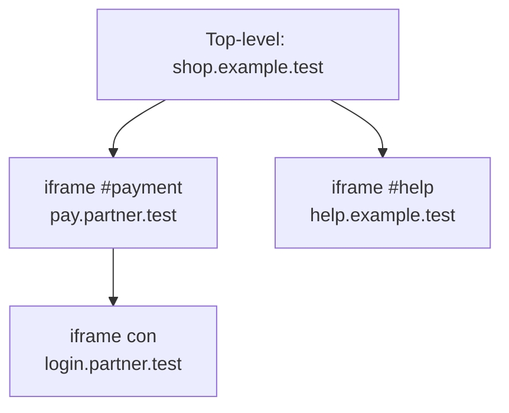
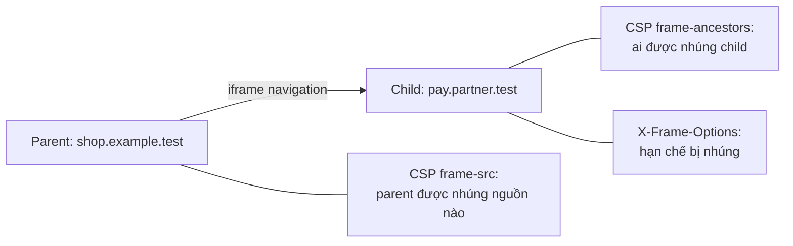

# Điều hướng frame: cơ chế navigation, quyền hạn và ranh giới bảo mật

## Mục tiêu học tập

Sau bài học, người học có thể:

1. Phân biệt **frame**, **document**, **navigable**, **frame tree** và thao tác **navigation** trong trình duyệt.
2. Giải thích vai trò của `<iframe src>`, `<a target>`, `<form target>`, `window.location` và `window.open()` khi điều hướng frame.
3. Phân biệt **quyền yêu cầu điều hướng** với **quyền đọc DOM và dữ liệu** của document sau điều hướng theo Same-Origin Policy (SOP).
4. Xác định tác động của **user activation**, `iframe sandbox`, **CSP `frame-src`/`frame-ancestors`**, **X-Frame-Options** và chính sách browser đến navigation.
5. Phân tích các rủi ro **clickjacking, framebusting, open redirect, CSRF**, thay đổi origin sau navigation và giao tiếp `postMessage`.
6. Thực hành đối chiếu URL, response headers, Network và Console để xác minh hành vi điều hướng trên các frame khác origin.

> **Phạm vi:** Bài thuộc chương **Navigation** trong module **Browser Security**. Để bảo vệ ứng dụng web, cần phân biệt những ranh giới mà **SOP, CORS, Site Isolation, cookie, CSP, Trusted Types và security headers** thực thi. Bài sử dụng thuật ngữ hiện đại của HTML và cách các trình duyệt phổ biến xử lý iframe. Chi tiết về quyền điều hướng có thể thay đổi theo engine, phiên bản, sandbox và thao tác người dùng.

## 1. Frame và navigation là gì?

Một **frame** là vùng hiển thị có ngữ cảnh duyệt riêng bên trong một trang. Trong HTML hiện đại, thành phần thường gặp là `<iframe>`. Mỗi frame có một **document đang hoạt động** và có thể chứa các iframe khác, tạo thành **frame tree**.

**Navigation (điều hướng)** là quá trình yêu cầu một **navigable** chuyển đến URL/document đích. Khái niệm *navigable* trong HTML Standard mô tả đối tượng có thể được điều hướng; tài liệu cũ thường diễn đạt bằng *browsing context*.

Các ví dụ điển hình:

- Người dùng nhấn liên kết bên trong iframe và **chính iframe** tải một trang khác.
- Parent sửa `iframe.src` để thay tài liệu nhúng.
- Một liên kết trong iframe có `target="_top"` yêu cầu mở URL ở **trang cấp cao nhất**.
- Script của frame gọi `location.assign()` hoặc `location.replace()`.
- Một form dùng `target` để gửi request rồi điều hướng frame nhận kết quả.

### Những đối tượng không nên đánh đồng

| Đối tượng | Vai trò | Điều gì xảy ra khi navigation? |
| --- | --- | --- |
| **`<iframe>` element** | Phần tử trên DOM parent để nhúng nội dung | Thường tồn tại qua nhiều lần tải document của frame |
| **Document** | DOM, script và origin của nội dung đang hiển thị | Cross-document navigation có thể thay toàn bộ document |
| **WindowProxy** (`iframe.contentWindow`) | Tham chiếu bên ngoài đến cửa sổ của frame | Có thể giữ cùng tham chiếu tới frame trong khi Window/document bên trong thay đổi |
| **Origin** | Ranh giới quyền web, thường theo scheme + host + port | Có thể thay đổi theo document đích |
| **Renderer process** | Tiến trình xử lý web trong browser đa tiến trình | Có thể đổi khi điều hướng, đặc biệt cross-site; không đồng nhất với frame |
| **Session history** | Các mục lịch sử duyệt | Navigation có thể thêm mục mới hoặc thay mục hiện tại |

Ví dụ một cây frame:



Frame tree biểu diễn **quan hệ nhúng**. Nó không cho biết tất cả frame cùng origin, được đọc DOM của nhau hay dùng chung tiến trình. Với **Site Isolation**, frame khác site có thể được đưa sang renderer khác.

### Initial `about:blank`

Khi một iframe được tạo, browser thường có **initial `about:blank` document** trước khi URL đích được tải. Document này thường kế thừa origin của ngữ cảnh tạo ra nó nếu không có hạn chế như sandbox. Sau khi iframe tải một trang cross-origin, document mới áp dụng origin và chính sách của nó.

Vì vậy, việc parent truy cập được `iframe.contentDocument` ngay sau khi tạo iframe **không chứng minh** parent sẽ đọc được document đích sau navigation.

## 2. Chọn đích điều hướng: `_self`, `_parent`, `_top`, `_blank`

`target` của hyperlink/form xác định navigable nhận navigation.

| Giá trị `target` | Ý nghĩa | Lưu ý bảo mật |
| --- | --- | --- |
| `_self` | Frame/navigable hiện tại | Link trong iframe thường chỉ thay nội dung **iframe** |
| `_parent` | Navigable cha; nếu không có cha thì như `_self` | Có thể bị giới hạn bởi cross-origin navigation policy và sandbox |
| `_top` | Navigable cấp cao nhất | Đặc biệt nhạy cảm với iframe bên thứ ba; có thể bị chặn nếu thiếu user activation/quyền |
| `_blank` | Navigable mới, thường là tab hoặc cửa sổ | Dùng `rel="noopener"` để tránh quan hệ opener không cần thiết |
| Tên frame, ví dụ `reportFrame` | Frame có tên tương ứng nếu được tìm thấy và được phép dùng | Không lấy tên frame từ dữ liệu không tin cậy; có thể xuất hiện đích khác dự kiến |

```html
<iframe name="reportFrame" title="Báo cáo" src="/reports/overview"></iframe>

<!-- Nhấp ở parent: tải báo cáo khác vào iframe đã đặt tên -->
<a href="/reports/daily" target="reportFrame">Báo cáo hôm nay</a>

<!-- Mở tài liệu ngoài trong tab mới -->
<a href="https://docs.partner.test/" target="_blank"
   rel="noopener noreferrer">Tài liệu hỗ trợ</a>

<!-- Form GET trả kết quả vào iframe -->
<form action="/reports/search" method="get" target="reportFrame">
  <label>Từ khóa <input name="q"></label>
  <button type="submit">Tìm kiếm</button>
</form>
```

Một form gửi dữ liệu đến server trước khi nhận document kết quả. Nếu form gây thay đổi trạng thái, server phải xác thực, phân quyền và phòng CSRF; **SOP/CORS không thay thế** các bước này.

### `iframe.src` và `srcdoc`

Parent có thể thay thuộc tính `src` trên **iframe element của chính nó**:

```html
<iframe
  id="report"
  title="Báo cáo đối tác"
  src="https://reports.partner.test/summary">
</iframe>

<script>
  document.getElementById("report").src =
    "https://reports.partner.test/monthly";
</script>
```

Parent yêu cầu điều hướng iframe **ngay cả khi document đích cross-origin**. Điều này **không cấp quyền** đọc DOM/cookie của document cross-origin.

`srcdoc` nạp HTML trực tiếp vào iframe; document `srcdoc` thường **kế thừa origin parent** nếu không bị sandbox. Khi nội dung HTML không tin cậy, cần cách ly origin/sandbox phù hợp và biện pháp chống XSS; không giả định iframe tự động cách ly script chỉ vì nội dung nằm trong một khung.

### Điều hướng bằng JavaScript

```js
// Trong script của frame hiện tại:
window.location.assign("/step-2");   // Thường thêm mục lịch sử
window.location.replace("/step-2");  // Thay mục lịch sử hiện tại

// Parent điều hướng iframe thuộc DOM của mình:
const frame = document.querySelector("#report");
frame.src = "https://reports.partner.test/summary";

// Mở tab/cửa sổ mới; popup blocker có thể yêu cầu user activation:
window.open("https://help.example.test", "_blank", "noopener");
```

Với URL tương đối, browser giải theo **base URL của document thực hiện điều hướng** (có thể chịu tác động của `<base href>`). Liên kết nằm trong iframe không tự động giải theo URL parent. Thẻ `<base target>` cũng có thể thay target mặc định của link/form; cần đọc DOM thực tế khi kiểm thử.

## 3. Điều hướng được không có nghĩa đọc được DOM

**SOP** kiểm soát quyền JavaScript truy cập dữ liệu và DOM giữa các origin. Browser có thể cho một ngữ cảnh **yêu cầu thay đổi URL của iframe** trong khi không cho nó **đọc tài liệu cross-origin sau navigation**.

Giả sử parent ở `https://shop.example.test` và child ở `https://pay.partner.test`:

```js
const payment = document.getElementById("payment");

// Được yêu cầu điều hướng iframe element trên DOM parent:
payment.src = "https://pay.partner.test/checkout";

// Không được tự do đọc DOM của document cross-origin:
try {
  console.log(payment.contentWindow.document.title);
} catch (error) {
  console.log(error.name); // Thường là "SecurityError"
}

// Giao tiếp hợp lệ qua cơ chế thiết kế riêng cho cross-origin:
payment.contentWindow.postMessage(
  { type: "REQUEST_CHECKOUT_STATUS" },
  "https://pay.partner.test"
);
```

Với `iframe.contentDocument`, browser thường trả `null` khi document khác origin; đọc `iframe.contentWindow.document` thường ném lỗi bảo mật. Không dựa vào việc truy cập được **initial `about:blank`** để kết luận quyền đối với document đích.

### Iframe muốn điều hướng parent hoặc top-level

Frame con có thể có các tham chiếu `window.parent` và `window.top`, nhưng việc có tham chiếu **không trao quyền đọc DOM cross-origin**. Hành vi yêu cầu điều hướng parent/top qua `top.location` hoặc `target="_top"` phải thỏa các ràng buộc navigation:

1. **Quan hệ nguồn-đích:** cùng/khác origin, quan hệ ancestor/navigable.
2. **User activation:** thao tác người dùng hợp lệ (chẳng hạn cú nhấp trực tiếp) có thể cần thiết khi iframe cross-origin muốn điều hướng top.
3. **Sandbox flags:** iframe có sandbox thường không được điều hướng top trừ khi được nới hạn chế thích hợp.
4. **Chính sách browser khác:** quyết định cuối cùng tùy engine, phiên bản, tính năng hạn chế tự động điều hướng và trạng thái kích hoạt.

Đặc biệt, **không giả định** một iframe cross-origin tự động đổi `top.location.href` luôn thành công; cũng không kết luận SOP chặn **mọi** điều hướng top. SOP và chính sách navigation là hai lớp kiểm soát.

Một cú nhấp `target="_top"` có thể được chấp thuận trong bối cảnh mà script chạy tự động bị chặn. Tuy nhiên, user activation **không được xem như quyền vượt sandbox**.

## 4. Navigation, origin, site và vòng đời document

Một navigation có thể giữ hoặc đổi origin của document:

| Điều hướng | Quan hệ origin | Hệ quả |
| --- | --- | --- |
| `https://shop.example.test/a` → `/b` | Same-origin | Path không làm đổi origin; cross-document navigation vẫn có thể tạo document mới |
| `https://shop.example.test` → `https://api.example.test` | Cross-origin, thường same-site | Subdomain khác, SOP vẫn hạn chế truy cập DOM |
| `https://shop.example.test` → `https://pay.partner.test` | Cross-origin, cross-site | Có thể dùng renderer khác; cookie bên thứ ba có quy tắc bổ sung |
| `https://shop.example.test` → `http://shop.example.test` | Cross-origin do scheme | Còn có thể chịu kiểm soát mixed content |
| Iframe → `data:text/html,...` | Thường có opaque origin mới | Không được coi cùng origin với parent |
| Iframe `srcdoc` thông thường | Thường kế thừa origin của parent | Nguy cơ nếu nhúng HTML/script không đáng tin |
| Iframe sandbox thiếu `allow-same-origin` | Origin bị ép thành opaque | Có thể không đọc được DOM dù URL cùng origin với parent |

### Same-document và cross-document navigation

- **Same-document navigation:** thay fragment (`#section`) hoặc sử dụng History API trong giới hạn của browser có thể thay URL/lịch sử **mà không tạo document mới**.
- **Cross-document navigation:** thường tạo hoặc kích hoạt document khác; DOM, script và origin được đánh giá theo document đó.
- **HTTP redirect:** URL ban đầu có thể dẫn đến origin khác sau response 3xx; hãy kiểm tra **đích cuối cùng** chứ không chỉ `src` ban đầu.
- **Back/forward và BFCache:** quay lại lịch sử đôi khi phục hồi document và trạng thái trước đó; không mặc định mọi navigation luôn khởi tạo mọi biến từ đầu.

**Tách tiến trình không thay thế chính sách web.** Site Isolation trên browser đa tiến trình có thể bố trí frame cross-site vào renderer khác, nhưng PID không quyết định quyền DOM, `postMessage` hoặc top navigation.

## 5. Sandbox giới hạn hành vi bên trong iframe

Thuộc tính `sandbox` thêm một tập hạn chế cho nội dung iframe. Khi khai báo `sandbox` rỗng, trình duyệt áp dụng các hạn chế sandbox mặc định; các token `allow-...` chỉ nới từng khả năng.

```html
<!-- Nội dung không tin cậy: hạn chế mạnh -->
<iframe title="Bản xem trước" sandbox
  src="https://preview.partner.test/document"></iframe>

<!-- Widget cần script, nhưng chưa được top navigation -->
<iframe title="Widget" sandbox="allow-scripts"
  src="https://widget.partner.test/embed"></iframe>

<!-- Luồng thanh toán có thể cần form và top navigation khi người dùng nhấp -->
<iframe title="Checkout"
  sandbox="allow-scripts allow-forms allow-top-navigation-by-user-activation"
  src="https://pay.partner.test/checkout"></iframe>
```

| Token | Tác dụng | Điều cần cân nhắc |
| --- | --- | --- |
| `sandbox` rỗng | Kích hoạt các hạn chế mặc định cho script, form, top navigation và origin | Ứng dụng bên thứ ba có thể không chạy nếu thiếu quyền |
| `allow-scripts` | Cho script chạy trong iframe | **Không tự cấp** quyền same-origin hoặc top navigation |
| `allow-same-origin` | Bỏ việc ép document thành opaque origin | Kết hợp với `allow-scripts` trên iframe **cùng origin** có thể cho script tháo sandbox rồi reload |
| `allow-forms` | Nới hạn chế submit form | Server vẫn cần xác thực, phân quyền và CSRF |
| `allow-top-navigation` | Nới hạn chế sandbox đối với điều hướng top-level | Chỉ cấp khi thật sự cần; browser còn có quy tắc khác |
| `allow-top-navigation-by-user-activation` | Nới hạn chế top navigation trong thao tác có user activation phù hợp | Giảm rủi ro tự động chuyển hướng nhưng không thay việc kiểm soát URL |
| `allow-popups` | Nới hạn chế mở tab/popup mới | Popup có thể kế thừa hạn chế sandbox |
| `allow-popups-to-escape-sandbox` | Cho phép popup mới không kế thừa sandbox | Nên dành cho luồng đã thiết kế tin cậy |
| `allow-downloads` | Nới hạn chế tải xuống nếu browser hỗ trợ | Không kiểm chứng tính an toàn của tệp |

**Lỗi thiết kế phổ biến:** `sandbox="allow-scripts allow-same-origin"` **không** là biện pháp cách ly đáng tin cho HTML/JavaScript không tin cậy được phục vụ **cùng origin** với parent. Với quyền script và same-origin, iframe có thể thao tác element sandbox ở parent và tải lại để giảm hạn chế.

**Hành vi khi sửa thuộc tính:** sửa/xóa `sandbox` trên iframe không nhất thiết làm thay đổi sandbox flags của **document đang hiển thị** ngay lập tức; hãy tải/điều hướng lại iframe trước khi xác minh.

### Quyết định top navigation

| Điều kiện | Kỳ vọng kiểm chứng |
| --- | --- |
| `sandbox` rỗng | Top navigation từ iframe thường bị chặn |
| `sandbox="allow-scripts"` | Script chạy nhưng top navigation vẫn bị sandbox hạn chế |
| `allow-top-navigation-by-user-activation` | Có thể điều hướng top khi có user activation phù hợp |
| `allow-top-navigation` | Nới hạn chế top navigation của sandbox; quy tắc browser khác vẫn áp dụng |
| Cross-origin iframe **không** sandbox | Khả năng điều hướng top vẫn có thể phụ thuộc user activation và browser policy |

## 6. Chính sách nhúng: parent kiểm soát gì, child kiểm soát gì?

Giả sử trang `https://shop.example.test` nhúng `https://pay.partner.test`. Có hai chính sách CSP độc lập:



### `frame-src`: phía parent

Response header của parent:

```http
Content-Security-Policy: default-src 'self'; frame-src 'self' https://pay.partner.test
```

`frame-src` giới hạn **nguồn tài liệu được parent tải vào frame**. Nếu không khai báo, browser áp dụng quy tắc fallback qua `child-src`/`default-src` khi có.

### `frame-ancestors` và X-Frame-Options: phía child

Response header của child:

```http
Content-Security-Policy: frame-ancestors https://shop.example.test
```

Nếu child là trang nhạy cảm **không cần nhúng**:

```http
Content-Security-Policy: frame-ancestors 'none'
X-Frame-Options: DENY
```

`frame-ancestors` kiểm tra các ancestor trong frame tree, không chỉ parent trực tiếp, và phải được gửi bằng **response header**; khai báo trong `<meta http-equiv="Content-Security-Policy">` không có tác dụng cho directive này. `X-Frame-Options` với `DENY`/`SAMEORIGIN` có thể dùng làm lớp tương thích.

| Cơ chế | Ai khai báo? | Quyết định |
| --- | --- | --- |
| CSP `frame-src` | Parent | Parent có được nhúng tài liệu từ nguồn này không? |
| CSP `frame-ancestors` | Child | Child có đồng ý bị các origin ancestor đó nhúng không? |
| `X-Frame-Options` | Child | Child có cho nhúng theo chính sách XFO không? |
| `iframe sandbox` | Parent | Hạn chế hành vi của document bên trong frame |
| CORS | Server phục vụ tài nguyên qua cơ chế CORS | JavaScript cross-origin có được đọc response theo CORS không? |

**CORS không phải điều kiện mặc định để một document HTML được tải vào iframe.** HTML cross-origin có thể được hiển thị nếu chính sách nhúng và browser cho phép, nhưng DOM vẫn bị SOP bảo vệ. Ngoài các cơ chế trong bảng, mixed content và những chính sách nhúng/tài nguyên khác (ví dụ COEP/CORP trong tình huống phù hợp) cũng có thể chặn tài nguyên; hãy đọc đúng lỗi DevTools.

### Sự kiện `load` không bảo đảm nhúng thành công

Trên iframe, browser có thể phát `load` **dù request bị lỗi**, nhằm tránh rò rỉ thông tin qua kênh dò lỗi xuyên origin. Vì vậy, **`iframe.onload` không phải bằng chứng nội dung child đã hiển thị thành công**. Luôn kiểm tra Network response, Console và chính sách nhúng từ server.

## 7. Cookie, SOP, CORS và CSRF khi iframe điều hướng

Navigation đến một document thường tạo **request HTTP**. Browser xét cookie theo các thuộc tính như `Domain`, `Path`, `Secure`, `SameSite`, quy định third-party cookie và partitioning. Quy tắc gửi cookie **không đồng nhất** với SOP: hai origin khác port có thể dùng cookie cùng host vì cookie không tách theo port như origin.

Một tình huống CSRF:

1. Người dùng đang có phiên đăng nhập ở `https://bank.example.test`.
2. Trang `https://blog.other.test` nhúng frame hoặc tạo form trỏ tới URL ngân hàng.
3. Browser quyết định có gửi cookie hay không theo ngữ cảnh request và chính sách cookie.
4. **Nếu** request mang credential phù hợp và server thiếu phòng vệ, endpoint gây thay đổi trạng thái có thể bị lạm dụng.

**SOP không bảo đảm request không được gửi.** Nó chủ yếu giới hạn khả năng mã web đọc hoặc thao tác dữ liệu cross-origin; CORS quyết định quyền đọc những HTTP response trong cơ chế CORS. Browser có thể hiển thị tài liệu HTML cross-origin trong iframe, và server vẫn phải **xác thực, phân quyền, chống CSRF và tránh dùng GET cho hành động thay đổi trạng thái**.

Server có thể dùng CSRF token và kiểm tra `Origin`/`Referer`, kết hợp cookie `SameSite` và Fetch Metadata khi phù hợp. Đừng giả định mọi navigation đều có `Origin`; phương án khi thiếu header phải được thiết kế rõ ràng.

### Fetch Metadata giúp nhìn thấy ngữ cảnh của request

Request điều hướng iframe trên browser hỗ trợ có thể mang:

```http
Sec-Fetch-Dest: iframe
Sec-Fetch-Mode: navigate
Sec-Fetch-Site: cross-site
```

`Sec-Fetch-Site` phản ánh quan hệ site/ngữ cảnh request; tùy nguồn và đích có thể là `same-origin`, `same-site`, `cross-site` hoặc `none`. `Sec-Fetch-User` chỉ xuất hiện trong các điều kiện navigation/user activation phù hợp; **không coi việc thiếu header này là lỗi mặc định**. Fetch Metadata giúp lọc một số request bất thường, nhưng **không phải cơ chế xác thực**.

## 8. Rủi ro thường gặp liên quan điều hướng frame

### A. Clickjacking: trang nhạy cảm bị nhúng

Một trang độc hại có thể tạo iframe chứa giao diện chuyển tiền, xác nhận đơn hàng hoặc phân quyền, sau đó dùng CSS căn chỉnh hoặc che phủ để đánh lừa cú nhấp. Browser vẫn có thể áp dụng SOP giữa hai site, nhưng điều đó **không ngăn người dùng tương tác với giao diện nhúng**.

Phòng vệ ở response của trang nhạy cảm:

```http
Content-Security-Policy: frame-ancestors 'none'
X-Frame-Options: DENY
```

Nếu có nhu cầu nhúng hợp lệ, thay `'none'` bằng danh sách origin ancestor được phép sau khi đánh giá rủi ro. Bảo vệ CSRF và xác thực/phân quyền vẫn cần thiết.

**Đừng chỉ dùng framebusting bằng JavaScript** như:

```js
if (window.top !== window.self) {
  window.top.location = window.location;
}
```

Browser có thể chặn điều hướng top từ iframe do sandbox, cross-origin restriction hoặc thiếu user activation. Script cũng có thể bị chặn/không chạy. Security header **do server phát ra** là lớp chống nhúng chính.

### B. Open redirect hoặc điều hướng top đến URL do người dùng kiểm soát

Đoạn mã nguy hiểm:

```js
// SAI: đích next lấy thẳng từ query string
const next = new URLSearchParams(location.search).get("next");
if (next) {
  window.top.location.href = next;
}
```

Nếu quyền navigation top được chấp thuận, kẻ tấn công có thể lợi dụng tham số `next` để đưa người dùng tới website phishing. Việc iframe không đọc được DOM của top-level **không loại trừ** rủi ro điều hướng.

Ví dụ cách giới hạn luồng điều hướng nội bộ:

```js
const allowedPaths = new Set([
  "/account",
  "/orders",
  "/checkout/complete"
]);

const next = new URLSearchParams(location.search).get("next");
if (next && allowedPaths.has(next)) {
  window.location.assign(next); // Chỉ điều hướng frame hiện tại
} else {
  console.warn("Đích điều hướng không hợp lệ");
}
```

Trong ứng dụng thật, **server cũng phải kiểm tra redirect target**, giới hạn scheme/origin và đường dẫn, xử lý redirect chain khi phù hợp. Tránh kiểm tra hostname bằng `startsWith()` hoặc `includes()` trên chuỗi URL thô; `https://shop.example.test.attacker.test` không cùng host với `https://shop.example.test`. Khi cần kiểm tra URL tuyệt đối, dùng `new URL()` và allowlist chuẩn hóa.

### C. Iframe bị điều hướng sau khi bắt tay `postMessage`

Parent có thể giữ tham chiếu `iframe.contentWindow` trong khi iframe điều hướng qua nhiều document. Đích WindowProxy vẫn đại diện cho frame, nhưng **origin của document bên trong có thể đổi**. Nếu tin một lần bắt tay rồi bỏ qua kiểm tra origin về sau, ứng dụng có thể gửi nhầm dữ liệu hoặc xử lý thông điệp giả.

```js
const widget = document.getElementById("widget");
const trustedOrigin = "https://widget.partner.test";

window.addEventListener("message", (event) => {
  // Kiểm tra ở MỖI thông điệp.
  if (event.origin !== trustedOrigin) return;
  if (event.source !== widget.contentWindow) return;
  if (!event.data || event.data.type !== "WIDGET_READY") return;

  // Tiếp tục kiểm tra schema và quyền theo hành động.
  widget.contentWindow.postMessage(
    { type: "SHOW_SUMMARY" },
    trustedOrigin
  );
});
```

Quy tắc:

- **Gửi:** dùng `targetOrigin` chính xác, tránh `"*"` cho dữ liệu nhạy cảm.
- **Nhận:** so sánh `event.origin`, `event.source`, kiểu thông điệp, schema và ngữ cảnh phiên.
- **Sau navigation:** không mặc định origin hoặc quyền đã được chứng thực trước đó còn giữ nguyên.
- **Opaque origin:** nhiều nguồn khác nhau có thể cùng tuần tự hóa thành `"null"`; không tin mọi message có `event.origin === "null"`.

### D. Tab mới và `window.opener`

Với `target="_blank"`, một tab mới có thể có quan hệ với cửa sổ mở nó trong một số trường hợp. Dù SOP hạn chế đọc DOM cross-origin, quan hệ opener có thể tạo thêm bề mặt thao tác navigation nếu được giữ. Với tài nguyên ngoài:

```html
<a
  href="https://docs.partner.test/"
  target="_blank"
  rel="noopener noreferrer">
  Xem tài liệu bên ngoài
</a>
```

Browser hiện đại có thể mặc định noopener cho `target="_blank"`, nhưng chỉ rõ `rel="noopener"` vẫn giúp thể hiện chủ đích. **COOP** (`Cross-Origin-Opener-Policy`) cũng kiểm soát quan hệ giữa các top-level browsing contexts trong trường hợp phù hợp; nó **không thay** `frame-ancestors` để chống clickjacking.

### E. XSS và DOM injection thông qua iframe hoặc URL

Nếu ứng dụng ghép HTML không tin cậy vào `iframe.srcdoc`, `innerHTML` hay dùng `javascript:` URL không được kiểm soát, script độc hại có thể chạy trong ngữ cảnh nguy hiểm. Cần:

- Tránh đưa HTML không tin cậy vào same-origin `srcdoc`; ưu tiên tách origin và sandbox chặt.
- Dùng encoding/sanitization đúng ngữ cảnh, API DOM an toàn và CSP phù hợp.
- Áp dụng **Trusted Types** tại các DOM injection sink được hỗ trợ, khi kiến trúc ứng dụng cho phép.
- Kiểm soát scheme URL, không nhận vô điều kiện `javascript:`/`data:`/`blob:` từ dữ liệu đầu vào.

Những biện pháp này giải quyết **XSS và xử lý dữ liệu nguy hiểm**; chúng bổ sung cho các cơ chế navigation và frame isolation.

## 9. Thực hành: kiểm chứng điều hướng frame bằng hai origin cục bộ

Bài lab dùng hai origin có cùng host nhưng khác port:

```text
Parent: http://127.0.0.1:8080/
Child : http://127.0.0.1:8081/
```

Chúng là **cross-origin do khác port**. Cách tổ chức này cho phép kiểm thử SOP, navigation và sandbox, nhưng **không mô phỏng đầy đủ** tình huống cookie cross-site/third-party thực tế.

### Chuẩn bị server bằng Node.js

Với Node.js 18+, tạo tệp `frame-lab.mjs` trong máy thử nghiệm và chạy `node frame-lab.mjs`. Chương trình chỉ phục vụ trang ở địa chỉ loopback:

```js
import http from "node:http";

const host = "127.0.0.1";
const parentPort = 8080;
const childPort = 8081;

const parentPage = `<!doctype html>
<html lang="vi">
<meta charset="utf-8">
<title>Parent - frame navigation lab</title>
<h1>Parent: http://127.0.0.1:8080</h1>
<p>Mở DevTools → Network và Console.</p>
<button id="inspect">Đọc DOM iframe</button>
<button id="navigate">Đổi src iframe</button>
<button id="message">Gửi postMessage</button>
<button id="sandbox">Bật sandbox</button>
<button id="reset">Bỏ sandbox và tải lại</button>
<iframe id="child" title="Frame thí nghiệm"
  src="http://127.0.0.1:8081/child"
  width="700" height="260"></iframe>
<script>
  const frame = document.querySelector("#child");
  const childOrigin = "http://127.0.0.1:8081";

  document.querySelector("#inspect").onclick = () => {
    try { console.log(frame.contentWindow.document.title); }
    catch (e) { console.log("SOP chặn:", e.name); }
  };
  document.querySelector("#navigate").onclick = () => {
    frame.src = childOrigin + "/child?from=parent";
  };
  document.querySelector("#message").onclick = () => {
    frame.contentWindow.postMessage({ type: "PING" }, childOrigin);
  };
  document.querySelector("#sandbox").onclick = () => {
    frame.setAttribute("sandbox", "allow-scripts");
    frame.src = childOrigin + "/child?sandbox=1";
  };
  document.querySelector("#reset").onclick = () => {
    frame.removeAttribute("sandbox");
    frame.src = childOrigin + "/child?reset=1";
  };
  window.addEventListener("message", (event) => {
    if (event.origin !== childOrigin) return;
    if (event.source !== frame.contentWindow) return;
    if (event.data?.type !== "PONG") return;
    console.log("Nhận PONG hợp lệ:", event.data);
  });
</script>
</html>`;

const childPage = `<!doctype html>
<html lang="vi">
<meta charset="utf-8">
<title>Child - frame navigation lab</title>
<h2>Child: http://127.0.0.1:8081</h2>
<p><a href="/child?mode=self" target="_self">
  Điều hướng _self (trong iframe)
</a></p>
<p><a href="http://127.0.0.1:8080/?via=top" target="_top">
  Thử điều hướng _top khi người dùng nhấp
</a></p>
<button id="auto">Lên lịch điều hướng top sau 8 giây</button>
<script>
  document.querySelector("#auto").addEventListener("click", () => {
    setTimeout(() => {
      try { top.location.href = "http://127.0.0.1:8080/?via=timer"; }
      catch (e) { console.log("Top navigation bị chặn:", e.name); }
    }, 8000);
  });
  window.addEventListener("message", (event) => {
    if (event.origin !== "http://127.0.0.1:8080") return;
    if (event.source !== parent) return;
    if (event.data?.type !== "PING") return;
    parent.postMessage({ type: "PONG", mode: location.search }, event.origin);
  });
</script>
</html>`;

function serve(port, body) {
  http.createServer((request, response) => {
    const base = "http://" + host + ":" + port;
    const parsed = new URL(request.url, base);
    response.setHeader("Content-Type", "text/html; charset=utf-8");
    response.setHeader("Cache-Control", "no-store");
    if (port === childPort && parsed.searchParams.has("deny")) {
      response.setHeader("Content-Security-Policy", "frame-ancestors 'none'");
    }
    response.end(body);
  }).listen(port, host, () => {
    console.log("Server đang nghe: http://" + host + ":" + port + "/");
  });
}

serve(parentPort, parentPage);
serve(childPort, childPage);
```

Trong các thử nghiệm thay sandbox, **document child bị gán opaque origin** nếu sandbox không có `allow-same-origin`. Vì vậy parent có thể bỏ qua thông điệp `PONG` của child sau khi bật sandbox: `event.origin` khi ấy thường là `"null"`, không khớp origin đối tác dự kiến. Đó là **cơ chế phòng vệ đang hoạt động**, không phải lý do nới bỏ kiểm tra origin.

### Thí nghiệm A — SOP khác quyền yêu cầu navigation

1. Mở `http://127.0.0.1:8080/` và DevTools → **Console/Network**.
2. Nhấn **Đọc DOM iframe**; dự kiến gặp `SecurityError` vì parent và child khác port.
3. Nhấn **Đổi src iframe**; Network xuất hiện request navigation mới tới child. Parent có thể điều hướng iframe element dù không đọc được DOM child.
4. Nhấn **Gửi postMessage**; khi không bật sandbox, parent nhận `PONG` sau khi kiểm tra `origin` và `source`.

**Kết luận quan sát cần rút ra:** SOP ngăn quyền đọc dữ liệu cross-origin; nó không đồng nghĩa cấm mọi thao tác đặt `src` của iframe mà parent sở hữu.

### Thí nghiệm B — `_self`, `_top` và sandbox

1. Trong child, nhấp `_self`; quan sát URL **bên trong iframe** đổi, URL top-level không đổi.
2. Nhấp `_top` khi **không** bật sandbox; ghi nhận trình duyệt có cho điều hướng top-level với cú nhấp người dùng hay không. Nếu trang top đổi, mở lại `http://127.0.0.1:8080/`.
3. Nhấn **Bật sandbox** ở parent rồi nhấp lại `_top`. Vì chỉ có `allow-scripts`, top navigation dự kiến bị hạn chế. Đọc lỗi Console.
4. Trong DevTools → **Elements**, chỉnh sandbox thành `allow-scripts allow-top-navigation-by-user-activation` rồi **tải lại iframe** trước khi thử lại `_top`.
5. Bấm nút **Lên lịch điều hướng top sau 8 giây** và xem browser có chặn yêu cầu khi không còn user activation hay không. Nếu không muốn trang thay đổi, có thể bỏ qua bước này.
6. Nhấn **Bỏ sandbox và tải lại** để trở lại trạng thái ban đầu.

**Đánh giá:** Kết quả top navigation còn tùy engine, phiên bản và quan hệ origin. Hãy ghi browser/phiên bản, sandbox tokens, thao tác người dùng và thông báo Console; đừng kết luận một lần thành công là quyền được cấp vĩnh viễn.

### Thí nghiệm C — Chính sách `frame-ancestors` chặn nhúng

Trong Console parent, sau khi đã bỏ sandbox:

```js
const frame = document.getElementById("child");
frame.src = "http://127.0.0.1:8081/child?deny=1";
```

Server child trả:

```http
Content-Security-Policy: frame-ancestors 'none'
```

Kiểm tra tab **Network → Headers** và lỗi CSP trong **Console**. Frame dự kiến không được nhúng dù request URL hợp lệ và parent đã gán `src`. Sau đó mở **trực tiếp** `http://127.0.0.1:8081/child?deny=1` ở top-level tab: chính sách `frame-ancestors 'none'` **không ngăn truy cập trực tiếp** ở top-level.

### Thí nghiệm D — Fetch Metadata và CORS

Trong Network, chọn request iframe:

- Xem `Sec-Fetch-Dest` và `Sec-Fetch-Mode` (nếu browser gửi); điều hướng tài liệu vào iframe thường tương ứng `iframe` và `navigate`.
- Xem `Sec-Fetch-Site`. Hai port khác nhau ở `127.0.0.1` cùng scheme là **cross-origin** nhưng có thể là **same-site**; không đánh đồng hai kết quả.
- Trong Console của child, thử `fetch("http://127.0.0.1:8080/")`. Server lab không thêm header CORS, nên JavaScript không thể đọc response cross-origin theo CORS; điều đó không chứng minh iframe document navigation bị chặn.
- Nếu cần kiểm chứng cookie third-party, phải tạo thêm môi trường có hai **site** khác nhau và cookie cấu hình rõ ràng. Hai local port không đại diện đầy đủ cho cross-site context.

### Mẫu bảng quan sát

| Thí nghiệm | Điều kiện | Ghi nhận từ browser | Cơ chế giải thích |
| --- | --- | --- | --- |
| Parent đọc DOM child | Cross-origin do khác port | Console: … | SOP |
| Parent đổi `iframe.src` | Cross-origin | Network/URL: … | Navigation của iframe element |
| Child nhấp `_top` | Không sandbox; có user activation | URL top/Console: … | Navigation policy |
| Child nhấp `_top` | `sandbox="allow-scripts"` | Console: … | Sandbox top-navigation flag |
| Parent nhúng `?deny=1` | Child trả CSP `frame-ancestors 'none'` | Network/Console: … | Chính sách chống nhúng |
| Child `fetch()` từ parent | Không có CORS response header | Console: … | SOP/CORS cho đọc response |

## 10. Ngộ nhận cần tránh

| Ngộ nhận | Cách hiểu đúng |
| --- | --- |
| “Parent tạo iframe thì được đọc mọi nội dung của iframe.” | Parent sở hữu element nhưng document cross-origin vẫn bị SOP bảo vệ. |
| “CORS cần bật thì HTML cross-origin mới vào iframe được.” | Điều hướng document iframe và việc JavaScript đọc response qua CORS là hai cơ chế khác nhau. |
| “SOP cấm tất cả cross-origin navigation.” | Navigation có quy tắc riêng; đặc biệt top-level từ iframe phụ thuộc user activation/sandbox. |
| “Sandbox chỉ chặn JavaScript.” | Sandbox còn kiểm soát origin, form, top navigation, popup và nhiều hành vi khác. |
| “`allow-scripts allow-same-origin` luôn là cấu hình sandbox an toàn.” | Nguy hiểm với nội dung không tin cậy **cùng origin** vì script có thể tháo sandbox rồi reload. |
| “`frame-src` và `frame-ancestors` đồng nghĩa.” | Parent dùng `frame-src`; child dùng `frame-ancestors` để kiểm soát ai được nhúng. |
| “Iframe phát `load` nghĩa là nội dung tải thành công.” | `load` không đủ chứng minh; kiểm tra Headers, Console và rendering. |
| “Iframe bị Site Isolation tách process thì không cần CSP.” | Renderer isolation không thay thế chính sách web và chống clickjacking. |
| “Nếu CORS chặn response thì request CSRF không thể gây hậu quả.” | Server vẫn có thể nhận request và thực hiện tác động trước khi browser chặn JavaScript đọc response. |

## 11. Câu hỏi tự kiểm tra

**Câu 1.** Parent `https://app.example.test` nhúng child `https://widget.partner.test`. Parent có thể thay `iframe.src` không? Có đọc được `iframe.contentWindow.document.cookie` không?

**Giải đáp:** Parent có thể yêu cầu điều hướng iframe element của mình. Sau khi child tải cross-origin, SOP không cho parent đọc DOM/cookie của child như cùng origin.

**Câu 2.** Iframe có `sandbox="allow-scripts"`, người dùng nhấp liên kết `target="_top"`. Top-level có chắc chắn điều hướng không?

**Giải đáp:** Không. `allow-scripts` không nới hạn chế top navigation; cần cấu hình token thích hợp và xét quy tắc browser/user activation.

**Câu 3.** Vì sao `frame-ancestors 'none'` có thể chặn iframe nhưng không ngăn người dùng truy cập URL đó ở top-level?

**Giải đáp:** Directive kiểm soát việc tài liệu **bị nhúng trong frame**, không cấm navigation top-level độc lập.

**Câu 4.** Iframe đã giao tiếp thành công qua `postMessage`, rồi bị điều hướng đến site lạ. Parent cần kiểm tra gì ở các thông điệp tiếp theo?

**Giải đáp:** Kiểm tra lại `event.origin`, `event.source`, kiểu và schema thông điệp, phiên và quyền tương ứng; gửi với `targetOrigin` chính xác.

**Câu 5.** Tại sao SOP, CORS và Site Isolation chưa đủ để bảo vệ biểu mẫu thanh toán trước clickjacking?

**Giải đáp:** Chúng không nhất thiết ngăn kẻ tấn công **nhúng giao diện để lừa người dùng nhấp**. Trang nhạy cảm phải dùng `frame-ancestors`/XFO và phòng vệ server thích hợp.

## 12. Tổng kết

**Điều hướng frame** xác định một URL/document được mở **ở đâu**, chịu tác động của target, frame tree, sandbox, user activation và chính sách trình duyệt. **Quyền điều hướng** khác **quyền đọc nội dung sau navigation**: SOP bảo vệ DOM; Site Isolation tách các tiến trình khi phù hợp; CSP `frame-src`, CSP `frame-ancestors` và X-Frame-Options quyết định tính hợp lệ của việc nhúng; cookie, CSRF token và kiểm tra phía server bảo vệ trạng thái ứng dụng.

Khi điều tra sự cố, hãy xác định **frame nào khởi tạo**, **frame nào nhận navigation**, **origin cuối cùng sau redirect**, **sandbox flags nào có hiệu lực**, **có user activation hay không**, **header của parent/child nói gì** và **Console/Network ghi nhận điều gì**. Những câu hỏi này giúp phân biệt lỗi SOP, CORS, sandbox, CSP, XFO và lỗi ứng dụng.

## Tài liệu tham khảo

1. [WHATWG HTML Standard — Navigating navigables](https://html.spec.whatwg.org/multipage/browsing-the-web.html#navigating-across-documents): mô hình navigable, navigation, document và lịch sử.
2. [WHATWG HTML Standard — The iframe element](https://html.spec.whatwg.org/multipage/iframe-embed-object.html#the-iframe-element): `src`, `srcdoc`, sandbox và hành vi nhúng.
3. [MDN — iframe element](https://developer.mozilla.org/en-US/docs/Web/HTML/Reference/Elements/iframe): sandbox tokens, origin và navigation.
4. [MDN — Same-origin policy](https://developer.mozilla.org/en-US/docs/Web/Security/Same-origin_policy): ranh giới truy cập giữa Window/document khác origin.
5. [MDN — CSP frame-src](https://developer.mozilla.org/en-US/docs/Web/HTTP/Reference/Headers/Content-Security-Policy/frame-src) và [CSP frame-ancestors](https://developer.mozilla.org/en-US/docs/Web/HTTP/Reference/Headers/Content-Security-Policy/frame-ancestors): chính sách nhúng từ hai phía.
6. [MDN — X-Frame-Options](https://developer.mozilla.org/en-US/docs/Web/HTTP/Reference/Headers/X-Frame-Options): bảo vệ trang nhạy cảm khỏi bị nhúng.
7. [MDN — Window.postMessage()](https://developer.mozilla.org/en-US/docs/Web/API/Window/postMessage): giao tiếp cross-origin có xác minh origin/source.
8. [MDN — Sec-Fetch-Dest](https://developer.mozilla.org/en-US/docs/Web/HTTP/Reference/Headers/Sec-Fetch-Dest) và [Sec-Fetch-Site](https://developer.mozilla.org/en-US/docs/Web/HTTP/Reference/Headers/Sec-Fetch-Site): quan sát ngữ cảnh request.
9. [OWASP — Clickjacking Defense Cheat Sheet](https://cheatsheetseries.owasp.org/cheatsheets/Clickjacking_Defense_Cheat_Sheet.html): kiểm soát nhúng và giới hạn framebusting.
10. [OWASP — Cross-Site Request Forgery Prevention Cheat Sheet](https://cheatsheetseries.owasp.org/cheatsheets/Cross-Site_Request_Forgery_Prevention_Cheat_Sheet.html): chống CSRF ở tầng ứng dụng.
