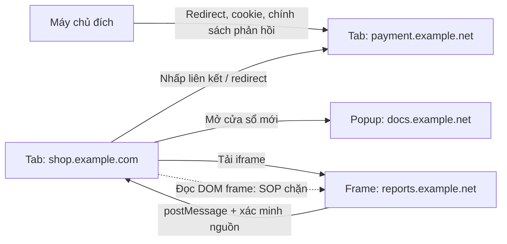
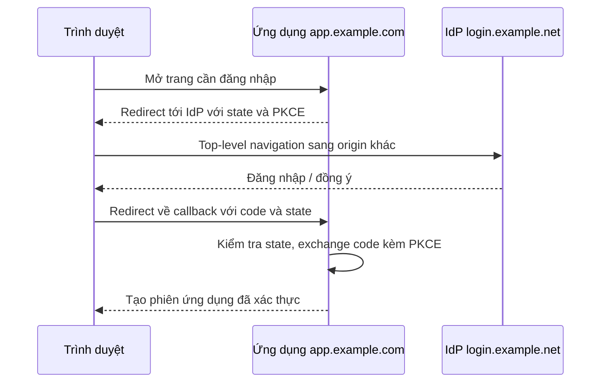

# Cross-origin navigation: điều hướng giữa các origin và ranh giới bảo mật

Người dùng có thể nhấp một liên kết từ cửa hàng sang cổng thanh toán, chuyển từ ứng dụng sang nhà cung cấp đăng nhập, hoặc mở trang tài liệu của đối tác trong tab mới. Các hành động ấy đều có thể là **cross-origin navigation** (điều hướng xuyên origin). Trình duyệt thường cho phép điều hướng như vậy vì đó là nhu cầu cơ bản của Web, nhưng vẫn phải bảo vệ dữ liệu và quyền truy cập của từng origin.

Điều quan trọng là phân biệt ba câu hỏi: **Có thể chuyển đến trang khác origin không? Sau khi chuyển, JavaScript ở trang cũ có được đọc trang mới không? Yêu cầu điều hướng có thể gây tác dụng phụ trên máy chủ không?** Câu trả lời lần lượt liên quan đến cơ chế điều hướng, Same-Origin Policy (SOP), cookie và phòng vệ CSRF.

Bài học thuộc chương **Navigation** của module `SECURITY_APPLICATION_SECURITY_BROWSER_SECURITY`. Phạm vi tập trung vào ranh giới trình duyệt–origin–cookie–ứng dụng, vai trò SOP/CORS và các chính sách cách ly, đồng thời liên hệ phòng vệ XSS, CSRF, clickjacking bằng CSP, Trusted Types, security headers và việc kiểm chứng hành vi thực tế.

## 1. Mục tiêu học tập

Sau bài học, người học có thể:

1. Giải thích cross-origin navigation là gì, xác định bằng bộ ba scheme–hostname–port.
2. Phân biệt điều hướng cấp cao (*top-level navigation*), điều hướng iframe và mở cửa sổ hoặc tab mới.
3. Nêu được giới hạn của SOP, CORS và CSP khi thực hiện điều hướng.
4. Phân tích tác động của redirect, cookie `SameSite`, CSRF và header Fetch Metadata.
5. Phòng vệ open redirect, reverse tabnabbing, lộ thông tin qua URL/`Referer` và rủi ro tích hợp đăng nhập bên ngoài.
6. Thiết kế phép thử trình duyệt chứng minh các hành vi được cho phép hoặc bị chặn.

## 2. Origin và điều hướng: hai khái niệm khác nhau

Với URL HTTP(S) thông thường, **origin** được xác định bằng:

```text
origin = (scheme, hostname, effective port)

https://app.example.com:8443/orders
  └─┬──┘ └──────┬───────┘ └┬─┘
  scheme      hostname      port
```

Hai URL **same origin** khi ba thành phần đều tương ứng bằng nhau. Thay path, query hoặc fragment không thay đổi origin. HTTPS mặc định dùng cổng 443 và HTTP mặc định dùng cổng 80.

Xét trang xuất phát `https://shop.example.com/cart`:

| Đích điều hướng | Quan hệ với trang xuất phát | Lý do |
| --- | --- | --- |
| `https://shop.example.com/checkout` | Same origin | Chỉ đổi đường dẫn. |
| `https://shop.example.com:443/order/42` | Same origin | Cổng 443 là mặc định của HTTPS. |
| `https://pay.example.com/checkout` | Cross origin, thường same site | Khác hostname, dù cùng miền có thể đăng ký. |
| `http://shop.example.com/cart` | Cross origin và khác site theo schemeful SameSite | Khác scheme. |
| `https://shop.example.com:8443/cart` | Cross origin, thường same site | Khác port. |
| `https://payment.example.net/checkout` | Cross origin, cross site | Khác hostname và miền đăng ký. |

**Navigation** là hành động làm một *browsing context* tải/hiển thị tài liệu hoặc tài nguyên đích. Điều hướng có thể diễn ra trong tab hiện tại, cửa sổ mới hoặc iframe. Sau khi điều hướng hoàn tất, tài liệu mới có origin của chính nó (hoặc origin đặc biệt theo quy tắc của URL, sandbox và loại tài liệu).

Không nên coi một URL khác path là ranh giới bảo mật: `https://shop.example.com/app-a` và `https://shop.example.com/app-b` cùng origin. Mã JavaScript có quyền trong một tài liệu cùng origin thường có thể tương tác với tài liệu kia khi các điều kiện truy cập khác cho phép.

## 3. Các hình thức cross-origin navigation

### 3.1. Nhấp liên kết

```html
<a href="https://payment.example.net/checkout">
  Tiếp tục tới cổng thanh toán
</a>
```

Một cú nhấp như vậy thường chuyển **tab hiện tại** sang tài liệu khác origin. Trang cũ không còn là tài liệu đang hoạt động trong tab đó, mặc dù có thể được trình duyệt giữ trong lịch sử hoặc back-forward cache. Không vì thế mà script ở đích được truy cập tuỳ ý DOM hoặc storage của origin cũ.

### 3.2. Gọi API điều hướng từ JavaScript

```js
// Thay entry hiện tại bằng một tài liệu ở origin khác.
window.location.assign('https://payment.example.net/checkout');

// Dùng khi muốn chuyển hướng mà không giữ URL trung gian
// thành một entry riêng trong lịch sử điều hướng.
// window.location.replace('https://payment.example.net/checkout');
```

`location.assign()` thường tạo entry mới trong lịch sử, còn `location.replace()` thay entry hiện tại. Hai cách đều có thể điều hướng cross-origin, tùy chính sách và bối cảnh. **Sự khác nhau về lịch sử không phải cơ chế xác thực hoặc bảo mật.**

Không ghép trực tiếp URL đích từ dữ liệu người dùng nếu nó có thể trở thành `javascript:`, URL lừa đảo hoặc một địa chỉ không nằm trong danh sách được phép. Với những yêu cầu chuyển hướng có đầu vào tùy ý, phải kiểm soát URL ở nơi quyết định điều hướng.

### 3.3. Gửi biểu mẫu HTML

```html
<form action="https://service.example.net/receive" method="post">
  <input name="reference" value="demo-42">
  <button type="submit">Gửi</button>
</form>
```

Form có thể điều hướng đến origin khác. Trình duyệt **không bắt buộc cần CORS** cho kiểu gửi form và tải tài liệu HTML này. Đây cũng là nguồn gốc một lớp tấn công CSRF: nếu endpoint đích thay đổi dữ liệu dựa vào cookie có sẵn mà không kiểm tra ý định của người dùng, request từ trang ngoài có thể gây hậu quả.

### 3.4. Mở cửa sổ hoặc tab mới

```html
<a
  href="https://docs.example.net/guide"
  target="_blank"
  rel="noopener noreferrer">
  Mở tài liệu ngoài
</a>
```

`target="_blank"` yêu cầu mở ngữ cảnh mới. `rel="noopener"` ngắt tham chiếu `window.opener` cho trang đích, giảm khả năng trang đích điều hướng lại tab gốc. `noreferrer` còn yêu cầu không gửi `Referer`. Nhiều trình duyệt hiện đại mặc định áp dụng một dạng `noopener` cho liên kết `target="_blank"`, nhưng khai báo rõ ràng giúp thể hiện ý định bảo mật và tương thích.

Với `window.open()`, có thể chỉ định tính năng `noopener`:

```js
window.open(
  'https://docs.example.net/guide',
  '_blank',
  'noopener,noreferrer'
);
```

Việc mở popup còn chịu quy tắc kích hoạt của người dùng và chặn popup của trình duyệt. Khi luồng đăng nhập thực sự cần cửa sổ con liên lạc về cửa sổ mở, phải thiết kế cơ chế trao đổi rõ ràng và cân nhắc chính sách cách ly thay vì vô tình dựa vào `window.opener`.

### 3.5. Điều hướng trong iframe

```html
<iframe
  src="https://reports.example.net/widget"
  title="Báo cáo đối tác">
</iframe>
```

Đây là **điều hướng của nested browsing context**. Tải iframe thành công không chứng minh trang cha được đọc DOM của trang con. SOP vẫn ngăn phần lớn quyền truy cập trực tiếp vào DOM của một iframe khác origin.

Khi iframe muốn điều hướng **trang trên cùng** (top-level), trình duyệt áp dụng những ràng buộc riêng: kích hoạt người dùng, quan hệ giữa các ngữ cảnh, iframe sandbox và các chính sách điều hướng. Không thiết kế widget với giả định một iframe bên thứ ba luôn có thể đổi `window.top.location` một cách tự động.

## 4. SOP bảo vệ khả năng đọc, không cấm mọi navigation

SOP giới hạn việc JavaScript thuộc một origin truy cập dữ liệu hoặc môi trường của origin khác. Tuy nhiên, Web cần cho phép người dùng đi từ website này sang website khác; do đó **navigation thường được phép** ngay cả khi **đọc DOM khác origin bị chặn**.



| Thao tác | Hành vi thông thường |
| --- | --- |
| Nhấp liên kết sang website khác | Được phép điều hướng, trừ hạn chế/chính sách áp dụng. |
| Gửi form đến website khác | Có thể gửi yêu cầu và điều hướng, dù không có CORS. |
| `fetch()` và đọc JSON từ origin khác | Cần CORS hoặc cơ chế chia sẻ phù hợp để JavaScript đọc response. |
| Trang cha đọc `iframe.contentWindow.document` khác origin | Bị SOP hạn chế; thường ném `SecurityError`. |
| Trang cha gửi `postMessage()` đến frame khác origin | Được phép; cần `targetOrigin` chính xác và kiểm tra nguồn ở bên nhận. |
| Script khác origin đọc `localStorage` của trang trước | Không được đọc trực tiếp vì vùng lưu trữ theo origin và các quy tắc trình duyệt. |

Một số thuộc tính cửa sổ được phép thao tác xuyên origin ở phạm vi rất hạn chế, phục vụ điều hướng hoặc truyền thông điệp. **Tham chiếu `window` không đồng nghĩa quyền đọc toàn bộ tài liệu.**

### CORS không phải công tắc bật/tắt navigation

Giả sử trang ở `https://app.example.com` gọi:

```js
await fetch('https://api.example.net/private');
```

Đây là truy cập HTTP kiểu `fetch`. Khi script cần đọc response, trình duyệt yêu cầu máy chủ đích cho phép theo CORS. Ngược lại:

```html
<a href="https://api.example.net/private">Mở trang đích</a>
```

là điều hướng; máy chủ có thể trả trang lỗi, yêu cầu đăng nhập hoặc một tài nguyên, nhưng việc tải tài liệu không tự động yêu cầu `Access-Control-Allow-Origin`. Chính sách CORS không thay thế xác thực, phân quyền và phòng vệ CSRF.

Một trang được phép điều hướng tới origin B không có nghĩa origin A được đọc tài nguyên B qua JavaScript. Cũng không có nghĩa script ở B được đọc trang A.

## 5. Redirect HTTP: mỗi bước đều có ý nghĩa bảo mật

Máy chủ có thể phản hồi bằng mã 3xx cùng header `Location` để hướng trình duyệt đến một URL khác:

```http
HTTP/1.1 303 See Other
Location: https://payment.example.net/result?reference=demo-42
```

Đích redirect có thể là cùng origin hoặc khác origin. Khi chuỗi redirect thay đổi origin, việc gửi cookie, xử lý `Referer`, các header nguồn và các chính sách áp dụng cần được đánh giá theo **toàn bộ luồng**, không chỉ theo URL người dùng nhấp lúc đầu.

| Mã redirect | Đặc điểm đáng chú ý | Hệ quả khi thiết kế |
| --- | --- | --- |
| `301 Moved Permanently` | Redirect dài hạn; trình duyệt có thể lưu cache; nhiều user agent đổi POST thành GET theo hành vi lịch sử | Không mặc định sử dụng cho bước nghiệp vụ tạm thời. |
| `302 Found` | Redirect tạm thời; với POST, một số client chuyển thành GET | Không phụ thuộc vào bảo toàn method của POST nếu dùng 302. |
| `303 See Other` | Sau một POST, client thường truy cập `Location` bằng GET | Thích hợp cho mẫu Post/Redirect/Get khi cần hiển thị trang kết quả. |
| `307 Temporary Redirect` | Giữ method và request body | Cẩn trọng khi redirect POST: body có thể được gửi sang đích mới. |
| `308 Permanent Redirect` | Giữ method và request body, có ý nghĩa lâu dài | Cần chắc chắn URL đích được kiểm soát và phù hợp với chính sách cache. |

Một **POST chứa dữ liệu nhạy cảm** không nên được chuyển qua `307`/`308` tới một URL cross-origin ngoài ý muốn: method và body được bảo toàn theo quy tắc redirect, dẫn đến nguy cơ gửi dữ liệu tới máy chủ không đáng tin. Trình duyệt có thể áp dụng các giới hạn khác trong từng bối cảnh, nhưng ứng dụng vẫn cần tránh tạo redirect kiểu này.

Sau khi xử lý biểu mẫu, nếu chỉ cần mở trang xác nhận, mẫu `303 See Other` đến URL do ứng dụng kiểm soát thường rõ nghĩa hơn. Với redirect do người dùng chọn, chỉ cho phép các đích đã được xác thực theo yêu cầu nghiệp vụ.

### Rủi ro open redirect

Mẫu URL nguy hiểm:

```text
https://shop.example.com/redirect?next=https://attacker.example.net/fake-login
```

Nếu server lấy `next` rồi đưa thẳng vào `Location`, kẻ tấn công có thể tạo liên kết bắt đầu trên tên miền uy tín nhưng đưa nạn nhân tới trang giả mạo. Open redirect còn có thể làm rối các luồng xác thực và kiểm tra URL đầu ra.

Biện pháp ưu tiên:

1. Dùng **đường dẫn nội bộ** hoặc mã đích do máy chủ định nghĩa thay cho URL tùy ý.
2. Nếu thật sự cần URL ngoài, phân tích bằng URL parser chuẩn, chỉ cho phép `https:` và **so sánh origin chính xác** với allowlist.
3. Xác minh thêm pathname/luồng nghiệp vụ nếu một origin chứa nhiều dịch vụ không cùng mức độ tin cậy.
4. Không chấp nhận các scheme như `javascript:` hoặc `data:`, hostname đánh lừa hoặc URL chứa thông tin đăng nhập.
5. Kiểm tra lại ở **máy chủ thực hiện redirect**; kiểm tra trên frontend không đủ.

Ví dụ kiểm soát điều hướng ở frontend để giảm lỗi khi tạo liên kết:

```js
const ALLOWED_ORIGINS = new Set([
  'https://payment.example.net',
  'https://docs.example.net'
]);

function parseExternalDestination(rawUrl) {
  const target = new URL(rawUrl); // Chỉ nhận URL tuyệt đối hợp lệ.
  if (target.protocol !== 'https:') throw new Error('Yêu cầu HTTPS');
  if (!ALLOWED_ORIGINS.has(target.origin)) {
    throw new Error('Origin đích không được phép');
  }
  if (target.username || target.password) {
    throw new Error('Không cho phép credentials trong URL');
  }
  return target;
}

const destination = parseExternalDestination(
  'https://payment.example.net/checkout'
);
window.location.assign(destination.href);
```

Đây là kiểm tra phục vụ giao diện, **không phải biện pháp kiểm soát cuối cùng**. Với đường dẫn `/redirect?next=...`, máy chủ vẫn phải validate đầu vào độc lập trước khi trả `Location`. Nếu ứng dụng chỉ cần một số luồng thanh toán cụ thể, nên dùng URL đích do server trả về từ một giao dịch được xác thực thay vì nhận URL thanh toán tùy ý từ trình duyệt.

## 6. Cookie, SameSite và CSRF khi điều hướng

**Origin** gồm scheme, hostname và port; **site** trong ngữ cảnh cookie `SameSite` hiện đại thường dựa trên scheme và miền có thể đăng ký (*registrable domain*). Hai subdomain có thể khác origin nhưng cùng site, trong khi hai scheme `http` và `https` khác site theo *schemeful SameSite*.

Giả sử người dùng đang đăng nhập tại `https://bank.example`, rồi được dẫn từ `https://attacker.example.net` tới `https://bank.example/transfer`.

| Cơ chế | Ý nghĩa trong trường hợp điều hướng |
| --- | --- |
| `HttpOnly` | Ngăn JavaScript đọc cookie phiên trực tiếp; không ngăn tự động gửi cookie kèm request đủ điều kiện. |
| `Secure` | Chỉ gửi cookie qua kết nối an toàn theo quy tắc trình duyệt. |
| `SameSite=Strict` | Cookie không được gửi trong yêu cầu cross-site thông thường; có thể ảnh hưởng luồng quay về sau đăng nhập/chuyển từ đối tác. |
| `SameSite=Lax` | Thường cho cookie đi cùng **top-level navigation với phương thức an toàn như GET** từ một site khác, nhưng hạn chế nhiều yêu cầu cross-site khác. |
| `SameSite=None; Secure` | Cho phép cookie trong bối cảnh cross-site nếu chính sách cookie của trình duyệt chấp nhận; không bảo đảm cookie bên thứ ba luôn hoạt động. |
| CSRF token và kiểm tra quyền | Xác minh hành động thay đổi trạng thái có ý định hợp lệ và người dùng được phép thực hiện. |

**Hệ quả quan trọng:** với cookie `SameSite=Lax`, một liên kết cross-site dẫn đến **GET** cấp cao có thể vẫn mang cookie phiên. Nếu `GET /delete-account` thực hiện xóa tài khoản, người dùng có thể bị tấn công qua một đường dẫn đơn giản. **GET/HEAD không được gây tác dụng phụ nghiệp vụ**; thao tác thay đổi dữ liệu phải dùng phương thức thích hợp và kiểm tra CSRF token, phiên, phân quyền.

`SameSite` cũng không đủ chống CSRF từ một **origin khác nhưng cùng site**. Ví dụ `app.example.com` và `untrusted.example.com` có thể có cùng site, dù SOP coi chúng khác origin. Một subdomain không đáng tin có thể gây rủi ro nếu ứng dụng dựa hoàn toàn vào kiểm tra same-site.

### Kiểm tra `Origin` và Fetch Metadata

Các header do trình duyệt đặt có thể giúp máy chủ đánh giá bối cảnh request:

```http
GET /account HTTP/1.1
Host: bank.example
Sec-Fetch-Site: cross-site
Sec-Fetch-Mode: navigate
Sec-Fetch-Dest: document
Sec-Fetch-User: ?1
```

Trong trình duyệt hỗ trợ, `Sec-Fetch-Site` mô tả quan hệ site của nguồn yêu cầu với đích (`same-origin`, `same-site`, `cross-site` hoặc `none`); `Sec-Fetch-Mode: navigate` cho biết yêu cầu mang tính điều hướng. `Sec-Fetch-User: ?1` có thể xuất hiện khi việc điều hướng gắn với kích hoạt người dùng. **Không phải mọi request đều có đầy đủ header**, và `Sec-Fetch-Site: same-site` không khẳng định người dùng đã cấp quyền nghiệp vụ.

Máy chủ có thể dùng Fetch Metadata để từ chối các yêu cầu cross-site không mong muốn, nhưng phải xây dựng chính sách xử lý trường hợp header vắng mặt và các luồng tích hợp hợp lệ. `Origin` hữu ích ở nhiều yêu cầu thay đổi trạng thái; `Referer` có thể là tín hiệu bổ sung, song không nên phụ thuộc hoàn toàn vì chính sách quyền riêng tư có thể lược bỏ nó.

## 7. Mở tab mới, `window.opener` và reverse tabnabbing

Khi một trang mở trang bên ngoài trong tab mới, trang đích có thể cố gắng thay đổi URL của tab gốc qua một số khả năng điều hướng hạn chế nếu quan hệ opener vẫn tồn tại. Đây là nền tảng của **reverse tabnabbing**:

1. Người dùng mở tài liệu bên ngoài từ trang đăng nhập tin cậy.
2. Trang ngoài có tham chiếu đến tab mở nó và điều hướng tab gốc sang trang đăng nhập giả.
3. Người dùng quay lại tab cũ và nhập thông tin vào trang giả.

SOP giới hạn quyền **đọc** DOM/tab gốc, nhưng không đủ để ngăn mọi loại **điều hướng** cửa sổ liên quan.

Ưu tiên dùng:

```html
<a href="https://partner.example.net/info"
   target="_blank"
   rel="noopener noreferrer">
  Xem thông tin đối tác
</a>
```

Nếu cần gửi `Referer` theo yêu cầu đo lường, `rel="noopener"` có thể dùng riêng. Việc cắt quan hệ opener bằng `noopener` hoặc một chính sách COOP phù hợp còn giảm khả năng tương tác không mong muốn giữa các cửa sổ.

### COOP và luồng popup

`Cross-Origin-Opener-Policy` (COOP) kiểm soát cách tài liệu được nhóm vào *browsing context group* với những cửa sổ khác. Một số cấu hình có thể cô lập tài liệu khỏi cửa sổ khác origin và ngắt kết nối opener. Điều này hữu ích cho mục tiêu cách ly nhưng có thể **làm hỏng luồng đăng nhập bằng popup** vốn dựa vào `window.opener.postMessage()` hoặc phát hiện `popup.closed`.

Do đó, cần chọn chính sách COOP theo kiến trúc thực tế, kiểm thử luồng popup đăng nhập/thanh toán và dùng cơ chế truyền kết quả qua server nếu phù hợp. Đừng bật một header cách ly trên toàn site chỉ vì tên của nó có chữ “security”.

## 8. CSP và các chính sách kiểm soát điều hướng

CSP và một số header khác kiểm soát **đích tải tài nguyên** hoặc **quan hệ nhúng**, nhưng tác dụng của từng chỉ thị không giống nhau:

| Chính sách | Kiểm soát điều gì? | Nhầm lẫn thường gặp |
| --- | --- | --- |
| CSP `form-action` | Đích được phép nhận form submit từ tài liệu. | Tưởng rằng nó tự xác thực form hoặc ngăn CSRF ở endpoint. |
| CSP `frame-src` | Nguồn iframe mà trang hiện tại được phép tải. | Nhầm với danh sách trang được nhúng *trang của mình*. |
| CSP `frame-ancestors` | Những origin tổ tiên được phép nhúng tài liệu hiện tại. | Nhầm với `frame-src` hoặc giới hạn top-level navigation. |
| `X-Frame-Options` | Chặn/giới hạn nhúng frame theo cơ chế truyền thống. | Tưởng nó ngăn người dùng nhấp link để mở trang cấp cao. |
| `iframe sandbox` | Hạn chế script, form, popup và top navigation của iframe theo token. | Nghĩ iframe cùng origin sẽ luôn giữ đủ quyền dù bị sandbox. |
| CSP `navigate-to` | Được thiết kế để hạn chế đích điều hướng. | Coi đây là biện pháp sẵn dùng trên mọi trình duyệt; mức hỗ trợ không đồng đều. |
| `Referrer-Policy` | Quyết định lượng thông tin referrer gửi tới đích. | Tưởng rằng chính sách này mã hóa hoặc bảo vệ mọi dữ liệu trong URL. |

Ví dụ một trang chỉ được submit form về chính nó và chỉ nhúng trang thanh toán được cấp phép:

```http
Content-Security-Policy: default-src 'self'; form-action 'self'; frame-src https://payment.example.net; object-src 'none'; base-uri 'none'
Referrer-Policy: strict-origin-when-cross-origin
X-Content-Type-Options: nosniff
```

Đây là **cấu hình minh họa**, không phải chính sách hoàn chỉnh có thể dán ngay vào production. Trang cần submit trực tiếp tới đối tác phải bổ sung origin đích vào `form-action` nếu kiến trúc cho phép. Các chỉ thị khác như `script-src`, `connect-src`, `frame-ancestors` cần được thiết kế theo yêu cầu thật và kiểm thử để tránh làm hỏng chức năng.

Đối với trang nhạy cảm **không cần bị nhúng**, response của chính trang đó có thể dùng:

```http
Content-Security-Policy: frame-ancestors 'none'
X-Frame-Options: DENY
```

Các header chống nhúng này **không cấm mở trực tiếp trang trong tab mới**. Đó là hai ngữ cảnh khác nhau.

### Điều hướng từ iframe có sandbox

```html
<iframe
  src="https://widget.example.net/"
  sandbox="allow-scripts allow-top-navigation-by-user-activation"
  title="Widget đối tác">
</iframe>
```

Ví dụ cho phép script và một số top-level navigation có kích hoạt người dùng, nhưng vẫn áp dụng những hạn chế sandbox còn lại (bao gồm opaque origin khi không có `allow-same-origin`). Nếu iframe không cần chuyển tab cha, hãy bỏ `allow-top-navigation-by-user-activation`. Nếu không cần script, bỏ cả `allow-scripts`.

Kết hợp `allow-scripts` và `allow-same-origin` khi nhúng **nội dung không tin cậy thuộc cùng origin với trang cha** là cấu hình cần tránh, vì iframe có thể làm suy yếu các hạn chế sandbox trong những điều kiện nhất định. Tách nội dung không tin cậy sang origin riêng phù hợp hơn.

## 9. Referrer, dữ liệu trong URL và chuyển từ HTTPS sang HTTP

Điều hướng là hành động có thể **đưa dữ liệu sang một máy chủ mới**:

- URL đích nằm trong lịch sử, log mạng, log máy chủ hoặc hệ thống phân tích tùy môi trường.
- Header `Referer` có thể tiết lộ URL trang nguồn hoặc phần origin, tùy `Referrer-Policy`. Fragment thường không được gửi trong `Referer`.
- Query string chứa token, mã phiên hoặc thông tin cá nhân có thể xuất hiện ở các hệ thống ghi log, ảnh chụp màn hình hoặc khi người dùng chia sẻ liên kết.
- Chuyển từ HTTPS sang HTTP làm mất bảo vệ mã hóa của kết nối đích; đừng chuyển dữ liệu xác thực hoặc thanh toán qua HTTP.

Chính sách:

```http
Referrer-Policy: strict-origin-when-cross-origin
```

thường gửi đường dẫn đầy đủ (không có fragment) khi điều hướng same-origin, chỉ gửi origin khi HTTPS sang một origin HTTPS khác và không gửi referrer khi từ HTTPS xuống HTTP. Nếu chức năng nhạy cảm cần ngăn referrer hoàn toàn, có thể cân nhắc `Referrer-Policy: no-referrer`; phải đánh giá yêu cầu tích hợp và đo lường.

Không đặt access token hoặc session ID trong URL điều hướng. Nếu phải truyền một mã dùng một lần cho luồng xác thực, hãy giới hạn phạm vi, thời hạn, số lần dùng, xử lý callback an toàn và loại bỏ tham số nhạy cảm khỏi URL trình duyệt khi thích hợp.

HTTPS và HSTS bảo vệ kênh truyền/giúp ép dùng HTTPS cho host phù hợp, nhưng không kiểm tra liệu trang đích có đáng tin hay là phishing. Kết nối HTTPS đến tên miền của kẻ tấn công vẫn là kết nối được mã hóa **tới kẻ tấn công**.

## 10. Cross-origin navigation trong luồng đăng nhập liên kết

Một ứng dụng dùng đăng nhập qua nhà cung cấp danh tính (IdP) thường thực hiện:



Trong OAuth 2.0 Authorization Code Flow có PKCE, một số yêu cầu cốt lõi gồm:

1. **`redirect_uri` đăng ký chính xác** ở nhà cung cấp; không dùng một open redirect tùy ý làm callback.
2. **`state` đủ ngẫu nhiên và gắn với giao dịch đăng nhập** để ràng buộc phản hồi với yêu cầu ban đầu và giảm login CSRF.
3. **PKCE** để ràng buộc authorization code với bên đã khởi tạo giao dịch theo quy trình giao thức.
4. Nếu sử dụng OpenID Connect, **`nonce`** và kiểm tra ID token theo yêu cầu của flow áp dụng.
5. Backend phải kiểm tra lỗi, mã sử dụng một lần, phiên và quyền trước khi đánh dấu người dùng đã đăng nhập; không tin đơn thuần một URL callback hoặc thông điệp popup tự nhận “success”.

Cookie `SameSite=Strict` có thể không đi kèm lượt quay về từ IdP khác site. Cookie `SameSite=Lax` thường phù hợp hơn với callback GET cấp cao, nhưng thiết kế cụ thể phải phù hợp flow thực tế và được kiểm tra trên trình duyệt đích. Không nới cookie bừa bãi chỉ để một redirect hoạt động.

Với đăng nhập bằng popup, cần kiểm tra thêm `noopener`, `window.opener`, `postMessage` và COOP; lựa chọn chúng ảnh hưởng trực tiếp tới khả năng trả kết quả về tab gốc. Tốt nhất nên dùng flow do thư viện giao thức uy tín cung cấp, kết hợp bảo vệ phiên ở server.

## 11. Thực hành: điều hướng giữa hai origin cục bộ

Thực hành trên **hai máy chủ do người học kiểm soát**:

```text
Nguồn: http://localhost:3000/
Đích:  http://localhost:3001/
```

Hai địa chỉ khác origin vì **khác port**. Có thể tạo hai thư mục `source` và `destination`, mỗi thư mục một tệp `index.html`, rồi dùng công cụ máy chủ tĩnh bất kỳ. Ví dụ khi máy có Python:

```bash
# Terminal 1, tại thư mục chứa source và destination
python -m http.server 3000 --directory source

# Terminal 2
python -m http.server 3001 --directory destination
```

### 11.1. Trang nguồn ở cổng 3000

```html
<!doctype html>
<html lang="vi">
<meta charset="utf-8">
<title>Navigation source</title>
<h1>Origin nguồn: http://localhost:3000</h1>

<p><a href="http://localhost:3001/">Điều hướng ở tab hiện tại</a></p>
<p>
  <a href="http://localhost:3001/"
     target="_blank" rel="noopener noreferrer">
    Mở tab mới an toàn
  </a>
</p>
<p>
  <button id="navigate">Điều hướng bằng location.assign</button>
</p>
<iframe id="dest" src="http://localhost:3001/"
        title="Trang cổng 3001"></iframe>

<script>
  document.querySelector('#navigate').addEventListener('click', () => {
    location.assign('http://localhost:3001/');
  });

  const frame = document.querySelector('#dest');
  frame.addEventListener('load', () => {
    console.log('Parent origin:', location.origin);
    console.log('Iframe WindowProxy:', Boolean(frame.contentWindow));
    try {
      console.log(frame.contentWindow.document.body.textContent);
    } catch (error) {
      console.log('Đọc DOM cross-origin bị chặn:', error.name);
    }
  });
</script>
</html>
```

### 11.2. Trang đích ở cổng 3001

```html
<!doctype html>
<html lang="vi">
<meta charset="utf-8">
<title>Navigation destination</title>
<h1>Origin đích: http://localhost:3001</h1>
<script>
  console.log('Đang chạy tại:', location.origin);
  console.log('Có opener không?', Boolean(window.opener));
  console.log('Có nằm trong iframe không?', window !== window.top);
</script>
</html>
```

### 11.3. Kịch bản và bằng chứng

Mở DevTools tại trang nguồn, bật **Preserve log** trong Network nếu muốn giữ lịch sử request qua điều hướng.

| Thao tác | Kết quả kỳ vọng | Bằng chứng nên ghi |
| --- | --- | --- |
| Nhấp link sang cổng 3001 | Tab chuyển sang trang đích khác origin | URL cuối, yêu cầu navigation trong Network. |
| Nhấp nút `location.assign()` | Điều hướng tương tự qua JavaScript | URL cuối và entry lịch sử nếu cần kiểm tra. |
| Nhấp link `target="_blank" rel="noopener noreferrer"` | Mở tab mới, không thiết lập opener cho tài liệu đích | Console ở đích in `false` cho `window.opener`. |
| Đọc DOM của iframe 3001 từ trang 3000 | Bị SOP chặn, thường là `SecurityError` | Console và URL nguồn/đích. |
| Chạy `fetch('http://localhost:3001/')` từ Console 3000 | Nếu server tĩnh không cấu hình CORS, script không đọc được response | Console báo CORS; Network có thể vẫn có request. |
| Thử form GET sang cổng 3001 | Có thể điều hướng dù CORS không được cấp | URL đích và Network request; không dùng endpoint làm thay đổi dữ liệu. |

Để quan sát khác biệt với một frame **same origin**, thay `src` của iframe thành `http://localhost:3000/`. Việc đọc DOM lúc này thường được phép vì scheme/host/port trùng khớp, nếu không có sandbox hay chính sách bổ sung.

Để kiểm tra CSP chống nhúng, cần cấu hình server đích trả response header `Content-Security-Policy: frame-ancestors 'none'`; máy chủ tĩnh mặc định ở ví dụ trên không tự thêm header này. Khi bật, iframe thường bị chặn trong khi mở đích trực tiếp ở tab cấp cao vẫn được. Xác minh ở **Console** và **Network**, không chỉ nhìn iframe trống.

### 11.4. Thực hành redirect và trạng thái máy chủ

Thêm một endpoint thử nghiệm `/go` trên server nguồn trả `302` hoặc `303` với `Location: http://localhost:3001/`, sau đó quan sát chuỗi redirect trong Network. Đây là bài bổ sung cần một server có khả năng đặt response headers; `python -m http.server` mặc định không tạo endpoint redirect theo yêu cầu.

Nếu thử POST/redirect, chỉ dùng dữ liệu giả và endpoint do mình sở hữu. Với `307`/`308`, quan sát method ở request tiếp theo và tránh đưa dữ liệu nhạy cảm sang đích khác origin. Với bài thử CSRF, kiểm tra **trạng thái dữ liệu ở server** trước và sau request; chỉ thấy lỗi CORS trong Console chưa đủ chứng minh endpoint được bảo vệ.

## 12. Checklist khi thiết kế cross-origin navigation

Trước khi phát hành một luồng chuyển hướng sang origin khác, cần xác minh:

| Câu hỏi | Kết quả mong đợi |
| --- | --- |
| Đích điều hướng có tin cậy không? | URL được tạo bởi nghiệp vụ hoặc xác minh bằng parser/allowlist chính xác; không có open redirect tùy ý. |
| Có dữ liệu nhạy cảm trong URL/Referer không? | Không đưa token phiên vào URL; có chính sách referrer phù hợp. |
| Điều hướng diễn ra ở tab, popup hay iframe? | Mỗi hình thức có quy tắc riêng về opener, sandbox, CSP và cookie. |
| Có mở tab ngoài không? | `noopener` khi không cần quan hệ opener; `noreferrer` nếu muốn chặn referrer. |
| Có form hoặc endpoint thay đổi trạng thái không? | Dùng method đúng, kiểm tra session, phân quyền, CSRF token và nguồn request. |
| Redirect có bảo toàn request body không? | Xem mã 3xx; tránh POST mang dữ liệu nhạy cảm đi ngoài ý muốn. |
| Cookie cần gửi theo luồng nào? | Kiểm tra `SameSite`, `Secure`, scope và các trình duyệt đích. |
| Có liên quan OAuth/OIDC không? | `redirect_uri` chính xác, `state`/PKCE và xác minh callback ở server. |
| Chính sách CSP nào áp dụng? | Phân biệt `form-action`, `frame-src`, `frame-ancestors`; không dựa vào `navigate-to` trên mọi trình duyệt. |
| Bằng chứng hành vi có đủ không? | Ghi lại URL thực, redirect chain, cookie được gửi, Network/Console và trạng thái server. |

## 13. Câu hỏi tự kiểm tra

1. Vì sao có thể nhấp link từ `https://shop.example.com` đến `https://payment.example.net`, nhưng JavaScript của trang nguồn không được tự đọc DOM trang thanh toán?
2. Sự khác nhau giữa cross-origin navigation và cross-origin `fetch` là gì? CORS kiểm soát phần nào?
3. Vì sao `SameSite=Lax` không bảo vệ một endpoint thay đổi dữ liệu bằng GET khi người dùng đi từ liên kết cross-site?
4. Các mã `303` và `307` khác nhau thế nào sau POST? Tại sao khác biệt đó quan trọng khi redirect tới origin khác?
5. Điều gì khiến `/redirect?next=...` trở thành open redirect? Có thể kiểm tra đích an toàn ở đâu?
6. `rel="noopener"` và `Referrer-Policy` xử lý những rủi ro nào khác nhau?
7. Vì sao `frame-ancestors 'none'` có thể chặn iframe nhưng vẫn cho người dùng mở cùng URL ở tab cấp cao?
8. Nếu OAuth callback đi từ IdP khác site về ứng dụng, những điểm nào cần kiểm chứng trong cookie, `state` và PKCE?
9. Một iframe bên thứ ba có được tự động đổi `window.top.location` trong mọi trường hợp không? Cần xét điều kiện nào?
10. Những bằng chứng nào chứng minh một request cross-origin đã tới server nhưng mã JavaScript nguồn không đọc được response?

**Tiêu chí hoàn thành:** người học có thể phân loại kiểu navigation và origin liên quan, giải thích rõ giới hạn SOP/CORS, chọn biện pháp phù hợp cho redirect–cookie–popup–iframe, và kiểm chứng luồng điều hướng trong trình duyệt lẫn tại máy chủ thay vì suy luận từ việc trang có hiển thị hay không.
