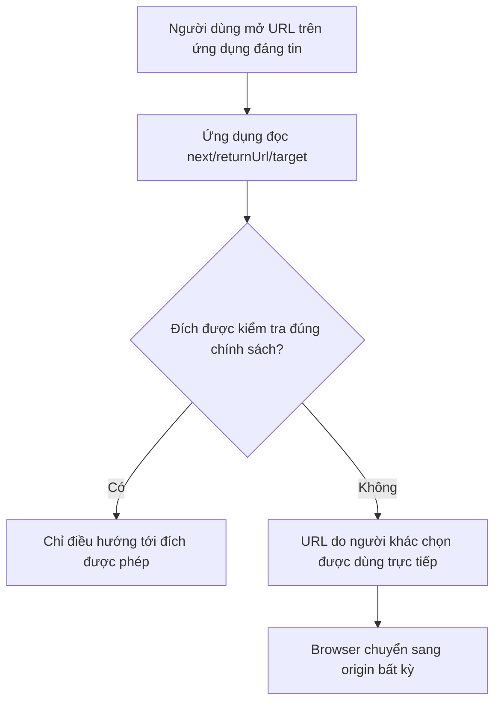
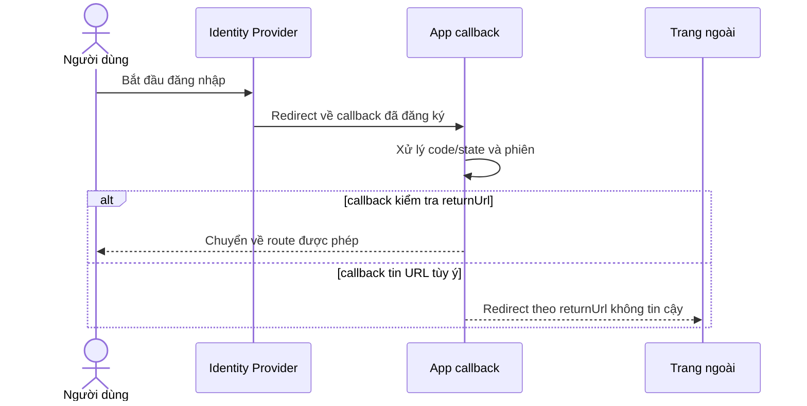

# Open redirect

> **Chương:** Navigation  
> **Học phần:** `SECURITY_APPLICATION_SECURITY_BROWSER_SECURITY` — Application Security / Browser Security

**Open redirect** (*chuyển hướng mở*, đôi khi gọi là *unvalidated redirect*) xảy ra khi ứng dụng cho phép dữ liệu do người dùng hoặc nguồn không đáng tin cậy quyết định đích chuyển hướng mà không kiểm tra đích đó theo chính sách phù hợp. Một URL trông như thuộc website uy tín có thể dẫn trình duyệt sang website khác do kẻ tấn công kiểm soát.

Trong bảo mật trình duyệt, open redirect nằm ở giao điểm giữa **navigation**, **origin**, **cookie** và **ứng dụng web**. Browser thường cho phép người dùng điều hướng sang origin khác; đây là tính năng hợp lệ của web, nên Same-Origin Policy (SOP), CORS, SameSite cookie hay security headers không tự sửa lỗi ứng dụng chọn sai đích điều hướng. Bài học này tập trung vào cơ chế, rủi ro thực tế, cách sửa tại nơi quyết định URL và cách kiểm chứng trên hệ thống thử nghiệm.

## 1. Mục tiêu học tập

Sau khi hoàn thành bài, bạn có thể:

1. Phân biệt **redirect phía server** và **navigation/redirect phía client**, đồng thời nhận biết đầu vào chưa tin cậy được dùng để chọn đích.
2. Giải thích vì sao open redirect có thể hỗ trợ **phishing**, lạm dụng luồng đăng nhập/ủy quyền và gây rò rỉ dữ liệu trong một số luồng thiết kế sai.
3. Nhận ra những cách kiểm tra URL dễ bị vượt qua: so chuỗi theo tiền tố, kiểm tra tên miền bằng `includes`, hiểu nhầm ký tự `@`, URL bắt đầu bằng `//`, khác biệt chuẩn hóa hoặc giải mã nhiều lần.
4. Chọn biện pháp phòng vệ theo mức ưu tiên: **dùng ID/route cố định**, giới hạn đường dẫn nội bộ, hoặc allowlist chính xác nếu buộc phải chuyển hướng ra ngoài.
5. Nêu được vai trò và giới hạn của SOP, CORS, CSP, Trusted Types, cookie `SameSite` và `Referrer-Policy` đối với open redirect.
6. Kiểm chứng `Location`, đích điều hướng và hành vi HTTP bằng DevTools, `curl` và các ca kiểm thử an toàn.

## 2. Redirect là gì trong cơ chế navigation?

**Navigation** là việc một trình duyệt hoặc browsing context tải tài liệu mới. Redirect là một cách khiến browser hoặc client HTTP chuyển từ URL ban đầu sang URL khác. Redirect hợp lệ xuất hiện khi đăng nhập xong quay lại trang trước đó, đổi đường dẫn cũ sang mới, chuyển HTTP sang HTTPS hoặc đưa người dùng sang nhà cung cấp thanh toán đã được chỉ định.

### 2.1. Redirect phía server

Server có thể trả status `3xx` và header `Location`:

```http
GET /old-page HTTP/1.1
Host: app.example.test

HTTP/1.1 302 Found
Location: /new-page
```

Browser đọc response rồi thực hiện request tiếp theo tới `Location` theo quy tắc redirect tương ứng. Giá trị `Location` có thể là đường dẫn tương đối hoặc URL tuyệt đối:

```http
Location: /dashboard
Location: https://docs.example.test/guide
```

| Status | Ý nghĩa thường gặp | Điểm cần lưu ý về phương thức HTTP |
| --- | --- | --- |
| `301 Moved Permanently` | Địa chỉ mới mang tính lâu dài | Một số client có thể đổi POST thành GET khi theo redirect; kết quả có thể được cache |
| `302 Found` | Chuyển hướng tạm thời | Browser thường đổi POST thành GET; không nên dựa vào 302 để bảo toàn phương thức |
| `303 See Other` | Yêu cầu client truy cập URL mới, thường bằng GET | Phù hợp với mẫu **POST → redirect → GET** sau khi xử lý form |
| `307 Temporary Redirect` | Chuyển hướng tạm thời nhưng giữ phương thức | Giữ method và body; nguy hiểm nếu đích do kẻ tấn công chọn |
| `308 Permanent Redirect` | Chuyển hướng lâu dài và giữ phương thức | Giữ method và body; có thể được cache |

Đặc biệt, nếu endpoint nhận POST chứa dữ liệu nhạy cảm rồi trả `307/308` đến URL bên ngoài không tin cậy, client có thể gửi **lại method và request body** tới đích mới. Cookie của site gốc không tự chuyển sang domain kẻ tấn công vì cookie có quy tắc phạm vi riêng, nhưng body hoặc các header được client cho phép chuyển tiếp vẫn cần được xem xét. Đừng dùng redirect tạm thời và redirect giữ method như thể chúng tương đương.

### 2.2. Navigation phía client

JavaScript có thể chủ động điều hướng:

```js
window.location.assign("/dashboard");
window.location.replace("/login");
```

Ngoài ra còn có liên kết `<a href="...">`, form, `meta refresh`, `Refresh` header và router trong ứng dụng một trang. Nếu ứng dụng lấy trực tiếp giá trị `next`/`returnUrl`/`redirect` từ URL rồi đưa vào một thao tác navigation, lỗ hổng có thể nằm hoàn toàn ở **client** dù server không trả HTTP `3xx`.

### 2.3. Luồng tổng quát



Vấn đề bảo mật nằm ở **quyết định chọn đích** của ứng dụng, không phải ở việc browser hỗ trợ redirect.

## 3. Một open redirect xuất hiện như thế nào?

Giả sử website có tính năng chuyển tiếp người dùng:

```text
https://app.example.test/go?next=/help
```

Lập trình viên viết endpoint sau (ví dụ **cố ý không an toàn**):

```js
// VÍ DỤ LỖ HỔNG: tuyệt đối không dùng trực tiếp trong production.
app.get("/go", (req, res) => {
  res.redirect(302, req.query.next || "/");
});
```

Kẻ tấn công có thể tạo một liên kết mang hostname ứng dụng hợp pháp:

```text
https://app.example.test/go?next=https%3A%2F%2Flogin.attacker.test%2F
```

Người dùng nhìn thấy `app.example.test`, nhấp vào, nhận response `302` với `Location: https://login.attacker.test/`, rồi browser đi đến website khác. Phần website sau chuyển hướng có thể giả mạo trang đăng nhập. **Open redirect không tự đánh cắp mật khẩu**; rủi ro phát sinh khi người dùng bị thuyết phục nhập dữ liệu ở đích giả hoặc khi một luồng khác vô tình truyền dữ liệu nhạy cảm qua redirect.

Cách viết phía client sau mắc lỗi cùng bản chất:

```js
// VÍ DỤ LỖ HỔNG: giá trị next chưa được kiểm tra.
const next = new URLSearchParams(location.search).get("next");
if (next) window.location.assign(next);
```

Đầu vào không tin cậy có thể đến từ query parameter, fragment, form, cookie, `postMessage`, storage, dữ liệu API hoặc cấu hình do bên thứ ba quản lý. Cần truy vết **nguồn dữ liệu → cách xử lý → thao tác điều hướng**.

## 4. Tác động thực tế và giới hạn của lỗ hổng

| Kịch bản | Open redirect góp phần thế nào? | Điều kiện/giới hạn |
| --- | --- | --- |
| **Phishing** | Dùng hostname đáng tin làm liên kết trung gian đến trang giả mạo | Người dùng vẫn phải thực hiện hành vi trên trang đích; không có nghĩa ứng dụng ban đầu đã lộ dữ liệu |
| **Lạm dụng uy tín URL** | Vượt qua bộ lọc chỉ kiểm tra hostname đầu tiên của chuỗi liên kết | Hiệu quả tùy công cụ, bộ lọc và việc nó có theo chuỗi redirect hay không |
| **OAuth/OIDC và luồng đăng nhập** | Đưa browser đến nơi ngoài dự kiến ở bước callback hoặc `returnUrl` | Mức độ rủi ro phụ thuộc cách xác thực `redirect_uri`, chuyển tiếp mã/token và kiểm soát phiên |
| **Rò rỉ thông tin** | URL đích, query hoặc fragment có thể bị xây dựng sai, kèm theo mã/token/dữ liệu | Chỉ xảy ra nếu luồng thực tế chuyển tiếp dữ liệu; `Referrer-Policy` và cách browser xử lý URL ảnh hưởng kết quả |
| **Redirect method/body** | Với `307/308`, request body có thể được gửi tiếp sang đích ngoài | Cần có request mang dữ liệu và client thực sự theo redirect |
| **Chuỗi redirect** | Open redirect trên host trung gian tạo đường dẫn qua nhiều website | Một bước validation trước đó không bảo đảm các bước sau an toàn |

Không nên đánh đồng mọi open redirect với **chiếm quyền tài khoản** hoặc **XSS**. Mức độ nghiêm trọng phụ thuộc endpoint có nằm trong luồng nhạy cảm, có mang bí mật, có được dùng làm đích OAuth, có chuyển tiếp dữ liệu hay chỉ thay đổi nơi người dùng được dẫn tới.

## 5. Open redirect trong đăng nhập và OAuth/OIDC

Các ứng dụng thường muốn đưa người dùng về trang trước khi đăng nhập:

```text
/login?returnUrl=/orders
```

Nếu ứng dụng sau khi login chuyển hướng tới `returnUrl` bất kỳ, nó tạo một điểm open redirect ngay trong luồng mà người dùng thường tin tưởng. Với OAuth/OIDC, vấn đề có thể nghiêm trọng hơn vì luồng liên quan tới **authorization code, token, `state`, session** và danh sách `redirect_uri` mà nhà cung cấp định danh cho phép.

Ví dụ mô hình:



Một callback an toàn phải **xác minh `state`**, xử lý authorization code đúng quy trình (thường kết hợp **PKCE**) và xác định trang quay lại theo lựa chọn đã được server kiểm soát. Phía nhà cung cấp định danh phải đăng ký và so khớp `redirect_uri` theo quy tắc chặt chẽ, không dùng wildcard tùy tiện. Không đưa `code`, access token, ID token, session token hoặc thông tin nhạy cảm vào URL được chuyển tiếp tới nơi khác.

**Phân biệt hai rủi ro:** open redirect ở `/go` không tự cho phép lấy OAuth code. Rò rỉ chỉ xảy ra khi đường redirect đó thực sự tương tác với một luồng ủy quyền, cấu hình callback/redirect URI hoặc dữ liệu nhạy cảm được xây dựng sai. Cần kiểm tra toàn bộ chuỗi chuyển hướng và nơi mã/token xuất hiện, không suy luận từ sự tồn tại của tham số `next`.

Một thiết kế thực tế là lưu **đích quay lại dưới dạng route ID** hoặc đường dẫn nội bộ đã qua kiểm tra trong trạng thái ràng buộc với phiên; không tin trực tiếp giá trị `returnUrl` do request callback đưa vào.

## 6. Tại sao kiểm tra URL bằng chuỗi thường sai?

URL không phải một chuỗi tên miền đơn giản. Browser áp dụng quy tắc phân tích scheme, authority, host, port, percent encoding, ký tự đặc biệt và URL tương đối. Những trường hợp sau thường đánh lừa code kiểm tra sơ sài.

| Giá trị nhập vào | Rủi ro nếu kiểm tra cẩu thả | Điều cần kiểm tra |
| --- | --- | --- |
| `https://app.example.test.evil.test/` | `startsWith("https://app.example.test")` cho kết quả đúng | Host thật là `app.example.test.evil.test` |
| `https://app.example.test@evil.test/path` | Phần trước `@` trông giống domain hợp pháp | Host thật là `evil.test`; phần trước `@` là userinfo |
| `//evil.test/path` | Bị tưởng là path bắt đầu bằng `/` | URL dạng *scheme-relative* có thể dẫn tới host khác |
| `https://evil.test/?to=app.example.test` | `includes("app.example.test")` cho kết quả đúng | Host vẫn là `evil.test` |
| `/\\evil.test/path` | Dấu `\\` bị xử lý khác nhau qua parser hoặc tầng trung gian | Cần từ chối đường dẫn không chuẩn và kiểm tra URL đã parse |
| `%2F%2Fevil.test` | Nhiều lớp giải mã có thể biến chuỗi thành `//evil.test` | Không tự giải mã lặp hoặc nối chuỗi rồi chuyển hướng |
| `javascript:...` hoặc `data:...` | Dữ liệu bị đưa thẳng vào sink navigation phía client | Không cho phép scheme tùy ý; một số sink có thể gây rủi ro script injection |
| `https://trusted.test:444/` | Chỉ so hostname bỏ qua port ngoài dự kiến | So origin hoặc port theo chính sách, không chỉ tên host |
| Tên miền Unicode/IDN | Chuỗi hiển thị và dạng canonical khác nhau | Dùng URL parser chuẩn, kiểm tra hostname đã chuẩn hóa và allowlist |

> **Cảnh báo ngữ cảnh:** Mỗi chuỗi trên là một **đầu vào thử nghiệm**, không mặc nhiên vượt qua mọi framework hoặc mọi trình duyệt. Điều đáng kiểm chứng là **URL cuối cùng được browser/client hiểu là gì**, sau tất cả các bước decode và chuẩn hóa của ứng dụng.

Ví dụ lỗi điển hình:

```js
// SAI: domain giả có thể bắt đầu bằng chuỗi này.
if (next.startsWith("https://app.example.test")) {
  res.redirect(next);
}

// SAI: hostname hợp lệ có thể nằm ở query, path hoặc userinfo.
if (next.includes("app.example.test")) {
  res.redirect(next);
}
```

Ngay cả khi URL đã được kiểm tra ban đầu, một **đích trung gian được phép** nhưng tự có open redirect vẫn có thể chuyển người dùng ra ngoài. Bảo vệ phải xét cả route được phép và những endpoint chuyển hướng tiếp theo trong hệ thống.

## 7. Nguyên tắc sửa lỗi: đừng trao quyền chọn URL tùy ý

Biện pháp dễ kiểm soát nhất là **không nhận URL hoàn chỉnh**. Thay vào đó, nhận một **mã đích** nằm trong tập hữu hạn, hoặc chọn route đích từ trạng thái server.

Ví dụ Express:

```js
import express from "express";

const app = express();
const routes = Object.freeze({
  home: "/home",
  orders: "/orders",
  profile: "/profile",
});

app.get("/go", (req, res) => {
  const key = req.query.to;
  const destination =
    typeof key === "string" && Object.hasOwn(routes, key)
      ? routes[key]
      : routes.home;

  return res.redirect(303, destination);
});
```

Các yêu cầu hợp lệ lúc này có dạng:

```text
/go?to=orders    → /orders
/go?to=profile   → /profile
/go?to=unknown   → /home
/go?to=https://evil.test/ → /home
```

Ưu điểm: input không trực tiếp chứa scheme/host/path tùy ý. Khi cần thêm trang, người phát triển đánh giá và bổ sung route vào danh sách. `303` thích hợp khi ý định là chuyển sang trang GET; với endpoint GET, nó cũng cho kết quả GET. Tuy nhiên, việc chọn status phải dựa trên ngữ nghĩa HTTP thực tế của endpoint.

**Lưu ý:** Nếu một route trong danh sách lại tự chuyển hướng theo `next` không được kiểm tra, vẫn có thể tồn tại chuỗi open redirect. Chỉ đưa vào danh sách các **đích cuối hoặc luồng điều hướng đã kiểm soát**.

## 8. Nếu cần cho phép đường dẫn nội bộ

Nhiều sản phẩm có quá nhiều route để tạo ID cho từng trang. Khi đó có thể chấp nhận **đường dẫn nội bộ** thay vì URL tuyệt đối, nhưng vẫn cần kiểm tra vì `//host` là URL dạng scheme-relative và dấu `\\` hoặc thao tác decode nhiều lần có thể tạo cách diễn giải bất ngờ.

Quy trình an toàn hơn:

1. Giới hạn kiểu dữ liệu, độ dài và ký tự đầu vào.
2. Chỉ chấp nhận path bắt đầu bằng **một** `/`, từ chối `//`, dấu gạch chéo ngược, ký tự điều khiển và các dạng mơ hồ.
3. Parse với base URL cố định bằng URL parser chuẩn; xác nhận `origin` cuối cùng giống origin của ứng dụng.
4. Kiểm tra thêm **route/path được phép** và hành vi redirect tiếp theo. Nếu không đạt, dùng fallback cố định.
5. Không decode thêm lần nữa sau khi xác thực rồi đưa kết quả sang một thư viện redirect khác.

Ví dụ minh họa với Node.js:

```js
const BASE = new URL("https://app.example.test");
const allowedPaths = new Set(["/home", "/orders", "/profile"]);

function safeInternalDestination(input) {
  const fallback = "/home";
  if (typeof input !== "string" || input.length > 2048) return fallback;

  // Chỉ nhận path-root tương đối rõ ràng, không nhận scheme-relative URL.
  if (!input.startsWith("/") || input.startsWith("//")) return fallback;
  if (/[\\\\\u0000-\u001F\u007F]/.test(input)) return fallback;

  try {
    const target = new URL(input, BASE);
    if (target.origin !== BASE.origin) return fallback;
    if (!allowedPaths.has(target.pathname)) return fallback;
    return `${target.pathname}${target.search}${target.hash}`;
  } catch {
    return fallback;
  }
}
```

Mẫu này chỉ minh họa quy tắc xử lý **URL path nội bộ** trong một ứng dụng có ba route được phép. Với hệ thống thực tế, cần kiểm thử thêm định tuyến, encoding, query nhạy cảm, cấu hình reverse proxy, `basePath`, dấu `/` cuối và hành vi của thư viện redirect. Nếu yêu cầu chỉ cần trang cố định sau đăng nhập, giải pháp **route ID** ở mục 7 đơn giản và ít trường hợp biên hơn.

## 9. Nếu thật sự phải chuyển hướng tới website bên ngoài

Một số luồng như chuyển sang nhà cung cấp thanh toán hoặc đối tác được phê duyệt cần đích ngoài origin. Hãy định nghĩa **allowlist chính xác**: scheme HTTPS, origin được phép và, nếu cần, cả path.

```js
const allowedOrigins = new Set([
  "https://checkout.partner.example",
  "https://accounts.partner.example",
]);

const allowedPaths = new Set(["/start", "/continue"]);

function safeExternalDestination(input) {
  if (typeof input !== "string" || input.length > 2048) return null;
  if (/[\\\\\u0000-\u001F\u007F]/.test(input)) return null;

  try {
    const target = new URL(input); // Yêu cầu URL tuyệt đối.
    if (target.protocol !== "https:") return null;
    if (target.username || target.password) return null;
    if (!allowedOrigins.has(target.origin)) return null;
    if (!allowedPaths.has(target.pathname)) return null;
    return target.href;
  } catch {
    return null;
  }
}
```

Với redirect đối tác, **danh sách cố định từ server** thường tốt hơn việc nhận URL từ client rồi lọc. Nếu đối tác có nhiều hostname động, cần một quy trình quản lý danh tính/hostname được phê duyệt; đừng cho phép mọi subdomain chỉ bằng `hostname.endsWith("partner.example")` mà chưa kiểm tra dấu chấm ranh giới, quyền quản lý subdomain và rủi ro takeover.

Các quy tắc bổ sung:

- **Không tin `Referer`, `Host`, `X-Forwarded-Host` hoặc một HTTP header do client tự khai báo** làm bằng chứng URL an toàn. Nếu dùng URL gốc để dựng redirect, hãy dựa vào cấu hình server hoặc proxy đáng tin và đã kiểm tra.
- Không chấp nhận `http:`, `javascript:`, `data:` hay scheme không cần thiết cho luồng.
- Tránh `301/308` cho redirect động không chắc chắn vì tính lâu dài và cache; tránh `307/308` chuyển request body sang domain khác nếu chưa có chủ đích và bảo đảm dữ liệu.
- Không đưa access token, session ID, mã xác thực hoặc dữ liệu cá nhân vào query của URL bên ngoài.
- Có thể hiển thị màn hình xác nhận **“Bạn đang rời khỏi website”** cho đích ngoài; đây là lớp minh bạch cho người dùng, **không thay thế validation**.

## 10. Phòng vệ phía client cho các luồng chuyển trang

Ngay cả khi redirect chỉ do JavaScript tạo ra, nguồn dữ liệu vẫn cần được coi là không tin cậy. Mẫu đơn giản nhất là chọn route qua một bảng ánh xạ:

```js
const routeMap = new Map([
  ["home", "/home"],
  ["settings", "/settings"],
  ["orders", "/orders"],
]);

const params = new URLSearchParams(window.location.search);
const targetKey = params.get("next");
const destination = routeMap.get(targetKey) ?? "/home";
window.location.assign(destination);
```

Nếu client nhận message từ iframe hoặc cửa sổ khác, phải kiểm tra **`event.origin` và cấu trúc dữ liệu**, sau đó chỉ cho phép các đích đã định. Không lấy trực tiếp `event.data.url` rồi gán vào `location.href`.

Một số API hoặc framework có thể áp dụng cách parse/escape riêng cho URL, vì vậy đừng kết luận “framework router đã chống open redirect” nếu chưa xem xét trường hợp đầu vào absolute URL, protocol-relative URL, escape, và nơi component thực sự thực hiện navigation.

**Open redirect phía client và DOM-based XSS có thể chồng lấn** khi một URL không tin cậy được đưa vào sink cho phép scheme chạy script hoặc HTML động. Kiểm tra URL scheme và sink là cần thiết; CSP, Trusted Types có thể giảm thiểu một số nhánh tấn công nhưng không thay thế việc chọn đích an toàn.

## 11. SOP, CORS, cookie, CSP có chặn được open redirect không?

Open redirect thường bị hiểu nhầm là “browser đáng lẽ phải chặn chuyển sang website khác”. Nhưng **top-level navigation** sang origin khác là hành vi web bình thường.

| Cơ chế | Chức năng chính | Vai trò với open redirect |
| --- | --- | --- |
| **SOP** | Hạn chế script đọc tài nguyên/DOM cross-origin | Không chặn browser điều hướng từ một trang sang origin khác |
| **CORS** | Quyết định origin nào được JavaScript đọc response cross-origin | Không là allowlist cho top-level navigation; redirect của `fetch` có quy tắc CORS riêng nhưng không sửa URL đích của ứng dụng |
| **Cookie `SameSite`** | Hạn chế gửi cookie theo ngữ cảnh site của request | Không cấm redirect; cookie của website gốc không tự chuyển sang domain khác |
| **CSP** | Giới hạn nhiều nguồn tài nguyên, thực thi script, frame và hành vi được chính sách hỗ trợ | CSP không thay thế server-side redirect validation; mức hỗ trợ kiểm soát navigation không đồng nhất giữa các browser |
| **Trusted Types** | Giảm rủi ro ở một số DOM injection sink được hỗ trợ | Không là danh sách hostname/URL redirect được phép |
| **`Referrer-Policy`** | Giới hạn thông tin từ URL nguồn được gửi qua `Referer` | Giảm một số rò rỉ qua referrer, không ngăn URL đích do ứng dụng chọn |
| **`frame-ancestors`, `X-Frame-Options`** | Hạn chế việc nhúng trang vào frame, hỗ trợ chống clickjacking | Không chặn redirect ở trang top-level |
| **HTTPS/HSTS** | Bảo vệ đường truyền và áp dụng HTTPS với host thuộc chính sách | Không xác nhận đích redirect có thuộc đối tác tin cậy |

Về `Referrer-Policy`, hành vi gửi `Referer` còn tùy policy, scheme và loại request. Không khẳng định rằng **mọi** redirect đều tiết lộ nguyên query hoặc token cho website sau. Chính sách tốt là **không bao giờ để bí mật trong URL có thể bị chuyển tiếp** và không dựa vào browser tự che mọi thông tin.

Một lỗi **CSRF** cũng không được sửa bằng cách khóa CORS hoặc chặn open redirect đơn thuần. Server vẫn phải xác thực, phân quyền, bảo vệ thao tác thay đổi trạng thái bằng CSRF token/kiểm tra nguồn phù hợp. Open redirect có thể là một thành phần trong chuỗi tấn công khác, nhưng phải kiểm chứng liên kết nhân quả và điều kiện cụ thể.

## 12. Quy trình rà soát một ứng dụng có tham số chuyển hướng

Khi đọc mã nguồn hoặc kiểm thử, bắt đầu từ **các điểm thực hiện redirect/navigation** và lần ngược về nguồn của URL.

| Cần rà soát | Câu hỏi cụ thể | Dấu hiệu rủi ro |
| --- | --- | --- |
| HTTP redirect | `Location` do đâu tạo ra? | `req.query.next`, `returnUrl`, `redirect_uri` được dùng trực tiếp |
| Client navigation | Dữ liệu nào gán vào `window.location`, link, router? | Query string, `postMessage`, localStorage hoặc API chưa validate |
| Phương thức HTTP | Response trả `302`, `303`, `307` hay `308`? | Redirect giữ method/body tới URL ngoài |
| URL parser | Ứng dụng kiểm tra scheme/hostname thế nào? | `startsWith`, `includes`, `split(".")` tùy tiện |
| Allowlist | Cho phép destination bằng ID, origin hay prefix? | Wildcard host, tất cả subdomain, userinfo, port không mong muốn |
| Chuỗi chuyển hướng | Đích được phép có tự chuyển tiếp không? | Đi qua `/go` hoặc `/out` thứ hai rồi ra host khác |
| Authentication/OAuth | `state`, `redirect_uri`, `returnUrl` liên kết ra sao? | Bí mật hoặc code/token bị đưa qua redirect, callback không ràng buộc phiên |
| Logging/monitoring | Có phát hiện redirect bất thường không? | Chỉ ghi URL ban đầu, bỏ qua `Location` hoặc chuỗi redirect |

Không cần mọi ứng dụng đều hỗ trợ redirect ra ngoài. Cấu hình mặc định bảo thủ là **route nội bộ cố định**; chỉ mở rộng khả năng chuyển đích khi có nhu cầu nghiệp vụ rõ ràng và chính sách kiểm soát tương ứng.

## 13. Thực hành kiểm chứng trên môi trường lab

Chỉ dùng máy local hoặc website thử nghiệm mà bạn được phép quản lý. Các domain `example.test`, `attacker.test` bên dưới chỉ để minh họa. Không thu thập thông tin đăng nhập, token hoặc dữ liệu của người dùng thật.

### Thực hành A — Quan sát một HTTP open redirect

1. Tạo endpoint lab `/go` dùng đoạn code **không an toàn** ở mục 3.
2. Gửi yêu cầu:

```bash
curl -i "http://localhost:3000/go?next=https%3A%2F%2Fattacker.test%2Fdemo"
```

3. Quan sát status và header `Location`. Không cần yêu cầu `curl` tự theo redirect để xác nhận server đã phát lệnh chuyển hướng.
4. Thay đoạn code bằng bảng route ID ở mục 7; thử lại cùng input.

**Kỳ vọng:** Bản lỗi trả `Location` tới hostname ngoài, bản đã sửa chuyển về route fallback hoặc trả lỗi. Chỉ kết luận dựa trên `Location` thực tế, không chỉ nhìn vào URL đầu vào.

### Thực hành B — Xem chuỗi navigation trong DevTools

Trong browser, mở **DevTools → Network**, bật **Preserve log**, rồi truy cập endpoint lab. Quan sát lần lượt status `3xx`, header `Location` và request đến tài liệu cuối. So sánh domain ở thanh địa chỉ lúc bắt đầu và sau khi hoàn tất.

**Kỳ vọng:** Một origin đáng tin có thể xuất hiện trong URL ban đầu, nhưng đích cuối là origin khác. Không nhầm điều này với một request `fetch` bị CORS chặn đọc response; **navigation** có quy tắc khác.

### Thực hành C — Kiểm tra URL parser

Chạy đoạn mã trên trong DevTools Console hoặc môi trường JavaScript tin cậy:

```js
const inputs = [
  "https://app.example.test.evil.test/path",
  "https://app.example.test@evil.test/path",
  "//evil.test/path",
  "/dashboard",
  "https://app.example.test:444/path",
];

console.table(inputs.map((input) => {
  const url = new URL(input, "https://app.example.test");
  return {
    input,
    href: url.href,
    protocol: url.protocol,
    hostname: url.hostname,
    origin: url.origin,
  };
}));
```

**Kỳ vọng:** Kết quả `.hostname` và `.origin` giúp giải thích vì sao so chuỗi prefix không đáng tin. Lưu ý URL `//evil.test` được resolve thành một host khác khi sử dụng base HTTPS.

### Thực hành D — Thử các trường hợp biên sau khi sửa

Trên endpoint **đã sửa**, chuẩn bị bảng yêu cầu và so sánh kết quả mong đợi:

| Input | Kỳ vọng khi dùng bảng route ID ở mục 7 |
| --- | --- |
| `to=home` | Đi tới `/home` |
| `to=orders` | Đi tới `/orders` |
| `to=https://attacker.test` | Fallback `/home` |
| `to=//attacker.test` | Fallback `/home` |
| `to=__proto__` | Fallback `/home` |
| Thiếu `to` | Fallback `/home` |
| `to=orders&to=profile` | Fallback nếu framework parse thành giá trị không phải string; xác nhận bằng kết quả thực tế |

Mục tiêu không chỉ kiểm tra “URL ngoài bị chặn”, mà còn xác nhận **route hợp lệ vẫn hoạt động**, **giá trị mơ hồ không lọt qua** và ứng dụng không còn nhánh redirect tự do khác.

### Thực hành E — Method và redirect

Trong lab, tạo endpoint POST trả `303` và một endpoint POST trả `307` tới **một endpoint thu request khác do bạn kiểm soát**. Gửi POST chứa dữ liệu giả không nhạy cảm và quan sát method/body của request tiếp theo.

**Kỳ vọng:** `303` thường dẫn tới GET, trong khi `307` giữ POST và body. Bài thử này cho thấy vì sao không nên dùng `307/308` với URL đích không tin cậy. Không thực hiện bài thử bằng token hoặc dữ liệu cá nhân thật.

## 14. Checklist bảo vệ open redirect

- [ ] Liệt kê mọi điểm trả `Location`, gán `window.location`, mở navigation qua router hoặc nhận `returnUrl`/`next`.
- [ ] Chỉ chấp nhận **mã route** hoặc đích do server xác định nếu luồng không cần URL tùy ý.
- [ ] Nếu dùng URL nội bộ, kiểm tra URL đã parse, origin và route đích; từ chối `//`, ký tự bất thường và decode nhiều lần.
- [ ] Nếu cần redirect ngoài, dùng allowlist chính xác theo HTTPS origin và path, đồng thời kiểm tra bên nào quản lý hostname.
- [ ] Không dùng string prefix/substring để chứng minh một URL thuộc domain tin cậy.
- [ ] Không chuyển token, mã ủy quyền, session ID hoặc dữ liệu nhạy cảm vào URL ngoài.
- [ ] Kiểm tra các redirect chain và luồng đăng nhập/OAuth; bảo vệ `state`, PKCE và cấu hình callback tương ứng.
- [ ] Chọn status redirect đúng ngữ nghĩa; thận trọng với method/body của `307/308`.
- [ ] Kiểm chứng bằng header `Location`, đích browser thực tế và những ca âm tính trong lab.
- [ ] Không lấy SOP, CORS, CSP hoặc SameSite làm bằng chứng redirect đã an toàn.

## 15. Câu hỏi tự kiểm tra

1. Vì sao `https://app.example.test/go?next=...` có thể bị dùng cho phishing dù hostname ban đầu hợp pháp?
2. Khi response có `Location`, điều gì quyết định browser gửi request tiếp theo tới đâu?
3. `302`, `303` và `307` khác nhau thế nào với request POST? Trường hợp nào có nguy cơ chuyển tiếp request body?
4. Vì sao `next.startsWith("https://app.example.test")` không đủ chứng minh đích redirect thuộc origin đã tin cậy?
5. Điểm khác biệt chính giữa bảng ánh xạ **route ID** và allowlist URL đầy đủ là gì?
6. SOP và CORS bảo vệ điều gì, và vì sao chúng không cấm top-level navigation tới website khác?
7. Trong một luồng OAuth, điều kiện nào khiến open redirect ảnh hưởng đến mã ủy quyền hoặc dữ liệu nhạy cảm? Vì sao không thể kết luận điều đó chỉ từ một endpoint `/go`?
8. Khi kiểm tra lỗ hổng, bạn cần quan sát gì trong Network để phân biệt URL đầu tiên với đích cuối cùng?

## 16. Kết luận

**Open redirect là lỗi kiểm soát đích navigation.** Browser thực hiện redirect theo yêu cầu hợp lệ của giao thức hoặc JavaScript, nhưng không thể tự biết một đích do tham số `next` chứa URL lạ có phù hợp với mục đích nghiệp vụ của ứng dụng hay không. Vì vậy, điểm khắc phục chính là **kiểm soát đích trước khi redirect**, ưu tiên route ID cố định hoặc allowlist URL được parse và đối chiếu chính xác.

Phòng vệ browser như SOP, CORS, cookie SameSite, CSP, Trusted Types và security headers vẫn cần thiết cho XSS, CSRF, clickjacking và cách ly tài nguyên, nhưng chúng hoạt động trên **những ranh giới khác**. Hãy kiểm tra toàn bộ chuỗi navigation, bảo vệ luồng xác thực/ủy quyền và xác minh kết quả bằng HTTP response cùng hành vi thực tế của browser.
