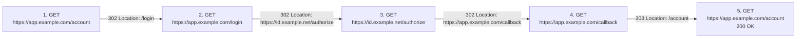
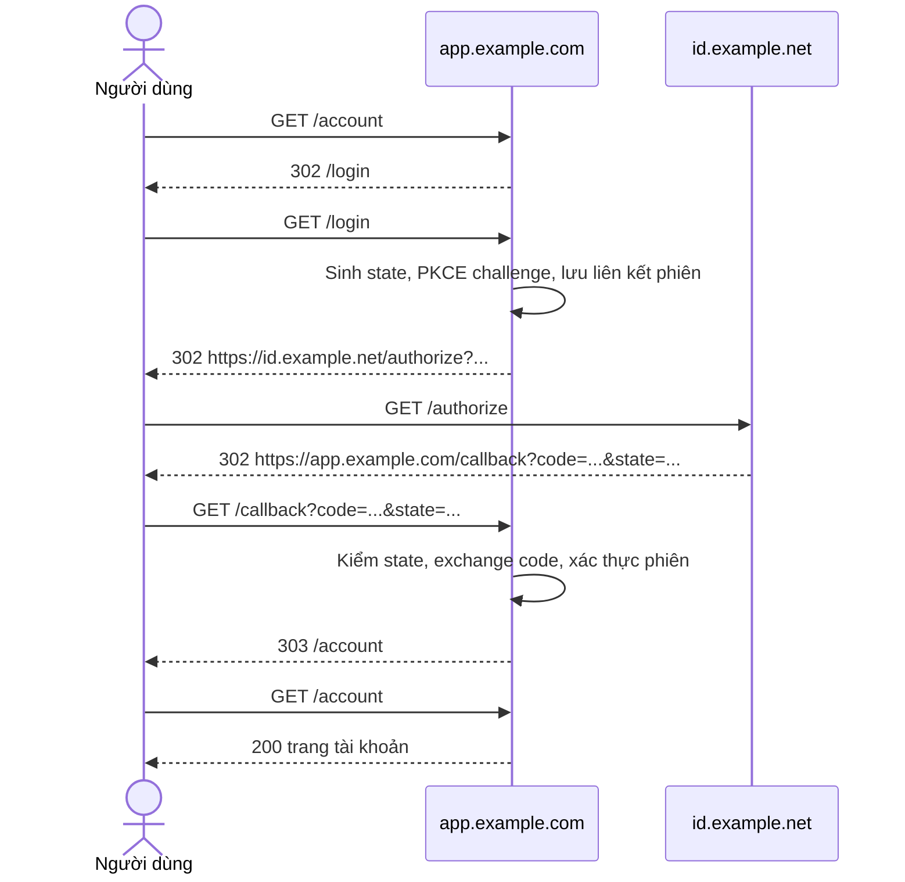

# Redirect chain

> **Chương:** Navigation  
> **Bài học:** Redirect chain (chuỗi chuyển hướng)  
> **Phạm vi:** **SECURITY_APPLICATION_SECURITY_BROWSER_SECURITY** — phân tích ranh giới bảo mật giữa trình duyệt, origin, cookie và ứng dụng web để hiểu Same-Origin Policy (SOP), CORS và cơ chế cách ly; áp dụng vào phòng vệ XSS, CSRF, clickjacking bằng CSP, Trusted Types, security headers và kiểm chứng hành vi thực tế.

## 1. Redirect chain là gì và vì sao quan trọng?

**Redirect chain** là chuỗi các lần chuyển hướng trong đó tài nguyên hoặc máy chủ trả lời rằng trình duyệt cần truy cập một URL khác, URL mới có thể lại chuyển hướng tiếp, cho đến khi nhận phản hồi cuối hoặc gặp lỗi.

Khi người dùng mở một đường dẫn đăng nhập, họ có thể đi qua nhiều bước:

1. URL ban đầu của ứng dụng.
2. Trang xác định người dùng đã đăng nhập hay chưa.
3. Hệ thống định danh (identity provider).
4. URL callback của ứng dụng.
5. Trang cuối cùng mà người dùng cần xem.

Mỗi bước có thể **đổi origin, đổi site, đổi method HTTP, gửi cookie khác nhau, áp dụng chính sách trình duyệt khác nhau hoặc làm lộ thông tin trong URL**. Vì vậy, an toàn của cả luồng không thể đánh giá chỉ bằng URL đầu tiên và trang cuối cùng.

### Mục tiêu học tập

Sau bài này, người học có thể:

- Đọc một chuỗi `3xx` và giải thích ý nghĩa của `Location`, URL đích, method và request body ở mỗi bước.
- Phân biệt **server-side HTTP redirect**, **client-side navigation** và chuyển hướng do chính trình duyệt thực hiện (chẳng hạn nâng cấp HSTS).
- Phân tích thay đổi **origin, site, cookie, credentials, referrer và security policy** xuyên suốt chuỗi.
- Giải thích vì sao redirect **không tự làm hai origin trở thành same-origin** và không tự cấp quyền đọc dữ liệu qua CORS.
- Nhận diện open redirect, redirect loop, HTTPS downgrade, rò rỉ token và rủi ro CSRF/OAuth trong luồng nhiều bước.
- Kiểm chứng trên DevTools/HTTP client, đề xuất cấu hình và mã phòng vệ cụ thể.

## 2. Một chuỗi redirect diễn ra như thế nào?

Giả sử ứng dụng có luồng chuyển hướng sau (các URL là ví dụ minh họa):



Đây là một luồng mô phỏng, chưa thể hiện token, `state`, PKCE và xử lý đăng nhập cần có trong hệ thống thật.

Ở mỗi bước, browser nhận **một HTTP response riêng**, đánh giá `Location` và thực hiện request tiếp theo nếu quy tắc cho phép.

Ví dụ tương tác HTTP rút gọn:

```http
GET /account HTTP/1.1
Host: app.example.com

HTTP/1.1 302 Found
Location: /login
Cache-Control: no-store
```

Browser giải quyết `/login` tương đối với URL hiện tại và tạo request:

```http
GET /login HTTP/1.1
Host: app.example.com

HTTP/1.1 302 Found
Location: https://id.example.net/authorize
```

Ở bước tiếp theo, host đã đổi từ `app.example.com` sang `id.example.net`, nghĩa là **khác origin** và **khác site**. Cookie, chính sách referrer và quyền truy cập tài nguyên được xét lại theo ngữ cảnh mới.

### Thuật ngữ cần phân biệt

| Thuật ngữ | Ý nghĩa |
|---|---|
| **Redirect response** | Phản hồi yêu cầu client điều hướng hoặc request đến URL khác theo quy tắc tương ứng |
| **Redirect target** | URL browser đi tiếp, thường xác định qua `Location` |
| **Hop** | Một bước chuyển từ URL này sang URL kế tiếp |
| **Final URL** | URL được truy cập sau bước redirect cuối cùng, nếu chuỗi hoàn tất |
| **Redirect loop** | Vòng chuyển hướng trở lại các URL đã gặp, lặp không dứt |
| **Cross-origin redirect** | Một bước dẫn sang origin khác |
| **Cross-site redirect** | Một bước dẫn sang site khác; khái niệm này không trùng hoàn toàn với cross-origin |
| **Open redirect** | Ứng dụng chấp nhận đầu vào không tin cậy để chuyển người dùng đến URL tùy ý |

Lưu ý: **không phải tất cả HTTP status 3xx đều tạo một chuyển hướng tự động**; chúng có mục đích riêng. Điển hình, `304 Not Modified` là kết quả xác thực cache, **không phải** lệnh chuyển sang URL khác.

## 3. Các mã HTTP redirect quan trọng

Hiểu đúng sự khác nhau giữa `301`, `302`, `303`, `307` và `308` là điều kiện tiên quyết khi thiết kế luồng đăng nhập, thao tác thay đổi dữ liệu và API.

| Mã | Tên | Dùng khi | Tác động với method/body |
|---|---|---|---|
| **301** | Moved Permanently | Tài nguyên chuyển vị trí lâu dài | Với `POST`, browser có thể chuyển request kế tiếp thành `GET`, bỏ body; với các method khác cần theo quy tắc Fetch/client |
| **302** | Found | Chuyển hướng tạm thời | Với `POST`, browser có thể chuyển thành `GET`, bỏ body |
| **303** | See Other | Sau thao tác, dẫn đến trang/tài nguyên xem kết quả | Nếu method không phải `GET`/`HEAD`, request tiếp theo dùng `GET`; body của request cũ không được gửi lại |
| **307** | Temporary Redirect | Chuyển tạm thời nhưng cần giữ phương thức | Giữ nguyên method/body theo khả năng gửi lại request |
| **308** | Permanent Redirect | Chuyển lâu dài và cần giữ phương thức | Giữ nguyên method/body theo khả năng gửi lại request |

**Cách nhớ:** `301/302` có hành vi tương thích lịch sử với `POST`; `303` chủ động chuyển sang bước đọc kết quả; `307/308` dùng khi cần **bảo toàn** phương thức và request body.

### 3.1. Vì sao 302 và 307 không thể dùng thay thế tùy ý?

Giả sử client gửi:

```http
POST /payments HTTP/1.1
Host: pay.example.com
Content-Type: application/json

{"amount":100}
```

Nếu server phản hồi:

```http
HTTP/1.1 302 Found
Location: /payments/result/123
```

Browser có thể gửi tiếp:

```http
GET /payments/result/123 HTTP/1.1
Host: pay.example.com
```

Đây có thể là hành vi mong muốn sau khi xử lý thành công, nhưng **`303 See Other` thể hiện rõ mục đích hơn**, đặc biệt trong mô hình *Post/Redirect/Get*.

Nếu server phản hồi:

```http
HTTP/1.1 307 Temporary Redirect
Location: https://new-pay.example.net/payments
```

Client có thể gửi **lại POST cùng body** đến origin mới. Điều này có thể dẫn đến lộ dữ liệu hoặc hành động trùng lặp nếu target chưa được kiểm soát. Với stream body không thể phát lại, client có thể từ chối hoặc không thể hoàn thành redirect.

**Quy tắc thiết kế:** không dùng `307/308` để đẩy một POST nhạy cảm sang origin bên thứ ba chỉ vì muốn “giữ nguyên request”. Xác minh địa chỉ đích, hợp đồng API, phân quyền và hệ quả của việc gửi lại body.

### 3.2. Khi nào dùng 303?

Mẫu **Post/Redirect/Get (PRG)** cho ứng dụng web:

```mermaid
sequenceDiagram
    actor U as Người dùng
    participant B as Browser
    participant S as Web server
    U->>B: Submit form POST /profile
    B->>S: POST /profile + CSRF token
    S->>S: Xác thực, phân quyền, xử lý và lưu
    S-->>B: 303 See Other; Location: /profile/saved
    B->>S: GET /profile/saved
    S-->>B: 200 OK + HTML
```

PRG giúp tránh việc người dùng vô tình **gửi lại POST khi refresh trang kết quả** trong nhiều trường hợp. PRG **không tự ngăn trùng giao dịch** khi client retry, mạng lỗi hoặc callback chạy lại; với nghiệp vụ quan trọng vẫn cần kiểm soát idempotency và xử lý transaction trên server.

### 3.3. Permanent redirects và cache

`301` và `308` thể hiện ý định chuyển lâu dài, do đó client/cache có thể ghi nhớ redirect theo các quy tắc cache. `302` và `307` là tạm thời nhưng cũng **có thể cache nếu được cấu hình rõ ràng** và cho phép theo chuẩn.

Không đặt `301/308` cho đích cá nhân hóa hoặc endpoint đăng nhập mà bạn sẽ phải thường xuyên thay đổi. Khi luồng có dữ liệu nhạy cảm hoặc chỉ định hướng tạm thời, chọn mã phù hợp và chính sách cache như `Cache-Control: no-store` theo thiết kế.

## 4. Location: URL tương đối, URL tuyệt đối và cách phân giải

Header `Location` cho biết đích redirect của nhiều status 3xx. Nó có thể chứa URL tương đối, URL tuyệt đối hoặc tham chiếu URL mà client phân giải theo URL của phản hồi hiện tại.

Từ `https://app.example.com/account/current`:

| Giá trị `Location` | Đích được phân giải |
|---|---|
| `/login` | `https://app.example.com/login` |
| `../login` | `https://app.example.com/login` |
| `login` | `https://app.example.com/account/login` |
| `https://id.example.net/start` | `https://id.example.net/start` |
| `//id.example.net/start` | `https://id.example.net/start` |
| `http://app.example.com/login` | `http://app.example.com/login` (đổi scheme, có thể bị chính sách HTTPS/HSTS tác động) |

Đặc biệt, `//id.example.net/start` là **network-path reference**: giữ scheme nhưng đổi host. Nếu bạn chỉ kiểm tra `startsWith('/')` thì có thể vô tình chấp nhận URL dẫn sang host khác.

Khi browser đi qua redirect tiếp theo, mỗi `Location` mới được giải quyết tương ứng với **URL hiện tại của bước đó**, không phải luôn theo URL ban đầu.

### JavaScript minh họa phân giải

```js
const current = 'https://app.example.com/account/current';

for (const location of [
  '/login',
  '../login',
  'login',
  '//id.example.net/start',
  'https://id.example.net/start',
]) {
  console.log(location, '=>', new URL(location, current).href);
}
```

Dùng API URL chuẩn của nền tảng để phân tích URL; tránh tự ghép host, tách chuỗi theo dấu chấm hoặc dựa vào `startsWith('https://trusted.example')`. Ví dụ, một chuỗi như `https://trusted.example.evil.test` **không** cùng host với `trusted.example`.

## 5. Phân biệt HTTP redirect và các kiểu navigation khác

Một thao tác chuyển trang **không nhất thiết** xuất phát từ HTTP `3xx`.

| Cơ chế | Ví dụ | Khi nào xuất hiện |
|---|---|---|
| **HTTP redirect** | `302` kèm `Location` | Server trả phản hồi chỉ định URL tiếp theo |
| **JavaScript navigation** | `window.location.assign('/dashboard')` | Mã trang quyết định điều hướng |
| **JavaScript replace** | `window.location.replace('/dashboard')` | Điều hướng bằng JS nhưng thay entry lịch sử hiện tại trong ngữ cảnh áp dụng |
| **Meta refresh** | `<meta http-equiv="refresh" content="0;url=/home">` | Tài liệu HTML yêu cầu refresh/chuyển trang sau khoảng thời gian |
| **Liên kết HTML** | `<a href="/home">` | Người dùng hoặc script kích hoạt điều hướng |
| **Biểu mẫu** | `<form action="/save">` | Submit form có thể nhận redirect sau phản hồi |
| **HSTS/internal upgrade** | Browser thay HTTP bằng HTTPS theo chính sách | Có thể hiển thị dạng internal redirect trong DevTools, không nhất thiết có HTTP 3xx trên mạng |

Ví dụ:

```js
// Client-side navigation: không tạo HTTP 3xx ở bước ra quyết định.
window.location.assign('/dashboard');

// Thay entry hiện tại trong history; có thể ảnh hưởng nút Back.
window.location.replace('/dashboard');
```

Nếu trang có bug XSS, đoạn mã độc chạy cùng origin có thể điều hướng người dùng bằng JavaScript. Ngăn open redirect phía server **không tự khắc phục** một điểm nhận URL không an toàn ở client.

### 5.1. Chuyển hướng bên trong trang khác với redirect server

Trong Network tab:

- HTTP redirect thường tạo một **redirect response** và request tiếp theo; bạn có thể xem `Location` cùng mã `3xx`.
- JavaScript navigation có thể xuất hiện như một request Document mới mà **không** có HTTP `3xx` liên quan tới quyết định điều hướng.
- HSTS có thể được DevTools hiển thị là **307 Internal Redirect** do browser nội bộ nâng cấp sang HTTPS. Đây không phải phản hồi `307` từ server HTTP. Cách hiện thị phụ thuộc browser.

Khi điều tra, xác định **ai tạo quyết định chuyển hướng**: server, JavaScript, HTML hay trình duyệt.

## 6. Origin và site được đánh giá lại qua từng hop

Ví dụ:

```text
A. https://app.example.com/start
   └─ 302 → https://login.example.com/verify

B. https://login.example.com/verify
   └─ 302 → https://id.partner.example.net/authorize

C. https://id.partner.example.net/authorize
   └─ 302 → https://app.example.com/callback

D. https://app.example.com/callback
   └─ 303 → /dashboard

E. https://app.example.com/dashboard
   └─ 200 OK
```

Ở đây:

- **A → B:** khác origin vì host khác, nhưng same-site theo schemeful site nếu hai URL dùng cùng scheme và registrable domain `example.com`.
- **B → C:** khác origin và khác site.
- **C → D:** từ một site bên thứ ba quay về ứng dụng, vẫn là chuyển tiếp **cross-site**.
- **D → E:** cùng origin, nếu scheme/host/port không đổi.

Browser không “gộp” tất cả các URL trong redirect chain thành một origin. JavaScript thực thi trong tài liệu cuối cùng chịu origin và chính sách của **tài liệu đó**, còn khả năng cookie được gửi trong các request của chain phụ thuộc ngữ cảnh điều hướng và chính sách cookie.

### 6.1. SOP không mất tác dụng do redirect

Giả sử trang `https://app.example.com` gọi API:

```text
GET https://api.example.com/data
302 Location: https://third.example.net/data
200 JSON
```

Việc URL cuối cùng trả dữ liệu không có nghĩa frontend tự động được đọc phản hồi. Browser vẫn áp dụng **Fetch/CORS**, chính sách credentials và các kiểm soát liên quan theo chuỗi request.

Tương tự, nếu một iframe từ origin A bị điều hướng sang origin B, trang cha vẫn **không** có quyền đọc DOM của tài liệu B khi SOP không cho phép.

### 6.2. Cross-origin chưa chắc cross-site

Hai URL có thể khác origin nhưng cùng site:

```text
https://app.example.com
https://api.example.com
```

Do đó, không suy rằng mọi redirect cross-origin đều mang ngữ cảnh cookie `SameSite` cross-site. Ngược lại, chuyển từ `https://app.example.com` sang `http://app.example.com` là cross-origin **và** khác schemeful site.

Với cookie và một số yêu cầu Fetch, lịch sử redirect có thể ảnh hưởng cách browser xác định tính cross-site của request hoặc các header như `Sec-Fetch-Site`. Không tự viết logic “chỉ cần URL đích cùng site là đủ an toàn” mà không kiểm tra cách browser xử lý cả chuỗi.

## 7. Cookie, phiên đăng nhập và credentials xuyên chuỗi

Một redirect chain có nhiều host **không đồng nghĩa mọi host đều nhận cùng cookie**. Browser xem xét cookie cho request ứng với **từng URL/hop**.

Các thuộc tính cần xem:

| Thuộc tính/chính sách | Liên quan trong redirect chain |
|---|---|
| `Domain` | Cookie host-only thường chỉ gửi cho host đã đặt; cookie có `Domain` có thể áp dụng cho các subdomain đủ điều kiện |
| `Path` | Giới hạn path mà cookie có thể được gửi tới; **không phải ranh giới bảo mật như origin** |
| `Secure` | Chỉ gửi cookie qua kết nối bảo mật theo quy tắc browser |
| `HttpOnly` | Giảm nguy cơ JavaScript đọc trực tiếp cookie, không chặn script gọi API bằng phiên hiện có |
| `SameSite` | Giới hạn một số lần gửi cookie cross-site; kết quả phụ thuộc kiểu navigation, method, ngữ cảnh và chuỗi redirect |
| `Set-Cookie` ở phản hồi 3xx | Có thể thiết lập/xóa cookie nếu browser chấp nhận; các hop tiếp theo có thể nhận cookie tương ứng |
| Chính sách third-party/partitioning | Có thể chặn hoặc phân vùng cookie, đặc biệt trong iframe và ngữ cảnh bên thứ ba |

Ví dụ response redirect:

```http
HTTP/1.1 302 Found
Location: /dashboard
Set-Cookie: __Host-session=opaque-session-id; Path=/; Secure; HttpOnly; SameSite=Lax
Cache-Control: no-store
```

Với browser hỗ trợ, tiền tố `__Host-` yêu cầu cookie có `Secure`, `Path=/` và **không** có `Domain`. Đây là cách giảm phạm vi cookie trong nhiều kiến trúc nhiều subdomain. Không đặt giá trị phiên thật trong tài liệu, log hoặc URL.

### 7.1. SameSite=Lax, Strict, None khi redirect

- **`SameSite=Strict`:** hạn chế cookie trong ngữ cảnh cross-site chặt chẽ; một luồng callback đăng nhập từ site khác có thể không nhận cookie Strict ngay ở request quay về.
- **`SameSite=Lax`:** thường cho phép cookie trong **điều hướng top-level với safe method** như GET, nhưng không phải mọi request cross-site và không thay CSRF token.
- **`SameSite=None; Secure`:** cho phép cookie trong một số ngữ cảnh cross-site nếu browser và chính sách quyền riêng tư chấp nhận; cần đánh giá rủi ro và sự hỗ trợ của trình duyệt.

Lưu ý rằng một số cookie không khai báo `SameSite` có thể chịu cơ chế mặc định và ngoại lệ triển khai theo browser. Không dựa vào giả định thiếu `SameSite` luôn hoạt động như `None`, hoặc mọi browser đều có cùng quy tắc.

### 7.2. Header Authorization và redirect cross-origin

Không giả định `Authorization` hoặc cookie của request ban đầu được tự động chuyển nguyên vẹn sang host khác. Browser/Fetch áp dụng các quy tắc bảo vệ credentials khi redirect, trong đó các header xác thực nhạy cảm có thể bị loại bỏ khi đổi origin.

Dù vậy, một request `307/308` **có thể mang lại body** sang đích khác nếu điều kiện cho phép. Bởi vậy, cần kiểm soát cả **địa chỉ redirect** lẫn **nội dung request được phát lại**, thay vì chỉ dựa vào giả định “auth header sẽ bị bỏ”.

## 8. Redirect chain trong CORS, fetch và API

Redirect của **navigation trang** và redirect của **Fetch/XHR** có ngữ cảnh bảo mật khác nhau.

### 8.1. fetch có các chế độ xử lý redirect

Mặc định, `fetch()` thường tự theo redirect trong phạm vi quy tắc Fetch. Có thể khai báo rõ:

```js
const response = await fetch('/api/profile', {
  redirect: 'follow', // hành vi thông thường
});

console.log(response.url);       // URL response cuối có thể quan sát được
console.log(response.redirected); // true nếu đã đi qua redirect
```

Để từ chối redirect ngay từ đầu trong request cần kiểm soát:

```js
try {
  const response = await fetch('/api/profile', {
    redirect: 'error',
  });
  console.log(response.status);
} catch (error) {
  console.error('Request hoặc redirect bị từ chối:', error);
}
```

`redirect: 'manual'` **không** phải cách mặc định để JavaScript đọc mọi `Location` của response cross-origin. Với Fetch ở browser, response có thể có kiểu `opaqueredirect`, che status và headers khỏi JavaScript.

Cũng không nên dựa vào `response.redirected` để quyết định **có nên gửi dữ liệu nhạy cảm hay không**: đến khi có response, redirect đã xảy ra. Phải kiểm soát URL/đích **trước request** hoặc yêu cầu server không chuyển hướng dữ liệu nhạy cảm sang host không tin cậy.

### 8.2. CORS có thể bị ảnh hưởng ở các hop

Ví dụ frontend tại `https://app.example.com`:

```js
const response = await fetch('https://api.example.com/data', {
  credentials: 'include',
});

const data = await response.json();
```

API phản hồi:

```http
HTTP/1.1 302 Found
Location: https://data.partner.example.net/data
```

Browser sẽ xử lý redirect theo thuật toán Fetch; **quyền đọc phản hồi cuối** vẫn chịu kiểm tra CORS và credential phù hợp. Nếu server cuối không cho phép origin của frontend theo quy tắc CORS, JavaScript không được đọc phản hồi như JSON bình thường, dù một số request đã đến server.

Tình huống redirect liên quan preflight có thêm giới hạn và khác biệt tương thích theo browser. **Đừng xây API dựa vào việc preflight `OPTIONS` được redirect qua nhiều host**; triển khai phản hồi preflight phù hợp ngay tại endpoint nhận request và chỉ chuyển hướng các luồng đã được thiết kế/kiểm thử.

### 8.3. Redirect API đến trang login HTML thường gây lỗi khó hiểu

Một mẫu lỗi phổ biến:

```text
fetch('/api/orders')
  → 302 Location: /login
  → 200 text/html
  → frontend gọi response.json()
  → lỗi parse JSON
```

Nếu frontend mong JSON mà server trả HTML login sau redirect, nguyên nhân có thể bị hiểu nhầm thành lỗi parser hoặc CORS.

Đối với API, thường rõ ràng hơn khi trả:

```http
HTTP/1.1 401 Unauthorized
Content-Type: application/json
Cache-Control: no-store

{"error":"authentication_required"}
```

Sau đó **frontend quyết định điều hướng** người dùng đến màn hình đăng nhập nếu phù hợp. Với thao tác không có quyền, có thể dùng `403 Forbidden` thay vì chuyển hướng mập mờ. Thiết kế chính xác còn phụ thuộc cơ chế authentication và hợp đồng API.

### 8.4. CORS không thay CSRF hoặc authorization

Một form cross-site có thể kích hoạt request mà không cần JavaScript đọc response. Redirect không biến một request thiếu quyền thành hợp lệ. Server phải kiểm tra:

- Người dùng/phiên hoặc token có hợp lệ không?
- Người dùng có quyền đối với tài nguyên đang thao tác không?
- Request thay đổi trạng thái có bảo vệ CSRF theo thiết kế không?
- Redirect target có được tin cậy cho tình huống này không?

Header `Access-Control-Allow-Origin` không phải cơ chế xác thực người dùng; có thể có request đến server dù browser chặn JavaScript đọc phản hồi.

## 9. Referrer, URL và rò rỉ dữ liệu qua chuỗi

Một đường dẫn redirect thường chứa tham số như `next`, `return_to` hoặc `redirect_uri`. Cần phân biệt **tham số điều hướng** với **dữ liệu nhạy cảm**.

Giả sử ứng dụng chuyển tới đối tác:

```text
https://app.example.com/continue?token=SECRET
  → 302 https://partner.example.net/complete
```

Ngay cả khi browser giới hạn `Referer` theo chính sách hiện hành, dữ liệu trong URL đầu vào có thể xuất hiện tại các vị trí như lịch sử duyệt, access log, analytics, bản ghi proxy hoặc màn hình chụp lại. **Không nên đặt access token, session ID, mật khẩu hoặc bí mật dài hạn vào URL redirect.**

Các vấn đề cần rà soát:

1. **Query string:** tham số có thể bị lưu trong log hoặc được ứng dụng truyền tiếp qua `Location`.
2. **Referer:** header này có thể tiết lộ nguồn truy cập theo `Referrer-Policy`, đặc biệt với redirect giữa các origin; không giả định mọi trình duyệt hay mọi cấu hình đều chỉ gửi origin.
3. **Fragment:** không được gửi như một phần request URL HTTP thông thường, nhưng có quy tắc kế thừa/tiếp diễn fragment trong redirect và JavaScript phía client có thể đọc fragment của URL trang đang mở.
4. **Set-Cookie:** mỗi phản hồi chuyển hướng có thể ảnh hưởng trạng thái phiên; cần kiểm tra cookie scope, cache và việc lưu cookie.
5. **Log:** chỉ ghi URL/Location đã được loại bỏ bí mật khi cần; tránh thu thập query nhạy cảm.

Ví dụ một chính sách giảm thông tin referrer:

```http
Referrer-Policy: strict-origin-when-cross-origin
```

Chính sách đó vẫn cần được kiểm thử cùng luồng điều hướng thực tế và không thay thế quy tắc **không truyền bí mật trong URL**.

## 10. Open redirect: rủi ro nổi bật trong navigation

**Open redirect** là tình huống ứng dụng để dữ liệu do bên ngoài kiểm soát quyết định đích điều hướng mà không ràng buộc đầy đủ. Ví dụ:

```text
https://trusted.example/redirect?next=https://attacker.example/phishing
```

Người dùng nhìn thấy tên miền ban đầu đáng tin, nhưng trình duyệt bị dẫn sang trang khác. Kẻ tấn công có thể sử dụng hành vi này trong phishing, chuỗi tấn công OAuth hoặc các luồng kiểm soát redirect của hệ thống khác.

### 10.1. Ví dụ code không an toàn

```js
// Ví dụ Express: KHÔNG AN TOÀN.
app.get('/redirect', (req, res) => {
  res.redirect(req.query.next);
});
```

`req.query.next` là input không tin cậy; client có thể đưa URL tuyệt đối, URL bắt đầu bằng `//` hoặc các chuỗi được mã hóa để vượt những kiểm tra hời hợt.

Một sai lầm tương tự:

```js
// KHÔNG AN TOÀN: kiểm tra prefix không xác nhận host thật.
if (target.startsWith('https://trusted.example')) {
  res.redirect(target);
}
```

Giá trị `https://trusted.example.evil.test` hoặc chuỗi URL có phần `userinfo` như `https://trusted.example@evil.test/` có thể khiến logic dựa trên tiền tố bị nhầm.

### 10.2. Thiết kế an toàn hơn: cho phép các route định trước

Nếu mục đích là quay lại các trang **nội bộ**, cách đơn giản là chấp nhận **route ID** thay vì URL tự do:

```js
// Ví dụ Express minh họa ý tưởng allowlist route nội bộ.
const allowedDestinations = new Map([
  ['home', '/'],
  ['account', '/account'],
  ['orders', '/orders'],
]);

app.get('/go', (req, res) => {
  const key = req.query.to;
  const destination = typeof key === 'string'
    ? allowedDestinations.get(key)
    : undefined;

  if (!destination) {
    return res.status(400).send('Unknown destination');
  }

  return res.redirect(302, destination);
});
```

Với thao tác POST xử lý thành công:

```js
// Pseudocode: sau khi đã xác thực, kiểm quyền và kiểm CSRF.
res.redirect(303, '/orders/confirmation');
```

Không chấp nhận giá trị tùy ý chỉ vì nó bắt đầu bằng dấu `/`; `//evil.example/path` có thể đổi host. Với các URL được phép gửi ra ngoài hệ thống, dùng **allowlist URL/host theo nghiệp vụ** và phân tích bằng parser chuẩn; hạn chế scheme (thường là `https:`), xử lý port, hostname, path và tránh cho phép URL có credentials.

### 10.3. Validate redirect phải phù hợp luồng nghiệp vụ

Một dịch vụ OAuth callback hoặc link theo đối tác có thể thực sự cần redirect cross-origin. Khi đó:

- Đăng ký **redirect URI chính xác** cho client OAuth; provider cần áp dụng quy tắc so khớp theo chuẩn và thiết kế đã chọn, không nhận mọi subdomain hoặc query tùy ý.
- Dùng `state` để ràng buộc phiên/yêu cầu cấp quyền và **PKCE** theo luồng OAuth hiện đại phù hợp.
- Kiểm tra cả những đích nằm sau một URL trung gian: một hostname allowlist có **open redirect** có thể trở thành bàn đạp tới host độc hại.
- Tránh nhúng authorization code, access token hoặc session secret vào URL do user kiểm soát.
- Có cơ chế phân biệt **URL trở về đã đăng ký** với một tham số `next` chỉ dùng để chọn trang nội bộ sau đăng nhập.

**Phòng vệ XSS liên quan:** nếu input điều khiển `window.location` hoặc `href` tại client, cần kiểm soát scheme và đích, tránh `javascript:` và các sơ đồ URL không mong muốn. CSP và Trusted Types là phòng vệ bổ sung cho các bề mặt phù hợp, không thay xác thực đích redirect.

## 11. Redirect loop, chain quá dài và thất bại giữa chừng

Redirect chain có thể bị lỗi vì logic sai hoặc chính sách không tương thích. Ví dụ:

```text
http://app.example.com/
  → https://app.example.com/
  → http://app.example.com/
  → ...
```

Hoặc:

```text
/account
  → /login
  → /account
  → /login
  → ...
```

Các trình duyệt có giới hạn đối với số lần redirect và có thể báo lỗi khi chuỗi quá dài hoặc lặp. Đừng dựa vào một giới hạn số hop cố định giữa mọi browser và HTTP client.

Nguyên nhân thường gặp:

- Reverse proxy không truyền đúng scheme gốc, ứng dụng tưởng request HTTPS là HTTP.
- Cấu hình canonical host (www/non-www) mâu thuẫn giữa proxy và ứng dụng.
- Trang kiểm tra đăng nhập và trang login liên tục chuyển nhau do cookie không được gửi/lưu.
- Sử dụng cookie `SameSite` hoặc `Secure` không phù hợp với luồng callback.
- URL có query/fragment bị gắn lặp trong `Location`.
- Hai dịch vụ đều yêu cầu đối phương xử lý trước và redirect qua lại.
- HSTS/HTTPS upgrade không được tính tới khi thiết kế redirect giữa các lớp.

### Cách giải quyết

1. Xác định URL bắt đầu, toàn bộ status `3xx` và từng `Location`.
2. Lập bảng scheme/host/port/method và cookie thực sự được gửi ở từng hop.
3. Kiểm tra cách proxy xác định scheme gốc và cấu hình trusted proxy.
4. Đảm bảo các yêu cầu bảo mật (session, CSRF, OIDC state, permission) được xác thực đúng trước khi redirect.
5. Loại bỏ những hop không cần thiết; chuyển trực tiếp đến canonical URL an toàn.
6. Bổ sung kiểm thử cho điều kiện chưa đăng nhập, đăng nhập xong, hết phiên, callback lỗi và browser không lưu third-party cookie.

Chain ngắn giúp giảm độ trễ và làm việc phân tích quyền dữ liệu đơn giản hơn, nhưng **một hop sai vẫn nguy hiểm**. Ưu tiên đúng chính sách hơn việc chỉ tối ưu số bước.

## 12. HTTPS, HSTS, mixed content và bảo vệ ranh giới transport

Một ví dụ chuyển hướng từ HTTP sang HTTPS:

```http
HTTP/1.1 301 Moved Permanently
Location: https://app.example.com/
```

Đây là cấu hình thường gặp, nhưng HTTP request ban đầu vẫn có thể đi qua mạng trước khi nhận redirect nếu browser không biết quy tắc nâng cấp. **HSTS (HTTP Strict Transport Security)** giúp browser đã biết chính sách yêu cầu HTTPS cho host trong những lần truy cập phù hợp tiếp theo.

```http
Strict-Transport-Security: max-age=31536000
```

HSTS chỉ được browser chấp nhận từ phản hồi HTTPS hợp lệ; có ngoại lệ về việc host được preload. Cần đánh giá cẩn thận trước khi dùng `includeSubDomains` hoặc đăng ký preload vì chúng ảnh hưởng rộng đến subdomain.

### 12.1. Redirect từ HTTPS xuống HTTP

Một redirect từ trang HTTPS sang HTTP có thể làm suy yếu bảo mật đường truyền, và trong ngữ cảnh *subresource* có thể bị chính sách mixed-content chặn hoặc nâng cấp. Với điều hướng top-level, hành vi browser và cảnh báo có thể khác theo trường hợp; **không coi HTTPS ở hop đầu là đủ bảo vệ toàn bộ chuỗi**.

Nên kiểm tra:

- Các hop có dùng `https:`/`wss:` theo yêu cầu không?
- Host trung gian có chứng chỉ TLS hợp lệ không?
- Có chuyển đích sang tên miền mới ít tin cậy không?
- Có để lộ dữ liệu nhạy cảm trên query hoặc qua log không?
- HSTS áp dụng cho host nào, và hop nào chỉ là nội bộ của browser?

### 12.2. Phân biệt HSTS internal redirect và HTTP 307

Chrome/DevTools có thể hiển thị một bước `307 Internal Redirect` trong trường hợp HSTS upgrade. Nó là tín hiệu xử lý **nội bộ browser**, không nhất thiết là server trả mã `307` qua mạng.

Để xác nhận server thật có gửi `Location` hay không, so sánh DevTools với log server và kết quả từ HTTP client trong môi trường kiểm thử.

## 13. CSP, iframe, clickjacking và redirect qua các ngữ cảnh navigation

Redirect trong **top-level page**, **iframe**, **popup** và **fetch** có thể chịu chính sách khác nhau.

### 13.1. Redirect trong iframe

Giả sử trang A nhúng một iframe trỏ đến B, B tiếp tục `302` sang C.

Browser sẽ xét cả:

- Trang cha có cho phép tải frame theo CSP `frame-src` (hoặc fallback phù hợp) không?
- Trang cuối/chuỗi có chính sách chống nhúng như CSP `frame-ancestors` hoặc `X-Frame-Options` không?
- Iframe có `sandbox` hạn chế script, biểu mẫu, popup, điều hướng top-level không?
- C có cùng origin với A không? Nếu khác origin, SOP giới hạn đọc DOM của iframe.

Ví dụ header phía trang không cho bị nhúng:

```http
Content-Security-Policy: frame-ancestors 'none'
X-Frame-Options: DENY
```

Một redirect không phải cách đáng tin để vượt `frame-ancestors`. Chính sách bảo vệ của tài liệu được nạp và các quy tắc browser vẫn áp dụng.

### 13.2. Sandbox và top-level navigation

Iframe có `sandbox` bị giới hạn nhiều năng lực; chẳng hạn điều hướng top-level thường bị hạn chế trừ khi cấp token thích hợp như `allow-top-navigation` hoặc `allow-top-navigation-by-user-activation` theo nhu cầu.

```html
<iframe
  src="https://widget.partner.example"
  sandbox="allow-scripts allow-forms"
  title="Widget đối tác">
</iframe>
```

Ví dụ này không cấp quyền cho widget tự ý điều hướng trang top-level. Nếu chức năng cần mở một trang bên ngoài, thiết kế luồng được người dùng kích hoạt và chỉ cấp quyền sandbox tối thiểu; đừng cấp tất cả quyền để “sửa lỗi redirect”.

### 13.3. Popup, opener và COOP

Redirect từ popup đăng nhập qua nhiều origin có thể bị ảnh hưởng bởi:

- `rel="noopener"`, `window.open` và quan hệ `window.opener`.
- **Cross-Origin-Opener-Policy (COOP)**, có thể tách browsing context group, ảnh hưởng cách popup liên lạc với trang mở nó.
- Cách gửi kết quả về ứng dụng qua callback backend hoặc `postMessage` có kiểm tra nguồn.

Nếu chọn `postMessage`, phía nhận phải kiểm tra `event.origin`, `event.source` (khi cần) và cấu trúc dữ liệu. Redirect đến origin khác **không cho phép** tùy tiện đọc DOM của popup.

### 13.4. Header không tự truyền qua các response

Một `302` do server A trả về và trang HTML `200` của server B là **những response khác nhau**. Không giả định CSP, `X-Frame-Options`, `Referrer-Policy`, `Cache-Control` hoặc cookie scope của response A tự động trở thành chính sách đầy đủ của tài liệu B.

Một số header có hiệu lực riêng ở giai đoạn redirect (ví dụ quản lý cookie, cache, referrer theo quy tắc tương ứng); những header khác điều khiển tài liệu/tài nguyên cuối. Cần kiểm tra **từng response và ngữ cảnh áp dụng**.

## 14. Thực hành 1: đọc redirect chain bằng DevTools

Thực hành trên ứng dụng hoặc máy chủ thử nghiệm do bạn sở hữu. Có thể cấu hình chuỗi sau:

```text
/start          → 302 Location: /step-a
/step-a         → 307 Location: /step-b
/step-b         → 303 Location: /finished
/finished       → 200 OK
```

### Các bước

1. Mở Chrome/Edge/Firefox DevTools → **Network**.
2. Bật **Preserve log** để không mất thông tin khi điều hướng sang tài liệu mới.
3. Xóa log cũ, mở `/start` và quan sát request theo thứ tự.
4. Chọn từng dòng, xem **Headers**: Request URL, Status Code, `Location`, `Set-Cookie`, `Cookie`, `Referer`, `Origin` và `Sec-Fetch-Site` nếu có.
5. Ở tab **Timing**, xem thời gian mỗi bước để xác định hop làm chậm.
6. Thử lại bằng `POST` ở endpoint demo riêng để phân biệt `303` và `307`. Không dùng endpoint thực thi thanh toán hoặc thay đổi dữ liệu thật.
7. Ghi lại origin/site/method của mỗi request; đừng suy từ một thông báo Console.

Bảng ghi nhận mẫu:

| Hop | Request URL | Status | Method tiếp theo | `Location` | Origin/site thay đổi? |
|---|---|---|---|---|---|
| 1 | `/start` | `302` | Tùy method gốc; với GET vẫn GET | `/step-a` | Không |
| 2 | `/step-a` | `307` | Giữ method/body nếu có thể | `/step-b` | Không |
| 3 | `/step-b` | `303` | Thường GET cho request trước không phải GET/HEAD | `/finished` | Không |
| 4 | `/finished` | `200` | Dừng chain | — | Không |

Với flow đăng nhập thật, thay các URL ví dụ bằng URL đã kiểm soát và **che cookie, token, authorization code** trước khi lưu ảnh/chia sẻ HAR.

## 15. Thực hành 2: khảo sát bằng HTTP client

HTTP client giúp nhìn rõ mã HTTP và header, nhưng **không mô phỏng đầy đủ** SOP, CORS, cookie policy và các hạn chế riêng của trình duyệt.

### Quan sát một response đầu tiên

Trên Windows PowerShell, dùng tên `curl.exe` để tránh nhầm alias `curl` của môi trường cũ:

```powershell
curl.exe -sS -D - -o NUL https://example.com/start
```

`-D -` in response headers ra đầu ra; `-o NUL` bỏ body trên Windows. Trong trường hợp demo có redirect, bạn sẽ thấy `Location` ở phản hồi `3xx` đầu tiên.

### Theo chuỗi redirect, có giới hạn

```powershell
curl.exe -sS -L -D - -o NUL --max-redirs 8 https://example.com/start
```

- `-L`: theo redirect.
- `-D -`: in headers của các response.
- `--max-redirs 8`: đặt giới hạn cho môi trường thử nghiệm.
- `-o NUL`: không in body ra console trên Windows.

Không dùng `-I` (HEAD) để suy chắc hành vi redirect của một request GET hoặc POST: server có thể xử lý HEAD khác. Với POST demo, lưu ý curl và browser không luôn có chính xác cùng hành vi mặc định khi lựa chọn option; tránh ép giữ POST ở mọi hop nếu mục đích là mô phỏng browser.

**An toàn khi kiểm tra:** không đưa cookie/token thật vào command line hoặc log công khai; không gửi request theo một `Location` trỏ tới host ngoài môi trường được phép.

## 16. Thực hành 3: kiểm tra open redirect và sửa lỗi

Giả sử endpoint demo ban đầu có dạng:

```js
// KHÔNG AN TOÀN: dễ tạo open redirect.
app.get('/continue', (req, res) => {
  res.redirect(req.query.next);
});
```

### Kiểm tra trong môi trường demo

Các giá trị cần xét theo thiết kế:

| `next` do client gửi | Mong muốn khi chỉ cho redirect nội bộ |
|---|---|
| `/orders` | Cho phép nếu đây là route hợp lệ |
| `https://external.example/` | Từ chối |
| `//external.example/` | Từ chối |
| `https://trusted.example.evil.test/` | Từ chối |
| `javascript:alert(1)` | Từ chối |
| `\\external.example\\path` | Từ chối/không diễn giải thành host hợp lệ |
| `/unknown-route` | Từ chối hoặc điều hướng về mặc định an toàn |

Áp dụng mô hình **route ID allowlist** ở mục 10.2, ví dụ `?to=orders`. Nếu hệ thống bắt buộc nhận URL, chuẩn hóa bằng `new URL(input, base)` và kiểm tra rõ scheme, origin, pathname, trạng thái cho phép; không dùng so sánh chuỗi tiền tố.

**Bài học:** open redirect vẫn nguy hiểm dù server không trả dữ liệu mật trực tiếp, vì nó có thể xây dựng đường dẫn đáng tin ban đầu để dẫn tới điểm đến không tin cậy.

## 17. Thực hành 4: kiểm thử cookies và CORS khi redirect

Dùng hai origin demo:

```text
Trang: http://localhost:3000
API:   http://localhost:4000
```

Khác port nghĩa là **khác origin**; cookie không phân tách theo port như origin. Đây là một ví dụ hữu ích để thấy hai cơ chế khác nhau.

### Thử nghiệm A — fetch đi qua redirect

1. Từ trang `http://localhost:3000` gọi `fetch('http://localhost:4000/start')`.
2. API `/start` trả `302 Location: /final`.
3. `/final` trả JSON; thử **không** và **có** cấu hình CORS phù hợp.
4. Trong Network, xem cả hai request và phản hồi cuối. JavaScript có đọc JSON được hay không phụ thuộc điều kiện CORS/Fetch.
5. Thử `redirect: 'error'` để thấy frontend chủ động từ chối redirect trong luồng cần kiểm soát.

```js
fetch('http://localhost:4000/start', {
  redirect: 'follow',
})
  .then(async (response) => {
    console.log('Final URL:', response.url);
    console.log('Redirected:', response.redirected);
    console.log('JSON:', await response.json());
  })
  .catch((error) => console.error(error));
```

### Thử nghiệm B — cookie ở mỗi hop

1. Cho server demo đặt một cookie phù hợp và quan sát `Set-Cookie` ở response `302`.
2. Xem request tiếp theo có gửi `Cookie` hay không.
3. Thay đổi host/path, `SameSite` và cách gửi credentials trong môi trường thử nghiệm rồi quan sát khác biệt.
4. Không kết luận hành vi cookie third-party từ duy nhất localhost: chính sách và khả năng tin cậy của localhost khác môi trường HTTPS thật.

### Thử nghiệm C — HTTP 303 và 307 với POST

1. Đặt endpoint `POST /submit-303` trả `303 Location: /result`.
2. Đặt endpoint `POST /submit-307` trả `307 Location: /receiver`.
3. Gửi body không nhạy cảm như `value=demo`.
4. Quan sát server log: request sau `303` thường là GET; sau `307` vẫn là POST khi client có thể phát lại request.
5. Không dùng `307` để chuyển body chứa phiên hoặc dữ liệu tài chính tới origin bên ngoài.

## 18. Bảng rà soát thiết kế redirect chain

| Vấn đề cần kiểm | Câu hỏi kiểm chứng | Biện pháp điển hình |
|---|---|---|
| **Đích redirect** | Có cho user nhập URL tùy ý không? | Allowlist route/URL, phân tích URL chuẩn, giới hạn scheme |
| **Method/body** | `POST` có được gửi lại sang hop khác không? | Chọn đúng `303`/`307`/`308`; không chuyển body nhạy cảm không kiểm soát |
| **Origin/site** | Có bước chuyển sang host/site kém tin cậy không? | Đánh giá từng hop; tránh allowlist một gateway có open redirect |
| **Cookie** | Cookie nào gửi ở mỗi hop, có ảnh hưởng `SameSite` không? | Host-only cookie, `Secure`, `HttpOnly`, `SameSite` phù hợp |
| **CSRF** | Form hoặc redirect có dẫn tới thao tác thay đổi trạng thái không? | CSRF token, kiểm tra Origin/Fetch Metadata, quyền server |
| **CORS** | Frontend có đang đọc API qua cross-origin redirect không? | CORS allowlist đúng, tránh redirect preflight, hợp đồng API rõ |
| **OAuth** | Có kiểm tra `redirect_uri`, `state`, PKCE không? | Exact redirect URI, state binding, PKCE, không truyền secret qua URL |
| **TLS** | Có hop HTTP hoặc hostname không mong muốn không? | HTTPS end-to-end, HSTS theo phạm vi phù hợp |
| **Referrer và log** | Token/query nhạy cảm có đi qua URL hoặc log không? | Không đưa secret vào URL, giới hạn log, `Referrer-Policy` |
| **Frame/popup** | Redirect có chạy trong iframe hoặc popup bị hạn chế không? | CSP `frame-ancestors`, sandbox, COOP, xác minh `postMessage` |
| **Cache** | Redirect lâu dài có thể bị cache sai không? | Mã 3xx và `Cache-Control` phù hợp |
| **Loop/độ trễ** | Có hop lặp, quá dài hoặc mâu thuẫn giữa proxy/app không? | Tối giản chain, giám sát và kiểm thử các trạng thái đăng nhập |

## 19. Tình huống thực tế: login callback an toàn

Giả sử một ứng dụng cần điều hướng người dùng tới hệ thống đăng nhập bên ngoài rồi quay về:



Những quyết định bảo mật ở đây:

1. **Redirect URI của ứng dụng đã đăng ký chính xác** với IdP, có HTTPS và endpoint callback phù hợp.
2. **`state` gắn với request/phiên**, kiểm tra và tiêu thụ đúng; PKCE bảo vệ quy trình trao đổi authorization code theo flow áp dụng.
3. Cookie được cấu hình để callback có thể hoàn tất đúng, nhưng không dựa riêng vào cookie khi xác nhận state và quyền.
4. **Không chuyển tiếp tự do** giá trị `next` từ bên ngoài; sau callback chỉ chọn route nội bộ được phép.
5. Dữ liệu nhạy cảm không đưa vào tham số `Location` tùy ý. Callback xử lý code theo giao thức, hạn chế log và tránh để giá trị tồn tại không cần thiết trong trình duyệt.
6. Phản hồi cuối mang **CSP, anti-framing headers và cache policy** phù hợp với tài liệu đích; không coi header ở bước login trước đó là đủ.
7. Nếu API được gọi bằng fetch thay vì top-level navigation, áp dụng **hợp đồng API/CORS** riêng thay vì chuyển đến trang login HTML mơ hồ.

Bằng cách kiểm tra **từng bước** và ranh giới tin cậy, redirect chain trở thành luồng điều hướng có thể kiểm chứng thay vì chuỗi `Location` khó quan sát.

## 20. Câu hỏi tự kiểm tra

**1.** Nếu server trả `302 Location: /login` cho request GET, browser có nhất thiết giữ nguyên URL ban đầu không?  
**Đáp án:** Không. Browser thường theo redirect để tới URL mới; lịch sử và hiển thị URL phụ thuộc ngữ cảnh điều hướng.

**2.** Vì sao `https://app.example.com` → `https://login.example.com` là cross-origin dù cùng công ty?  
**Đáp án:** Khác thành phần host. Origin được xác định bởi scheme, host và port, không bởi quyền sở hữu.

**3.** Nên dùng status nào sau POST tạo đơn hàng thành công khi muốn hiển thị trang xác nhận qua GET?  
**Đáp án:** `303 See Other` làm rõ việc chuyển tới một resource khác bằng GET theo mô hình PRG.

**4.** `307` khác `302` về rủi ro nào khi redirect POST?  
**Đáp án:** `307` giữ method/body theo quy tắc và khả năng phát lại; có nguy cơ gửi body tới host khác nếu target không được kiểm soát.

**5.** `Location: //evil.example/path` có được xem là relative path nội bộ chỉ vì bắt đầu bằng `/`?  
**Đáp án:** Không. Đây là network-path reference; host có thể thay đổi.

**6.** Một request Fetch theo redirect tới API khác origin. Có thể đọc JSON chỉ vì request cuối trả `200 OK` không?  
**Đáp án:** Không. Browser còn phải cho phép đọc response theo CORS và các chính sách liên quan.

**7.** Cookie host-only của `app.example.com` có tự gửi sang `login.example.com` trong chain không?  
**Đáp án:** Không, trừ khi có cookie khác đáp ứng phạm vi host/domain và các điều kiện gửi. Cookie host-only áp dụng cho host đã đặt nó.

**8.** `SameSite=Lax` có thay được CSRF token không?  
**Đáp án:** Không. Có những trường hợp top-level navigation hoặc same-site request vẫn mang cookie; kiểm tra CSRF phía server là lớp bảo vệ riêng.

**9.** Vì sao redirect từ HTTPS đến HTTP cần được đánh giá?  
**Đáp án:** Có thể làm giảm bảo vệ truyền tải, bị browser chặn/nâng cấp trong các ngữ cảnh hoặc làm lộ thông tin khi URL chứa dữ liệu nhạy cảm.

**10.** Vì sao `https://trusted.example.evil.test` không vượt qua được allowlist hostname chính xác của `trusted.example`?  
**Đáp án:** Host thực tế là `trusted.example.evil.test`, không phải `trusted.example`; kiểm tra prefix chuỗi là sai.

**11.** Một response `302` có CSP an toàn. Response cuối `200` ở host khác có tự được hưởng CSP đó không?  
**Đáp án:** Không mặc nhiên. Cần đánh giá chính sách trên response và ngữ cảnh mà chính sách thực sự áp dụng.

**12.** DevTools hiện `307 Internal Redirect`. Có thể kết luận server đã trả HTTP 307 không?  
**Đáp án:** Không. Đó có thể là xử lý nâng cấp HTTPS nội bộ của browser, ví dụ HSTS.

**13.** Vì sao `fetch(..., { redirect: 'manual' })` không phải API đọc mọi `Location` cross-origin?  
**Đáp án:** Fetch có thể trả response kiểu `opaqueredirect` để giới hạn thông tin lộ ra; manual mode không vô hiệu hóa SOP/CORS.

**14.** Redirect chain có thể giúp tấn công phishing dù endpoint trung gian không trả bí mật?  
**Đáp án:** Có. Open redirect trên tên miền đáng tin có thể đưa nạn nhân đến trang giả mạo và làm phức tạp việc đánh giá URL đích.

**15.** Khi browser báo quá nhiều redirect, chỉ xóa cookie có đủ để kết luận nguyên nhân không?  
**Đáp án:** Không. Cần đọc từng hop, kiểm tra điều kiện đăng nhập, proxy, scheme, host, cookie policy và các rule redirect mâu thuẫn.

## Kết luận

**Redirect chain là một chuỗi các quyết định điều hướng có thể đi qua nhiều ranh giới bảo mật.** Mỗi hop có URL, status, method, header và chính sách cookie riêng. `301/302/303/307/308` không tương đương khi xử lý POST; `Location` có thể đổi host ngay cả khi bắt đầu bằng `//`; và các bước đi qua origin khác không làm SOP hay CORS biến mất.

Một thiết kế an toàn cần **kiểm soát đích redirect, chọn đúng status, bảo vệ credentials, xác thực/phân quyền và CSRF ở server, giữ HTTPS, giới hạn dữ liệu nhạy cảm trong URL, kiểm tra CSP và framing theo ngữ cảnh, đồng thời quan sát đầy đủ chuỗi bằng DevTools**. Đây là nền tảng để xây dựng luồng đăng nhập, thanh toán, API và tích hợp đối tác đáng tin cậy trên trình duyệt.
