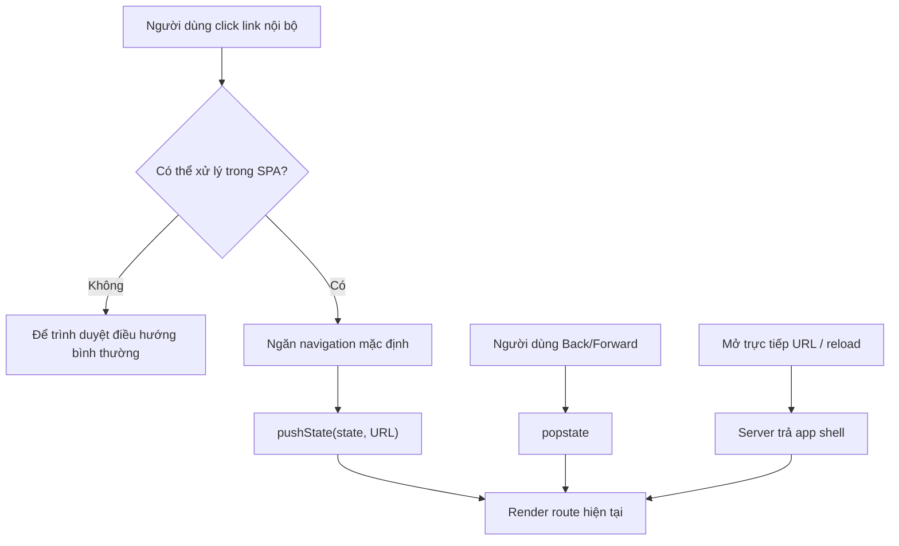

# History API: quản lý lịch sử điều hướng trong ứng dụng web

**Chương:** Navigation  
**Mô-đun:** `SECURITY_APPLICATION_SECURITY_BROWSER_SECURITY` — phân tích ranh giới bảo mật giữa trình duyệt, origin, cookie và ứng dụng web để hiểu Same-Origin Policy (SOP), CORS và các cơ chế cách ly; thực hành phòng vệ XSS, CSRF, clickjacking bằng CSP, Trusted Types, security headers và kiểm chứng hành vi thực tế.

**History API** cho phép JavaScript đọc và điều khiển một phần *session history* của tab hoặc browsing context hiện tại. Ứng dụng có thể thêm một mục lịch sử bằng `history.pushState()`, thay thế mục hiện tại bằng `history.replaceState()`, và phản ứng khi người dùng quay lại/tiến tới bằng sự kiện `popstate`. Đây là nền tảng của nhiều bộ định tuyến trong ứng dụng một trang (SPA).

Điểm cần hiểu rõ về bảo mật: History API cập nhật URL và trạng thái điều hướng trong phạm vi document hiện tại; nó **không cấp quyền cross-origin**, **không thay thế xác thực/phân quyền phía server**, và **không tự tải một document mới** khi gọi `pushState()`. Nếu xử lý URL hoặc state thiếu kiểm soát, ứng dụng vẫn có thể mắc XSS, open redirect, lộ dữ liệu nhạy cảm hoặc lỗi điều hướng.

## 1. Mục tiêu học tập

Sau bài học, bạn có thể:

1. Mô tả session history và vai trò của History API trong navigation của một tab.
2. Phân biệt `pushState()`, `replaceState()`, `back()`, `forward()`, `go()` và sự kiện `popstate`.
3. Giải thích giới hạn same-origin khi thay đổi URL bằng History API.
4. Xây dựng luồng SPA cơ bản đồng bộ URL, nội dung và thao tác Back/Forward.
5. Thiết kế URL và đối tượng state không chứa bí mật, đồng thời xử lý dữ liệu route an toàn.
6. Nhận diện những lỗi thường gặp liên quan đến XSS, open redirect, server fallback, scroll và quyền truy cập tài nguyên.

## 2. Session history là gì?

Khi người dùng điều hướng trong một tab, trình duyệt quản lý các **session history entries** cho browsing context đó. Một entry có thể đại diện cho document được tải, hoặc một trạng thái lịch sử được tạo bởi ứng dụng bằng History API. Người dùng tương tác với lịch sử qua nút Back/Forward, phím tắt hoặc giao diện trình duyệt.

Ví dụ một SPA có thể tạo chuỗi entry như sau:

```text
Mở /home
   |
   | history.pushState(...)
   v
/home  ->  /products  ->  /products/42
          Back              Forward
```

Mỗi lần gọi `pushState()` thành công, trình duyệt thêm một entry mới vào session history của browsing context hiện tại. `replaceState()` cập nhật entry đang hoạt động mà không thêm entry mới. Khi người dùng quay lại hoặc tiến tới một entry khác, trình duyệt có thể kích hoạt `popstate` trên document đang hoạt động theo quy tắc traversal.

Không nên hình dung history chỉ là một mảng JavaScript đơn giản. Trình duyệt có thể lưu trạng thái document, điều hướng, scroll position và các dữ liệu nội bộ khác; một số entry còn có thể khôi phục document qua cơ chế như Back/Forward Cache (BFCache). Ứng dụng nên dùng API công khai và không giả định chi tiết nội bộ của trình duyệt.

### 2.1. Các thuộc tính và phương thức chính

| API | Vai trò | Có tạo entry mới? |
| --- | --- | --- |
| `history.length` | Số lượng entry trong session history mà trình duyệt báo cho browsing context | Không |
| `history.state` | State gắn với entry hiện tại | Không |
| `history.pushState(state, unused, url?)` | Thêm entry và có thể cập nhật URL hiển thị | Có |
| `history.replaceState(state, unused, url?)` | Thay state/URL của entry hiện tại | Không |
| `history.back()` | Yêu cầu traversal về entry trước | Không |
| `history.forward()` | Yêu cầu traversal đến entry sau | Không |
| `history.go(delta)` | Yêu cầu traversal theo số bước tương đối | Không |

`history.length` không cho biết đầy đủ URL, nội dung hay quyền truy cập của các entry trước. Không dùng nó làm kiểm tra bảo mật, không suy luận rằng entry trước thuộc ứng dụng của mình, và không giả định gọi `back()` chắc chắn quay về một trang cụ thể.

## 3. `pushState()`: thêm entry mới

Cú pháp:

```javascript
history.pushState(state, unused, url);
```

- `state` là dữ liệu gắn với entry mới. Dữ liệu được xử lý theo cơ chế structured clone.
- `unused` là tham số thứ hai được giữ lại vì lý do tương thích lịch sử API; truyền chuỗi rỗng `""`.
- `url` là URL tùy chọn để hiển thị cho entry mới. Nếu bỏ qua, URL hiện tại được giữ nguyên.

Ví dụ:

```javascript
const state = {
  page: "product-detail",
  productId: "42"
};

history.pushState(state, "", "/products/42");
console.log(location.pathname);
// "/products/42"

console.log(history.state);
// { page: "product-detail", productId: "42" }
```

**Điều gì đã xảy ra?**

1. Một entry mới được thêm vào session history.
2. Thanh địa chỉ có thể hiển thị `/products/42`.
3. Document hiện tại vẫn tiếp tục hoạt động; không có navigation tải document mới chỉ vì gọi `pushState()`.
4. Trình duyệt không tự tải dữ liệu sản phẩm, không tự render trang và không tự gọi API. Ứng dụng phải thực hiện những việc đó.
5. `popstate` **không được phát ngay** chỉ vì gọi `pushState()`.

`pushState()` không bắt buộc phải thực hiện request HTTP tới URL mới. Đây là khác biệt quan trọng so với `location.assign()` hoặc người dùng nhấp liên kết để điều hướng thực sự.

### 3.1. Giới hạn same-origin của URL

URL truyền vào `pushState()` hoặc `replaceState()` phải cùng origin với document hiện tại. Ví dụ, nếu ứng dụng đang ở `https://app.example.com`:

| URL truyền vào | Hợp lệ? | Giải thích |
| --- | --- | --- |
| `/products/42` | Có | URL tương đối, cùng origin |
| `https://app.example.com/cart` | Có | Đúng scheme, host và port |
| `https://app.example.com:443/cart` | Có | Cổng mặc định HTTPS tương đương 443 |
| `https://api.example.com/profile` | Không | Khác hostname |
| `http://app.example.com/home` | Không | Khác scheme |
| `https://app.example.com:8443/home` | Không | Khác port |

Ví dụ lỗi:

```javascript
// Document hiện tại: https://app.example.com
history.pushState({}, "", "https://attacker.example/landing");
// Trình duyệt ném SecurityError.
```

Giới hạn này ngăn một document dùng History API để giả vờ rằng nó đang ở một origin khác. Nó **không** có nghĩa ứng dụng không thể điều hướng người dùng sang trang ngoài bằng các API navigation thông thường; điều hướng thật là một hành vi khác và phải được kiểm soát theo nhu cầu sản phẩm.

URL tương đối được phân giải theo URL của document hiện tại. Có thể dùng `new URL()` để phân tích và kiểm tra đích trước khi gọi History API:

```javascript
const target = new URL("/products/42", window.location.href);

if (target.origin !== window.location.origin) {
  throw new Error("Route phải cùng origin");
}

history.pushState({ page: "product" }, "", target);
```

### 3.2. Khi nào pushState() có thể lỗi?

Một số tình huống phổ biến:

- URL không hợp lệ hoặc khác origin.
- Document không ở trạng thái phù hợp để thực hiện thao tác (ví dụ document không còn fully active).
- Ứng dụng gọi quá thường xuyên trong khoảng thời gian ngắn, khiến trình duyệt áp giới hạn.
- Đối tượng `state` không thể structured-clone, dẫn tới `DataCloneError`.
- Trình duyệt không thể thực hiện thao tác do giới hạn session history hoặc điều kiện nội bộ.

Đừng nuốt mọi lỗi một cách im lặng. Ghi nhận lỗi kỹ thuật phù hợp, nhưng không log URL chứa token hay state có dữ liệu cá nhân.

## 4. `replaceState()`: cập nhật entry hiện tại

`replaceState()` có cú pháp tương tự `pushState()`:

```javascript
history.replaceState(state, "", url);
```

Nó thay đổi state và có thể cập nhật URL của **entry hiện tại**, không tạo một entry mới.

Ví dụ khi ứng dụng chuẩn hóa URL ban đầu:

```javascript
const canonicalUrl = new URL(location.href);
canonicalUrl.searchParams.delete("tracking");

history.replaceState(
  { page: "home" },
  "",
  canonicalUrl
);
```

Ví dụ khác: người dùng chọn một bộ lọc sản phẩm. Nếu thay đổi lọc chỉ là điều chỉnh trạng thái hiện tại và bạn không muốn Back phải đi qua từng giá trị lọc, có thể cân nhắc `replaceState()`. Nếu mỗi lần chọn lọc là một bước người dùng mong muốn quay lại được, `pushState()` phù hợp hơn.

| Tình huống | Thường dùng |
| --- | --- |
| Mở một trang/route mới trong SPA | `pushState()` |
| Cập nhật bộ lọc mà không cần entry riêng | `replaceState()` |
| Chuẩn hóa URL hoặc bổ sung state cho entry ban đầu | `replaceState()` |
| Ghi nhận từng bước trong luồng người dùng cần Back/Forward | `pushState()` |
| Điều hướng sang document khác | Link hoặc Navigation API phù hợp, `location.assign()` |

`replaceState()` cũng chịu giới hạn same-origin cho URL và yêu cầu state có thể structured-clone.

## 5. `popstate`: phản ứng khi người dùng Back/Forward

Sự kiện `popstate` được phát khi active history entry thay đổi qua thao tác traversal, ví dụ người dùng nhấn Back/Forward hoặc ứng dụng gọi `history.back()`/`history.go()` và traversal thành công đến entry khác. `event.state` chứa bản sao state gắn với entry vừa được kích hoạt.

Ví dụ:

```javascript
window.addEventListener("popstate", (event) => {
  console.log("URL hiện tại:", location.href);
  console.log("State của entry:", event.state);

  renderRoute(location.pathname);
});
```

**Phân biệt ba hành vi:**

| Hành động | Thêm/thay entry | Phát `popstate` ngay? |
| --- | --- | --- |
| `history.pushState(...)` | Thêm entry | Không |
| `history.replaceState(...)` | Thay entry hiện tại | Không |
| Người dùng Back/Forward đến entry khác | Traversal | Có thể phát trên document đang hoạt động theo quy tắc traversal |

Vì `pushState()` không phát `popstate`, ứng dụng phải tự cập nhật giao diện sau khi gọi nó. Không nên đợi `popstate` để render route vừa tạo.

`popstate` cũng không đồng nghĩa với `hashchange`. Gọi `pushState()` để thay URL có fragment không tự phát `hashchange`; thay đổi fragment bằng điều hướng hash thông thường có thể phát `hashchange`. Hãy chọn cơ chế và event phù hợp, không đăng ký cả hai rồi xử lý cùng một thay đổi hai lần.

### 5.1. `back()`, `forward()` và `go()` là bất đồng bộ

`history.back()` và `history.forward()` yêu cầu trình duyệt thực hiện traversal. Chúng không trả về Promise chứa trang đích.

```javascript
history.back();     // Yêu cầu quay lại một entry.
history.forward();  // Yêu cầu tiến một entry.
history.go(-2);     // Yêu cầu lùi hai entry.
history.go(1);      // Tương đương forward().
history.go(0);      // Reload entry hiện tại theo hành vi của trình duyệt.
```

Không viết logic phụ thuộc vào giả định rằng lệnh `history.back()` luôn hoàn tất ngay dòng kế tiếp. Nếu cần thực hiện công việc sau khi route thay đổi, hãy phản ứng bằng `popstate` hoặc cơ chế điều phối route của ứng dụng.

Nếu không có entry phù hợp, lệnh có thể không tạo ra thay đổi như mong muốn. Không sử dụng Back làm cơ chế đăng xuất, thu hồi quyền hoặc bảo đảm người dùng không thể truy cập trang trước. Khi đăng xuất, server phải thu hồi session/token và endpoint phải kiểm tra trạng thái xác thực.

## 6. State object: lưu gì trong history?

`state` được structured-clone để gắn với entry. Điều đó có nghĩa đối tượng nhận lại qua `history.state` hoặc `event.state` không nhất thiết là cùng tham chiếu với object ban đầu.

Ví dụ:

```javascript
const original = {
  page: "search",
  filters: { category: "books" }
};

history.pushState(original, "", "/search?category=books");

original.filters.category = "music";

// State đã được clone khi pushState được gọi.
// Không dựa vào việc thay đổi original để cập nhật history.state.
console.log(history.state);
```

State phù hợp để giữ dữ liệu điều hướng nhỏ và có thể tái tạo giao diện:

- tên route hoặc mã tài nguyên không nhạy cảm;
- trạng thái tab đang chọn;
- thông tin phân trang, bộ lọc đơn giản;
- khóa tham chiếu đến dữ liệu mà ứng dụng có thể tải lại;
- vị trí scroll hoặc trạng thái UI nhỏ, nếu kiến trúc cần.

Không nên lưu:

- session ID, access token, refresh token, mật khẩu;
- dữ liệu thanh toán hoặc bí mật xác thực;
- dữ liệu cá nhân nhạy cảm không cần thiết;
- object lớn, binary hoặc toàn bộ dữ liệu API chỉ để tránh tải lại.

Trình duyệt có thể đặt giới hạn kích thước state và có thể lưu state xuống đĩa để khôi phục session. Nếu dữ liệu không structured-clone được, thao tác có thể ném `DataCloneError`; nếu quá lớn, trình duyệt có thể từ chối. Lưu dữ liệu lớn ở bộ nhớ ứng dụng hoặc storage thích hợp, rồi chỉ giữ một khóa tham chiếu nhỏ trong history.

**URL và state có vai trò khác nhau:** URL nên mô tả tài nguyên/trạng thái có thể chia sẻ, bookmark hoặc tải lại; state có thể giữ chi tiết điều hướng riêng của một entry. Một trang phải xử lý được trường hợp người dùng mở trực tiếp URL trong tab mới, nơi `history.state` có thể là `null`.
## 7. Xây dựng router SPA an toàn

Một router SPA cơ bản phải đồng bộ ba thứ:

1. URL hiện tại.
2. Nội dung mà ứng dụng hiển thị.
3. Session history để Back/Forward hoạt động đúng.

Luồng cơ bản:



### 7.1. Chỉ intercept link phù hợp

Một router không nên chặn mọi click. Hãy giữ hành vi mặc định cho:

- link mở tab mới bằng `target="_blank"`;
- click có Ctrl/Cmd/Shift/Alt hoặc nút chuột không phải trái;
- link có thuộc tính `download`;
- link external origin;
- link có `rel="external"` nếu ứng dụng dùng quy ước này;
- event đã bị component khác xử lý hoặc navigation mà ứng dụng không sở hữu.

Ví dụ logic kiểm tra:

```javascript
function shouldHandleLink(event, anchor) {
  if (event.defaultPrevented) return false;
  if (event.button !== 0) return false;
  if (event.metaKey || event.ctrlKey || event.shiftKey || event.altKey) {
    return false;
  }
  if (anchor.hasAttribute("download")) return false;
  if (anchor.target && anchor.target !== "_self") return false;
  if (anchor.relList.contains("external")) return false;

  const url = new URL(anchor.href, location.href);
  if (url.origin !== location.origin) return false;

  return true;
}
```

Sau khi xác định link phù hợp, ứng dụng có thể ngăn hành vi mặc định, gọi `pushState()` và render. Nếu URL không cùng origin, hãy để trình duyệt thực hiện navigation thông thường hoặc dùng một luồng external navigation được thiết kế rõ ràng.

### 7.2. Không biến URL thành HTML

Route có thể chứa tham số do người dùng kiểm soát. Ví dụ `/search?q=...` hoặc `/users/:id`. Đừng đưa trực tiếp chuỗi route vào `innerHTML`:

```javascript
// Không an toàn: query có thể chứa markup/script.
result.innerHTML = new URLSearchParams(location.search).get("q");
```

Dùng DOM API an toàn và kiểm tra dữ liệu theo kiểu:

```javascript
const query = new URLSearchParams(location.search).get("q") ?? "";
result.textContent = query;
```

Nếu cần render HTML giàu định dạng, phải dùng sanitizer phù hợp, kiểm soát sink, CSP và Trusted Types khi được hỗ trợ. History API chỉ thay đổi trạng thái navigation; nó không làm cho dữ liệu trong URL trở nên đáng tin.

### 7.3. Xử lý route và lỗi rõ ràng

Không giả định pathname luôn khớp route hợp lệ. Router cần:

- chuẩn hóa và phân tích URL bằng `URL`, không nối chuỗi tùy tiện;
- xác định route bằng allowlist/pattern rõ ràng;
- kiểm tra kiểu, chiều dài và định dạng của path parameter;
- hiển thị trang 404/không tìm thấy nếu route không hợp lệ;
- tải dữ liệu từ API có xác thực và phân quyền;
- hủy hoặc bỏ qua kết quả request cũ khi người dùng chuyển route nhanh;
- không dùng dữ liệu route để tự quyết định quyền truy cập.

Một route `/admin` chỉ là địa chỉ giao diện. Người dùng có thể tự nhập URL hoặc gọi API trực tiếp; server phải xác thực và phân quyền mọi request quản trị.

## 8. Server fallback: vì sao reload route SPA có thể trả 404?

Sau khi SPA gọi `pushState({}, "", "/products/42")`, thanh địa chỉ hiển thị `/products/42` nhưng server có thể chưa hề nhận request cho route này. Khi người dùng refresh hoặc mở URL đó trực tiếp, trình duyệt gửi request HTTP:

```http
GET /products/42 HTTP/1.1
Host: app.example.com
```

Nếu server chỉ phục vụ file vật lý và không cấu hình fallback, nó có thể trả `404 Not Found` dù SPA có route đó. Vì vậy cần cấu hình server/proxy để trả app shell cho các đường dẫn SPA phù hợp, trong khi vẫn giữ API, file tĩnh và endpoint thật hoạt động chính xác.

Ví dụ logic khái niệm:

```text
/api/*           -> API handler
/assets/*        -> static file handler
/products/*      -> app shell (index.html)
/settings/*      -> app shell (index.html)
unknown asset    -> 404 thật
```

Không cấu hình fallback quá rộng đến mức một URL file tĩnh sai cũng trả HTML với status 200. Điều đó làm hỏng cache, che giấu lỗi deploy và có thể khiến trình duyệt xử lý nhầm nội dung.

Với route cần SEO hoặc nội dung phản hồi riêng, có thể dùng server-side rendering hoặc framework có hỗ trợ routing ở server. Dù dùng SPA hay SSR, quyền truy cập dữ liệu nhạy cảm vẫn phải được kiểm tra tại server.

## 9. History API và các cơ chế bảo mật

### 9.1. Same-Origin Policy không bị History API vượt qua

Giới hạn same-origin của `pushState()` và `replaceState()` bảo đảm document không thể đổi URL lịch sử sang origin tùy ý. Nó không cho document đọc DOM, cookie hay Web Storage của origin khác.

Ví dụ trang `https://app.example.com` không thể gọi:

```javascript
history.pushState({}, "", "https://api.example.com/profile");
```

để giả vờ chạy tại API. Nếu cần truy cập API, ứng dụng phải dùng Fetch/XHR và tuân thủ CORS; nếu cần điều hướng người dùng sang host khác, đó là navigation thật với các chính sách tương ứng.

### 9.2. History API không phải kiểm soát truy cập

Ẩn một route bằng cách không hiển thị link hoặc gọi `replaceState()` không bảo vệ tài nguyên. Người dùng có thể tự nhập URL, gọi API, sửa state trong DevTools hoặc gửi request ngoài giao diện. Server phải xác minh session, quyền và trạng thái nghiệp vụ cho mọi endpoint.

Không lưu cờ kiểu `{ isAdmin: true }` trong history state để cấp quyền. State chỉ là dữ liệu client có thể thay đổi; nó không phải bằng chứng xác thực.

### 9.3. Tránh bí mật trong URL và history state

URL có thể xuất hiện trong lịch sử trình duyệt, log proxy/server, ảnh chụp màn hình, clipboard, hệ thống analytics và header `Referer` tùy Referrer Policy. Không đặt token truy cập, mã khôi phục hoặc bí mật vào query/fragment để “giữ trạng thái khi Back”.

History state cũng không phải kho bí mật. Trình duyệt có thể giữ state trong session và có thể serialize để khôi phục. Chỉ lưu dữ liệu UI không nhạy cảm và có thể tái tạo.

Đối với luồng OAuth/OIDC, dùng cơ chế `state`/PKCE theo giao thức, kiểm tra callback và redirect URI ở server. Đừng nhầm tham số `state` của OAuth với object `history.state`: chúng là hai khái niệm hoàn toàn khác nhau.

### 9.4. Open redirect là vấn đề của navigation đích

History API chỉ chấp nhận URL cùng origin cho `pushState()`, nhưng ứng dụng vẫn có thể có open redirect ở endpoint server hoặc logic navigation:

```javascript
// Rủi ro: next do người dùng kiểm soát, có thể trỏ ra website giả mạo.
location.assign(new URLSearchParams(location.search).get("next"));
```

Trước khi điều hướng ngoài, xác thực đích bằng allowlist host/scheme cụ thể hoặc dùng route nội bộ được ánh xạ từ mã định danh. Không dựa vào kiểm tra hậu tố chuỗi kiểu `endsWith("example.com")`.

Nếu chỉ cần cập nhật route trong SPA, tạo URL cùng origin qua `new URL(path, location.origin)` rồi so sánh `url.origin` với `location.origin` trước khi gọi `pushState()`.

### 9.5. XSS trong SPA và CSP/Trusted Types

Một SPA thường render nhiều nội dung mà không tải lại document. XSS trong một route có thể chạy với quyền của origin ứng dụng, đọc dữ liệu mà origin đó được phép đọc và thực hiện request theo quyền của người dùng. Việc route được tạo bằng `pushState()` không làm nội dung an toàn hơn.

Phòng vệ gồm:

- hiển thị dữ liệu dạng text bằng `textContent` khi phù hợp;
- tránh sink nguy hiểm như `innerHTML` với chuỗi không tin cậy;
- dùng sanitizer được duy trì nếu phải render HTML;
- triển khai CSP chặt, ưu tiên nonce/hash cho script inline khi cần;
- dùng `require-trusted-types-for 'script'` và Trusted Types policy khi trình duyệt hỗ trợ;
- kiểm tra dữ liệu từ URL, state, API và postMessage như đầu vào không tin cậy.

Ví dụ header định hướng:

```http
Content-Security-Policy: default-src 'self'; script-src 'self'; object-src 'none'; base-uri 'self'; frame-ancestors 'none'
X-Content-Type-Options: nosniff
Referrer-Policy: strict-origin-when-cross-origin
```

CSP phải phù hợp với cách bundle script, style, API và iframe thực tế của ứng dụng. `frame-ancestors` giúp chống clickjacking cho document được bảo vệ; nó không phải một phần của History API và không kiểm soát route nào được phép truy cập dữ liệu.

### 9.6. CSRF và clickjacking không được giải quyết bằng Back/Forward

Một route ẩn hoặc một entry đã bị replace không ngăn request giả mạo. CSRF cần token hoặc cơ chế tương đương, cookie `SameSite`, kiểm tra nguồn request theo chính sách và xác thực/phân quyền phía server. Clickjacking cần CSP `frame-ancestors` hoặc header tương thích phù hợp trên response của trang cần bảo vệ.

Đăng xuất không nên chỉ dùng `history.replaceState()` để thay URL hoặc điều hướng về trang login. Server phải vô hiệu hóa session/token; trang chứa dữ liệu nhạy cảm nên xử lý cache phù hợp; API phải từ chối phiên đã thu hồi. Nút Back có thể khôi phục một document từ cache trong một số tình huống, vì vậy UI cần kiểm tra trạng thái phiên và không dựa vào việc URL đã đổi để bảo vệ dữ liệu.

## 10. Scroll restoration và trải nghiệm điều hướng

Trình duyệt thường quản lý vị trí cuộn khi traversal. `history.scrollRestoration` có hai giá trị phổ biến:

- `"auto"`: trình duyệt tự khôi phục vị trí cuộn.
- `"manual"`: ứng dụng tự quản lý việc khôi phục.

Ví dụ:

```javascript
history.scrollRestoration = "manual";

window.addEventListener("popstate", () => {
  renderRoute(location.pathname);
  window.scrollTo(0, 0);
});
```

Đây chỉ là ví dụ đơn giản. Nếu ứng dụng cần khôi phục vị trí từng entry, hãy lưu scroll position theo một khóa entry riêng và khôi phục sau khi nội dung đã render. Không dùng URL làm khóa duy nhất nếu cùng route có thể có nhiều entry với bộ lọc hoặc trạng thái khác nhau.

Không tự động cuộn lên đầu cho mọi `popstate` nếu UX yêu cầu giữ vị trí trước đó. Hãy kiểm thử với trang dài, danh sách ảo hóa, nội dung tải bất đồng bộ và thao tác Back/Forward liên tiếp.

## 11. Lab: xây dựng router nhỏ bằng History API

Lab này dùng Node.js có sẵn, không cần thư viện bên ngoài. Server trả cùng app shell cho các đường dẫn route để kiểm chứng cả điều hướng nội bộ và reload trực tiếp.

Tạo file `history-lab.mjs`:

```javascript
import { createServer } from "node:http";

const html = `<!doctype html>
<html lang="vi">
<head>
  <meta charset="utf-8">
  <meta name="viewport" content="width=device-width, initial-scale=1">
  <title>History API Lab</title>
</head>
<body>
  <h1>History API Lab</h1>
  <nav aria-label="Điều hướng">
    <a href="/">Trang chủ</a>
    <a href="/products">Sản phẩm</a>
    <a href="/products/42">Sản phẩm 42</a>
    <a href="/about">Giới thiệu</a>
    <a href="https://example.org/" target="_blank" rel="noopener">Website ngoài</a>
  </nav>

  <main id="app" aria-live="polite"></main>
  <p>
    <button id="back" type="button">Back</button>
    <button id="forward" type="button">Forward</button>
    <button id="replace" type="button">Replace state</button>
  </p>
  <pre id="debug"></pre>

  <script>
    const app = document.querySelector("#app");
    const debug = document.querySelector("#debug");

    function render() {
      const path = location.pathname;
      let title;

      if (path === "/") {
        title = "Trang chủ";
      } else if (path === "/products") {
        title = "Danh sách sản phẩm";
      } else if (path === "/products/42") {
        title = "Chi tiết sản phẩm 42";
      } else if (path === "/about") {
        title = "Giới thiệu";
      } else {
        title = "Không tìm thấy route";
      }

      // Nội dung là text; không diễn giải pathname thành HTML.
      app.textContent = title;
      debug.textContent = JSON.stringify({
        pathname: location.pathname,
        state: history.state,
        length: history.length
      }, null, 2);
    }

    document.addEventListener("click", event => {
      const anchor = event.target.closest("a");
      if (!anchor) return;
      if (event.defaultPrevented || event.button !== 0) return;
      if (event.metaKey || event.ctrlKey || event.shiftKey || event.altKey) return;
      if (anchor.hasAttribute("download")) return;
      if (anchor.target && anchor.target !== "_self") return;
      if (anchor.relList.contains("external")) return;

      const url = new URL(anchor.href, location.href);
      if (url.origin !== location.origin) return;

      event.preventDefault();
      history.pushState(
        { path: url.pathname, changedAt: Date.now() },
        "",
        url
      );
      render();
    });

    window.addEventListener("popstate", event => {
      console.log("popstate:", event.state);
      render();
    });

    document.querySelector("#back").addEventListener("click", () => {
      history.back();
    });

    document.querySelector("#forward").addEventListener("click", () => {
      history.forward();
    });

    document.querySelector("#replace").addEventListener("click", () => {
      history.replaceState(
        { path: location.pathname, replacedAt: Date.now() },
        "",
        location.href
      );
      render();
    });

    // Gắn state cho entry đầu tiên nếu chưa có.
    if (history.state === null) {
      history.replaceState({ path: location.pathname }, "", location.href);
    }

    render();
  </script>
</body>
</html>`;

createServer((req, res) => {
  if (req.url?.startsWith("/favicon.ico")) {
    res.writeHead(204);
    return res.end();
  }

  // Lab trả app shell cho route SPA để reload URL sâu vẫn hoạt động.
  res.writeHead(200, {
    "Content-Type": "text/html; charset=utf-8",
    "Cache-Control": "no-store"
  });
  res.end(html);
}).listen(3000, () => {
  console.log("History API Lab: http://localhost:3000");
});
```

Chạy server:

```bash
node history-lab.mjs
```

Mở `http://localhost:3000` trong trình duyệt và mở DevTools → Console/Network.

### 11.1. Các bước quan sát

1. Nhấn **Sản phẩm**. URL đổi thành `/products`, nội dung đổi mà không tải document mới.
2. Nhấn **Sản phẩm 42**. URL đổi thành `/products/42` và thêm một history entry.
3. Nhấn **Back** hoặc nút Back của trình duyệt. Sự kiện `popstate` chạy và giao diện được render theo pathname hiện tại.
4. Nhấn **Forward** để quay lại entry tiếp theo.
5. Nhấn **Replace state** nhiều lần. State của entry hiện tại thay đổi nhưng số entry không tăng do thao tác replace.
6. Nhấp link **Website ngoài**. Vì link có target khác và origin khác, router không intercept; trình duyệt xử lý navigation bình thường.
7. Đang ở `/products/42`, nhấn Refresh. Server vẫn trả app shell nên route có thể render lại. Nếu bỏ fallback server, request trực tiếp có thể trả 404.
8. Thử mở URL `http://localhost:3000/products/42` trong tab mới. `history.state` ban đầu có thể là `null`; ứng dụng vẫn phải render được route từ URL.

### 11.2. Thử các lỗi có kiểm soát

Trong Console của lab, thử:

```javascript
history.pushState({}, "", "https://example.org/outside");
```

Kết quả mong đợi: trình duyệt ném `SecurityError` vì URL khác origin.

Tiếp theo:

```javascript
history.pushState({ page: "test" }, "", "/test");
console.log(history.state);
```

URL thay đổi và state gắn với entry; document không tải lại. Sau đó nhấn Back để quan sát `popstate`.

Thử:

```javascript
history.replaceState({ page: "replaced" }, "", "/test-replaced");
console.log(history.state);
```

Entry hiện tại được cập nhật, không thêm entry mới.

Cuối cùng, thử đưa object không structured-clone được vào state:

```javascript
history.pushState({ callback() {} }, "", "/bad-state");
```

Hàm không thể structured-clone nên thao tác sẽ thất bại với `DataCloneError` trong trình duyệt tuân thủ hành vi này.

**Kết thúc lab:** dừng Node bằng Ctrl+C. Không dùng URL hoặc state chứa token, cookie, mật khẩu hay dữ liệu người dùng thật.

## 12. Các ngộ nhận thường gặp

**“pushState() điều hướng và tải trang mới.”** Sai. Nó thêm history entry và có thể cập nhật URL, nhưng document hiện tại tiếp tục chạy.

**“pushState() có thể đổi origin vì URL trên thanh địa chỉ đã đổi.”** Sai. URL phải cùng origin với document hiện tại; API không cho giả mạo origin khác.

**“pushState() sẽ phát popstate.”** Sai. `popstate` gắn với traversal đến entry khác; sau khi push/replace, ứng dụng tự render.

**“replaceState() giống pushState().”** Sai. Replace cập nhật entry hiện tại; push thêm entry mới.

**“history.state là dữ liệu đáng tin vì do ứng dụng tạo.”** Sai. State ở client có thể thiếu, cũ hoặc bị thay đổi; không dùng nó để cấp quyền.

**“Ẩn route admin là đã bảo vệ API.”** Sai. Người dùng có thể gọi endpoint trực tiếp; server phải kiểm tra quyền cho từng request.

**“URL route không thể gây XSS vì chỉ là đường dẫn.”** Sai. Query, fragment và path parameter vẫn là dữ liệu không tin cậy nếu đưa vào DOM hoặc sink nguy hiểm.

**“Back sau logout bảo đảm dữ liệu riêng tư biến mất.”** Sai. Document có thể được khôi phục từ cache; session phải được thu hồi phía server và UI phải xử lý trạng thái xác thực.

**“history.length cho biết có thể quay lại trang của ứng dụng.”** Sai. Nó không cung cấp danh sách entry hay nguồn gốc đáng tin cậy của entry trước.

**“Dùng replaceState để chặn người dùng quay lại là biện pháp bảo mật.”** Sai. Nó chỉ sửa entry hiện tại; không thay thế kiểm soát session, quyền truy cập hay chính sách cache.

## 13. Checklist triển khai History API trong ứng dụng thực tế

Trước khi phát hành router SPA, kiểm tra:

1. **URL cùng origin:** mọi URL truyền vào `pushState()/replaceState()` được phân tích bằng `URL` và kiểm tra origin.
2. **URL là nguồn route:** ứng dụng có thể render khi mở trực tiếp, refresh hoặc khôi phục session mà `history.state` không có.
3. **Back/Forward:** `popstate` render đúng route; không đợi event này sau `pushState()`.
4. **Link interception:** không phá Ctrl/Cmd-click, middle-click, target, download hoặc external navigation.
5. **Server fallback:** route SPA trả app shell đúng; API và static assets vẫn trả response riêng; đường dẫn asset sai vẫn có 404.
6. **State tối thiểu:** chỉ lưu dữ liệu UI nhỏ, structured-clone được; không lưu token hoặc bí mật.
7. **XSS:** dữ liệu từ path/query/hash/state được xử lý như input không tin cậy; dùng DOM API an toàn, CSP và Trusted Types khi phù hợp.
8. **Open redirect:** kiểm tra đích external navigation bằng allowlist; không tin URL `next` do client gửi.
9. **Authorization:** server kiểm tra session và quyền cho mọi API; router không phải ranh giới bảo mật.
10. **Logout/cache:** thu hồi session ở server, xử lý dữ liệu nhạy cảm và kiểm tra Back/Forward/BFCache.
11. **Scroll và accessibility:** quản lý focus, tiêu đề trang, thông báo route mới, scroll restoration và thao tác bàn phím.
12. **Kiểm thử trình duyệt:** kiểm tra refresh, mở URL sâu, Back/Forward nhanh, tab mới, session restore và các trình duyệt mục tiêu.

### Câu hỏi tự kiểm tra

**Câu 1.** `pushState({page:"a"}, "", "/a")` có tải document `/a` từ server không?  
**Đáp án:** Không. Nó cập nhật session history và URL; ứng dụng phải render route. Khi refresh hoặc mở URL trực tiếp, trình duyệt mới gửi request tới server.

**Câu 2.** Ứng dụng đang ở `https://app.example.com` có thể gọi `pushState({}, "", "https://api.example.com")` không?  
**Đáp án:** Không. URL khác origin nên thao tác bị từ chối.

**Câu 3.** Sau `pushState()`, tại sao không thấy `popstate`?  
**Đáp án:** Vì push tạo entry; `popstate` phản ứng khi traversal kích hoạt entry khác.

**Câu 4.** `replaceState()` khác `pushState()` thế nào?  
**Đáp án:** Replace sửa entry hiện tại; push thêm entry mới.

**Câu 5.** Có thể lưu access token trong `history.state` để giữ đăng nhập khi Back không?  
**Đáp án:** Không. History state không phải kho bí mật; session phải được quản lý an toàn ở server và cookie/storage phù hợp.

**Câu 6.** Route `/admin` không có link trên giao diện. Điều đó có ngăn người dùng gọi API admin không?  
**Đáp án:** Không. API phải xác thực và phân quyền độc lập với router.

## 14. Ghi nhớ cốt lõi

History API là công cụ quản lý **session history của browsing context**: `pushState()` thêm entry, `replaceState()` sửa entry hiện tại, và `popstate` giúp ứng dụng phản ứng khi người dùng Back/Forward. URL truyền vào phải cùng origin; thao tác push/replace không tải document mới và không tự phát `popstate`.

Một router an toàn cần đồng bộ URL, giao diện và server fallback; xử lý route như dữ liệu không tin cậy; không lưu bí mật trong URL/state; và để server chịu trách nhiệm xác thực, phân quyền, CSRF. **History API cải thiện điều hướng và trải nghiệm SPA, không tạo ra ranh giới bảo mật mới và không thay thế các cơ chế bảo vệ của trình duyệt hoặc máy chủ.**

### Tài liệu tham khảo

- [MDN — History API](https://developer.mozilla.org/en-US/docs/Web/API/History_API).
- [MDN — Working with the History API](https://developer.mozilla.org/en-US/docs/Web/API/History_API/Working_with_the_History_API).
- [MDN — History.pushState()](https://developer.mozilla.org/en-US/docs/Web/API/History/pushState).
- [MDN — History.replaceState()](https://developer.mozilla.org/en-US/docs/Web/API/History/replaceState).
- [MDN — popstate event](https://developer.mozilla.org/en-US/docs/Web/API/Window/popstate_event).
- [HTML Standard — Session history and navigation](https://html.spec.whatwg.org/multipage/nav-history-apis.html).
