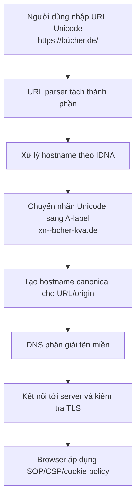

# Punycode

**Punycode** là cách mã hóa các nhãn tên miền có ký tự Unicode thành dạng ASCII tương thích với DNS, để tên miền quốc tế hóa (**Internationalized Domain Name – IDN**) có thể được biểu diễn và phân giải trong hệ thống tên miền truyền thống. Ví dụ, tên miền Unicode `bücher.de` có dạng ASCII-compatible là `xn--bcher-kva.de`.

Punycode giúp biểu diễn tên miền, nhưng **không mã hóa bí mật, không xác minh chủ sở hữu và không chứng minh website đáng tin cậy**. Kẻ tấn công có thể đăng ký tên miền chứa ký tự Unicode nhìn giống thương hiệu thật (*homograph attack*). Vì vậy ứng dụng phải phân tích và chuẩn hóa hostname bằng thư viện URL/IDNA đáng tin cậy, so sánh tên miền theo dạng canonical và kiểm tra chính sách truy cập ở phía server.

Bài học thuộc chương **URL và encoding** trong module **Browser Security** (`SECURITY_APPLICATION_SECURITY_BROWSER_SECURITY`). Nội dung kết nối cách xử lý URL với ranh giới origin, cookie và ứng dụng web; đồng thời chỉ ra những rủi ro giả mạo tên miền có thể dẫn tới phishing, XSS, CSRF hoặc điều hướng người dùng sang website độc hại.

## 1. Mục tiêu học tập

Sau bài này, bạn có thể:

1. Giải thích vì sao DNS cần biểu diễn tên miền quốc tế hóa bằng ASCII-compatible encoding.
2. Phân biệt **Unicode domain (U-label)**, **ASCII-compatible domain (A-label)**, Punycode và percent-encoding của URL.
3. Đọc dạng `xn--...` và giải thích ý nghĩa của tiền tố `xn--`.
4. Hiểu quan hệ giữa Punycode, IDNA, Unicode normalization, URL parser, DNS và origin của browser.
5. Nhận diện homograph, mixed-script, ký tự vô hình và lỗi so sánh hostname.
6. Viết kiểm tra hostname theo allowlist bằng API URL/IDNA chuẩn; không dựa vào hình thức hiển thị của tên miền.
7. Dùng Node.js để chuyển đổi U-label/A-label, xem hostname và origin mà URL parser thực sự sử dụng.

## 2. Vì sao tên miền cần Punycode?

DNS truyền thống được thiết kế quanh các nhãn tên miền dùng tập ký tự ASCII giới hạn. Trong khi đó, tên miền người dùng muốn nhớ có thể chứa ký tự từ nhiều hệ chữ: tiếng Đức có `ü`, tiếng Pháp có dấu, tiếng Việt có dấu, tiếng Nhật có Kanji/Kana, tiếng Ả Rập có chữ viết từ phải sang trái.

Ví dụ người dùng có thể nhập:

```text
bücher.de
```

Để tương thích với hạ tầng DNS, nhãn `bücher` được chuyển thành:

```text
xn--bcher-kva.de
```

Hai cách viết biểu diễn cùng một tên miền IDN hợp lệ sau khi xử lý theo quy tắc IDNA. Browser có thể hiển thị dạng Unicode hoặc dạng ASCII tùy chính sách an toàn, ngôn ngữ và phiên bản trình duyệt. DNS sử dụng biểu diễn ASCII-compatible tương ứng khi truy vấn.

### Sơ đồ chuyển đổi



Punycode chỉ là một phần trong quá trình. Việc quyết định một nhãn Unicode có hợp lệ làm tên miền hay không thuộc quy tắc **IDNA** và quy trình xử lý tên miền của URL parser. Không phải chuỗi Unicode bất kỳ nào cũng chuyển thành một hostname hợp lệ.

## 3. Phân biệt U-label, A-label, IDN và Punycode

| Thuật ngữ | Ý nghĩa | Ví dụ |
| --- | --- | --- |
| **IDN** | Tên miền quốc tế hóa, có thể chứa nhãn không phải ASCII | `bücher.de` |
| **U-label** | Nhãn tên miền ở dạng Unicode đáp ứng quy tắc IDNA | `bücher` |
| **A-label** | Biểu diễn ASCII-compatible của một U-label hợp lệ | `xn--bcher-kva` |
| **Punycode** | Thuật toán mã hóa Bootstring dùng để biểu diễn code point Unicode trong chuỗi ASCII | Phần dữ liệu sau tiền tố `xn--` |
| **IDNA** | Bộ tiêu chuẩn/quy tắc xử lý nhãn tên miền Unicode, gồm kiểm tra tính hợp lệ và chuyển đổi dạng | Xử lý `bücher.de` thành hostname ASCII-compatible |

### 3.1. Tiền tố `xn--` có ý nghĩa gì?

`xn--` là tiền tố **ACE (ASCII Compatible Encoding)** được dùng trong A-label của IDN. Nó báo hiệu nhãn tiếp theo là biểu diễn Punycode theo quy tắc IDNA, không phải một chuỗi tùy ý chỉ vì có tiền tố đó.

Ví dụ:

```text
U-label: bücher
A-label: xn--bcher-kva


U-label đầy đủ: bücher.de
A-label đầy đủ: xn--bcher-kva.de
```

Một nhãn bắt đầu bằng `xn--` vẫn phải qua kiểm tra IDNA hợp lệ. Không tự cắt tiền tố rồi xem phần còn lại là dữ liệu an toàn; cũng không giả định mọi chuỗi `xn--...` đều round-trip được thành U-label hợp lệ.

### 3.2. Punycode không phải encryption

Punycode là một phép mã hóa biểu diễn có thể đảo ngược trong phạm vi nhãn hợp lệ. Nó không dùng khóa bí mật, không chống sửa đổi và không che giấu thông tin. Bất kỳ ai cũng có thể chuyển đổi một A-label hợp lệ trở lại U-label.

Vì vậy:

- Không dùng Punycode để mã hóa password, token hay dữ liệu nhạy cảm.
- Không dùng tiền tố `xn--` để kết luận website nguy hiểm hoặc an toàn.
- Không coi tên miền A-label là bằng chứng chủ sở hữu có liên quan đến thương hiệu mà nó trông giống.
- Không tự viết thuật toán Punycode hoặc IDNA cho kiểm tra quyền truy cập trong ứng dụng thông thường.

## 4. Punycode khác percent-encoding như thế nào?

Một URL có nhiều thành phần:

```text
https://user:pass@bücher.de:443/search?q=cà+phê#results
\________/ \________/ \_______/ \_/ \____________/ \_____/
  scheme      userinfo    host    port     path/query   fragment
```

**IDNA/Punycode áp dụng cho hostname** (các nhãn tên miền). **Percent-encoding** biểu diễn byte trong path, query hoặc thành phần URL khác theo quy tắc URL tương ứng. Hai cơ chế giải quyết hai bài toán khác nhau.

| Dữ liệu | Cơ chế liên quan | Ví dụ |
| --- | --- | --- |
| Tên miền Unicode | IDNA và A-label/Punycode | `bücher.de` → `xn--bcher-kva.de` |
| Dấu cách trong path | Percent-encoding | `/my files` → `/my%20files` |
| Ký tự Unicode trong query | URL encoding theo UTF-8 và percent-encoding | `?q=cà phê` có thể được serialize với các byte UTF-8 percent-encoded |
| Fragment | Quy tắc serialize fragment của URL | `#mục-lục` được URL parser serialize phù hợp |

Không tự chạy `encodeURIComponent()` trên toàn bộ URL. Nếu encode cả chuỗi, các dấu phân cách như `:`, `/`, `?`, `#` có thể bị biến thành dữ liệu và cấu trúc URL bị phá vỡ. Hãy parse URL bằng API chuẩn, sau đó thao tác đúng thành phần.

Ví dụ:

```js
const url = new URL('https://bücher.de/search?q=cà phê');

console.log(url.hostname); // xn--bcher-kva.de
console.log(url.pathname); // /search
console.log(url.search);   // query đã được URL parser serialize
console.log(url.origin);   // https://xn--bcher-kva.de
```

Điểm quan trọng là **hostname được chuyển đổi theo IDNA**, còn path/query được serialize theo quy tắc URL. Không được áp dụng bộ giải mã Punycode cho path hoặc query.

## 5. IDNA: quy tắc đứng sau Punycode

**Internationalized Domain Names in Applications (IDNA)** là bộ quy tắc cho phép ứng dụng xử lý tên miền quốc tế hóa. Punycode là thuật toán biểu diễn; IDNA quy định nhãn Unicode nào được chấp nhận, cách chuyển đổi, cách xác thực và cách xử lý dạng Unicode/ASCII.

### 5.1. IDNA2008 và UTS #46

Hai khái niệm thường gặp:

- **IDNA2008** (RFC 5890–5895): định nghĩa thuật ngữ, quy tắc xử lý, kiểm tra và chuyển đổi tên miền quốc tế hóa.
- **Unicode IDNA Compatibility Processing (UTS #46)**: cung cấp quy trình tương thích để các ứng dụng xử lý đầu vào Unicode theo cách thân thiện với người dùng hơn, gồm mapping một số ký tự trước khi áp dụng kiểm tra IDNA.

Các thư viện và nền tảng có thể khác nhau về phiên bản Unicode, mapping và chế độ strict/non-transitional. Browser theo URL Standard sử dụng quy trình domain-to-ASCII dựa trên UTS #46. Node.js cung cấp `domainToASCII()` và `domainToUnicode()` trong module `node:url`; kết quả phụ thuộc phiên bản runtime/ICU được triển khai.

**Hệ quả:** không tự giả định rằng hai chuỗi Unicode nhìn giống nhau sẽ luôn được mọi hệ thống xử lý giống nhau. Với luồng bảo mật, cần dùng cùng một quy trình canonicalization ở nơi parse URL, kiểm tra allowlist, lưu dữ liệu và thực hiện kết nối.

### 5.2. Normalization và mapping

Unicode có thể biểu diễn ký tự nhìn giống nhau theo nhiều chuỗi code point. Ví dụ chữ `ü` có thể biểu diễn:

- Dạng dựng sẵn (composed): `ü` – U+00FC.
- Dạng tổ hợp (decomposed): `u` + dấu diaeresis kết hợp – U+0075 U+0308.

Một quy trình IDNA có xử lý normalization/mapping phù hợp để xác định nhãn hợp lệ. Tuy nhiên, ứng dụng không nên tự chuẩn hóa hostname theo một quy tắc riêng rồi so sánh với giá trị đã được browser xử lý bằng quy tắc khác.

Một số dấu chấm Unicode có thể được xử lý như dấu phân cách nhãn trong quy trình tương thích. Do đó, đừng tự chia hostname theo dấu `.` trên chuỗi Unicode thô trước khi canonicalize bằng URL/IDNA parser.

### 5.3. Kiểm tra nhãn hợp lệ

IDNA có quy tắc cho các nhóm ký tự, dấu kết hợp, ký tự bị cấm, dấu nối, ngữ cảnh đặc biệt và thuật toán xử lý chữ viết từ phải sang trái (Bidi). Một nhãn chứa ký tự không được phép hoặc vi phạm quy tắc có thể bị từ chối trong quá trình chuyển đổi.

Giới hạn DNS cũng áp dụng: một nhãn DNS được giới hạn độ dài theo octet (tối đa 63 octet); toàn bộ tên miền có giới hạn độ dài theo định dạng DNS. Punycode có thể làm nhãn ASCII dài hơn nhãn Unicode hiển thị. Vì vậy việc “chuyển đổi được” không đồng nghĩa tên miền đã đáp ứng mọi điều kiện triển khai hoặc đã được đăng ký.

## 6. Browser, DNS, TLS và origin sử dụng tên miền như thế nào?

Khi người dùng nhập `https://bücher.de/account`, các bước quan trọng có thể mô tả như sau:

1. **URL parser** tách scheme, hostname, port, path, query và fragment.
2. **Domain-to-ASCII / IDNA processing** chuẩn hóa hostname Unicode thành dạng ASCII-compatible hợp lệ.
3. Browser tạo URL canonical và xác định origin dựa trên scheme, hostname đã chuẩn hóa và port.
4. **DNS** phân giải tên miền, thường sử dụng biểu diễn A-label cho nhãn IDN.
5. **TLS** xác minh chứng thư phù hợp với hostname được truy cập; với tên miền IDN, DNS name trong chứng thư thường dùng A-label theo quy tắc liên quan.
6. Khi response về, browser tiếp tục áp dụng SOP, CORS, cookie policy, CSP và các chính sách bảo mật khác.

### 6.1. Punycode có ảnh hưởng tới origin không?

Có. Hostname là một phần của origin. URL Unicode và URL A-label tương ứng sau xử lý IDNA biểu diễn cùng hostname:

```js
const a = new URL('https://bücher.de/profile');
const b = new URL('https://xn--bcher-kva.de/profile');

console.log(a.hostname); // xn--bcher-kva.de
console.log(b.hostname); // xn--bcher-kva.de
console.log(a.origin === b.origin); // true
```

Ngược lại, một hostname Unicode **trông giống** tên miền khác nhưng có code point khác sẽ có A-label khác và là origin khác. Ví dụ chuỗi Cyrillic `раураl.com` có thể khiến người đọc liên tưởng đến `paypal.com`, nhưng không phải hostname `paypal.com`. Hãy xem mã ký tự và giá trị hostname canonical, không dựa vào hình thức mắt thường.

### 6.2. TLS bảo vệ kết nối, không bảo đảm thương hiệu

Một website phishing có thể sở hữu chứng thư TLS hợp lệ cho chính tên miền Unicode của nó. Khi đó browser có thể xác minh kết nối được mã hóa tới đúng hostname đã nhập, nhưng điều này **không chứng minh** hostname thuộc về ngân hàng, nhà cung cấp hay thương hiệu mà người dùng tưởng tượng.

TLS xác minh danh tính hostname theo chứng thư và chuỗi tin cậy; người dùng và ứng dụng vẫn cần xác định hostname có đúng với dịch vụ mong muốn hay không.

## 7. Rủi ro bảo mật: Homograph và Unicode confusables

**Homograph attack** lợi dụng các ký tự có hình dạng tương tự nhau để tạo hostname nhìn giống một tên miền hợp pháp. Ký tự có thể đến từ Latin, Cyrillic, Greek hoặc các hệ chữ khác.

Ví dụ:

```text
Tên miền thật:       paypal.com
Chuỗi gây nhầm lẫn:  раураl.com
                    ^^^^^
                    Các chữ đầu có thể là Cyrillic,
                    ký tự cuối là Latin.
```

Hai chuỗi có thể trông gần giống nhau ở một số font. Tuy nhiên, code point và A-label khác nhau. Attacker có thể dùng tên miền như vậy trong email, quảng cáo, QR code, liên kết rút gọn hoặc trang giả đăng nhập.

### 7.1. Những dạng ký tự cần chú ý

| Dạng | Rủi ro | Cách kiểm tra |
| --- | --- | --- |
| **Mixed-script** | Trộn ký tự từ nhiều hệ chữ trong cùng nhãn để tạo hình thức gần giống thương hiệu | Kiểm tra script của từng code point, chính sách đăng ký IDN |
| **Confusables** | Ký tự khác code point nhưng gần giống về hình dạng, ví dụ Latin `a` và Cyrillic `а` | Dùng Unicode confusables data/UTS #39 để phát hiện dấu hiệu, không coi mapping là định danh |
| **Combining marks** | Dấu kết hợp có thể tạo hình thức khó nhận ra hoặc thứ tự bất thường | Xem code point, kiểm tra normalization và quy tắc IDNA |
| **Bidi controls / RTL** | Hướng hiển thị chữ có thể làm người đọc hiểu nhầm thứ tự hostname | Áp dụng quy tắc Bidi của IDNA; kiểm tra code point và hiển thị có kiểm soát |
| **Ký tự vô hình / format characters** | Có thể khiến hai chuỗi nhìn giống nhưng khác dữ liệu | Hiển thị dạng escaped/code point trong công cụ kiểm tra |
| **Dot equivalents** | Dấu phân cách Unicode có thể được mapping trong quy trình IDNA | Canonicalize toàn hostname trước khi tách nhãn hoặc so sánh |

### 7.2. Browser có thể hiển thị Unicode hoặc Punycode

Browser thường có chính sách hiển thị tên miền IDN để giảm phishing. Tùy trình duyệt, phiên bản, ngôn ngữ và tập script, thanh địa chỉ có thể:

- Hiển thị U-label Unicode nếu nhãn đáp ứng chính sách hiển thị.
- Hiển thị A-label dạng `xn--...` khi phát hiện tổ hợp script hoặc ký tự có nguy cơ gây nhầm lẫn.
- Áp dụng thêm quy tắc theo ngôn ngữ giao diện hoặc nhóm ký tự.

**Không được dựa vào cách thanh địa chỉ hiển thị như một cơ chế bảo mật của ứng dụng.** Quy tắc khác nhau giữa các browser và có thể thay đổi. Ứng dụng cần xác minh hostname canonical của URL và hiển thị domain có kiểm soát trong các luồng nhạy cảm.

### 7.3. IDN không tự động đồng nghĩa độc hại

Tên miền quốc tế hóa có ích và được sử dụng hợp pháp trên toàn thế giới. Một domain có A-label `xn--` không phải dấu hiệu đủ để kết luận phishing. Tương tự, hostname chỉ chứa ASCII vẫn có thể là domain giả mạo kiểu `paypa1.com`.

Đánh giá cần dựa trên hostname thực, chủ sở hữu, ngữ cảnh liên kết, chứng thư, lịch sử và chính sách ứng dụng. Unicode confusables là **tín hiệu rủi ro**, không phải bằng chứng tuyệt đối.

## 8. Lỗi triển khai thường gặp khi kiểm tra hostname

### 8.1. So sánh chuỗi Unicode thô

```js
// Không nên: so sánh trực tiếp dữ liệu URL chưa parse.
if (inputHost === 'bücher.de') {
  allowAccess();
}
```

Chuỗi có thể ở dạng composed/decomposed, có ký tự phân cách Unicode, hoa/thường hoặc cách biểu diễn khác. Browser/HTTP client có thể canonicalize khác với phép so sánh thủ công.

### 8.2. Kiểm tra suffix không có ranh giới nhãn

```js
// Không an toàn: attacker-example.com cũng kết thúc bằng example.com.
if (hostname.endsWith('example.com')) {
  allowAccess();
}
```

Nếu chính sách cho phép domain gốc và subdomain, phải so sánh **ranh giới nhãn**:

```js
function isDomainOrSubdomain(hostname, allowedDomain) {
  return hostname === allowedDomain ||
    hostname.endsWith('.' + allowedDomain);
}
```

Hàm này chỉ là phép so sánh hostname đã canonicalize, không tự xử lý URL, IDNA, port, protocol hoặc SSRF. Cần thực hiện các bước đó trước khi dùng.

### 8.3. Dùng `decodeURIComponent()` hoặc Punycode decoder trên toàn URL

Percent-encoding và IDNA giải quyết thành phần khác nhau. Giải mã toàn URL trước khi parse có thể biến dữ liệu thành ký tự phân cách cấu trúc, tạo ra cách hiểu URL khác với browser. Không tự giải mã lặp nhiều lần; một giá trị `%252F` có thể trở thành `%2F` rồi `/` nếu giải mã nhiều lượt, gây sai lệch giữa lớp proxy và ứng dụng.

### 8.4. Dùng hostname hiển thị thay cho hostname canonical

Không dùng chuỗi hiển thị sau `domainToUnicode()` làm khóa định danh hoặc để xác minh allowlist. U-label được tạo để người dùng dễ đọc; ký tự confusable vẫn có thể khiến mắt người nhầm. Dùng dạng ASCII canonical cho so sánh chính sách, đồng thời có thể hiển thị dạng Unicode có kiểm soát cho giao diện.

## 9. Thực hành: chuyển đổi IDN và kiểm tra hostname bằng Node.js

Bài thực hành dùng **Node.js 18 trở lên**, không cần cài package ngoài. Mục tiêu là nhìn thấy URL parser chuyển hostname Unicode sang A-label và kiểm tra một hostname theo allowlist sau canonicalization.

### 9.1. Tạo file `idn-demo.mjs`

```js
import { domainToASCII, domainToUnicode } from 'node:url';

const names = [
  'bücher.de',
  'xn--bcher-kva.de',
  'bu\u0308cher.de', // u + combining diaeresis
  'раураl.com',      // ký tự Cyrillic và Latin dễ gây nhầm lẫn
];

for (const name of names) {
  const ascii = domainToASCII(name);
  const unicode = ascii ? domainToUnicode(ascii) : '';
  console.log({ input: name, ascii, unicode });
}

const parsed = new URL('https://bücher.de/account?lang=vi');
console.log('hostname:', parsed.hostname);
console.log('origin:', parsed.origin);
console.log('path:', parsed.pathname);
console.log('query:', parsed.search);
```

Chạy:

```bash
node idn-demo.mjs
```

Quan sát:

- `bücher.de` được chuyển thành `xn--bcher-kva.de`.
- Dạng A-label có thể chuyển lại dạng Unicode bằng `domainToUnicode()`.
- Chuỗi composed/decomposed được xử lý theo mapping/normalization của implementation.
- `раураl.com` được chuyển thành A-label khác với `paypal.com`; không dựa vào hình thức nhìn bằng mắt.
- `URL.hostname` và `URL.origin` cho thấy browser-compatible parser sử dụng hostname ASCII canonical.

Nếu một hostname không hợp lệ theo quy tắc xử lý của runtime, `domainToASCII()` có thể trả chuỗi rỗng. Phiên bản Node.js/ICU và quy trình IDNA có thể ảnh hưởng kết quả của một số ký tự biên; ghi nhận phiên bản runtime khi kiểm thử.

### 9.2. Kiểm tra allowlist domain

Tạo tiếp `allowlist-demo.mjs`:

```js
import { domainToASCII } from 'node:url';

const allowedDomain = 'example.com';

function isAllowedUrl(input) {
  try {
    const url = new URL(input);

    // Chỉ nhận HTTPS và không cho userinfo gây nhầm hostname.
    if (url.protocol !== 'https:' || url.username || url.password) {
      return false;
    }

    // URL đã parse; chuẩn hóa hostname theo IDNA trước khi so sánh.
    const hostname = domainToASCII(url.hostname);
    if (!hostname) return false;

    // Cho phép đúng domain hoặc subdomain có ranh giới dấu chấm.
    return hostname === allowedDomain ||
      hostname.endsWith('.' + allowedDomain);
  } catch {
    return false;
  }
}

const samples = [
  'https://example.com/account',
  'https://api.example.com/v1',
  'https://attacker-example.com/',
  'https://example.com.attacker.net/',
  'http://example.com/',
  'https://user@example.com/',
];

for (const value of samples) {
  console.log(isAllowedUrl(value), value);
}
```

Chạy:

```bash
node allowlist-demo.mjs
```

Kết quả mong đợi: domain gốc và subdomain hợp lệ được chấp nhận; `attacker-example.com`, `example.com.attacker.net`, HTTP và URL có userinfo bị từ chối.

**Giới hạn của ví dụ:** đây là minh họa allowlist hostname cho một ứng dụng, không phải bộ kiểm tra SSRF hoàn chỉnh. Nếu server sẽ kết nối tới URL do người dùng cung cấp, cần thêm allowlist scheme/port, cấm IP/private/link-local/reserved theo chính sách, resolve DNS và kiểm tra địa chỉ IP thực tế, kiểm tra lại sau redirect, xử lý DNS rebinding và kiểm soát proxy/mạng. Không chỉ kiểm tra hostname rồi cho phép server fetch mọi URL.

### 9.3. Xem code point của chuỗi đáng ngờ

Khi hai hostname nhìn giống nhau, in code point để tìm ký tự khác biệt:

```js
function inspectCodePoints(value) {
  return Array.from(value, (character) => ({
    character,
    codePoint: 'U+' + character.codePointAt(0)
      .toString(16)
      .toUpperCase()
      .padStart(4, '0'),
  }));
}

console.table(inspectCodePoints('раураl.com'));
console.table(inspectCodePoints('paypal.com'));
```

So sánh cột `codePoint`: ký tự có hình dạng giống nhau vẫn có thể thuộc các Unicode block khác nhau. Đây là kỹ thuật hữu ích khi điều tra URL phishing, kiểm tra dữ liệu domain trong log hoặc xây dựng cảnh báo nhập liệu.

## 10. Nguyên tắc phòng vệ khi xử lý IDN trong ứng dụng web

1. **Dùng URL parser chuẩn:** parse toàn bộ URL bằng API phù hợp runtime (ví dụ `new URL()`), không tách hostname bằng regex đơn giản.
2. **Canonicalize nhất quán:** dùng cùng quy trình IDNA/URL parser ở nơi validate, lưu trữ, tạo request và so sánh allowlist.
3. **So sánh dạng ASCII canonical:** sử dụng A-label/hostname canonical để quyết định quyền truy cập; không so sánh hình thức Unicode mà người dùng nhìn thấy.
4. **Ràng buộc chính sách rõ ràng:** kiểm tra scheme, hostname, port, userinfo và redirect; domain gốc/subdomain phải được so sánh theo ranh giới nhãn.
5. **Phát hiện dấu hiệu homograph:** cân nhắc Unicode script, mixed-script và confusables theo UTS #39; không tự cấm toàn bộ IDN hợp pháp.
6. **Hiển thị có kiểm soát:** trong luồng xác nhận thanh toán/đăng nhập, cho người dùng thấy domain canonical hoặc hiển thị Unicode đã qua chính sách an toàn; không phụ thuộc riêng vào thanh địa chỉ browser.
7. **Bảo vệ xác thực và session:** TLS, cookie host-only khi phù hợp, `Secure`, `HttpOnly`, `SameSite`, CSRF token và authorization ở server.
8. **Không tin URL từ client:** backend gọi URL người dùng cung cấp phải có biện pháp chống SSRF, DNS rebinding, redirect abuse và truy cập mạng nội bộ.
9. **Log cả hai biểu diễn khi cần:** lưu hostname canonical phục vụ đối chiếu và có thể lưu đầu vào gốc để điều tra; bảo đảm log escape ký tự điều khiển và không tạo log injection.
10. **Kiểm thử đa nền tảng:** xác minh hành vi với browser, runtime, proxy, CDN, DNS và thư viện IDNA thực tế mà hệ thống sử dụng.

### Punycode liên quan thế nào tới các biện pháp browser security?

| Cơ chế | Quan hệ với IDN/Punycode |
| --- | --- |
| **SOP / origin** | Hostname canonical là một phần của origin; IDN tương đương A-label có thể tạo cùng origin sau parse, còn homograph là origin khác |
| **CORS** | Giá trị `Origin` chứa scheme/host/port đã serialize; server cần so sánh với allowlist origin canonical, không dùng chuỗi Unicode tùy tiện |
| **Cookie** | Cookie domain được browser xử lý theo host/domain và quy tắc cookie; không tự dùng chuỗi hiển thị để quyết định phạm vi cookie |
| **CSRF** | Domain giả mạo có thể dẫn người dùng tạo request tới website thật hoặc website giả; SameSite không xác minh thương hiệu của hostname |
| **XSS** | URL và dữ liệu điều hướng không được đưa vào HTML/DOM sink nguy hiểm; tên miền Unicode hợp lệ không làm input trở nên đáng tin |
| **CSP / Trusted Types** | Hạn chế nguồn script và DOM sink; không phát hiện mọi tên miền homograph hoặc xác minh chủ sở hữu domain |
| **TLS / HSTS** | Bảo vệ kết nối tới hostname cụ thể; không chứng minh domain có liên quan đến thương hiệu người dùng mong muốn |

## 11. Những nhầm lẫn cần tránh

| Nhầm lẫn | Cách hiểu đúng |
| --- | --- |
| “Punycode là mã hóa để bảo mật domain.” | Punycode chỉ là biểu diễn ASCII-compatible có thể đảo ngược, không bí mật và không xác thực. |
| “Tên miền có `xn--` chắc chắn độc hại.” | IDN hợp pháp cũng dùng A-label `xn--`; cần kiểm tra hostname và ngữ cảnh. |
| “Tên miền Unicode nhìn giống thương hiệu là cùng domain.” | Hình dạng glyph không quyết định hostname; code point và A-label có thể khác. |
| “TLS hợp lệ chứng minh website thuộc thương hiệu.” | TLS xác minh hostname theo chứng thư; domain phishing cũng có thể có chứng thư hợp lệ. |
| “Percent-encoding và Punycode giống nhau.” | Percent-encoding áp dụng cho các thành phần URL theo quy tắc URL; Punycode dùng cho nhãn tên miền IDN. |
| “Chỉ cần lowercase hostname là đủ.” | Cần URL parsing và IDNA canonicalization, kiểm tra nhãn, scheme/port và chính sách domain. |
| “Chuyển Unicode thành ASCII là đã xác minh an toàn.” | A-label chỉ là biểu diễn; vẫn cần kiểm tra allowlist, quyền và dấu hiệu homograph. |
| “Browser luôn hiển thị Punycode khi có ký tự giả mạo.” | Chính sách hiển thị khác nhau theo browser, phiên bản, ngôn ngữ và script. |

## 12. Câu hỏi tự đánh giá

**Câu 1.** `bücher.de` và `xn--bcher-kva.de` có phải hai website khác nhau không?

**Gợi ý trả lời:** Đây là U-label và A-label tương ứng của cùng tên miền IDN hợp lệ. Sau khi URL parser xử lý IDNA, hostname canonical giống nhau.

**Câu 2.** Punycode có phải thuật toán mã hóa bí mật hoặc chữ ký số không?

**Gợi ý trả lời:** Không. Punycode là thuật toán biểu diễn Unicode trong ASCII, không có khóa bí mật, không bảo đảm toàn vẹn và không xác thực chủ sở hữu.

**Câu 3.** Vì sao `раураl.com` có thể gây phishing dù browser dùng HTTPS?

**Gợi ý trả lời:** Chuỗi có ký tự Cyrillic nhìn gần giống Latin. TLS có thể bảo vệ kết nối tới chính hostname đó, nhưng không chứng minh hostname thuộc PayPal hay thương hiệu mà người dùng tưởng.

**Câu 4.** Vì sao không dùng `hostname.endsWith('example.com')` để xác minh domain?

**Gợi ý trả lời:** `attacker-example.com` cũng có suffix là `example.com`. Cần so sánh chính xác hoặc suffix có ranh giới nhãn `.example.com` sau canonicalization.

**Câu 5.** Punycode có áp dụng cho query `?q=cà phê` không?

**Gợi ý trả lời:** Không. Punycode áp dụng cho nhãn hostname; query được URL parser serialize theo quy tắc percent-encoding phù hợp.

**Câu 6.** Một domain IDN đã chuyển thành A-label hợp lệ. Có thể bỏ qua kiểm tra allowlist không?

**Gợi ý trả lời:** Không. IDNA chỉ chuẩn hóa/kiểm tra cách biểu diễn tên miền; quyền truy cập vẫn cần chính sách hostname, scheme, port, xác thực và phân quyền.

## Tài liệu tham khảo

- RFC 3492 — [Punycode: A Bootstring encoding of Unicode for Internationalized Domain Names in Applications (IDNA)](https://www.rfc-editor.org/rfc/rfc3492).
- RFC 5890 — [IDNA: Definitions and Document Framework](https://www.rfc-editor.org/rfc/rfc5890); RFC 5891 — [IDNA: Protocol](https://www.rfc-editor.org/rfc/rfc5891).
- Unicode — [UTS #46: Unicode IDNA Compatibility Processing](https://unicode.org/reports/tr46/) và [UTS #39: Unicode Security Mechanisms](https://unicode.org/reports/tr39/).
- WHATWG — [URL Standard: Host parsing / domain to ASCII](https://url.spec.whatwg.org/).
- Node.js — [URL API: domainToASCII() and domainToUnicode()](https://nodejs.org/api/url.html).
- OWASP — [Phishing](https://owasp.org/www-community/attacks/Phishing) và [Server Side Request Forgery Prevention Cheat Sheet](https://cheatsheetseries.owasp.org/cheatsheets/Server_Side_Request_Forgery_Prevention_Cheat_Sheet.html).
