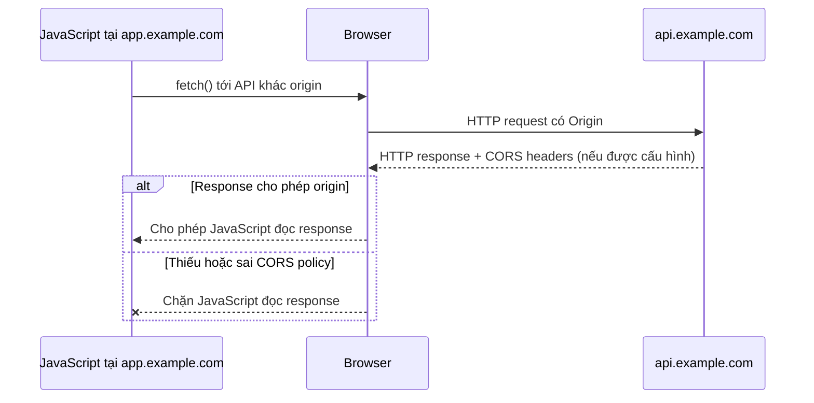
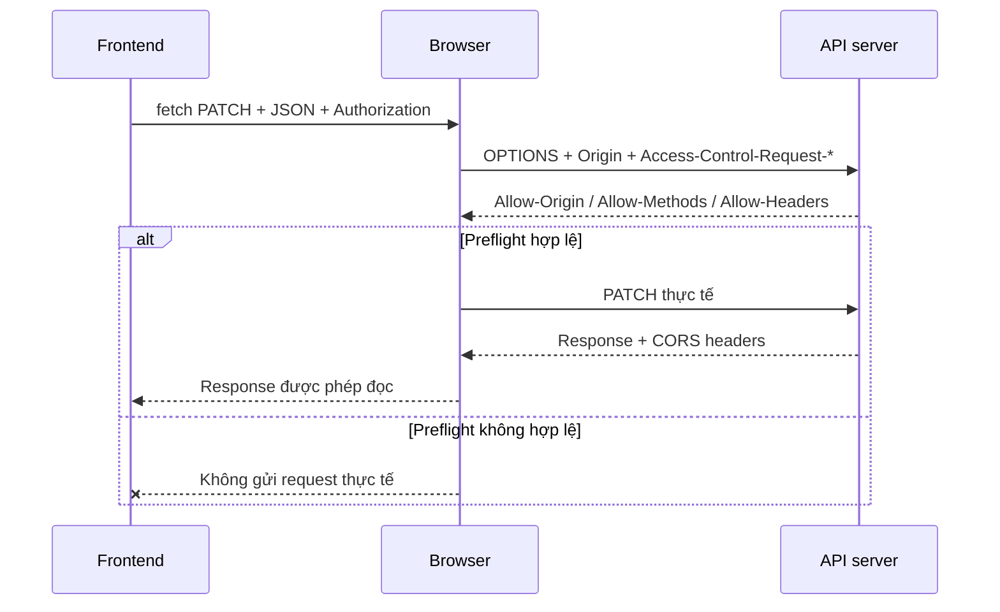

# CORS là gì?

> **Chương:** CORS  
> **Học phần:** Application Security — Browser Security (`SECURITY_APPLICATION_SECURITY_BROWSER_SECURITY`)

Khi một trang web gọi API ở một origin khác, trình duyệt cần quyết định JavaScript của trang đó có được **đọc response** hay không. **Cross-Origin Resource Sharing (CORS)** là cơ chế HTTP cho phép server công bố những origin nào được phép đọc response cross-origin thông qua browser.

CORS là phần mở rộng có kiểm soát của **Same-Origin Policy (SOP)**. Nó giúp ứng dụng web tích hợp frontend và API ở các origin khác nhau, nhưng không thay thế xác thực, phân quyền, chống CSRF hoặc kiểm tra dữ liệu ở server. Muốn hiểu đúng CORS, cần phân biệt ba việc: request có được browser gửi đi, server xử lý request ra sao, và JavaScript có được phép đọc response hay không.

## 1. Mục tiêu học tập

Sau bài học, bạn có thể:

1. Giải thích CORS giải quyết vấn đề gì và quan hệ của nó với SOP.
2. Xác định một request có cùng origin hay cross-origin dựa trên `scheme + host + port`.
3. Phân biệt request đơn giản theo CORS (simple request) với request cần preflight `OPTIONS`.
4. Đọc và cấu hình đúng các response header `Access-Control-Allow-*`.
5. Giải thích CORS với credentials, cookie và cache; nhận biết trường hợp wildcard không hợp lệ.
6. Chẩn đoán lỗi CORS bằng DevTools và kiểm tra request/response thực tế.
7. Nhận ra vì sao CORS không phải cơ chế xác thực API hoặc biện pháp chống CSRF.

## 2. CORS giải quyết vấn đề gì?

Một **origin** được xác định bởi bộ ba:

```text
scheme + host + port
```

Ví dụ, `https://app.example.com` và `https://api.example.com` là hai origin khác nhau vì host khác nhau. `https://app.example.com` và `https://app.example.com:8443` cũng khác origin vì port khác nhau. Path, query string và fragment không tham gia xác định origin.

Giả sử trang frontend ở `https://app.example.com` thực hiện:

```js
const response = await fetch("https://api.example.com/profile");
const profile = await response.json();
```

Request đi từ origin của trang tới origin API khác. Với `fetch` cross-origin, browser áp dụng CORS. Nếu API không trả về response header cho phép origin frontend đọc response, browser sẽ không cung cấp nội dung response cho JavaScript. Console thường hiển thị thông báo CORS.



Server quyết định response có công bố quyền đọc cho origin nào bằng các header CORS. Browser đọc các header đó và thực thi chính sách trước khi trao response cho JavaScript.

## 3. CORS và Same-Origin Policy (SOP)

**SOP** là chính sách cách ly giữa các origin. Nó hạn chế một tài liệu hoặc script ở origin này đọc dữ liệu thuộc origin khác, chẳng hạn DOM của iframe cross-origin hoặc response từ một số API. Tuy nhiên, web vẫn cần tải tài nguyên và giao tiếp giữa origin trong nhiều tình huống. CORS cho phép server **chủ động nới quyền đọc response** cho những origin được chọn.

| Cơ chế | Câu hỏi chính | Cơ chế thực hiện |
| --- | --- | --- |
| SOP | Script origin A có được đọc dữ liệu origin B không? | Browser áp dụng quy tắc cùng origin và các ngoại lệ của nền tảng |
| CORS | Server B có cho JavaScript từ origin A đọc response này không? | Server trả response header CORS; browser kiểm tra và thực thi |
| Authentication | Người gọi có danh tính hợp lệ không? | Server xác minh session, token hoặc cơ chế xác thực khác |
| Authorization | Danh tính đó có quyền làm việc này trên tài nguyên cụ thể không? | Server kiểm tra quyền theo user, resource và hành động |

CORS **không** làm hai origin trở thành same-origin. Nó cũng không mở quyền đọc tùy ý DOM của một trang khác. CORS chỉ áp dụng trong những giao thức tải tài nguyên/API mà browser định nghĩa có kiểm tra CORS; một số tài nguyên như ảnh có thể hiển thị cross-origin theo cách khác, nhưng việc đọc pixel từ canvas có thể bị hạn chế nếu ảnh không được tải với quyền CORS phù hợp.

## 4. Hai kiểu request: simple request và preflight

Trong tài liệu và thực tế phát triển, thường chia request cross-origin thành hai nhóm: **simple request** (request đơn giản theo tiêu chí CORS) và request cần **preflight**. Đây là cách gọi quen thuộc để giải thích hành vi browser; điều kiện chuẩn xác nằm trong quy tắc *CORS-safelisted method/header* của Fetch Standard.

### 4.1 Simple request

Một request có thể không cần preflight nếu method và các request header thuộc danh sách an toàn của CORS, đồng thời thỏa những giới hạn về giá trị header. Các trường hợp phổ biến:

- Method là `GET`, `HEAD` hoặc `POST`.
- Các request header tự đặt chỉ dùng một số header safelisted như `Accept`, `Accept-Language`, `Content-Language`, `Content-Type` với media type được cho phép.
- `Content-Type` thuộc một trong các loại phổ biến: `application/x-www-form-urlencoded`, `multipart/form-data` hoặc `text/plain` (và không vi phạm giới hạn bổ sung của chuẩn).

Ví dụ:

```js
fetch("https://api.example.com/search?q=browser", {
  method: "GET",
});
```

Hoặc gửi form POST với kiểu dữ liệu form thông thường. Browser có thể gửi request trực tiếp; sau khi nhận response, browser kiểm tra `Access-Control-Allow-Origin` trước khi cho JavaScript đọc response.

**Điểm bảo mật quan trọng:** Một simple request có thể tới server và làm phát sinh tác động ngay cả khi browser sau đó không cho JavaScript đọc response. Đây là lý do CORS không tự ngăn CSRF.

### 4.2 Preflight request

Nếu request dùng method không safelisted, request header không safelisted hoặc `Content-Type` nằm ngoài nhóm an toàn, browser thường gửi một request kiểm tra trước, gọi là **preflight**. Preflight dùng method `OPTIONS` để hỏi server xem request thực tế có được phép thực hiện từ origin này không.

Ví dụ frontend gửi JSON kèm header `Authorization`:

```js
fetch("https://api.example.com/orders/42", {
  method: "PATCH",
  headers: {
    "Content-Type": "application/json",
    "Authorization": "Bearer ACCESS_TOKEN",
  },
  body: JSON.stringify({ status: "confirmed" }),
});
```

Do `PATCH`, `application/json` và `Authorization` không thuộc nhóm request safelisted, browser sẽ gửi preflight tương tự:

```http
OPTIONS /orders/42 HTTP/1.1
Host: api.example.com
Origin: https://app.example.com
Access-Control-Request-Method: PATCH
Access-Control-Request-Headers: authorization, content-type
```

Server trả lời nếu cho phép:

```http
HTTP/1.1 204 No Content
Access-Control-Allow-Origin: https://app.example.com
Access-Control-Allow-Methods: GET, POST, PATCH
Access-Control-Allow-Headers: Authorization, Content-Type
Access-Control-Max-Age: 600
Vary: Origin
```

Nếu kiểm tra preflight thành công, browser mới tiếp tục gửi request `PATCH` thực tế. Response của request thực tế cũng phải có CORS header phù hợp thì JavaScript mới đọc được kết quả.



Preflight là request do browser tự tạo. Nó **thường không mang cookie hoặc HTTP credentials**; server không nên yêu cầu session cookie để trả lời preflight. Việc preflight được chấp nhận cũng không có nghĩa request thực tế đã được xác thực hoặc được cấp quyền. Server vẫn phải kiểm tra credentials và quyền khi xử lý request thật.

### 4.3 Credentials không tự làm request phải preflight

Chế độ `credentials: "include"` của Fetch quyết định việc có gửi credentials cross-origin hay không, theo các quy tắc cookie và browser. Bản thân việc bật `include` không phải điều kiện khiến một request vốn safelisted bắt buộc preflight. Method, header và các tiêu chí CORS khác mới quyết định request có cần preflight hay không.

## 5. Các response header CORS quan trọng

CORS được thực thi chủ yếu thông qua **response header**. Không có một request header nào từ frontend có thể tự cấp quyền CORS cho chính nó.

| Response header | Ý nghĩa |
| --- | --- |
| `Access-Control-Allow-Origin` | Origin được phép đọc response; thường là `https://app.example.com` hoặc `*` cho response công khai không credential |
| `Access-Control-Allow-Methods` | Các method được phép trong request cross-origin sau preflight |
| `Access-Control-Allow-Headers` | Các request header không safelisted mà server chấp nhận sau preflight |
| `Access-Control-Allow-Credentials` | Cho phép browser chia sẻ response khi request ở credentials mode `include`; giá trị phải là `true` |
| `Access-Control-Expose-Headers` | Các response header bổ sung mà JavaScript được phép đọc |
| `Access-Control-Max-Age` | Thời gian browser có thể lưu kết quả preflight trong cache CORS của nó |
| `Vary: Origin` | Báo cho cache HTTP rằng response có thể khác theo request header `Origin` |

### 5.1 `Access-Control-Allow-Origin`

Đây là header cốt lõi. Nếu chỉ cho phép frontend cụ thể:

```http
Access-Control-Allow-Origin: https://app.example.com
```

Origin là giá trị có scheme, host và port nếu khác mặc định; **không** chứa path, query, fragment hoặc dấu `/` cuối theo kiểu URL đầy đủ. Ví dụ `https://app.example.com/dashboard` không phải giá trị origin hợp lệ để dùng trong header này.

Wildcard:

```http
Access-Control-Allow-Origin: *
```

`*` phù hợp với tài nguyên công khai mà không cần credentials. Nó **không** cho phép JavaScript đọc response của request ở credentials mode `include`.

Server không thể gửi danh sách nhiều origin phân tách bằng dấu phẩy trong `Access-Control-Allow-Origin`. Nếu cần nhiều frontend, server phải so khớp `Origin` request với **allowlist chính xác**, rồi trả về một origin đã được chấp nhận. Khi response thay đổi theo origin, thêm `Vary: Origin` để cache không dùng nhầm response của origin khác.

Không phản chiếu tùy tiện mọi giá trị `Origin` mà client gửi. Nếu server luôn trả lại chính origin được yêu cầu mà không kiểm tra allowlist, cấu hình CORS gần như cho phép mọi website đọc response.

### 5.2 `Access-Control-Allow-Methods` và `Access-Control-Allow-Headers`

Hai header này chủ yếu trả lời preflight:

```http
Access-Control-Allow-Methods: GET, POST, PATCH, DELETE
Access-Control-Allow-Headers: Content-Type, Authorization, X-CSRF-Token
```

- `Access-Control-Allow-Methods` khai báo các method mà server cho phép theo CORS.
- `Access-Control-Allow-Headers` khai báo các request header mà server chấp nhận.
- Tên header không phân biệt chữ hoa/chữ thường theo quy tắc HTTP, nhưng cần bảo đảm giá trị cho phép bao phủ đúng header mà browser yêu cầu.

Đừng nhầm `Access-Control-Allow-Headers` với `Access-Control-Expose-Headers`: một header cho phép **gửi request header**, header còn lại cho phép JavaScript **đọc response header**.

### 5.3 `Access-Control-Expose-Headers`

JavaScript chỉ đọc được một tập response header safelisted mặc định. Nếu frontend cần đọc header bổ sung như `X-Request-Id` hoặc `Content-Disposition`, server phải công bố:

```http
Access-Control-Expose-Headers: X-Request-Id, Content-Disposition
```

Việc một header xuất hiện trong Network panel không đồng nghĩa JavaScript có quyền đọc nó qua `response.headers.get(...)`.

### 5.4 `Access-Control-Max-Age`

```http
Access-Control-Max-Age: 600
```

Giá trị này cho browser biết có thể lưu kết quả preflight trong bao lâu (tính bằng giây). Browser có thể áp dụng giới hạn tối đa riêng, vì vậy không nên giả định giá trị lớn luôn được giữ nguyên. Cache preflight giúp giảm số lần gửi `OPTIONS`; nó không phải cache dữ liệu API và không thay thế kiểm tra quyền ở request thực tế.

## 6. CORS với credentials và cookie

Nếu frontend cần gửi cookie phiên tới API cross-origin, cần cấu hình **cả Fetch lẫn response CORS**, và cookie phải thỏa các chính sách cookie độc lập.

```js
const response = await fetch("https://api.example.com/profile", {
  method: "GET",
  credentials: "include",
});
```

Theo mặc định, Fetch dùng `credentials: "same-origin"`; credentials không được gửi tới request cross-origin theo mặc định. Có thể dùng `include` khi cần gửi credentials cross-origin. Phía server cần trả:

```http
Access-Control-Allow-Origin: https://app.example.com
Access-Control-Allow-Credentials: true
Vary: Origin
```

Các quy tắc quan trọng:

- `Access-Control-Allow-Credentials` phải có giá trị chính xác `true` để browser cho phép chia sẻ credentialed response.
- Không dùng `Access-Control-Allow-Origin: *` cho request credentials mode `include`; phải trả origin cụ thể đã được allowlist chấp nhận.
- Nếu frontend cần gửi `Authorization` hoặc header tùy chỉnh, server phải cho phép chúng qua preflight bằng `Access-Control-Allow-Headers`.
- Nếu cần JavaScript đọc response header tùy chỉnh, phải khai báo thêm `Access-Control-Expose-Headers`.
- Bật `credentials: "include"` không tự bỏ qua `SameSite`, `Secure`, domain/path, thời hạn cookie hoặc chính sách cookie bên thứ ba của browser.

Ví dụ cấu hình không hợp lệ cho credentialed response:

```http
Access-Control-Allow-Origin: *
Access-Control-Allow-Credentials: true
```

Browser sẽ không cho JavaScript đọc response theo cấu hình này. Dùng origin cụ thể thay cho wildcard.

### 6.1 CORS không quyết định cookie có được gửi hay không

CORS và cookie là hai lớp khác nhau. `credentials: "include"` chỉ yêu cầu Fetch cho phép gửi credentials theo chế độ include; browser vẫn xét cookie có phù hợp với request hay không. Những yếu tố cần kiểm tra:

- Cookie là host-only hay có thuộc tính `Domain`.
- `Path`, thời hạn, `Secure` và `HttpOnly`.
- `SameSite=Strict`, `Lax` hay `None`.
- Request có thật sự cùng site hay cross-site, có đi qua iframe hay không.
- Browser có chặn hoặc partition cookie bên thứ ba trong ngữ cảnh đó không.

Ví dụ, `https://app.example.com` gọi `https://api.example.com` là cross-origin nhưng thường same-site theo schemeful site. SOP/CORS vẫn áp dụng vì host khác nhau; cookie có thể được xử lý theo ngữ cảnh same-site, nhưng vẫn phải đúng domain/path và chế độ credentials. Nếu frontend ở `https://app.other.test`, request tới `api.example.com` là cross-site; cookie còn phải vượt qua các hạn chế cross-site, thường cần `SameSite=None; Secure` và vẫn có thể bị chính sách browser chặn.

## 7. CORS không phải cơ chế xác thực, phân quyền hoặc chống CSRF

Đây là giới hạn quan trọng nhất của CORS.

### 7.1 CORS không chặn mọi request cross-origin

Browser có thể gửi một số request cross-origin mà không cần preflight, sau đó chỉ chặn JavaScript đọc response nếu server không cho phép. Form HTML, ảnh, điều hướng và các request đơn giản tồn tại từ lâu trước CORS. Vì thế, cấu hình CORS không thể được dùng như một cổng kiểm soát duy nhất để bảo vệ thao tác thay đổi trạng thái.

Ví dụ một website độc hại có thể thử gửi form POST tới một website người dùng đã đăng nhập. Nếu cookie được browser đính kèm và endpoint không có CSRF protection, server có thể thực hiện thao tác. Trang độc hại có thể không đọc được response, nhưng hành động đã xảy ra.

### 7.2 CORS không chặn `curl`, backend hoặc client tùy chỉnh

Các lệnh sau có thể gửi request và đọc response vì `curl` không thực thi SOP/CORS của browser:

```bash
curl -i https://api.example.com/profile
```

Một ứng dụng mobile, backend service, script hoặc người dùng có thể gọi API trực tiếp. Header `Origin` có thể được client HTTP tự tạo; nó không phải bằng chứng xác thực danh tính. **Không bao giờ cấp quyền truy cập dữ liệu chỉ vì request có `Origin` nằm trong allowlist CORS.**

### 7.3 CORS không thay thế CSRF protection

Với ứng dụng xác thực bằng cookie, cần thiết kế chống CSRF phù hợp, có thể kết hợp:

- CSRF token được xác minh ở server.
- Kiểm tra `Origin` và/hoặc `Referer` theo chính sách chính xác.
- Cookie `SameSite` như một lớp giảm thiểu, không phải lớp duy nhất.
- Fetch Metadata (`Sec-Fetch-Site`) như tín hiệu bổ sung.
- Không dùng `GET` cho thao tác thay đổi trạng thái.
- Xác thực và phân quyền ở server trên mọi request.

Preflight có thể khiến một request tùy chỉnh không được gửi nếu kiểm tra thất bại, nhưng điều đó không biến CORS thành CSRF token. Kẻ tấn công vẫn có thể dùng những hình thức request cross-origin khác. Đặc biệt, subdomain cùng site nhưng khác origin có thể là nguồn request đáng ngờ dù cookie `SameSite` được gửi theo ngữ cảnh same-site.

### 7.4 Server phải tự bảo vệ dữ liệu

Ví dụ API phải kiểm tra phiên và quyền sở hữu tài nguyên:

```text
GET /api/orders/42
  → xác thực session hoặc access token
  → tìm đơn hàng 42
  → kiểm tra người dùng hiện tại có quyền đọc đơn hàng này
  → chỉ trả dữ liệu được phép
```

Khi request không có quyền, server trả `401` hoặc `403` (hoặc `404` theo chính sách tránh tiết lộ sự tồn tại của tài nguyên). CORS chỉ quyết định browser có cho JavaScript đọc response hay không; server vẫn phải đưa ra quyết định bảo mật cho request.

## 8. Cấu hình CORS an toàn

Một cấu hình nên xuất phát từ danh sách origin thật sự cần đọc API, method và header cần thiết, cùng yêu cầu credentials. Ví dụ giả mã middleware:

```js
const allowedOrigins = new Set([
  "https://app.example.com",
  "https://admin.example.com",
]);

function corsPolicy(req, res, next) {
  const origin = req.headers.origin;
  const allowed = origin && allowedOrigins.has(origin);

  // Nếu response thay đổi theo Origin, cache phải phân biệt Origin.
  res.vary("Origin");

  if (allowed) {
    res.setHeader("Access-Control-Allow-Origin", origin);
    res.setHeader("Access-Control-Allow-Credentials", "true");
  }

  const requestedMethod = req.headers["access-control-request-method"];
  const isPreflight = req.method === "OPTIONS" && requestedMethod;

  if (isPreflight) {
    if (!allowed) return res.sendStatus(403);

    res.setHeader("Access-Control-Allow-Methods", "GET, POST, PATCH, DELETE");
    res.setHeader(
      "Access-Control-Allow-Headers",
      "Content-Type, Authorization, X-CSRF-Token"
    );
    res.setHeader("Access-Control-Max-Age", "600");
    return res.sendStatus(204);
  }

  return next();
}
```

Đây là ví dụ minh họa luồng, không phải middleware dùng nguyên trạng cho mọi framework. Khi triển khai thực tế, cần bảo đảm header CORS cũng có trên **response lỗi** mà frontend cần đọc (ví dụ `401`, `403`, `404`, `500`); xử lý OPTIONS đúng với router/proxy; không đặt header credentials nếu endpoint không cần credentials; và kiểm tra chính sách method/header theo từng API. Middleware phải chạy ở vị trí phù hợp để các response sớm và exception không vô tình bỏ qua CORS header.

Các nguyên tắc cấu hình:

1. **Allowlist rõ ràng:** So sánh origin chính xác theo scheme, host và port; không dùng `endsWith("example.com")` mà thiếu ranh giới hostname, vì chuỗi như `evil-example.com` có thể lọt qua.
2. **Chỉ cho phép nhu cầu thực tế:** Không mở tất cả method/header/credentials nếu ứng dụng chỉ cần một tập nhỏ.
3. **Không phản chiếu Origin vô điều kiện:** Chỉ trả origin đã được xác nhận.
4. **Xử lý credentials có chủ đích:** Nếu dùng cookie hoặc HTTP credentials, chỉ cho origin cụ thể và đánh giá rủi ro CSRF.
5. **Thêm `Vary: Origin` khi phản hồi phụ thuộc Origin:** Tránh cache dùng response của origin này cho origin khác.
6. **Áp dụng cho response lỗi:** Nếu thiếu CORS header trên `401`, frontend có thể chỉ thấy lỗi CORS thay vì đọc được trạng thái xác thực.
7. **Tách CORS khỏi authorization:** API luôn xác thực, phân quyền và kiểm tra dữ liệu độc lập.

Không nên mặc định cho phép `Origin: null`. Giá trị `null` có thể xuất hiện từ các ngữ cảnh opaque origin như một số tài liệu sandbox hoặc `file:`/`data:`. Cho phép `null` rộng có thể mở quyền đọc cho các ngữ cảnh không mong muốn; nếu có nhu cầu đặc biệt, cần hiểu rõ nguồn phát sinh và kiểm soát chặt.

## 9. Những lỗi cấu hình và hiểu nhầm thường gặp

| Lỗi | Triệu chứng/hậu quả | Cách xử lý |
| --- | --- | --- |
| Dùng `Access-Control-Allow-Origin: *` với credentials | Browser từ chối chia sẻ credentialed response | Trả origin cụ thể đã allowlist và `Access-Control-Allow-Credentials: true` |
| Không xử lý `OPTIONS` | Preflight trả `404`, `405` hoặc redirect không phù hợp | Cho phép preflight đi qua proxy/router và trả các header cần thiết |
| Chỉ thêm CORS header cho response `200` | Frontend không đọc được body/status lỗi `401`, `403`, `500` | Gắn CORS header nhất quán lên response phù hợp, kể cả lỗi |
| Allow origin bằng kiểm tra chuỗi lỏng lẻo | Website không tin cậy có thể được cấp quyền | Dùng URL/origin parse chuẩn và allowlist chính xác |
| Phản chiếu bất kỳ `Origin` nào | Bất kỳ website nào cũng có thể được cho đọc response | Chỉ phản chiếu origin đã kiểm tra |
| Cho rằng CORS bảo vệ API khỏi `curl` | API vẫn bị gọi trực tiếp | Xác thực, phân quyền và rate limit ở server |
| Cho rằng CORS chặn CSRF | Simple request có thể tới server dù response bị chặn đọc | CSRF token, SameSite, Origin/Fetch Metadata và quy tắc nghiệp vụ |
| Quên `Vary: Origin` khi trả origin động | Shared cache có thể dùng nhầm response giữa các origin | Thêm `Vary: Origin` và kiểm tra cache/CDN |
| Nhầm Allow-Headers với Expose-Headers | Request gửi được nhưng JS không đọc được response header | Chọn đúng header theo chiều request hoặc response |
| Dùng `mode: "no-cors"` để “sửa lỗi” | Response thường là opaque, JS không đọc body/header | Sửa CORS ở server và gọi bằng mode phù hợp |

### 9.1 Vì sao `mode: "no-cors"` không phải cách sửa CORS?

```js
const response = await fetch("https://api.example.com/data", {
  mode: "no-cors",
});
```

`no-cors` tạo ra một request bị giới hạn về method/header và thường trả về **opaque response**. JavaScript không thể đọc status, body hoặc header như một response bình thường. Cách này không cấp quyền đọc dữ liệu cross-origin và không giải quyết yêu cầu tích hợp API JSON. Hãy cấu hình CORS đúng ở server.

### 9.2 CORS và cache

Nếu API phản hồi origin cụ thể theo allowlist, response có thể khác tùy `Origin`. Header:

```http
Vary: Origin
```

giúp cache HTTP nhận biết response thay đổi theo request header đó. Nếu thiếu `Vary`, một CDN hoặc shared cache có thể lưu response có `Access-Control-Allow-Origin: https://app.example.com` rồi trả lại cho request từ origin khác. Hãy kiểm tra cả cache key, CDN rule và response header trên đường đi thực tế.

## 10. Quy trình debug CORS bằng DevTools

Khi Console báo CORS, hãy xác định request bị dừng ở bước nào thay vì chỉ sửa header theo phỏng đoán.

1. Mở **DevTools → Network**, bật Preserve log nếu request chuyển hướng hoặc trang reload.
2. Tìm request API và xem **Request URL**, method, status, `Origin`, credentials/cookie nếu có.
3. Nếu có `OPTIONS`, kiểm tra request preflight: `Origin`, `Access-Control-Request-Method`, `Access-Control-Request-Headers`.
4. Kiểm tra response preflight có `Access-Control-Allow-Origin`, method và header cần thiết không; kiểm tra origin có khớp chính xác không.
5. Nếu preflight thành công, xem request thực tế có được gửi không.
6. Kiểm tra response thực tế cũng có CORS header phù hợp, kể cả khi status là lỗi.
7. Nếu dùng credentials, xác minh `credentials: "include"`, `Access-Control-Allow-Credentials: true`, origin cụ thể và cookie có được browser cho phép gửi không.
8. Kiểm tra redirect, reverse proxy, CDN, cache và middleware có làm mất hoặc ghi đè header không.

| Quan sát trong Network | Khả năng cần kiểm tra |
| --- | --- |
| Có OPTIONS, không có request thật | Preflight thất bại hoặc bị proxy/router chặn |
| OPTIONS trả `404`/`405` | Server chưa xử lý OPTIONS cho endpoint hoặc router không chuyển tiếp |
| OPTIONS trả `200`/`204`, request thật có gửi nhưng JS vẫn báo CORS | Response thực tế thiếu/sai CORS header |
| `Access-Control-Allow-Origin` không khớp trang hiện tại | Allowlist hoặc logic origin sai; cần so cả scheme, host và port |
| Credentials request nhưng ACAO là `*` | Cần origin cụ thể và `Access-Control-Allow-Credentials: true` |
| Network cho thấy `401`/`403` nhưng JS báo CORS | Response lỗi có thể thiếu CORS header; đồng thời kiểm tra session/authorization |
| Cookie không xuất hiện trong request | Kiểm tra credentials mode và cookie policy; đây không nhất thiết là lỗi CORS |

Thông báo Console là tín hiệu hữu ích nhưng không phải lúc nào cũng chỉ ra đầy đủ response thực tế. Network panel, log server và cấu hình proxy giúp xác định chính xác request đã đến đâu.

## 11. Thực hành kiểm chứng trong môi trường local

Tạo hai server thử nghiệm:

- Frontend: `http://localhost:5173`.
- API: `http://localhost:3000`.

Khác port nghĩa là **cross-origin**, dù cùng hostname `localhost`. Dùng dữ liệu giả và không đặt thông tin bí mật trong môi trường lab.

### Bài thử A — Simple request không có CORS header

Từ frontend, gọi:

```js
fetch("http://localhost:3000/api/demo")
  .then((response) => response.json())
  .then(console.log)
  .catch(console.error);
```

Ở API, trả JSON nhưng không thêm `Access-Control-Allow-Origin`. Quan sát Console, Network và log server.

**Kỳ vọng:** JavaScript không đọc được response do CORS. Request GET vẫn có thể đã đến server. Xác nhận bằng log server; không suy luận rằng CORS error đồng nghĩa server không xử lý request.

### Bài thử B — Cho phép đúng một origin

Thêm response header ở API:

```http
Access-Control-Allow-Origin: http://localhost:5173
Vary: Origin
```

Gọi lại từ frontend. Sau đó thử từ một trang ở port khác hoặc đổi frontend port.

**Kỳ vọng:** Origin được cho phép đọc response; origin không được cho phép không thể đọc response bằng JavaScript. Port là thành phần của origin nên `localhost:5173` và `localhost:5174` không giống nhau.

### Bài thử C — Quan sát preflight

Gửi request buộc phải preflight:

```js
fetch("http://localhost:3000/api/items/1", {
  method: "PATCH",
  headers: {
    "Content-Type": "application/json",
    "X-Lab-Token": "demo",
  },
  body: JSON.stringify({ name: "sample" }),
});
```

Xem request `OPTIONS` trong Network. Cấu hình API trả:

```http
Access-Control-Allow-Origin: http://localhost:5173
Access-Control-Allow-Methods: PATCH
Access-Control-Allow-Headers: Content-Type, X-Lab-Token
Access-Control-Max-Age: 600
```

Thử bỏ `PATCH` khỏi Allow-Methods hoặc bỏ `X-Lab-Token` khỏi Allow-Headers rồi gửi lại.

**Kỳ vọng:** Khi preflight không cho phép method/header, browser không gửi request PATCH thực tế. Khi preflight thành công, response PATCH thực tế vẫn cần CORS header phù hợp.

### Bài thử D — Credentials và wildcard

Trong lab có cookie thử nghiệm, gọi:

```js
fetch("http://localhost:3000/api/session", {
  credentials: "include",
});
```

Thử response với `Access-Control-Allow-Origin: *` và `Access-Control-Allow-Credentials: true`, sau đó đổi sang origin cụ thể và giữ `Access-Control-Allow-Credentials: true`.

**Kỳ vọng:** Wildcard không hợp lệ để chia sẻ credentialed response. Sau khi đổi sang origin cụ thể, còn phải kiểm tra cookie có thỏa điều kiện gửi hay không. Với hai port khác nhau nhưng cùng hostname, cookie không được phân vùng theo port; cần chú ý domain/path và cấu hình browser khi diễn giải kết quả.

### Bài thử E — Dùng curl để thấy giới hạn của CORS

Gửi:

```bash
curl -i \
  -H "Origin: http://localhost:5173" \
  http://localhost:3000/api/demo
```

Quan sát status, body và CORS header. Sau đó thử bỏ `Origin` hoặc gửi một giá trị origin khác.

**Kỳ vọng:** `curl` vẫn đọc được HTTP response bất kể header CORS có cho phép hay không, vì `curl` không phải browser và không thực thi SOP/CORS. Điều này chứng minh server phải tự xác thực và phân quyền.

## 12. Một số câu hỏi thiết kế trước khi bật CORS

Trước khi mở CORS cho một API, hãy trả lời:

- API này thực sự cần được gọi từ những origin nào? Có cả môi trường staging, localhost, admin hoặc tenant riêng không?
- Endpoint có dữ liệu công khai hay dữ liệu cá nhân? Có cần cookie hoặc Authorization header không?
- Method và request header nào thực sự cần thiết? Có thể thu hẹp allowlist không?
- API có xử lý preflight `OPTIONS` qua gateway, reverse proxy và middleware không?
- Các response `401`, `403`, `404`, `500` có cần được frontend đọc không?
- Cấu hình origin động có `Vary: Origin` và được CDN cache đúng không?
- CSRF protection có phù hợp với mô hình cookie và subdomain không?
- API có xác thực, phân quyền theo tài nguyên, kiểm tra input và giới hạn tốc độ độc lập với CORS không?

Không có một cấu hình CORS chung an toàn cho mọi ứng dụng. Tài nguyên công khai không credential có thể phù hợp với `*`; API nội bộ dùng session thường cần allowlist chính xác và đánh giá CSRF. Chọn chính sách dựa trên luồng dữ liệu, cách xác thực và mô hình tin cậy thật của sản phẩm.

## 13. Câu hỏi tự kiểm tra

1. Vì sao `https://app.example.com` gọi `https://api.example.com` vẫn là cross-origin dù có thể same-site?
2. Khi nào browser gửi preflight `OPTIONS`? Hãy nêu ba yếu tố có thể khiến request cần preflight.
3. Một simple POST không có CORS header có thể đến server và thay đổi dữ liệu không? Vì sao?
4. Vì sao `Access-Control-Allow-Origin: *` không dùng được cho credentialed response?
5. Phân biệt `Access-Control-Allow-Headers` và `Access-Control-Expose-Headers`.
6. Khi Console báo CORS nhưng Network hiển thị `401`, bạn cần kiểm tra những gì ở browser và server?
7. Vì sao `curl` gọi được API dù browser báo lỗi CORS?
8. Nếu API chỉ cho phép `Origin` frontend, server còn cần kiểm tra những gì trước khi trả đơn hàng của người dùng?

## 14. Ghi nhớ

**CORS là cơ chế browser thực thi dựa trên response header do server cung cấp, cho phép hoặc từ chối JavaScript đọc response cross-origin.** Với request cần preflight, browser gửi `OPTIONS` để kiểm tra method và header trước khi gửi request thực tế. Với request đơn giản, request có thể đã được gửi trước khi browser chặn JavaScript đọc response.

Hãy luôn tách ba quyết định: **browser có gửi request không, server có cho phép thao tác không, JavaScript có được đọc response không**. CORS giải quyết quyết định thứ ba và hỗ trợ quyết định thứ nhất trong một số request cần preflight. Xác thực, phân quyền, chống CSRF, bảo vệ cookie và kiểm tra dữ liệu vẫn thuộc trách nhiệm của ứng dụng/server.
