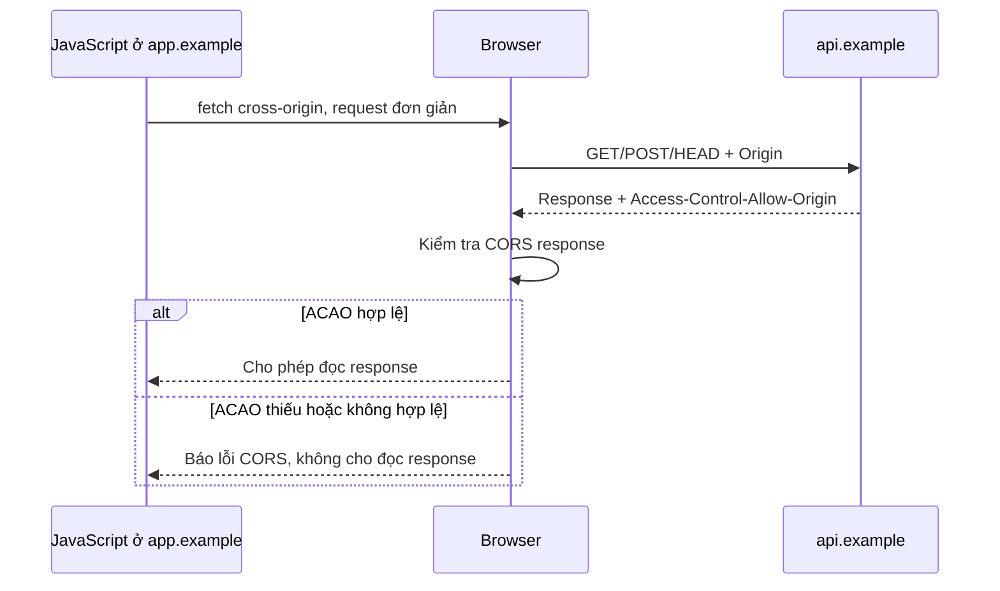

# Simple request

> **Chương:** CORS  
> **Bài học:** Simple request — yêu cầu cross-origin không cần preflight  
> **Phạm vi module:** **SECURITY_APPLICATION_SECURITY_BROWSER_SECURITY** — phân tích ranh giới bảo mật giữa trình duyệt, origin, cookie và ứng dụng web để hiểu Same-Origin Policy (SOP), CORS và cơ chế cách ly; áp dụng vào phòng vệ XSS, CSRF, clickjacking bằng CSP, Trusted Types, security headers và kiểm chứng thực tế.

## Mục tiêu học tập

Sau bài này, bạn có thể:

1. Giải thích **simple request** và mối liên hệ với các khái niệm Fetch hiện nay như *CORS-safelisted method* và *CORS-safelisted request-header*.
2. Xác định request nào được browser gửi trực tiếp mà không cần **preflight OPTIONS**.
3. Phân biệt **quyền gửi request** với **quyền JavaScript đọc response**.
4. Nhận diện method, header và Content-Type khiến request cần preflight.
5. Hiểu CORS khi có credentials, cookie, Access-Control-Allow-Origin và Access-Control-Allow-Credentials.
6. Phân tích vì sao simple request vẫn có thể gây CSRF hoặc tác động lên server.
7. Kiểm chứng simple request, CORS failure và preflight bằng DevTools.

## 1. Simple request là gì?

**Simple request** là cách gọi quen thuộc trong tài liệu CORS để chỉ một số request cross-origin mà browser có thể gửi **trực tiếp**, không cần hỏi trước bằng request **OPTIONS** (preflight).

Trong Fetch Standard hiện nay, các điều kiện này được diễn đạt chính xác hơn bằng những khái niệm như:

- **CORS-safelisted method:** method thuộc nhóm được phép không cần preflight, điển hình là **GET**, **HEAD**, **POST**.
- **CORS-safelisted request-header:** request header thuộc danh sách an toàn, với giá trị đáp ứng những giới hạn nhất định.
- Các điều kiện bổ sung liên quan đến kiểu body và cách request được tạo.

Vì vậy, “simple request” là tên gọi thuận tiện và có tính lịch sử. Khi triển khai, cần xét quy tắc Fetch/CORS thực tế, không chỉ kiểm tra method.

### 1.1. Vì sao browser có khái niệm này?

Trước khi CORS được sử dụng rộng rãi, web đã hỗ trợ nhiều thao tác cross-origin như gửi HTML form tới website khác, tải ảnh/stylesheet/script từ máy chủ khác và điều hướng người dùng sang website khác.

Các hành vi này vẫn cần thiết để web hoạt động. CORS cho phép ứng dụng hiện đại đọc một số response cross-origin nhưng vẫn duy trì tính tương thích với những kiểu request web đã tồn tại.

Một request có thể được gửi mà không có preflight; **điều đó không có nghĩa JavaScript được tự do đọc response**. Browser vẫn kiểm tra CORS trên response thực tế trước khi công khai dữ liệu cho script.

### 1.2. Hai bước cần tách biệt



**Simple request bỏ qua bước preflight; nó không bỏ qua bước kiểm tra CORS response.**

## 2. Điều kiện để request không cần preflight

Để một request thuộc nhóm không cần preflight, các đặc điểm quan trọng gồm method, request headers và cách gửi body.

### 2.1. Method được safelist

Ba method thông dụng trong nhóm CORS-safelisted method là:

| Method | Mục đích thường gặp | Ví dụ |
|---|---|---|
| **GET** | Đọc tài nguyên | Lấy danh sách sản phẩm |
| **HEAD** | Đọc metadata response mà không lấy body | Kiểm tra header/cache |
| **POST** | Gửi dữ liệu theo định dạng được hỗ trợ | Submit form |

Các method như **PUT**, **PATCH**, **DELETE** không thuộc nhóm này và thường khiến request cần preflight trong CORS.

Không nên đổi một thao tác cập nhật từ PUT thành POST chỉ để né preflight. Method cần phản ánh đúng ngữ nghĩa nghiệp vụ; server vẫn phải xác thực, phân quyền và kiểm tra dữ liệu.

### 2.2. Các request header được safelist

Những header phổ biến thuộc danh sách CORS-safelisted request-header:

| Header | Vai trò | Ví dụ |
|---|---|---|
| **Accept** | Kiểu nội dung client mong muốn | application/json |
| **Accept-Language** | Ngôn ngữ client ưu tiên | vi-VN,vi;q=0.9 |
| **Content-Language** | Ngôn ngữ của nội dung gửi | vi |
| **Content-Type** | Kiểu nội dung request body, nếu giá trị thuộc nhóm cho phép | application/x-www-form-urlencoded |
| **Range** | Yêu cầu một khoảng byte đơn giản | bytes=0-99 |

Tên header nằm trong danh sách vẫn chưa đủ. **Giá trị của header cũng phải đáp ứng giới hạn của Fetch Standard**, bao gồm giới hạn độ dài và các byte không an toàn đối với CORS. Giá trị bất thường hoặc quá dài có thể khiến header không còn được xem là safelisted.

Các header tự đặt thường không được safelist:

- **Authorization**
- **X-Api-Key**
- **X-Requested-With**
- **X-CSRF-Token**
- **Content-Type: application/json**

Ví dụ, dù method là GET, việc thêm Authorization vẫn có thể khiến browser cần preflight:

```js
fetch('https://api.example.test/profile', {
  method: 'GET',
  headers: {
    Authorization: 'Bearer example-token',
  },
});
```

**Method đơn giản không đồng nghĩa toàn bộ request đơn giản.** Chỉ cần có một request header không được safelist là request có thể phải preflight.

### 2.3. Content-Type được safelist

Với request có body, Content-Type thường là điểm quyết định:

| Content-Type | Có thuộc nhóm safelist? | Ví dụ sử dụng |
|---|:---:|---|
| **application/x-www-form-urlencoded** | Có | Dữ liệu form dạng key/value |
| **multipart/form-data** | Có | Form có file hoặc nhiều phần |
| **text/plain** | Có | Nội dung văn bản thuần |
| **application/json** | Không | JSON API thông dụng |
| **application/xml** | Không | XML API |
| **application/octet-stream** | Không | Dữ liệu nhị phân |

Browser còn kiểm tra MIME type essence và các giới hạn giá trị header theo chuẩn. Chỉ nhìn một chuỗi Content-Type mà bỏ qua cách nó được parse là chưa đủ để kết luận.

Ví dụ:

```http
POST /search HTTP/1.1
Host: api.example.test
Origin: https://app.example.test
Content-Type: application/x-www-form-urlencoded;charset=UTF-8

q=browser+security
```

Đây là kiểu body thường được dùng trong HTML form và có thể thuộc nhóm simple request.

Trong khi đó:

```http
POST /search HTTP/1.1
Host: api.example.test
Origin: https://app.example.test
Content-Type: application/json

{"q":"browser security"}
```

application/json không nằm trong nhóm Content-Type safelist, do đó request Fetch này thường cần preflight.

**Không nên đổi JSON thành text/plain chỉ để tránh OPTIONS.** Server cần xác định content type đúng, parse dữ liệu theo hợp đồng API và kiểm tra đầu vào; CORS không phải lý do để làm mơ hồ định dạng dữ liệu.

### 2.4. Các điều kiện bổ sung

Một vài điều kiện ít gặp nhưng quan trọng:

- Request không có listener được đăng ký trên XMLHttpRequest.upload theo cách khiến request phải preflight.
- Body không sử dụng ReadableStream trong trường hợp khiến request bị yêu cầu preflight.
- Các request header phải đáp ứng đầy đủ quy tắc safelist, không chỉ tên header.

Vì vậy, “GET/POST là simple” chỉ là cách nhớ ban đầu. Khi debug một request cụ thể, hãy xem **toàn bộ method, headers, body và API tạo request**.

## 3. Ví dụ những request thường không cần preflight

### 3.1. GET với Accept

Frontend chạy ở **https://app.example.test**, gọi API ở **https://api.example.test**:

```js
const response = await fetch(
  'https://api.example.test/products',
  {
    method: 'GET',
    headers: {
      Accept: 'application/json',
    },
  }
);

const products = await response.json();
console.log(products);
```

Method là GET, header Accept thuộc nhóm safelist và không có header tùy chỉnh. Browser có thể gửi request trực tiếp mà không cần OPTIONS.

API vẫn cần trả CORS response header hợp lệ nếu muốn frontend đọc JSON:

```http
HTTP/1.1 200 OK
Access-Control-Allow-Origin: https://app.example.test
Vary: Origin
Content-Type: application/json

[{"id":1,"name":"Sổ tay"}]
```

Nếu header Access-Control-Allow-Origin thiếu hoặc không khớp, request có thể đã tới server nhưng Promise của Fetch sẽ bị reject do lỗi CORS.

### 3.2. POST với URLSearchParams

```js
const body = new URLSearchParams({
  keyword: 'browser security',
  language: 'vi',
});

const response = await fetch(
  'https://api.example.test/search',
  {
    method: 'POST',
    headers: {
      'Content-Type': 'application/x-www-form-urlencoded;charset=UTF-8',
    },
    body,
  }
);

console.log(await response.json());
```

Method POST và content type form-urlencoded thuộc nhóm safelist. Nếu không có header hoặc điều kiện nào khác buộc preflight, browser gửi POST trực tiếp.

### 3.3. POST với FormData

```js
const form = new FormData();
form.append('title', 'Browser security');
form.append('category', 'web');

const response = await fetch(
  'https://api.example.test/articles',
  {
    method: 'POST',
    body: form,
  }
);

console.log(await response.json());
```

Browser tự tạo Content-Type multipart/form-data kèm boundary phù hợp. **Không tự đặt header Content-Type khi body là FormData**, vì nếu tự đặt thiếu boundary, server có thể không parse được multipart body.

FormData thường có thể được gửi dưới dạng request không cần preflight nếu không có điều kiện khác làm request trở nên không safelisted.

### 3.4. HTML form truyền thống

```html
<form
  action="https://api.example.test/subscribe"
  method="POST"
  enctype="application/x-www-form-urlencoded">
  <label>
    Email
    <input name="email" type="email">
  </label>
  <button type="submit">Đăng ký</button>
</form>
```

HTML form là một trong những lý do lịch sử quan trọng khiến các kiểu request đơn giản được browser hỗ trợ. Form có thể gửi dữ liệu đến origin khác và điều hướng đến response đích.

Tuy nhiên, trang nguồn **không vì vậy được quyền đọc DOM hoặc response của origin nhận form**. Điều hướng tài liệu và quyền đọc response bằng JavaScript là hai chuyện khác nhau.

## 4. Điều gì xảy ra ở Network khi gửi simple request?

Giả sử:

```text
Frontend: https://app.example.test
API:      https://api.example.test
Method:   GET
Headers:  Accept: application/json
```

Một request không cần preflight có thể đi thẳng:

```http
GET /products HTTP/1.1
Host: api.example.test
Origin: https://app.example.test
Accept: application/json
```

Browser gửi Origin để xác định nguồn của request trong ngữ cảnh CORS. Origin là header do browser quản lý; JavaScript không thể tùy ý đặt giá trị header này như một header thông thường.

Nếu server trả:

```http
HTTP/1.1 200 OK
Access-Control-Allow-Origin: https://app.example.test
Content-Type: application/json
Vary: Origin

{"items":[]}
```

Browser kiểm tra response và cho phép JavaScript đọc nội dung khi các điều kiện CORS khác đều đạt.

### 4.1. Không có OPTIONS nhưng vẫn có CORS

Với request đơn giản, Network thường chỉ hiển thị request thực tế:

```text
GET /products
200 OK
```

Không thấy OPTIONS **không có nghĩa CORS không được áp dụng**. Browser vẫn cần kiểm tra Access-Control-Allow-Origin trên response thực tế.

### 4.2. Response thiếu Access-Control-Allow-Origin

Nếu server trả:

```http
HTTP/1.1 200 OK
Content-Type: application/json

{"privateData":"example"}
```

Browser có thể đã nhận response từ server, nhưng không cung cấp body cho JavaScript cross-origin. Fetch thường reject với lỗi dạng TypeError; thông tin chi tiết được hiển thị ở Console/Network tùy browser.

**Server có thể đã thực hiện nghiệp vụ trước khi browser chặn quyền đọc response.** Đây là lý do simple request liên quan trực tiếp đến CSRF.

## 5. CORS response headers cho simple request

Simple request không cần server trả các header cho phép method/header trong preflight, nhưng vẫn cần CORS response header thích hợp.

### 5.1. Access-Control-Allow-Origin

Ví dụ cho một frontend cụ thể:

```http
Access-Control-Allow-Origin: https://app.example.test
```

Nếu tài nguyên thật sự công khai và không sử dụng credential, server có thể trả:

```http
Access-Control-Allow-Origin: *
```

Dấu * có nghĩa mọi origin có thể đọc response trong phạm vi CORS không credential. Chỉ dùng cho dữ liệu được thiết kế để công khai.

Các lưu ý:

- Giá trị ACAO phải là * hoặc một origin hợp lệ phù hợp với request; không phải danh sách origin phân cách bằng dấu phẩy.
- Không phản chiếu bất kỳ Origin nào mà client gửi vào response.
- Nếu server chọn origin từ allowlist và response thay đổi theo Origin, thêm Vary: Origin để cache không phục vụ nhầm response cho origin khác.
- Origin: null không phải danh tính đáng tin cậy để cấp quyền rộng cho dữ liệu nhạy cảm.

### 5.2. Credentials

Mặc định, Fetch dùng credentials: same-origin; cookie và HTTP credentials không tự được gửi trong một Fetch cross-origin chỉ vì request là simple.

Nếu cần gửi credentials:

```js
const response = await fetch(
  'https://api.example.test/account',
  {
    method: 'GET',
    credentials: 'include',
  }
);

const account = await response.json();
```

Server phải phản hồi với origin cụ thể và cho phép credentials:

```http
Access-Control-Allow-Origin: https://app.example.test
Access-Control-Allow-Credentials: true
Vary: Origin
```

Quy tắc quan trọng:

- Access-Control-Allow-Origin: * không hợp lệ cho response được đọc với credentials mode include.
- Access-Control-Allow-Credentials phải có giá trị true theo cú pháp được browser chấp nhận.
- Cookie vẫn phải thỏa Domain, Path, Secure, SameSite và chính sách third-party cookie/partitioning của browser.
- CORS cho phép JavaScript đọc response; nó không xác minh người dùng có quyền xem tài khoản.

### 5.3. Đọc response headers tùy chỉnh

Browser chỉ cho JavaScript đọc một tập response header được safelist mặc định. Nếu frontend cần đọc header tùy chỉnh, server khai báo:

```http
Access-Control-Allow-Origin: https://app.example.test
Access-Control-Expose-Headers: X-Request-Id, X-RateLimit-Remaining
Vary: Origin
```

Sau đó:

```js
const response = await fetch('https://api.example.test/products');

console.log(response.headers.get('X-Request-Id'));
console.log(response.headers.get('X-RateLimit-Remaining'));
```

Set-Cookie là forbidden response-header name; không thể làm nó lộ cho JavaScript chỉ bằng Access-Control-Expose-Headers.

### 5.4. Những header không cần cho simple request

Các header sau thường được sử dụng để phản hồi preflight:

- Access-Control-Allow-Methods
- Access-Control-Allow-Headers
- Access-Control-Max-Age

Một simple request không cần preflight nên không cần các header này để cho phép method/header của request hiện tại. Tuy nhiên, server có thể vẫn trả chúng cho endpoint phục vụ cả request đơn giản và request cần preflight.

**Không nhầm lẫn:** Access-Control-Allow-Methods không phải allowlist phân quyền API. Nó là một phần của cơ chế preflight CORS; server vẫn phải tự giới hạn method và quyền nghiệp vụ.

## 6. Simple request, form và nguy cơ CSRF

Đây là phần bảo mật quan trọng nhất của bài học.

Một trang độc hại có thể tạo form hoặc request cross-origin đơn giản đến website người dùng đang đăng nhập. Nếu browser tự đính kèm cookie phù hợp và server chỉ kiểm tra cookie, thao tác thay đổi trạng thái có thể được thực hiện.

Ví dụ minh họa:

```html
<form
  action="https://bank.example/transfer"
  method="POST"
  enctype="application/x-www-form-urlencoded">
  <input type="hidden" name="to" value="attacker">
  <input type="hidden" name="amount" value="100">
</form>
```

Đoạn này chỉ minh họa rủi ro trong môi trường giả lập; không sử dụng với hệ thống thật. Form có thể gửi POST mà không cần JavaScript đọc response của ngân hàng.

### 6.1. CORS không phải CSRF protection

Giả sử bank.example không cho evil.example đọc response qua CORS. Điều đó **không đảm bảo** form POST không tới server.

| Câu hỏi | CORS simple request | CSRF protection |
|---|---|---|
| Có cần preflight không? | Xác định theo method/header/body | Không phải tiêu chí chính |
| Request có được gửi không? | Có thể được gửi trực tiếp | Phải xác minh request có nguồn/ngữ cảnh hợp lệ |
| JavaScript origin khác đọc response không? | Chỉ khi CORS response cho phép | Không phải mục tiêu chính |
| Ngăn thao tác trái phép dựa vào cookie phiên không? | Không | Có, khi thiết kế và triển khai đúng |
| Kiểm tra quyền người dùng trên server không? | Không | Vẫn cần authentication/authorization |

**CORS quyết định quyền đọc response trong browser. CSRF protection quyết định server có chấp nhận một hành động được gửi từ ngữ cảnh không đáng tin hay không.**

### 6.2. Phòng vệ CSRF theo chiều sâu

Với endpoint thay đổi trạng thái, áp dụng các biện pháp phù hợp:

1. **CSRF token:** token khó đoán, ràng buộc đúng phiên và được server xác minh trước khi thực hiện hành động.
2. **SameSite cookie:** chọn Lax hoặc Strict theo luồng nghiệp vụ; None chỉ khi cần cross-site và phải đi cùng Secure. Đây là lớp bổ sung.
3. **Kiểm tra Origin:** so sánh origin với allowlist tin cậy ở server cho những request phù hợp.
4. **Referer:** có thể dùng làm tín hiệu bổ sung khi Origin không hiện diện, với chiến lược xử lý header thiếu được xác định rõ.
5. **Fetch Metadata:** cân nhắc Sec-Fetch-Site, Sec-Fetch-Mode và Sec-Fetch-Dest để từ chối request cross-site không mong muốn.
6. **Phân quyền nghiệp vụ:** kiểm tra chủ sở hữu tài nguyên, số dư, trạng thái đơn hàng và quyền thao tác ở server.
7. **Method đúng ngữ nghĩa:** không thay đổi dữ liệu qua GET hoặc HEAD.

Không dùng riêng Content-Type: application/json như một giải pháp chống CSRF. Nó thường khiến Fetch cần preflight, nhưng server có thể có endpoint nhận form, endpoint khác hoặc parser chấp nhận nhiều content type. Hãy bảo vệ hành động ở phía server.

### 6.3. Same-site vẫn có thể cross-origin

https://app.example.com và https://api.example.com khác origin nhưng có thể cùng site. Một subdomain kém tin cậy có thể tạo request same-site đến ứng dụng khác. Do đó:

- SameSite không phải kiểm tra same-origin.
- Không chia sẻ cookie Domain=example.com nếu không thật sự cần.
- Kiểm tra Origin và quyền trên server.
- Không giả định mọi request same-site đều xuất phát từ frontend đáng tin.

## 7. Simple request có thể mang dữ liệu nhạy cảm không?

Có. Việc request không cần preflight không giới hạn dữ liệu theo nghiệp vụ. Browser có thể gửi thông tin theo cookie/credentials policy, và server có thể nhận body do client gửi.

Ví dụ: GET truy vấn dữ liệu tài khoản; POST gửi biểu mẫu thay đổi cài đặt; POST multipart tải tệp; POST form-urlencoded thực hiện thao tác.

Điều đó không có nghĩa API nên cho phép mọi hành động qua simple request. Server phải kiểm tra method, content type, authentication, authorization, CSRF và dữ liệu đầu vào.

### 7.1. Không dựa vào việc response bị CORS chặn

Giả sử server nhận request rồi cập nhật địa chỉ email. Sau đó browser chặn JavaScript origin khác đọc response vì thiếu ACAO. Thay đổi email vẫn có thể đã xảy ra.

Khi kiểm tra sự cố, cần xem request thực tế có tới server không, server có thực hiện transaction không, có CSRF token hoặc kiểm tra nguồn không, response bị CORS chặn ở browser hay server trả lỗi nghiệp vụ, và có log audit để biết hành động đã được thực hiện không.

Không suy luận “Fetch báo lỗi nên server không làm gì”.

## 8. So sánh simple request và preflight request

| Đặc điểm | Simple request | Request cần preflight |
|---|---|---|
| Method | Thường GET, HEAD, POST | Ví dụ PUT, PATCH, DELETE |
| Header | Các header safelisted với giá trị hợp lệ | Có header tùy chỉnh như Authorization, X-CSRF-Token |
| Content-Type | Một trong các kiểu safelisted | Ví dụ application/json |
| OPTIONS trước request thật | Không | Có, nếu preflight thành công mới gửi request thực tế |
| CORS response check | Có | Có |
| Có thể tác động server trước khi JavaScript đọc response? | Có | Request thật chỉ gửi sau preflight; vẫn có thể tác động sau đó |
| CSRF được giải quyết tự động? | Không | Không |

### Ví dụ đối chiếu

**A. Simple GET**

```js
fetch('https://api.example.test/items', {
  method: 'GET',
  headers: {
    Accept: 'application/json',
  },
});
```

Thông thường không có OPTIONS.

**B. GET với Authorization**

```js
fetch('https://api.example.test/items', {
  method: 'GET',
  headers: {
    Authorization: 'Bearer demo',
  },
});
```

Có thể phát sinh OPTIONS vì Authorization không safelisted.

**C. POST JSON**

```js
fetch('https://api.example.test/items', {
  method: 'POST',
  headers: {
    'Content-Type': 'application/json',
  },
  body: JSON.stringify({ name: 'Book' }),
});
```

Có thể phát sinh OPTIONS do content type.

**D. POST form-urlencoded**

```js
fetch('https://api.example.test/items', {
  method: 'POST',
  headers: {
    'Content-Type': 'application/x-www-form-urlencoded;charset=UTF-8',
  },
  body: new URLSearchParams({ name: 'Book' }),
});
```

Thông thường không có OPTIONS nếu không có yếu tố nào khác khiến request không safelisted.

## 9. Lỗi thường gặp khi triển khai simple request

### 9.1. Cho rằng không có OPTIONS nghĩa là CORS đã tắt

Sai. Browser bỏ qua preflight nhưng vẫn kiểm tra ACAO trên response thực tế.

### 9.2. Cho rằng CORS error nghĩa là server không nhận request

Sai. Với simple request, server có thể đã xử lý request trước khi browser từ chối công khai response.

### 9.3. Đổi JSON thành text/plain để né preflight

Đây không phải giải pháp bảo mật hay kiến trúc tốt. Nó làm hợp đồng API khó hiểu và có thể tạo parser ambiguity. Hãy chọn định dạng đúng và cấu hình preflight nếu cần.

### 9.4. Cho phép mọi origin bằng cách phản chiếu Origin

Sai nếu không có allowlist và kiểm soát credentials. Ví dụ:

```js
// Không an toàn: phản chiếu Origin bất kỳ.
response.setHeader(
  'Access-Control-Allow-Origin',
  request.headers.origin
);
response.setHeader('Access-Control-Allow-Credentials', 'true');
```

Kẻ tấn công có thể tạo trang từ origin của họ và được server cấp quyền đọc response có credentials nếu cookie và chính sách browser cho phép.

### 9.5. Dùng wildcard với credentials

Access-Control-Allow-Origin: * không thể kết hợp để cho phép JavaScript đọc response với credentials mode include. Khi cần credentials, trả origin cụ thể đã được xác minh và Access-Control-Allow-Credentials: true.

### 9.6. Nghĩ rằng CORS là allowlist người dùng

CORS chỉ là cơ chế browser kiểm soát quyền đọc. Một script ngoài browser có thể gọi API trực tiếp; server phải tự xác thực và phân quyền.

### 9.7. Quên Vary khi response phụ thuộc Origin

Nếu server chọn ACAO theo allowlist, cần Vary: Origin để cache trung gian không dùng response của một origin cho origin khác.

### 9.8. Cho rằng cookie luôn được gửi trong simple request

Không. Fetch cross-origin mặc định không gửi credentials; nếu chọn include, cookie vẫn chịu SameSite, Secure, domain/path và chính sách browser. HTML form/navigation có quy tắc cookie riêng theo ngữ cảnh.

## 10. Thực hành A — Quan sát simple GET trong DevTools

Dùng hai server do bạn kiểm soát:

```text
Frontend: http://localhost:3000
API:      http://localhost:4000
```

Hai URL khác origin vì port khác nhau. Có thể dùng môi trường demo riêng hoặc tên miền test HTTPS.

### Các bước

1. Mở frontend và DevTools → Network.
2. Bật Preserve log và chọn lọc request Fetch/XHR.
3. Chạy:

```js
fetch('http://localhost:4000/data', {
  method: 'GET',
  headers: { Accept: 'application/json' },
})
  .then((response) => response.json())
  .then(console.log)
  .catch(console.error);
```

4. Xem Network: request GET có được gửi trực tiếp không; có OPTIONS không?
5. Cho API trả JSON nhưng không có Access-Control-Allow-Origin.
6. Xem server log và Console. Ghi nhận GET có thể tới server trong khi JavaScript không đọc được response.
7. Thêm Access-Control-Allow-Origin: http://localhost:3000 vào response rồi chạy lại.

### Kết quả mong đợi

- Không có OPTIONS nếu request thỏa điều kiện simple.
- GET xuất hiện trong Network và server log.
- Thiếu ACAO thì Fetch không cung cấp response cho JavaScript.
- Có ACAO khớp thì JavaScript đọc được response nếu các chính sách khác cho phép.

## 11. Thực hành B — So sánh POST form-urlencoded với POST JSON

Từ frontend, chạy lần lượt hai request đến API test:

```js
// Request thường không cần preflight:
fetch('http://localhost:4000/echo-form', {
  method: 'POST',
  headers: {
    'Content-Type': 'application/x-www-form-urlencoded;charset=UTF-8',
  },
  body: new URLSearchParams({ message: 'hello' }),
});
```

Sau đó:

```js
// Request thường cần preflight:
fetch('http://localhost:4000/echo-json', {
  method: 'POST',
  headers: {
    'Content-Type': 'application/json',
  },
  body: JSON.stringify({ message: 'hello' }),
});
```

Quan sát:

- Request đầu thường gửi POST trực tiếp.
- Request thứ hai thường gửi OPTIONS trước; nếu preflight đạt yêu cầu, browser mới gửi POST.
- Cả hai vẫn cần response CORS hợp lệ nếu JavaScript muốn đọc response.
- Không dùng dữ liệu thật hoặc endpoint thực hiện hành động nhạy cảm trong bài lab.

## 12. Thực hành C — Thử nghiệm credentials

Chỉ thực hiện với ứng dụng demo do bạn sở hữu.

1. Tạo endpoint API trả response JSON và cấu hình cookie thử nghiệm.
2. Gọi endpoint từ frontend với credentials: include.
3. Quan sát request có gửi cookie không; ghi lại các thuộc tính cookie.
4. Thử ACAO cụ thể cùng Access-Control-Allow-Credentials: true.
5. Thử wildcard ACAO và quan sát browser không cho đọc response credentialed.
6. Thay đổi SameSite hoặc site nguồn/đích trong môi trường test HTTPS để kiểm tra chính sách cookie thực tế.

```js
fetch('https://api.example.test/session-info', {
  method: 'GET',
  credentials: 'include',
})
  .then((response) => response.json())
  .then(console.log)
  .catch(console.error);
```

Không đưa session cookie thật vào code, ảnh chụp hoặc log chia sẻ. Kết quả localhost có thể khác môi trường triển khai do secure context và third-party cookie policy.

## 13. Thực hành D — Xác minh request có gây side effect không

Mục đích là hiểu CORS không thay CSRF protection, không thực hiện thao tác trái phép.

Trong một ứng dụng demo của bạn:

1. Tạo endpoint giả lập nhận POST form-urlencoded và chỉ ghi một bản ghi thử nghiệm.
2. Gọi endpoint bằng HTML form từ một origin demo khác.
3. Quan sát request có đến server dù trang nguồn không thể đọc response.
4. Thêm CSRF token bắt buộc và kiểm tra request thiếu token bị từ chối.
5. Thêm kiểm tra Origin/Fetch Metadata theo chính sách ứng dụng.
6. So sánh log server trước và sau khi có các biện pháp bảo vệ.

Không kiểm thử trên tài khoản thật hoặc hệ thống bên thứ ba. Bài lab chỉ dùng dữ liệu vô hại và môi trường bạn kiểm soát.

## 14. Bảng kiểm tra khi debug

| Triệu chứng | Câu hỏi nên kiểm tra | Hướng xử lý |
|---|---|---|
| Không thấy OPTIONS | Request có thật sự không safelisted không? | Kiểm tra method, headers, content type, upload listener và body |
| GET đã tới server nhưng Fetch lỗi | Response có ACAO khớp không? | Kiểm tra response header và Console |
| POST form có side effect dù CORS lỗi | Endpoint có chống CSRF không? | Token, SameSite, Origin/Fetch Metadata, quyền server |
| POST JSON có OPTIONS nhưng không có POST | Preflight có thành công không? | Kiểm tra ACAO, ACAM, ACAH, method và header yêu cầu |
| Có ACAO nhưng không đọc được response | Có credentials không? Header có wildcard không? | Dùng origin cụ thể + ACAC đúng khi cần credentials |
| Đọc được body nhưng không đọc được custom header | Có expose header không? | Cấu hình Access-Control-Expose-Headers |
| Cookie không xuất hiện trong request | Fetch credentials và cookie policy thế nào? | Kiểm tra credentials, SameSite, Secure, Domain, Path, third-party policy |
| Môi trường cache cho response khác nhau | Response có phụ thuộc Origin không? | Thêm Vary: Origin |
| CORS chỉ lỗi trên browser, curl thành công | Có đang nhầm CORS với HTTP server access? | Kiểm thử bằng browser; curl không thực thi CORS |

## 15. Câu hỏi tự kiểm tra

**1.** Simple request có nghĩa là request không bị kiểm tra CORS không?  
**Đáp án:** Không. Nó chỉ thường bỏ qua preflight; browser vẫn kiểm tra response trước khi cho JavaScript đọc.

**2.** GET với Accept: application/json có thể là simple request không?  
**Đáp án:** Có, nếu giá trị header đáp ứng safelist và không có yếu tố khác buộc preflight.

**3.** GET với Authorization: Bearer ... có chắc không cần preflight không?  
**Đáp án:** Không. Authorization không thuộc nhóm CORS-safelisted request-header nên thường khiến preflight.

**4.** Vì sao POST với Content-Type: application/json thường có OPTIONS?  
**Đáp án:** application/json không nằm trong ba MIME type được safelist cho Content-Type.

**5.** POST với application/x-www-form-urlencoded có thể được gửi mà không preflight không?  
**Đáp án:** Có, nếu method, headers và các điều kiện khác đều đáp ứng quy tắc safelist.

**6.** Nếu thiếu ACAO, server có thể đã xử lý POST chưa?  
**Đáp án:** Có. Browser có thể gửi request trước, rồi chặn JavaScript đọc response.

**7.** Access-Control-Allow-Methods có cần cho một simple GET không?  
**Đáp án:** Không cần để cho phép request đơn giản hiện tại; header này chủ yếu được dùng trong phản hồi preflight.

**8.** Có thể dùng Access-Control-Allow-Origin: * khi credentials: include không?  
**Đáp án:** Không. Response credentialed cần origin cụ thể và Access-Control-Allow-Credentials: true.

**9.** CORS có ngăn HTML form cross-origin gửi POST không?  
**Đáp án:** Không theo nghĩa ngăn gửi. SOP/CORS hạn chế việc đọc response; server cần bảo vệ CSRF.

**10.** Vì sao không nên đổi JSON thành text/plain chỉ để tránh preflight?  
**Đáp án:** Vì nó làm sai hợp đồng định dạng và không giải quyết xác thực, phân quyền hay CSRF. Chọn đúng content type và cấu hình preflight khi cần.

## Ghi nhớ

**Simple request là request CORS có thể được browser gửi mà không cần preflight, nhưng vẫn phải vượt qua kiểm tra CORS response trước khi JavaScript được đọc dữ liệu.** Method GET, HEAD, POST, nhóm header safelist và các kiểu content type application/x-www-form-urlencoded, multipart/form-data, text/plain là những yếu tố cốt lõi; một header tùy chỉnh hoặc application/json có thể khiến request cần OPTIONS.

Điểm bảo mật quan trọng nhất: **không có preflight không có nghĩa không có rủi ro**. Request có thể tới server và gây thay đổi trạng thái dù response bị CORS chặn. Hãy kết hợp CORS allowlist, quản lý credentials/cookie đúng cách, CSRF token, kiểm tra nguồn, xác thực/phân quyền và kiểm chứng thực tế bằng DevTools.
