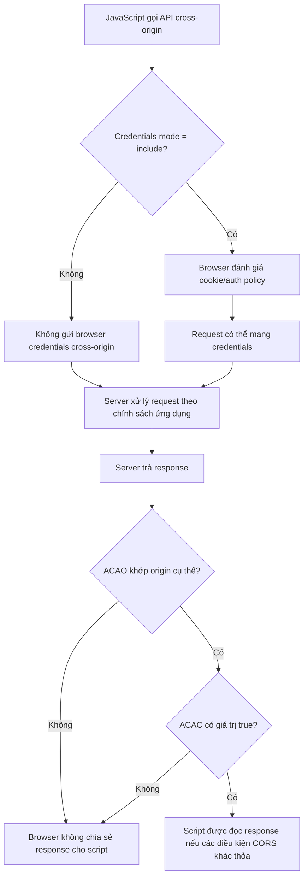

# Access-Control-Allow-Credentials — cho phép chia sẻ response có credentials

> **Chương:** CORS  
> **Mục tiêu:** Hiểu cách trình duyệt xử lý request cross-origin có cookie hoặc thông tin xác thực; phân biệt Fetch credentials mode với chính sách cookie; cấu hình đúng `Access-Control-Allow-Credentials` và `Access-Control-Allow-Origin`; xử lý preflight, cache và kiểm tra bảo mật phía server.

## 1. Bài toán: request có cookie nhưng JavaScript không đọc được response

Giả sử giao diện đang chạy tại `https://app.example.com` và API đăng nhập tại `https://api.example.com`. Người dùng đã đăng nhập ở API; trình duyệt có thể lưu cookie phiên. Giao diện muốn lấy dữ liệu tài khoản:

```js
const response = await fetch("https://api.example.com/account", {
  credentials: "include",
});

const account = await response.json();
console.log(account);
```

Hai URL khác **origin** vì hostname khác nhau. Mặc định, trình duyệt không chia sẻ mọi response cross-origin cho JavaScript. Khi request cần credentials, server phải tuyên bố rõ origin được phép và đồng ý chia sẻ response trong chế độ credentials.

Hai response header cốt lõi là:

```http
Access-Control-Allow-Origin: https://app.example.com
Access-Control-Allow-Credentials: true
```

Header đầu chỉ ra origin cụ thể được phép đọc response. Header thứ hai cho biết server cho phép trình duyệt chia sẻ response trong ngữ cảnh request có credentials. Nếu thiếu một điều kiện, JavaScript có thể nhận lỗi CORS dù request thực tế đã được gửi và server đã xử lý.

**Access-Control-Allow-Credentials không tự gửi cookie và không đăng nhập người dùng.** Nó chỉ là một phần của quyết định CORS về việc JavaScript có được đọc response hay không. Việc gửi cookie còn phụ thuộc Fetch credentials mode, thuộc tính cookie và chính sách riêng tư của trình duyệt.

## 2. Credentials là gì?

Trong Fetch, *credentials* là thông tin xác thực do trình duyệt quản lý và có thể gắn với request, chẳng hạn:

- Cookie phù hợp với URL đích.
- Thông tin HTTP authentication mà trình duyệt đang quản lý.
- TLS client certificate trong những môi trường sử dụng xác thực chứng chỉ phía client.

Header `Authorization` do ứng dụng tự đặt là một trường hợp cần chú ý riêng: nó là request header không thuộc nhóm wildcard của CORS và phải được nêu rõ trong `Access-Control-Allow-Headers` khi request cần preflight. Đừng nhầm việc thêm header này với việc bật Fetch credentials mode.

Fetch API có thuộc tính `credentials` với ba giá trị:

| Giá trị | Ý nghĩa |
| --- | --- |
| `same-origin` | Chỉ gửi credentials cho request cùng origin. Đây là mặc định của Fetch. |
| `include` | Cho phép gửi credentials cả trong request cross-origin, nếu các chính sách cookie và trình duyệt cho phép. |
| `omit` | Không gửi credentials của trình duyệt và không dùng credentials trong response. |

Ví dụ:

```js
// Mặc định: credentials: "same-origin"
fetch("https://api.example.com/public");

// Cho phép gửi credentials cho request khác origin
fetch("https://api.example.com/account", {
  credentials: "include",
});

// Chủ động không gửi credentials
fetch("https://api.example.com/public", {
  credentials: "omit",
});
```

Đối với XMLHttpRequest, mặc định `withCredentials` là `false` cho request cross-origin. Muốn gửi credentials trong trường hợp đó, ứng dụng cần đặt:

```js
const xhr = new XMLHttpRequest();
xhr.open("GET", "https://api.example.com/account");
xhr.withCredentials = true;
xhr.onload = () => console.log(xhr.responseText);
xhr.send();
```

Fetch credentials mode và XHR `withCredentials` là lựa chọn phía client. Chúng không thể buộc trình duyệt gửi cookie đã bị chặn bởi `SameSite`, chính sách cookie bên thứ ba, partitioning, thuộc tính `Secure` hoặc phạm vi Domain/Path.

## 3. Ba điều kiện độc lập cần phân biệt

Khi một ứng dụng gọi API có cookie, có ít nhất ba câu hỏi:

1. **Client có cho phép request mang credentials không?** Fetch phải dùng `credentials: "include"` cho request cross-origin; XHR phải đặt `withCredentials = true`.
2. **Cookie có đủ điều kiện được gửi không?** Browser kiểm tra Domain, Path, Secure, SameSite, thời hạn, chính sách third-party cookie và các giới hạn khác.
3. **JavaScript có được đọc response không?** CORS phải cho phép origin cụ thể và cho phép credentials.



Sơ đồ nhấn mạnh rằng CORS là một ranh giới đọc response. Browser có thể gửi request trước rồi mới từ chối chia sẻ response với JavaScript. Vì vậy, lỗi CORS không chứng minh rằng server chưa nhận request.

## 4. Cấu hình Access-Control-Allow-Credentials đúng cách

Khi request có credentials và response cần được JavaScript đọc, server phải trả cả hai header:

```http
Access-Control-Allow-Origin: https://app.example.com
Access-Control-Allow-Credentials: true
```

Các quy tắc cần nhớ:

- `Access-Control-Allow-Origin` phải chứa **một origin cụ thể** được phép, ví dụ `https://app.example.com`. Không có path hay dấu slash cuối.
- `Access-Control-Allow-Credentials` phải có giá trị chính xác là chữ thường `true`. Không dùng `True`, `TRUE` hay `1`.
- Không dùng `Access-Control-Allow-Origin: *` cho response credentialed. Wildcard không hợp lệ khi Fetch credentials mode là `include`.
- Nếu server chọn origin động dựa trên request `Origin`, cần phát `Vary: Origin` để cache không dùng nhầm response của origin này cho origin khác.

Ví dụ response:

```http
HTTP/1.1 200 OK
Content-Type: application/json
Access-Control-Allow-Origin: https://app.example.com
Access-Control-Allow-Credentials: true
Vary: Origin

{"id":"u-123","displayName":"An"}
```

Giá trị `Access-Control-Allow-Origin` phải khớp với origin đã được browser gửi, bao gồm scheme, hostname canonical và port nếu không phải port mặc định. Không được phản chiếu mọi giá trị `Origin` mà không kiểm tra allowlist.

### Vì sao không thể dùng wildcard?

Nếu server trả:

```http
Access-Control-Allow-Origin: *
Access-Control-Allow-Credentials: true
```

trình duyệt sẽ không cho JavaScript đọc response trong chế độ credentials `include`. Wildcard có nghĩa là công khai cho mọi origin; nó không thể đồng thời diễn đạt quyền đọc dữ liệu có credentials cho một phiên cụ thể.

Nếu API thực sự công khai và không cần credentials, wildcard có thể phù hợp:

```http
Access-Control-Allow-Origin: *
```

Nhưng không nên bật credentials chỉ vì một frontend muốn dùng chung cách gọi. Hãy xác định dữ liệu có cần phiên đăng nhập hay không và chỉ cấp quyền chia sẻ tối thiểu.

## 5. Preflight khi request có credentials

Một request cross-origin có thể cần **preflight** nếu dùng phương thức hoặc request header không thuộc nhóm đơn giản. Ví dụ:

```js
fetch("https://api.example.com/account", {
  method: "POST",
  credentials: "include",
  headers: {
    "Content-Type": "application/json",
    "X-CSRF-Token": "token-value",
  },
  body: JSON.stringify({ action: "refresh" }),
});
```

Browser có thể gửi request kiểm tra trước:

```http
OPTIONS /account HTTP/1.1
Origin: https://app.example.com
Access-Control-Request-Method: POST
Access-Control-Request-Headers: content-type,x-csrf-token
```

**Preflight request không mang credentials của request thực tế.** Server phải xử lý `OPTIONS` mà không đòi cookie phiên của người dùng, nếu không browser không thể hoàn thành bước kiểm tra để gửi request thực. Tuy vậy, server vẫn nên kiểm tra origin, method và headers được yêu cầu; không trả dữ liệu nghiệp vụ nhạy cảm trong response preflight.

Response preflight cho ví dụ trên có thể là:

```http
HTTP/1.1 204 No Content
Access-Control-Allow-Origin: https://app.example.com
Access-Control-Allow-Credentials: true
Access-Control-Allow-Methods: POST
Access-Control-Allow-Headers: Content-Type, X-CSRF-Token
Access-Control-Max-Age: 600
Vary: Origin, Access-Control-Request-Method, Access-Control-Request-Headers
```

Sau khi preflight thành công, browser mới gửi request thực tế theo credentials mode và các chính sách cookie. Response **thực tế** cũng phải có `Access-Control-Allow-Origin` khớp và `Access-Control-Allow-Credentials: true` để JavaScript đọc được nội dung.

Preflight không phải xác thực người dùng. Nó không có cookie phiên; server không nên dựa vào OPTIONS để quyết định người dùng có được sửa tài khoản hay không. Request thực tế phải được xác thực, phân quyền và kiểm tra CSRF như bình thường.

### Những gì preflight kiểm tra

| Header response | Vai trò |
| --- | --- |
| `Access-Control-Allow-Origin` | Origin được phép thực hiện chia sẻ CORS |
| `Access-Control-Allow-Credentials` | Cho phép chia sẻ response của request credentialed |
| `Access-Control-Allow-Methods` | Các phương thức được phép cho request thực tế |
| `Access-Control-Allow-Headers` | Các request header được phép |
| `Access-Control-Max-Age` | Thời gian browser có thể cache kết quả preflight, trong giới hạn của browser |

Không phải mọi request cross-origin đều preflight. Một số request đơn giản có thể được gửi trực tiếp; đây là lý do CORS không thể được dùng làm cơ chế chống CSRF duy nhất.

## 6. Wildcard trong các header CORS khác

Khi request dùng credentials mode `include`, wildcard không còn mang nghĩa “mọi giá trị” trong một số header CORS:

| Header | Wildcard | Với credentials mode `include` |
| --- | --- | --- |
| `Access-Control-Allow-Origin` | `*` | Không hợp lệ; phải chỉ rõ origin |
| `Access-Control-Allow-Methods` | `*` | Không hoạt động như wildcard; liệt kê method cụ thể |
| `Access-Control-Allow-Headers` | `*` | Không hoạt động như wildcard; liệt kê header cụ thể |
| `Access-Control-Expose-Headers` | `*` | Không có nghĩa là expose mọi header; liệt kê header cần đọc |

Đặc biệt, `Authorization` là một **CORS non-wildcard request-header name**. Nếu request cần gửi header này qua preflight, server phải nêu rõ:

```http
Access-Control-Allow-Headers: Authorization, Content-Type
```

Ví dụ expose một header tùy chỉnh để frontend đọc:

```http
Access-Control-Expose-Headers: X-Request-Id, X-RateLimit-Remaining
```

Hãy liệt kê đúng những method và header mà frontend cần. Việc mở quá rộng làm tăng bề mặt tích hợp và khó kiểm toán, nhất là với API chứa dữ liệu cá nhân.

## 7. Cookie vẫn chịu SameSite và chính sách riêng tư của browser

`credentials: "include"` chỉ cho phép Fetch gửi credentials cross-origin. Cookie còn phải đáp ứng các thuộc tính và chính sách của browser:

- **Domain và Path:** cookie phải thuộc phạm vi hostname/path của request.
- **Secure:** cookie có thuộc tính này chỉ được gửi trong ngữ cảnh kết nối an toàn theo quy tắc cookie.
- **SameSite:** `Strict`, `Lax` hoặc `None` điều khiển việc gửi cookie trong ngữ cảnh same-site/cross-site. Cookie cross-site thường cần `SameSite=None; Secure`.
- **Third-party cookie policy:** browser hoặc thiết lập người dùng có thể chặn cookie bên thứ ba ngay cả khi cookie có `SameSite=None; Secure`.
- **Partitioning:** một số browser phân vùng cookie/storage theo top-level site, làm cookie trong iframe hoặc ngữ cảnh bên thứ ba không dùng chung như trước.

Ví dụ cookie phiên dành cho trường hợp cần được gửi cross-site:

```http
Set-Cookie: session=opaque-value; Path=/; Secure; HttpOnly; SameSite=None
```

Đây không phải bảo đảm rằng cookie sẽ luôn được gửi: chính sách third-party cookie, partitioning, thời hạn, Domain và các giới hạn khác vẫn có hiệu lực.

### Same-site không đồng nghĩa same-origin

`https://app.example.com` và `https://api.example.com` có thể cùng site nhưng khác origin. Fetch mặc định dùng `credentials: "same-origin"`, nên credentials **không được gửi sang API khác origin chỉ vì hai host cùng site**. Muốn cho phép browser credentials trong request cross-origin, client cần `include`; sau đó cookie vẫn phải vượt qua các điều kiện riêng.

Ngược lại, hai website khác site có thể cần `SameSite=None; Secure` nếu thật sự dùng cookie trong ngữ cảnh cross-site, nhưng browser vẫn có thể áp dụng chặn hoặc phân vùng cookie bên thứ ba.

## 8. Cấu hình server an toàn: allowlist thay vì phản chiếu Origin

Một anti-pattern phổ biến:

```js
// SAI: phản chiếu bất kỳ Origin nào và cấp quyền đọc response có credentials.
res.setHeader("Access-Control-Allow-Origin", req.headers.origin);
res.setHeader("Access-Control-Allow-Credentials", "true");
```

Nếu endpoint chứa dữ liệu phiên riêng tư, website của kẻ tấn công có thể khiến browser gửi request có credentials và đọc response nếu server cho phép mọi origin. Đây có thể trở thành lỗ hổng **CORS misconfiguration** nghiêm trọng.

Hãy dùng allowlist origin cụ thể:

```js
const allowedOrigins = new Set([
  "https://app.example.com",
  "https://admin.example.com",
]);

function applyCors(req, res) {
  const origin = req.headers.origin;

  // Response thay đổi theo Origin: cần bảo cache phân biệt biến thể.
  res.setHeader("Vary", "Origin");

  if (typeof origin !== "string" || !allowedOrigins.has(origin)) {
    return false;
  }

  res.setHeader("Access-Control-Allow-Origin", origin);
  res.setHeader("Access-Control-Allow-Credentials", "true");
  res.setHeader(
    "Access-Control-Expose-Headers",
    "X-Request-Id"
  );
  return true;
}
```

Đây là ví dụ minh họa cho một server Node-style; trong hệ thống thật cần ghép với framework, xử lý nhiều giá trị `Vary` hiện có thay vì ghi đè tùy tiện, và áp dụng middleware đúng thứ tự. Quan trọng hơn, allowlist phải được quản trị như cấu hình bảo mật.

### Vì sao không nên cho phép `Origin: null`?

Một số ngữ cảnh có thể gửi `Origin: null`, chẳng hạn tài liệu opaque origin, sandboxed iframe hoặc một số môi trường đặc biệt. Nếu server cho phép `null` cùng credentials, nhiều tài liệu không liên quan có thể rơi vào nhóm được phép. Chỉ chấp nhận `null` khi có yêu cầu nghiệp vụ cụ thể, đã phân tích rủi ro và có cách ràng buộc bổ sung đáng tin cậy; mặc định nên từ chối.

### Không dùng regex lỏng để cho phép subdomain

Không nên kiểm tra:

```js
if (origin.endsWith("example.com")) {
  // Không an toàn: attackerexample.com cũng khớp.
}
```

Nếu thật sự cần cho phép một nhóm subdomain, parse origin bằng URL parser, chuẩn hóa hostname và kiểm tra ranh giới nhãn cùng scheme/port. Đồng thời đánh giá liệu mọi subdomain có cùng mức tin cậy không. Danh sách origin cụ thể thường an toàn hơn wildcard theo hậu tố.

## 9. Cache và Vary: Origin

Khi server phản hồi khác nhau tùy header `Origin`, cache phải biết response nào thuộc origin nào. Nếu server phản hồi:

```http
Access-Control-Allow-Origin: https://app.example.com
Vary: Origin
```

thì `Vary: Origin` thông báo cho cache rằng `Origin` là một yếu tố ảnh hưởng response. Thiếu `Vary` trong cấu hình dynamic origin có thể khiến cache dùng nhầm response CORS đã tạo cho origin khác.

Với preflight response động, cache có thể cần phân biệt thêm:

```http
Vary: Origin, Access-Control-Request-Method, Access-Control-Request-Headers
```

`Access-Control-Max-Age` điều khiển thời gian cache kết quả preflight theo giới hạn browser. Cache preflight không phải cache xác thực: browser vẫn thực hiện request thực tế và server vẫn phải kiểm tra session/quyền.

Nếu dùng CDN hoặc reverse proxy, kiểm tra cấu hình cache ở **mọi tầng**. Không chỉ nhìn header từ ứng dụng; cần xác minh response cuối cùng mà browser nhận được.

## 10. Access-Control-Allow-Credentials không phải biện pháp chống CSRF

CORS chủ yếu kiểm soát **JavaScript có được đọc response hay không**. CSRF là vấn đề **request có thể khiến server thực hiện hành động ngoài ý muốn hay không**.

Ví dụ một website độc hại tạo form gửi request tới endpoint chuyển tiền của ngân hàng. Trình duyệt có thể gửi cookie phiên trong một số ngữ cảnh; website độc hại không nhất thiết cần đọc response để gây tác động. Với request đơn giản, browser có thể không gửi preflight trước.

Do đó:

- Server phải kiểm tra xác thực và phân quyền trên mọi thao tác nhạy cảm.
- Dùng CSRF token hoặc cơ chế chống CSRF phù hợp với kiến trúc.
- Xem xét `SameSite`, kiểm tra `Origin`/`Referer` và Fetch Metadata như các lớp bổ sung.
- Không dùng GET cho hành động thay đổi trạng thái.
- CORS phải giới hạn origin được phép đọc response, nhưng không được xem là authorization hoặc CSRF protection.

Một request có thể đã được server thực hiện dù JavaScript gọi nó không đọc được response vì lỗi CORS. Frontend không được suy luận rằng “fetch reject” nghĩa là thao tác chắc chắn chưa xảy ra; các thao tác tài chính cần idempotency, trạng thái giao dịch rõ ràng và xử lý lỗi phía server.

## 11. Mẫu triển khai đầu-cuối

### Client: Fetch

```js
async function loadAccount() {
  const response = await fetch("https://api.example.com/account", {
    method: "GET",
    credentials: "include",
    headers: {
      Accept: "application/json",
    },
  });

  if (!response.ok) {
    throw new Error("API trả về HTTP " + response.status);
  }

  return response.json();
}
```

### Server: response thực tế

```http
HTTP/1.1 200 OK
Content-Type: application/json
Access-Control-Allow-Origin: https://app.example.com
Access-Control-Allow-Credentials: true
Vary: Origin

{"id":"u-123","role":"customer"}
```

### Server: preflight cho POST JSON

```http
HTTP/1.1 204 No Content
Access-Control-Allow-Origin: https://app.example.com
Access-Control-Allow-Credentials: true
Access-Control-Allow-Methods: POST
Access-Control-Allow-Headers: Content-Type, X-CSRF-Token
Access-Control-Max-Age: 600
Vary: Origin, Access-Control-Request-Method, Access-Control-Request-Headers
```

Response preflight không có dữ liệu tài khoản và không cần cookie phiên. Khi request POST thực tế đến, server phải xác thực session, kiểm tra CSRF token, phân quyền hành động, xác thực input và trả CORS header đúng nếu origin được phép đọc kết quả.

### Nếu dùng Authorization header

```js
fetch("https://api.example.com/account", {
  credentials: "include",
  headers: {
    Authorization: "Bearer access-token",
    Accept: "application/json",
  },
});
```

Header `Authorization` thường làm request cần preflight và phải được nêu rõ trong `Access-Control-Allow-Headers`. Không đưa access token vào URL query string; URL dễ xuất hiện trong log, history, referrer hoặc công cụ giám sát.

## 12. Chẩn đoán lỗi credentialed CORS

Khi request không hoạt động, hãy xem cả **Network** và **Console**. Đừng chỉ dựa vào thông báo “blocked by CORS”.

| Dấu hiệu | Nguyên nhân thường gặp | Cách kiểm tra |
| --- | --- | --- |
| Browser báo wildcard origin không được dùng với credentials | Server trả `Access-Control-Allow-Origin: *` | Trả origin cụ thể từ allowlist |
| Credentials mode là include nhưng thiếu credential permission | Thiếu hoặc sai `Access-Control-Allow-Credentials` | Response thực tế phải có giá trị `true` chính xác |
| Preflight thất bại | OPTIONS bị auth middleware chặn hoặc thiếu allow-method/header | Xem OPTIONS trong Network và response headers |
| Preflight thành công nhưng request thực không có cookie | Cookie không khớp Domain/Path, SameSite, Secure hoặc bị browser chặn | Kiểm tra Request Cookies và cookie blocked reason |
| Request được gửi nhưng JavaScript không đọc được body | CORS header trên response thực tế thiếu/sai | Kiểm tra response của endpoint, kể cả response lỗi |
| API trả 401/403 | Session hết hạn, cookie không gửi, token/quyền không hợp lệ | Xem server log và xác thực; CORS không thay quyền truy cập |
| Origin được phép nhưng cache trả header của origin khác | Thiếu hoặc cấu hình sai `Vary: Origin` | Kiểm tra CDN/proxy và cache key |
| Header Authorization không được chấp nhận | Chưa liệt kê trong `Access-Control-Allow-Headers` | Cho phép rõ `Authorization` trên preflight |

### Phân biệt request không gửi và response không được chia sẻ

1. Mở Network và bật Preserve log.
2. Tìm request OPTIONS nếu có; kiểm tra status và các header allow-method/header/origin.
3. Tìm request thực tế; xem nó có xuất hiện hay không và request cookie có được gửi không.
4. Mở response thực tế; kiểm tra `Access-Control-Allow-Origin` và `Access-Control-Allow-Credentials`.
5. Đối chiếu Console với server log. Một response 200 có thể tồn tại trong Network trong khi JavaScript không có quyền đọc nó.

Không nên tắt browser security, dùng extension vô hiệu hóa CORS hoặc mở allowlist cho mọi origin để “sửa” lỗi trong production. Hãy xác định chính xác tầng đang từ chối.

## 13. Thí nghiệm kiểm chứng trong môi trường local

Thí nghiệm này minh họa khác biệt giữa request không credentials, credentialed CORS và lỗi do wildcard. Dùng hai origin local, ví dụ frontend `http://localhost:8000` và API `http://localhost:8001`. Không dùng cookie hoặc dữ liệu production.

### Bước 1 — API trả CORS headers

Tạo endpoint API thử nghiệm để phản hồi theo một allowlist chỉ gồm `http://localhost:8000`. Khi origin khớp, trả:

```http
Access-Control-Allow-Origin: http://localhost:8000
Access-Control-Allow-Credentials: true
Vary: Origin
```

Với request OPTIONS, trả thêm các method/header thử nghiệm và không yêu cầu session cookie:

```http
Access-Control-Allow-Methods: GET, POST
Access-Control-Allow-Headers: Content-Type, X-Demo-Header
Access-Control-Max-Age: 300
```

Đảm bảo endpoint chỉ phục vụ dữ liệu giả lập, không có hành động nhạy cảm.

### Bước 2 — Gọi API với Fetch

```js
const response = await fetch("http://localhost:8001/demo", {
  credentials: "include",
});

console.log(response.status);
console.log(await response.text());
```

Quan sát request và response. Để kiểm tra cookie một cách có kiểm soát, có thể đặt cookie thử nghiệm qua server với thuộc tính phù hợp và xem Network; không giả định cookie sẽ được gửi chỉ vì đã đặt `include`.

### Bước 3 — Thử cấu hình sai

Đổi response API thành:

```http
Access-Control-Allow-Origin: *
Access-Control-Allow-Credentials: true
```

Giữ nguyên Fetch `credentials: "include"`. Browser sẽ từ chối chia sẻ response cho script. Sau đó bỏ `Access-Control-Allow-Credentials` hoặc đổi giá trị thành `True` để quan sát lỗi tương ứng.

### Bước 4 — Thử preflight

Gọi POST JSON hoặc thêm `X-Demo-Header` để browser cần OPTIONS. Cố tình bỏ `X-Demo-Header` khỏi `Access-Control-Allow-Headers`; preflight sẽ thất bại và browser không gửi request thực tế. Khôi phục header rồi quan sát request POST.

**Kết luận mong đợi:** client credentials mode, cookie policy và CORS response headers là các điều kiện khác nhau. Chỉ khi tất cả điều kiện cần thiết thỏa, JavaScript mới đọc được response credentialed.

## 14. Checklist khi triển khai Access-Control-Allow-Credentials

- Chỉ bật credentials cho endpoint thực sự cần cookie hoặc browser-managed credentials.
- Dùng `credentials: "include"` hoặc `withCredentials = true` đúng nơi; không bật theo thói quen cho mọi request.
- Kiểm tra Domain, Path, Secure, SameSite, thời hạn và chính sách third-party cookie.
- Dùng allowlist origin cụ thể; không phản chiếu `Origin` bất kỳ.
- Trả `Access-Control-Allow-Origin` đúng origin đã được phép, không dùng `*` cho credentialed response.
- Trả `Access-Control-Allow-Credentials: true` với đúng chữ thường `true` trên response thực tế và response preflight cần thiết.
- Với preflight, liệt kê method và request header cụ thể; không yêu cầu cookie phiên để trả OPTIONS.
- Với `Authorization`, liệt kê rõ trong `Access-Control-Allow-Headers`.
- Dùng `Vary: Origin` nếu response phụ thuộc Origin; xem xét thêm các request headers preflight trong cache variation.
- Không cho phép `Origin: null` nếu không có lý do và đánh giá bảo mật cụ thể.
- Thực hiện xác thực, authorization và CSRF protection ở server; CORS không thay thế chúng.
- Kiểm tra response thành công lẫn lỗi, preflight, CDN/proxy cache và hành vi trên browser mục tiêu.

## 15. Câu hỏi tự kiểm tra

1. Vì sao `credentials: "include"` không đảm bảo cookie chắc chắn được gửi?
2. Khi request credentialed, tại sao `Access-Control-Allow-Origin: *` không hợp lệ?
3. `Access-Control-Allow-Credentials` phải có giá trị gì và vì sao cần đúng chữ thường?
4. Vì sao preflight không mang cookie phiên nhưng response preflight vẫn phải cho phép cấu hình CORS phù hợp với request thực?
5. Tại sao Fetch mặc định `same-origin` không gửi cookie sang một API khác origin dù hai host có thể cùng site?
6. Vì sao `SameSite=None; Secure` vẫn không bảo đảm cookie bên thứ ba luôn được gửi?
7. Vì sao phản chiếu mọi `Origin` cùng `Access-Control-Allow-Credentials: true` có thể tạo lỗ hổng đọc dữ liệu?
8. `Vary: Origin` bảo vệ tính đúng đắn của cache như thế nào?
9. Vì sao CORS không thay thế CSRF token và kiểm tra quyền ở server?

**Ghi nhớ:** `Access-Control-Allow-Credentials: true` là tín hiệu cho phép browser chia sẻ response cross-origin trong chế độ credentials khi các điều kiện CORS còn lại thỏa. Nó không tự gửi cookie, không vượt qua SameSite hay chính sách cookie bên thứ ba, và không xác thực người dùng. Cấu hình an toàn cần origin allowlist cụ thể, `Access-Control-Allow-Origin` chính xác, preflight phù hợp, cache có `Vary: Origin`, cùng xác thực, phân quyền và CSRF protection ở server.
