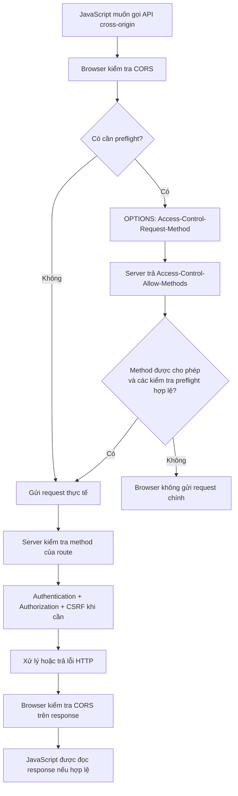

# Allowed methods trong CORS

Trong CORS, **Access-Control-Allow-Methods** là response header cho biết server cho phép browser thực hiện những HTTP method nào trong một yêu cầu cross-origin cần **preflight**. Header này tham gia vào quyết định của browser trước khi gửi request chính; nó **không phải** danh sách phân quyền nghiệp vụ, không thay thế việc server giới hạn method theo từng endpoint và cũng không ngăn mọi request cross-origin.

Bài học thuộc chương **CORS** của module **Browser Security** (SECURITY_APPLICATION_SECURITY_BROWSER_SECURITY). Nội dung tập trung vào quan hệ giữa method, preflight OPTIONS, request thực tế và response headers; từ đó hiểu đúng ranh giới giữa browser, origin, cookie và ứng dụng web. Khi triển khai, cần kết hợp CORS allowlist với xác thực, phân quyền và phòng CSRF ở server.

## 1. Mục tiêu học tập

Sau bài này, bạn có thể:

1. Giải thích vai trò của Access-Control-Allow-Methods trong quy trình CORS preflight.
2. Phân biệt Access-Control-Allow-Methods với HTTP Allow, Access-Control-Request-Method và method allowlist ở server.
3. Nhận diện khi nào GET, HEAD, POST được gửi mà không cần preflight do method; khi nào PUT, PATCH, DELETE hoặc method khác làm phát sinh preflight.
4. Đọc và tạo phản hồi OPTIONS đúng với method và request headers mà browser yêu cầu.
5. Cấu hình CORS theo allowlist origin và tập method tối thiểu, có xét credentials, cache preflight và response lỗi.
6. Giải thích vì sao CORS không phải cơ chế authentication, authorization hay CSRF protection.
7. Dùng DevTools và Node.js để kiểm chứng request chính có được gửi sau preflight hay không.

## 2. HTTP method và CORS method là hai lớp kiểm soát

HTTP method mô tả loại hành động mà client muốn thực hiện trên tài nguyên. Các method phổ biến:

| Method | Ý nghĩa thường gặp | Ví dụ |
| --- | --- | --- |
| GET | Lấy biểu diễn tài nguyên | Đọc hồ sơ, danh sách đơn hàng |
| HEAD | Như GET nhưng chỉ lấy headers, không có response body | Kiểm tra metadata tài nguyên |
| POST | Gửi dữ liệu để xử lý hoặc tạo hành động/tài nguyên | Tạo đơn hàng, gửi biểu mẫu |
| PUT | Tạo hoặc thay thế biểu diễn tài nguyên tại URI | Thay thế cấu hình hồ sơ |
| PATCH | Cập nhật một phần tài nguyên | Đổi một số trường hồ sơ |
| DELETE | Xóa tài nguyên | Xóa một phiên hoặc mục dữ liệu |
| OPTIONS | Hỏi về các tùy chọn giao tiếp của tài nguyên/server; cũng được browser dùng cho CORS preflight | Preflight hoặc khám phá khả năng endpoint |

Server định nghĩa endpoint nào chấp nhận method nào và hành động đó cần quyền gì. CORS bổ sung một câu hỏi khác: **mã JavaScript từ origin này có được browser cho phép gửi và đọc kết quả của request cross-origin theo method đã định hay không?**

### Sơ đồ các lớp kiểm soát



Sơ đồ phân biệt **quyền của browser** với **quyền nghiệp vụ ở server**. Browser có thể chặn một request trước khi gửi vì preflight thất bại; nhưng nếu request được gửi, server vẫn phải kiểm tra method, danh tính, quyền và dữ liệu.

## 3. Access-Control-Allow-Methods là gì?

Đây là **HTTP response header** dùng trong phản hồi CORS preflight. Giá trị của nó là danh sách HTTP method mà server cho phép đối với request cross-origin được hỏi.

Ví dụ browser đang chạy JavaScript từ https://app.example.com và muốn gửi PATCH tới https://api.example.com/profile. Browser có thể gửi:

```http
OPTIONS /profile HTTP/1.1
Origin: https://app.example.com
Access-Control-Request-Method: PATCH
Access-Control-Request-Headers: content-type, authorization
```

Server có thể trả:

```http
HTTP/1.1 204 No Content
Access-Control-Allow-Origin: https://app.example.com
Access-Control-Allow-Methods: GET, PATCH
Access-Control-Allow-Headers: Content-Type, Authorization
Vary: Origin
```

Browser kiểm tra method dự định là PATCH có nằm trong tập method được phép không, đồng thời kiểm tra origin và các request headers. Nếu các điều kiện cần thiết đều hợp lệ, browser mới gửi request PATCH chính.

**Lưu ý:** Access-Control-Allow-Methods là header do server trả lời cho browser. Nó không phải header để frontend tự khai báo rằng mình muốn dùng method nào. Method được hỏi nằm trong request header **Access-Control-Request-Method**.

### 3.1. Cách đọc ba header method

| Header | Hướng truyền | Ý nghĩa |
| --- | --- | --- |
| Access-Control-Request-Method | Browser → server, trong preflight | Method mà browser dự định dùng ở request chính |
| Access-Control-Allow-Methods | Server → browser, trong response preflight | Các method server cho phép qua CORS |
| Allow | Server → client, trong response HTTP thông thường (đặc biệt 405) | Các method mà tài nguyên/route hỗ trợ theo HTTP |

Ví dụ route chỉ hỗ trợ GET và PATCH có thể trả lỗi method không được hỗ trợ:

```http
HTTP/1.1 405 Method Not Allowed
Allow: GET, PATCH
Content-Type: application/json
```

Header Allow không thay thế Access-Control-Allow-Methods. Ngược lại, khai báo PATCH trong Access-Control-Allow-Methods cũng không bắt buộc route phải thực hiện PATCH; server vẫn có thể từ chối bằng 405 hoặc 403 theo chính sách.

Tên HTTP method là token phân biệt chữ hoa/chữ thường theo ngữ nghĩa HTTP. Các method chuẩn thường được viết hoa (GET, POST, PATCH); nếu ứng dụng hỗ trợ method mở rộng, hãy so sánh đúng token mà giao thức sử dụng thay vì tự ý chuẩn hóa mọi tên method.

### 3.2. Access-Control-Allow-Methods không phải firewall method

Giả sử server trả:

```http
Access-Control-Allow-Methods: GET, PATCH
```

Điều đó không có nghĩa server đã chặn POST, PUT hoặc DELETE trên toàn hệ thống. Header được browser sử dụng trong CORS preflight. Client ngoài browser như curl, backend service hoặc script tự viết có thể gửi method trực tiếp; server phải tự kiểm tra method tại route.

Đồng thời, request cross-origin dùng method CORS-safelisted như GET, HEAD hoặc POST có thể được gửi mà không cần preflight chỉ vì method. Nếu response không có CORS header phù hợp, browser có thể chặn JavaScript đọc response **sau khi server đã nhận request**.

Đây là lý do không được dùng Access-Control-Allow-Methods làm biện pháp duy nhất để ngăn hành động trái phép hoặc CSRF.

## 4. Khi nào browser gửi preflight?

Browser dùng preflight để hỏi server trước khi gửi một số request cross-origin. Một request có thể cần preflight vì method, request headers hoặc Content-Type không thuộc nhóm được CORS-safelisted.

### 4.1. Ba method CORS-safelisted

Các method được xem là CORS-safelisted method là:

- GET
- HEAD
- POST

Với các điều kiện CORS-safelisted khác được thỏa mãn, method tự nó không làm phát sinh preflight. POST không tự động đồng nghĩa với preflight.

Ngược lại, PUT, PATCH, DELETE và các method không nằm trong nhóm trên thường cần preflight khi dùng trong request CORS.

| Request | Preflight do method? | Ghi chú |
| --- | :---: | --- |
| GET /items | Không | GET là method safelisted |
| HEAD /items/1 | Không | HEAD là method safelisted |
| POST /contact với form-urlencoded | Không | Nếu Content-Type và headers cũng thỏa điều kiện safelisted |
| POST /api với application/json | Không do method, nhưng thường **có** preflight do Content-Type | application/json không phải CORS-safelisted Content-Type |
| PUT /profile/1 | Có | PUT không phải method safelisted |
| PATCH /profile/1 | Có | PATCH không phải method safelisted |
| DELETE /sessions/1 | Có | DELETE không phải method safelisted |
| GET có header X-Client-Version | Có | Header tùy chỉnh không nằm trong safelisted request headers |

Một request có thể phát sinh preflight vì nhiều lý do cùng lúc. Khi điều tra, hãy xem cả method, Content-Type và danh sách headers; không kết luận chỉ dựa trên method.

### 4.2. Ví dụ GET không cần preflight do method

```js
const response = await fetch('https://api.example.com/products');
const products = await response.json();
```

Nếu request đáp ứng điều kiện safelisted, browser gửi GET trực tiếp. API vẫn cần trả Access-Control-Allow-Origin phù hợp để JavaScript đọc response. Không có preflight **không có nghĩa** request đã được cấp quyền đọc response.

### 4.3. Ví dụ POST có thể không cần preflight

```js
const body = new URLSearchParams({
  email: 'user@example.com',
});

const response = await fetch('https://api.example.com/contact', {
  method: 'POST',
  body,
});
```

URLSearchParams thường tạo Content-Type application/x-www-form-urlencoded, thuộc nhóm safelisted Content-Type. Nếu không thêm header không safelisted và các điều kiện khác phù hợp, browser có thể gửi POST trực tiếp mà không hỏi OPTIONS trước.

Đây là ví dụ quan trọng khi phân tích CSRF: form HTML và một số POST đơn giản có thể được gửi xuyên origin mà không cần preflight. Server không thể dựa vào việc “browser sẽ hỏi CORS trước” để bảo vệ hành động.

### 4.4. Ví dụ PATCH làm phát sinh preflight

```js
const response = await fetch('https://api.example.com/profile', {
  method: 'PATCH',
  headers: {
    'Content-Type': 'application/json',
  },
  body: JSON.stringify({ displayName: 'Lan' }),
});
```

Browser cần xác nhận API cho phép PATCH và Content-Type trước. Nếu preflight không thành công, browser không gửi PATCH chính.

## 5. Cấu trúc CORS preflight đầy đủ

### 5.1. Request OPTIONS

Một preflight request thường có dạng:

```http
OPTIONS /profile HTTP/1.1
Host: api.example.com
Origin: https://app.example.com
Access-Control-Request-Method: PATCH
Access-Control-Request-Headers: content-type, x-request-id
```

Các trường cần hiểu:

- Origin: origin của tài liệu khởi tạo request.
- Access-Control-Request-Method: method dự định dùng trong request chính.
- Access-Control-Request-Headers: các header không safelisted mà request chính muốn gửi.

Preflight là request do browser tự tạo. Nó không phải request PATCH chính và không nên làm thay đổi dữ liệu nghiệp vụ.

### 5.2. Response OPTIONS

```http
HTTP/1.1 204 No Content
Access-Control-Allow-Origin: https://app.example.com
Access-Control-Allow-Methods: GET, PATCH
Access-Control-Allow-Headers: Content-Type, X-Request-Id
Access-Control-Max-Age: 600
Vary: Origin
```

Browser kiểm tra:

1. Origin được cho phép.
2. Method trong Access-Control-Request-Method được bao gồm trong Access-Control-Allow-Methods.
3. Những header được yêu cầu được bao gồm trong Access-Control-Allow-Headers.
4. Các điều kiện credentials và chính sách CORS khác phù hợp nếu request cần credentials.

204 No Content là status thường dùng cho preflight thành công. Server cũng có thể dùng một status 2xx phù hợp; không cần response body.

### 5.3. Request chính chỉ được gửi sau preflight thành công

Nếu preflight hợp lệ, browser mới gửi:

```http
PATCH /profile HTTP/1.1
Origin: https://app.example.com
Content-Type: application/json
X-Request-Id: 12345

{"displayName":"Lan"}
```

Response của request chính cũng cần CORS headers phù hợp để JavaScript đọc được. Việc preflight thành công không tự động cho phép đọc response cuối cùng nếu response đó thiếu hoặc sai CORS headers.

### 5.4. Preflight thất bại thì chuyện gì xảy ra?

Ví dụ browser hỏi PATCH nhưng server chỉ trả:

```http
Access-Control-Allow-Methods: GET, POST
```

Browser từ chối preflight và không gửi PATCH chính. JavaScript thường nhận lỗi mạng chung từ fetch; chi tiết CORS xuất hiện trong Console/Network tùy browser.

Nếu request chính không xuất hiện trong Network hoặc server log chỉ ghi OPTIONS, đó là dấu hiệu preflight đã ngăn request chính. Hãy phân biệt tình huống này với GET/POST safelisted đã đến server nhưng response bị chặn đọc.

## 6. Access-Control-Allow-Methods và HTTP Allow

Hai header có tên gần giống nhau nhưng có phạm vi khác:

| Tiêu chí | Access-Control-Allow-Methods | Allow |
| --- | --- | --- |
| Chuẩn/ngữ cảnh | CORS | HTTP |
| Mục đích | Cho browser biết method nào được phép trong CORS preflight | Nêu method mà tài nguyên hỗ trợ |
| Thường xuất hiện | Response preflight OPTIONS | Response OPTIONS hoặc 405 |
| Đối tượng sử dụng | Browser CORS implementation | HTTP client và người vận hành API |
| Có thay authorization không? | Không | Không |
| Có thay method routing ở server không? | Không | Không |

Ví dụ:

```http
HTTP/1.1 405 Method Not Allowed
Allow: GET, HEAD, PATCH, OPTIONS
Content-Type: application/json
Access-Control-Allow-Origin: https://app.example.com
```

Nếu response 405 cần được JavaScript cross-origin đọc, server còn phải gửi CORS headers phù hợp. Nếu thiếu, browser có thể chỉ báo lỗi CORS thay vì cung cấp status 405 cho script.

Không phải mọi response 405 đều bắt buộc phải có CORS; điều đó phụ thuộc client và chính sách. Nhưng khi frontend hợp lệ cần đọc lỗi HTTP, hãy cấu hình CORS nhất quán cả cho response lỗi.

## 7. Cấu hình method allowlist an toàn

### 7.1. Chỉ cho phép method mà frontend thực sự cần

Ví dụ API chỉ cần đọc hồ sơ và cập nhật một phần:

```http
Access-Control-Allow-Methods: GET, PATCH
```

Không nên khai báo mọi method chỉ để “cho chắc”. Tập method rộng làm tăng bề mặt tích hợp và có thể vô tình mở khả năng gọi các endpoint không cần thiết. Tuy nhiên, giảm danh sách CORS cũng không thay thế kiểm soát method ở server.

### 7.2. Cấu hình theo route

Không phải mọi endpoint đều cần cùng một tập method:

| Route | Method nghiệp vụ | Method ngoài ý muốn |
| --- | --- | --- |
| /api/profile | GET, PATCH | POST, DELETE |
| /api/sessions/current | GET, DELETE | PUT, PATCH |
| /api/orders | GET, POST | PATCH, DELETE |
| /api/reports/export | POST | GET nếu export tạo tác vụ hoặc có side effect |

Server nên định nghĩa method allowlist theo route, trả 405 khi method không được hỗ trợ và thực thi authorization theo người dùng/tài nguyên. CORS policy có thể được cấu hình theo route hoặc nhóm API để browser chỉ dùng đúng các method cần thiết.

### 7.3. Xử lý OPTIONS đúng cách

Một số framework hoặc reverse proxy xử lý OPTIONS tự động; một số ứng dụng cần route middleware riêng. Dù dùng cách nào, hãy đảm bảo:

- OPTIONS preflight được nhận diện qua Origin và Access-Control-Request-Method.
- Trả các CORS headers phù hợp với origin/method/headers đã allowlist.
- Không chạy nghiệp vụ POST/PATCH/DELETE trong handler preflight.
- Không yêu cầu session cookie ở preflight như thể đó là request nghiệp vụ; browser thường không gửi credentials trong preflight.
- Request chính vẫn xác thực, phân quyền, kiểm tra CSRF và validation bình thường.
- Không trả Access-Control-Allow-Methods từ dữ liệu client gửi lên một cách phản chiếu tùy tiện.

Nếu endpoint hỗ trợ OPTIONS như một method nghiệp vụ thực sự, hãy phân biệt nó với preflight dựa trên các header CORS. Không phải cứ nhận OPTIONS là mặc nhiên được phép mọi method khác.

### 7.4. CORS allowlist và credentials

Ví dụ response preflight và response thực tế khi frontend dùng cookie:

```http
Access-Control-Allow-Origin: https://app.example.com
Access-Control-Allow-Methods: GET, PATCH
Access-Control-Allow-Headers: Content-Type, X-Request-Id
Access-Control-Allow-Credentials: true
Vary: Origin
```

Với request có credentials, Access-Control-Allow-Origin phải là origin cụ thể; không dùng wildcard *. Nếu server phản hồi origin động theo allowlist, thêm Vary: Origin để cache phân biệt response theo Origin.

Wildcard trong Access-Control-Allow-Methods cũng có quy tắc đặc biệt: khi request có credentials mode include, dấu * không hoạt động như wildcard bao trùm mọi method mà được xem như một method tên dấu sao. Vì vậy hãy liệt kê rõ method cần thiết, đặc biệt khi API hỗ trợ cookie/session.

Preflight request thông thường không mang cookie phiên, dù request thực tế có thể dùng credentials: include. Server cần xử lý OPTIONS để trả chính sách CORS mà không dựa vào cookie của request chính. Các kiểm tra danh tính và quyền truy cập dữ liệu được thực hiện trên request thực tế.

## 8. Access-Control-Max-Age và cache preflight

Server có thể chỉ định thời gian browser được cache kết quả preflight bằng:

```http
Access-Control-Max-Age: 600
```

Giá trị tính bằng giây. Trong ví dụ, browser có thể tái sử dụng kết quả preflight trong một khoảng thời gian thay vì gửi OPTIONS cho mọi request tương tự. Trình duyệt có thể áp dụng giới hạn tối đa riêng.

**Lợi ích:** giảm số request OPTIONS, độ trễ và tải cho API.

**Đánh đổi:** khi thay đổi CORS policy, browser có thể còn cache quyết định cũ đến khi hết hạn hoặc bị xóa. Do đó:

- Chọn TTL dựa trên tần suất thay đổi policy và mức chấp nhận độ trễ.
- Trong giai đoạn phát triển có thể dùng TTL thấp.
- Khi thu hồi quyền origin/method, vẫn phải kiểm soát nghiệp vụ ở server; không trông đợi cache preflight tự chặn request đã được cho phép trước đó.
- Không nhầm preflight cache với HTTP response cache thông thường.

## 9. CORS methods không thay thế bảo vệ CSRF

Đây là một trong những nhầm lẫn nguy hiểm nhất.

Giả sử một website khác tạo form POST gửi tới endpoint cập nhật email. POST với content type form-urlencoded có thể là request đơn giản, không cần preflight. Browser có thể gửi request và cookie phiên có thể được đính kèm nếu cookie policy cho phép. Website gây ra request không nhất thiết đọc được response, nhưng server vẫn có thể xử lý.

Vì vậy:

1. **Không dựa vào Access-Control-Allow-Methods** để chặn form POST hoặc request ngoài browser.
2. Dùng CSRF token hoặc cơ chế chống CSRF phù hợp với kiến trúc cookie/session.
3. Cấu hình cookie Secure, HttpOnly và SameSite phù hợp; hiểu rằng same-site không đồng nghĩa same-origin.
4. Kiểm tra Origin/Referer và Fetch Metadata khi thích hợp, kết hợp token chứ không coi một header là bằng chứng tuyệt đối.
5. Không dùng GET cho hành động thay đổi trạng thái.
6. Xác thực, phân quyền và kiểm tra quyền sở hữu tài nguyên trên server cho mọi request.

**CORS kiểm soát quyền đọc response của JavaScript trong browser; CSRF defense xác minh request thay đổi trạng thái có xuất phát từ luồng được phép hay không.** Hai mục tiêu liên quan nhưng không thay thế nhau.

## 10. Ví dụ Node.js: CORS method allowlist và route method allowlist

Bài thực hành dùng Node.js 18 trở lên, không cần package ngoài. Hai origin:

- http://localhost:3000: frontend.
- http://localhost:3001: API.

Khác port nên khác origin. Mục tiêu là quan sát preflight cho PATCH, response cho phép method và phản hồi 405 khi method không được route hỗ trợ.

### 10.1. Tạo API

Tạo file api.mjs trong một thư mục thực hành riêng:

```js
import { createServer } from 'node:http';

const allowedOrigin = 'http://localhost:3000';
const allowedCorsMethods = ['GET', 'PATCH'];
const allowedCorsHeaders = ['content-type', 'x-request-id'];

function setCorsHeaders(req, res) {
  // Response thay đổi theo Origin nên cache phải phân biệt biến thể.
  res.setHeader('Vary', 'Origin');
  if (req.headers.origin === allowedOrigin) {
    res.setHeader('Access-Control-Allow-Origin', allowedOrigin);
  }
}

createServer((req, res) => {
  setCorsHeaders(req, res);
  res.setHeader('Cache-Control', 'no-store');

  // CORS preflight: hỏi method và headers trước request chính.
  if (req.method === 'OPTIONS' &&
      req.headers.origin &&
      req.headers['access-control-request-method']) {
    const requestedMethod = req.headers['access-control-request-method'];
    const requestedHeaders = (req.headers['access-control-request-headers'] || '')
      .split(',')
      .map(value => value.trim().toLowerCase())
      .filter(Boolean);

    const headersAllowed = requestedHeaders.every(header =>
      allowedCorsHeaders.includes(header),
    );

    if (!allowedCorsMethods.includes(requestedMethod) || !headersAllowed) {
      res.writeHead(403).end();
      return;
    }

    res.setHeader('Access-Control-Allow-Methods', allowedCorsMethods.join(', '));
    res.setHeader('Access-Control-Allow-Headers', 'Content-Type, X-Request-Id');
    res.setHeader('Access-Control-Max-Age', '120');
    res.writeHead(204).end();
    return;
  }

  // Server-side route method allowlist; independent of CORS.
  if (req.url === '/profile' && req.method === 'GET') {
    res.writeHead(200, { 'Content-Type': 'application/json' });
    res.end(JSON.stringify({ displayName: 'Lan' }));
    return;
  }

  if (req.url === '/profile' && req.method === 'PATCH') {
    let body = '';
    req.on('data', chunk => { body += chunk; });
    req.on('end', () => {
      res.writeHead(200, { 'Content-Type': 'application/json' });
      res.end(JSON.stringify({
        updated: true,
        received: body,
      }));
    });
    return;
  }

  if (req.url === '/profile') {
    res.writeHead(405, {
      'Allow': 'GET, PATCH',
      'Content-Type': 'application/json',
    });
    res.end(JSON.stringify({ error: 'Method Not Allowed' }));
    return;
  }

  res.writeHead(404).end('Not found');
}).listen(3001, () => console.log('API: http://localhost:3001'));
```

Đây là demo tối giản, chưa có authentication, authorization, CSRF hoặc kiểm tra JSON đầy đủ. Không dùng làm API production. Điểm quan trọng là server có **hai lớp riêng**: xử lý preflight CORS và kiểm tra method của route.

### 10.2. Tạo frontend

Tạo file app.mjs:

```js
import { createServer } from 'node:http';

const html = `<!doctype html>
<html lang="vi">
<head><meta charset="utf-8"><title>CORS Allowed Methods</title></head>
<body>
  <h1>CORS Allowed Methods</h1>
  <button id="get">GET /profile</button>
  <button id="patch">PATCH /profile</button>
  <button id="delete">DELETE /profile</button>
  <pre id="log"></pre>
  <script>
    const api = 'http://localhost:3001/profile';
    const log = message => {
      document.querySelector('#log').textContent += message + '\\n';
    };

    async function call(method) {
      try {
        const options = { method };
        if (method === 'PATCH') {
          options.headers = {
            'Content-Type': 'application/json',
            'X-Request-Id': 'demo-001',
          };
          options.body = JSON.stringify({ displayName: 'Lan mới' });
        }
        const response = await fetch(api, options);
        log(method + ': HTTP ' + response.status + ' ' + await response.text());
      } catch (error) {
        log(method + ': fetch rejected - ' + error.message);
      }
    }

    document.querySelector('#get').onclick = () => call('GET');
    document.querySelector('#patch').onclick = () => call('PATCH');
    document.querySelector('#delete').onclick = () => call('DELETE');
  </script>
</body>
</html>`;

createServer((_req, res) => {
  res.writeHead(200, {
    'Content-Type': 'text/html; charset=utf-8',
    'Cache-Control': 'no-store',
  });
  res.end(html);
}).listen(3000, () => console.log('App: http://localhost:3000'));
```

Chạy hai terminal riêng:

```bash
node api.mjs
```

```bash
node app.mjs
```

Mở http://localhost:3000, nhấn F12 và chọn Network. Nếu DevTools có bộ lọc, chọn Fetch/XHR và bật Preserve log.

### 10.3. Quan sát từng method

| Nút | Request trong Network | Kết quả mong đợi |
| --- | --- | --- |
| GET | GET /profile, không cần preflight do method | JavaScript đọc JSON 200 |
| PATCH | OPTIONS trước, sau đó PATCH /profile | OPTIONS cho phép PATCH; request chính trả JSON 200 |
| DELETE | OPTIONS trước; response preflight không cho DELETE | Browser không gửi DELETE chính; fetch bị reject vì CORS |

Khi nhấn PATCH, mở request OPTIONS và quan sát:

```http
Access-Control-Request-Method: PATCH
Access-Control-Request-Headers: content-type, x-request-id
```

Response:

```http
Access-Control-Allow-Methods: GET, PATCH
Access-Control-Allow-Headers: Content-Type, X-Request-Id
```

Sau đó kiểm tra request PATCH chính. Khi nhấn DELETE, API nhận OPTIONS nhưng không có DELETE trong Access-Control-Allow-Methods nên browser không gửi DELETE chính.

### 10.4. Phân biệt CORS từ chối và server trả 405

Thử thêm method POST vào frontend (hoặc dùng một HTTP client) để gọi /profile. Server không cho phép POST và trả 405 cùng Allow. Nếu gọi từ browser cross-origin và response 405 có CORS headers hợp lệ, JavaScript có thể đọc status 405. Nếu CORS headers không hợp lệ, browser có thể che response khỏi script và chỉ báo lỗi CORS.

Thí nghiệm cho thấy:

- **CORS preflight từ chối:** browser không gửi request chính.
- **Server method allowlist từ chối:** request chính đã tới server, server trả 405.
- **CORS response check thất bại:** server có thể đã trả response nhưng browser không cho script đọc.

## 11. Checklist triển khai CORS methods

Trước khi đưa API vào production:

1. **Liệt kê method theo route:** xác định GET/POST/PUT/PATCH/DELETE nào thực sự cần; không mở toàn bộ method theo mặc định.
2. **Tách CORS policy và route policy:** Access-Control-Allow-Methods phục vụ browser preflight; route vẫn phải kiểm tra method và trả 405 đúng.
3. **Allowlist origin:** chỉ chấp nhận origin tin cậy; không phản chiếu tùy tiện header Origin.
4. **Allowlist request headers:** chỉ cho phép header cần thiết; kiểm tra Access-Control-Request-Headers.
5. **Xử lý OPTIONS:** trả preflight không side effect, không yêu cầu cookie phiên như request nghiệp vụ.
6. **Cấu hình credentials chính xác:** nếu cần cookie, dùng origin cụ thể và Access-Control-Allow-Credentials; kiểm tra cookie policy riêng.
7. **CORS trên response thực:** gồm response thành công và lỗi nếu frontend cần đọc status/body.
8. **Cache preflight có chủ đích:** đặt Access-Control-Max-Age theo khả năng thay đổi policy và chấp nhận độ trễ thu hồi.
9. **CSRF và authorization:** bảo vệ request thay đổi trạng thái độc lập với CORS; kiểm tra quyền trên server.
10. **Kiểm thử client khác browser:** dùng curl hoặc backend client để xác minh server vẫn từ chối method trái phép; CORS không áp dụng cho các client đó.

## 12. Những nhầm lẫn cần tránh

| Nhầm lẫn | Cách hiểu đúng |
| --- | --- |
| “Access-Control-Allow-Methods là danh sách method server hỗ trợ.” | Nó là danh sách method cho CORS preflight; HTTP Allow và routing server có mục đích riêng. |
| “Không khai báo POST trong Access-Control-Allow-Methods thì browser không gửi POST.” | POST safelisted có thể được gửi không cần preflight; response có thể bị chặn đọc sau đó. |
| “Mọi POST đều cần OPTIONS.” | POST có thể không cần preflight nếu method, Content-Type và headers thỏa điều kiện safelisted. |
| “Preflight OPTIONS chính là request PATCH/DELETE.” | OPTIONS chỉ hỏi trước; request nghiệp vụ được gửi sau khi preflight thành công. |
| “Preflight thành công nghĩa là API cho phép người dùng cập nhật dữ liệu.” | Server vẫn phải xác thực, phân quyền, validate và chống CSRF. |
| “CORS từ chối nghĩa là server không xử lý request.” | Với request không cần preflight, server có thể đã xử lý trước khi browser chặn đọc response. |
| “HTTP Allow thay thế Access-Control-Allow-Methods.” | Allow mô tả method của tài nguyên theo HTTP; ACA-Methods phục vụ CORS preflight. |
| “Cho phép method trong CORS là đã an toàn.” | Method allowlist ở server, authorization và kiểm soát side effect vẫn cần thiết. |

## 13. Câu hỏi tự đánh giá

**Câu 1.** Browser gọi PATCH cross-origin. Header nào cho biết method dự định gửi trong preflight và header nào server dùng để cho phép?

**Gợi ý trả lời:** Browser gửi Access-Control-Request-Method: PATCH; server trả Access-Control-Allow-Methods chứa PATCH.

**Câu 2.** API không khai báo POST trong Access-Control-Allow-Methods. Website khác có thể gửi POST form tới API không?

**Gợi ý trả lời:** Có thể. POST với loại nội dung safelisted có thể được gửi mà không cần preflight. Server phải tự bảo vệ endpoint và CSRF.

**Câu 3.** Preflight cho phép PATCH nhưng request chính trả 405. Có mâu thuẫn không?

**Gợi ý trả lời:** Không. CORS policy cho phép browser gửi PATCH, còn route server có thể từ chối method theo HTTP hoặc chính sách nghiệp vụ. Hai lớp độc lập.

**Câu 4.** Vì sao server nên trả CORS headers trên response lỗi 405/403?

**Gợi ý trả lời:** Để frontend origin được phép có thể đọc status và body lỗi. Nếu thiếu CORS headers, browser có thể che response và khiến frontend chỉ thấy lỗi CORS.

**Câu 5.** Access-Control-Max-Age có thể làm thay đổi việc server kiểm tra quyền method không?

**Gợi ý trả lời:** Không. Nó cache kết quả preflight trong thời gian nhất định; server vẫn phải kiểm tra method và authorization cho request thực tế.

**Câu 6.** Preflight có mang cookie phiên không? Điều này ảnh hưởng thiết kế API thế nào?

**Gợi ý trả lời:** Preflight thông thường không mang credentials của request chính. Handler OPTIONS cần trả chính sách CORS mà không yêu cầu session cookie; request thực tế vẫn cần xác thực và phân quyền.

## Tài liệu tham khảo

- MDN — [Cross-Origin Resource Sharing (CORS)](https://developer.mozilla.org/en-US/docs/Web/HTTP/Guides/CORS).
- MDN — [Access-Control-Allow-Methods](https://developer.mozilla.org/en-US/docs/Web/HTTP/Reference/Headers/Access-Control-Allow-Methods), [Access-Control-Request-Method](https://developer.mozilla.org/en-US/docs/Web/HTTP/Reference/Headers/Access-Control-Request-Method), [Allow](https://developer.mozilla.org/en-US/docs/Web/HTTP/Reference/Headers/Allow).
- WHATWG — [Fetch Standard: CORS protocol and preflight](https://fetch.spec.whatwg.org/).
- RFC 9110 — [HTTP Semantics: Method and Allow](https://www.rfc-editor.org/rfc/rfc9110).
- OWASP — [Cross-Site Request Forgery Prevention Cheat Sheet](https://cheatsheetseries.owasp.org/cheatsheets/Cross-Site_Request_Forgery_Prevention_Cheat_Sheet.html), [REST Security Cheat Sheet](https://cheatsheetseries.owasp.org/cheatsheets/REST_Security_Cheat_Sheet.html).
