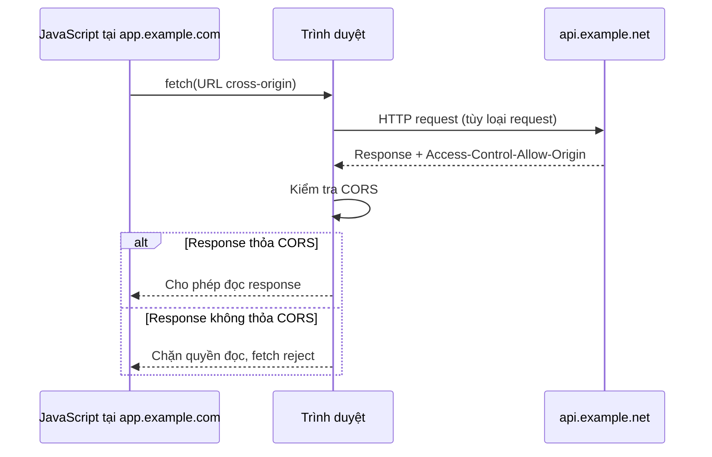

# Wildcard origin trong CORS: phạm vi, giới hạn và cách dùng an toàn

## 1. Wildcard origin giải quyết bài toán gì?

Một ứng dụng web tại `https://app.example.com` có thể cần đọc dữ liệu từ API ở origin khác, ví dụ `https://api.example.net`. Theo Same-Origin Policy (SOP), JavaScript không mặc nhiên được đọc response cross-origin. **Cross-Origin Resource Sharing (CORS)** cho phép máy chủ khai báo origin nào được trình duyệt cấp quyền đọc response.

Với tài nguyên công khai, máy chủ có thể trả:

```http
Access-Control-Allow-Origin: *
```

Dấu `*` được gọi là **wildcard origin**: mọi origin đều có thể đọc response bằng cơ chế CORS trong điều kiện request không sử dụng chế độ credentials. Đây là lựa chọn phù hợp cho dữ liệu thực sự công khai, chẳng hạn ảnh, font, metadata hoặc API chỉ đọc không gắn với phiên đăng nhập.

Nhưng wildcard có giới hạn quan trọng: nếu JavaScript thực hiện request với **credentials mode `include`**, browser sẽ từ chối response có `Access-Control-Allow-Origin: *`. Máy chủ phải trả một origin cụ thể được cho phép và khai báo `Access-Control-Allow-Credentials: true`. Không thể ghép wildcard với credentialed CORS để vừa mở cho mọi origin vừa cho phép đọc dữ liệu phiên đăng nhập.

Trong module `SECURITY_APPLICATION_SECURITY_BROWSER_SECURITY`, chủ đề này kết nối trực tiếp SOP, CORS, cookie và các ranh giới tin cậy của ứng dụng web. Mục tiêu không chỉ là làm cho lỗi CORS biến mất, mà là chọn đúng chính sách theo mức độ công khai của dữ liệu và kiểm chứng hành vi thực tế của browser.

### Kết quả học tập

Sau bài này, người học có thể:

1. Giải thích chính xác ý nghĩa của `Access-Control-Allow-Origin: *`.
2. Phân biệt request không credentials với credentialed CORS request, kể cả khi cookie thực tế không được gửi.
3. Nhận diện giới hạn của wildcard ở `Access-Control-Allow-Methods`, `Access-Control-Allow-Headers` và `Access-Control-Expose-Headers`.
4. Thiết kế allowlist origin cụ thể cho API cần cookie hoặc dữ liệu người dùng.
5. Xử lý preflight, cache và `Vary: Origin` đúng cách.
6. Chứng minh CORS không thay thế xác thực, phân quyền hoặc CSRF protection.

## 2. CORS hoạt động ở đâu trong luồng request?

Khi trang A gọi API B, browser kiểm tra chính sách CORS để quyết định JavaScript của A có được đọc response từ B hay không. Server B là nơi gửi các response headers thể hiện quyền cho phép.



Điểm cần phân biệt:

- **Request có được gửi không?** Phụ thuộc loại request, preflight, CSP, mixed content, chính sách browser và các điều kiện khác.
- **JavaScript có đọc được response không?** Phụ thuộc CORS response headers và chế độ credentials.
- **Server có thực hiện hành động không?** Phụ thuộc xử lý request, xác thực, phân quyền, CSRF và logic nghiệp vụ phía server.

CORS chủ yếu điều khiển **quyền đọc response của JavaScript trong browser**. Nó không phải tường lửa chặn mọi HTTP request và không phải cơ chế xác thực API.

## 3. Wildcard `Access-Control-Allow-Origin: *` có nghĩa gì?

Với request CORS không dùng credentials, server có thể trả:

```http
HTTP/1.1 200 OK
Content-Type: application/json
Access-Control-Allow-Origin: *

{"status":"ok","catalogVersion":"2026.11"}
```

JavaScript từ nhiều origin khác nhau có thể đọc response này nếu các điều kiện CORS khác được đáp ứng. Server không cần biết trước danh sách website tiêu thụ dữ liệu.

### 3.1. Ví dụ phía client

```js
const response = await fetch("https://api.example.net/public/catalog");

if (!response.ok) {
  throw new Error("Không tải được catalog");
}

const catalog = await response.json();
console.log(catalog);
```

Mặc định, Fetch dùng credentials mode `same-origin`. Với request cross-origin như ví dụ trên, cookie, HTTP authentication và các credentials liên quan không được gửi theo chế độ mặc định đó. Nếu API trả `Access-Control-Allow-Origin: *`, browser có thể cho JavaScript đọc response.

### 3.2. Wildcard không phải danh sách mọi subdomain

Giá trị hợp lệ của `Access-Control-Allow-Origin` về cơ bản là:

- `*`: wildcard cho request không credentials.
- Một serialized origin cụ thể, ví dụ `https://app.example.com`.
- `null`: giá trị đặc biệt biểu diễn opaque origin trong một số ngữ cảnh; cần cân nhắc rủi ro, không dùng như wildcard.

Các dạng sau **không phải wildcard pattern được CORS hỗ trợ**:

```http
Access-Control-Allow-Origin: https://*.example.com
Access-Control-Allow-Origin: https://app.example.com, https://admin.example.com
```

Không được liệt kê nhiều origin trong cùng một giá trị header. Nếu cần hỗ trợ nhiều frontend, server phải kiểm tra `Origin` của request với allowlist và trả về **một origin cụ thể** đã được chấp nhận.

### 3.3. Khi nào wildcard là lựa chọn phù hợp?

Wildcard có thể phù hợp khi:

- Dữ liệu công khai, không phụ thuộc danh tính người dùng.
- Response không cần được đọc trong một request có credentials mode `include`.
- API không tiết lộ dữ liệu riêng tư theo cookie hoặc HTTP authentication.
- Mọi hành động ghi dữ liệu vẫn được bảo vệ độc lập ở server.

Ví dụ phù hợp thường là catalog công khai, dữ liệu tham chiếu, file font hoặc asset dùng chung. “Có thể đọc công khai” phải là quyết định sản phẩm và bảo mật rõ ràng, không phải cách sửa nhanh lỗi CORS.

## 4. Vì sao wildcard không dùng được với credentials?

### 4.1. Credentials gồm những gì?

Trong ngữ cảnh Fetch/CORS, credentials có thể gồm:

- Cookie phù hợp với URL và ngữ cảnh request.
- HTTP authentication entries.
- TLS client certificates theo cơ chế browser.

Fetch có ba chế độ credentials:

| Giá trị | Hành vi khái quát |
| --- | --- |
| `omit` | Không gửi credentials và không sử dụng credentials trong response |
| `same-origin` | Chỉ dùng credentials với request same-origin; đây là mặc định của Fetch |
| `include` | Cho phép dùng credentials cả trong request cross-origin, tùy các chính sách cookie và browser |

Ví dụ yêu cầu gửi cookie cross-origin:

```js
const response = await fetch("https://api.example.net/me", {
  credentials: "include"
});
```

Nếu API trả:

```http
Access-Control-Allow-Origin: *
Access-Control-Allow-Credentials: true
```

browser sẽ **không cho JavaScript đọc response** vì request có credentials mode `include` nhưng `Access-Control-Allow-Origin` là wildcard. `Access-Control-Allow-Credentials: true` không làm wildcard trở nên hợp lệ.

### 4.2. Lỗi vẫn xảy ra dù cookie thực tế không được gửi

Một chi tiết dễ nhầm: quyết định CORS dựa trên **credentials mode của request**, không chỉ dựa trên việc browser cuối cùng có đính kèm một cookie hay không.

Ví dụ, client gọi `fetch(..., { credentials: "include" })`, nhưng cookie bị loại do `SameSite`, `Secure`, phạm vi domain/path hoặc third-party cookie policy. Request vẫn dùng credentials mode `include`; response wildcard vẫn không đáp ứng quy tắc credentialed CORS.

Vì vậy, không nên suy luận “Network không có Cookie thì wildcard sẽ hợp lệ”. Hãy kiểm tra cả cấu hình Fetch/XHR lẫn response headers.

### 4.3. Cấu hình đúng cho credentialed CORS

Nếu chỉ frontend tin cậy được phép đọc dữ liệu người dùng, API trả origin cụ thể:

```http
Access-Control-Allow-Origin: https://app.example.com
Access-Control-Allow-Credentials: true
Vary: Origin
```

Phía client:

```js
const response = await fetch("https://api.example.net/me", {
  credentials: "include"
});
```

Ba điều kiện cần nhớ:

1. `Access-Control-Allow-Origin` phải khớp origin cụ thể được cho phép, không phải `*`.
2. `Access-Control-Allow-Credentials` phải có giá trị chính xác là `true` khi cần đọc credentialed response.
3. Cookie vẫn phải vượt qua `SameSite`, `Secure`, domain/path, thời hạn và chính sách quyền riêng tư của browser.

Header `Access-Control-Allow-Credentials: true` không có nghĩa browser tự động gửi cookie; nó chỉ cho phép browser chấp nhận response CORS trong trường hợp request dùng credentials và các điều kiện còn lại hợp lệ.

### 4.4. XMLHttpRequest cũng có quy tắc tương tự

```js
const xhr = new XMLHttpRequest();
xhr.open("GET", "https://api.example.net/me");
xhr.withCredentials = true;
xhr.onload = () => console.log(xhr.responseText);
xhr.onerror = () => console.error("CORS hoặc lỗi mạng");
xhr.send();
```

Khi `withCredentials = true` cho request cross-origin, server cần trả origin cụ thể cùng `Access-Control-Allow-Credentials: true`. Không dùng wildcard để cấp quyền đọc response có credentials.

## 5. Wildcard ở các CORS headers khác

Ngoài `Access-Control-Allow-Origin`, CORS còn có các response headers cho method, request headers và response headers được phép expose. Dấu `*` ở các header này có quy tắc riêng; không nên áp dụng suy luận của ACAO một cách máy móc.

### 5.1. Access-Control-Allow-Methods

`Access-Control-Allow-Methods` cho biết các HTTP method được phép trong preflight response:

```http
Access-Control-Allow-Methods: GET, POST, PATCH
```

Trong request không credentials, wildcard `*` có thể đại diện cho các method theo quy tắc CORS. Với request credentials mode `include`, wildcard không còn mang ý nghĩa “mọi method”; phải khai báo các method cụ thể:

```http
Access-Control-Allow-Methods: GET, POST, PATCH
```

Hãy khai báo đúng method mà API thực sự hỗ trợ. CORS cho phép browser gửi request theo chính sách, nhưng server vẫn phải từ chối method hoặc hành động không hợp lệ.

### 5.2. Access-Control-Allow-Headers

`Access-Control-Allow-Headers` cho biết request headers nào được chấp nhận sau preflight:

```http
Access-Control-Allow-Headers: Content-Type, X-CSRF-Token
```

Wildcard `*` có thể đại diện cho các request headers trong request không credentials, nhưng có ngoại lệ đáng chú ý: **`Authorization` là CORS non-wildcard request-header name** và phải được liệt kê rõ ràng. Với request credentials mode `include`, hãy liệt kê cụ thể tất cả header cần thiết.

```http
Access-Control-Allow-Headers: Content-Type, Authorization, X-CSRF-Token
```

Không mở mọi custom header chỉ để tránh cấu hình. Header được phép có thể làm tăng khả năng một frontend gửi các request nhạy cảm; server phải xác minh dữ liệu và quyền thực hiện.

### 5.3. Access-Control-Expose-Headers

Browser chỉ cho JavaScript đọc một tập response headers CORS-safelisted mặc định. Nếu cần đọc header tùy chỉnh, server khai báo:

```http
Access-Control-Expose-Headers: X-Request-Id, Content-Disposition
```

Trong request không credentials, `*` có thể đại diện cho các response headers theo quy tắc CORS. Trong credentialed response, `*` được xem như tên header có nghĩa đen, không phải wildcard; hãy liệt kê rõ:

```http
Access-Control-Expose-Headers: X-Request-Id, Content-Disposition
```

### 5.4. Bảng tổng hợp ý nghĩa wildcard

| Header | Request không dùng credentials | Credentials mode `include` |
| --- | --- | --- |
| `Access-Control-Allow-Origin: *` | Cho phép mọi origin đọc response nếu các điều kiện CORS khác đạt | **Không hợp lệ**; phải trả origin cụ thể |
| `Access-Control-Allow-Methods: *` | Wildcard method theo quy tắc CORS | Được hiểu như giá trị method có nghĩa đen; liệt kê method cụ thể |
| `Access-Control-Allow-Headers: *` | Wildcard header theo quy tắc CORS, trừ `Authorization` cần khai báo rõ | Được hiểu như tên header có nghĩa đen; liệt kê header cụ thể |
| `Access-Control-Expose-Headers: *` | Wildcard response headers theo quy tắc CORS | Được hiểu như tên header có nghĩa đen; liệt kê header cụ thể |

Khi triển khai API có credentials, lựa chọn ít gây nhầm lẫn nhất là **không dùng wildcard cho các danh sách method/header/expose** mà khai báo rõ những giá trị cần thiết.

## 6. Wildcard origin không hỗ trợ mẫu subdomain

Nhiều đội phát triển muốn cho phép mọi subdomain:

```text
https://app.example.com
https://admin.example.com
https://preview.example.com
```

Một cấu hình như sau không có nghĩa wildcard subdomain:

```http
Access-Control-Allow-Origin: https://*.example.com
```

Browser không diễn giải dấu `*` bên trong origin như một pattern. Nếu cần cho phép một tập origin, server phải kiểm tra origin gửi đến theo allowlist và phản hồi bằng **một origin chính xác**.

### 6.1. Allowlist origin tĩnh

```js
const allowedOrigins = new Set([
  "https://app.example.com",
  "https://admin.example.com"
]);

function getAllowedOrigin(requestOrigin) {
  if (!requestOrigin) return null;
  if (!allowedOrigins.has(requestOrigin)) return null;
  return requestOrigin;
}
```

So sánh chính xác chuỗi origin đã serialize. Không dùng:

```js
// Sai: attacker.example.com có thể chứa chuỗi example.com.
if (requestOrigin.includes("example.com")) {
  allow();
}

// Cũng nguy hiểm nếu cho mọi subdomain dù không cùng mức tin cậy.
if (requestOrigin.endsWith(".example.com")) {
  allow();
}
```

Nếu thật sự cần cho phép subdomain động, phải xác định rõ ranh giới DNS, giao thức, port và quyền quản lý subdomain; tránh cho phép subdomain preview, user-generated hoặc bên thứ ba chưa được tin cậy. Cùng site không đồng nghĩa cùng mức tin cậy.

### 6.2. Không phản chiếu Origin một cách mù quáng

Một lỗi phổ biến là lấy header `Origin` của request rồi phản hồi lại nguyên văn:

```js
// KHÔNG AN TOÀN: mọi origin đều được phản chiếu.
res.setHeader("Access-Control-Allow-Origin", req.headers.origin);
res.setHeader("Access-Control-Allow-Credentials", "true");
```

Nếu browser gửi request có credentials từ website của kẻ tấn công, phản hồi trên có thể cấp cho website đó quyền đọc dữ liệu cá nhân. Kẻ tấn công không cần đoán trước origin của nạn nhân; server đã tự cho phép origin gửi request.

Cách đúng là **kiểm tra allowlist trước khi phản chiếu**:

```js
const allowedOrigins = new Set([
  "https://app.example.com",
  "https://admin.example.com"
]);

function applyCors(req, res) {
  const origin = req.headers.origin;
  if (!origin || !allowedOrigins.has(origin)) return false;

  res.setHeader("Access-Control-Allow-Origin", origin);
  res.setHeader("Access-Control-Allow-Credentials", "true");
  res.setHeader("Vary", "Origin");
  return true;
}
```

Đoạn code là minh họa cho logic allowlist. Trong ứng dụng thật, cần đảm bảo `Vary` được **nối thêm** vào giá trị hiện có thay vì ghi đè các giá trị `Vary` khác; đồng thời áp dụng header cho response thành công và response lỗi cần frontend đọc được.

## 7. Origin `null`: không phải cách mở quyền an toàn

Một số ngữ cảnh browser có thể gửi:

```http
Origin: null
```

Ví dụ có thể liên quan đến opaque origin như tài liệu sandbox thiếu `allow-same-origin`, tài liệu `data:` hoặc một số ngữ cảnh file. Nếu server trả:

```http
Access-Control-Allow-Origin: null
Access-Control-Allow-Credentials: true
```

thì một số tài liệu opaque origin có thể được cấp quyền đọc credentialed response nếu các điều kiện khác thỏa. Không nên cho phép `null` chỉ vì thấy lỗi CORS trong iframe hoặc môi trường local.

**Nguyên tắc:** từ chối `Origin: null` trừ khi có một yêu cầu nghiệp vụ cụ thể, threat model rõ và cơ chế kiểm soát bổ sung. Với dữ liệu người dùng hoặc API phiên đăng nhập, không đưa `null` vào allowlist theo mặc định.

## 8. Preflight và wildcard

### 8.1. Khi nào browser gửi preflight?

Một số request cross-origin được gửi trực tiếp mà không cần preflight nếu đáp ứng điều kiện CORS-safelisted. Ví dụ một số request `GET`, `HEAD`, `POST` với tập header và content type giới hạn.

Request thường cần preflight khi sử dụng:

- Method không thuộc nhóm safelisted, ví dụ `PATCH`, `PUT`, `DELETE`.
- Header tùy chỉnh như `X-CSRF-Token`.
- `Content-Type: application/json` (không phải safelisted content type).
- Các điều kiện request khác khiến nó không còn là CORS-safelisted request.

Ví dụ:

```js
fetch("https://api.example.net/profile", {
  method: "PATCH",
  headers: {
    "Content-Type": "application/json",
    "X-CSRF-Token": token
  },
  credentials: "include",
  body: JSON.stringify({ displayName: "An" })
});
```

Browser sẽ gửi preflight `OPTIONS` trước request chính nếu cần.

### 8.2. Ví dụ preflight với credentials

Request preflight thường có dạng:

```http
OPTIONS /profile HTTP/1.1
Host: api.example.net
Origin: https://app.example.com
Access-Control-Request-Method: PATCH
Access-Control-Request-Headers: content-type, x-csrf-token
```

Preflight không mang credentials của request chính. Server có thể trả:

```http
HTTP/1.1 204 No Content
Access-Control-Allow-Origin: https://app.example.com
Access-Control-Allow-Credentials: true
Access-Control-Allow-Methods: PATCH
Access-Control-Allow-Headers: Content-Type, X-CSRF-Token
Access-Control-Max-Age: 600
Vary: Origin
```

Browser chỉ tiếp tục gửi request chính nếu preflight đáp ứng chính sách. Khi request chính dùng credentials, response chính cũng phải trả origin cụ thể và `Access-Control-Allow-Credentials: true` để JavaScript đọc được response.

Máy chủ thường cần xử lý OPTIONS preflight **trước middleware yêu cầu session đăng nhập**, vì preflight không mang cookie phiên của request chính. Điều này không có nghĩa endpoint dữ liệu được mở công khai: request chính vẫn phải xác thực, phân quyền và kiểm tra CSRF như bình thường.

### 8.3. Wildcard trong preflight

Với request không credentials, browser có thể áp dụng wildcard cho các trường phù hợp:

```http
Access-Control-Allow-Origin: *
Access-Control-Allow-Methods: *
Access-Control-Allow-Headers: *
```

Nhưng `Authorization` vẫn cần khai báo cụ thể trong `Access-Control-Allow-Headers`. Khi request dùng credentials mode `include`, không dựa vào wildcard cho origin, method hoặc headers; trả origin và các giá trị cụ thể.

## 9. Cache, Vary và nguy cơ rò response giữa các origin

Nếu server luôn trả cùng một header:

```http
Access-Control-Allow-Origin: https://app.example.com
```

thì response không thay đổi theo header `Origin`, thường không cần `Vary: Origin` chỉ vì CORS.

Ngược lại, nếu server chọn origin được phép từ allowlist và phản hồi lại origin đó, response **thay đổi theo request header `Origin`**. Khi có cache trung gian, cần:

```http
Access-Control-Allow-Origin: https://app.example.com
Vary: Origin
```

Nếu thiếu `Vary: Origin`, cache/CDN có thể lưu response đã được gắn ACAO cho một origin rồi phục vụ response đó cho request từ origin khác. Hành vi cache không nhất thiết làm browser chấp nhận một origin trái phép, nhưng có thể tạo lỗi quyền đọc, rò rỉ response hoặc phá vỡ giả định phân tách cache tùy thiết kế.

Khi response preflight được cache ở tầng HTTP, nếu các header trả lời thay đổi theo `Origin`, `Access-Control-Request-Method` hoặc `Access-Control-Request-Headers`, cần cấu hình cache key/`Vary` tương ứng. `Access-Control-Max-Age` điều khiển thời gian browser giữ kết quả preflight trong CORS-preflight cache; browser có thể áp giới hạn riêng.

**Không nhầm hai loại cache:**

- `Access-Control-Max-Age`: cache quyết định preflight trong browser.
- HTTP cache/CDN: cache response theo cache key và các header `Vary`.

### 9.1. Ví dụ middleware dynamic allowlist và preflight

```js
const allowedOrigins = new Set([
  "https://app.example.com",
  "https://admin.example.com"
]);

const allowedMethods = new Set(["GET", "POST", "PATCH"]);
const allowedHeaders = new Set([
  "content-type",
  "authorization",
  "x-csrf-token"
]);

function appendVary(res, value) {
  const current = res.getHeader("Vary");
  const values = new Set(
    String(current || "")
      .split(",")
      .map(item => item.trim())
      .filter(Boolean)
  );
  values.add(value);
  res.setHeader("Vary", [...values].join(", "));
}

function corsMiddleware(req, res, next) {
  const origin = req.headers.origin;
  const allowed = typeof origin === "string" &&
    allowedOrigins.has(origin);

  // Chỉ thêm CORS headers cho origin được duyệt.
  if (allowed) {
    res.setHeader("Access-Control-Allow-Origin", origin);
    res.setHeader("Access-Control-Allow-Credentials", "true");
    appendVary(res, "Origin");
  }

  if (req.method === "OPTIONS" &&
      req.headers["access-control-request-method"]) {
    if (!allowed) {
      res.writeHead(403);
      res.end();
      return;
    }

    const requestedMethod =
      req.headers["access-control-request-method"].toUpperCase();
    const requestedHeaders = String(
      req.headers["access-control-request-headers"] || ""
    )
      .split(",")
      .map(header => header.trim().toLowerCase())
      .filter(Boolean);

    if (!allowedMethods.has(requestedMethod) ||
        requestedHeaders.some(header => !allowedHeaders.has(header))) {
      res.writeHead(403);
      res.end();
      return;
    }

    res.setHeader(
      "Access-Control-Allow-Methods",
      [...allowedMethods].join(", ")
    );
    res.setHeader(
      "Access-Control-Allow-Headers",
      [...allowedHeaders].join(", ")
    );
    res.setHeader("Access-Control-Max-Age", "600");
    appendVary(res, "Access-Control-Request-Method");
    appendVary(res, "Access-Control-Request-Headers");
    res.writeHead(204);
    res.end();
    return;
  }

  next();
}
```

Đây là ví dụ minh họa logic, không phải middleware hoàn chỉnh dùng trực tiếp cho mọi framework. Trong ứng dụng thật:

- Gắn middleware trước route để response lỗi 401/403/404 cũng có CORS headers khi origin hợp lệ và frontend cần đọc lỗi.
- Không bỏ qua xác thực, phân quyền hoặc CSRF ở route thực hiện hành động.
- Nếu header `Vary` đã có nhiều giá trị, phải giữ nguyên các giá trị đó khi bổ sung `Origin`.
- Xác minh method/header được yêu cầu; không phản hồi allowlist quá rộng chỉ vì preflight đến.
- Kiểm tra cách framework xử lý OPTIONS, header lặp và cache.

## 10. CORS không phải authentication, authorization hay CSRF protection

Đây là ranh giới quan trọng nhất của bài.

### 10.1. CORS chỉ có ý nghĩa trong browser

Một chương trình ngoài browser có thể gửi request HTTP và tự đọc response:

```bash
curl -i https://api.example.net/private/profile \
  -H "Origin: https://attacker.test"
```

`curl` không thực thi SOP/CORS như browser. Server vẫn nhận request và trả response cho client. Header `Origin` do HTTP client gửi không phải chứng minh danh tính; client không phải browser có thể giả mạo header này.

Vì vậy, **CORS không bảo vệ API khỏi curl, script server-side, ứng dụng di động hoặc HTTP client khác**. API phải có xác thực và phân quyền độc lập.

### 10.2. CORS không ngăn request đơn giản được gửi

Một form trên website khác có thể gửi request cross-origin theo các dạng được browser cho phép mà không cần đọc response. Nếu endpoint dùng cookie phiên và thực hiện thay đổi trạng thái, request vẫn có thể tác động đến tài khoản người dùng nếu server thiếu CSRF protection.

Ví dụ nguy cơ:

1. Người dùng đăng nhập vào `https://bank.example`.
2. Người dùng mở `https://attacker.test`.
3. Trang lạ gửi form POST tới endpoint ngân hàng.
4. Browser quyết định cookie có được gửi theo SameSite và các chính sách khác.
5. Nếu server chỉ dựa vào cookie mà không xác minh CSRF token/nguồn request, hành động có thể được thực hiện.

Việc JavaScript của trang lạ không đọc được response ngân hàng **không hoàn tác hành động đã xảy ra**.

### 10.3. Những lớp bảo vệ cần phối hợp

| Cơ chế | Trách nhiệm |
| --- | --- |
| CORS allowlist | Giới hạn origin nào được browser cho phép đọc response |
| Authentication | Xác định người dùng hoặc client là ai |
| Authorization | Kiểm tra chủ thể có quyền thực hiện hành động trên tài nguyên |
| CSRF token | Xác minh ý định hợp lệ đối với thao tác dựa trên credentials tự động gửi |
| `SameSite` cookie | Hạn chế cookie trong một số ngữ cảnh cross-site |
| Origin / Fetch Metadata validation | Hỗ trợ server nhận diện ngữ cảnh request browser |
| Input validation | Kiểm tra dữ liệu đầu vào theo quy tắc nghiệp vụ |

Đặc biệt, không dùng CORS thay cho CSRF token chỉ vì API chỉ cho phép frontend chính thức đọc response. Cũng không xem `Origin` allowlist là xác thực cho các request không phải browser.

## 11. Các lỗi cấu hình wildcard thường gặp

| Cấu hình/lỗi | Hậu quả | Cách sửa |
| --- | --- | --- |
| `ACAO: *` cùng request credentials mode `include` | Browser chặn quyền đọc response | Trả origin cụ thể và `ACAC: true` |
| Phản chiếu mọi giá trị `Origin` | Website bất kỳ có thể được cấp quyền đọc dữ liệu phiên nếu các điều kiện khác thỏa | Kiểm tra allowlist chính xác trước khi phản chiếu |
| `ACAO: https://*.example.com` | Browser không hiểu wildcard subdomain pattern | Dynamic allowlist và phản hồi một origin cụ thể |
| Trả nhiều origin trong một ACAO | Response CORS không hợp lệ | Chỉ trả một origin hoặc `*` khi phù hợp |
| Cho phép `Origin: null` tùy tiện | Opaque-origin document có thể được cấp quyền đọc response | Từ chối mặc định; chỉ mở khi có threat model rõ |
| Dùng `Access-Control-Allow-Headers: *` nhưng cần `Authorization` | Preflight có thể thất bại | Liệt kê `Authorization` rõ ràng |
| Dùng wildcard methods/headers/expose trong credentialed request | Wildcard không có ý nghĩa wildcard ở các header đó | Khai báo giá trị cụ thể |
| Dynamic ACAO nhưng thiếu `Vary: Origin` | Cache có thể phục vụ response sai biến thể | Bổ sung `Vary: Origin` và cấu hình cache key |
| Chỉ thêm CORS headers cho response 200 | Frontend không đọc được lỗi 401/403/500 | Áp dụng chính sách nhất quán cho response phù hợp |
| Bỏ auth middleware cho mọi OPTIONS và nghĩ API đã an toàn | Request chính vẫn có thể tới route nhạy cảm | Chỉ xử lý preflight riêng; xác thực request thực |
| Cho rằng CORS ngăn CSRF | Form/simple request vẫn có thể gửi | Token CSRF và kiểm tra server-side |

## 12. Thực hành: so sánh wildcard và credentialed CORS

Tạo hai origin local bằng Node.js: frontend ở `http://localhost:3000`, API ở `http://localhost:4000`. Dùng dữ liệu giả, không dùng tài khoản hoặc cookie thật.

### 12.1. API với hai endpoint

Tạo file `cors-wildcard-lab.js` trong thư mục thử nghiệm:

```js
const http = require("node:http");

const frontendOrigin = "http://localhost:3000";

http.createServer((req, res) => {
  if (req.url === "/public") {
    res.writeHead(200, {
      "Content-Type": "application/json",
      "Access-Control-Allow-Origin": "*"
    });
    res.end(JSON.stringify({ kind: "public", value: 42 }));
    return;
  }

  if (req.url === "/private") {
    res.writeHead(200, {
      "Content-Type": "application/json",
      "Access-Control-Allow-Origin": frontendOrigin,
      "Access-Control-Allow-Credentials": "true",
      "Vary": "Origin"
    });
    res.end(JSON.stringify({
      kind: "credentialed",
      cookieSeen: Boolean(req.headers.cookie)
    }));
    return;
  }

  if (req.method === "OPTIONS" && req.url === "/update") {
    res.writeHead(204, {
      "Access-Control-Allow-Origin": frontendOrigin,
      "Access-Control-Allow-Credentials": "true",
      "Access-Control-Allow-Methods": "PATCH",
      "Access-Control-Allow-Headers": "Content-Type, X-CSRF-Token",
      "Access-Control-Max-Age": "300",
      "Vary": "Origin"
    });
    res.end();
    return;
  }

  if (req.url === "/update" && req.method === "PATCH") {
    res.writeHead(200, {
      "Content-Type": "application/json",
      "Access-Control-Allow-Origin": frontendOrigin,
      "Access-Control-Allow-Credentials": "true",
      "Vary": "Origin"
    });
    res.end(JSON.stringify({ updated: true }));
    return;
  }

  res.writeHead(404);
  res.end();
}).listen(4000, "localhost", () => {
  console.log("API lab: http://localhost:4000");
});

http.createServer((_req, res) => {
  res.writeHead(200, { "Content-Type": "text/html; charset=utf-8" });
  res.end(`<!doctype html>
<meta charset="utf-8">
<title>CORS wildcard lab</title>
<h1>CORS wildcard lab</h1>
<button id="public">Đọc public wildcard</button>
<button id="private">Đọc private exact origin</button>
<button id="bad">Thử private với wildcard</button>
<button id="patch">Thử preflight PATCH</button>
<pre id="result"></pre>
<script>
const result = document.querySelector("#result");
async function run(label, url, options = {}) {
  try {
    const response = await fetch(url, options);
    result.textContent += label + ": " +
      JSON.stringify(await response.json()) + "\\n";
  } catch (error) {
    result.textContent += label + ": " + error.name + "\\n";
  }
}

document.querySelector("#public").onclick = () =>
  run("public", "http://localhost:4000/public");

document.querySelector("#private").onclick = () =>
  run("private", "http://localhost:4000/private", {
    credentials: "include"
  });

document.querySelector("#bad").onclick = () =>
  run("wildcard + include", "http://localhost:4000/private", {
    credentials: "include"
  });

document.querySelector("#patch").onclick = () =>
  run("PATCH", "http://localhost:4000/update", {
    method: "PATCH",
    credentials: "include",
    headers: {
      "Content-Type": "application/json",
      "X-CSRF-Token": "demo-token"
    },
    body: JSON.stringify({ value: 1 })
  });
</script>`);
}).listen(3000, "localhost", () => {
  console.log("Frontend lab: http://localhost:3000");
});
```

Chạy:

```bash
node cors-wildcard-lab.js
```

Mở `http://localhost:3000`, bật DevTools → Network và Console. Endpoint `/public` dùng wildcard và không yêu cầu credentials; endpoint `/private` trả origin cụ thể cùng `Access-Control-Allow-Credentials: true`; endpoint `/update` minh họa preflight.

**Lưu ý về nút “wildcard + include”:** để thấy lỗi chính xác, hãy đổi tạm response `/private` thành `Access-Control-Allow-Origin: *` trong server, giữ client `credentials: "include"`, rồi tải lại trang. Browser sẽ chặn response. Sau phép thử, khôi phục origin cụ thể. Không cần có cookie thực tế trong request để quy tắc credential mode được áp dụng.

### 12.2. Ma trận kết quả kỳ vọng

| Phép thử | Request/response | Kết quả JavaScript |
| --- | --- | --- |
| `GET /public`, mặc định | ACAO `*`, không credentials | Đọc JSON thành công |
| `GET /private`, `credentials: include`, ACAO cụ thể + ACAC true | CORS credentialed hợp lệ | Đọc JSON thành công |
| `GET /private`, `credentials: include`, ACAO `*` | Sai quy tắc credentialed CORS | `fetch` reject, response không đọc được |
| `PATCH /update` với JSON và custom header | OPTIONS preflight trước, sau đó PATCH nếu preflight hợp lệ | Đọc JSON nếu response chính cũng có CORS headers phù hợp |
| `PATCH /update` khi bỏ header cho phép `X-CSRF-Token` khỏi preflight response | Preflight không đạt | Browser không gửi request PATCH chính |

Đừng chỉ nhìn status 200 trong Network. Hãy xác định request nào đã được gửi, response nào browser nhận, và JavaScript có được phép đọc response hay không.

## 13. Checklist thiết kế CORS với wildcard

Trước khi bật wildcard:

- [ ] Dữ liệu có thực sự công khai cho mọi website không?
- [ ] API có phụ thuộc cookie, HTTP authentication hoặc TLS client certificate không?
- [ ] Client có dùng `credentials: "include"` hoặc `withCredentials = true` không?
- [ ] Endpoint có thực hiện thay đổi trạng thái không?
- [ ] API có xác thực và phân quyền độc lập không?
- [ ] Có request custom method/header cần preflight không?
- [ ] Có cần expose response headers tùy chỉnh không?
- [ ] Có cache/CDN và response thay đổi theo `Origin` không?
- [ ] Có origin `null`, subdomain preview hoặc subdomain do bên thứ ba quản lý không?
- [ ] Response lỗi và redirect có được kiểm thử không?

Quy tắc lựa chọn:

| Nhu cầu | Cấu hình gợi ý |
| --- | --- |
| Dữ liệu công khai, không credentials | `Access-Control-Allow-Origin: *` |
| API dùng cookie phiên, chỉ frontend được duyệt | Origin cụ thể từ allowlist + `Access-Control-Allow-Credentials: true` |
| Nhiều frontend tin cậy | Allowlist chính xác; trả một origin tương ứng mỗi response; `Vary: Origin` |
| Tất cả subdomain | Không dùng pattern `https://*.example.com`; xác định danh sách/điều kiện tin cậy rõ ràng |
| Opaque origin / `Origin: null` | Từ chối mặc định trừ khi có nhu cầu đặc biệt được đánh giá |

### Ghi nhớ

**`Access-Control-Allow-Origin: *` chỉ phù hợp để cho mọi origin đọc response CORS không dùng credentials.** Khi request có credentials mode `include`, server phải trả một origin cụ thể được cho phép và `Access-Control-Allow-Credentials: true`. Wildcard ở method, request headers và exposed headers cũng có quy tắc riêng; với credentialed request nên khai báo rõ. Dynamic origin phải dựa trên allowlist và cache phải phản ánh `Origin` bằng `Vary` phù hợp. CORS vẫn chỉ là quyền đọc response trong browser: xác thực, phân quyền và CSRF luôn là trách nhiệm riêng của server.
