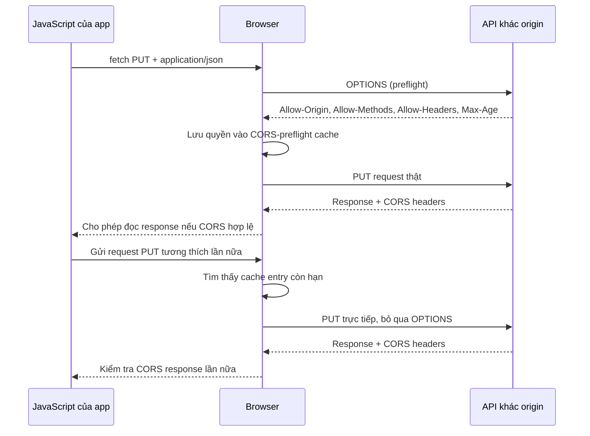

# Preflight cache trong CORS

> **Chương:** CORS nâng cao  
> **Chủ đề:** Preflight cache  
> **Module:** `SECURITY_APPLICATION_SECURITY_BROWSER_SECURITY` — phân tích ranh giới bảo mật giữa trình duyệt, origin, cookie và ứng dụng web để hiểu Same-Origin Policy, CORS và các cơ chế cách ly; thực hành phòng vệ XSS, CSRF, clickjacking bằng CSP, Trusted Types, security headers và kiểm chứng hành vi thực tế.

## Mục tiêu học tập

Sau bài học, bạn có thể:

1. Giải thích vì sao browser gửi CORS preflight và dữ liệu nào được gửi trong request `OPTIONS`.
2. Phân biệt **CORS-preflight cache** với HTTP cache và cache response nghiệp vụ.
3. Cấu hình `Access-Control-Max-Age`, hiểu thời hạn, giới hạn nội bộ của browser và các điều kiện cache khớp request.
4. Dự đoán khi nào browser có thể bỏ qua preflight, khi nào phải gửi lại và vì sao thay đổi CORS policy không phải lúc nào cũng có hiệu lực tức thì.
5. Phân tích tác động của cache đối với request có credentials, cấu hình CORS động và triển khai thay đổi chính sách.
6. Dùng DevTools và Node.js để quan sát lần đầu có `OPTIONS`, lần sau tái sử dụng preflight cache và hành vi khi cache hết hạn hoặc URL thay đổi.

## 1. Ôn lại CORS preflight

**CORS (Cross-Origin Resource Sharing)** cho phép server khai báo origin nào được JavaScript đọc response cross-origin. Với một số request, browser phải hỏi server trước bằng một request `OPTIONS` gọi là **preflight**.

Ví dụ, trang `http://localhost:3000` chạy:

```js
const response = await fetch('http://localhost:4000/items/42', {
  method: 'PUT',
  headers: {
    'Content-Type': 'application/json',
    'X-Lab-Tag': 'lesson',
  },
  body: JSON.stringify({ label: 'demo' }),
});
```

Request dùng phương thức `PUT`, không thuộc nhóm method CORS-safelisted; `Content-Type: application/json` và header tùy chỉnh `X-Lab-Tag` cũng khiến browser cần preflight. Trước khi gửi `PUT`, browser thường gửi:

```http
OPTIONS /items/42 HTTP/1.1
Host: localhost:4000
Origin: http://localhost:3000
Access-Control-Request-Method: PUT
Access-Control-Request-Headers: content-type,x-lab-tag
```

Server trả lời nếu chấp nhận:

```http
HTTP/1.1 204 No Content
Access-Control-Allow-Origin: http://localhost:3000
Access-Control-Allow-Methods: PUT
Access-Control-Allow-Headers: Content-Type, X-Lab-Tag
Access-Control-Max-Age: 60
Vary: Origin, Access-Control-Request-Method, Access-Control-Request-Headers
```

Nếu preflight thành công, browser mới gửi request `PUT` thật. Response của request thật cũng phải vượt qua kiểm tra CORS, ví dụ có `Access-Control-Allow-Origin` phù hợp. **Preflight thành công không tự động làm mọi response sau đó được phép đọc.**

### 1.1. Request nào cần preflight?

Một request thường không cần preflight nếu method, các request header và giá trị header thỏa điều kiện CORS-safelisted. Các trường hợp thường làm phát sinh preflight:

- Method khác `GET`, `HEAD` hoặc `POST`, ví dụ `PUT`, `PATCH`, `DELETE`.
- Header do ứng dụng tự thêm như `X-Api-Key` hoặc `X-Requested-With`.
- `Content-Type` có giá trị không thuộc nhóm safelisted; ví dụ `application/json`.
- Một số giá trị header vượt giới hạn hoặc không thỏa điều kiện safelist.

Request đơn giản có thể được gửi thẳng mà không có `OPTIONS`. Điều đó không có nghĩa response chắc chắn đọc được: browser vẫn kiểm tra CORS trên response thật.

> **Điểm bảo mật:** CORS preflight là bước browser hỏi quyền gửi một loại request cross-origin. Nó không phải authentication, authorization hoặc CSRF token. Request không cần preflight vẫn có thể được gửi tới server dù JavaScript không được phép đọc response.

## 2. Preflight cache là gì?

Nếu mỗi lần ứng dụng gọi `PUT` đều phải gửi một `OPTIONS` giống nhau, sẽ phát sinh thêm một lượt mạng. **CORS-preflight cache** cho phép browser ghi nhớ những quyền preflight đã được server chấp thuận trong một khoảng thời gian, để request tiếp theo phù hợp có thể bỏ qua `OPTIONS`.



Cache này lưu **kết quả cho phép preflight**, không lưu nội dung response của endpoint. Nó cũng không lưu dữ liệu nghiệp vụ, JSON của request hoặc kết quả thao tác `PUT`.

Ví dụ: nếu browser đã có quyền gửi `PUT` tới `/items/42` với các header `content-type` và `x-lab-tag`, request tương thích kế tiếp có thể gửi thẳng `PUT` khi quyền đó còn hạn.

## 3. Access-Control-Max-Age điều khiển thời hạn

Server khai báo thời gian tối đa browser có thể dùng kết quả preflight qua response header:

```http
Access-Control-Max-Age: 600
```

Giá trị được tính bằng **giây**. Trong ví dụ trên, server đề nghị browser lưu quyền preflight tối đa 600 giây (10 phút).

- Nếu không có `Access-Control-Max-Age`, thời gian mặc định theo chuẩn là **5 giây**.
- Nếu có header, browser có thể dùng giá trị đó nhưng vẫn áp dụng **giới hạn tối đa nội bộ**. Mức trần khác nhau theo user agent và phiên bản; không giả định mọi browser đều giữ cache đúng bằng số server gửi.
- Giá trị lớn giảm số lần `OPTIONS`, nhưng làm thay đổi CORS policy có thể mất thời gian mới phản ánh đầy đủ trên các browser đang giữ cache.
- Giá trị nhỏ giúp thay đổi policy có hiệu lực sớm hơn nhưng tăng số preflight và độ trễ.

| Cấu hình | Hành vi mong đợi | Đánh đổi |
|---|---|---|
| Không có header | Browser dùng thời hạn mặc định ngắn | Nhiều preflight hơn |
| `Access-Control-Max-Age: 0` | Không giữ quyền lâu hơn thời điểm hiện tại | Có thể phải preflight thường xuyên |
| `Access-Control-Max-Age: 60` | Đề nghị cache trong 60 giây | Cân bằng cho demo hoặc policy thay đổi tương đối thường |
| `Access-Control-Max-Age: 3600` | Đề nghị cache trong 1 giờ | Ít OPTIONS hơn, thay đổi policy có độ trễ lâu hơn |
| `Access-Control-Max-Age: 86400` | Đề nghị cache trong 24 giờ | Browser có thể áp trần thấp hơn; cần quy trình thay đổi policy phù hợp |

`Access-Control-Max-Age` là chỉ dẫn cho **CORS-preflight cache**. Nó không phải TTL cho JSON/HTML response và không thay thế `Cache-Control` của tài nguyên.

## 4. Browser cache điều gì và khi nào dùng lại?

Preflight cache không phải một cờ “origin này được tin cậy”. Browser ghi nhớ những quyền cụ thể đã được server cho phép. Theo mô hình Fetch, cache entry gắn với ngữ cảnh mạng và origin, URL đích, điều kiện credentials, cùng method hoặc tên header được cho phép. Một request sau chỉ có thể tận dụng entry khi các điều kiện tương ứng khớp và entry chưa hết hạn.

Các yếu tố quan trọng:

| Yếu tố | Ảnh hưởng |
|---|---|
| Origin khởi tạo | Quyền cấp cho `http://app.example.test` không tự động cấp cho `http://admin.example.test` |
| URL request | Quyền preflight cho endpoint này không nên được hiểu là quyền cho mọi endpoint khác |
| Method | Cache quyền `PUT` không có nghĩa đã cache quyền `DELETE` |
| Tên request header | Quyền dùng `X-Client-Id` không tự động cấp cho `X-Admin-Mode` |
| Credentials mode | Request dùng credentials phải thỏa điều kiện cache và CORS tương ứng |
| Thời hạn | Entry hết hạn thì browser cần preflight lại khi request vẫn thuộc loại cần preflight |
| Network partition/context | Browser hiện đại có thể phân vùng cache theo ngữ cảnh mạng; không giả định các profile hoặc mọi context dùng chung cache |

Một số chi tiết có thể khác theo triển khai browser, nhưng nguyên tắc an toàn là: **đừng giả định một lần preflight đã cấp quyền vĩnh viễn hoặc cho mọi request cùng host**.

### 4.1. Method và header được cache riêng

Giả sử server trả:

```http
Access-Control-Allow-Methods: PUT, PATCH
Access-Control-Allow-Headers: Content-Type, X-Client-Id
Access-Control-Max-Age: 300
```

Browser có thể ghi nhớ các method/header được cho phép trong phạm vi preflight cache. Một request `PUT` có header `Content-Type` có thể khớp entry; request `DELETE` hoặc thêm `X-Admin-Mode` cần quyền tương ứng khác và có thể phát sinh preflight mới.

Tên header được xét không phân biệt hoa thường theo quy tắc HTTP. Giá trị cụ thể của một custom header thường không phải nội dung mà `Access-Control-Request-Headers` liệt kê; preflight hỏi về **tên header**. Tuy vậy, giá trị vẫn phải tuân thủ các điều kiện CORS và validation nghiệp vụ khác.

### 4.2. Thay đổi body không nhất thiết làm cache miss

Nếu hai request có cùng origin, URL, method, credentials mode và tập header cần quyền, việc thay đổi JSON body thường không làm preflight cache miss. Preflight không xác nhận schema hay nội dung body. Server vẫn phải validate từng body và phân quyền theo từng thao tác.

Ví dụ, hai request `PUT` có body khác nhau nhưng cùng header `Content-Type` và `X-Lab-Tag` có thể dùng cùng quyền preflight. Cache không nói rằng dữ liệu của request thứ hai hợp lệ.

## 5. Preflight cache khác HTTP cache

Hai cơ chế có thể cùng liên quan đến HTTP nhưng có mục đích và cách điều khiển khác nhau:

| Tiêu chí | CORS-preflight cache | HTTP cache |
|---|---|---|
| Lưu gì? | Quyền preflight đã chấp thuận | Response HTTP có thể tái sử dụng |
| Dùng để làm gì? | Bỏ qua OPTIONS khi request phù hợp còn quyền | Tránh tải lại response hoặc giảm tải server |
| Header điều khiển chính | `Access-Control-Max-Age` | `Cache-Control`, `Expires`, `ETag`, `Last-Modified` |
| Phạm vi | Cơ chế riêng của user agent, có thể partition theo context | Browser cache và/hoặc intermediary cache như CDN, proxy |
| Có lưu JSON response của API không? | Không | Có thể, tùy cache policy |
| `Vary` có vai trò gì? | Không phải TTL của preflight cache | Chọn biến thể response trong HTTP cache |

**`Vary: Origin` không thay thế `Access-Control-Max-Age`.** Khi server phản hồi CORS dựa trên origin động, `Vary: Origin` giúp HTTP cache/proxy không trả response của origin A cho origin B. Với preflight response được cache qua một HTTP intermediary, các header request làm thay đổi response như `Origin`, `Access-Control-Request-Method` và `Access-Control-Request-Headers` cũng cần được cân nhắc trong `Vary`.

Ngược lại, `Cache-Control: no-store` điều khiển HTTP cache theo quy tắc HTTP; nó không phải chỉ thị chuẩn để xóa hoặc vô hiệu hóa CORS-preflight cache. Đừng dùng một trong hai cơ chế như thể chúng là cùng một cache.

## 6. Credentials và preflight cache

Khi fetch dùng:

```js
fetch('https://api.example.test/profile', {
  method: 'PUT',
  credentials: 'include',
  headers: { 'Content-Type': 'application/json' },
  body: JSON.stringify({ displayName: 'Lan' }),
});
```

Browser phải xét cả CORS lẫn điều kiện cookie. Một số điểm cần nhớ:

1. **Preflight request không mang credentials của người dùng** như cookie session. Nó là request `OPTIONS` do browser tạo để hỏi chính sách.
2. Nếu request thật dùng credentials, server cần trả `Access-Control-Allow-Credentials: true` và `Access-Control-Allow-Origin` phải là origin cụ thể được cho phép; `*` không hợp lệ cho response credentialed.
3. Response preflight cần cho phép origin, method và các header cần thiết; response thật cũng phải vượt qua kiểm tra CORS để JavaScript đọc được.
4. Cookie thực sự được gửi còn phụ thuộc `SameSite`, `Secure`, Domain/Path, chính sách third-party cookie và browser. `credentials: 'include'` không ép browser bỏ qua các giới hạn này.
5. Cache entry cho request có credentials phải thỏa điều kiện credentials tương ứng; không coi một quyền preflight không-credentials là quyền vô điều kiện cho mọi request.

Ví dụ response cho một API có credentials:

```http
Access-Control-Allow-Origin: https://app.example.test
Access-Control-Allow-Credentials: true
Access-Control-Allow-Methods: PUT
Access-Control-Allow-Headers: Content-Type
Access-Control-Max-Age: 120
Vary: Origin
```

Trong production, chỉ cho phép origin từ allowlist chính xác. Không phản chiếu bất kỳ `Origin` nào chỉ vì request đã gửi preflight thành công.

## 7. Cache không phải cơ chế thu hồi quyền hoặc bảo vệ API

Đây là phần quan trọng nhất khi vận hành CORS.

Giả sử lúc 10:00, API cho phép `PUT` từ `https://app.example.test` và gửi `Access-Control-Max-Age: 3600`. Browser lưu quyền preflight. Đến 10:05, đội vận hành gỡ `PUT` khỏi `Access-Control-Allow-Methods`.

Browser có thể **vẫn bỏ qua OPTIONS** trong thời gian entry cũ còn hạn và gửi request `PUT` thật. Tuy nhiên, browser vẫn kiểm tra CORS trên **response thật**. Nếu response không còn `Access-Control-Allow-Origin` hợp lệ, JavaScript không đọc được response. Dù vậy, request đã tới server và thao tác nghiệp vụ có thể đã xảy ra.

Vì thế:

- Không dùng preflight như firewall hoặc cổng authorization.
- Không dựa vào việc “browser sẽ hỏi OPTIONS trước” để bảo vệ thao tác thay đổi dữ liệu.
- Server phải xác thực session/token, kiểm tra authorization, CSRF và dữ liệu trên **request thật**.
- Khi thu hồi quyền đọc cross-origin, phải cập nhật response CORS thật; khi thay đổi danh sách method/header, chờ cache cũ hết hạn hoặc có chiến lược version/endpoint phù hợp.
- Với endpoint nhạy cảm hoặc policy thay đổi thường xuyên, chọn `Access-Control-Max-Age` ngắn hơn và kiểm thử quy trình rollout.

### 7.1. Vì sao simple request vẫn là rủi ro?

Một form cross-origin có thể gửi một số request mà không cần preflight. Nếu server dựa vào cookie session và thiếu CSRF protection, request vẫn có thể thay đổi trạng thái. Browser chặn JavaScript đọc response không đồng nghĩa request chưa được xử lý.

Các lớp bảo vệ cần phối hợp:

- CSRF token hoặc cơ chế tương đương cho thao tác dùng cookie.
- Kiểm tra `Origin`/`Referer` phù hợp và Fetch Metadata như `Sec-Fetch-Site` ở server.
- Authentication và authorization cho từng endpoint.
- Không dùng `GET` để thay đổi trạng thái.
- CORS allowlist chính xác, cấu hình credentials có chủ đích và response headers nhất quán.

### 7.2. Preflight không xác thực client

Header `Origin`, `Access-Control-Request-Method` và `Access-Control-Request-Headers` mô tả yêu cầu của browser. Chúng không chứng minh danh tính người dùng. Client ngoài browser có thể tự tạo request `OPTIONS` hoặc gửi thẳng request thật mà không tuân theo preflight.

Do đó, không trả lời OPTIONS theo kiểu “origin được phép thì tin người gửi” rồi bỏ qua kiểm tra request thật. Preflight chỉ giúp browser quyết định có tiếp tục một CORS request hay không.

## 8. Cấu hình CORS động và cache đúng cách

Nếu server cho phép nhiều frontend, hãy dùng allowlist origin đầy đủ:

```js
const allowedOrigins = new Set([
  'https://app.example.test',
  'https://admin.example.test',
]);

function corsOriginFor(origin) {
  if (origin && allowedOrigins.has(origin)) {
    return origin;
  }
  return null;
}
```

Tránh kiểm tra kiểu:

```js
// Không an toàn: có thể khớp hostname giả như app.example.test.attacker.test
origin.endsWith('example.test');

// Không an toàn: chỉ cần chuỗi chứa tên domain
origin.includes('example.test');
```

Khi origin được phản chiếu từ allowlist, response nên có `Vary: Origin`. Với OPTIONS response, nếu quyết định cho phép thay đổi theo method/header yêu cầu, hãy cân nhắc:

```http
Vary: Origin, Access-Control-Request-Method, Access-Control-Request-Headers
```

Điều này dành cho HTTP cache/intermediary. Nó không làm CORS-preflight cache sống lâu hơn; `Access-Control-Max-Age` mới điều khiển thời gian lưu quyền preflight của browser.

Một số nguyên tắc triển khai:

1. Trả `Access-Control-Allow-Origin` chỉ cho origin đã xác minh.
2. Trả `Access-Control-Allow-Methods` và `Access-Control-Allow-Headers` theo allowlist tối thiểu cần thiết.
3. Chỉ trả `Access-Control-Allow-Credentials: true` nếu thực sự cần cookie/credential.
4. Không dựa vào wildcard cho credentialed request; không phản chiếu `null` trừ khi đã hiểu rõ opaque-origin use case và có thiết kế riêng.
5. Đảm bảo response thật và preflight response có chính sách nhất quán.
6. Cấu hình CDN/proxy để không dùng nhầm một OPTIONS response cho origin, method hoặc header khác.
7. Chọn Max-Age dựa trên khả năng thay đổi policy và nhu cầu hiệu năng; không đặt cực lớn chỉ để giảm log OPTIONS.

## 9. Thực hành: quan sát preflight cache

Bài lab dùng Node.js, không cần package ngoài. Ta chạy frontend ở `http://localhost:3000` và API ở `http://localhost:4000`. Một request `PUT` với `application/json` và header tùy chỉnh sẽ tạo preflight. Server đề nghị cache trong 60 giây.

### Bước 1 — Tạo file `preflight-cache-lab.cjs`

```js
const http = require('node:http');

const allowedOrigin = 'http://localhost:3000';
const allowedHeaders = new Set(['content-type', 'x-lab-tag']);

const page = `<!doctype html>
<html lang="vi">
<head><meta charset="utf-8"><title>CORS preflight cache lab</title></head>
<body>
  <h1>CORS preflight cache</h1>
  <button id="send">Gửi PUT</button>
  <pre id="result"></pre>
  <script>
    let counter = 0;
    document.querySelector('#send').addEventListener('click', async () => {
      counter += 1;
      const output = document.querySelector('#result');
      try {
        const response = await fetch('http://localhost:4000/items/42', {
          method: 'PUT',
          headers: {
            'Content-Type': 'application/json',
            'X-Lab-Tag': 'demo',
          },
          body: JSON.stringify({ updateNumber: counter }),
        });
        const data = await response.json();
        output.textContent = JSON.stringify(data, null, 2);
      } catch (error) {
        output.textContent = error.name + ': ' + error.message;
      }
    });
  </script>
</body>
</html>`;

http.createServer((req, res) => {
  if (req.url === '/') {
    res.writeHead(200, {
      'Content-Type': 'text/html; charset=utf-8',
      'Cache-Control': 'no-store',
    });
    return res.end(page);
  }
  res.writeHead(404);
  res.end('Not found');
}).listen(3000, () => {
  console.log('App: http://localhost:3000');
});

http.createServer((req, res) => {
  const origin = req.headers.origin;

  if (req.method === 'OPTIONS') {
    const requestedMethod = req.headers['access-control-request-method'];
    const requestedHeaders = (req.headers['access-control-request-headers'] || '')
      .split(',')
      .map((value) => value.trim().toLowerCase())
      .filter(Boolean);

    console.log('OPTIONS', req.url, {
      origin,
      requestedMethod,
      requestedHeaders,
    });

    if (origin !== allowedOrigin) {
      res.writeHead(403, { 'Vary': 'Origin' });
      return res.end();
    }
    if (requestedMethod !== 'PUT') {
      res.writeHead(405, { 'Vary': 'Origin' });
      return res.end();
    }
    if (requestedHeaders.some((name) => !allowedHeaders.has(name))) {
      res.writeHead(403, { 'Vary': 'Origin' });
      return res.end();
    }

    res.writeHead(204, {
      'Access-Control-Allow-Origin': allowedOrigin,
      'Access-Control-Allow-Methods': 'PUT',
      'Access-Control-Allow-Headers': 'Content-Type, X-Lab-Tag',
      'Access-Control-Max-Age': '60',
      'Vary': 'Origin, Access-Control-Request-Method, Access-Control-Request-Headers',
    });
    return res.end();
  }

  if (req.method === 'PUT' && req.url === '/items/42') {
    let body = '';
    req.setEncoding('utf8');
    req.on('data', (chunk) => { body += chunk; });
    req.on('end', () => {
      console.log('PUT /items/42', {
        origin,
        labTag: req.headers['x-lab-tag'],
        body,
      });
      const responseHeaders = {
        'Vary': 'Origin',
        'Content-Type': 'application/json; charset=utf-8',
        'Cache-Control': 'no-store',
      };
      if (origin === allowedOrigin) {
        responseHeaders['Access-Control-Allow-Origin'] = allowedOrigin;
      }
      res.writeHead(200, responseHeaders);
      res.end(JSON.stringify({
        ok: true,
        message: 'Request thật đã tới API',
        received: body,
      }));
    });
    return;
  }

  res.writeHead(404);
  res.end('Not found');
}).listen(4000, () => {
  console.log('API: http://localhost:4000');
});
```

Chạy:

```sh
node preflight-cache-lab.cjs
```

Mở `http://localhost:3000`, bật Developer Tools → **Network**, bật **Preserve log** và quan sát cả terminal Node.js.

### Bước 2 — Gửi cùng request nhiều lần

1. Nhấn **Gửi PUT** lần đầu. Trong Network, thường thấy `OPTIONS /items/42` trước `PUT /items/42`. Terminal cũng in log OPTIONS và PUT.
2. Nhấn lại nút ngay sau đó. Nếu browser còn preflight cache entry phù hợp, lần này thường chỉ thấy `PUT`; terminal không có log OPTIONS mới.
3. Đợi ít nhất 60 giây rồi gửi lại. Khi entry đã hết hạn và request vẫn cần preflight, browser cần hỏi OPTIONS lại. Giới hạn nội bộ của browser và thời điểm thực tế có thể ảnh hưởng quan sát.
4. Đổi URL API trong mã sang một path khác, ví dụ `/items/43`, đồng thời cập nhật route server tương ứng. Đây là URL khác và thường tạo cache miss.

Body JSON thay đổi theo bộ đếm nhưng method, URL và tên header giữ nguyên; preflight cache không cần kiểm tra nội dung body. API vẫn nhận từng request PUT thật.

### Bước 3 — Thử thay đổi method hoặc header

Thêm header `X-Another-Header` vào fetch nhưng chưa thêm vào `allowedHeaders` của server. Browser sẽ gửi preflight mới (hoặc kiểm tra cache entry tương ứng); server trả 403, vì vậy request PUT không được gửi. Sau đó thêm tên header vào allowlist và `Access-Control-Allow-Headers` rồi thử lại bằng một URL mới hoặc context browser mới để tránh entry cũ ảnh hưởng thí nghiệm.

Đổi `PUT` thành `DELETE` cũng cần quyền method tương ứng. Chỉ thay body thường không làm phát sinh quyền preflight mới; thêm method/header thì có thể.

### Bước 4 — Thử thay đổi policy khi cache còn hạn

Sau khi đã cache quyền PUT, đổi server để không cho phép PUT trong response OPTIONS nhưng giữ response CORS thật. Gửi lại request trước khi cache hết hạn:

- Browser có thể bỏ qua OPTIONS đã được cache và gửi PUT.
- Server vẫn có thể nhận và xử lý PUT.
- CORS check trên response thật vẫn diễn ra; nếu response thật thiếu hoặc sai `Access-Control-Allow-Origin`, JavaScript không đọc được response.

Đây là minh họa vì sao **preflight cache không phải cơ chế authorization**. Không dùng cách thay đổi OPTIONS policy để thu hồi quyền thực hiện nghiệp vụ; phải kiểm tra quyền trên request PUT tại server.

### Bước 5 — Phân biệt với HTTP cache

Đặt `Cache-Control: no-store` trên response OPTIONS hoặc response PUT không phải cách chuẩn để xóa CORS-preflight cache. Hãy quan sát riêng:

- OPTIONS có xuất hiện lại không? Đây là dấu hiệu preflight cache miss/expired.
- PUT có được gửi không? Đây là request nghiệp vụ.
- Response có được JavaScript đọc không? Đây là bước kiểm tra CORS trên response thật.

Nếu cần kiểm chứng lại từ đầu, dùng URL mới hoặc browser profile thử nghiệm mới. Nút **Disable cache** trong DevTools chủ yếu điều khiển HTTP cache; không nên mặc định nó xóa mọi CORS-preflight cache trong mọi browser.

## 10. Chẩn đoán lỗi và vận hành

Khi OPTIONS xuất hiện nhiều lần hoặc request vẫn chạy sau khi thay đổi CORS:

1. **Xem Network theo thứ tự thời gian.** Có OPTIONS không? Status và response headers của OPTIONS là gì? PUT/POST thật có được gửi không?
2. **Kiểm tra cache entry có thể khớp không.** Origin, URL, method, tên header, credentials mode và thời hạn có giống request trước?
3. **Kiểm tra Max-Age.** Header có bị proxy xóa/ghi đè? Browser có áp trần nội bộ thấp hơn? Request có thật sự được preflight thành công?
4. **Tách OPTIONS khỏi response thật.** OPTIONS thành công nhưng response PUT thiếu ACAO vẫn làm JavaScript không đọc được.
5. **Kiểm tra HTTP cache/CDN.** Dynamic origin cần `Vary: Origin`; OPTIONS response phụ thuộc method/header cần cache key phù hợp nếu intermediary cache chúng.
6. **Kiểm tra credentials.** Preflight không mang cookie; request thật có thể cần `credentials: 'include'`, ACAO cụ thể và ACAC true.
7. **Kiểm tra server authorization.** Một request đã được browser gửi vẫn phải vượt qua xác thực, phân quyền, CSRF và validation.

| Triệu chứng | Nguyên nhân có thể | Hướng kiểm tra |
|---|---|---|
| Không thấy OPTIONS ở lần gọi thứ hai | Cache entry còn hạn | So sánh method/header/URL và đợi Max-Age hết |
| OPTIONS xuất hiện mỗi lần | Không cache được, entry không khớp, Max-Age thấp hoặc browser policy | Xem response OPTIONS và các điều kiện request |
| OPTIONS 204 nhưng PUT không chạy | Allow-Methods/Allow-Headers/Allow-Origin không hợp lệ hoặc kiểm tra preflight thất bại | Đọc Console và response OPTIONS |
| PUT chạy nhưng JavaScript báo CORS | Response PUT thiếu/sai ACAO hoặc ACAC | Kiểm tra response thật, không chỉ OPTIONS |
| Bỏ quyền OPTIONS nhưng PUT vẫn đến server | Browser dùng preflight cache còn hạn hoặc request không cần preflight | Kiểm tra log server; bảo vệ endpoint ở tầng nghiệp vụ |
| Origin A nhận policy của origin B qua CDN | HTTP cache không phân biệt biến thể origin | Cấu hình `Vary: Origin` và cache key phù hợp |
| Credentialed fetch bị chặn | Wildcard origin, thiếu ACAC true hoặc cookie không được gửi | Kiểm tra ACAO, ACAC, credentials mode và cookie policy |

## 11. Câu hỏi tự kiểm tra

**1.** `Access-Control-Max-Age: 600` có nghĩa là browser cache JSON response trong 10 phút không?  
**Trả lời:** Không. Nó đề nghị browser cache quyền preflight tối đa 600 giây; response JSON có HTTP cache policy riêng.

**2.** Lần đầu gọi `PUT` với `Content-Type: application/json` có thể phát sinh những request nào?  
**Trả lời:** Thường là OPTIONS preflight trước; nếu preflight thành công thì mới gửi PUT thật.

**3.** Vì sao lần thứ hai cùng request có thể không thấy OPTIONS?  
**Trả lời:** Browser đã có preflight cache entry còn hạn phù hợp với origin, URL, method, header và điều kiện credentials.

**4.** Thay JSON body nhưng giữ URL, method và header có nhất thiết tạo preflight mới không?  
**Trả lời:** Không. Preflight cấp quyền theo method/header trong phạm vi request; nó không kiểm tra schema hoặc nội dung body.

**5.** `Cache-Control: no-store` có thay `Access-Control-Max-Age` không?  
**Trả lời:** Không. Một header điều khiển HTTP cache, header kia điều khiển CORS-preflight cache của browser.

**6.** Nếu preflight cache còn hạn sau khi server gỡ method khỏi ACA-Methods, request PUT có thể đến server không?  
**Trả lời:** Có thể. Browser có thể dùng quyền đã cache và gửi PUT; response CORS vẫn được kiểm tra riêng. Server phải tự từ chối thao tác nếu không còn được phép.

**7.** Preflight request có gửi cookie session không?  
**Trả lời:** Không. Preflight do browser tạo không mang credentials của người dùng; request thật có credentials phải thỏa cấu hình CORS và cookie policy.

**8.** Vì sao CORS không thay thế CSRF token?  
**Trả lời:** Một số request cross-origin được gửi mà không cần preflight, và preflight cache cũng không kiểm soát authorization. Server phải xác minh request thay đổi trạng thái.

## Tổng kết

**CORS-preflight cache** giúp browser ghi nhớ quyền đã được server chấp thuận cho một tổ hợp request cross-origin trong một khoảng thời gian do `Access-Control-Max-Age` đề nghị, có giới hạn theo user agent. Nó giảm OPTIONS nhưng không cache response nghiệp vụ, không thay HTTP cache, không bỏ kiểm tra CORS trên response thật và không xác thực người dùng. Khi cấu hình hoặc thu hồi CORS policy, hãy xét thời hạn cache, origin/method/header/credentials, `Vary` ở HTTP cache và hành vi CDN; quan trọng nhất, luôn thực thi **authentication, authorization, CSRF protection và validation trên request thật**.
