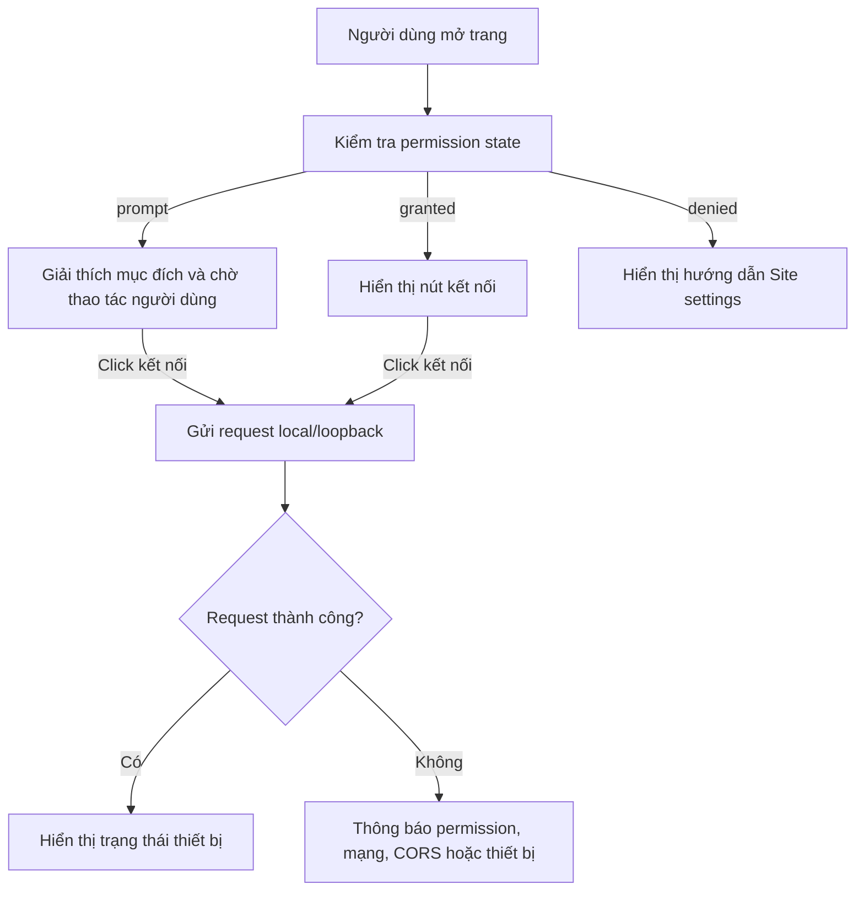

# Private Network Access — bảo vệ kết nối từ web công cộng vào mạng nội bộ

> **Chương:** CORS nâng cao  
> **Mục tiêu:** Hiểu mối đe dọa khi một website công cộng dùng trình duyệt của người dùng để gửi request vào router, thiết bị LAN hoặc dịch vụ localhost; nắm mô hình Private Network Access (PNA) và preflight headers lịch sử; phân biệt cách tiếp cận Local Network Access (LNA) hiện được Chrome triển khai; biết kiểm tra quyền, CORS, secure context và hành vi thực tế.

## 1. Vấn đề: một website công cộng có thể chạm tới mạng riêng của người dùng

Khi người dùng mở một website, JavaScript của trang có thể thực hiện một số request đến các địa chỉ mạng mà máy tính người dùng truy cập được. Những địa chỉ này không chỉ là máy chủ công khai trên Internet. Máy người dùng có thể đồng thời kết nối tới:

- Router hoặc modem tại mạng gia đình, ví dụ `192.168.1.1`.
- Máy in, camera, NAS hoặc thiết bị IoT trong LAN.
- Trang quản trị nội bộ của doanh nghiệp.
- Dịch vụ đồng hành chạy trên máy người dùng, ví dụ một agent tại `127.0.0.1`.
- Máy chủ phát triển hoặc dashboard chỉ có thể truy cập trong mạng riêng.

Hãy tưởng tượng người dùng đăng nhập router trong một tab, rồi mở một website độc hại ở tab khác. Website độc hại có thể thử gửi request đến router, dò các cổng hoặc endpoint quen thuộc, hoặc kích hoạt một hành động quản trị nếu router chấp nhận request dựa trên cookie hay trạng thái đăng nhập sẵn có.

Website công cộng có thể không đọc được response vì Same-Origin Policy hoặc CORS. Tuy vậy, **chỉ gửi được request cũng có thể gây tác động** nếu thiết bị đích thực hiện lệnh. Đây là lý do CORS đơn thuần không đủ để ngăn mọi cuộc tấn công nhắm vào mạng nội bộ.

**Private Network Access (PNA)** được đề xuất nhằm tạo thêm ranh giới cho những request đi từ không gian địa chỉ ít riêng tư hơn đến không gian riêng tư hơn. Mục tiêu là giảm khả năng website công cộng lợi dụng trình duyệt như một “đại diện mạng” để tấn công thiết bị nội bộ hoặc dò cấu trúc mạng.

## 2. Threat model: trình duyệt trở thành confused deputy

Trong mô hình này, trình duyệt có kết nối mạng tới cả Internet và LAN. Website độc hại không cần tự có đường đi vào mạng LAN; nó chỉ cần khiến **trình duyệt của nạn nhân** gửi request thay mình.

Ví dụ một trang công cộng có thể thử:

1. Gửi GET hoặc POST tới giao diện quản trị router.
2. Thử nhiều địa chỉ IP riêng để suy đoán thiết bị nào đang hoạt động.
3. Gửi request tới dịch vụ localhost để kích hoạt chức năng của ứng dụng đồng hành.
4. Dựa vào thời gian phản hồi, lỗi mạng hoặc trạng thái tải tài nguyên để suy luận thông tin về mạng nội bộ.
5. Tận dụng cookie hoặc thông tin xác thực mà trình duyệt có thể tự đính kèm vào request.

Các tác động cần phòng vệ gồm **CSRF nhắm tới router/thiết bị**, dò quét mạng, fingerprinting mạng nội bộ và lạm dụng dịch vụ chạy trên máy người dùng.

PNA/LNA tập trung vào request **đi tới địa chỉ đích có mức riêng tư cao hơn**. Chúng không thay thế xác thực trên thiết bị, kiểm tra CSRF, phân đoạn mạng, firewall hay bảo vệ ứng dụng khỏi XSS.

## 3. Address space: public, private và local

Thiết kế PNA ban đầu phân loại đích theo các address space. Cách gọi và chi tiết phân loại đã thay đổi trong quá trình phát triển, vì vậy cần phân biệt mô hình PNA lịch sử với mô hình Local Network Access (LNA) hiện hành trong Chromium.

### Mô hình PNA lịch sử

PNA dùng các nhóm khái niệm **public**, **private** và **local** để biểu diễn mức độ riêng tư của địa chỉ. Request từ public sang private/local hoặc từ private sang local là những hướng đi vào vùng riêng tư hơn cần được xem xét.

### Mô hình LNA hiện hành trong Chrome

Hướng dẫn Chrome hiện tại mô tả một lattice ba mức:

```text
public  →  local  →  loopback
ít riêng tư hơn              riêng tư hơn
```

| Address space LNA | Ví dụ địa chỉ | Ý nghĩa |
| --- | --- | --- |
| **public** | Địa chỉ Internet thông thường | Đích công khai |
| **local** | IPv4 RFC1918: `10.0.0.0/8`, `172.16.0.0/12`, `192.168.0.0/16`; link-local `169.254.0.0/16`; IPv6 ULA `fc00::/7`, link-local `fe80::/10`; hostname mDNS `.local` | Thiết bị trong mạng nội bộ hoặc mạng cục bộ |
| **loopback** | IPv4 `127.0.0.0/8`, IPv6 `::1/128`, `localhost` | Dịch vụ chạy trên chính máy người dùng |

LNA kiểm tra khi request đi từ vùng ít riêng tư hơn tới vùng riêng tư hơn, ví dụ:

- Public origin → local address space: cần quyền `local-network`.
- Public origin → loopback address space: cần quyền `loopback-network`.
- Local origin → loopback address space: cần quyền `loopback-network`.

Không phải mọi địa chỉ có vẻ “không công khai” đều được phân loại theo suy đoán của ứng dụng. Browser xác định address space theo quy tắc địa chỉ và kết quả phân giải hostname. Tham khảo bảng trong [Local Network Access specification](https://wicg.github.io/local-network-access/).

## 4. PNA preflight: mô hình giao thức ban đầu

PNA từng đề xuất một bước kiểm tra trước khi gửi request từ address space ít riêng tư hơn sang address space riêng tư hơn. Bước này được gọi là **Private Network Access preflight**.

Trong mô hình lịch sử, browser gửi một request OPTIONS có header:

```http
OPTIONS /admin/status HTTP/1.1
Host: 192.168.1.1
Origin: https://portal.example
Access-Control-Request-Method: GET
Access-Control-Request-Private-Network: true
```

Thiết kế PNA dự định yêu cầu bước kiểm tra này cả khi request vốn là CORS-safelisted và không cần preflight CORS thông thường. Nhờ đó, một request GET đơn giản tới router cũng phải qua bước opt-in trước khi browser gửi request thực tế.

Thiết bị đích phải thể hiện rõ sự đồng ý với request đi vào mạng riêng bằng response:

```http
HTTP/1.1 204 No Content
Access-Control-Allow-Origin: https://portal.example
Access-Control-Allow-Methods: GET
Access-Control-Allow-Private-Network: true
```

Nếu request cần các request header không đơn giản, response preflight còn phải cho phép chúng qua `Access-Control-Allow-Headers`. Nếu response thật cần được JavaScript đọc, response thực tế cũng phải đáp ứng CORS bình thường.

### Ý nghĩa của hai header PNA

| Header | Hướng | Ý nghĩa |
| --- | --- | --- |
| `Access-Control-Request-Private-Network: true` | Browser gửi trong OPTIONS | Thông báo request muốn đi tới address space riêng tư hơn |
| `Access-Control-Allow-Private-Network: true` | Server trả trong preflight response | Server thể hiện đồng ý với loại request PNA trong mô hình cũ |

Preflight này là một **opt-in của server/thiết bị đích**. Nó không phải cookie, không phải token đăng nhập và không chứng minh người dùng có quyền thực hiện hành động quản trị.

### Preflight không mang credentials

Giống preflight CORS thông thường, request OPTIONS kiểm tra trước không mang cookie phiên hay HTTP credentials của request thực tế. Server cần cho phép xử lý OPTIONS mà không đòi session cookie.

Request thực tế sau đó vẫn chịu chính sách credentials, cookie và CORS. Nếu request thực tế dùng credentials và JavaScript cần đọc response, server vẫn phải trả `Access-Control-Allow-Origin` cụ thể và `Access-Control-Allow-Credentials: true` theo quy tắc CORS.

## 5. PNA và CORS giải quyết hai lớp khác nhau

Không nên gộp PNA preflight với CORS thông thường:

| Cơ chế | Câu hỏi chính | Phạm vi |
| --- | --- | --- |
| **CORS preflight** | Server có cho phép origin gửi request với method/header dự kiến không? | Chia sẻ tài nguyên cross-origin |
| **PNA preflight (mô hình cũ)** | Server đích có opt-in cho request đi vào address space riêng tư hơn không? | Bảo vệ vùng mạng riêng |
| **CORS response check** | JavaScript có được đọc response cross-origin không? | Quyền đọc response |
| **LNA permission (mô hình Chrome hiện tại)** | Người dùng có cho website này kết nối tới local network hoặc loopback không? | Quyền gửi request tới vùng mạng cục bộ |

Một request có thể vượt qua một lớp nhưng thất bại ở lớp khác. Ví dụ:

- API cho phép CORS nhưng browser chặn request vì người dùng chưa cấp quyền LNA.
- Người dùng đã cấp LNA nhưng server không trả CORS phù hợp nên JavaScript không đọc được response.
- CORS và LNA đều cho phép request, nhưng thiết bị trả `401` hoặc `403` vì không có quyền nghiệp vụ.

**CORS không phải authorization**, và quyền LNA cũng không thay thế đăng nhập hoặc xác thực của thiết bị.

## 6. Tình trạng hiện nay: LNA thay thế hướng PNA preflight trong Chrome

Đây là điểm quan trọng khi đọc tài liệu PNA cũ.

Chrome từng thử nghiệm PNA bằng các CORS preflight header `Access-Control-Request-Private-Network` và `Access-Control-Allow-Private-Network`. Tuy nhiên, rollout PNA đã được đặt ở trạng thái hold. Chrome chuyển sang **Local Network Access (LNA)**, yêu cầu quyền người dùng trước khi website kết nối tới mạng cục bộ hoặc loopback.

Theo hướng dẫn Chrome cập nhật 2026-10-07, PNA preflight chưa từng được thực thi như một yêu cầu blocking bắt buộc trong Chrome; chúng đã bị deprecated và không cần triển khai như fallback. Server hoặc firmware cũ có thể tiếp tục trả `Access-Control-Allow-Private-Network: true` mà không gây hại, nhưng không nên thêm xử lý này cho code mới.

Theo tài liệu Chrome:

- LNA permission prompt bắt đầu triển khai trong Chrome 142.
- Chrome 145 tách quyền thành `local-network` và `loopback-network` để người dùng kiểm soát chi tiết hơn.
- Hướng dẫn Chrome cập nhật ngày 2026-10-07 khuyên **không thêm PNA preflight headers vào code mới**; các header cũ có thể được server/firmware giữ lại mà không cần coi đó là cơ chế bảo vệ hiện hành.

Vì vậy, bài học này vẫn giải thích PNA preflight để hiểu thiết kế và hệ thống cũ, nhưng khi phát triển ứng dụng mới cần kiểm tra **LNA và khả năng hỗ trợ của browser mục tiêu**. Các trình duyệt khác có thể có cơ chế, tiến độ triển khai hoặc giao diện quyền khác nhau.

Nguồn đọc tiếp:

- [Chrome: New permission prompt for Local Network Access](https://developer.chrome.com/blog/local-network-access) — giải thích vì sao Chrome chuyển từ PNA sang LNA.
- [Chrome Modern Web Guidance: Local Network Access](https://developer.chrome.google.cn/docs/modern-web-guidance/guides/security/local-network-access?hl=en) — hướng dẫn triển khai, permission, `targetAddressSpace` và Permissions Policy; cập nhật 2026-10-07.
- [Chrome Enterprise release notes](https://support.google.com/chrome/a/answer/10314655?hl=en) — theo dõi thay đổi quyền và chính sách quản trị theo phiên bản.

## 7. LNA: quyền người dùng cho local network và loopback

Trong mô hình LNA của Chrome, request từ website public tới mạng nội bộ hoặc dịch vụ loopback được kiểm soát bằng permission prompt. Quyền chỉ có thể được yêu cầu từ **secure context**.

Hai permission hiện hành:

| Permission | Dùng khi | Ví dụ |
| --- | --- | --- |
| `local-network` | Kết nối từ public origin tới local address space | Router `192.168.1.1`, máy in LAN, thiết bị `printer.local` |
| `loopback-network` | Kết nối từ public hoặc local origin tới loopback | `127.0.0.1`, `[::1]`, `localhost` |

Quyền thường có ba trạng thái:

- `granted`: browser đã cho phép origin sử dụng vùng địa chỉ tương ứng.
- `prompt`: chưa có quyết định; ứng dụng cần giải thích nhu cầu và để người dùng chủ động kích hoạt kết nối.
- `denied`: người dùng hoặc chính sách đã từ chối; ứng dụng cần hiển thị hướng dẫn sửa quyền trong Site settings.

Không nên gửi request local network tự động ngay khi trang vừa tải nếu trạng thái là `prompt`. Trước tiên giải thích vì sao cần kết nối và kích hoạt request từ thao tác rõ ràng của người dùng, ví dụ nhấn nút “Kết nối máy in”.

### Kiểm tra trạng thái permission

Ví dụ dưới đây dùng các permission name granular:

```js
async function getLocalNetworkPermission(name) {
  if (!navigator.permissions || !navigator.permissions.query) {
    return "prompt";
  }

  try {
    const status = await navigator.permissions.query({ name });
    return status.state;
  } catch {
    // Browser chưa hỗ trợ PermissionName này.
    return "prompt";
  }
}

const localState = await getLocalNetworkPermission("local-network");
const loopbackState = await getLocalNetworkPermission("loopback-network");

console.log({ localState, loopbackState });
```

Đây là ví dụ progressive enhancement. Không nên truy vấn tên permission cũ `local-network-access` để làm fallback: tài liệu Chrome cảnh báo tên cũ có hành vi không an toàn ở một số phiên bản cũ. Hãy kiểm tra hỗ trợ của browser mục tiêu và bắt lỗi khi PermissionName chưa được nhận diện.

## 8. Gọi thiết bị local bằng Fetch và targetAddressSpace

Khi trang HTTPS gọi một endpoint HTTP trên LAN hoặc loopback, browser cần biết đích thuộc address space nào. Trong Chrome LNA hiện tại, Fetch/Request có tùy chọn `targetAddressSpace`:

| Giá trị | Dùng cho |
| --- | --- |
| `local` | Đích trong mạng LAN, RFC1918, ULA, link-local hoặc hostname `.local` |
| `loopback` | `localhost`, `127.0.0.1` hoặc `::1` |

Ví dụ kết nối máy in trong LAN:

```js
async function readPrinterStatus() {
  const request = new Request(
    "http://192.168.1.100:8080/api/status",
    {
      method: "GET",
      mode: "cors",
      targetAddressSpace: "local",
    }
  );

  const response = await fetch(request);
  if (!response.ok) {
    throw new Error("Printer trả HTTP " + response.status);
  }
  return response.json();
}
```

Ví dụ kết nối dịch vụ đồng hành trên máy người dùng:

```js
async function readCompanionStatus() {
  const request = new Request(
    "http://127.0.0.1:45678/health",
    {
      method: "GET",
      mode: "cors",
      targetAddressSpace: "loopback",
    }
  );

  const response = await fetch(request);
  if (!response.ok) {
    throw new Error("Companion service trả HTTP " + response.status);
  }
  return response.json();
}
```

`targetAddressSpace` không cấp quyền cho request. Nó khai báo vùng địa chỉ dự kiến; browser vẫn kiểm tra permission và xác minh IP sau khi DNS phân giải. Nếu hostname được khai báo là `local` nhưng lại phân giải thành IP public, browser có thể hủy request thay vì tiếp tục với phân loại không khớp.

### Tại sao targetAddressSpace còn liên quan Mixed Content?

Một trang HTTPS gọi endpoint HTTP thường gặp Mixed Content blocking. Browser kiểm tra Mixed Content trước khi DNS phân giải. Khi ứng dụng biết endpoint thực sự nằm trong LAN/loopback, khai báo `targetAddressSpace` hoặc dùng hostname/IP mà browser nhận diện rõ có thể giúp browser áp dụng ngoại lệ Mixed Content dành cho local network sau khi quyền được cấp.

Không khai báo `local` cho hostname công khai chỉ vì bạn hy vọng nó sẽ phân giải tới LAN. Nếu địa chỉ sau DNS không thuộc address space đã khai báo, request có thể bị hủy. Chỉ dùng ngoại lệ này cho thiết bị và dịch vụ nội bộ mà ứng dụng thực sự cần truy cập.

## 9. Permission cần thao tác người dùng và xử lý lỗi rõ ràng

Một giao diện tốt nên nói rõ:

- Ứng dụng muốn kết nối tới thiết bị nào hoặc dịch vụ nào.
- Mục đích của kết nối là gì, ví dụ tìm máy in hoặc đọc trạng thái thiết bị.
- Dữ liệu nào được gửi/nhận và có được lưu lại không.
- Người dùng có thể từ chối hoặc thu hồi quyền ở đâu.

Ví dụ luồng UI:



Không tự kích hoạt lần đầu từ `DOMContentLoaded` khi quyền còn ở trạng thái prompt. Theo hướng dẫn Chrome, Service Worker và Shared Worker không có Document gắn kèm để mở prompt; request đầu tiên từ worker sẽ thất bại nếu permission chưa được cấp. Hãy kích hoạt permission từ trang có giao diện người dùng trước.

Mẫu xử lý:

```js
async function connectFromUserAction() {
  try {
    const state = await getLocalNetworkPermission("local-network");

    if (state === "denied") {
      throw new Error(
        "Quyền Local Network đang bị chặn. Hãy kiểm tra Site settings."
      );
    }

    // Gọi hàm này từ click handler sau khi giải thích nhu cầu cho người dùng.
    const result = await readPrinterStatus();
    renderPrinterStatus(result);
  } catch (error) {
    showConnectionError(error.message);
  }
}

document.querySelector("#connect-printer")
  .addEventListener("click", connectFromUserAction);
```

Trong sản phẩm thực, kiểm tra permission riêng theo address space cần dùng; ví dụ thiết bị LAN cần `local-network`, daemon localhost cần `loopback-network`. Bắt lỗi network và permission, đồng thời cung cấp hướng dẫn khôi phục mà không yêu cầu người dùng tắt toàn bộ bảo vệ trình duyệt.

## 10. CORS vẫn cần thiết sau khi người dùng cấp LNA

LNA quyết định website có được phép **gửi request tới vùng mạng cục bộ** hay không. Nếu request là cross-origin và JavaScript cần đọc response, server thiết bị vẫn phải đáp ứng CORS.

Ví dụ thiết bị có thể trả:

```http
Access-Control-Allow-Origin: https://portal.example.com
Vary: Origin
Content-Type: application/json

{"status":"ready"}
```

Nếu thiết bị yêu cầu cookie hoặc credentials, còn phải áp dụng các quy tắc CORS credentialed response: origin cụ thể và `Access-Control-Allow-Credentials: true`; cookie phải đủ điều kiện gửi. Nhưng permission LNA không thay thế đăng nhập vào thiết bị.

Một thiết bị nội bộ không nên trả CORS wildcard cho dữ liệu quản trị chỉ vì nó nằm trong LAN. Máy trong LAN có thể vẫn chứa thông tin nhạy cảm. Hãy dùng authentication phù hợp, chống CSRF và giới hạn origin cần truy cập.

## 11. Ủy quyền LNA cho iframe khác origin

Theo hướng dẫn Chrome hiện hành, các permission `local-network` và `loopback-network` mặc định có allowlist `'self'`. Một iframe khác origin không tự động được phép thực hiện request local/loopback chỉ vì trang cha có quyền.

Nếu widget đối tác thật sự cần kết nối thiết bị, trang cha phải ủy quyền rõ bằng `allow` trên iframe và/hoặc response header Permissions Policy của tài liệu top-level.

Ví dụ:

```html
<iframe
  src="https://setup.partner.example/device-bridge"
  title="Kết nối thiết bị"
  allow="local-network; loopback-network"
></iframe>
```

Response header trên trang cha có thể giới hạn origin được ủy quyền:

```http
Permissions-Policy: local-network=(self "https://setup.partner.example"), loopback-network=(self "https://setup.partner.example")
```

Header Permissions Policy cần được gửi bởi **tài liệu top-level đang nhúng iframe**. Hãy chỉ ủy quyền origin đối tác đã xác minh, không mở rộng cho mọi iframe. Quyền người dùng và các điều kiện browser khác vẫn được áp dụng.

## 12. WebSocket, WebTransport và các giao thức khác

Kết nối local network không chỉ dùng Fetch. Ứng dụng có thể dùng WebSocket hoặc WebTransport để giao tiếp thời gian thực với thiết bị hay companion service.

Theo hướng dẫn Chrome hiện tại:

- LNA cũng áp dụng permission cho kết nối WebSocket tới địa chỉ local/loopback mà browser nhận diện.
- Constructor WebSocket nhận URL và danh sách subprotocol; không truyền object `{ targetAddressSpace }` vào tham số thứ hai.
- Với custom hostname không phải `.local` trỏ tới endpoint local, hướng dẫn Chrome khuyến nghị dùng `wss://`.
- WebTransport sử dụng `https://` và browser kiểm tra address space/permission trong quá trình kết nối; API không nhận tùy chọn `targetAddressSpace` như Fetch.

Ví dụ WebSocket:

```js
const socket = new WebSocket(
  "ws://192.168.1.100:8080/stream",
  ["device-v1"]
);

socket.addEventListener("open", () => {
  console.log("Đã kết nối thiết bị");
});

socket.addEventListener("error", () => {
  console.error("Không thể kết nối; kiểm tra quyền và trạng thái thiết bị");
});
```

Phạm vi hỗ trợ của LNA đối với WebSocket, WebTransport và các API mạng khác thay đổi theo browser và phiên bản. Kiểm tra hướng dẫn cập nhật và thử nghiệm trên browser mục tiêu; không suy ra rằng mọi API đều có cùng giao diện hoặc cùng thời điểm kiểm tra permission.

## 13. Kiểm thử PNA lịch sử và LNA hiện hành

### Thí nghiệm A — đọc hiểu PNA preflight cũ

Trong một môi trường lab cô lập, xem lại request OPTIONS:

```http
OPTIONS /device/status HTTP/1.1
Origin: https://portal.example
Access-Control-Request-Method: GET
Access-Control-Request-Private-Network: true
```

Và response opt-in:

```http
HTTP/1.1 204 No Content
Access-Control-Allow-Origin: https://portal.example
Access-Control-Allow-Methods: GET
Access-Control-Allow-Private-Network: true
```

Đây là mô hình lịch sử giúp hiểu tài liệu cũ và firmware hiện có. **Không dùng các header này làm giải pháp mới cho Chrome LNA hiện hành.** Tài liệu Chrome hiện tại nói rõ PNA preflight đã deprecated; server cũ có thể giữ header mà không cần thêm xử lý mới.

### Thí nghiệm B — kiểm tra Local Network Access trong Chrome

Thực hiện trên thiết bị và mạng lab do bạn quản lý:

1. Phục vụ trang thử nghiệm từ **HTTPS secure context**.
2. Chuẩn bị endpoint giả lập ở một IP LAN hoặc một dịch vụ loopback; không dùng router hay thiết bị production.
3. Thêm một nút “Kết nối thiết bị” để request chỉ phát sinh sau thao tác click.
4. Kiểm tra permission bằng `navigator.permissions.query({ name: "local-network" })` hoặc `loopback-network` tùy đích.
5. Gửi Fetch với `targetAddressSpace: "local"` hoặc `"loopback"` phù hợp; bắt lỗi và hiển thị trạng thái.
6. Quan sát prompt, chọn Allow/Block trong môi trường lab, rồi thử lại sau khi đổi permission ở Site settings.
7. Nếu response cross-origin cần được JavaScript đọc, cấu hình CORS riêng trên endpoint thiết bị.

### Vì sao localhost dev server có thể không tạo prompt?

`http://localhost` và loopback IP đã thuộc loopback address space. Nếu trang thử nghiệm cũng được phục vụ từ localhost, nó không mô phỏng đầy đủ tình huống public origin truy cập mạng riêng. Hãy dùng một secure public origin thử nghiệm trỏ tới thiết bị lab, hoặc sử dụng cơ chế address-space override dành cho kiểm thử trong Chromium theo hướng dẫn chính thức.

Không tắt bảo vệ của browser hoặc thử quét mạng thật. Mục tiêu là quan sát quyền của một request cụ thể trong một mạng được kiểm soát.

## 14. Phân biệt lỗi LNA, CORS, Mixed Content và lỗi thiết bị

| Dấu hiệu | Lớp có thể liên quan | Cách điều tra |
| --- | --- | --- |
| Browser báo permission denied hoặc request không được phép tới local network | LNA permission | Kiểm tra secure context, permission state, Site settings và thao tác người dùng |
| Request đã tới thiết bị nhưng JavaScript báo CORS | CORS | Kiểm tra response `Access-Control-Allow-Origin` và credentials nếu có |
| HTTPS page bị chặn khi gọi HTTP endpoint | Mixed Content hoặc khai báo address space | Xác định đích có phải local/loopback; xem hướng dẫn `targetAddressSpace` của browser |
| Request trả 401/403 | Authentication/authorization ở thiết bị | Kiểm tra session, token, quyền người dùng và log thiết bị |
| Request timeout hoặc connection refused | Mạng/thiết bị | Kiểm tra IP, port, firewall, thiết bị đang bật và cùng mạng |
| Hostname phân giải thành address space khác với khai báo | DNS/address-space validation | Kiểm tra DNS, targetAddressSpace và cấu hình endpoint |
| Iframe đối tác không thể truy cập local network | Permissions Policy / iframe delegation | Kiểm tra header top-level và thuộc tính `allow` |

Lỗi CORS có thể che response của thiết bị nhưng không chứng minh request chưa được gửi. Lỗi LNA là quyết định quyền truy cập mạng; lỗi 401/403 là quyết định của ứng dụng đích. Chẩn đoán đúng tầng sẽ tránh việc nới chính sách sai chỗ.

## 15. Giới hạn bảo vệ: PNA/LNA không thay thế bảo mật thiết bị

Ngay cả khi browser yêu cầu người dùng cấp quyền local network, thiết bị đích vẫn cần tự bảo vệ:

- **Authentication:** không coi mọi request từ LAN là đáng tin; yêu cầu thông tin xác thực cho chức năng nhạy cảm.
- **Authorization:** giới hạn từng hành động và từng tài nguyên theo người dùng/thiết bị.
- **CSRF protection:** dùng token hoặc cơ chế phù hợp; kiểm tra origin/fetch metadata khi thích hợp.
- **Không dùng GET để thay đổi trạng thái:** request đọc không được khởi động lại router, mở khóa cửa hoặc thay đổi cấu hình.
- **Giảm bề mặt dịch vụ:** chỉ mở endpoint/port cần thiết, cập nhật firmware và tắt giao diện quản trị không dùng.
- **Chống DNS rebinding và Host confusion:** xác minh Host/Origin phù hợp, không tin hostname chỉ vì nó phân giải tới IP nội bộ.
- **Giới hạn CORS:** chỉ cho origin cần thiết đọc response; không trả dữ liệu nhạy cảm cho mọi website.
- **Phân đoạn mạng:** firewall và ACL vẫn là ranh giới quan trọng giữa guest Wi-Fi, thiết bị IoT, máy trạm và hệ thống quản trị.

LNA giảm khả năng website tự ý gửi request tới mạng cục bộ nếu chưa có quyền người dùng. Nó không biến một thiết bị có API quản trị yếu thành thiết bị an toàn, và không thay thế firewall hay xác thực.

## 16. Checklist thiết kế ứng dụng cần truy cập thiết bị nội bộ

- Xác định rõ endpoint là public, local hay loopback; không suy luận chỉ từ hostname.
- Chỉ yêu cầu local-network/loopback-network khi tính năng thực sự cần.
- Phục vụ ứng dụng từ secure context và kiểm tra browser/version mục tiêu.
- Giải thích mục đích truy cập trước khi hiển thị permission prompt.
- Chỉ khởi tạo lần đầu từ thao tác rõ ràng của người dùng khi permission đang prompt.
- Kiểm tra trạng thái permission phù hợp; xử lý trường hợp browser chưa hỗ trợ PermissionName.
- Với Fetch/Request trong Chrome LNA, khai báo `targetAddressSpace` đúng với endpoint và xử lý mismatch sau DNS.
- Dùng CORS riêng nếu script cần đọc response cross-origin; không coi LNA permission là CORS grant.
- Với iframe khác origin, ủy quyền bằng Permissions Policy và `allow` ở mức tối thiểu.
- Bảo vệ thiết bị bằng authentication, authorization, CSRF và kiểm tra Host/Origin.
- Không thêm PNA preflight headers vào code mới chỉ để tương thích một bài hướng dẫn cũ; phân biệt rõ server firmware lịch sử với LNA hiện hành.
- Kiểm thử trên các browser/version mà sản phẩm hỗ trợ; ghi nhận khác biệt và cung cấp fallback rõ ràng.

## 17. Câu hỏi tự kiểm tra

1. Vì sao một website public có thể gây hại cho router dù JavaScript không đọc được response của router?
2. PNA preflight ban đầu dùng hai header nào để yêu cầu và chấp nhận truy cập private network?
3. Vì sao không nên xem `Access-Control-Allow-Private-Network: true` là giải pháp mới cho Chrome hiện hành?
4. LNA phân biệt quyền `local-network` và `loopback-network` như thế nào?
5. Vì sao LNA yêu cầu secure context và thao tác người dùng rõ ràng?
6. `targetAddressSpace` có cấp quyền truy cập hay chỉ khai báo/kiểm tra address space dự kiến?
7. Vì sao cấp LNA permission chưa chắc JavaScript đọc được response?
8. Vì sao preflight PNA lịch sử không thay thế authentication, authorization hoặc CSRF protection?
9. Khi một iframe đối tác cần truy cập thiết bị LAN, cần cấu hình thêm lớp nào?
10. Vì sao một trang localhost không phải lúc nào cũng mô phỏng được request từ public origin vào loopback?

**Ghi nhớ:** PNA là thiết kế bảo vệ request đi từ vùng mạng ít riêng tư hơn vào vùng riêng tư hơn; mô hình lịch sử dùng preflight với `Access-Control-Request-Private-Network` và `Access-Control-Allow-Private-Network`. Chrome đã chuyển hướng sang **Local Network Access (LNA)** với quyền người dùng cho `local-network` và `loopback-network`, yêu cầu secure context và có thể cần `targetAddressSpace` cho Fetch tới HTTP local/loopback. CORS vẫn kiểm soát việc đọc response, còn thiết bị vẫn phải xác thực, phân quyền và chống CSRF. Luôn kiểm tra browser/version mục tiêu và dùng tài liệu hiện hành trước khi triển khai.
