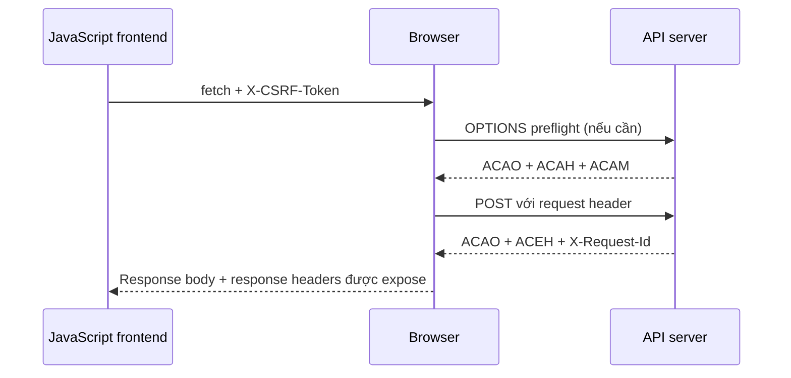

# Expose headers: cho phép JavaScript đọc response header qua CORS

## Mục tiêu học tập

Sau bài học, người học có thể:

1. Giải thích vai trò của response header **`Access-Control-Expose-Headers` (ACEH)** trong CORS.
2. Phân biệt nhóm **CORS-safelisted response headers** được JavaScript đọc mặc định với các response header cần expose tường minh.
3. Cấu hình expose các header ứng dụng như `ETag`, `Content-Disposition`, `X-Request-Id`, `Retry-After` và header phân trang.
4. Hiểu chính xác ý nghĩa của wildcard `*`, đặc biệt khi request dùng credentials mode `include`.
5. Nhận diện các **forbidden response-header names** như `Set-Cookie` mà JavaScript không thể đọc thông qua Fetch/XHR, kể cả khi cố expose.
6. Phân biệt `Access-Control-Expose-Headers` với `Access-Control-Allow-Headers`, kiểm chứng bằng Fetch API và Chrome DevTools.

> **Bối cảnh:** Module Browser Security phân tích ranh giới giữa browser, origin, cookie và ứng dụng web. `Access-Control-Expose-Headers` là một phần của CORS, điều khiển những response header nào được JavaScript của một origin khác nhìn thấy. Nó bổ sung cho SOP và CORS; không xác thực người dùng, không cấp quyền API và không làm cho mọi header của response trở nên công khai.

## 1. Vì sao JavaScript không đọc được mọi response header?

Giả sử frontend tại `https://app.example.test` gọi API tại `https://api.example.test`. API trả:

```http
HTTP/1.1 200 OK
Access-Control-Allow-Origin: https://app.example.test
Content-Type: application/json
Content-Length: 42
ETag: "profile-v7"
X-Request-Id: req-8f31
X-RateLimit-Remaining: 87
Content-Disposition: attachment; filename="report.csv"
```

Nếu CORS cho phép frontend đọc response, JavaScript vẫn chỉ được đọc **nhóm response header được CORS safelist mặc định cho phép** và các header server expose thêm. Những header như `ETag`, `X-Request-Id`, `X-RateLimit-Remaining` và `Content-Disposition` không thuộc nhóm safelist mặc định.

Vì vậy đoạn mã:

```js
const response = await fetch("https://api.example.test/profile");

console.log(response.status);                       // Có thể đọc nếu response CORS hợp lệ
console.log(response.headers.get("Content-Type"));  // Safelisted
console.log(response.headers.get("ETag"));          // null nếu chưa expose
console.log(response.headers.get("X-Request-Id"));  // null nếu chưa expose
```

có thể đọc status và `Content-Type` nhưng nhận `null` cho `ETag` và `X-Request-Id`, dù DevTools → Network vẫn hiển thị các header đó trong response.

**`Access-Control-Expose-Headers`** là response header cho phép server chỉ định các header bổ sung được đưa vào danh sách header mà script cross-origin có thể đọc.

## 2. CORS-safelisted response headers

Fetch định nghĩa một nhóm response header names được expose mặc định cho script khi response đã vượt qua các kiểm tra CORS. Nhóm hiện hành gồm:

| Header | Công dụng thường gặp |
| --- | --- |
| `Cache-Control` | Chỉ thị cache |
| `Content-Language` | Ngôn ngữ nội dung |
| `Content-Length` | Kích thước body theo byte khi header có mặt |
| `Content-Type` | Kiểu nội dung |
| `Expires` | Thời điểm hết hạn cache theo HTTP |
| `Last-Modified` | Thời điểm tài nguyên được sửa lần cuối |
| `Pragma` | Chỉ thị tương thích cache kiểu cũ |

Không cần thêm các header này vào `Access-Control-Expose-Headers` chỉ để `response.headers.get()` đọc được chúng. Tuy nhiên, header thực tế vẫn phải có trong response; safelist không tự tạo giá trị.

### Header không nằm trong safelist

Các header thường cần expose tường minh:

- `ETag`: frontend dùng validator để kiểm soát cache hoặc cập nhật có điều kiện.
- `Content-Disposition`: frontend cần biết tên tệp hoặc cách xử lý nội dung tải xuống.
- `X-Request-Id`/`Traceparent`: frontend gửi mã tương quan cho bộ phận hỗ trợ hoặc hệ thống tracing.
- `Retry-After`: frontend cần biết khi nào nên thử lại sau khi bị giới hạn tốc độ hoặc dịch vụ tạm thời không sẵn sàng.
- `X-RateLimit-Limit`, `X-RateLimit-Remaining`, `X-RateLimit-Reset`: hiển thị trạng thái quota nếu API sử dụng quy ước này.
- `Link`: đọc liên kết pagination hoặc quan hệ tài nguyên nếu server dùng header này.

Tên header không phân biệt chữ hoa/thường theo quy tắc HTTP. Ví dụ `X-Request-Id` và `x-request-id` chỉ cùng một tên header; cách viết hoa/thường trong cấu hình nhằm dễ đọc.

## 3. Cú pháp Access-Control-Expose-Headers

Server trả một danh sách tên response header được expose, phân cách bằng dấu phẩy:

```http
Access-Control-Expose-Headers: ETag, Content-Disposition, X-Request-Id
```

Sau khi response vượt qua kiểm tra CORS, JavaScript từ origin được phép có thể đọc:

```js
const response = await fetch("https://api.example.test/reports/latest");

const etag = response.headers.get("ETag");
const disposition = response.headers.get("Content-Disposition");
const requestId = response.headers.get("X-Request-Id");

console.log({ etag, disposition, requestId });
```

Nếu cần đọc tất cả header đã được expose cùng safelist:

```js
for (const [name, value] of response.headers) {
  console.log(name, value);
}
```

Danh sách trên chỉ chứa các header **được phép nhìn thấy qua Fetch API**. Nó không phải bản dump toàn bộ header HTTP của network response.

### Ví dụ response hoàn chỉnh

```http
HTTP/1.1 200 OK
Access-Control-Allow-Origin: https://app.example.test
Access-Control-Expose-Headers: ETag, X-Request-Id, Content-Disposition
Content-Type: application/json
ETag: "orders-page-4"
X-Request-Id: req-2026-0042
Content-Disposition: attachment; filename="orders.csv"
```

Khi CORS hợp lệ, frontend có thể đọc `ETag`, `X-Request-Id` và `Content-Disposition` cùng các header safelist. Nếu response không vượt qua CORS, ACEH cũng không mở quyền đọc response cho JavaScript.

## 4. Wildcard * và credentials mode

Trong `Access-Control-Expose-Headers`, wildcard `*` có ý nghĩa đặc biệt **khi request không dùng credentials mode `include`**:

```http
Access-Control-Expose-Headers: *
```

Khi credentials mode khác `include`, `*` có thể đại diện cho tất cả response header names có thể expose (ngoại trừ các forbidden response-header names). Khi credentials mode là `include`, wildcard **không còn là wildcard**; nó được hiểu như tên header thông thường `*`.

Đây là điểm dễ nhầm vì wildcard trong `Access-Control-Allow-Origin` và wildcard trong `Access-Control-Expose-Headers` có quy tắc riêng:

| Request credentials mode | ACEH | Ý nghĩa |
| --- | --- | --- |
| Không phải `include` | `*` | Wildcard: expose các response header names có thể expose |
| `include` | `*` | Tên header literal `*`, không expose toàn bộ |
| Bất kỳ mode nào | `ETag, X-Request-Id` | Expose các tên header được liệt kê, nếu không bị cấm |

### Trường hợp có credentials

Frontend:

```js
const response = await fetch("https://api.example.test/account", {
  credentials: "include"
});
```

Response cần cho phép origin cụ thể, credentials và expose các header mong muốn:

```http
Access-Control-Allow-Origin: https://app.example.test
Access-Control-Allow-Credentials: true
Access-Control-Expose-Headers: ETag, X-Request-Id
```

Không dựa vào:

```http
# Không expose toàn bộ header trong credentials mode include
Access-Control-Expose-Headers: *
```

Khi request dùng credentials, hãy **liệt kê rõ từng header** cần expose. Đồng thời, cookie thực tế được gửi còn phụ thuộc `SameSite`, `Secure`, domain/path, third-party cookie policy và các điều kiện của browser.

## 5. Forbidden response-header names: vì sao không expose được Set-Cookie?

Fetch có một tập **forbidden response-header names**. JavaScript không được đọc các header này thông qua `Response.headers`/`XMLHttpRequest` response header APIs, kể cả server có ghi chúng vào `Access-Control-Expose-Headers`.

Ví dụ quan trọng nhất:

- `Set-Cookie`
- `Set-Cookie2`

Response có thể chứa:

```http
Set-Cookie: session=abc123; Secure; HttpOnly; SameSite=Lax
Access-Control-Expose-Headers: Set-Cookie, Set-Cookie2
```

Nhưng đoạn mã sau vẫn không đọc được giá trị cookie:

```js
const response = await fetch("https://api.example.test/login", {
  credentials: "include"
});

console.log(response.headers.get("Set-Cookie")); // null
```

Browser quản lý cookie từ `Set-Cookie` theo chính sách cookie. Header này bị cấm expose cho JavaScript vì lý do bảo mật và quyền riêng tư. `HttpOnly` là một thuộc tính cookie khác, ngăn script đọc cookie qua `document.cookie`; nó không phải lý do duy nhất khiến `Set-Cookie` bị lọc khỏi Fetch response.

**Không thiết kế API yêu cầu frontend đọc `Set-Cookie`.** Nếu ứng dụng cần biết trạng thái đăng nhập, hãy trả dữ liệu nghiệp vụ riêng, ví dụ `{"authenticated": true}`, trong body JSON sau khi server xử lý cookie. Không trả lại bí mật session/token trong body chỉ để thay thế `Set-Cookie`.

## 6. Phân biệt ACEH với Access-Control-Allow-Headers

Hai header có tên gần giống nhưng kiểm soát hai chiều khác nhau:

| Header | Hướng kiểm soát | Câu hỏi |
| --- | --- | --- |
| `Access-Control-Allow-Headers` (ACAH) | **Request headers** | JavaScript có được gửi các request header không safelisted này không? |
| `Access-Control-Expose-Headers` (ACEH) | **Response headers** | JavaScript có được đọc các response header không safelisted này không? |

Ví dụ frontend gửi request:

```js
fetch("https://api.example.test/orders", {
  method: "POST",
  headers: {
    "Content-Type": "application/json",
    "X-CSRF-Token": "token-value"
  },
  body: JSON.stringify({ itemId: 42 })
});
```

Preflight có thể hỏi server về `content-type` và `x-csrf-token`. Server cần cấu hình ACAH tương ứng:

```http
Access-Control-Allow-Headers: Content-Type, X-CSRF-Token
```

Nếu response POST trả `X-Request-Id` và frontend muốn đọc giá trị đó, server cần ACEH:

```http
Access-Control-Expose-Headers: X-Request-Id
```

Một header không thể thay thế header còn lại. Cấu hình ACAH không làm lộ response header; cấu hình ACEH không cho phép gửi request header tùy ý.

### Luồng request/response



ACEH chủ yếu tác động đến **response thực tế mà script nhận**. Không dùng ACEH để thay cấu hình ACAH trên preflight; cũng không chỉ thêm ACEH vào OPTIONS rồi kỳ vọng JavaScript đọc được header của response POST.

## 7. Thiết kế expose headers theo nhu cầu API

Không nên expose mọi header chỉ để tiện debug. Chọn những header mà frontend thực sự cần:

| Nhu cầu frontend | Header có thể expose | Lý do |
| --- | --- | --- |
| Cache/đồng bộ phiên bản dữ liệu | `ETag` | Đọc validator và gửi `If-None-Match` ở request tiếp theo khi phù hợp |
| Tải file với tên từ server | `Content-Disposition` | Đọc metadata tên file/kiểu xử lý |
| Hỗ trợ điều tra lỗi | `X-Request-Id` | Người dùng gửi mã request cho support |
| Hiển thị quota API | `X-RateLimit-Remaining`, `X-RateLimit-Reset` | Frontend điều chỉnh UI hoặc lịch thử lại |
| Xử lý retry | `Retry-After` | Biết thời điểm nên gửi lại |
| Phân trang | `Link` | Đọc các quan hệ `next`, `prev` nếu server dùng định dạng này |

### Không expose dữ liệu nhạy cảm

Response header có thể chứa thông tin nội bộ như:

- Tên máy chủ nội bộ, topology hoặc phiên bản chi tiết không cần công khai.
- Debug stack, thông tin đường dẫn filesystem, thông tin định danh nội bộ.
- Token, khóa, cookie hoặc dữ liệu xác thực.

Chỉ expose header không đồng nghĩa mọi người đều nhận được dữ liệu: ACAO vẫn phải cho phép origin, nhưng các origin được allowlist có thể đọc header đó. Vì vậy, coi ACEH là một phần của **hợp đồng API** và đánh giá nội dung trước khi công khai.

**Không expose `Server`, `Set-Cookie` hoặc header debug theo mặc định.** Với header không cần thiết, tốt nhất không gửi nó ra response thay vì chỉ dựa vào CORS để che.

## 8. Ví dụ cấu hình backend

### Java Spring MVC

Với frontend ở hai origin tin cậy và API có session cookie:

```java
import org.springframework.context.annotation.Bean;
import org.springframework.context.annotation.Configuration;
import org.springframework.web.servlet.config.annotation.CorsRegistry;
import org.springframework.web.servlet.config.annotation.WebMvcConfigurer;

@Configuration
public class ApiCorsConfiguration {

    @Bean
    WebMvcConfigurer corsConfigurer() {
        return new WebMvcConfigurer() {
            @Override
            public void addCorsMappings(CorsRegistry registry) {
                registry.addMapping("/api/**")
                    .allowedOrigins(
                        "https://app.example.test",
                        "https://admin.example.test"
                    )
                    .allowedMethods("GET", "POST", "PUT")
                    .allowedHeaders("Content-Type", "X-CSRF-Token")
                    .exposedHeaders(
                        "ETag",
                        "Content-Disposition",
                        "X-Request-Id",
                        "Retry-After"
                    )
                    .allowCredentials(true)
                    .maxAge(600);
            }
        };
    }
}
```

`exposedHeaders(...)` cấu hình response headers được JavaScript đọc; `allowedHeaders(...)` cấu hình request headers được gửi. Nếu dùng Spring Security, phải bảo đảm CORS được tích hợp đúng trong security filter chain và request OPTIONS/preflight không bị chặn trước khi CORS xử lý. Cần kiểm tra response cuối cùng để chắc chắn middleware/proxy không xóa hoặc ghi đè header.

### Node.js: allowlist và expose response headers

```js
import http from "node:http";

const allowedOrigins = new Set([
  "https://app.example.test",
  "https://admin.example.test"
]);

function appendVary(response, names) {
  const current = String(response.getHeader("Vary") || "");
  if (current.trim() === "*") return;

  const values = new Map();
  for (const value of current.split(",").map(item => item.trim()).filter(Boolean)) {
    values.set(value.toLowerCase(), value);
  }
  for (const name of names) values.set(name.toLowerCase(), name);
  response.setHeader("Vary", [...values.values()].join(", "));
}

function applyCors(request, response) {
  const origin = request.headers.origin;
  // ACAO thay đổi theo Origin request, cache phải phân biệt.
  appendVary(response, ["Origin"]);
  // Request không có Origin không phải CORS request; xử lý theo authz thông thường.
  if (origin === undefined) return true;
  if (typeof origin !== "string" || !allowedOrigins.has(origin)) return false;

  response.setHeader("Access-Control-Allow-Origin", origin);
  response.setHeader("Access-Control-Allow-Credentials", "true");
  return true;
}

http.createServer((request, response) => {
  if (!applyCors(request, response)) {
    response.writeHead(403);
    response.end();
    return;
  }

  if (request.method === "OPTIONS") {
    appendVary(response, [
      "Access-Control-Request-Method",
      "Access-Control-Request-Headers"
    ]);
    response.setHeader("Access-Control-Allow-Methods", "GET, POST");
    response.setHeader(
      "Access-Control-Allow-Headers",
      "Content-Type, X-CSRF-Token"
    );
    response.setHeader("Access-Control-Max-Age", "600");
    response.writeHead(204);
    response.end();
    return;
  }

  response.setHeader(
    "Access-Control-Expose-Headers",
    "ETag, Content-Disposition, X-Request-Id, Retry-After"
  );
  response.setHeader("Content-Type", "application/json");
  response.setHeader("ETag", '"orders-v12"');
  response.setHeader("X-Request-Id", "req-2026-0042");
  response.end(JSON.stringify({ items: [] }));
}).listen(8080);
```

Đây là ví dụ chọn origin và expose header cho một route; server production cần tích hợp với middleware CORS thống nhất, xử lý OPTIONS/preflight, xác thực, phân quyền, CSRF, lỗi và gộp `Vary` với các giá trị cache đã có. Không đặt ACAO hoặc ACEH tùy ý dựa trên input client.

## 9. Kiểm chứng bằng Fetch API và Chrome DevTools

### Bước 1 — Đọc header mặc định

Từ frontend được server cho phép CORS:

```js
const response = await fetch("https://api.example.test/profile");

console.log(response.headers.get("Content-Type"));
console.log(response.headers.get("Content-Length"));
console.log(response.headers.get("ETag"));
console.log([...response.headers.entries()]);
```

Nếu `ETag` chưa được expose, `get("ETag")` trả `null` và `entries()` không liệt kê nó, dù Network có thể nhìn thấy header.

### Bước 2 — Thêm ACEH ở response API

Cho API trả:

```http
Access-Control-Allow-Origin: https://app.example.test
Access-Control-Expose-Headers: ETag, X-Request-Id
ETag: "profile-v7"
X-Request-Id: req-8f31
```

Tải lại request rồi chạy:

```js
console.log(response.headers.get("ETag"));         // "profile-v7"
console.log(response.headers.get("X-Request-Id"));  // "req-8f31"
```

### Bước 3 — Thử wildcard và credentials

Thử hai request:

```js
// Request không dùng credentials mode include:
const publicResponse = await fetch(
  "https://api.example.test/public",
  { credentials: "omit" }
);

// Request có credentials mode include:
const privateResponse = await fetch(
  "https://api.example.test/private",
  { credentials: "include" }
);
```

Nếu server trả `Access-Control-Expose-Headers: *`, request đầu có thể đọc các response header names được expose (trừ forbidden names); request thứ hai **không** dùng `*` như wildcard. Hãy thay ACEH bằng danh sách rõ ràng rồi thử lại.

### Bước 4 — Kiểm tra Set-Cookie

Cho response test gửi:

```http
Set-Cookie: session=test; Secure; HttpOnly; SameSite=None
Access-Control-Expose-Headers: Set-Cookie, X-Request-Id
```

Trong Console:

```js
console.log(response.headers.get("Set-Cookie")); // null
console.log(response.headers.get("X-Request-Id")); // Có thể đọc nếu CORS hợp lệ
```

Kiểm tra cookie trong **Application → Cookies** (nếu cookie đáp ứng chính sách browser). Không dùng `document.cookie` để kỳ vọng đọc cookie `HttpOnly`.

### Bước 5 — Phân biệt DevTools và JavaScript

Trong **Network → Response Headers**, DevTools có thể hiển thị response header mà JavaScript không được expose. Trong **Console**, `response.headers` là danh sách đã lọc theo Fetch/CORS. Hai giao diện trả lời hai câu hỏi khác nhau:

- Network: server/browser nhận được những response header nào?
- Fetch API: script của trang được phép đọc những response header nào?

Postman, curl và server-side HTTP client không thực thi chính sách CORS của browser. Chúng giúp xem server gửi gì, nhưng không chứng minh JavaScript trong browser có quyền đọc header.

### Ma trận kiểm thử

| Trường hợp | ACEH | Kết quả dự kiến trong Fetch |
| --- | --- | --- |
| Chỉ có header safelist | Không có ACEH | Đọc được các header safelist có mặt |
| `ETag` không được expose | Không có `ETag` trong ACEH | `headers.get("ETag")` trả `null` |
| `ETag` được expose | `ETag` | Đọc được nếu CORS response hợp lệ |
| Wildcard, credentials mode không phải `include` | `*` | Expose các header names có thể expose |
| Wildcard, credentials mode `include` | `*` | `*` là tên literal; không expose toàn bộ |
| Cố expose cookie | `Set-Cookie` | Không đọc được; đây là forbidden response-header name |
| CORS không hợp lệ | Có ACEH nhưng ACAO sai/thiếu | Không đọc được response; ACEH không vượt qua CORS |
| Response `no-cors` opaque | Có ACEH ở server | Script không đọc được header của opaque response |

## 10. Lỗi cấu hình thường gặp

| Lỗi | Hậu quả | Cách xử lý |
| --- | --- | --- |
| Nhầm ACEH với ACAH | Đã cho phép gửi request header nhưng vẫn không đọc được response header | Dùng `Access-Control-Expose-Headers` cho response |
| Chỉ expose header trên OPTIONS | Response thực tế không có danh sách expose cần thiết | Thêm ACEH vào response tài nguyên thực tế |
| Dùng `*` với credentials mode `include` | Header tùy chỉnh không được expose như mong muốn | Liệt kê tên header tường minh |
| Cố expose `Set-Cookie` | JavaScript vẫn nhận `null` | Để browser quản lý cookie; trả trạng thái nghiệp vụ riêng nếu cần |
| Không cấu hình ACAO hợp lệ | ACEH không có tác dụng vì CORS check thất bại | Kiểm tra ACAO và ACAC trước |
| Expose mọi header không cần thiết | Mở rộng dữ liệu response cho các frontend được phép | Chỉ expose danh sách tối thiểu |
| Dựa vào DevTools để kết luận script đọc được header | Network hiển thị header không có nghĩa Fetch API expose header đó | Kiểm tra `response.headers.get()` trong trang |
| Dùng curl/Postman làm bằng chứng CORS | Công cụ không thực thi CORS như browser | Kiểm thử trong browser thật |
| Dùng `no-cors` để né lỗi | Response opaque, body/header không đọc được | Sửa CORS phía server hoặc dùng kiến trúc backend phù hợp |

## 11. Câu hỏi củng cố

**Câu 1.** API trả `ETag` và `X-Request-Id`, nhưng frontend đọc cả hai bằng `response.headers.get()` đều nhận `null`. Network vẫn thấy chúng. Nguyên nhân có thể là gì?

**Giải đáp:** Hai header không nằm trong CORS-safelisted response headers. Server cần expose chúng bằng `Access-Control-Expose-Headers`, đồng thời response phải vượt qua CORS check.

**Câu 2.** `Access-Control-Expose-Headers: *` có expose tất cả header khi frontend gọi Fetch với `credentials: "include"` không?

**Giải đáp:** Không. Trong credentials mode `include`, `*` được hiểu như tên header literal, không phải wildcard. Liệt kê từng header cần expose.

**Câu 3.** Có thể đọc `Set-Cookie` nếu thêm `Set-Cookie` vào ACEH không?

**Giải đáp:** Không. `Set-Cookie` và `Set-Cookie2` là forbidden response-header names, không được expose qua Fetch/XHR.

**Câu 4.** `Access-Control-Allow-Headers: X-Request-Id` có cho frontend đọc response header `X-Request-Id` không?

**Giải đáp:** Không. ACAH cho phép gửi request header; ACEH cho phép đọc response header.

**Câu 5.** DevTools Network hiển thị `X-Request-Id` nhưng JavaScript không đọc được. Hai kết quả có mâu thuẫn không?

**Giải đáp:** Không. Network hiển thị header của response; Fetch API hiển thị tập header đã được browser lọc theo CORS.

## 12. Tổng kết

`Access-Control-Expose-Headers` mở rộng danh sách response header mà JavaScript cross-origin được phép đọc ngoài nhóm CORS-safelisted. Hãy expose **đúng các header frontend cần**, chẳng hạn `ETag`, `Content-Disposition`, `X-Request-Id` hoặc `Retry-After`. Wildcard `*` chỉ là wildcard khi credentials mode không phải `include`; với credentials, liệt kê tên cụ thể. Các header bị cấm như `Set-Cookie` không thể được expose bằng ACEH.

Khi debug, đối chiếu **response thực tế**, ACAO/ACAC, ACEH và `response.headers` trong browser. Phân biệt ACEH với ACAH, và luôn giữ xác thực, phân quyền, cookie policy và CSRF defense ở đúng lớp của backend.

## Tài liệu tham khảo

1. [Fetch Standard — CORS protocol and credentials](https://fetch.spec.whatwg.org/#http-cors-protocol): quy tắc chia sẻ response CORS.
2. [Fetch Standard — CORS-safelisted response-header name](https://fetch.spec.whatwg.org/#cors-safelisted-response-header-name): danh sách response headers được expose mặc định.
3. [Fetch Standard — CORS-exposed header-name](https://fetch.spec.whatwg.org/#cors-exposed-header-name): cách xử lý `Access-Control-Expose-Headers`, wildcard và credentials.
4. [Fetch Standard — Forbidden response-header name](https://fetch.spec.whatwg.org/#forbidden-response-header-name): các header như `Set-Cookie` không thể expose cho script.
5. [MDN — Access-Control-Expose-Headers](https://developer.mozilla.org/en-US/docs/Web/HTTP/Reference/Headers/Access-Control-Expose-Headers): cú pháp, wildcard và ví dụ.
6. [MDN — Access-Control-Allow-Headers](https://developer.mozilla.org/en-US/docs/Web/HTTP/Reference/Headers/Access-Control-Allow-Headers): phân biệt quyền gửi request header với quyền đọc response header.
7. [MDN — Response.headers](https://developer.mozilla.org/en-US/docs/Web/API/Response/headers): API đọc response headers trong Fetch.
8. [OWASP — Cross-Site Request Forgery Prevention Cheat Sheet](https://cheatsheetseries.owasp.org/cheatsheets/Cross-Site_Request_Forgery_Prevention_Cheat_Sheet.html): vai trò riêng của CORS và phòng vệ CSRF.
