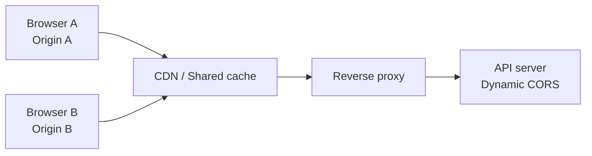

# Vary Origin

> **Chương:** CORS nâng cao  
> **Bài học:** Vary Origin — phối hợp CORS với HTTP cache  
> **Phạm vi module:** **SECURITY_APPLICATION_SECURITY_BROWSER_SECURITY** — phân tích ranh giới bảo mật giữa trình duyệt, origin, cookie và ứng dụng web để hiểu Same-Origin Policy (SOP), CORS và các cơ chế cách ly; thực hành phòng vệ XSS, CSRF, clickjacking bằng CSP, Trusted Types, security headers và kiểm chứng thực tế.

## Mục tiêu học tập

Sau bài này, bạn có thể:

1. Giải thích header HTTP **Vary** và cách cache tạo các biến thể response theo request header.
2. Hiểu tại sao endpoint CORS phản chiếu một origin từ allowlist thường cần **Vary: Origin**.
3. Phân biệt response CORS có origin cố định, wildcard và origin thay đổi theo request.
4. Thiết kế CORS allowlist an toàn, xử lý origin không được phép, origin vắng mặt và giá trị null.
5. Cấu hình cache cho tài nguyên công khai, response có credentials và dữ liệu cá nhân hóa.
6. Phân biệt cache response thực tế với **CORS preflight cache**.
7. Nhận diện lỗi CDN/reverse proxy, cache poisoning, cache fragmentation và rủi ro do bỏ qua Vary.
8. Kiểm chứng response variants qua DevTools và cache trung gian trong môi trường thử nghiệm.

## 1. Vấn đề: cùng URL nhưng response CORS có thể khác nhau

Giả sử một API cung cấp dữ liệu danh mục cho hai ứng dụng:

- Frontend A: https://app-a.example
- Frontend B: https://app-b.example
- API: https://api.example

Máy chủ API chỉ cho phép hai origin trên đọc response. Server chọn header CORS theo Origin của request.

**Request từ frontend A:**

```http
GET /catalog HTTP/1.1
Host: api.example
Origin: https://app-a.example
```

**Response tương ứng:**

```http
HTTP/1.1 200 OK
Access-Control-Allow-Origin: https://app-a.example
Content-Type: application/json

{"items":["book","pen"]}
```

Khi request đến từ frontend B, response có thể là:

```http
HTTP/1.1 200 OK
Access-Control-Allow-Origin: https://app-b.example
Content-Type: application/json

{"items":["book","pen"]}
```

Cùng URL và cùng nội dung body, nhưng **header CORS khác nhau theo request header Origin**.

Nếu một cache dùng chung chỉ lưu response theo URL mà không phân biệt Origin, response dành cho frontend A có thể được tái sử dụng khi frontend B gọi API. Frontend B khi đó nhận ACAO của A. Browser so sánh giá trị này với origin hiện tại và từ chối cho JavaScript đọc response.

Để cache biết response phụ thuộc vào header Origin, server cần khai báo:

```http
Vary: Origin
```

Đây là nhiệm vụ chính của **Vary Origin**.

## 2. Vary là gì?

**Vary** là HTTP response header mô tả những request header nào ảnh hưởng đến cách chọn response từ cache.

Một response có thể thay đổi theo:

- **Accept-Encoding:** server trả nội dung nén gzip, Brotli hoặc không nén.
- **Accept-Language:** server trả nội dung theo ngôn ngữ.
- **Accept:** server chọn định dạng JSON hoặc HTML.
- **Origin:** server trả CORS headers phù hợp với origin của request.

Ví dụ:

```http
HTTP/1.1 200 OK
Content-Type: application/json
Content-Encoding: br
Vary: Accept-Encoding, Origin
```

Với response này, cache phải cân nhắc cả giá trị Accept-Encoding và Origin của request khi quyết định có thể dùng lại response đã lưu hay không.

### 2.1. Cache key và response variant

Một HTTP cache thường nhận diện response bằng request method và target URI, sau đó sử dụng các trường được liệt kê trong Vary để so sánh request mới với request đã tạo ra response được lưu.

Mô hình khái quát:

```text
Cache entry:
  Method: GET
  URI: https://api.example/catalog
  Vary: Origin

  Request variant A:
    Origin: https://app-a.example
    Response:
      ACAO: https://app-a.example

  Request variant B:
    Origin: https://app-b.example
    Response:
      ACAO: https://app-b.example
```

Hai request có cùng URL nhưng khác Origin được xem là các biến thể khác nhau cho mục đích tái sử dụng response.

Vary không bắt buộc mọi cache phải triển khai nội bộ bằng một cấu trúc cache key cụ thể. Nó định nghĩa **điều kiện lựa chọn response variant** theo ngữ nghĩa HTTP caching. CDN, reverse proxy và browser cache cần được cấu hình để tôn trọng điều kiện này.

### 2.2. Vary: Origin có tác dụng gì?

```http
Access-Control-Allow-Origin: https://app-a.example
Vary: Origin
```

Header này cho biết response được chọn dựa trên Origin. Nếu request mới có Origin khác, cache không được coi response variant cũ là phù hợp chỉ vì URL giống nhau.

Điều này giúp tránh tình trạng:

1. Browser A nhận response mang ACAO của A.
2. Cache dùng chung lưu response đó.
3. Browser B gọi cùng URL nhưng nhận lại ACAO của A.
4. Browser B từ chối response vì origin không khớp.

**Vary: Origin không cấp quyền CORS.** Quyền đọc vẫn do browser kiểm tra các response headers CORS, đặc biệt là Access-Control-Allow-Origin và các điều kiện credentials tương ứng.

## 3. Khi nào cần Vary: Origin?

Câu trả lời phụ thuộc vào cách server tạo response.

| Cách trả ACAO | Response có thay đổi theo Origin? | Có cần Vary: Origin? |
|---|:---:|:---:|
| Luôn trả Access-Control-Allow-Origin: * cho tài nguyên công khai | Không | Thường không |
| Luôn trả một origin cố định cho mọi request | Không | Không bắt buộc vì ACAO không phụ thuộc request Origin |
| Chọn ACAO từ allowlist theo Origin request | Có | Có |
| Phản chiếu Origin sau khi xác minh allowlist | Có | Có |
| Origin được phép thì trả ACAO; origin khác thì không trả ACAO | Có | Có |
| Body hoặc header khác nhau theo Origin | Có | Có, ngoài các chiều cache khác cần thiết |

### 3.1. Trường hợp origin cố định

Nếu endpoint luôn trả:

```http
Access-Control-Allow-Origin: https://app.example
```

cho tất cả request, response không thay đổi theo giá trị Origin. Browser chỉ cho origin phù hợp đọc response; origin khác không được đọc.

Trong trường hợp này, Vary: Origin không bắt buộc chỉ để mô tả ACAO vì header được cố định.

### 3.2. Trường hợp wildcard

Với tài nguyên thật sự công khai, server có thể trả:

```http
Access-Control-Allow-Origin: *
```

Giá trị wildcard không phụ thuộc Origin request, nên thường không cần Vary: Origin.

**Không dùng wildcard cho response cần credentials.** Browser không chấp nhận Access-Control-Allow-Origin: * khi request được thực hiện với credentials mode include.

### 3.3. Trường hợp allowlist động

Ví dụ server chỉ cho phép hai frontend:

- https://app-a.example
- https://app-b.example

Nếu server chọn ACAO theo request, response thay đổi theo Origin. Cần trả ACAO phù hợp và:

```http
Vary: Origin
```

Cần có Vary ngay cả khi request từ origin không được phép nhận response không có ACAO, vì quyết định thêm hay không thêm ACAO cũng phụ thuộc Origin.

## 4. Thiết kế CORS allowlist và Vary an toàn

Một endpoint thường phải thực hiện hai việc riêng:

1. Xác định Origin có nằm trong danh sách được phép đọc response hay không.
2. Khai báo cho cache rằng response có phụ thuộc vào Origin hay không.

Ví dụ pseudocode:

```js
const allowedOrigins = new Set([
  'https://app-a.example',
  'https://app-b.example',
]);

function applyCorsHeaders(request, response) {
  const origin = request.headers.origin;

  // Response của endpoint thay đổi theo Origin,
  // kể cả trường hợp Origin không được phép.
  appendVary(response, 'Origin');

  if (typeof origin === 'string' && allowedOrigins.has(origin)) {
    response.setHeader('Access-Control-Allow-Origin', origin);
  }
}
```

appendVary ở đây là hàm minh họa: nó cần **giữ các giá trị Vary đã có**, thêm Origin nếu chưa tồn tại và tránh ghi đè các trường như Accept-Encoding.

### 4.1. So khớp origin chính xác

Một Origin thông thường có dạng:

```text
scheme://host[:port]
```

Ví dụ:

- https://app.example
- https://app.example:8443
- http://app.example

Đây là ba origin khác nhau.

Không kiểm tra kiểu:

```js
// Không an toàn: kiểm tra hậu tố quá rộng.
if (origin.endsWith('example')) {
  allowOrigin(origin);
}
```

Cách kiểm tra trên có thể chấp nhận host ngoài dự kiến. Tương tự, so khớp bằng startsWith có thể chấp nhận https://app.example.attacker.test.

Ưu tiên allowlist các serialized origin đầy đủ, có scheme, host và port như dự kiến. Không tự ghép chuỗi từ host do người dùng nhập.

### 4.2. Xử lý Origin vắng mặt và Origin: null

Không phải mọi HTTP request đều có header Origin. Một số request cùng origin, điều hướng hoặc client không phải browser có thể không gửi header này theo cùng một cách.

Giá trị Origin: null cũng có thể xuất hiện trong những ngữ cảnh opaque origin, ví dụ tài liệu sandbox hoặc URL data. Không coi null là một đối tác cụ thể hoặc nguồn đáng tin.

Quy tắc an toàn:

- Chỉ thêm ACAO cho Origin đã được xác minh và được phép.
- Không phản chiếu null tùy tiện.
- Không coi thiếu Origin là bằng chứng request an toàn.
- Authentication, authorization và CSRF phải được kiểm tra độc lập.

### 4.3. Không trả nhiều Access-Control-Allow-Origin

Một response CORS chỉ nên có **một giá trị ACAO hợp lệ** cho request đó. Không trả:

```http
Access-Control-Allow-Origin: https://app-a.example, https://app-b.example
```

Browser không hiểu đây là danh sách origin hợp lệ theo cách đó. Server phải chọn một origin phù hợp với request đã được xác minh, hoặc dùng wildcard trong trường hợp tài nguyên công khai không credentials.

### 4.4. Luôn giữ các Vary hiện có

Một endpoint có thể đã trả:

```http
Vary: Accept-Encoding
```

Sau khi thêm CORS động, response nên có:

```http
Vary: Accept-Encoding, Origin
```

Không ghi đè Vary: Accept-Encoding bằng Vary: Origin. Làm như vậy có thể khiến cache tái sử dụng sai biến thể nén, ngoài lỗi CORS.

Nếu header đã có Origin thì không cần thêm trùng lặp. Tên field HTTP không phân biệt chữ hoa/thường; việc hợp nhất nên được thực hiện bằng cơ chế xử lý header chuẩn của framework/proxy.

## 5. Ví dụ response theo từng origin

Giả sử API cho phép https://shop.example và https://admin.example đọc dữ liệu danh mục.

### 5.1. Request từ shop

```http
GET /api/catalog HTTP/1.1
Host: api.example
Origin: https://shop.example
Accept: application/json
```

Response:

```http
HTTP/1.1 200 OK
Content-Type: application/json
Access-Control-Allow-Origin: https://shop.example
Vary: Origin
Cache-Control: public, max-age=60

{"items":["book","pen"]}
```

### 5.2. Request từ admin

```http
GET /api/catalog HTTP/1.1
Host: api.example
Origin: https://admin.example
Accept: application/json
```

Response:

```http
HTTP/1.1 200 OK
Content-Type: application/json
Access-Control-Allow-Origin: https://admin.example
Vary: Origin
Cache-Control: public, max-age=60

{"items":["book","pen"]}
```

Một cache có thể lưu hai response variants theo Origin. Nội dung body ở ví dụ này giống nhau, nhưng header CORS khác nhau.

### 5.3. Request từ origin không được phép

```http
GET /api/catalog HTTP/1.1
Host: api.example
Origin: https://unknown.example
```

Server có thể trả:

```http
HTTP/1.1 200 OK
Content-Type: application/json
Vary: Origin
Cache-Control: public, max-age=60

{"items":["book","pen"]}
```

Không có ACAO nên browser không cho JavaScript của origin đó đọc response. Server cũng có thể chủ động trả lỗi theo chính sách ứng dụng, nhưng **không nên nhầm việc browser chặn đọc với xác thực hoặc phân quyền server**.

Vary vẫn cần vì response có ACAO hay không phụ thuộc vào Origin.

## 6. Vary Origin và cache dùng chung

Trong thực tế, response có thể đi qua nhiều lớp cache:



Các lớp có thể bao gồm:

- Browser HTTP cache.
- Service worker cache do ứng dụng quản lý.
- Reverse proxy hoặc API gateway.
- CDN edge cache.
- Cache của nền tảng hosting.

Mỗi lớp có quy tắc và cấu hình riêng. Vary: Origin là tín hiệu HTTP cho cache; CDN có thể còn có **cache key policy** tùy chỉnh.

### 6.1. Khi cache không tôn trọng Vary

Nếu API phản chiếu Origin hợp lệ nhưng response không khai báo Vary: Origin, shared cache có thể tái sử dụng response variant sai.

Ví dụ:

1. Request đầu từ shop tạo response có ACAO là shop.
2. CDN lưu response theo URL chung.
3. Request từ admin dùng lại response của shop.
4. Browser admin nhận ACAO của shop và từ chối đọc response.

Hậu quả phổ biến là **lỗi CORS không ổn định theo thứ tự request**: người dùng đầu tiên hoạt động, người dùng tiếp theo lỗi, hoặc lỗi xuất hiện tùy edge cache.

Đây thường là vấn đề tính đúng đắn và tính sẵn sàng. Trong những cấu hình cache phức tạp, nếu body cũng phụ thuộc dữ liệu cá nhân hoặc credentials nhưng cache key không tách đúng các chiều liên quan, rủi ro có thể nghiêm trọng hơn và dẫn đến rò rỉ dữ liệu. **Vary: Origin không thay thế cache policy cho dữ liệu cá nhân.**

### 6.2. Cache key tùy chỉnh ở CDN

Một số CDN cho phép cấu hình cache key riêng, ví dụ chỉ bao gồm URL và một số query parameters. Nếu CDN bỏ qua header Vary hoặc không đưa Origin vào cache key theo chính sách tương ứng, chỉ thêm header ở ứng dụng có thể chưa đủ trong cấu hình cụ thể.

Khi triển khai cần kiểm tra:

- CDN có tôn trọng Vary từ origin server không?
- Có rule nào loại bỏ hoặc ghi đè Vary không?
- Cache key có đưa Origin vào khi endpoint cần phân biệt Origin không?
- Có cache rule bỏ qua cookie hoặc authorization không?
- Có response transform làm mất ACAO hoặc Vary không?
- Edge cache và browser cache có cùng hành vi không?

Không cấu hình cache key bằng cách đưa mọi request header vào một cách máy móc. Chỉ chọn các chiều cần thiết, kiểm soát cardinality và kiểm thử khả năng cache.

### 6.3. Vary có thể làm tăng số lượng cache variants

Nếu một endpoint phản hồi theo mọi Origin mà không giới hạn, cache có thể tạo nhiều variants cho cùng URL.

Điều này có thể:

- Làm giảm cache hit ratio.
- Tăng bộ nhớ và lưu trữ cache.
- Tăng số lần truy cập origin server.
- Tạo cơ hội gây cache fragmentation bằng nhiều Origin khác nhau.

Allowlist origin chặt chẽ vừa là quyết định bảo mật vừa giúp kiểm soát số lượng biến thể. Với tài nguyên công khai thực sự, cân nhắc dùng wildcard cố định nếu phù hợp thay vì phản chiếu origin không cần thiết.

## 7. Vary Origin không phải cơ chế xác thực hay phân quyền

Đây là phân biệt bắt buộc:

| Cơ chế | Nhiệm vụ |
|---|---|
| Access-Control-Allow-Origin | Browser biết origin nào được phép đọc response theo CORS |
| Vary: Origin | Cache biết response variant phụ thuộc request header Origin |
| Authentication | Xác định danh tính người dùng/client |
| Authorization | Xác định danh tính đó có quyền thực hiện hành động hoặc đọc tài nguyên không |
| CSRF protection | Xác minh request thay đổi trạng thái được gửi trong ngữ cảnh hợp lệ |
| Cache-Control | Quy định khả năng lưu trữ và tái sử dụng response |
| SameSite cookie | Điều chỉnh việc gửi cookie trong các ngữ cảnh same-site/cross-site |

Một HTTP client như curl hoặc backend service không tuân theo CORS enforcement của browser. Nó có thể gửi request và đọc response bất kể ACAO là gì. Vì vậy, không bao giờ dùng allowlist CORS làm hàng rào duy nhất cho dữ liệu riêng tư.

### 7.1. Origin không phải danh tính người dùng

Header Origin cho biết nguồn của request trong các ngữ cảnh browser áp dụng. Nó không chứng minh:

- Người dùng đã đăng nhập.
- Người gửi sở hữu tài khoản.
- Request không bị giả mạo bởi một HTTP client ngoài browser.
- Người dùng có quyền đọc hoặc sửa tài nguyên.

Server phải xác minh token/session và quyền nghiệp vụ ở từng endpoint.

## 8. CORS với credentials và cache dữ liệu cá nhân

Một API có thể cho phép frontend đọc dữ liệu dựa trên cookie phiên:

```js
const response = await fetch('https://api.example/account', {
  credentials: 'include',
});

const account = await response.json();
```

Response tương ứng:

```http
Access-Control-Allow-Origin: https://app.example
Access-Control-Allow-Credentials: true
Vary: Origin
```

Đây là cấu hình CORS hợp lệ khi origin đã được allowlist. Nhưng cần xem **nội dung response có phụ thuộc người dùng hay không**.

### 8.1. Vary Origin không tách người dùng

Giả sử hai người dùng đăng nhập từ cùng frontend origin:

- User A có cookie phiên A.
- User B có cookie phiên B.
- Cả hai gọi cùng URL /account.

Cả hai request đều có cùng Origin https://app.example, nên Vary: Origin không phân biệt họ.

Nếu response chứa thông tin cá nhân, chỉ dùng Vary Origin là **không đủ**. Cần cấu hình cache để response không bị dùng chung giữa người dùng.

Thông thường, response tài khoản/phiên nhạy cảm nên dùng:

```http
Cache-Control: private, no-store
Vary: Origin
Access-Control-Allow-Origin: https://app.example
Access-Control-Allow-Credentials: true
```

private ngăn shared cache lưu response theo ngữ nghĩa HTTP; no-store yêu cầu cache không lưu response. Chọn chính sách cụ thể theo yêu cầu sản phẩm và khả năng cache của nền tảng.

### 8.2. Không dùng Vary: Cookie như giải pháp mặc định

Có thể nghĩ đến Vary: Cookie để tách response theo cookie, nhưng cách này thường tạo rất nhiều variants, khó kiểm soát và dễ gây lỗi nếu cache/proxy xử lý cookie không nhất quán.

Với response cá nhân hóa, ưu tiên Cache-Control: private hoặc no-store tùy mức nhạy cảm. Không cố cache dữ liệu người dùng trong shared cache chỉ bằng cách thêm một trường Vary.

### 8.3. Cache-Control và Vary giải quyết hai câu hỏi khác nhau

- **Vary:** request nào có thể dùng lại cùng response variant?
- **Cache-Control:** response có được lưu không, ai được lưu, và trong bao lâu?

Ví dụ tài nguyên công khai:

```http
Cache-Control: public, max-age=300
Access-Control-Allow-Origin: https://app.example
Vary: Origin
```

Ví dụ dữ liệu tài khoản:

```http
Cache-Control: private, no-store
Access-Control-Allow-Origin: https://app.example
Access-Control-Allow-Credentials: true
Vary: Origin
```

Không có một bộ header phù hợp cho mọi API. Phải phân loại response theo mức độ công khai, phụ thuộc người dùng và yêu cầu hiệu năng.

## 9. CORS errors, error responses và Vary

Một endpoint có thể trả các status khác nhau:

- 200 OK
- 401 Unauthorized
- 403 Forbidden
- 404 Not Found
- 429 Too Many Requests
- 500 Internal Server Error

Nếu frontend được phép đọc lỗi API để hiển thị thông báo, response lỗi cũng cần các CORS headers phù hợp. Nếu chỉ response 200 có ACAO còn 401/403 không có, frontend có thể chỉ nhận lỗi CORS mơ hồ thay vì đọc status/body lỗi.

Ví dụ:

```http
HTTP/1.1 401 Unauthorized
Access-Control-Allow-Origin: https://app.example
Vary: Origin
Content-Type: application/json
Cache-Control: no-store

{"error":"authentication_required"}
```

Khi response thay đổi theo Origin, Vary: Origin cần được duy trì trên các status phù hợp, không chỉ nhánh thành công. Middleware và error handler phải bảo đảm header không bị mất.

### 9.1. Redirect và response 304

- Response redirect có thể mang CORS headers tùy loại request và quy tắc Fetch; cần kiểm tra response trung gian và response cuối.
- 304 Not Modified được dùng trong conditional caching. Khi cache cập nhật metadata từ 304, các trường như Vary cần được xử lý nhất quán theo quy tắc HTTP caching.
- Không giả định response 304 có body như response 200; body thường được lấy từ cache entry đã lưu.

Khi debug, quan sát cả Age, ETag, Cache-Control, Vary, Via hoặc header riêng của CDN nếu có.

## 10. Vary Origin và preflight cache

CORS có hai hoạt động cache khác nhau cần phân biệt:

1. **HTTP response cache:** lưu response thực tế như GET /catalog, có thể dùng Vary: Origin để phân biệt biến thể.
2. **CORS preflight cache:** browser lưu kết quả cho phép method/header từ preflight theo cơ chế riêng, được điều khiển một phần bởi Access-Control-Max-Age.

Ví dụ preflight response:

```http
HTTP/1.1 204 No Content
Access-Control-Allow-Origin: https://app.example
Access-Control-Allow-Methods: PUT
Access-Control-Allow-Headers: Content-Type, X-CSRF-Token
Access-Control-Max-Age: 600
Vary: Origin, Access-Control-Request-Method, Access-Control-Request-Headers
```

Các điểm cần nhớ:

- Access-Control-Max-Age điều khiển thời gian browser có thể tái sử dụng quyền preflight theo giới hạn của browser.
- Preflight cache không phải HTTP cache thông thường của response API.
- Vary: Origin trên response thực tế không thay Access-Control-Max-Age.
- Khi shared cache/proxy có thể cache OPTIONS response, cần phân biệt cả Origin, method và request headers được hỏi trước. Cấu hình cụ thể phải phù hợp với hành vi cache của nền tảng.
- Browser có thể áp giới hạn thời gian preflight cache thấp hơn giá trị server đề xuất.

Đừng nhầm “preflight đã được cache” với “GET response đã được cache”. Hai cache có mục tiêu và khóa khác nhau.

## 11. Ví dụ triển khai: middleware CORS động và Vary

Đoạn dưới đây là pseudocode theo phong cách Express, tập trung vào nguyên tắc. Tên helper và cách append header có thể cần điều chỉnh theo framework.

```js
const allowedOrigins = new Set([
  'https://app.example',
  'https://admin.example',
]);

function appendVary(res, fieldName) {
  const current = res.getHeader('Vary');

  if (current === '*') return;

  const fields = String(current || '')
    .split(',')
    .map((field) => field.trim())
    .filter(Boolean);

  const exists = fields.some(
    (field) => field.toLowerCase() === fieldName.toLowerCase()
  );

  if (!exists) fields.push(fieldName);

  res.setHeader('Vary', fields.join(', '));
}

function corsForApi(req, res, next) {
  const origin = req.headers.origin;

  // Chính sách endpoint phụ thuộc Origin.
  appendVary(res, 'Origin');

  if (typeof origin === 'string' && allowedOrigins.has(origin)) {
    res.setHeader('Access-Control-Allow-Origin', origin);
    res.setHeader('Access-Control-Allow-Credentials', 'true');
  }

  next();
}
```

Trong hệ thống thật:

- Middleware phải chạy trước khi response được gửi, bao gồm các nhánh lỗi.
- Không ghi đè Vary hiện có từ compression hoặc framework.
- Không tạo nhiều ACAO header.
- Nếu response chứa dữ liệu người dùng, đặt cache policy phù hợp như private, no-store.
- Chỉ bật credentials nếu ứng dụng thực sự cần và cookie policy được thiết kế tương ứng.
- Xử lý preflight OPTIONS theo middleware/route phù hợp; không giả định chỉ middleware response thực tế là đủ.

### 11.1. Một lưu ý về Vary: *

Vary: * biểu thị response không thể được tái sử dụng theo phép so sánh request-header thông thường. Nếu response đã có Vary: *, không cần thêm Origin vào danh sách; * đã có ý nghĩa rộng hơn.

Tuy nhiên, không dùng Vary: * như cách sửa nhanh cho cấu hình cache CORS sai. Nó thường làm mất lợi ích cache và không thay thế Cache-Control, CORS allowlist hoặc kiểm soát dữ liệu cá nhân.

## 12. Tình huống thực tế: CDN trả lỗi CORS ngẫu nhiên

Giả sử một API dùng allowlist động và CDN ở trước server.

Hiện tượng:

- Frontend A đôi lúc đọc được dữ liệu.
- Frontend B thỉnh thoảng gặp lỗi CORS.
- Lỗi thay đổi theo thời điểm hoặc edge node.
- API origin server luôn trả đúng ACAO khi kiểm tra trực tiếp.

Một nguyên nhân có thể là CDN cache response theo URL mà không tách Origin.

### Quy trình điều tra

1. Mở DevTools Network và ghi lại request Origin, response ACAO, Vary, Age, Via và header cache của CDN.
2. Gọi cùng URL lần lượt từ origin A và B.
3. So sánh response khi cache cold và cache hit.
4. Kiểm tra cấu hình CDN có tôn trọng Vary: Origin hay không.
5. Kiểm tra có rule cache key tùy chỉnh hoặc response header transform bỏ Vary/ACAO không.
6. Thêm hoặc sửa Vary: Origin ở origin response nếu response thay đổi theo Origin.
7. Cấu hình CDN cache key phù hợp với Origin nếu nền tảng yêu cầu cấu hình tường minh.
8. Purge các response variants cũ sau khi thay đổi chính sách cache.
9. Kiểm thử lại từ tất cả origin được allowlist và một origin không được phép.

### Ví dụ so sánh

| Lượt gọi | Origin request | ACAO nhận được | Kết quả browser |
|---|---|---|---|
| 1 | app-a.example | app-a.example | Đọc được |
| 2, cache dùng sai variant | app-b.example | app-a.example | Bị CORS chặn |
| 3, cache key đúng | app-b.example | app-b.example | Đọc được |
| 4 | unknown.example | Không có ACAO | Không được đọc |

Đây là ví dụ về **lỗi lựa chọn variant**. Không nên mặc định mọi lỗi CORS ngẫu nhiên đều do Vary: còn có thể do proxy, header trùng, redirect, credentials, cache trình duyệt hoặc cấu hình CDN khác.

## 13. Thực hành A — Quan sát Vary Origin bằng hai frontend

Thực hiện trên hai origin demo bạn kiểm soát:

```text
Frontend A: http://localhost:3000
Frontend B: http://localhost:3001
API:        http://localhost:4000
```

Ba URL này có cùng host nhưng khác port, do đó khác origin.

### Chuẩn bị API

Tạo endpoint /catalog trả JSON và chọn ACAO theo allowlist:

- Origin A được phép: trả ACAO là Origin A.
- Origin B được phép: trả ACAO là Origin B.
- Origin khác: không trả ACAO.
- Mọi response có Vary: Origin.

### Các bước

1. Mở frontend A, bật DevTools Network, gọi /catalog.
2. Ghi lại Origin, Access-Control-Allow-Origin, Vary, status và body.
3. Mở frontend B và gọi cùng endpoint.
4. Kiểm tra ACAO thay đổi theo origin và Vary vẫn có Origin.
5. Thử origin thứ ba không được phép và xác nhận không có ACAO.
6. Nếu có CDN/cache thử nghiệm, chạy nhiều lượt và kiểm tra Age hoặc cache status.

### Kết quả mong đợi

- Origin A và B nhận response variant phù hợp.
- Response có Vary: Origin.
- Origin ngoài allowlist không được JavaScript đọc response.
- Browser vẫn thực hiện CORS check dù không có preflight nếu request là simple.

## 14. Thực hành B — Thử nghiệm lỗi khi bỏ Vary

Chỉ làm trên cache demo của bạn.

1. Tạm bỏ Vary: Origin trong response động.
2. Xóa cache.
3. Gọi API từ frontend A để cache lưu response ACAO của A.
4. Gọi cùng URL từ frontend B qua cùng cache.
5. Quan sát xem B có nhận response variant của A không.
6. Khôi phục Vary: Origin, purge cache và thử lại.

**Không phải mọi browser cache hoặc CDN đều có hành vi giống nhau khi Vary bị thiếu.** Kết quả phụ thuộc cấu hình cache key. Mục tiêu thí nghiệm là xác minh lớp cache cụ thể của hệ thống.

## 15. Thực hành C — Phân biệt Vary và Cache-Control

Tạo hai endpoint demo:

**Endpoint công khai:**

```http
Access-Control-Allow-Origin: https://app.example
Vary: Origin
Cache-Control: public, max-age=300
```

**Endpoint cá nhân hóa:**

```http
Access-Control-Allow-Origin: https://app.example
Access-Control-Allow-Credentials: true
Vary: Origin
Cache-Control: private, no-store
```

Quan sát:

- Endpoint công khai có thể được cache theo policy đã khai báo.
- Endpoint cá nhân hóa không nên được shared cache tái sử dụng giữa người dùng.
- Vary: Origin phân biệt origin; nó không phân biệt user A và user B khi cả hai có cùng Origin.
- Cache-Control xác định khả năng lưu và tái sử dụng; nó không thay CORS allowlist.

## 16. Thực hành D — Kiểm tra response error và preflight

1. Tạo endpoint demo trả 401 hoặc 403.
2. Cho phép origin frontend bằng ACAO và thêm Vary.
3. Gọi bằng Fetch để xem frontend có đọc được status/body lỗi không.
4. Bỏ ACAO khỏi nhánh error handler rồi so sánh lỗi CORS.
5. Tạo request PUT hoặc POST JSON để phát sinh preflight.
6. Kiểm tra OPTIONS response và Access-Control-Max-Age.
7. Phân biệt response preflight được browser cache với response API được HTTP cache lưu.

Không sử dụng thông tin phiên thật hoặc endpoint nghiệp vụ thật trong bài lab.

## 17. Bảng kiểm tra trước khi triển khai

| Hạng mục | Câu hỏi | Kỳ vọng |
|---|---|---|
| CORS allowlist | Có xác minh serialized origin đầy đủ? | So khớp chính xác scheme/host/port |
| ACAO | Có một giá trị hợp lệ cho response? | Một origin được phép hoặc wildcard cho dữ liệu công khai |
| Vary | ACAO có thay đổi theo Origin không? | Có Vary: Origin nếu response phụ thuộc Origin |
| Vary merge | Response đã có Accept-Encoding hoặc field khác? | Giữ các field hiện có |
| Origin không hợp lệ | Có phản chiếu tùy tiện? | Không thêm ACAO cho nguồn không được phép |
| Origin null | Có được allow vô điều kiện? | Không |
| Credentials | Có dùng wildcard với credentials? | Không; dùng origin cụ thể và ACAC true khi cần |
| Dữ liệu cá nhân | Shared cache có thể lưu không? | private/no-store theo độ nhạy cảm |
| CDN | Có tôn trọng Vary/cache key? | Kiểm thử edge và cache hit |
| Error response | Nhánh 401/403/500 có CORS header phù hợp? | Nhất quán theo chính sách |
| Preflight | Có nhầm Access-Control-Max-Age với HTTP cache? | Phân biệt hai cache |
| Server authorization | Có dựa vào Origin để cấp quyền? | Không; xác thực và phân quyền độc lập |

## 18. Câu hỏi tự kiểm tra

**1.** Vary là response header hay request header?  
**Đáp án:** Vary là response header; giá trị của nó liệt kê request headers mà cache phải xét khi chọn response variant.

**2.** Khi server phản chiếu Origin từ allowlist, vì sao cần Vary: Origin?  
**Đáp án:** Vì ACAO thay đổi theo Origin request; cache cần tách các response variants.

**3.** Nếu endpoint luôn trả ACAO wildcard cho tài nguyên công khai, có cần Vary: Origin không?  
**Đáp án:** Thường không, vì response không phụ thuộc Origin.

**4.** Nếu endpoint luôn trả một ACAO cố định cho mọi request thì sao?  
**Đáp án:** Vary Origin không bắt buộc chỉ vì CORS, do ACAO không thay đổi theo request Origin. Browser vẫn chỉ cho origin khớp đọc response.

**5.** Vary: Origin có cấp quyền cho một origin không được allowlist không?  
**Đáp án:** Không. Vary chỉ điều khiển lựa chọn cache variant; ACAO và browser CORS check mới quyết định quyền đọc.

**6.** Vary: Origin có phân biệt hai người dùng cùng gọi từ một frontend origin không?  
**Đáp án:** Không. Cả hai có cùng Origin. Response cá nhân hóa cần cache policy riêng như private/no-store.

**7.** Vì sao cần giữ Vary: Accept-Encoding khi thêm Vary: Origin?  
**Đáp án:** Vì cache còn phải phân biệt response nén và không nén; ghi đè Vary có thể làm sai variant nội dung.

**8.** Nếu cache bỏ qua Vary, điều gì có thể xảy ra?  
**Đáp án:** Có thể trả sai ACAO variant, dẫn đến lỗi CORS ngẫu nhiên; nếu các chiều dữ liệu cá nhân khác cũng bị cache sai, có thể phát sinh rủi ro rò rỉ nghiêm trọng.

**9.** Access-Control-Max-Age có thay Vary Origin không?  
**Đáp án:** Không. Nó điều khiển cache kết quả preflight của browser; Vary liên quan lựa chọn HTTP response variant.

**10.** Có nên phản chiếu Origin null cho credentials API không?  
**Đáp án:** Không. Null có thể đại diện nhiều opaque origins khác nhau và không xác định một đối tác đáng tin.

**11.** CORS allowlist có thay authentication/authorization không?  
**Đáp án:** Không. Client ngoài browser không bị CORS enforcement của browser; server vẫn phải xác thực và phân quyền.

**12.** Response 401 có cần CORS headers không?  
**Đáp án:** Nếu frontend được phép đọc status/body lỗi, nhánh 401 cũng cần CORS headers phù hợp và Vary nhất quán nếu response phụ thuộc Origin.

## Ghi nhớ

**Vary: Origin kết nối chính sách CORS động với HTTP caching.** Khi server chọn Access-Control-Allow-Origin dựa trên Origin request, response cần khai báo Vary: Origin để cache phân biệt các biến thể. Nếu ACAO cố định hoặc wildcard cho dữ liệu công khai và không phụ thuộc Origin, Vary Origin thường không cần thiết.

Vary không cấp quyền CORS, không xác thực người dùng và không bảo vệ dữ liệu cá nhân. Hãy kết hợp allowlist origin chính xác, giữ các Vary hiện có, cấu hình CDN đúng, dùng Cache-Control: private, no-store cho response nhạy cảm khi phù hợp, phân biệt preflight cache với HTTP cache và kiểm tra cả response thành công lẫn lỗi. Đây là cách tránh lỗi CORS do cache và bảo vệ dữ liệu khi nhiều ứng dụng cùng dùng một API.
