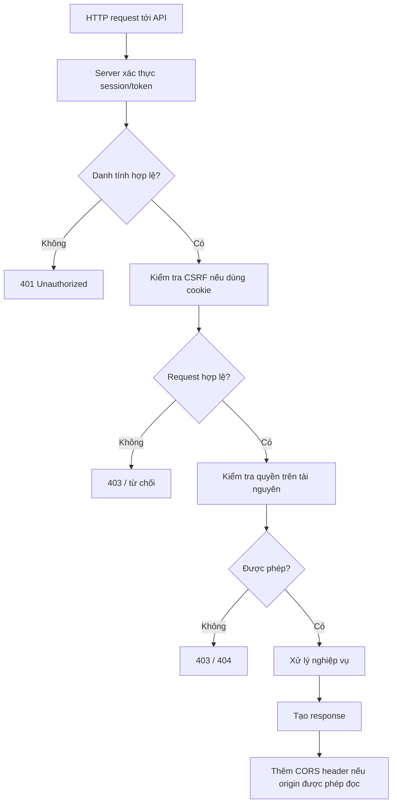

# Thiết kế allowlist CORS

> **Chương:** CORS nâng cao  
> **Học phần:** Application Security — Browser Security (`SECURITY_APPLICATION_SECURITY_BROWSER_SECURITY`)

Một allowlist CORS tốt phải trả lời được câu hỏi: **những origin nào thực sự cần được JavaScript đọc response từ API này?** Câu trả lời cần chính xác tới scheme, host và port; có chủ sở hữu, môi trường và mục đích rõ ràng; được áp dụng nhất quán ở ứng dụng, gateway và cache. Một danh sách domain gốc hoặc một wildcard tiện lợi thường che giấu những ranh giới tin cậy khác nhau.

Thiết kế allowlist là bài toán quản lý quyền đọc response trong browser. Nó không xác thực người dùng, không cấp quyền truy cập tài nguyên và không thay thế CSRF protection. Server vẫn phải kiểm tra danh tính, quyền theo tài nguyên và quy tắc nghiệp vụ ở mọi request.

## 1. Mục tiêu học tập

Sau bài học, bạn có thể:

1. Xác định origin hợp lệ theo bộ ba `scheme + host + port`.
2. Thiết kế allowlist exact-match, phân tách theo môi trường và loại endpoint.
3. Xử lý nhu cầu origin động của tenant mà không phản chiếu tùy ý header `Origin`.
4. Chọn chính sách credentials, method, request header và response header tối thiểu.
5. Phối hợp CORS với cookie, CSRF, subdomain, reverse proxy và cache.
6. Viết kiểm thử dương tính/âm tính cho allowlist, preflight và response lỗi.
7. Lập quy trình thêm, rà soát, thu hồi và giám sát origin được phép.

## 2. Bắt đầu từ ranh giới origin

Origin là bộ ba:

```text
scheme + host + port
```

Ví dụ, các giá trị sau là những origin khác nhau:

| Origin | Lý do |
| --- | --- |
| `https://app.example.com` | Origin ứng dụng chính |
| `http://app.example.com` | Khác scheme |
| `https://app.example.com:8443` | Khác port |
| `https://admin.example.com` | Khác host |
| `https://app.example.net` | Khác host và registrable domain |

Path không thuộc origin. `https://app.example.com/dashboard` và `https://app.example.com/settings` cùng origin. Vì vậy, CORS allowlist không thể phân biệt hai ứng dụng chỉ bằng path nếu chúng dùng chung origin. Nếu hai ứng dụng có mức độ tin cậy khác nhau, hãy cân nhắc triển khai trên các origin riêng.

Giá trị request header `Origin` được browser gửi theo dạng serialized origin, ví dụ:

```http
Origin: https://app.example.com
```

Nó không chứa path, query hoặc fragment. Một số ngữ cảnh opaque origin được biểu diễn bằng `Origin: null`; giá trị này không nên được cho phép theo mặc định.

## 3. Nguyên tắc thiết kế allowlist

Một allowlist có thể được review và vận hành tốt nên tuân thủ các nguyên tắc sau:

1. **Exact match:** so sánh origin đầy đủ, không so chuỗi con hoặc domain suffix mơ hồ.
2. **Least privilege:** chỉ thêm origin cần thiết cho endpoint và luồng người dùng cụ thể.
3. **Phân tách môi trường:** production, staging, preview và local development có cấu hình riêng.
4. **Tin cậy theo chủ sở hữu:** chỉ cho phép origin do tổ chức kiểm soát và có người chịu trách nhiệm.
5. **Credentials có chủ đích:** chỉ bật khi cần cookie hoặc HTTP credentials; không kết hợp tùy tiện với wildcard.
6. **Không phụ thuộc CORS để bảo vệ API:** xác thực, phân quyền và chống CSRF phải độc lập.
7. **Có thể thu hồi:** origin cần có ngày rà soát, chủ sở hữu và quy trình loại bỏ khi không còn sử dụng.
8. **Kiểm thử ở đường đi thực:** xác minh response qua ứng dụng, proxy, CDN và browser.

## 4. Xây dựng danh sách từ nhu cầu thực tế

Đừng bắt đầu bằng câu hỏi “có thể cho phép domain nào?”. Hãy lập bản đồ các client thực sự cần đọc response:

| Client | Origin production | Cần cookie? | API cần đọc | Chủ sở hữu |
| --- | --- | --- | --- | --- |
| Web app | `https://app.example.com` | Có, session cookie | Profile, orders | Nhóm Web |
| Admin portal | `https://admin.example.com` | Có, session cookie riêng | Admin API | Nhóm Platform |
| Public docs | `https://docs.example.com` | Không | API tài liệu công khai | Nhóm Docs |
| Local development | `http://localhost:5173` | Chỉ trong môi trường dev | API dev | Nhóm phát triển |

Bảng này giúp phát hiện rằng không phải mọi client đều cần cùng quyền. Public docs có thể chỉ cần đọc một tập dữ liệu công khai với `Access-Control-Allow-Origin: *` và không credentials. Web app và admin portal có thể cần origin chính xác cùng credentials. Local development không nên tự động được đưa vào allowlist production.

Nên xác định allowlist theo **nhóm API hoặc policy** thay vì áp dụng một danh sách rộng cho mọi endpoint. Ví dụ API công khai, API tài khoản và API quản trị có thể có yêu cầu CORS khác nhau.

## 5. Exact-match và chuẩn hóa origin

Không dùng những cách kiểm tra lỏng lẻo như:

```js
// Sai: có thể chấp nhận evil-example.com
origin.endsWith("example.com");

// Sai: có thể chấp nhận example.com.attacker.test
origin.includes("example.com");
```

Một cách tiếp cận an toàn hơn là cấu hình các serialized origin đã được chuẩn hóa và so sánh chính xác:

```js
const allowedOrigins = new Set([
  "https://app.example.com",
  "https://admin.example.com",
]);

function isAllowedOrigin(origin) {
  if (typeof origin !== "string" || origin === "null") {
    return false;
  }

  try {
    const parsed = new URL(origin);

    // Origin header phải là serialized origin, không phải URL có path.
    if (parsed.origin !== origin) return false;

    return allowedOrigins.has(parsed.origin);
  } catch {
    return false;
  }
}
```

Trong cấu hình, cần lưu origin theo dạng canonical mà browser sử dụng: scheme và hostname viết thường, IDN ở dạng chuẩn hóa, port mặc định được lược bỏ. Không tự viết bộ canonicalization bằng regex. Exact-match cũng giúp từ chối các giá trị sai định dạng, URL có path và giá trị không nằm trong allowlist.

Nếu hệ thống cần chấp nhận nhiều dạng nhập từ quản trị viên, hãy chuẩn hóa và xác thực **tại thời điểm cấu hình**, rồi lưu serialized origin chuẩn. Khi xử lý request, so sánh với giá trị đã chuẩn hóa; không vừa parse vừa tự suy diễn quyền từ chuỗi tùy ý.

## 6. Không cho phép mọi subdomain theo mặc định

Một quy tắc như “mọi host kết thúc bằng `.example.com` đều đáng tin” chỉ an toàn nếu toàn bộ namespace đó được quản trị cùng mức độ tin cậy. Trên thực tế, subdomain có thể do nhóm khác quản lý, trỏ tới dịch vụ SaaS, chứa nội dung người dùng hoặc bị bỏ quên sau khi ngừng triển khai.

Ví dụ:

```text
https://app.example.com       → web app do tổ chức kiểm soát
https://support.example.com   → dịch vụ hỗ trợ của nhà cung cấp
https://uploads.example.com   → nội dung do người dùng tải lên
https://old.example.com       → ứng dụng cũ chưa được bảo trì
```

Các host có thể cùng site nhưng khác origin. Cho phép toàn bộ subdomain có thể trao quyền đọc response cho một origin có mức độ tin cậy thấp hơn.

Nếu thật sự cần wildcard subdomain, phải có tối thiểu:

- Quy trình cấp phát và thu hồi subdomain được quản lý tập trung.
- Không có subdomain trỏ tới dịch vụ bên thứ ba mà tổ chức không kiểm soát quyền sở hữu.
- Kiểm soát tenant và nội dung người dùng, không cho họ chạy script tùy ý trên origin được tin cậy.
- Giám sát DNS/CNAME, chứng chỉ và trạng thái dịch vụ.
- Rà soát định kỳ các host còn hoạt động và chủ sở hữu hiện tại.

Ngay cả khi đã có những kiểm soát này, exact allowlist thường dễ review hơn.

## 7. Phân tách môi trường và preview deployment

Không nên dùng chung một allowlist cho mọi môi trường:

```text
Production:
  https://app.example.com
  https://admin.example.com

Staging:
  https://staging-app.example.net
  https://staging-admin.example.net

Development:
  http://localhost:5173
```

Đây chỉ là ví dụ minh họa. Tên miền và port thực tế phải lấy từ hệ thống triển khai. Quy tắc quan trọng:

- Localhost chỉ được bật ở môi trường phát triển cần thiết.
- Không đưa origin preview dùng chung của nền tảng hosting vào production allowlist nếu người ngoài có thể tạo preview hoặc chiếm quyền project.
- Nếu cần kiểm thử preview, cấp origin riêng cho từng môi trường/nhóm và có thời hạn thu hồi.
- Không tự động chấp nhận mọi subdomain của domain staging chỉ vì domain đó thuộc công ty.
- Tránh dùng HTTP ở môi trường production; chỉ chấp nhận HTTPS origin theo yêu cầu bảo mật của ứng dụng.

Việc kiểm tra origin là kiểm tra scheme, host và port đầy đủ. `http://localhost:5173` và `https://localhost:5173` là hai origin khác nhau; `http://localhost:5173` cũng khác `http://localhost:3000`.

## 8. Credentials: tách policy public và policy phiên đăng nhập

Một API công khai không cần cookie có thể dùng:

```http
Access-Control-Allow-Origin: *
```

và không bật `Access-Control-Allow-Credentials`. Đây là lựa chọn hợp lý nếu dữ liệu thật sự công khai và không có response riêng theo người dùng.

API dùng cookie phiên thường cần origin cụ thể:

```http
Access-Control-Allow-Origin: https://app.example.com
Access-Control-Allow-Credentials: true
Vary: Origin
```

Frontend cần yêu cầu Fetch gửi credentials:

```js
fetch("https://api.example.com/account", {
  credentials: "include",
});
```

Với credentialed response:

- `Access-Control-Allow-Origin` phải là origin cụ thể được chấp nhận; không dùng `*`.
- `Access-Control-Allow-Credentials` phải có giá trị chính xác `true`.
- Cookie vẫn phải thỏa `Domain`/host-only, `Path`, `Secure`, `SameSite` và chính sách browser.
- CORS không thay thế CSRF token hoặc kiểm tra nguồn request.

Không nên bật credentials cho toàn bộ API chỉ vì một vài endpoint cần session. Nếu framework/middleware chỉ hỗ trợ policy toàn cục, cân nhắc tách route hoặc tạo policy riêng để giảm phạm vi.

## 9. Thiết kế method và header theo endpoint

Preflight kiểm tra method và request header không safelisted. Chỉ công bố những giá trị client thật sự cần:

```http
Access-Control-Allow-Methods: GET, POST, PATCH
Access-Control-Allow-Headers: Content-Type, Authorization, X-CSRF-Token
```

Không cần mở `DELETE`, `PUT` hoặc các header tùy chỉnh nếu client không sử dụng. Tuy nhiên, cần nhớ **Allow-Methods không phải authorization**: client có thể gọi API bằng công cụ khác, và server phải kiểm tra quyền trên method thực tế.

Nếu frontend cần đọc response header ngoài nhóm safelisted:

```http
Access-Control-Expose-Headers: X-Request-Id, Content-Disposition
```

Hãy phân biệt:

| Header | Hướng áp dụng | Mục đích |
| --- | --- | --- |
| `Access-Control-Allow-Headers` | Request | Cho phép client gửi header không safelisted sau preflight |
| `Access-Control-Expose-Headers` | Response | Cho phép JavaScript đọc response header bổ sung |

Đừng công bố các response header chứa thông tin nội bộ hoặc bí mật nếu frontend không cần đọc chúng.

## 10. Xử lý origin động và multi-tenant

Một số sản phẩm cho phép khách hàng cấu hình custom domain, ví dụ:

```text
https://portal.customer-a.test
https://portal.customer-b.test
```

Không thể dùng một allowlist tĩnh nhỏ nếu số tenant thay đổi liên tục. Nhưng cách giải quyết không phải phản chiếu mọi origin. Cần một **registry origin có kiểm soát**.

Một quy trình phù hợp:

1. Tenant đăng ký custom origin trong giao diện quản trị đã xác thực.
2. Hệ thống xác minh quyền kiểm soát domain bằng DNS TXT, HTTP challenge hoặc quy trình xác minh tương đương.
3. Lưu serialized origin đã chuẩn hóa, tenant sở hữu, trạng thái xác minh và thời điểm xác minh.
4. Chỉ kích hoạt origin sau khi xác minh hoàn tất và domain không thuộc trạng thái bị thu hồi.
5. Khi xử lý request, tra cứu **exact origin** trong registry và kiểm tra trạng thái tenant.
6. Khi tenant ngừng sử dụng hoặc mất quyền kiểm soát domain, thu hồi origin và xóa cache liên quan.

Ví dụ pseudocode:

```js
async function findAllowedTenantOrigin(origin) {
  if (typeof origin !== "string" || origin === "null") return null;

  let parsed;
  try {
    parsed = new URL(origin);
  } catch {
    return null;
  }

  if (parsed.origin !== origin || parsed.protocol !== "https:") {
    return null;
  }

  return tenantOriginRegistry.findOne({
    serializedOrigin: parsed.origin,
    verified: true,
    active: true,
  });
}
```

Đoạn mã minh họa cách tìm bản ghi đã xác minh; trong hệ thống thật cần kiểm soát quyền tenant, trạng thái domain, cache, race condition và lỗi registry. **Xác minh domain một lần không có nghĩa quyền kiểm soát không thể thay đổi mãi mãi**: cần theo dõi hết hạn, thay đổi DNS và thu hồi.

Không dùng `Origin` để xác định tenant của dữ liệu thay cho session/token. Origin có thể giúp chọn quyền đọc response cho browser; tenant và người dùng của request vẫn phải được xác định bằng cơ chế xác thực server-side.

## 11. `Vary: Origin` và thiết kế cache

Khi server trả origin cụ thể theo request, response thay đổi theo `Origin`. Hãy thêm:

```http
Vary: Origin
```

Điều này giúp HTTP cache phân biệt các response dựa trên giá trị request header `Origin`. Nếu dùng origin động, cache proxy/CDN phải giữ đúng `Vary` và cache key tương ứng.

Với response cá nhân hóa theo session, CORS không quyết định response có thể được cache công khai hay không. Cần policy cache riêng, ví dụ:

```http
Cache-Control: private, no-store
Vary: Origin
```

Chọn `private` hoặc `no-store` theo yêu cầu dữ liệu và trải nghiệm. `Vary: Origin` không phân biệt người dùng; nó không thay thế cache key an toàn cho session. Tránh cache response tài khoản trên shared CDN chỉ dựa vào URL.

Preflight còn có cache riêng do browser quản lý qua `Access-Control-Max-Age`. Nếu hạ quyền origin, không nên coi việc thay allowlist là đủ để ngăn mọi request tức thời: kết quả preflight đã cache có thể còn hiệu lực trong một khoảng thời gian. Response thực tế vẫn cần có CORS header phù hợp, và server phải tiếp tục kiểm tra authorization. Thu hồi quyền thao tác phải được thực hiện ở server, không phụ thuộc vào việc cache preflight hết hạn.

Nếu hạ tầng còn cache response `OPTIONS` bằng HTTP cache hoặc CDN, phải kiểm tra cache key cho cả `Origin`, `Access-Control-Request-Method` và `Access-Control-Request-Headers` (thường thể hiện qua `Vary` tương ứng), hoặc tắt shared caching cho preflight. `Access-Control-Max-Age` điều khiển CORS-preflight cache của browser; nó không tự cấu hình cache ở proxy/CDN.

## 12. Ví dụ middleware CORS theo allowlist

Ví dụ dưới đây minh họa một middleware cho API dùng credentials với hai origin production được phép. Nó cần được điều chỉnh theo framework, router và yêu cầu endpoint:

```js
const allowedOrigins = new Set([
  "https://app.example.com",
  "https://admin.example.com",
]);

const allowedMethods = "GET, POST, PATCH";
const allowedHeaders = "Content-Type, Authorization, X-CSRF-Token";

function isAllowedOrigin(origin) {
  if (typeof origin !== "string" || origin === "null") return false;

  try {
    const parsed = new URL(origin);
    return parsed.origin === origin && allowedOrigins.has(parsed.origin);
  } catch {
    return false;
  }
}

function corsMiddleware(req, res, next) {
  const origin = req.headers.origin;
  const allowed = isAllowedOrigin(origin);

  // Policy response thay đổi theo Origin.
  res.vary("Origin");

  if (allowed) {
    res.setHeader("Access-Control-Allow-Origin", origin);
    res.setHeader("Access-Control-Allow-Credentials", "true");
  }

  const isPreflight =
    req.method === "OPTIONS" &&
    Boolean(req.headers["access-control-request-method"]);

  if (isPreflight) {
    if (!allowed) return res.sendStatus(403);

    res.setHeader("Access-Control-Allow-Methods", allowedMethods);
    res.setHeader("Access-Control-Allow-Headers", allowedHeaders);
    res.setHeader("Access-Control-Max-Age", "300");
    return res.sendStatus(204);
  }

  next();
}
```

Các điểm cần bổ sung khi triển khai:

- Middleware phải chạy trước những nhánh trả response sớm nếu frontend cần đọc các lỗi `401`, `403`, `404` hoặc `500`.
- Không yêu cầu cookie phiên để trả lời preflight; request `OPTIONS` cần được router/proxy chuyển tiếp đúng.
- Chỉ bật `Access-Control-Allow-Credentials` cho route cần credentials; ví dụ này cố ý minh họa một policy dành cho nhóm API phiên đăng nhập.
- Nếu origin không hợp lệ, không trả `Access-Control-Allow-Origin`. Việc server có trả lỗi hay tiếp tục xử lý request là quyết định route/server; CORS không phải authorization.
- Nếu cho phép origin động, tra cứu registry đã xác minh thay cho `Set` tĩnh, nhưng phải có timeout, cache invalidation và fail-closed khi registry lỗi.
- Tránh để cả reverse proxy lẫn ứng dụng cùng thêm ACAO khiến response có nhiều giá trị.

## 13. Phân biệt CORS policy với bảo vệ API

Một API an toàn cần nhiều quyết định độc lập:



Server không được bỏ qua xác thực hoặc authorization vì origin nằm trong allowlist. Ngược lại, một request từ origin không có CORS permission vẫn có thể tới server; nếu request được xác thực và có quyền thì server phải xử lý theo chính sách API. CORS quyết định browser chia sẻ response với JavaScript, không quyết định server có thực hiện nghiệp vụ hay không.

Với API dùng cookie, cần đánh giá CSRF riêng. Các biện pháp có thể gồm CSRF token, kiểm tra `Origin`/`Referer`, Fetch Metadata và cookie `SameSite`. `Origin` trong CORS allowlist không phải danh tính user, còn request same-site từ subdomain khác origin vẫn có thể cần kiểm tra CSRF.

## 14. Kiểm thử allowlist: ma trận dương tính và âm tính

Một bộ kiểm thử nên chứng minh cả origin được phép lẫn origin phải bị từ chối.

| Giá trị `Origin` | Kỳ vọng nếu chỉ allowlist `https://app.example.com` |
| --- | --- |
| `https://app.example.com` | Cho phép |
| `http://app.example.com` | Từ chối — sai scheme |
| `https://app.example.com:8443` | Từ chối — sai port |
| `https://admin.example.com` | Từ chối — host không được khai báo |
| `https://evil-example.com` | Từ chối — hostname giả mạo |
| `https://app.example.com.attacker.test` | Từ chối — suffix giả mạo |
| `null` | Từ chối theo mặc định |
| Header thiếu | Không thêm ACAO; không coi đó là xác thực thất bại |

Ví dụ unit test đơn giản:

```js
const cases = [
  ["https://app.example.com", true],
  ["http://app.example.com", false],
  ["https://app.example.com:8443", false],
  ["https://admin.example.com", false],
  ["https://evil-example.com", false],
  ["https://app.example.com.attacker.test", false],
  ["null", false],
  [undefined, false],
];

for (const [origin, expected] of cases) {
  if (isAllowedOrigin(origin) !== expected) {
    throw new Error(`Unexpected allowlist result for ${origin}`);
  }
}
```

Ngoài unit test, cần integration test kiểm tra header response thực tế qua server và proxy. Unit test xác minh logic allowlist; nó không chứng minh CDN, middleware, cookie và browser vận hành đúng.

## 15. Thực hành kiểm chứng trong môi trường lab

Chỉ dùng domain và tài khoản thử nghiệm mà bạn kiểm soát. Không dùng các bài thử này để dò tìm hoặc đọc dữ liệu trên hệ thống bên ngoài.

### Bài thử A — Xác minh exact origin

1. Cấu hình API lab chỉ cho phép `https://app.lab.example.test`.
2. Gửi request lần lượt từ origin được phép, một subdomain khác, một scheme khác và một port khác.
3. Quan sát `Access-Control-Allow-Origin` trong response và khả năng đọc response từ JavaScript.

**Kỳ vọng:** Chỉ origin chính xác được trả ACAO. Origin khác có thể vẫn gửi một số request, nhưng browser không cho JavaScript đọc response nếu thiếu quyền CORS.

### Bài thử B — Thử thu hồi origin

1. Thêm một origin thử nghiệm vào allowlist và xác nhận request đọc được response.
2. Xóa origin khỏi allowlist.
3. Thử lại sau khi xóa cache preflight và cả khi cache còn hiệu lực.

**Kỳ vọng:** Response mới không cấp quyền đọc cho origin đã thu hồi. Dù browser còn cache kết quả preflight, server vẫn kiểm tra authorization và response thực tế vẫn phải có ACAO phù hợp. Thu hồi quyền nghiệp vụ cần được thực hiện ở server ngay lập tức.

### Bài thử C — Dynamic tenant origin

Tạo hai tenant lab với custom domain đã xác minh và một domain chưa xác minh. Cho registry trả về trạng thái active/verified. Gọi API từ ba origin tương ứng.

**Kỳ vọng:** Chỉ origin đã xác minh, active và gắn với policy được phép nhận ACAO. Domain chưa xác minh hoặc đã thu hồi bị từ chối. Không dùng wildcard để thay registry.

### Bài thử D — Cache và response cá nhân

Gọi cùng endpoint bằng hai origin hợp lệ, kiểm tra `Vary: Origin`, `Cache-Control` và cache tại proxy/CDN. Dùng hai tài khoản thử nghiệm để xác minh response không bị dùng chung giữa session.

**Kỳ vọng:** Cache phân biệt origin khi ACAO thay đổi và không làm lộ response cá nhân giữa các user. `Vary: Origin` không thay thế cache policy theo session.

### Bài thử E — CORS không cấp quyền API

Từ origin hợp lệ, gọi endpoint lab với user A để đọc tài nguyên của user B. Sau đó gọi cùng API bằng client HTTP độc lập không có `Origin`.

**Kỳ vọng:** Server từ chối truy cập trái phép theo quyền tài nguyên, bất kể origin được allowlist hay request có CORS header hay không.

## 16. Vận hành allowlist trong vòng đời sản phẩm

Allowlist thay đổi cùng sản phẩm. Hãy quản lý nó như một cấu hình bảo mật có chủ sở hữu:

- **Đề xuất:** Người yêu cầu nêu origin đầy đủ, endpoint, lý do cần đọc response, yêu cầu credentials và môi trường.
- **Xác minh:** Kiểm tra domain thuộc quyền quản lý, TLS hoạt động, ứng dụng có kiểm soát bảo mật tương đương và không cho người ngoài tùy ý triển khai nội dung.
- **Phê duyệt:** Chủ sở hữu API/security review tác động dữ liệu, CSRF, subdomain, cookie và cache.
- **Triển khai:** Thay đổi cấu hình qua quy trình version control/config management; tránh sửa thủ công không truy vết.
- **Kiểm thử:** Chạy ma trận positive/negative, preflight, credentialed response và integration test qua gateway.
- **Giám sát:** Ghi nhận origin không được phép, lỗi preflight và thay đổi cấu hình; không log token, cookie hoặc dữ liệu cá nhân.
- **Rà soát:** Định kỳ xác nhận origin còn hoạt động, còn chủ sở hữu và còn nhu cầu.
- **Thu hồi:** Xóa origin khỏi allowlist/registry, làm mới cache cấu hình, kiểm tra CDN và ghi nhận thời điểm thu hồi.

Không ghi toàn bộ giá trị header nhạy cảm vào log nếu có nguy cơ chứa dữ liệu không cần thiết. Origin thường không phải bí mật, nhưng log cần giới hạn, có cấu trúc và tránh lưu thông tin request/response riêng tư.

## 17. Checklist review trước khi phát hành

- [ ] Danh sách origin có lý do nghiệp vụ và chủ sở hữu rõ ràng.
- [ ] So sánh exact serialized origin, gồm scheme, host và port.
- [ ] Không phản chiếu Origin tùy ý; mặc định từ chối `null`.
- [ ] Không dùng substring/suffix matching thiếu ranh giới.
- [ ] Không tin toàn bộ subdomain nếu namespace không cùng mức độ quản trị.
- [ ] Production, staging, preview và development có policy riêng.
- [ ] Chỉ bật credentials trên endpoint thực sự cần; không kết hợp ACAO `*` với credentials.
- [ ] Method, request header và exposed response header được thu hẹp theo nhu cầu.
- [ ] `Vary: Origin` được giữ qua proxy/CDN khi response phụ thuộc Origin.
- [ ] Response cá nhân có cache policy phù hợp, không phụ thuộc riêng vào `Vary`.
- [ ] Preflight và response lỗi được kiểm thử trên đường đi thực tế.
- [ ] Tenant origin được xác minh, gắn tenant, có trạng thái và có thể thu hồi.
- [ ] Authentication, authorization và CSRF protection độc lập với CORS.
- [ ] Có kiểm thử âm tính và quy trình rà soát/thu hồi origin.

## 18. Câu hỏi tự kiểm tra

1. Vì sao allowlist nên so sánh cả scheme, host và port thay vì chỉ tên miền gốc?
2. `endsWith("example.com")` có thể chấp nhận origin nào không mong muốn?
3. Khi nào wildcard subdomain có thể chấp nhận được, và những rủi ro nào cần quản lý?
4. Vì sao local development và preview deployment không nên tự động xuất hiện trong production allowlist?
5. Một SaaS multi-tenant có custom domain nên xác minh và lưu origin ra sao?
6. `Vary: Origin` có giải quyết việc cache response theo session không?
7. Khi origin đã bị thu hồi nhưng preflight cache chưa hết hạn, lớp nào vẫn phải ngăn thao tác không được phép?
8. Vì sao origin được allowlist không đồng nghĩa user có quyền đọc tài nguyên API?

## 19. Ghi nhớ

Thiết kế allowlist CORS bắt đầu từ client thật sự cần đọc response và ranh giới tin cậy của từng origin. Hãy ưu tiên **exact match, least privilege, tách môi trường, quản lý chủ sở hữu, kiểm soát credentials, cache đúng và quy trình thu hồi**. Origin động của tenant cần được xác minh và quản lý như một registry, không phải phản chiếu tùy ý request header.

CORS chỉ điều khiển browser có chia sẻ response với JavaScript hay không. **Server vẫn phải xác thực, phân quyền theo tài nguyên, chống CSRF và kiểm tra nghiệp vụ cho từng request.** Một allowlist đúng giúp thu hẹp bề mặt tích hợp; nó không biến origin thành danh tính hoặc quyền truy cập API.
