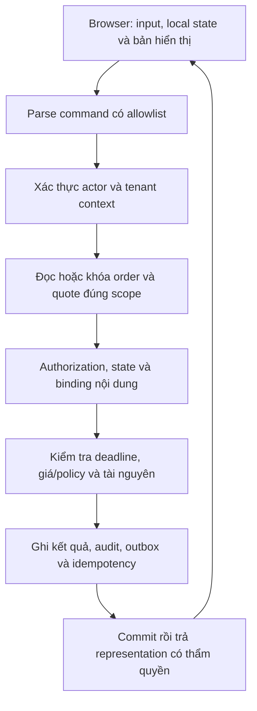

# Untrusted browser state — Không dùng trạng thái trình duyệt làm thẩm quyền nghiệp vụ

## 1. Trình duyệt lưu ý định và bản hiển thị, không quyết định sự thật nghiệp vụ

**Untrusted browser state** là nguyên tắc không coi trạng thái được giữ hoặc gửi từ trình duyệt là căn cứ có thẩm quyền chỉ vì ứng dụng frontend đã tạo, hiển thị hoặc kiểm tra nó.

DOM, hidden field, biến JavaScript, state của framework, localStorage, sessionStorage và các giá trị gửi trong request đều nằm phía client. Người dùng có thể dùng một client khác, thay request hoặc gửi lại dữ liệu cũ mà không đi qua luồng giao diện dự kiến.

Không cần giả định mọi thành phần trình duyệt đều đọc/sửa được bằng JavaScript. Ví dụ cookie `HttpOnly` có giới hạn truy cập script riêng. Nguyên tắc là server phải biết **nguồn và bằng chứng** của từng dữ kiện, không lấy vị trí lưu trên browser làm bằng chứng cấp quyền.

Bài thuộc chương **Client Trust** của module `SECURITY_APPLICATION_SECURITY_BUSINESS_LOGIC_SECURITY`. Trọng tâm là ngăn sửa giá, giả quyền, bỏ qua bước duyệt hoặc thực hiện trùng thông qua trạng thái client.

Ví dụ, frontend đang giữ:

```json
{
  "selectedTenantId": "tenant-a",
  "role": "REVIEWER",
  "canApprove": true,
  "approvalCompleted": true,
  "totalMinorUnits": 100000,
  "workflowStep": 4
}
```

Những giá trị đó có thể giúp dựng giao diện, nhưng không tự chứng minh actor là reviewer, order đã được duyệt, tổng tiền đúng hoặc các bước trước đã hoàn tất.

Backend phải lấy danh tính từ xác thực đã kiểm chứng, xác minh tenant/quyền, đọc trạng thái có thẩm quyền và quyết định operation theo invariant hiện tại.

## 2. Lập bản đồ trạng thái client và nguồn sự thật tương ứng

| Trạng thái trên browser | Có thể phục vụ việc gì? | Nguồn quyết định có thẩm quyền |
| --- | --- | --- |
| DOM, hidden/readonly field | Hiển thị, thu thập lựa chọn | Command đã validate và dữ liệu server |
| Biến `isAdmin`, `canApprove` | Bật/tắt affordance trên UI | Authorization của action trên đúng resource |
| Local draft, cart state | Khôi phục thao tác chưa hoàn tất | Server kiểm tra lại field, reference, quantity và state |
| Giá/tổng tiền tính tại frontend | Ước tính, phản hồi nhanh | Giá/policy hoặc quote server hợp lệ |
| `selectedTenantId` | Yêu cầu chọn không gian làm việc | Membership/service scope đã xác minh |
| `workflowStep`, `approvalCompleted` | Thanh tiến độ, màn hình hiện tại | State machine và quyết định đã lưu |
| `expiresAt`, đồng hồ đếm ngược | Thông báo thời gian còn lại | Deadline và thời gian có thẩm quyền ở backend |
| Version/ETag đã nhận | Precondition phát hiện stale state | Version hiện tại và điều kiện ghi tại server |
| Session ID/token | Vận chuyển credential hoặc bằng chứng | Kiểm chứng credential theo hợp đồng tin cậy |
| Cờ callback/return URL thành công | Điều hướng và hiển thị sơ bộ | Kết quả backend đã xác minh từ nguồn liên quan |

“Client không có thẩm quyền” không có nghĩa mọi dữ liệu client gửi đều vô dụng. Product ID, quantity, ghi chú hoặc version kỳ vọng vẫn có thể là input hợp lệ. Chúng cần được hiểu là **ý định hoặc precondition cần kiểm tra**, không phải kết luận server phải chấp nhận.

## 3. Vì sao cơ chế frontend không tạo ra ranh giới authorization?

### 3.1. Ẩn nút không ngăn gọi action

UI có thể ẩn nút khi user không đủ quyền. Điều này giúp trải nghiệm rõ ràng, nhưng caller vẫn có thể gửi request trực tiếp đến endpoint.

```javascript
// Có thể dùng để hiển thị, không phải kiểm soát cuối cùng.
if (browserState.canApprove) {
  showApproveButton();
}
```

Backend không được bỏ kiểm tra chỉ vì cho rằng chỉ nút đó mới gọi API. Người gửi request có thể chưa tải trang, dùng tab cũ hoặc dùng một chương trình không chạy JavaScript của ứng dụng.

### 3.2. `disabled`, `readonly`, hidden và validation HTML là hỗ trợ UI

Giới hạn `min`, `max`, trường bị khóa hoặc không xuất hiện trong form không khiến server miễn kiểm tra. Các thuộc tính DOM không xác định caller có được sửa giá, ownership hoặc trạng thái hay không.

Một request sửa draft chỉ nên nhận field thuộc command đó. Không bind mọi property của entity vì frontend “không có ô nhập” cho các field nhạy cảm.

### 3.3. Build frontend đúng không chứng minh mọi request đi qua build đó

Minify/obfuscate code, kiểm tra tên ứng dụng, `User-Agent` hoặc header tự đặt không chứng minh caller đã chạy một phiên bản frontend được tin cậy.

HTTPS bảo vệ trao đổi trên đường truyền theo mô hình TLS, không ngăn người ở đầu client tạo request khác. Header `X-Requested-With` hoặc một chuỗi phiên bản app cũng không trở thành quyền phê duyệt trên resource.

### 3.4. Kiểm tra client vẫn có giá trị khi đúng vai trò

Frontend nên validate để báo lỗi sớm, hiển thị quyền từ server và giúp người dùng tránh thao tác không thể hoàn tất. Nhưng những kiểm tra đó là lớp hỗ trợ; backend vẫn thực thi điều kiện tương ứng trước khi tạo tác dụng.

## 4. Browser storage là kho dữ liệu đầu vào, không phải sổ quyền

### 4.1. LocalStorage, sessionStorage và client database

Ứng dụng có thể lưu tùy chọn giao diện hoặc bản nháp để thuận tiện. Khi đọc lại, phải xem đó là dữ liệu có thể sai, cũ hoặc đã bị thay đổi, đặc biệt khi dữ liệu được gửi tiếp đến server.

OWASP cảnh báo dữ liệu trong local storage có thể bị đọc hoặc ghi bởi mã chạy trong ngữ cảnh trang; dữ liệu từ client storage không nên được dùng như bằng chứng xác thực/authorization. [OWASP HTML5 Security Cheat Sheet](https://cheatsheetseries.owasp.org/cheatsheets/HTML5_Security_Cheat_Sheet.html).

Không dùng các khóa sau làm quyền phía server:

```text
localStorage["role"] = "ADMIN"
localStorage["approvedOrderIds"] = [...]
sessionStorage["remainingQuota"] = 999999
IndexedDB record: { approvalRequired: false }
```

Ngay cả giá trị ban đầu do server trả về cũng chỉ là một bản copy nếu client gửi lại sau đó mà không có cơ chế bảo vệ/xác minh thích hợp. Nó có thể không còn phản ánh trạng thái hiện tại.

### 4.2. Mã hóa hoặc encode ở client không tạo nguồn thẩm quyền mới

Base64 hoặc một checksum không bí mật không chứng minh dữ liệu không bị sửa. Nếu client có đầy đủ khóa để tự tạo bằng chứng mà server chấp nhận như quyền, người kiểm soát client có thể dùng cùng khả năng đó.

Mã hóa phục vụ mục tiêu cụ thể của nó; không được suy ra “đã mã hóa nên đã được phép”. Khi cần bảo vệ integrity của state do server phát hành, dùng cơ chế chuẩn với khóa và quá trình xác minh ở phía có thẩm quyền, kèm binding và kiểm tra ngữ cảnh cần thiết.

Không tự phát minh một thuật toán ký state bằng chuỗi bí mật nhúng trong JavaScript để thay authorization.

### 4.3. Đăng xuất hoặc đổi user không tự làm bản nháp trở thành của user mới

Một browser có thể còn local state của tài khoản trước hoặc tenant trước. Namespace cache/draft theo principal và tenant giúp tránh nhầm giao diện, nhưng không thay thế kiểm tra quyền backend.

Khi phục hồi hoặc đồng bộ draft, server phải kiểm tra đúng object, owner/quan hệ, tenant và các field được phép. Không tự upload toàn bộ local object vào entity của phiên đăng nhập mới.

## 5. Cookie và token: kiểm chứng bằng chứng cụ thể, không tin mọi state

### 5.1. Cookie mang session ID khác cookie tự khai role

Một opaque session ID có thể được backend tra cứu để xác định phiên do server quản lý. Việc tin cậy đến từ quá trình kiểm chứng session và policy của hệ thống, không phải từ việc giá trị nằm trong cookie.

Cookie `role=ADMIN` không có kiểm chứng tương ứng không trở thành thẩm quyền. Cookie có chữ ký server có thể bảo vệ một payload cụ thể khỏi sửa trái phép, nhưng quyền trong payload có thể vẫn là snapshot cũ và phải được dùng theo hợp đồng hiệu lực của nó.

### 5.2. Các thuộc tính cookie bảo vệ những mặt khác nhau

| Cơ chế | Tác dụng liên quan | Không tự chứng minh |
| --- | --- | --- |
| `HttpOnly` | Hạn chế script truy cập cookie qua API DOM tương ứng | Mọi request dùng phiên đều đúng nghiệp vụ |
| `Secure` | Giới hạn việc browser gửi cookie qua kết nối bảo mật | Role, giá hoặc workflow state client khai là đúng |
| `SameSite` | Hạn chế gửi cookie trong một số ngữ cảnh cross-site | Quyền trên object hoặc mọi yêu cầu chống CSRF của ứng dụng |

Cookie vẫn có thể được browser gửi khi phát request phù hợp. XSS hoặc CSRF và lỗi tin state nghiệp vụ là các rủi ro có liên quan nhưng cần kiểm soát riêng. OWASP giải thích rõ phạm vi của các thuộc tính cookie và việc TLS không ngăn client-side tampering. [OWASP Session Management Cheat Sheet](https://cheatsheetseries.owasp.org/cheatsheets/Session_Management_Cheat_Sheet.html).

### 5.3. Decode JWT không phải validate JWT

Đọc được payload chỉ cho biết token khai gì. Backend cần kiểm chứng token theo profile đã chọn: khóa/thuật toán được phép, issuer và bên nhận phù hợp, subject, hiệu lực thời gian và các ràng buộc cần thiết.

RFC 8725 nhấn mạnh kiểm tra issuer/subject và audience để tránh dùng token trong ngữ cảnh không được định trước. Điều đó vẫn không biến mọi claim nghiệp vụ thành quyền vô điều kiện trên mọi resource. [RFC 8725: JWT Best Current Practices](https://www.rfc-editor.org/rfc/rfc8725.html#section-3.8).

Không nhận một access token, quote token và confirmation token như cùng một loại bằng chứng chỉ vì đều là chuỗi có chữ ký. Mỗi loại cần mục đích, nơi cấp, bên nhận và quy tắc sử dụng riêng.

## 6. Phân loại input: ý định, precondition và bằng chứng có ràng buộc

### 6.1. Ý định hợp lệ vẫn phải được server quyết định

Ví dụ người dùng chọn sản phẩm, quantity hoặc địa chỉ giao trong tập được phép. Backend parse/validate và kiểm tra quyền sử dụng các reference đó.

Các trường `isAdmin`, `approvedBy`, `remainingLimit`, `total` hoặc `skipApproval` không được gán vào entity chỉ vì frontend gửi chúng cùng các field hợp lệ.

### 6.2. Version là precondition, không phải version mới do client đặt

Client gửi `expectedVersion = 12` để nói “tôi đang thao tác trên bản 12”. Server so với version hiện tại khi ghi; nếu đã khác thì xử lý conflict theo hợp đồng.

Không copy `expectedVersion` hoặc một field `version` vào entity rồi coi lần lưu là hợp lệ. Tương tự, `clientObservedAt` có thể hỗ trợ điều tra nhưng không thay thế thời gian server để quyết định hết hạn.

### 6.3. Bằng chứng server phát hành cần được dùng đúng phạm vi

Một quote đã được server chốt có thể là cơ sở giá nếu policy cho cố định giá trong một cửa sổ. Nhưng phải xác minh nó thuộc đúng tenant, object/nội dung, người hoặc phạm vi được phép sử dụng, currency và action.

Không bắt buộc mọi thứ phải tải lại từ một giá hiện hành nếu hợp đồng quote cho phép giữ giá cũ. Điều quan trọng là dùng đúng nguồn được phép và điều kiện hiệu lực, không tin một con số client tự ghi là “giá đã chốt”.

## 7. State machine phía server ngăn giả tiến độ workflow

### 7.1. Màn hình bước cuối không chứng minh đã qua các bước trước

Một SPA có thể lưu `currentStep = 4`, `reviewed = true` hoặc `approvalCompleted = true`. Caller có thể mở thẳng route cuối hoặc gửi request cuối trước khi thực hiện các bước còn lại.

Backend cần lưu và kiểm tra precondition của transition:

```text
CONFIRM được chấp nhận
    => trạng thái nguồn cho phép
    AND nội dung/version đúng
    AND các phê duyệt bắt buộc hợp lệ
    AND actor có quyền trên đúng resource
    AND các điều kiện thời gian/tài nguyên đạt.
```

Không lấy `workflowStep`, cờ review hoặc cờ approval trong browser làm bằng chứng cho các điều kiện đó.

### 7.2. Dữ liệu được duyệt phải là dữ liệu được sử dụng

Nếu người dùng được yêu cầu xác nhận tổng tiền hoặc reviewer duyệt một snapshot, quantity, giá, người nhận và những dữ kiện có ý nghĩa phải được bind đúng vào quyết định.

Thay một local object sau khi preview rồi gửi đến action cuối không được làm thay đổi nội dung đã được chấp thuận mà không có kiểm tra lại. Server cần dùng dữ liệu đã chốt hoặc phát hiện version/hash không còn phù hợp.

OWASP khuyến nghị thực thi transaction authorization ở server và có kiểm tra gắn với bước thực thi cuối, thay vì để client quyết định kết quả ủy quyền bằng các tham số điều khiển. [OWASP Transaction Authorization Cheat Sheet](https://cheatsheetseries.owasp.org/cheatsheets/Transaction_Authorization_Cheat_Sheet.html).

### 7.3. Deadline không phụ thuộc đồng hồ đếm ngược của client

Browser có thể có giờ sai hoặc giữ một tab qua deadline. Việc dừng JavaScript, sửa `expiresAt` hay mở lại trang không làm quyền hành động kéo dài.

Backend kiểm tra thời gian từ nguồn có thẩm quyền tại điểm quyết định được policy định nghĩa, đặc biệt sau các bước có thể phải chờ khóa. Không coi một countdown còn dương trên UI là lý do tiếp tục.

## 8. Một luồng xác nhận đơn không nhận sự thật từ browser

### 8.1. Public command nhỏ và có ý nghĩa rõ

Ví dụ body xác nhận chỉ gồm:

```java
public record ConfirmOrderBody(
    @NotNull UUID quoteId,
    @NotNull @Min(0) Long expectedVersion
) {}
```

Order ID lấy từ route như một selector; idempotency key lấy từ vị trí đã quy định. Actor được dựng từ credential đã kiểm chứng, tenant được chọn và xác minh theo policy.

Command không có `total`, `approvalCompleted`, `actorId`, `newState`, `remainingStock` hoặc `confirmed = true`. Với hợp đồng strict, field ngoài tập cho phép bị từ chối bởi adapter/parser đã cấu hình và kiểm thử tương ứng.

### 8.2. Ranh giới tin cậy của luồng



Response server giúp frontend cập nhật lại bản hiển thị. Nếu người dùng sửa response hoặc local state, lần command tiếp theo vẫn phải qua cùng ranh giới kiểm tra.

### 8.3. Khung application service Java

Ví dụ dùng `TransactionTemplate` của Spring; repository và policy là hợp đồng minh họa, không phải chương trình hoàn chỉnh có thể chép chạy ngay.

```java
public ConfirmationReceipt confirm(
        ConfirmOrderCommand cmd, TrustedActor actor) {

    return transactions.execute(tx -> {
        VerifiedTenantContext tenant = tenantContexts.resolve(
            actor, cmd.selectedTenantId());

        PurchaseOrder order = orders.lockByTenant(tenant, cmd.orderId());
        receiptAccess.requireReadable(actor, tenant, order);

        IdempotencyClaim claim = idempotency.claim(
            tenant.id(), actor.principalId(), "CONFIRM_ORDER",
            cmd.idempotencyKey(), fingerprints.confirmOrder(cmd));

        if (claim.isCompleted()) {
            return claim.originalReceipt();
        }

        authorization.requireCanConfirm(actor, tenant, order);
        order.requireExpectedVersion(cmd.expectedVersion());
        workflow.requireReadyForConfirmation(actor, order);

        StoredQuote quote = quotes.lockByTenantAndOrder(
            tenant, order.id(), cmd.quoteId());

        resources.lockForConfirmation(tenant, order);
        Instant decisionAt = databaseClock.currentInstant();

        quoteRules.requireUsableAt(
            quote, actor, tenant, order, decisionAt);
        resourceRules.requireAvailableFor(order);

        resources.reserveAlreadyLockedOrThrow(tenant, order);
        orders.confirmWithQuoteOrThrow(order, quote, decisionAt);
        quotes.markConsumedOrThrow(quote, order);

        ConfirmationReceipt receipt = audit.appendOrderConfirmed(
            tenant, actor, order, quote, decisionAt);
        outbox.appendOrderConfirmed(receipt);
        idempotency.complete(claim, receipt);
        return receipt;
    });
}
```

Các hợp đồng cần hiểu rõ:

- Tenant/order/quote được truy vấn đúng scope; ID trong command không tự chứng minh quyền sở hữu hoặc quyền sử dụng.
- `workflow` đọc trạng thái và các quyết định được lưu, không nhận cờ hoàn thành từ browser.
- `quoteRules` kiểm tra binding nội dung/version/currency và điều kiện giá, actor/phạm vi, thời hạn, trạng thái chưa tiêu thụ theo profile quote của ví dụ.
- Những hàng tài nguyên cần thiết được khóa theo thứ tự thống nhất trước điểm kiểm tra cuối. Mô hình một database không tự bao trùm HTTP hoặc service bên ngoài.
- Quantity dùng để giữ tồn và nội dung được xác nhận đến từ order/quote đã được server chốt, không từ một local object bổ sung gửi kèm.
- State/version, reservation, quote consumption, audit, outbox và kết quả idempotency cùng commit hoặc cùng rollback. Kiểm tra số hàng cập nhật phù hợp và không nuốt exception lưu dữ liệu.
- Nhánh replay yêu cầu quyền đọc receipt hiện tại theo policy đã chọn; nó không tạo thêm lần xác nhận hoặc tự chuyển state lần nữa.

Nếu quyền hoặc tài nguyên còn dựa vào nguồn ngoài/cache, cần định nghĩa độ mới và giao thức tương ứng. Chỉ đặt code trong transaction không tạo ra bảo đảm nguyên tử với mọi nguồn đó.

## 9. Signed browser state có thể tin đến mức nào?

### 9.1. Integrity không phải mọi loại thẩm quyền

Giả sử server ký một state chứa order ID, content hash, total và expiry rồi gửi browser giữ. Khi nhận lại, server có thể kiểm chứng bằng chứng đó theo profile đã định nghĩa.

Điều này khác việc tin raw JSON từ localStorage. Nhưng chữ ký chỉ có ý nghĩa nếu khóa, thuật toán, nơi cấp, mục đích và quy trình verify đúng. Nó cũng không tự giải quyết mọi thay đổi xảy ra sau lúc phát hành.

### 9.2. Những kiểm tra ngữ cảnh vẫn cần có

| Thuộc tính | Câu hỏi cần kiểm chứng |
| --- | --- |
| Mục đích/token type | Đây là quote, session hay xác nhận action nào? |
| Tenant và resource | Có đúng phạm vi và object đang được thao tác không? |
| Nội dung/version | Quantity và các dữ kiện được ký có khớp nội dung được sử dụng không? |
| Subject hoặc quyền sử dụng | Caller này có được dùng bằng chứng đó không? |
| Thời gian | Còn trong cửa sổ hiệu lực theo nguồn server không? |
| Trạng thái | Order đã hủy, quote đã tiêu thụ hoặc workflow đã đóng chưa? |
| Replay | Cùng bằng chứng có thể bị dùng tạo thêm tác dụng không? |
| Độ mới của quyền | Việc đổi owner, thu hồi role hoặc membership ảnh hưởng thế nào? |

Nếu cần one-time use, trạng thái tiêu thụ hoặc cơ chế tương đương phải được thực thi nguyên tử. Một field `used = true` chỉ lưu trong browser không ngăn copy token sang nơi khác và gửi lại.

### 9.3. Opaque reference cũng cần scope và authorization

Một quote ID khó đoán hoặc session ID ngẫu nhiên không có ý nghĩa “ai biết thì làm gì cũng được”, trừ khi hệ thống chủ đích thiết kế capability như vậy với giới hạn rõ.

Khi dùng reference, tra đúng dữ liệu server và xác minh quan hệ/quyền. Khi dùng self-contained state, verify đúng bằng chứng và điều kiện sử dụng. Cả hai đều có mô hình thu hồi, stale state và replay cần được thiết kế.

## 10. Tab cũ, offline state và optimistic UI

### 10.1. Một browser trung thực vẫn có thể gửi dữ liệu cũ

Không cần có attacker: người dùng mở hai tab, quay lại trang cũ, mất mạng hoặc phục hồi session có thể tạo request dựa trên state không còn hiện tại.

Ví dụ tab A thấy order version 12. Tab B đổi quantity và server lưu version 13. Tab A gửi xác nhận version 12 phải được xử lý theo precondition/policy quote, không ghi đè quantity mới hoặc dùng quote cũ im lặng.

Conflict cần làm frontend tải lại và cho người dùng hiểu nội dung thay đổi. Server không nên tự chọn một bản local có lợi để làm action thành công.

### 10.2. Optimistic UI không tạo commit

Frontend có thể hiển thị “đang lưu” hoặc cập nhật tạm thời để phản hồi nhanh. Trạng thái hiển thị đó phải được điều chỉnh theo kết quả có thẩm quyền từ backend.

Không coi việc một promise ở client đã resolve, một callback JavaScript đã chạy hoặc một flag đã được set là bằng chứng transaction nghiệp vụ đã commit. Với request mất response, kết quả có thể chưa biết; client nên tra cứu/retry đúng idempotency key thay vì tạo operation mới.

### 10.3. Offline sync là một command mới cần kiểm tra

Khi browser gửi hàng loạt thay đổi offline, mỗi thay đổi cần được kiểm tra quyền, state, version và field allowlist theo hợp đồng sync.

Không merge toàn bộ object cache lên entity, đặc biệt với role, owner, approval state, tổng tiền và timestamp có thẩm quyền. Các xung đột không được “giải quyết” bằng cách cho bản client mới nhất theo giờ máy tự ghi đè mọi dữ liệu.

### 10.4. Dữ liệu đã xem không thể thu hồi bằng cách đổi UI

Khi quyền bị thu hồi, backend phải ngăn các lần truy cập/tác dụng mới theo policy độ mới. Nó không thể làm người dùng quên dữ liệu đã đọc hoặc hủy mọi bản tải xuống chỉ bằng việc ẩn màn hình.

Ứng dụng cần chính sách lưu/cache phù hợp với độ nhạy cảm. Chỉ đổi cờ local `loggedOut` hoặc xóa một object client không phải bằng chứng session/credential phía server đã hết hiệu lực.

## 11. Các cơ chế browser bổ trợ bảo vệ những gì?

| Cơ chế | Giá trị bảo vệ | Giới hạn đối với client trust |
| --- | --- | --- |
| HTTPS | Bảo vệ trao đổi trên đường truyền | Không chứng minh input do một UI cụ thể tạo ra |
| Same-origin/CORS | Kiểm soát một số tương tác cross-origin của browser | Không thay authorization của caller trên resource |
| CSRF protection | Ràng buộc request với ngữ cảnh chống giả mạo theo thiết kế | Không làm quantity/giá/quyết định client khai thành đúng |
| XSS prevention/CSP phù hợp | Giảm khả năng mã không mong muốn chạy trong trang | Không thay kiểm tra backend nếu caller tự gửi request |
| HttpOnly/session controls | Bảo vệ một phần credential và vòng đời phiên | Không cấp quyền bỏ qua state machine |
| Frontend validation | Cải thiện UX, chặn lỗi thông thường sớm | Không là kiểm soát cuối cho command nghiệp vụ |

Không nên loại bỏ các lớp bảo vệ này vì backend đã validate. Cũng không dùng sự hiện diện của chúng để bỏ authorization, kiểm tra nội dung hoặc idempotency ở server.

Một request có `Origin` trông đúng, header ứng dụng đúng và session hợp lệ vẫn có thể yêu cầu action sai quyền hoặc dùng state cũ. Điều cần xét là credential và command có được phép trong context hiện tại hay không.

## 12. Kiểm thử bằng cách thay state, bỏ UI và gửi lại dữ liệu cũ

### 12.1. Thiết lập baseline có thể đối soát

Chuẩn bị một order, quyền actor, quote/version và trạng thái workflow rõ ràng. Gửi request hợp lệ trước để biết dữ liệu, reservation và event mong đợi.

Sau đó thay trạng thái client hoặc request mà không thay bằng chứng server tương ứng. Mục tiêu là chứng minh backend tự giữ invariant, kể cả khi frontend cung cấp kết luận sai.

| Tình huống | Kết quả cần bảo đảm |
| --- | --- |
| Đổi `canApprove`, `isAdmin` hoặc role trong state/storage | Không tăng quyền backend |
| Bỏ `disabled`, sửa hidden/readonly field | Không ghi field hoặc action ngoài thẩm quyền |
| Mở route cuối hoặc giả `workflowStep` | Không bỏ qua precondition ở server |
| Gửi `approvalCompleted = true` khi chưa có quyết định | Không được coi là đã duyệt |
| Sửa total, currency hoặc unit price trên browser | Không thay nguồn giá có thẩm quyền |
| Sửa tenant selector hoặc resource ID | Membership và quyền object vẫn được kiểm tra |
| Dùng draft/storage của user hoặc tenant trước | Không merge dữ liệu ngoài quyền vào phiên hiện tại |
| Chỉ decode token, thay payload hoặc dùng token sai mục đích | Verify/profile/context chặn bằng chứng không hợp lệ |
| Cookie tự khai role hoặc claim chưa được kiểm chứng | Không được dùng làm authorization |
| Quote đúng integrity nhưng của order/actor/tenant khác | Bị binding/authorization chặn |
| Quote đúng chữ ký nhưng hết hạn, bị dùng hoặc object đã hủy | Không tạo tác dụng mới |
| Đổi quantity sau lúc lấy quote hoặc duyệt | Không sử dụng quyết định cho nội dung khác |
| Sửa đồng hồ máy/countdown | Không gia hạn deadline server |
| Quyền bị thu hồi sau khi mở trang | Lần thực thi tuân policy quyền hiện tại/độ mới đã cam kết |
| Hai tab có version khác nhau | Không ghi đè hoặc xác nhận nội dung lỗi thời |
| Gửi request trực tiếp không tải frontend | Cùng authorization và invariant được thực thi |
| Frontend hiển thị thành công nhưng transaction rollback | State/receipt server vẫn phản ánh thất bại/chưa commit |
| Mất response sau commit rồi retry cùng key | Không xác nhận, giữ tồn hoặc phát event thêm lần nữa |
| Dùng key mới để replay cùng quote/order | State/one-time use và constraint vẫn ngăn tác dụng lặp |
| Offline sync có field server-only | Không mass assignment vào entity |
| Lỗi kiểm chứng token hoặc nguồn quyền không đủ bằng chứng | Không fallback sang cờ/quyền từ browser |
| Cookie có các thuộc tính bảo vệ nhưng payload nghiệp vụ sai | Backend vẫn từ chối theo quyền/giá trị/workflow |

### 12.2. Kiểm tra dữ liệu và tác dụng, không chỉ giao diện

Với request bị chặn, đối soát tenant/owner/state/version, quyết định phê duyệt, tổng tiền, reservation, idempotency và outbox. Không được có thay đổi nghiệp vụ trái phép dù UI có hiển thị lỗi sau đó.

Với request thành công, actor, thời gian và dữ liệu có thẩm quyền phải đến từ nguồn đúng. Không ghi audit như thể giá trị client khai là sự thật server đã xác minh nếu chưa có bằng chứng.

Đối với concurrency, dùng transaction thật hoặc môi trường tích hợp phù hợp để tạo tranh chấp giữa thay nội dung, hết hạn, thu hồi quyền và xác nhận. Một test chỉ sửa localStorage rồi quan sát nút ẩn/hiện không chứng minh backend an toàn.

### 12.3. Log đủ để điều tra mà không sao chép bí mật

Audit có thể lưu action, actor/tenant đã xác minh, object/version, quote reference, reason code, policy version và command/correlation ID. Nếu cần giữ timestamp client, đặt tên cho biết đó là dữ liệu quan sát chưa có thẩm quyền.

Không log access token, session ID, toàn payload hoặc local storage dump chỉ để chứng minh state client bị sửa. Giới hạn kích thước và quyền đọc dữ liệu điều tra.

Các khung Java và ma trận trong bài mang tính thiết kế; chúng chưa được chạy như một ứng dụng hoàn chỉnh.

## 13. Bài tập áp dụng

Một SPA giữ role, tenant hiện tại, order total, approval flag và quote trong localStorage. Frontend chỉ bật nút xác nhận khi `approvalCompleted = true`. Sau khi mở trang, user bị thu hồi role, một tab khác sửa quantity và quote cũng hết hạn. User gửi lại request cũ bằng công cụ khác với total nhỏ hơn.

Hãy thiết kế:

1. Những field nào chỉ là dữ liệu hiển thị/ý định và những dữ kiện nào cần bằng chứng hoặc nguồn server?
2. Public command xác nhận nên nhận những input tối thiểu nào và actor/tenant được lấy ở đâu?
3. State, content version, quote, deadline và quyền được kiểm tra ở điểm nào trước tác dụng cuối?
4. Chữ ký quote bảo vệ điều gì và không tự bảo vệ điều gì trong tình huống này?
5. Cách xử lý tab cũ, conflict và mất response nào giữ được nội dung người dùng đã đồng ý mà không thực thi lặp?
6. Cookie, CORS, CSRF protection và frontend validation giúp ở lớp nào, còn invariant nào backend vẫn phải tự giữ?
7. Những bản ghi và phép kiểm thử nào chứng minh server không tin cờ hoặc số tiền do browser tự kết luận?

Không tin browser state là giữ ranh giới giữa ý định của client và thẩm quyền quyết định của server. Dữ liệu có thể được nhận, lưu tạm hoặc mang bằng chứng được bảo vệ, nhưng chỉ được dùng tạo tác dụng nghiệp vụ sau khi nguồn, phạm vi, hiệu lực và invariant liên quan đã được kiểm chứng.
